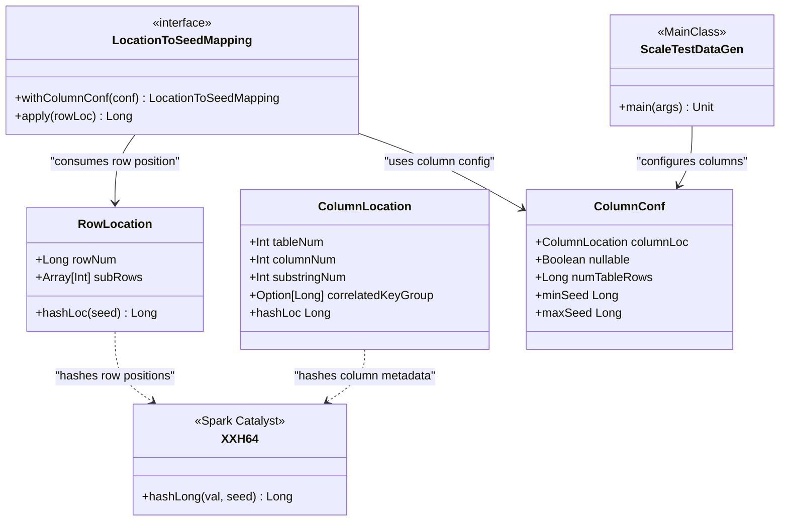
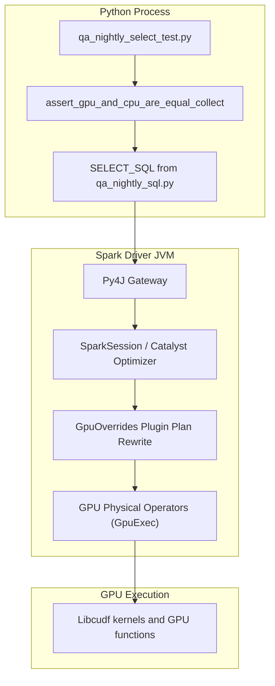

<!-- source: DeepWiki mcp.deepwiki.com · repo NVIDIA/cudf-spark · page 13.3 Scale Testing & Data Generation · fetched 2026-10-26 -->

# Scale Testing & Data Generation

<details>
<summary>Relevant source files</summary>

The following files were used as context for generating this wiki page:

- [datagen/src/main/scala/org/apache/spark/sql/tests/datagen/bigDataGen.scala](datagen/src/main/scala/org/apache/spark/sql/tests/datagen/bigDataGen.scala)
- [integration_tests/src/main/python/qa_nightly_select_test.py](integration_tests/src/main/python/qa_nightly_select_test.py)
- [integration_tests/src/main/python/qa_nightly_sql.py](integration_tests/src/main/python/qa_nightly_sql.py)
- [jenkins/databricks/install_deps.py](jenkins/databricks/install_deps.py)

</details>


The RAPIDS Accelerator for Apache Spark incorporates a comprehensive infrastructure for large-scale validation, performance benchmarking, and synthetic data generation. This infrastructure facilitates stress testing of GPU-accelerated Spark operations under extreme conditions such as high data cardinality, skew, and volume that exceed typical unit test scopes.

---

## Data Generation Module (`datagen`)

The `datagen` module contains a sophisticated, deterministic synthetic data generator constructed to produce scalable, reproducible datasets tailored for GPU testing scenarios. It leverages a hierarchical location tracking system to generate consistent data distributions across distributed Spark tasks.

### Core Implementation: `bigDataGen.scala`

Located at `datagen/src/main/scala/org/apache/spark/sql/tests/datagen/bigDataGen.scala` [datagen/src/main/scala/org/apache/spark/sql/tests/datagen/bigDataGen.scala:1-3279](), the core data generation engine organizes positional tracking logic and seed derivation to ensure consistent data production.

#### Key Classes and Traits:

- **`RowLocation`**
  Tracks the current row position, including indexing into nested sub-rows for complex data types like arrays. It offers a `hashLoc` method that hashes the row and sub-row indices into a single 64-bit seed using `XXH64`. This ensures row-position-aware deterministic data generation.
  [datagen/src/main/scala/org/apache/spark/sql/tests/datagen/bigDataGen.scala:45-74]()

- **`ColumnLocation`**
  Represents the location of a column in a table, including table number, column index, and substring index (for substring columns). Supports optional correlation via `correlatedKeyGroup` to enforce data correlation across columns belonging to a key group, critical for producing joined or grouped data that is consistent.
  [datagen/src/main/scala/org/apache/spark/sql/tests/datagen/bigDataGen.scala:87-106]()

- **`ColumnConf`**
  Holds column metadata and constraints: nullable flag, total number of rows in the table, and seed range for value generation. Supports derivation of configurations for subsequent columns and substrings, as well as special configs for null generation and correlated key groups.
  [datagen/src/main/scala/org/apache/spark/sql/tests/datagen/bigDataGen.scala:117-153]()

- **`LocationToSeedMapping`**
  Abstract trait that defines how to map a `RowLocation` and column configuration to a random seed long value used for value generation. Implementations can inject skew or specific distributions by manipulating seed ranges.
  [datagen/src/main/scala/org/apache/spark/sql/tests/datagen/bigDataGen.scala:162-175]()

### ScaleTestDataGen Entry Point

The class `com.nvidia.rapids.tests.scaletest.ScaleTestDataGen` acts as the main entry point Spark application for data generation. Users run it via `spark-submit` with parameters controlling data scale, complexity, output format, and destination path.
[datagen/ScaleTest.md:15-33]()

Typical CLI arguments:

| Parameter | Description |
|---|---|
| `scale factor` | Multiplier defining overall data size, e.g., "1" means base scale; affects row counts per table. |
| `complexity` | Complexity controls number of columns and data distribution intricacies. |
| `format` | Output data file format, such as `parquet` or `orc`. |
| `output directory` | Target directory for generated data files. |
| `--seed` (optional) | Seed for random data generation for reproducibility (default is 41).|
| `--tables` (optional)| Restrict generation to specific tables by name. |
| `--overwrite` (flag) | Allow overwriting existing data at the specified path. |

Example submission command:

```bash
$SPARK_HOME/bin/spark-submit \
  --master spark://<SPARK_MASTER>:7077 \
  --conf spark.driver.memory=10G \
  --conf spark.executor.memory=32G \
  --conf spark.sql.parquet.int96RebaseModeInWrite=CORRECTED \
  --conf spark.sql.parquet.datetimeRebaseModeInWrite=CORRECTED \
  --class com.nvidia.rapids.tests.scaletest.ScaleTestDataGen \
  --jars $SPARK_HOME/examples/jars/scopt_2.12-3.7.1.jar \
  ./target/datagen_2.12-26.12.0-SNAPSHOT-spark332.jar \
  1 10 parquet /path/to/output
```
[datagen/ScaleTest.md:39-52]()

### Architecture Mapping: Data Generation Components



Sources: [datagen/src/main/scala/org/apache/spark/sql/tests/datagen/bigDataGen.scala:45-175](), [datagen/ScaleTest.md:15-56]()

---

## ScaleTest Framework

This framework integrates the data generation module and a suite of SQL queries to benchmark and validate GPU-accelerated Spark under demanding workloads.

### Table Schemas

The suite generates a set of predefined tables with strong schema and row count patterns. Each table scales in row count relative to the overall scale factor.

| Table | Rows @ SF=1 | Notable Columns and Features |
|---|---|---|
| `a_facts` | 10,000 | Primary key (`primary_a`), numeric columns with low cardinality |
| `b_data` | 1,000,000 | Foreign key to `a_facts.primary_a` (~99% overlap), 3-column composite key |
| `c_data` | 100,000 | Foreign key to `a_facts.primary_a` (~50% overlap), variable key group columns |
| `d_data` | 100,000 | Similar to `c_data`, lesser overlap for join tests |
| `e_data` | 1,000,000 | High-cardinality composite keys overlapping with `b_data` |
| `f_facts` | 10,000 | Complex correlated low-unique columns for join skew testing |

Sources: [datagen/ScaleTest.md:65-127]()

### Query Sets

A detailed suite of queries targets various GPU accelerated Spark operators such as joins, aggregations, and window functions. The queries stress complex join patterns, skew scenarios, grouping, and aggregation.

| Query ID(s) | Operators Targeted | Description | Source Lines |
|---|---|---|---|
| q1 - q3 | `GpuHashJoin` | Inner, full outer, and left outer joins with many ride-along columns | [integration_tests/ScaleTest.md:23-25]() |
| q6 - q10 | `GpuHashJoin`, `GpuHashAggregate` | Large key equi-joins with min/max aggregations | [integration_tests/ScaleTest.md:28-32]() |
| q16 - q20 | `GpuHashJoin` with AST conditions | Skew and conditional join filters using Catalyst AST expressions | [integration_tests/ScaleTest.md:38-42]() |
| q22 - q24 | `GpuHashAggregate` | Large cardinality group-by aggregations with complex numeric ops | [integration_tests/ScaleTest.md:44-46]() |
| q27 - q28 | `GpuWindowExec` | Running and ranged window operations with skewed partition keys | [integration_tests/ScaleTest.md:49-50]() |

Sources: [integration_tests/ScaleTest.md:5-50]()

---

## Mortgage Benchmark Tests

The mortgage benchmark tests validate GPU handling of complex, real-world-like pipelines modeled on Fannie Mae Single-Family Loan performance datasets. These benchmarks simulate multi-table ETL workflows including normalization and multi-file reads.

### Implementation Overview

The tests are implemented primarily in two suites:

- `MortgageSparkSuite` tests basic functionality around multiple mortgage-related tables and schema.
- `MortgageAdaptiveSparkSuite` includes tests for adaptive query execution behaviors with mortgage data.

These suites stress GPU-based columnar reads and join processing for complex schema and large datasets.
Sources: [integration_tests/src/test/scala/com/nvidia/spark/rapids/tests/mortgage/MortgageSparkSuite.scala:25-116](), [integration_tests/src/test/scala/com/nvidia/spark/rapids/tests/mortgage/MortgageAdaptiveSparkSuite.scala:18-20]()

---

## QA Nightly SQL Test Suite

The `qa_nightly` suite is a Python-driven testing framework focused on exhaustive GPU-accelerated Spark SQL expression coverage and stability.

### Architecture and Data Flow

The suite uses Pytest to execute a curated set of SQL queries in Spark sessions, comparing GPU and CPU operator outputs for correctness verification.



Sources: [integration_tests/src/main/python/qa_nightly_select_test.py:30-63](), [integration_tests/src/main/python/qa_nightly_sql.py:17-135]()

### Test Coverage

- The test table defined in `num_stringDf` generates a DataFrame with diverse types: `strF`, `byteF`, `shortF`, `intF`, `longF`, `floatF`, `doubleF`, `decimalF`, `booleanF`, `timestampF`, and `dateF`. This table is registered as a temp view for SQL query execution.
  [integration_tests/src/main/python/qa_nightly_select_test.py:30-63]()

- The corresponding SQL queries in `qa_nightly_sql.py` extensively exercise Spark SQL mathematical functions such as `abs`, `acosh`, `asin`, `atan`, `atanh`, `cbrt`, `ceil`, `cos`, `cot`, `exp`, `log10`, `pow`, and many more, ensuring operator correctness and GPU compatibility on large datasets.
  [integration_tests/src/main/python/qa_nightly_sql.py:17-135]()

Sources: [integration_tests/src/main/python/qa_nightly_select_test.py:30-63](), [integration_tests/src/main/python/qa_nightly_sql.py:17-135]()

---

# Summary

This scale testing and data generation infrastructure is critical for robust validation of GPU-accelerated Spark SQL. The `datagen` module provides deterministic, scalable synthetic data, while the ScaleTest framework combines this data with complex query sets to benchmark performance and correctness. The mortgage benchmarks target real-world-like workloads, and the Python-driven `qa_nightly` SQL suite validates a broad spectrum of Spark SQL functions on GPU.

Sources:
- [datagen/src/main/scala/org/apache/spark/sql/tests/datagen/bigDataGen.scala:1-176]()
- [datagen/ScaleTest.md:1-123]()
- [integration_tests/ScaleTest.md:1-125]()
- [integration_tests/src/main/python/qa_nightly_sql.py:1-135]()
- [integration_tests/src/main/python/qa_nightly_select_test.py:1-127]()
- [integration_tests/src/test/scala/com/nvidia/spark/rapids/tests/mortgage/MortgageSparkSuite.scala:25-116]()
- [integration_tests/src/test/scala/com/nvidia/spark/rapids/tests/mortgage/MortgageAdaptiveSparkSuite.scala:18-20]()

---

