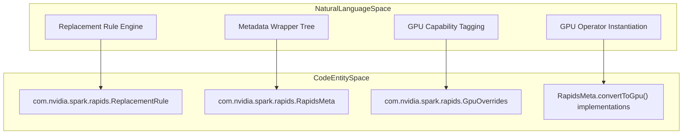
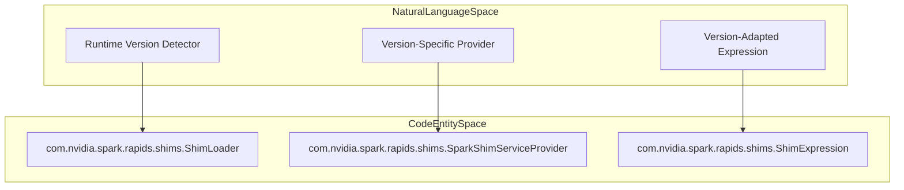
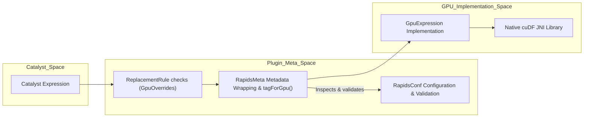
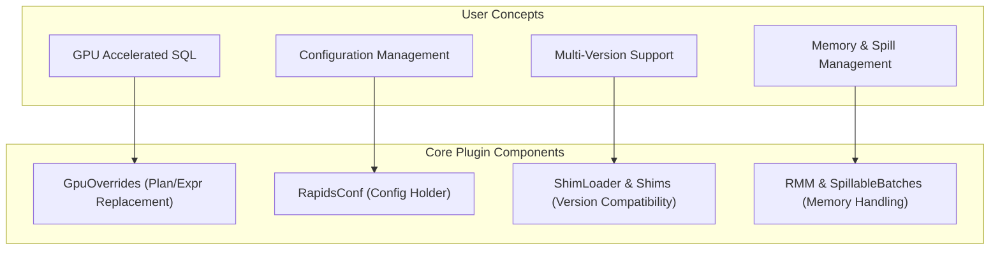

<!-- source: DeepWiki mcp.deepwiki.com · repo NVIDIA/cudf-spark · page 14 Glossary · fetched 2026-10-26 -->

# Glossary

Relevant source files

The following files were used as context for generating this wiki page:

- [aggregator/pom.xml](aggregator/pom.xml)
- [api_validation/pom.xml](api_validation/pom.xml)
- [dist/pom.xml](dist/pom.xml)
- [docs/additional-functionality/advanced_configs.md](docs/additional-functionality/advanced_configs.md)
- [docs/configs.md](docs/configs.md)
- [docs/dev/shims.md](docs/dev/shims.md)
- [docs/supported_ops.md](docs/supported_ops.md)
- [integration_tests/pom.xml](integration_tests/pom.xml)
- [integration_tests/src/main/python/data_gen.py](integration_tests/src/main/python/data_gen.py)
- [integration_tests/src/main/python/hash_aggregate_test.py](integration_tests/src/main/python/hash_aggregate_test.py)
- [integration_tests/src/main/python/window_function_test.py](integration_tests/src/main/python/window_function_test.py)
- [jenkins/databricks/init_cudf_udf.sh](jenkins/databricks/init_cudf_udf.sh)
- [jenkins/version-def.sh](jenkins/version-def.sh)
- [pom.xml](pom.xml)
- [scala2.13/aggregator/pom.xml](scala2.13/aggregator/pom.xml)
- [scala2.13/dist/pom.xml](scala2.13/dist/pom.xml)
- [scala2.13/pom.xml](scala2.13/pom.xml)
- [scala2.13/shuffle-plugin/pom.xml](scala2.13/shuffle-plugin/pom.xml)
- [scala2.13/sql-plugin/pom.xml](scala2.13/sql-plugin/pom.xml)
- [scala2.13/tests/pom.xml](scala2.13/tests/pom.xml)
- [scala2.13/udf-compiler/pom.xml](scala2.13/udf-compiler/pom.xml)
- [shuffle-plugin/pom.xml](shuffle-plugin/pom.xml)
- [sql-plugin/pom.xml](sql-plugin/pom.xml)
- [sql-plugin/src/main/scala/com/nvidia/spark/rapids/GpuOverrides.scala](sql-plugin/src/main/scala/com/nvidia/spark/rapids/GpuOverrides.scala)
- [sql-plugin/src/main/scala/com/nvidia/spark/rapids/Plugin.scala](sql-plugin/src/main/scala/com/nvidia/spark/rapids/Plugin.scala)
- [sql-plugin/src/main/scala/com/nvidia/spark/rapids/RapidsConf.scala](sql-plugin/src/main/scala/com/nvidia/spark/rapids/RapidsConf.scala)
- [sql-plugin/src/main/scala/com/nvidia/spark/rapids/RapidsConfEntries.scala](sql-plugin/src/main/scala/com/nvidia/spark/rapids/RapidsConfEntries.scala)
- [tests/pom.xml](tests/pom.xml)
- [udf-compiler/pom.xml](udf-compiler/pom.xml)

## Purpose and Scope

This wiki page provides definitions for codebase-specific terms, abbreviations, and domain concepts essential for engineers onboarding to the RAPIDS Accelerator for Apache Spark. It includes direct pointers to key underlying code implementations, configuration classes, and architecture files.

---

## 1. Core Concepts & Plan Replacement

The RAPIDS Accelerator intercepts Spark's physical planning phase to substitute CPU `SparkPlan` nodes and Catalyst expressions with GPU-accelerated counterparts (`GpuExec` and `GpuExpression`).

- **ReplacementRule**:  
  An abstract base class defining rules for replacing a SparkPlan or Expression with a GPU equivalent. It manages metadata, compatibility checks, descriptions, and configuration keys, wrapping nodes with `RapidsMeta` instances that perform detailed compatibility analysis [sql-plugin/src/main/scala/com/nvidia/spark/rapids/GpuOverrides.scala:69-177]().
  
- **GpuOverrides**:  
  The central registry and engine for all replacement rules. It enumerates supported Spark plans, expressions, and data source scan nodes that can be replaced with GPU-specific implementations. It drives tagging and conversion to GPU operators [sql-plugin/src/main/scala/com/nvidia/spark/rapids/GpuOverrides.scala:69-186]().
  
- **RapidsMeta**:  
  A metadata hierarchy of classes shadowing the SparkPlan and Expression tree during query planning. Each `RapidsMeta` instance analyzes node input types, configuration, and children recursively to decide GPU compatibility, fallback necessity, and resource requirements [sql-plugin/src/main/scala/com/nvidia/spark/rapids/GpuOverrides.scala:69-177]().

- **tagForGpu**:  
  A key recursive method on `RapidsMeta` instances that checks whether a plan or expression can run on GPU by analyzing data types, child nodes, runtime configuration, and any plugin-specific restrictions.

- **convertToGpu**:  
  After successful tagging, this method creates the actual GPU-executing operator or expression implementing the functionality on the GPU using cuDF or related native libraries.

### Natural Language to Code Entity Space: Plan Replacement

*Title: "Mapping Natural Language Plan Replacement Concepts to Code Entities"*

Sources: [sql-plugin/src/main/scala/com/nvidia/spark/rapids/GpuOverrides.scala:69-186]()

---

## 2. Shim Layer & Multi-Version Support

Apache Spark frequently changes internal APIs between versions. This project abstracts version-specific differences into a shim framework to enable support for multiple Spark versions without duplicating code.

- **ShimLoader**:  
  A runtime factory locating and loading the correct shim implementation based on the executing Spark version. This decouples version-specific code from the core logic [sql-plugin/src/main/scala/com/nvidia/spark/rapids/GpuOverrides.scala:29-29]().

- **SparkShimServiceProvider**:  
  An interface implemented by version-specific modules providing version-adapted implementations of internal Spark types or utilities to the plugin.

- **ShimExpression**:  
  A marker trait and base for expressions that require specialized Spark version handling, enabling conditional branching or execution depending on the underlying Spark release [sql-plugin/src/main/scala/com/nvidia/spark/rapids/GpuOverrides.scala:29-29]().

### Natural Language to Code Entity Space: Shim Layer

*Title: "Mapping Version Shimming Concepts to Code Entities"*

Sources: [sql-plugin/src/main/scala/com/nvidia/spark/rapids/GpuOverrides.scala:29-29]()

---

## 3. Memory Management & Execution Terminology

- **RMM (RAPIDS Memory Manager)**:  
  The native GPU memory manager used by cuDF and the plugin. It manages pooled allocations on the GPU device to prevent fragmentation and provide performance metrics [sql-plugin/src/main/scala/com/nvidia/spark/rapids/RapidsConf.scala:25-25]().
  
- **Spillable / SpillableColumnarBatch**:  
  Wrappers around GPU columnar batches to allow safe spilling from GPU memory to host memory or disk when GPU memory pressure is high. This makes out-of-core computations possible with GPU acceleration.
  
- **AQE (Adaptive Query Execution)**:  
  Spark's runtime optimization layer for dynamic query re-planning based on runtime metrics. The plugin hooks into AQE to maintain GPU acceleration while allowing query adjustments.
  
- **LORE (Local Replay Framework)**:  
  A diagnostic facility that dumps GPU execution plans, data batches, and metadata for offline replay and debugging of GPU-accelerated SQL queries.
  
- **ANSI Mode**:  
  A strict execution mode in Spark SQL enforcing ANSI-compliant overflow detection and casting semantics to ensure correctness [sql-plugin/src/main/scala/com/nvidia/spark/rapids/GpuOverrides.scala:17-186]().

Sources: [sql-plugin/src/main/scala/com/nvidia/spark/rapids/GpuOverrides.scala:28-41](), [sql-plugin/src/main/scala/com/nvidia/spark/rapids/RapidsConf.scala:25-25]()

---

## 4. Terminology Quick Reference & Data Flow

| Term | Definition | Key Code Pointers |
| :--- | :--- | :--- |
| **GpuColumnVector** | GPU-backed implementation of Spark's `ColumnVector`, which holds cuDF device memory columns. Enables vectorized GPU processing. | `GpuColumnVector` [sql-plugin/src/main/scala/com/nvidia/spark/rapids/Plugin.scala:74-150]() |
| **TypeChecks** | Validation logic to verify if input and output data types of expressions or plans are supported on GPU. Ensures compatibility with libcudf constraints. | `TypeChecks` [sql-plugin/src/main/scala/com/nvidia/spark/rapids/GpuOverrides.scala:77-77]() |
| **Transpiler** | Components managing regex translation from Spark's Java/Catalyst flavor regex syntax into GPU-supported cuDF regex equivalents. Includes `RegexParser`. | `RegexParser` [sql-plugin/src/main/scala/com/nvidia/spark/rapids/GpuOverrides.scala:33-33]() |
| **RapidsConf** | Configuration object managing all `spark.rapids.*` parameters, encompassing runtime flags, tuning knobs, and defaults. Validates configs and provides typed access. | `RapidsConf` [sql-plugin/src/main/scala/com/nvidia/spark/rapids/RapidsConf.scala:124-200]() |
| **CalendarInterval** | A Spark SQL data type representing a period of time, storing months, days, and microseconds. GPU support for this type is currently limited. | `CalendarInterval` [docs/supported_ops.md:56-59]() |
| **Decimal** | A Spark SQL data type for fixed-point decimal values with configurable precision and scale. The plugin supports 128-bit decimals, but some operations may fall back to CPU due to Spark's `PromotePrecision` or `CheckOverflow` behavior. | `Decimal` [docs/supported_ops.md:19-49]() |
| **Timestamp** | A Spark SQL data type for date and time. The cuDF plugin only supports UTC as the time zone for timestamps. | `Timestamp` [docs/supported_ops.md:51-54]() |

### Expression Execution Data Flow

This sequence depicts how a CPU Catalyst expression/request is converted and executed on GPU using the plugin:

*Title: "End-to-End Expression Replacement and Execution Flow"*

Sources: [sql-plugin/src/main/scala/com/nvidia/spark/rapids/GpuOverrides.scala:69-90](), [sql-plugin/src/main/scala/com/nvidia/spark/rapids/RapidsConf.scala:124-200]()

---

## 5. Configuration & Build System

- **Startup Configs**:  
  These are `spark.rapids.*` parameters that *must* be set at application launch via `--conf` options. They include GPU memory pool sizes (e.g., `memory.gpu.maxAllocFraction`), pinned memory pool sizes, thread counts for multithreaded readers, and shuffle configurations. Changing them at runtime may have no effect or cause instability [docs/configs.md:30-55]().
  
- **Runtime Configs**:  
  Parameters that can be dynamically modified during an active Spark session with `spark.conf.set(...)`, such as batch sizes for readers and executor concurrency throttles [docs/configs.md:30-33]().
  
- **Parallel Worlds Build**:  
  The Maven build system organizes the code into parallel directory "worlds" for multiple Spark and Scala versions. This allows different shims and versions of classes to coexist in the same artifact to support Spark 3.3.x through 4.2.x and Scala 2.12/2.13 from a single unified codebase [pom.xml:64-82](), [scala2.13/pom.xml:63-81](), [dist/pom.xml:28-39]().

Sources: [docs/configs.md:30-55](), [pom.xml:64-82](), [scala2.13/pom.xml:63-81](), [dist/pom.xml:28-39]()

---

# Summary Diagram: From Natural Language Concepts in the RAPIDS Accelerator to Core Code Entities

*Title: "Bridging High-Level Concepts to Key Code Entities"*

Sources: [sql-plugin/src/main/scala/com/nvidia/spark/rapids/GpuOverrides.scala:1-186](), [sql-plugin/src/main/scala/com/nvidia/spark/rapids/RapidsConf.scala:1-200](), [docs/configs.md:30-55](), [sql-plugin/src/main/scala/com/nvidia/spark/rapids/Plugin.scala:1-186](), [pom.xml:64-82](), [scala2.13/pom.xml:63-81](), [dist/pom.xml:28-39](), [docs/supported_ops.md:19-59]()