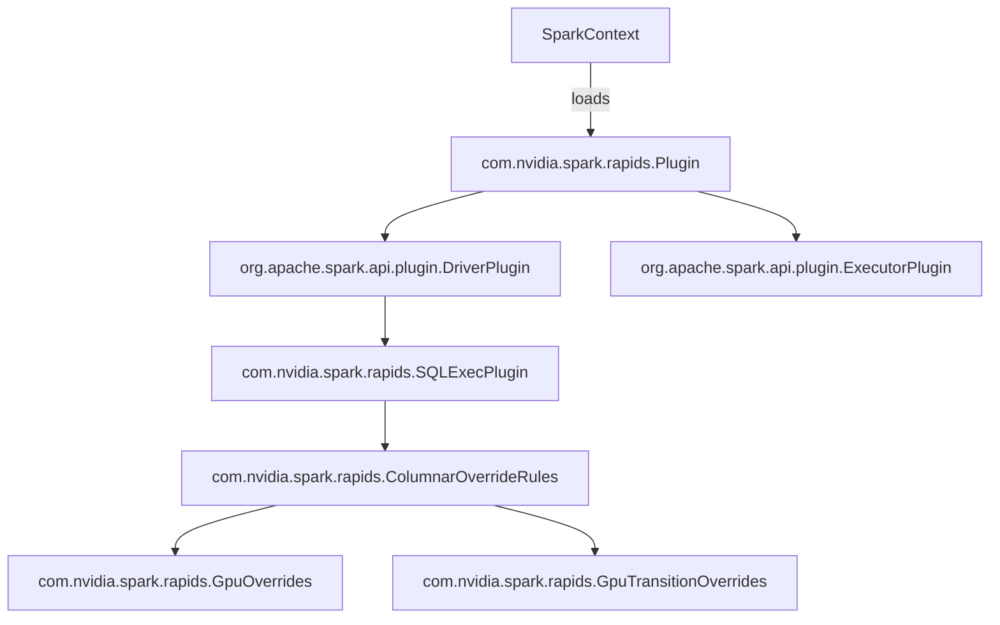
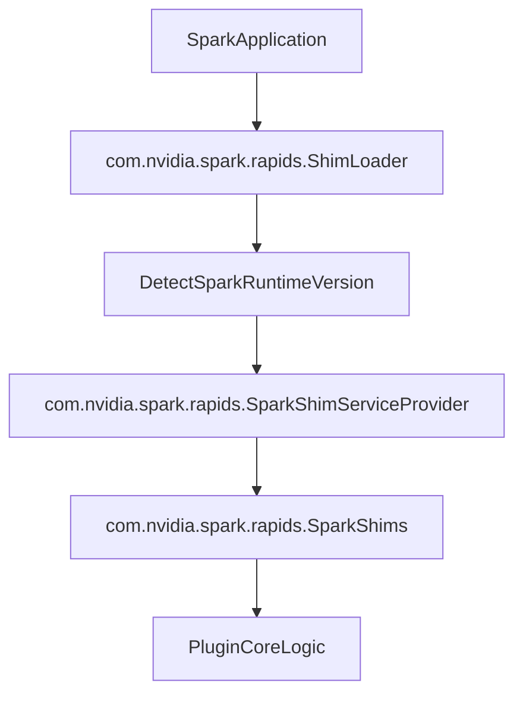
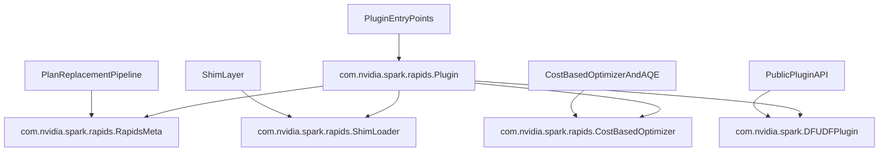

<!-- source: DeepWiki mcp.deepwiki.com · repo NVIDIA/cudf-spark · page 2 Core Plugin Architecture · fetched 2026-10-26 -->

# Core Plugin Architecture

Relevant source files

The following files were used as context for generating this wiki page:

- [docs/additional-functionality/advanced_configs.md](docs/additional-functionality/advanced_configs.md)
- [docs/configs.md](docs/configs.md)
- [docs/dev/shims.md](docs/dev/shims.md)
- [docs/supported_ops.md](docs/supported_ops.md)
- [integration_tests/src/main/python/data_gen.py](integration_tests/src/main/python/data_gen.py)
- [integration_tests/src/main/python/hash_aggregate_test.py](integration_tests/src/main/python/hash_aggregate_test.py)
- [integration_tests/src/main/python/window_function_test.py](integration_tests/src/main/python/window_function_test.py)
- [sql-plugin/src/main/scala/com/nvidia/spark/rapids/GpuOverrides.scala](sql-plugin/src/main/scala/com/nvidia/spark/rapids/GpuOverrides.scala)
- [sql-plugin/src/main/scala/com/nvidia/spark/rapids/Plugin.scala](sql-plugin/src/main/scala/com/nvidia/spark/rapids/Plugin.scala)
- [sql-plugin/src/main/scala/com/nvidia/spark/rapids/RapidsConf.scala](sql-plugin/src/main/scala/com/nvidia/spark/rapids/RapidsConf.scala)
- [sql-plugin/src/main/scala/com/nvidia/spark/rapids/RapidsConfEntries.scala](sql-plugin/src/main/scala/com/nvidia/spark/rapids/RapidsConfEntries.scala)

This page provides a high-level overview of the core architecture of the RAPIDS Accelerator for Apache Spark plugin. It explains how the plugin integrates with Spark via its entry points, the role of the shim layer for multi-version compatibility, the plan-replacement pipeline that transforms Spark plans for GPU execution, the cost-based optimizer and Adaptive Query Execution (AQE) integration, and the public API surface for external extensions. Each subsection links to detailed child pages covering these topics in depth.

---

## Plugin Entry Points & SparkPlugin Registration

The plugin hooks into Spark through the `SparkPlugin` interface, implementing both the `DriverPlugin` and `ExecutorPlugin` traits (`org.apache.spark.api.plugin.SparkPlugin`) [sql-plugin/src/main/scala/com/nvidia/spark/rapids/Plugin.scala:43](). This enables initialization tasks within driver and executors such as setting up the GPU memory allocator (`RmmSpark`), the GPU-safe timezone database (`GpuTimeZoneDB`), and other execution environment components [sql-plugin/src/main/scala/com/nvidia/spark/rapids/Plugin.scala:37-81](). 

On the SQL planning side, the plugin registers `ColumnarOverrideRules` which provide replacement rules to transform CPU Spark physical plans into GPU-accelerated equivalents using `GpuOverrides` and `GpuTransitionOverrides` [sql-plugin/src/main/scala/com/nvidia/spark/rapids/Plugin.scala:74-81](). These rules form the basis of accelerating Spark SQL operations on the GPU.

For detailed mechanics of plugin registration and entry points, refer to [Plugin Entry Points & SparkPlugin Registration](#2.1).

### Diagram: Plugin Registration and Entry Points

Sources:  
- [sql-plugin/src/main/scala/com/nvidia/spark/rapids/Plugin.scala:37-81]()  
- [sql-plugin/src/main/scala/com/nvidia/spark/rapids/GpuOverrides.scala:75-76]()

---

## Shim Layer & Multi-Version Support

Apache Spark evolves rapidly across versions, frequently introducing incompatible internal API changes. To manage this, the plugin uses a **shim layer** to abstract differences between Spark versions. This layer exposes stable interfaces (e.g., `SparkShimServiceProvider`) implemented differently per Spark version, allowing the core GPU plugin logic to remain version-agnostic [sql-plugin/src/main/scala/com/nvidia/spark/rapids/Plugin.scala:70]().

The `ShimLoader` dynamically detects the Spark runtime version and loads the corresponding shim implementation. The project uses a **parallel-worlds JAR layout**, packaging each supported Spark version’s shim as a separate artifact loaded at runtime, minimizing class conflicts and enabling multi-version compatibility within the same plugin release.

For an in-depth explanation of the shim architecture, including adding support for new Spark versions, see [Shim Layer & Multi-Version Support](#2.2).

### Diagram: Shim Resolution Flow

Sources:  
- [sql-plugin/src/main/scala/com/nvidia/spark/rapids/Plugin.scala:70]()

---

## RapidsMeta & Plan Replacement Pipeline

The core of GPU acceleration lies in analyzing and transforming Spark’s physical plans. This is done via a plan-replacement pipeline that traverses Spark operators and expressions, wrapping them with corresponding `RapidsMeta` classes (e.g., `SparkPlanMeta`, `BaseExprMeta`) which contain GPU-specific metadata and logic [sql-plugin/src/main/scala/com/nvidia/spark/rapids/GpuOverrides.scala:69-77]().

The `tagForGpu()` method in these wrappers performs compatibility checks against type constraints and runtime configurations (`TypeChecks`), marking operators as GPU-compatible or requiring fallback. Compatible operators are replaced by equivalent GPU implementations through `convertToGpu()`. If not compatible, fallback to CPU execution or transition wrappers (`GpuTransitionOverrides`) manage graceful plan degradation [sql-plugin/src/main/scala/com/nvidia/spark/rapids/Plugin.scala:74-81]().

This modular mechanism allows fine-grained control over what and how parts of a query plan are accelerated on GPUs.

For details on `RapidsMeta` classes, compatibility tagging, and rule pipelines, see [RapidsMeta & Plan Replacement Pipeline](#2.3).

Sources:  
- [sql-plugin/src/main/scala/com/nvidia/spark/rapids/GpuOverrides.scala:69-90]()  
- [sql-plugin/src/main/scala/com/nvidia/spark/rapids/Plugin.scala:74-81]()

---

## Cost-Based Optimizer & Adaptive Query Execution

To decide when to run workloads on GPU versus CPU and optimize overall query performance, the plugin integrates with Spark’s **Cost-Based Optimizer (CBO)** and **Adaptive Query Execution (AQE)** framework. It models operation costs under CPU and GPU execution paths, which helps avoid costly unnecessary data transfers between host and device memory [sql-plugin/src/main/scala/com/nvidia/spark/rapids/RapidsConf.scala:46]().

AQE integration enables dynamically rewriting query stages involving shuffles (`ShuffleQueryStageExec`, `BroadcastQueryStageExec`) and inserting optimized GPU-aware shuffle readers and transition steps based on runtime metrics [sql-plugin/src/main/scala/com/nvidia/spark/rapids/GpuOverrides.scala:41-42]().

This cost and feedback-driven optimization pipeline helps maximize GPU usage while preserving correctness and overall efficiency.

For comprehensive coverage of CBO models, AQE hooks, and custom shuffle readers, refer to [Cost-Based Optimizer & Adaptive Query Execution](#2.4).

Sources:  
- [sql-plugin/src/main/scala/com/nvidia/spark/rapids/GpuOverrides.scala:41-42]()  
- [sql-plugin/src/main/scala/com/nvidia/spark/rapids/RapidsConf.scala:46]()

---

## Public Plugin API (sql-plugin-api)

The plugin exposes a stable public API surface residing in the `sql-plugin-api` module. This API supports external extensions, custom data sources, and user-defined functions that can leverage GPU acceleration safely across Spark versions.

Key public classes and interfaces include:

- `ShimLoader` and `SparkShimServiceProvider` for shim interaction  
- `RapidsConf` for configuration management  
- Helpers for columnar batch utilities like `GpuColumnVectorUtils`  
- GPU-aware user-defined function interfaces like `DFUDFPluginAPI`  
- Format and file I/O helper modules in `sql-plugin-columnar` and `sql-plugin-format`  

This API is intentionally separated from internal implementation to permit binary-compatible plugin extensions.

For detailed description of API components and examples, see [Public Plugin API (sql-plugin-api)](#2.5).

Sources:  
- [sql-plugin/src/main/scala/com/nvidia/spark/rapids/Plugin.scala:31]()

---

# Related Child Pages

- **[Plugin Entry Points & SparkPlugin Registration](#2.1)** — Plugin registration lifecycle, DriverPlugin/ExecutorPlugin roles, and override-rule registries.  
- **[Shim Layer & Multi-Version Support](#2.2)** — Shim patterns, SPI service provider loading, JAR packaging, and version compatibility.  
- **[RapidsMeta & Plan Replacement Pipeline](#2.3)** — RapidsMeta class hierarchy, GPU tagging, conversion routines, and physical plan rewriting rules.  
- **[Cost-Based Optimizer & Adaptive Query Execution](#2.4)** — CPU vs GPU cost models, AQE-aware plan adjustments, and efficient shuffle strategies.  
- **[Public Plugin API (sql-plugin-api)](#2.5)** — Stable APIs for external extensions and custom components using the RAPIDS plugin.

---

# Summary Diagram: Natural Language To Code Entity Space Mapping

Sources:  
- [sql-plugin/src/main/scala/com/nvidia/spark/rapids/Plugin.scala:31-81]()  
- [sql-plugin/src/main/scala/com/nvidia/spark/rapids/GpuOverrides.scala:69-90]()  
- [sql-plugin/src/main/scala/com/nvidia/spark/rapids/RapidsConf.scala:46]()  

---

# Summary of Key Components in Code Entity Space

| Component                      | Code Entity                                   | Role                                                                                   |
|-------------------------------|-----------------------------------------------|----------------------------------------------------------------------------------------|
| Plugin Entry Point             | `com.nvidia.spark.rapids.Plugin`              | Entry point for Spark integration, driver and executor setup                           |
| Columnar Override Rules        | `ColumnarOverrideRules`                        | Contains rule sets that enable GPU plan transformation                                |
| Plan Replacement Pipeline      | `GpuOverrides`, `RapidsMeta` classes           | Wraps Spark plans for compatibility checking and GPU conversion                        |
| Shim Loader                   | `ShimLoader`, `SparkShimServiceProvider`      | Detects Spark version and loads appropriate shim implementation                        |
| Cost-Based Optimizer & AQE    | `CostBasedOptimizer`, AQE integration rules   | Models CPU/GPU costs and enables dynamic plan adaptation                              |
| Plugin Public API             | `sql-plugin-api` module classes                 | Stable API for external extensions and safe API surface                               |

Sources:  
- [sql-plugin/src/main/scala/com/nvidia/spark/rapids/Plugin.scala:31-81]()  
- [sql-plugin/src/main/scala/com/nvidia/spark/rapids/GpuOverrides.scala:69-90]()

---

