<!-- source: DeepWiki mcp.deepwiki.com · repo NVIDIA/cudf-spark · page 2.1 Plugin Entry Points & SparkPlugin Registration · fetched 2026-10-26 -->

# Plugin Entry Points & SparkPlugin Registration

<details>
<summary>Relevant source files</summary>

The following files were used as context for generating this wiki page:

- [delta-lake/common/src/main/delta-io/scala/com/nvidia/spark/rapids/delta/DeltaIOProvider.scala](delta-lake/common/src/main/delta-io/scala/com/nvidia/spark/rapids/delta/DeltaIOProvider.scala)
- [delta-lake/delta-20x/src/main/scala/com/nvidia/spark/rapids/delta/delta20x/Delta20xProvider.scala](delta-lake/delta-20x/src/main/scala/com/nvidia/spark/rapids/delta/delta20x/Delta20xProvider.scala)
- [delta-lake/delta-21x/src/main/scala/com/nvidia/spark/rapids/delta/delta21x/Delta21xProvider.scala](delta-lake/delta-21x/src/main/scala/com/nvidia/spark/rapids/delta/delta21x/Delta21xProvider.scala)
- [delta-lake/delta-22x/src/main/scala/com/nvidia/spark/rapids/delta/delta22x/Delta22xProvider.scala](delta-lake/delta-22x/src/main/scala/com/nvidia/spark/rapids/delta/delta22x/Delta22xProvider.scala)
- [delta-lake/delta-23x/src/main/scala/com/nvidia/spark/rapids/delta/delta23x/Delta23xProvider.scala](delta-lake/delta-23x/src/main/scala/com/nvidia/spark/rapids/delta/delta23x/Delta23xProvider.scala)
- [delta-lake/delta-24x/src/main/scala/com/nvidia/spark/rapids/delta/delta24x/Delta24xProvider.scala](delta-lake/delta-24x/src/main/scala/com/nvidia/spark/rapids/delta/delta24x/Delta24xProvider.scala)
- [docs/additional-functionality/advanced_configs.md](docs/additional-functionality/advanced_configs.md)
- [docs/configs.md](docs/configs.md)
- [docs/supported_ops.md](docs/supported_ops.md)
- [integration_tests/src/main/python/data_gen.py](integration_tests/src/main/python/data_gen.py)
- [integration_tests/src/main/python/hash_aggregate_test.py](integration_tests/src/main/python/hash_aggregate_test.py)
- [integration_tests/src/main/python/window_function_test.py](integration_tests/src/main/python/window_function_test.py)
- [sql-plugin/src/main/scala/com/nvidia/spark/rapids/GpuOverrides.scala](sql-plugin/src/main/scala/com/nvidia/spark/rapids/GpuOverrides.scala)
- [sql-plugin/src/main/scala/com/nvidia/spark/rapids/Plugin.scala](sql-plugin/src/main/scala/com/nvidia/spark/rapids/Plugin.scala)
- [sql-plugin/src/main/scala/com/nvidia/spark/rapids/RapidsConf.scala](sql-plugin/src/main/scala/com/nvidia/spark/rapids/RapidsConf.scala)
- [sql-plugin/src/main/scala/com/nvidia/spark/rapids/RapidsConfEntries.scala](sql-plugin/src/main/scala/com/nvidia/spark/rapids/RapidsConfEntries.scala)
- [sql-plugin/src/main/scala/com/nvidia/spark/rapids/delta/DeltaProvider.scala](sql-plugin/src/main/scala/com/nvidia/spark/rapids/delta/DeltaProvider.scala)
- [sql-plugin/src/main/scala/com/nvidia/spark/rapids/v2WriteCommandMetas.scala](sql-plugin/src/main/scala/com/nvidia/spark/rapids/v2WriteCommandMetas.scala)
- [sql-plugin/src/main/scala/org/apache/spark/sql/rapids/ExternalSource.scala](sql-plugin/src/main/scala/org/apache/spark/sql/rapids/ExternalSource.scala)

</details>


This page details how the RAPIDS Accelerator for Apache Spark integrates with the Spark ecosystem. It covers the primary entry points for the plugin, including Spark's `DriverPlugin` and `ExecutorPlugin` APIs (`SparkPlugin`, `DriverPlugin`, `ExecutorPlugin`), the `SQLExecPlugin` and `ColumnarOverrideRules` entry points for query plan transformations, and the `GpuOverrides` mechanism for defining GPU-accelerated replacement rules.

---

## SparkPlugin Registration

The RAPIDS Accelerator registers itself with Spark using the `SparkPlugin` API, which provides `DriverPlugin` and `ExecutorPlugin` interfaces. These interfaces enable the plugin to initialize resources and inject custom logic on both the driver and executor nodes.

### Driver-side Initialization

On the Spark driver, the `DriverPlugin` implementation performs several critical startup steps to bootstrap GPU-acceleration:

1. **Configuration Loading**: The plugin loads and encapsulates its configuration settings through `RapidsConf`, an abstraction for all `spark.rapids.*` properties [sql-plugin/src/main/scala/com/nvidia/spark/rapids/RapidsConf.scala:1-100]().
2. **Build Information Logging**: Detailed version and build metadata, including those for the plugin itself, JNI components, and the underlying cuDF library, are logged via the `SparkRapidsBuildInfoEvent` [sql-plugin/src/main/scala/com/nvidia/spark/rapids/Plugin.scala:104-121]().
3. **Multiple JAR Detection**: To avoid runtime conflicts, the plugin scans the classpath for multiple versions of RAPIDS JARs loaded simultaneously [sql-plugin/src/main/scala/com/nvidia/spark/rapids/Plugin.scala:32-32]().
4. **Time Zone Database Initialization**: The plugin initializes the GPU time zone database (`GpuTimeZoneDB`), essential for correct timestamp handling in GPU computations [sql-plugin/src/main/scala/com/nvidia/spark/rapids/Plugin.scala:37-37]().
5. **SQL Plugin Registration**: The `SQLExecPlugin` is registered as a Spark session extension, hooking into Catalyst's planning and optimization phases [sql-plugin/src/main/scala/com/nvidia/spark/rapids/Plugin.scala:89-92]().
6. **UDF Plugin Registration**: Optionally, the `DFUDFPlugin` is registered to accelerate user-defined functions on the GPU [sql-plugin/src/main/scala/com/nvidia/spark/rapids/Plugin.scala:31-31]().
7. **Kryo Serializer Registrator Setup**: Registers `GpuKryoRegistrator` if Kryo serialization is active [sql-plugin/src/main/scala/com/nvidia/spark/rapids/Plugin.scala:96-97]().
8. **Shuffle Manager Setup**: For accelerated shuffle operations, `GpuShuffleEnv` is initialized [sql-plugin/src/main/scala/com/nvidia/spark/rapids/Plugin.scala:50-50]().

Sources: [sql-plugin/src/main/scala/com/nvidia/spark/rapids/Plugin.scala:104-241](), [sql-plugin/src/main/scala/com/nvidia/spark/rapids/RapidsConf.scala:1-100]()

---

### Executor-side Initialization

On each executor node, the `ExecutorPlugin` implementation completes GPU-specific initialization, including:

1. **GPU Device Discovery and Acquisition**: Using Spark-assigned GPU resource information, the plugin identifies the GPU device address and acquires it via `GpuDeviceManager` [sql-plugin/src/main/scala/com/nvidia/spark/rapids/Plugin.scala:277-311]().
2. **RMM Initialization**: The plugin initializes GPU memory management through `RmmSpark`, configuring memory pools and spill thresholds [sql-plugin/src/main/scala/com/nvidia/spark/rapids/Plugin.scala:37-37]().
3. **CUDA Context Establishment**: Ensures the CUDA context for the assigned GPU device is properly initialized.
4. **Time Zone Database Initialization**: Sets up `GpuTimeZoneDB` for executor-side timestamp operations [sql-plugin/src/main/scala/com/nvidia/spark/rapids/Plugin.scala:37-37]().
5. **Traffic Controller Setup**: Manages asynchronous I/O and task-level traffic [sql-plugin/src/main/scala/com/nvidia/spark/rapids/Plugin.scala:36-36]().
6. **Task Completion Listener Registration**: Hooks into Spark's task lifecycle via `ScalableTaskCompletion.onTaskCompletion` to perform cleanup [sql-plugin/src/main/scala/com/nvidia/spark/rapids/Plugin.scala:34-34]().

Sources: [sql-plugin/src/main/scala/com/nvidia/spark/rapids/Plugin.scala:277-311]()

---

### SparkPlugin Registration Flow Diagram

```mermaid
graph TD
    SparkContext["SparkContext"] -- "Loads" --> RapidsPlugin["com.nvidia.spark.rapids.Plugin"]

    RapidsPlugin -- "DriverInit" --> RapidsDriverPlugin["com.nvidia.spark.rapids.DriverPlugin"]
    RapidsPlugin -- "ExecutorInit" --> RapidsExecutorPlugin["com.nvidia.spark.rapids.ExecutorPlugin"]

    subgraph DriverEntities["Driver Entities"]
        RapidsDriverPlugin --> RapidsConf["com.nvidia.spark.rapids.RapidsConf"]
        RapidsDriverPlugin --> GpuTimeZoneDB["com.nvidia.spark.rapids.jni.GpuTimeZoneDB"]
        RapidsDriverPlugin --> SQLExecPlugin["com.nvidia.spark.rapids.SQLExecPlugin"]
        RapidsDriverPlugin --> GpuShuffleEnv["org.apache.spark.sql.rapids.GpuShuffleEnv"]
        RapidsDriverPlugin --> DFUDFPlugin["com.nvidia.spark.DFUDFPlugin"]
        RapidsDriverPlugin --> GpuKryoRegistrator["com.nvidia.spark.rapids.GpuKryoRegistrator"]
    end

    subgraph ExecutorEntities["Executor Entities"]
        RapidsExecutorPlugin --> GpuDeviceManager["com.nvidia.spark.rapids.GpuDeviceManager"]
        RapidsExecutorPlugin --> RmmSpark["com.nvidia.spark.rapids.jni.RmmSpark"]
        RapidsExecutorPlugin --> TrafficController["com.nvidia.spark.rapids.io.async.TrafficController"]
        RapidsExecutorPlugin --> PythonWorkerSemaphore["com.nvidia.spark.rapids.python.PythonWorkerSemaphore"]
    end

    SQLExecPlugin -- "Injects" --> ColumnarOverrideRules["com.nvidia.spark.rapids.ColumnarOverrideRules"]
```



Sources: [sql-plugin/src/main/scala/com/nvidia/spark/rapids/Plugin.scala:104-311](), [sql-plugin/src/main/scala/com/nvidia/spark/rapids/RapidsConf.scala:1-100]()

---

## SQLPlugin and ColumnarOverrideRules

The RAPIDS Accelerator embeds itself deeply into Spark's SQL optimization phases via two primary mechanisms: the `SQLExecPlugin` and `ColumnarOverrideRules`.

### SQLExecPlugin

The `SQLExecPlugin` is a main integration point that extends Spark's session extensions. It registers operations to be performed on Spark session startup, enhancing the Catalyst plan with GPU-capable rules [sql-plugin/src/main/scala/com/nvidia/spark/rapids/Plugin.scala:89-92]().

### ColumnarOverrideRules

`ColumnarOverrideRules` is an abstraction that wraps two important rule sets impacting the Spark physical plan:

1. **overrides (pre-columnar transitions)**: Uses `GpuOverrides` to scan the physical plan and replace nodes with GPU-enabled equivalents [sql-plugin/src/main/scala/com/nvidia/spark/rapids/Plugin.scala:75-78]().
2. **overrideTransitions (post-columnar transitions)**: Uses `GpuTransitionOverrides` to manage CPU/GPU boundary conversions via wrappers like `GpuRowToColumnarExec` and `GpuColumnarToRowExec` [sql-plugin/src/main/scala/com/nvidia/spark/rapids/Plugin.scala:76-80]().

Sources: [sql-plugin/src/main/scala/com/nvidia/spark/rapids/Plugin.scala:74-81]()

---

## GpuOverrides Replacement-Rule Registry

The `GpuOverrides` class serves as the central registry and executor of all Catalyst plan replacement rules for the RAPIDS Accelerator [sql-plugin/src/main/scala/com/nvidia/spark/rapids/GpuOverrides.scala:69-77]().

### ReplacementRule Class

The abstract `ReplacementRule` class encapsulates how a CPU plan node or expression is wrapped and transformed for GPU execution [sql-plugin/src/main/scala/com/nvidia/spark/rapids/GpuOverrides.scala:69-77]().

```scala
abstract class ReplacementRule[INPUT <: BASE, BASE, WRAP_TYPE <: RapidsMeta[INPUT, BASE, _]](
    protected var doWrap: (
        INPUT,
        RapidsConf,
        Option[RapidsMeta[_, _, _]],
        DataFromReplacementRule) => WRAP_TYPE,
    protected var desc: String,
    protected val checks: Option[TypeChecks[_]],
    final val tag: ClassTag[INPUT]) extends DataFromReplacementRule {
    // ...
}
```

Sources: [sql-plugin/src/main/scala/com/nvidia/spark/rapids/GpuOverrides.scala:69-125]()

---

### Replacement Pipeline Data Flow

```mermaid
graph LR
    SparkPlanExpressionCPU["org.apache.spark.sql.execution.SparkPlan or Expression"] --> GpuOverridesRegistry["com.nvidia.spark.rapids.GpuOverrides"]
    GpuOverridesRegistry --> ReplacementRuleMatch["com.nvidia.spark.rapids.ReplacementRule"]
    ReplacementRuleMatch --> TypeChecksValidation["com.nvidia.spark.rapids.TypeChecks"]
    TypeChecksValidation -- "passes" --> RapidsMetaLayer["com.nvidia.spark.rapids.RapidsMeta"]
    RapidsMetaLayer --> TagForGpu["tagForGpu()"]
    TagForGpu -- "convertToGpu()" --> GpuExecImplementation["com.nvidia.spark.rapids.GpuExpression"]
```



Sources: [sql-plugin/src/main/scala/com/nvidia/spark/rapids/GpuOverrides.scala:69-162]()

---

# Summary

The RAPIDS Accelerator for Apache Spark hooks into the Spark ecosystem primarily through the `SparkPlugin` interface using driver and executor plugins [sql-plugin/src/main/scala/com/nvidia/spark/rapids/Plugin.scala:104-311](). At the SQL layer, `SQLExecPlugin` and `ColumnarOverrideRules` coordinate plan rewrites using the `GpuOverrides` registry and `ReplacementRule` abstractions [sql-plugin/src/main/scala/com/nvidia/spark/rapids/Plugin.scala:74-92](), [sql-plugin/src/main/scala/com/nvidia/spark/rapids/GpuOverrides.scala:69-77]().

---

