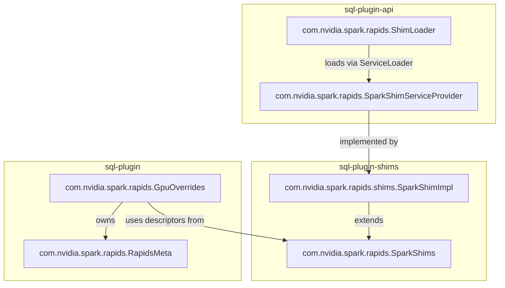
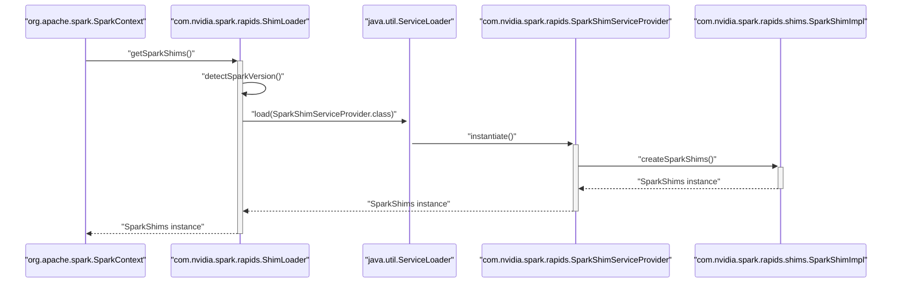
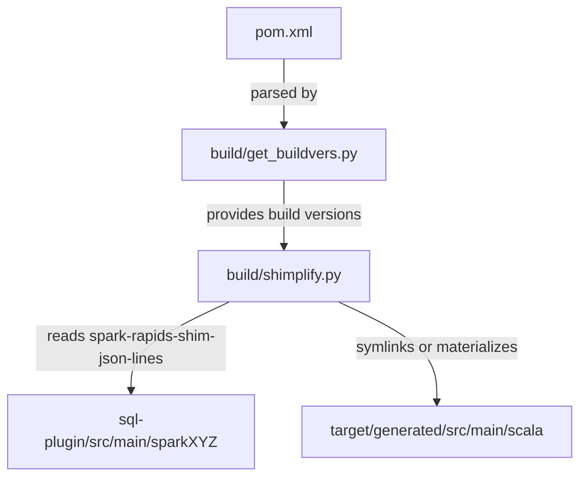

<!-- source: DeepWiki mcp.deepwiki.com · repo NVIDIA/cudf-spark · page 2.2 Shim Layer & Multi-Version Support · fetched 2026-10-26 -->

# Shim Layer & Multi-Version Support

<details>
<summary>Relevant source files</summary>

The following files were used as context for generating this wiki page:

- [.github/workflows/mvn-verify-check/populate-daily-cache.sh](.github/workflows/mvn-verify-check/populate-daily-cache.sh)
- [.gitignore](.gitignore)
- [build/dyn_shim_detection.py](build/dyn_shim_detection.py)
- [build/get_buildvers.py](build/get_buildvers.py)
- [build/shimplify.py](build/shimplify.py)
- [dist/keep-in-spark-shared.txt](dist/keep-in-spark-shared.txt)
- [dist/scripts/analyze-parallel-world-deps.py](dist/scripts/analyze-parallel-world-deps.py)
- [docs/dev/parallel-world-unshimming.md](docs/dev/parallel-world-unshimming.md)
- [docs/dev/shimplify.md](docs/dev/shimplify.md)
- [docs/dev/shims.md](docs/dev/shims.md)
- [sql-plugin/src/main/spark330db/scala/com/nvidia/spark/rapids/shims/Spark321PlusDBShims.scala](sql-plugin/src/main/spark330db/scala/com/nvidia/spark/rapids/shims/Spark321PlusDBShims.scala)
- [sql-plugin/src/main/spark330db/scala/org/apache/spark/rapids/execution/GpuSubqueryBroadcastMeta.scala](sql-plugin/src/main/spark330db/scala/org/apache/spark/rapids/execution/GpuSubqueryBroadcastMeta.scala)
- [sql-plugin/src/main/spark330db/scala/org/apache/spark/rapids/execution/GpuSubqueryBroadcastMeta330DBBase.scala](sql-plugin/src/main/spark330db/scala/org/apache/spark/rapids/execution/GpuSubqueryBroadcastMeta330DBBase.scala)
- [sql-plugin/src/main/spark332db/scala/com/nvidia/spark/rapids/shims/Spark332PlusDBShims.scala](sql-plugin/src/main/spark332db/scala/com/nvidia/spark/rapids/shims/Spark332PlusDBShims.scala)
- [sql-plugin/src/main/spark340/scala/com/nvidia/spark/rapids/shims/Spark340PlusNonDBShims.scala](sql-plugin/src/main/spark340/scala/com/nvidia/spark/rapids/shims/Spark340PlusNonDBShims.scala)
- [sql-plugin/src/main/spark350db143/scala/com/nvidia/spark/rapids/shims/Spark341PlusDBShims.scala](sql-plugin/src/main/spark350db143/scala/com/nvidia/spark/rapids/shims/Spark341PlusDBShims.scala)
- [sql-plugin/src/main/spark350db143/scala/com/nvidia/spark/rapids/shims/Spark350db143Shims.scala](sql-plugin/src/main/spark350db143/scala/com/nvidia/spark/rapids/shims/Spark350db143Shims.scala)
- [sql-plugin/src/main/spark350db143/scala/org/apache/spark/sql/rapids/execution/GpuSubqueryBroadcastMeta.scala](sql-plugin/src/main/spark350db143/scala/org/apache/spark/sql/rapids/execution/GpuSubqueryBroadcastMeta.scala)
- [sql-plugin/src/main/spark400/scala/org/apache/spark/sql/rapids/execution/GpuSubqueryBroadcastMeta.scala](sql-plugin/src/main/spark400/scala/org/apache/spark/sql/rapids/execution/GpuSubqueryBroadcastMeta.scala)
- [sql-plugin/src/test/scala/com/nvidia/spark/rapids/ClassInitializationSuite.scala](sql-plugin/src/test/scala/com/nvidia/spark/rapids/ClassInitializationSuite.scala)

</details>


## Purpose and Scope

The NVIDIA cuDF plugin for Apache Spark supports multiple feature version lines of Apache Spark (such as `3.3.x`, `3.4.x`, `3.5.x`, `4.x`) as well as various vendor distributions like Databricks and Amazon EMR [docs/dev/shims.md:10-12](). Because Spark's internal APIs evolve rapidly and frequently break source and binary compatibility between releases, the accelerator uses a **shim layer** architecture [docs/dev/shims.md:12-14](). This layer abstracts Spark internals behind a stable common interface, isolating version-specific adjustments in dedicated shim modules and allowing core plugin logic to remain uniform [docs/dev/shims.md:13-16]().

Sources:
* [docs/dev/shims.md:10-16]()

---

## The Shim Layer Architecture & One-Way Module Boundaries

The shim layer operates via a ServiceProvider pattern where the appropriate implementation is loaded at runtime after detecting the active Spark version [docs/dev/shims.md:16-19](). 

### One-way Shim Module Boundary

To maintain binary compatibility and cleanly isolate version dependencies, the codebase enforces a strict one-way module boundary [docs/dev/shims.md:24-37]():

| Module | Purpose | Restrictions |
| :--- | :--- | :--- |
| `sql-plugin-api` | Contains narrow shared types and descriptor objects (`ShimDataWritingCommandRule`, `ShimRunnableCommandRule`, `ShimExecRule`) [docs/dev/shims.md:30-40](). | Must not depend on implementation classes from `sql-plugin` [docs/dev/shims.md:31-32](). |
| `sql-plugin-shims` | Depends on `sql-plugin-api` and Spark; references Spark internal APIs that vary across build versions [docs/dev/shims.md:32-34](). | Must not reference GPU meta classes, `GpuOverrides`, or `RapidsMeta` [docs/dev/shims.md:33-35](). |
| `sql-plugin` | Turns shim descriptors into concrete plugin rules and owns RAPIDS metadata factories [docs/dev/shims.md:35-37](). | Depends on `sql-plugin-shims` and orchestrates execution [docs/dev/shims.md:35-37](). |



**Title: Shim Architecture and Module Dependencies**

Sources:
* [docs/dev/shims.md:24-48]()

---

## ShimLoader and Runtime Shim Discovery

`ShimLoader` serves as the primary entry point for interacting with the host Spark runtime [docs/dev/shims.md:17-20]().

### Loading Mechanism

- **Detection**: Queries the active Spark execution environment to identify the exact Spark build version and vendor [docs/dev/shims.md:17-20]().
- **Service Discovery**: Leverages Java's `ServiceLoader` to locate and instantiate `SparkShimServiceProvider` implementations [docs/dev/shims.md:17-19]().
- **Resolution**: Returns the concrete `SparkShims` instance tailored to the runtime [docs/dev/shims.md:17-19]().



**Title: Runtime Shim Discovery Sequence**

Sources:
* [docs/dev/shims.md:17-22]()

---

## Parallel-Worlds JAR Layout & Reducing Parallel-World Classes

Packaging multiple binary-incompatible Spark versions into a single distribution jar is achieved via the **Parallel-Worlds** layout [docs/dev/shims.md:52-56]().

### Parallel-Worlds Layout Organization

- Version-specific shim bytecode resides in isolated namespaces (e.g., `spark330`, `spark340`, `spark500`) [docs/dev/shims.md:52-56]().
- Common logic shared across versions is stored in `spark-shared/` or the root of the distribution [docs/dev/shims.md:56-59]().
- `ShimLoader` adjusts class loading priorities at runtime to select the classes matching the active Spark build [docs/dev/shims.md:17-20]().
- The deduplication script `dist/scripts/binary-dedupe.sh` verifies byte-for-byte identical classes and promotes them out of `spark-shared` when safe [docs/dev/shims.md:60-65]().

Developers can analyze parallel-world dependencies using the provided dependency analysis script [docs/dev/shims.md:85-88]():

```bash
VERSION=26.04.2
curl -fL -o /tmp/rapids-4-spark_2.12-${VERSION}-cuda12.jar \
  https://repo.maven.apache.org/maven2/com/nvidia/rapids-4-spark_2.12/${VERSION}/rapids-4-spark_2.12-${VERSION}-cuda12.jar

python3 dist/scripts/analyze-parallel-world-deps.py \
  /tmp/rapids-4-spark_2.12-${VERSION}-cuda12.jar \
  --show-topo
```

This tool inspects the distribution jar to report direct classifier-package dependencies, root-safety violations, and strongly connected components (SCCs) [docs/dev/shims.md:110-120]().

Sources:
* [docs/dev/shims.md:52-123]()

---

## Tooling: `shimplify` and Build Integration

Maintaining dozens of version-specific directories is managed by the `shimplify` tooling implemented in `build/shimplify.py` [docs/dev/shimplify.md:10-16]().

### JSON Lines Shim Metadata

Instead of separate directory trees for each version variant, individual source files declare their target Spark builds via a `spark-rapids-shim-json-lines` comment block [docs/dev/shimplify.md:35-45]():

```scala
/*** spark-rapids-shim-json-lines
{"spark": "330"}
{"spark": "331"}
spark-rapids-shim-json-lines ***/
```

- Files are physically stored under the directory corresponding to the **owner shim** (the minimum Spark version listed) [docs/dev/shimplify.md:47-65]().
- During the Maven `generate-sources` phase, `build/shimplify.py` parses these blocks and symlinks or materializes the source files into version-specific target directories (`target/${buildver}/generated/src/...`) [docs/dev/shimplify.md:65-75]().
- `build/get_buildvers.py` parses Maven POM profiles to extract active Spark build versions while honoring exclusions defined in `dyn.shim.excluded.releases` [build/get_buildvers.py:20-55]().



**Title: Shimplify Build Generation Pipeline**

Sources:
* [docs/dev/shimplify.md:8-79]()
* [build/get_buildvers.py:20-88]()

---

## Adding a Shim & Preventing Class Initialization Deadlocks

Adding support for a new Spark version involves creating a dedicated source root and registering the new service provider. However, concurrent class loading between `GpuOverrides` and `SparkShimImpl` can trigger deadlocks if initialization locks are held improperly [sql-plugin/src/test/scala/com/nvidia/spark/rapids/ClassInitializationSuite.scala:115-124]().

### Preventing Deadlocks via Lazy Evaluation

To prevent race conditions during JVM class initialization:
- Rule maps and version-specific extension lists inside shims (such as `shimExecs` in `Spark340PlusNonDBShims`) must be declared `private lazy val` [sql-plugin/src/main/spark340/scala/com/nvidia/spark/rapids/shims/Spark340PlusNonDBShims.scala:68-71]().
- Eager evaluation during object construction can cause circular dependencies where `GpuOverrides` waits for `SparkShimImpl` while holding its class-initialization lock, and vice versa [sql-plugin/src/test/scala/com/nvidia/spark/rapids/ClassInitializationSuite.scala:115-124]().

Sources:
* [sql-plugin/src/main/spark340/scala/com/nvidia/spark/rapids/shims/Spark340PlusNonDBShims.scala:68-71]()
* [sql-plugin/src/test/scala/com/nvidia/spark/rapids/ClassInitializationSuite.scala:115-124]()

---

