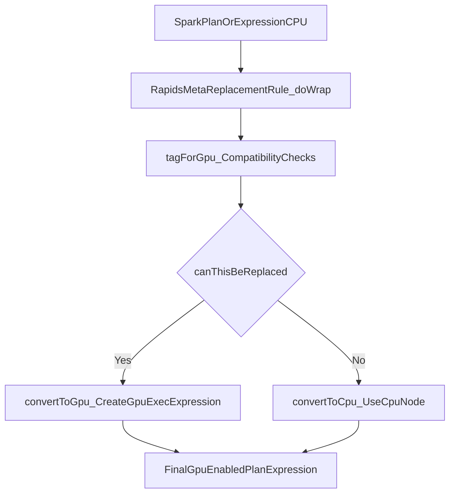
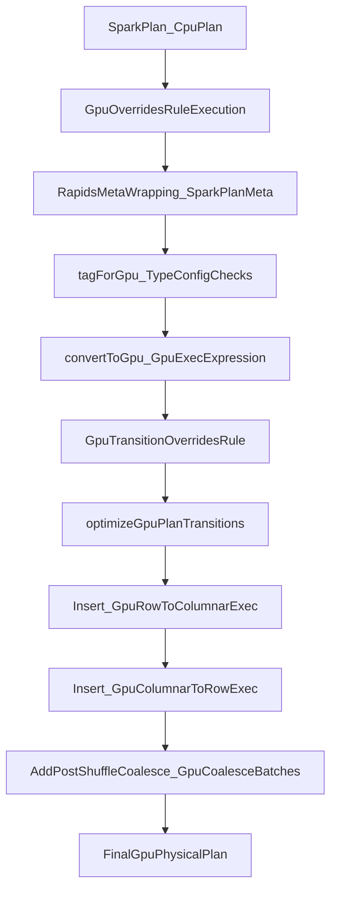
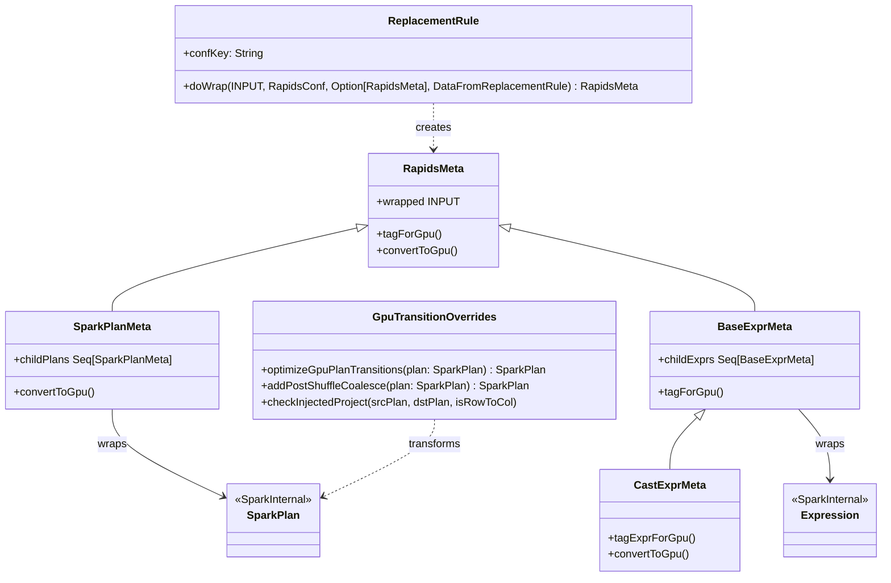

<!-- source: DeepWiki mcp.deepwiki.com · repo NVIDIA/cudf-spark · page 2.3 RapidsMeta & Plan Replacement Pipeline · fetched 2026-10-26 -->

# RapidsMeta & Plan Replacement Pipeline

Relevant source files

The following files were used as context for generating this wiki page:

- [integration_tests/src/main/python/aqe_test.py](integration_tests/src/main/python/aqe_test.py)
- [integration_tests/src/main/python/cast_test.py](integration_tests/src/main/python/cast_test.py)
- [integration_tests/src/main/python/date_time_test.py](integration_tests/src/main/python/date_time_test.py)
- [sql-plugin/src/main/scala/com/nvidia/spark/rapids/CostBasedOptimizer.scala](sql-plugin/src/main/scala/com/nvidia/spark/rapids/CostBasedOptimizer.scala)
- [sql-plugin/src/main/scala/com/nvidia/spark/rapids/DateUtils.scala](sql-plugin/src/main/scala/com/nvidia/spark/rapids/DateUtils.scala)
- [sql-plugin/src/main/scala/com/nvidia/spark/rapids/GpuAggregateExec.scala](sql-plugin/src/main/scala/com/nvidia/spark/rapids/GpuAggregateExec.scala)
- [sql-plugin/src/main/scala/com/nvidia/spark/rapids/GpuCast.scala](sql-plugin/src/main/scala/com/nvidia/spark/rapids/GpuCast.scala)
- [sql-plugin/src/main/scala/com/nvidia/spark/rapids/GpuTransitionOverrides.scala](sql-plugin/src/main/scala/com/nvidia/spark/rapids/GpuTransitionOverrides.scala)
- [sql-plugin/src/main/scala/com/nvidia/spark/rapids/RapidsMeta.scala](sql-plugin/src/main/scala/com/nvidia/spark/rapids/RapidsMeta.scala)
- [sql-plugin/src/main/scala/com/nvidia/spark/rapids/SparkShims.scala](sql-plugin/src/main/scala/com/nvidia/spark/rapids/SparkShims.scala)
- [sql-plugin/src/main/scala/com/nvidia/spark/rapids/TypeChecks.scala](sql-plugin/src/main/scala/com/nvidia/spark/rapids/TypeChecks.scala)
- [sql-plugin/src/main/scala/org/apache/spark/sql/catalyst/expressions/rapids/Timestamp.scala](sql-plugin/src/main/scala/org/apache/spark/sql/catalyst/expressions/rapids/Timestamp.scala)
- [sql-plugin/src/main/scala/org/apache/spark/sql/rapids/datetimeExpressions.scala](sql-plugin/src/main/scala/org/apache/spark/sql/rapids/datetimeExpressions.scala)
- [sql-plugin/src/main/spark400/scala/com/nvidia/spark/rapids/shims/DateTimeUtilsShims.scala](sql-plugin/src/main/spark400/scala/com/nvidia/spark/rapids/shims/DateTimeUtilsShims.scala)
- [tests/src/test/scala/com/nvidia/spark/rapids/AdaptiveQueryExecSuite.scala](tests/src/test/scala/com/nvidia/spark/rapids/AdaptiveQueryExecSuite.scala)
- [tests/src/test/scala/com/nvidia/spark/rapids/AnsiCastOpSuite.scala](tests/src/test/scala/com/nvidia/spark/rapids/AnsiCastOpSuite.scala)
- [tests/src/test/scala/com/nvidia/spark/rapids/BroadcastNestedLoopJoinSuite.scala](tests/src/test/scala/com/nvidia/spark/rapids/BroadcastNestedLoopJoinSuite.scala)
- [tests/src/test/scala/com/nvidia/spark/rapids/CastOpSuite.scala](tests/src/test/scala/com/nvidia/spark/rapids/CastOpSuite.scala)
- [tests/src/test/scala/com/nvidia/spark/rapids/CostBasedOptimizerSuite.scala](tests/src/test/scala/com/nvidia/spark/rapids/CostBasedOptimizerSuite.scala)
- [tests/src/test/scala/com/nvidia/spark/rapids/CsvScanSuite.scala](tests/src/test/scala/com/nvidia/spark/rapids/CsvScanSuite.scala)
- [tests/src/test/scala/com/nvidia/spark/rapids/HashAggregatesSuite.scala](tests/src/test/scala/com/nvidia/spark/rapids/HashAggregatesSuite.scala)
- [tests/src/test/scala/com/nvidia/spark/rapids/ParseDateTimeSuite.scala](tests/src/test/scala/com/nvidia/spark/rapids/ParseDateTimeSuite.scala)
- [tests/src/test/scala/com/nvidia/spark/rapids/SparkQueryCompareTestSuite.scala](tests/src/test/scala/com/nvidia/spark/rapids/SparkQueryCompareTestSuite.scala)

This page covers the detailed implementation of the `RapidsMeta` hierarchy, including core classes like `SparkPlanMeta` and `BaseExprMeta`, explaining their key roles in the RAPIDS Accelerator for Apache Spark. It also describes how the `tagForGpu` and `convertToGpu` methods operate in the GPU plan transformation workflow, the use of `TypeChecks` for compatibility verification, and the central `GpuTransitionOverrides` rule pipeline that transforms Spark physical plans for GPU execution.

---

## 1. RapidsMeta Hierarchy

### Overview

At the core of GPU acceleration via RAPIDS for Apache Spark is the `RapidsMeta` class hierarchy `[sql-plugin/src/main/scala/com/nvidia/spark/rapids/RapidsMeta.scala:87-91]()`. This hierarchy wraps Spark operator nodes (such as physical plan nodes or expressions) to provide metadata tracking for GPU compatibility analysis and conversion from CPU to GPU execution.

Key variants are:

- **SparkPlanMeta**: Wraps physical plan nodes (subclasses of `SparkPlan`) to analyze and convert them.
- **BaseExprMeta**: Wraps Spark catalyst expressions (`Expression` subclasses) to handle expression compatibility and GPU conversion.
- **CastExprMeta**: A specialized meta wrapper for `Cast` expressions, handling evaluation modes like ANSI and type-specific compatibility checks `[sql-plugin/src/main/scala/com/nvidia/spark/rapids/GpuCast.scala:43-55]()`.
- Other specialized meta wrappers include `PartMeta` (for partitioning), `ScanMeta` (for scan nodes), and `DataWritingCommandMeta` (for write commands) `[sql-plugin/src/main/scala/com/nvidia/spark/rapids/RapidsMeta.scala:106-116]()`.

Sources:
`[sql-plugin/src/main/scala/com/nvidia/spark/rapids/RapidsMeta.scala:87-116]()`,
`[sql-plugin/src/main/scala/com/nvidia/spark/rapids/GpuCast.scala:43-55]()`

---

### `RapidsMeta` Base Class

The abstract class `RapidsMeta[INPUT, BASE, OUTPUT]` models the metadata for a single unit in the Spark physical plan or expression tree `[sql-plugin/src/main/scala/com/nvidia/spark/rapids/RapidsMeta.scala:87-91]()`:

- **INPUT** is the concrete Spark type wrapped.
- **BASE** is the general Spark plan or expression base.
- **OUTPUT** is the type expected after GPU conversion.

Important responsibilities include:

- Holding the wrapped Spark node in the `wrapped` field `[sql-plugin/src/main/scala/com/nvidia/spark/rapids/RapidsMeta.scala:88]()`.
- Holding references to child meta nodes in categories:
  - `childPlans`: wrapped `SparkPlan` children `[sql-plugin/src/main/scala/com/nvidia/spark/rapids/RapidsMeta.scala:96]()`.
  - `childExprs`: wrapped expression children `[sql-plugin/src/main/scala/com/nvidia/spark/rapids/RapidsMeta.scala:99-101]()`.
  - `childScans`, `childParts`, `childDataWriteCmds` for other respective internal children `[sql-plugin/src/main/scala/com/nvidia/spark/rapids/RapidsMeta.scala:104-116]()`.
- Methods for:
  - **`tagForGpu()`**: to analyze and mark reasons for suitability or incompatibility with GPU execution.
  - **`convertToGpu()`**: to produce the GPU-enabled equivalent physical operator or expression `[sql-plugin/src/main/scala/com/nvidia/spark/rapids/RapidsMeta.scala:124]()`.
  - **`convertToCpu()`** (usually default to returning the wrapped CPU node) for parts that cannot be replaced `[sql-plugin/src/main/scala/com/nvidia/spark/rapids/RapidsMeta.scala:126-132]()`.
- Recording reasons preventing replacement (`cannotBeReplacedReasons`), forced replacement (`mustBeReplacedReasons`), and other state flags `[sql-plugin/src/main/scala/com/nvidia/spark/rapids/RapidsMeta.scala:134-141]()`.

Sources:
`[sql-plugin/src/main/scala/com/nvidia/spark/rapids/RapidsMeta.scala:87-141]()`

---

### Tagging and Compatibility Checks (`tagForGpu()`)

The `tagForGpu()` method is central for gating GPU conversion. It is implemented per meta class and performs thorough checks:

- Verifying configuration flags and feature toggles.
- Inspecting data types and expressions via `TypeChecks`.
- Marking failures with concise reasons using `willNotWorkOnGpu(reason: String)`.
- For `Cast` operations, `tagExprForGpu` checks for specific configurations like `spark.rapids.sql.castFloatToIntegralTypes.enabled` and other detailed casts support `[sql-plugin/src/main/scala/com/nvidia/spark/rapids/GpuCast.scala:114-116]()`.

This phase determines if the node can run on GPU or must stay on CPU before any conversion.

Sources:
`[sql-plugin/src/main/scala/com/nvidia/spark/rapids/RapidsMeta.scala:87-141]()`,
`[sql-plugin/src/main/scala/com/nvidia/spark/rapids/GpuCast.scala:114-116]()`

---

### Conversion (`convertToGpu()`)

If the node passes tagging, `convertToGpu()` creates the GPU variant, e.g., `GpuXXXExec` or `GpuXXXExpression` `[sql-plugin/src/main/scala/com/nvidia/spark/rapids/RapidsMeta.scala:124]()`. For example, `CastExprMeta.convertToGpu` returns a `GpuCast` instance `[sql-plugin/src/main/scala/com/nvidia/spark/rapids/GpuCast.scala:72-74]()`. Otherwise, it falls back to `convertToCpu()` which usually returns the unmodified CPU node while possibly converting children `[sql-plugin/src/main/scala/com/nvidia/spark/rapids/RapidsMeta.scala:126-132]()`.

Sources:
`[sql-plugin/src/main/scala/com/nvidia/spark/rapids/RapidsMeta.scala:124-132]()`,
`[sql-plugin/src/main/scala/com/nvidia/spark/rapids/GpuCast.scala:72-74]()`

---

### RapidsMeta Pipeline Workflow

Sources:
`[sql-plugin/src/main/scala/com/nvidia/spark/rapids/RapidsMeta.scala:87-132]()`,
`[sql-plugin/src/main/scala/com/nvidia/spark/rapids/GpuCast.scala:61-76]()`

---

## 2. TypeChecks for Validation

### Purpose

`TypeChecks` encapsulate the data type and operand constraints that determine whether an operation can be offloaded to GPU. They form a fundamental mechanism for compatibility verification during tagging.

These checks validate:

- Supported input and output data types.
- Constraints such as literal-only operands.
- Special-case flags for nested or complex types.

Sources:
`[sql-plugin/src/main/scala/com/nvidia/spark/rapids/TypeChecks.scala:27-154]()`

---

### Support Levels

Types in `TypeChecks` are classified into support levels to clearly indicate the extent of GPU compatibility:

|Level            | Meaning                                    |
|-----------------|--------------------------------------------|
|**Supported (S)**       | Fully supported by both Spark and RAPIDS plugin. |
|**NotSupported (NS)**   | Supported by Spark but not by the RAPIDS plugin.|
|**PartiallySupported (PS)** | Supported with caveats, e.g., some child types unsupported or only literals accepted.|

Sources:
`[sql-plugin/src/main/scala/com/nvidia/spark/rapids/TypeChecks.scala:30-89]()`

---

### Type Signature (`TypeSig`)

`TypeSig` models sets of supported base types and nested child types, including properties about literal restrictions `[sql-plugin/src/main/scala/com/nvidia/spark/rapids/TypeChecks.scala:32-37]()`:

- Allows adding literal-only types via `withLit()` `[sql-plugin/src/main/scala/com/nvidia/spark/rapids/TypeChecks.scala:44-48]()`.
- Supports combination (`+`), subtraction (`-`), and intersection of type sets `[sql-plugin/src/main/scala/com/nvidia/spark/rapids/TypeChecks.scala:76-105]()`.
- Maintains notes documenting special constraints or missing features for the type signature `[sql-plugin/src/main/scala/com/nvidia/spark/rapids/TypeChecks.scala:132-135]()`.

This abstraction lets `RapidsMeta` and related checks concisely express complex type compatibility requirements.

Sources:
`[sql-plugin/src/main/scala/com/nvidia/spark/rapids/TypeChecks.scala:32-135]()`

---

## 3. Replacement Rules & the `GpuTransitionOverrides` Pipeline

### Background

The transformation of CPU Spark physical plans into GPU-enabled plans is orchestrated by a series of rules and wrappers. Among these, the `GpuTransitionOverrides` trait is a key Catalyst `Rule[SparkPlan]` defined to manage inserting GPU transition operators and optimizing conversions `[sql-plugin/src/main/scala/com/nvidia/spark/rapids/GpuTransitionOverrides.scala:50-50]()`.

Sources:
`[sql-plugin/src/main/scala/com/nvidia/spark/rapids/GpuTransitionOverrides.scala:50-50]()`

---

### Role and Workflow

This rule acts **after** Spark’s initial row-to-columnar and columnar-to-row transitions have been inserted. Its responsibilities include:

- Converting Spark's `HostColumnarToGpu(RowToColumnarExec)` transitions into the plugin's `GpuRowToColumnarExec`, which performs the early GPU transition on batches `[sql-plugin/src/main/scala/com/nvidia/spark/rapids/GpuTransitionOverrides.scala:55-58]()`.
- Converting `ColumnarToRowExec` wrapping a `GpuBringBackToHost` into `GpuColumnarToRowExec`, managing the transition back to CPU with GPU data materialization `[sql-plugin/src/main/scala/com/nvidia/spark/rapids/GpuTransitionOverrides.scala:59-60]()`.
- Injecting batch coalesce operators after shuffle stages to optimize GPU batch sizes and improve performance. This decides between `GpuCoalesceBatches` or `GpuShuffleCoalesceExec` depending on configured shuffle mode `[sql-plugin/src/main/scala/com/nvidia/spark/rapids/GpuTransitionOverrides.scala:75-81]()`.

Sources:
`[sql-plugin/src/main/scala/com/nvidia/spark/rapids/GpuTransitionOverrides.scala:50-81]()`

---

### Core Methods

- **`optimizeGpuPlanTransitions(plan: SparkPlan): SparkPlan`**  
  Recursively travels down the plan tree, replacing row-columnar transitions with GPU-enabled versions and applying injected projections (used for intermediate buffer conversions via `readBufferConverter`) at `RowToColumnarExec` boundaries.

  It handles cases such as:

  - `HostColumnarToGpu(RowToColumnarExec)` → `GpuRowToColumnarExec`
  - `ColumnarToRowExec(GpuBringBackToHost)` → `GpuColumnarToRowExec`
  - Recursion for nodes with single or multiple children, ensuring injected `ProjectExec` layers are inserted as necessary `[sql-plugin/src/main/scala/com/nvidia/spark/rapids/GpuTransitionOverrides.scala:54-72]()`.

- **`optimizeAdaptiveTransitions(plan: SparkPlan, parent: Option[SparkPlan]): SparkPlan`**  
  Performs plan transformation for Adaptive Query Execution (AQE) plans. It carefully unwraps and rewraps AQE stages and exchanges, including transformation of plan fragments to columnar representations with GPU transitions.

  It also handles removal of some final `GpuBringBackToHost` operators at root query stages to meet Spark AQE expectations `[sql-plugin/src/main/scala/com/nvidia/spark/rapids/GpuTransitionOverrides.scala:95-135]()`.

- **`checkInjectedProject(srcPlan, dstPlan, isRowToCol)`**  
  Checks if a wrapped `ProjectExec` should be applied based on projections recorded with `readBufferConverter` on the source plan node. This supports cases where intermediate buffer conversion projections are needed for GPU compatibility.

  If such a projection exists, wraps the destination plan with a `ProjectExec`, else returns the destination plan as-is `[sql-plugin/src/main/scala/com/nvidia/spark/rapids/GpuTransitionOverrides.scala:86-93]()`.

Sources:
`[sql-plugin/src/main/scala/com/nvidia/spark/rapids/GpuTransitionOverrides.scala:54-135]()`

---

### GpuTransitionOverrides Pipeline Flow

Sources:
`[sql-plugin/src/main/scala/com/nvidia/spark/rapids/GpuTransitionOverrides.scala:50-140]()`

---

## 4. Key Classes and Methods

### Natural Language to Code Entity Mapping

Sources:
`[sql-plugin/src/main/scala/com/nvidia/spark/rapids/RapidsMeta.scala:87-132]()`,
`[sql-plugin/src/main/scala/com/nvidia/spark/rapids/GpuCast.scala:43-76]()`,
`[sql-plugin/src/main/scala/com/nvidia/spark/rapids/GpuTransitionOverrides.scala:50-100]()`,
`[sql-plugin/src/main/scala/com/nvidia/spark/rapids/RapidsMeta.scala:44-54]()`

---

## 5. Summary

The RAPIDS Accelerator leverages a meta-wrapping architecture with `RapidsMeta` to inspect, validate, and convert Spark physical plan nodes and expressions to GPU-enabled equivalents `[sql-plugin/src/main/scala/com/nvidia/spark/rapids/RapidsMeta.scala:87-132]()`. The `tagForGpu` phase thoroughly checks compatibility using `TypeChecks` and configuration flags `[sql-plugin/src/main/scala/com/nvidia/spark/rapids/TypeChecks.scala:27-154]()`. The conversion phase produces GPU variants of operators where possible.

Following this, the `GpuTransitionOverrides` Catalyst rule optimizes the final physical plan by transforming row-columnar transitions into their GPU counterparts and by injecting coalescing operations to optimize batch sizes after shuffles `[sql-plugin/src/main/scala/com/nvidia/spark/rapids/GpuTransitionOverrides.scala:50-140]()`.

This layered approach ensures extensibility, fine-grained validation, and efficient plan preparation for GPU acceleration.

Sources:
`[sql-plugin/src/main/scala/com/nvidia/spark/rapids/RapidsMeta.scala:87-132]()`,
`[sql-plugin/src/main/scala/com/nvidia/spark/rapids/TypeChecks.scala:27-154]()`,
`[sql-plugin/src/main/scala/com/nvidia/spark/rapids/GpuTransitionOverrides.scala:50-140]()`

---

