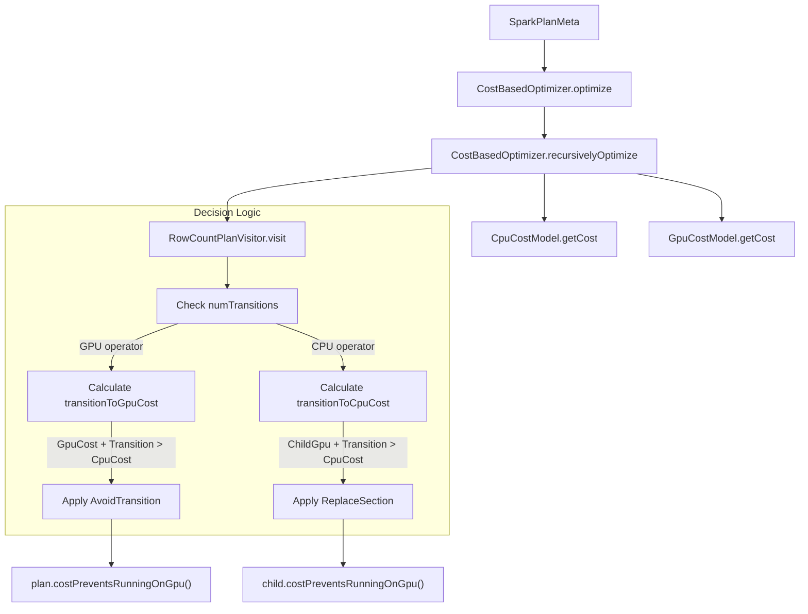
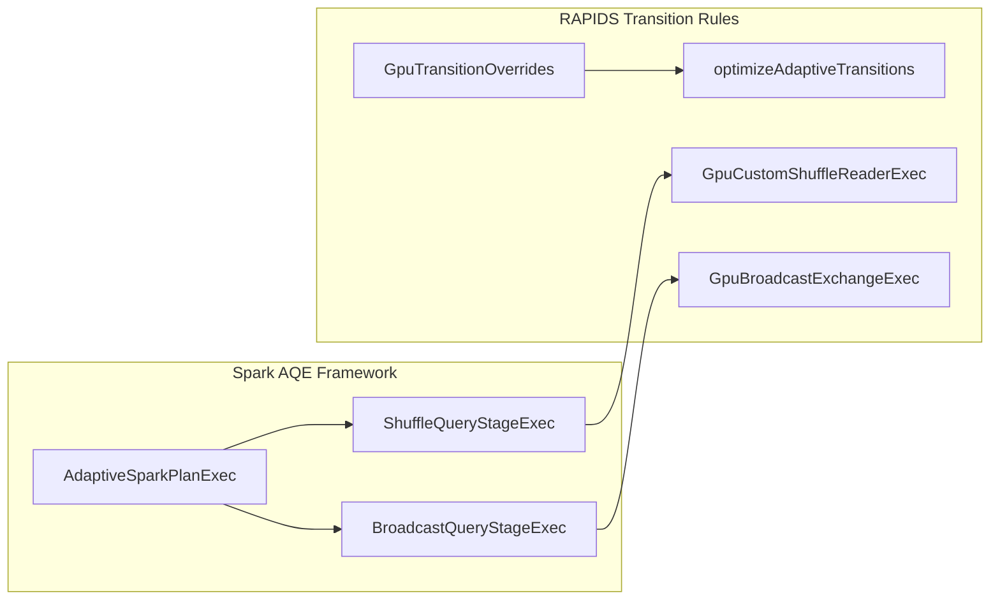

<!-- source: DeepWiki mcp.deepwiki.com · repo NVIDIA/cudf-spark · page 2.4 Cost-Based Optimizer & Adaptive Query Execution · fetched 2026-10-26 -->

# Cost-Based Optimizer & Adaptive Query Execution

Relevant source files

The following files were used as context for generating this wiki page:

- [integration_tests/src/main/python/aqe_test.py](integration_tests/src/main/python/aqe_test.py)
- [sql-plugin/src/main/scala/com/nvidia/spark/rapids/CostBasedOptimizer.scala](sql-plugin/src/main/scala/com/nvidia/spark/rapids/CostBasedOptimizer.scala)
- [sql-plugin/src/main/scala/com/nvidia/spark/rapids/GpuAggregateExec.scala](sql-plugin/src/main/scala/com/nvidia/spark/rapids/GpuAggregateExec.scala)
- [sql-plugin/src/main/scala/com/nvidia/spark/rapids/GpuTransitionOverrides.scala](sql-plugin/src/main/scala/com/nvidia/spark/rapids/GpuTransitionOverrides.scala)
- [sql-plugin/src/main/scala/com/nvidia/spark/rapids/SparkShims.scala](sql-plugin/src/main/scala/com/nvidia/spark/rapids/SparkShims.scala)
- [tests/src/test/scala/com/nvidia/spark/rapids/AdaptiveQueryExecSuite.scala](tests/src/test/scala/com/nvidia/spark/rapids/AdaptiveQueryExecSuite.scala)
- [tests/src/test/scala/com/nvidia/spark/rapids/BroadcastNestedLoopJoinSuite.scala](tests/src/test/scala/com/nvidia/spark/rapids/BroadcastNestedLoopJoinSuite.scala)
- [tests/src/test/scala/com/nvidia/spark/rapids/CostBasedOptimizerSuite.scala](tests/src/test/scala/com/nvidia/spark/rapids/CostBasedOptimizerSuite.scala)
- [tests/src/test/scala/com/nvidia/spark/rapids/CsvScanSuite.scala](tests/src/test/scala/com/nvidia/spark/rapids/CsvScanSuite.scala)
- [tests/src/test/scala/com/nvidia/spark/rapids/HashAggregatesSuite.scala](tests/src/test/scala/com/nvidia/spark/rapids/HashAggregatesSuite.scala)
- [tests/src/test/scala/com/nvidia/spark/rapids/SparkQueryCompareTestSuite.scala](tests/src/test/scala/com/nvidia/spark/rapids/SparkQueryCompareTestSuite.scala)

This page details the Cost-Based Optimizer (CBO) and Adaptive Query Execution (AQE) integration within the RAPIDS Accelerator for Apache Spark. It explains how the plugin evaluates the cost of operations on both CPU and GPU to avoid inefficient transitions, how it hooks into Spark's dynamic runtime optimization framework, and how custom shuffle readers manage partitioned columnar data.

---

## Cost-Based Optimizer (CBO) Architecture

The `CostBasedOptimizer` is an experimental component designed to balance the performance benefits of running query plan segments on the GPU against the overhead of transitioning data between CPU and GPU formats [sql-plugin/src/main/scala/com/nvidia/spark/rapids/CostBasedOptimizer.scala:49-54](). 

The optimizer implements the `Optimizer` trait and recursively walks the `SparkPlanMeta` tree, computing execution costs using two models: `CpuCostModel` and `GpuCostModel` [sql-plugin/src/main/scala/com/nvidia/spark/rapids/CostBasedOptimizer.scala:36-69]().

- **`CpuCostModel`**: Estimates execution costs for operators running on the host CPU.
- **`GpuCostModel`**: Estimates execution costs on the accelerator device, including computation and resource overhead.
- **`MemoryCostHelper`**: Used to estimate input/output data sizes and memory footprints [tests/src/test/scala/com/nvidia/spark/rapids/CostBasedOptimizerSuite.scala:61-76]().
- **`RowCountPlanVisitor`**: Traverses the plan tree to estimate output row counts for cost calculations [sql-plugin/src/main/scala/com/nvidia/spark/rapids/CostBasedOptimizer.scala:119]().

Sources: [sql-plugin/src/main/scala/com/nvidia/spark/rapids/CostBasedOptimizer.scala:36-77](), [tests/src/test/scala/com/nvidia/spark/rapids/CostBasedOptimizerSuite.scala:61-76]()

---

## Optimization Decisions: `AvoidTransition` and `ReplaceSection`

During traversal, the optimizer detects boundaries where operators switch execution domains (`numTransitions > 0`) [sql-plugin/src/main/scala/com/nvidia/spark/rapids/CostBasedOptimizer.scala:123-127](). Based on these evaluations, it applies two major optimizations:

1. **`AvoidTransition`**: Triggered when moving data to the GPU for an operator (such as a trivial projection) incurs a transition cost that exceeds the execution savings. The optimizer keeps the operator on the CPU and resets the GPU cost calculation for that node [sql-plugin/src/main/scala/com/nvidia/spark/rapids/CostBasedOptimizer.scala:141-149]().
2. **`ReplaceSection`**: Triggered when an entire GPU subtree—including the cost of moving data back to the CPU for downstream consumption—is more expensive than executing entirely on the CPU. The optimizer forces that specific section of the plan to revert to CPU execution [sql-plugin/src/main/scala/com/nvidia/spark/rapids/CostBasedOptimizer.scala:155-165]().

### Diagram: CBO Logic and Code Mapping

**Diagram 1: Cost-Based Optimizer Decision Logic with Code Entity Mapping**

Sources: [sql-plugin/src/main/scala/com/nvidia/spark/rapids/CostBasedOptimizer.scala:64-165]()

---

## Adaptive Query Execution (AQE) Integration

The RAPIDS Accelerator integrates tightly with Spark's Adaptive Query Execution (AQE) framework to dynamically optimize query execution plans at runtime. This is handled primarily by `GpuTransitionOverrides`, a catalyst `Rule[SparkPlan]` that runs after Spark inserts transitions [sql-plugin/src/main/scala/com/nvidia/spark/rapids/GpuTransitionOverrides.scala:46-50]().

### Handling Adaptive Transitions

- **Removal of Redundant `GpuBringBackToHost`**: Removes redundant `GpuBringBackToHost` operators at final query stages to allow Spark AQE to reuse shuffle executions or broadcast exchanges without unnecessary host round-trips [sql-plugin/src/main/scala/com/nvidia/spark/rapids/GpuTransitionOverrides.scala:99-106]().
- **Host-to-GPU Columnar Transition Replacement**: Replaces `HostColumnarToGpu(RowToColumnarExec)` with `GpuRowToColumnarExec` for efficient GPU ingestion [sql-plugin/src/main/scala/com/nvidia/spark/rapids/GpuTransitionOverrides.scala:109-120]().
- **AQE Exchange Adaptation**: Detects independent query stages and removes host conversion wrappers around `ShuffleExchangeLike` or `BroadcastExchangeLike` plans [sql-plugin/src/main/scala/com/nvidia/spark/rapids/GpuTransitionOverrides.scala:128-143]().
- **Project Injection**: Utilizes `readBufferConverter` to insert `ProjectExec` nodes after GPU transitions when buffer layout adjustments are required [sql-plugin/src/main/scala/com/nvidia/spark/rapids/GpuTransitionOverrides.scala:86-93]().

Sources: [sql-plugin/src/main/scala/com/nvidia/spark/rapids/GpuTransitionOverrides.scala:50-143]()

---

## Custom Shuffle Readers

When AQE coalesces partitions or handles data skew, custom shuffle readers become necessary for efficient columnar execution. The plugin implements `GpuCustomShuffleReaderExec` to wrap shuffle query stages with GPU-aware reading logic.

- **Partition Metrics**: Records partition sizes (`PARTITION_SIZE`), number of partitions read (`NUM_PARTITIONS`), and execution timing (`OP_TIME_NEW_SHUFFLE_READ`).
- **Dynamic Output Partitioning**: Adapts output partitioning based on local reads, coalesced blocks, or skewed partition specs to maintain full compatibility with Spark AQE optimizations [tests/src/test/scala/com/nvidia/spark/rapids/AdaptiveQueryExecSuite.scala:55-78]().

### Diagram: AQE Integration Flow

**Diagram 2: RAPIDS AQE Integration and Transition Handling**

Sources: [sql-plugin/src/main/scala/com/nvidia/spark/rapids/GpuTransitionOverrides.scala:43-143](), [tests/src/test/scala/com/nvidia/spark/rapids/AdaptiveQueryExecSuite.scala:55-78]()

---

## AQE Transition Optimization Scenarios

| Scenario | Plugin Action | File Reference |
|---|---|---|
| Post-Shuffle Coalescing | Injects `GpuCoalesceBatches` or `GpuShuffleCoalesceExec` based on shuffle configuration. | [sql-plugin/src/main/scala/com/nvidia/spark/rapids/GpuTransitionOverrides.scala:75-81]() |
| Project Injection | Applies optional buffer conversion project via `readBufferConverter` during plan transitions. | [sql-plugin/src/main/scala/com/nvidia/spark/rapids/GpuTransitionOverrides.scala:86-93]() |
| Exchange Reuse Removal | Detects and removes `GpuBringBackToHost` around reused exchanges for AQE compatibility. | [sql-plugin/src/main/scala/com/nvidia/spark/rapids/GpuTransitionOverrides.scala:129-143]() |
| Broadcast to Row Conversion | Uses `GpuBroadcastToRowExec` when broadcasted data is consumed by CPU operators. | [sql-plugin/src/main/scala/com/nvidia/spark/rapids/GpuTransitionOverrides.scala:43]() |

Sources: [sql-plugin/src/main/scala/com/nvidia/spark/rapids/GpuTransitionOverrides.scala:43-143]()

---

