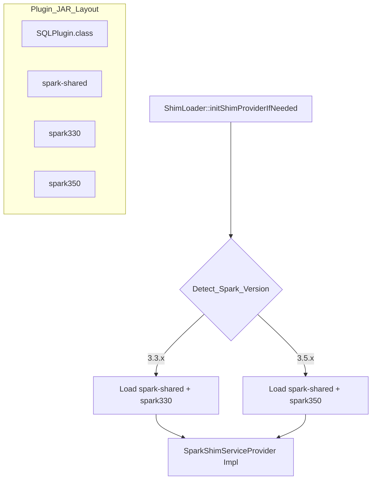
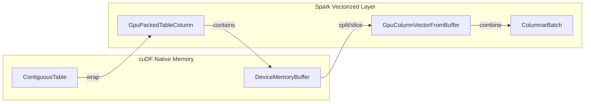
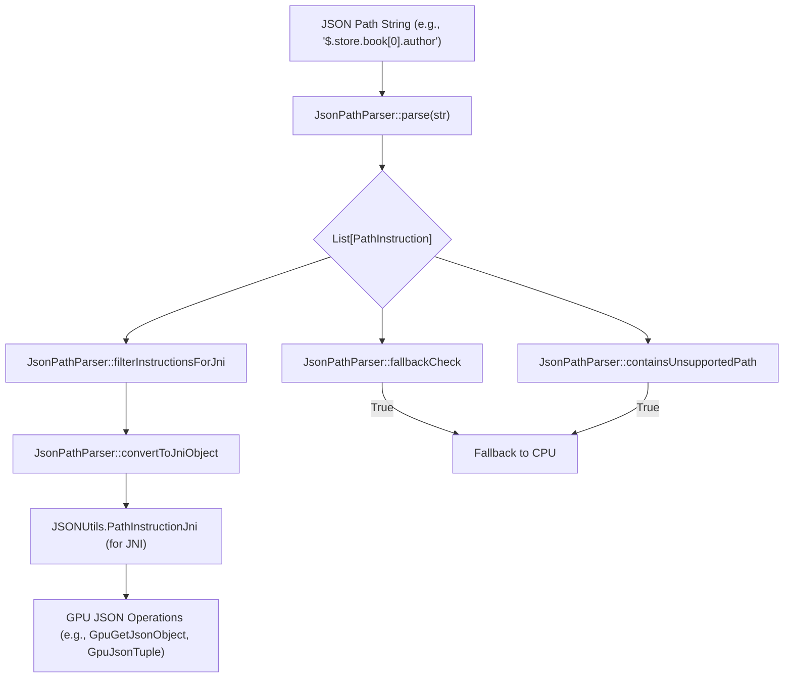
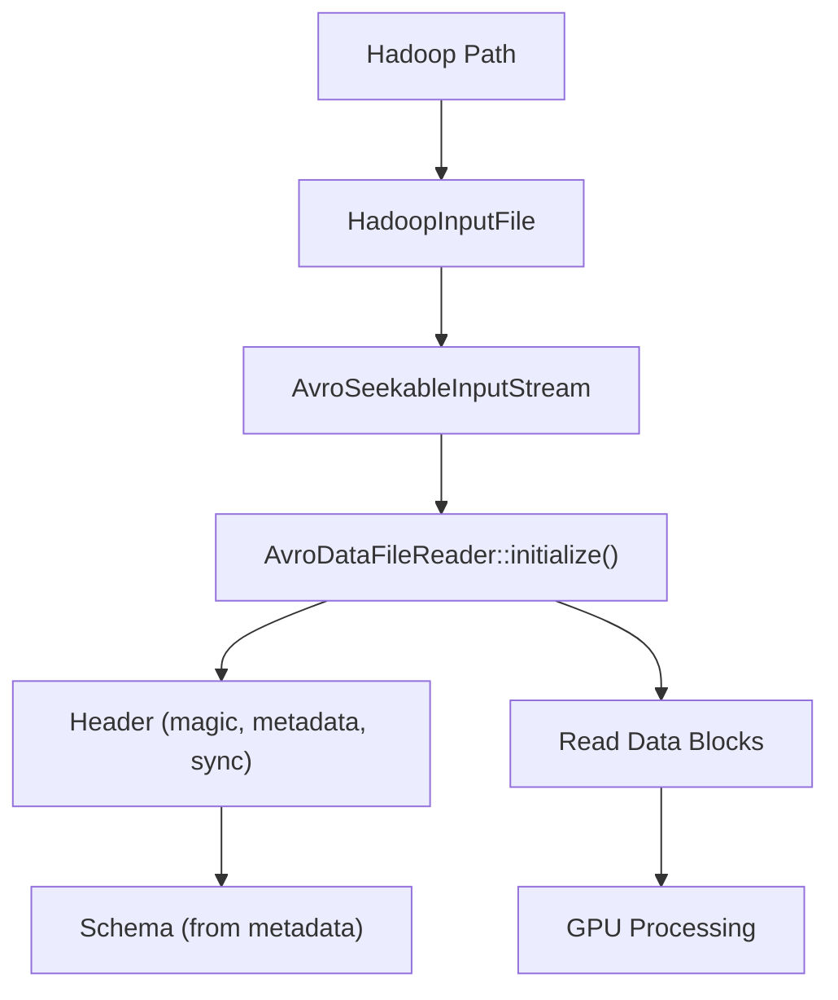
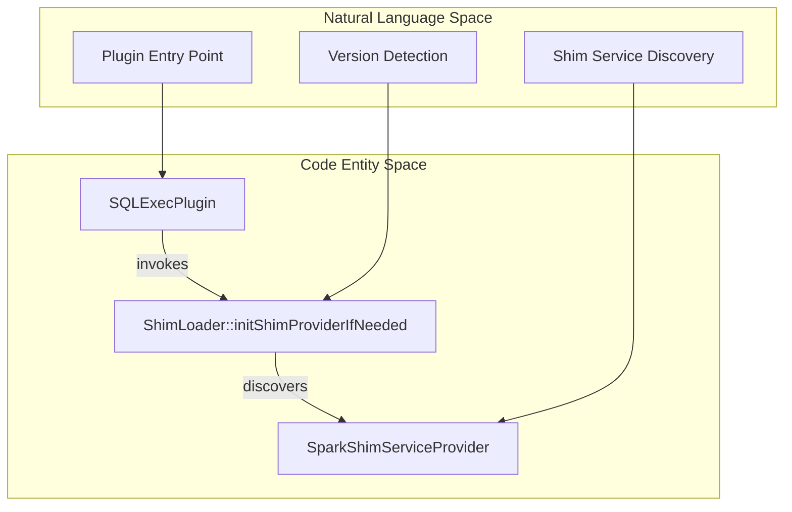
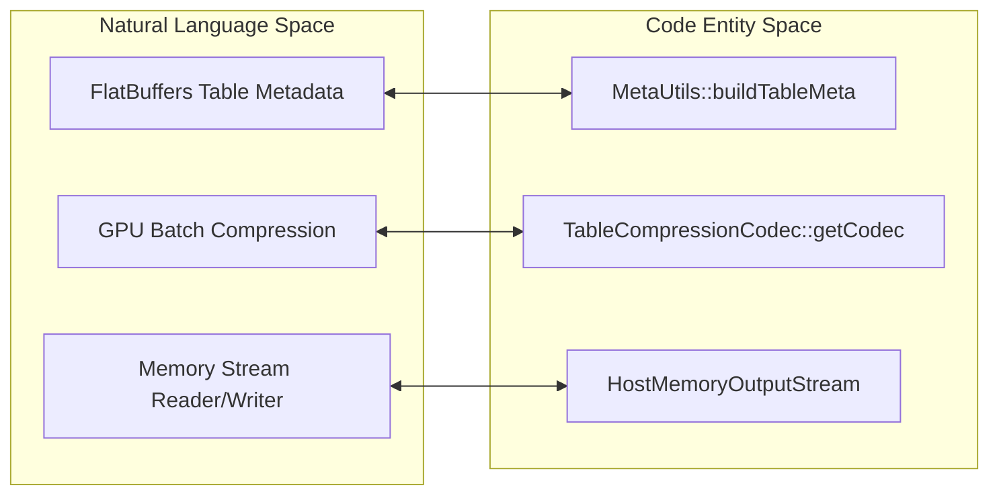

<!-- source: DeepWiki mcp.deepwiki.com · repo NVIDIA/cudf-spark · page 2.5 Public Plugin API (sql-plugin-api) · fetched 2026-10-26 -->

# Public Plugin API (sql-plugin-api)

Relevant source files

The following files were used as context for generating this wiki page:

- [dist/root-safe-module-classes.txt](dist/root-safe-module-classes.txt)
- [iceberg-common/src/main/scala/com/nvidia/spark/rapids/iceberg/spark/GpuSparkSQLProperties.scala](iceberg-common/src/main/scala/com/nvidia/spark/rapids/iceberg/spark/GpuSparkSQLProperties.scala)
- [integration_tests/src/main/python/avro_test.py](integration_tests/src/main/python/avro_test.py)
- [scala2.13/api_validation/pom.xml](scala2.13/api_validation/pom.xml)
- [scala2.13/sql-plugin-api/pom.xml](scala2.13/sql-plugin-api/pom.xml)
- [sql-plugin-api/pom.xml](sql-plugin-api/pom.xml)
- [sql-plugin-api/src/main/scala/com/nvidia/spark/rapids/AvroBlockInfo.scala](sql-plugin-api/src/main/scala/com/nvidia/spark/rapids/AvroBlockInfo.scala)
- [sql-plugin-api/src/main/scala/com/nvidia/spark/rapids/LineBufferer.scala](sql-plugin-api/src/main/scala/com/nvidia/spark/rapids/LineBufferer.scala)
- [sql-plugin-api/src/main/scala/com/nvidia/spark/rapids/MultiFileReaderContracts.scala](sql-plugin-api/src/main/scala/com/nvidia/spark/rapids/MultiFileReaderContracts.scala)
- [sql-plugin-api/src/main/scala/com/nvidia/spark/rapids/OrcReaderMetadata.scala](sql-plugin-api/src/main/scala/com/nvidia/spark/rapids/OrcReaderMetadata.scala)
- [sql-plugin-api/src/main/scala/com/nvidia/spark/rapids/parquet/ParquetSchemaWrapper.scala](sql-plugin-api/src/main/scala/com/nvidia/spark/rapids/parquet/ParquetSchemaWrapper.scala)
- [sql-plugin-api/src/main/scala/org/apache/spark/sql/rapids/AvroReaderMetadata.scala](sql-plugin-api/src/main/scala/org/apache/spark/sql/rapids/AvroReaderMetadata.scala)
- [sql-plugin-columnar/src/main/java/com/nvidia/spark/rapids/FloatUtils.java](sql-plugin-columnar/src/main/java/com/nvidia/spark/rapids/FloatUtils.java)
- [sql-plugin-columnar/src/main/java/com/nvidia/spark/rapids/GpuColumnVectorBase.java](sql-plugin-columnar/src/main/java/com/nvidia/spark/rapids/GpuColumnVectorBase.java)
- [sql-plugin-columnar/src/main/java/com/nvidia/spark/rapids/GpuPackedTableColumn.java](sql-plugin-columnar/src/main/java/com/nvidia/spark/rapids/GpuPackedTableColumn.java)
- [sql-plugin-columnar/src/main/java/com/nvidia/spark/rapids/WithTableBuffer.java](sql-plugin-columnar/src/main/java/com/nvidia/spark/rapids/WithTableBuffer.java)
- [sql-plugin-columnar/src/main/scala/com/nvidia/spark/rapids/HostMemoryStreams.scala](sql-plugin-columnar/src/main/scala/com/nvidia/spark/rapids/HostMemoryStreams.scala)
- [sql-plugin-columnar/src/main/scala/com/nvidia/spark/rapids/SpillPriorities.scala](sql-plugin-columnar/src/main/scala/com/nvidia/spark/rapids/SpillPriorities.scala)
- [sql-plugin-fileio/src/main/java/com/nvidia/spark/rapids/fileio/hadoop/HadoopInputFile.java](sql-plugin-fileio/src/main/java/com/nvidia/spark/rapids/fileio/hadoop/HadoopInputFile.java)
- [sql-plugin-fileio/src/main/java/com/nvidia/spark/rapids/fileio/hadoop/HadoopInputStream.java](sql-plugin-fileio/src/main/java/com/nvidia/spark/rapids/fileio/hadoop/HadoopInputStream.java)
- [sql-plugin-fileio/src/main/java/com/nvidia/spark/rapids/fileio/hadoop/HadoopOutputFile.java](sql-plugin-fileio/src/main/java/com/nvidia/spark/rapids/fileio/hadoop/HadoopOutputFile.java)
- [sql-plugin-fileio/src/main/java/com/nvidia/spark/rapids/fileio/hadoop/HadoopOutputStream.java](sql-plugin-fileio/src/main/java/com/nvidia/spark/rapids/fileio/hadoop/HadoopOutputStream.java)
- [sql-plugin/src/main/scala/com/nvidia/spark/rapids/AvroDataFileReader.scala](sql-plugin/src/main/scala/com/nvidia/spark/rapids/AvroDataFileReader.scala)
- [sql-plugin/src/main/scala/com/nvidia/spark/rapids/GpuRunnableCommand.scala](sql-plugin/src/main/scala/com/nvidia/spark/rapids/GpuRunnableCommand.scala)

The `sql-plugin-api` module of the RAPIDS Accelerator for Apache Spark exposes a stable public API surface designed for integration and extension of GPU acceleration capabilities. This module acts as the bridge between the version-independent plugin core and the version-specific Spark internals, while also providing utility functions and helper modules for GPU columnar data manipulation, format management, and memory buffering.

---

## Purpose and Scope

The main purpose of this module is to define the contract for GPU acceleration plugin features, abstract differences between Spark versions, provide utility operations for GPU columnar data, and enable UDF plugin support. By isolating these public APIs into a separate module, the RAPIDS Accelerator ensures binary compatibility across multiple Spark distributions including Apache Spark, Databricks, EMR, and GCP. Supplementary helper modules such as `sql-plugin-columnar`, format handlers, and file I/O utilities further support specialized use cases.

Key exposed classes, interfaces, and utility modules include:
- `ShimLoader` — isolates classloading and dynamic discovery of version-specific Spark shims [sql-plugin-api/pom.xml:32-37]().
- `SparkShimServiceProvider` — factory interface for version-specific plugin implementations.
- `ColumnarRdd` — abstraction for GPU-native columnar RDDs.
- `DFUDFPluginAPI` — interface for GPU-enabled UDF registration.
- `Functions` — GPU-accelerated SQL function implementations.
- `GpuColumnVectorUtils` — utilities to interact with RAPIDS cuDF columns and vectors.
- `sql-plugin-columnar`/`format`/`fileio` — helper modules for columnar data format and file I/O [sql-plugin-api/pom.xml:29-37](), [scala2.13/sql-plugin-api/pom.xml:29-37]().

Sources: [sql-plugin-api/pom.xml:1-44](), [scala2.13/sql-plugin-api/pom.xml:1-44]()

---

## 1. ShimLoader & SparkShimServiceProvider

The `ShimLoader` class provides the core mechanism to load and access the appropriate Spark shim implementation based on the runtime Spark version. As Spark internal APIs and classes differ across versions, the RAPIDS Accelerator uses a shim layer to encapsulate version-specific logic and present a uniform API to the common plugin code.

### Responsibilities
- **Parallel Worlds Loading**: The plugin JAR is structured with multiple parallel worlds, each representing a Spark version, inside the same archive. `ShimLoader` creates a dedicated classloader to isolate the correct shim classes for the detected Spark version.
- **Version Detection & Dynamic Discovery**: At initialization, `ShimLoader` detects the running Spark version and loads the matching implementation of `SparkShimServiceProvider`.
- **Classloader Isolation**: Maintains a version-specific classloader scoped to the minimal required shim folders.

### Diagram: Shim Loading Architecture

Sources: [sql-plugin-api/pom.xml:32-37]()

---

## 2. Columnar Abstractions & Buffer Helpers (`sql-plugin-columnar`)

The `sql-plugin-columnar` module houses lower-level columnar abstractions, memory buffer wrappers, and stream handlers that interface directly with cuDF device buffers.

### Key Classes
- `GpuPackedTableColumn`: Tracks a packed table (such as one generated by `contiguousSplit`) without requiring individual child columns to be manifested [sql-plugin-columnar/src/main/java/com/nvidia/spark/rapids/GpuPackedTableColumn.java:37-40](). It implements `WithTableBuffer` and wraps a `ContiguousTable` [sql-plugin-columnar/src/main/java/com/nvidia/spark/rapids/GpuPackedTableColumn.java:37-58]().
- `GpuColumnVectorFromBuffer`: Represents a GPU column vector carved from a single contiguous device buffer, allowing multiple columns to share backing memory and layout metadata (`TableMeta`).
- `HostMemoryOutputStream` / `HostMemoryInputStream`: Provide standard Java stream interfaces (`OutputStream`, `InputStream`) over cuDF `HostMemoryBuffer` instances for serialized data transfer and spill operations [sql-plugin-columnar/src/main/scala/com/nvidia/spark/rapids/HostMemoryStreams.scala:32-84](), [sql-plugin-columnar/src/main/scala/com/nvidia/spark/rapids/HostMemoryStreams.scala:173-176]().

### Diagram: Columnar Buffer Lifecycle

Sources: [sql-plugin-columnar/src/main/java/com/nvidia/spark/rapids/GpuPackedTableColumn.java:37-80]()

---

## 3. Metadata & Compression Utilities (`MetaUtils` & `TableCompressionCodec`)

### MetaUtils
`MetaUtils` constructs and parses FlatBuffer-backed table metadata (`TableMeta` and `BufferMeta`) used during shuffle data exchange and columnar caching. It handles building table metadata from contiguous tables or compressed vectors.

### TableCompressionCodec
Defines the compression interface for contiguous tables on the GPU, supporting codecs like `nvcomp-LZ4`, `nvcomp-ZSTD`, and `copy` (uncompressed). It provides batched compression and decompression pipelines (`BatchedTableCompressor`, `BatchedBufferDecompressor`).

Sources: `sql-plugin/src/main/scala/com/nvidia/spark/rapids/MetaUtils.scala`, `sql-plugin/src/main/scala/com/nvidia/spark/rapids/TableCompressionCodec.scala`

---

## 4. Spill Priorities & Numerical Utilities (`SpillPriorities` & `FloatUtils`)

### SpillPriorities
Defines numerical priority constants used by the spill framework to manage device memory pressure, ensuring proper eviction ordering for shuffle outputs, active iterators, and cached buffers [sql-plugin-columnar/src/main/scala/com/nvidia/spark/rapids/SpillPriorities.scala:24-54]().

### FloatUtils
Provides GPU-accelerated utilities for handling floating-point edge cases such as NaN-to-zero conversion and infinity replacement on cuDF column vectors [sql-plugin-columnar/src/main/java/com/nvidia/spark/rapids/FloatUtils.java:24-62]().

Sources: [sql-plugin-columnar/src/main/scala/com/nvidia/spark/rapids/SpillPriorities.scala:24-54](), [sql-plugin-columnar/src/main/java/com/nvidia/spark/rapids/FloatUtils.java:24-62]()

---

## 5. JSON Path Parsing (`JsonPathParser`)

The `JsonPathParser` object provides utilities for parsing JSON path strings into a list of `PathInstruction` objects, which are then used by GPU-accelerated JSON functions like `GpuGetJsonObject` and `GpuJsonTuple`.

### Key Functions
- `parse(str: String)`: Parses a JSON path string into a `List[PathInstruction]` [sql-plugin/src/main/scala/com/nvidia/spark/rapids/GpuGetJsonObject.scala:48]().
- `filterInstructionsForJni(instructions: List[PathInstruction])`: Filters out instructions not needed by the JNI implementation [sql-plugin/src/main/scala/com/nvidia/spark/rapids/GpuGetJsonObject.scala:51-56]().
- `fallbackCheck(instructions: List[PathInstruction])`: Checks if the path depth exceeds the maximum supported by the GPU, triggering a fallback to CPU if necessary [sql-plugin/src/main/scala/com/nvidia/spark/rapids/GpuGetJsonObject.scala:58-59]().
- `convertToJniObject(instructions: List[PathInstruction])`: Converts `PathInstruction` objects into JNI-compatible `JSONUtils.PathInstructionJni` objects for native processing [sql-plugin/src/main/scala/com/nvidia/spark/rapids/GpuGetJsonObject.scala:71-83]().
- `containsUnsupportedPath(instructions: List[PathInstruction])`: Checks for unsupported path features like wildcards, which would cause a fallback [sql-plugin/src/main/scala/com/nvidia/spark/rapids/GpuGetJsonObject.scala:85-93]().

### Diagram: JSON Path Processing Flow

Sources: [sql-plugin/src/main/scala/com/nvidia/spark/rapids/GpuGetJsonObject.scala:38-105](), [sql-plugin/src/main/scala/com/nvidia/spark/rapids/GpuJsonTuple.scala:67-76]()

---

## 6. File I/O Helper Modules (`sql-plugin-fileio`, `sql-plugin-format`)

The `sql-plugin-fileio` and `sql-plugin-format` modules provide abstractions and implementations for GPU-accelerated file input/output operations, including handling various file formats like Avro.

### `sql-plugin-fileio`
This module contains Hadoop-specific input/output stream and file abstractions, such as `HadoopInputFile`, `HadoopInputStream`, `HadoopOutputFile`, and `HadoopOutputStream`. These classes bridge standard Java I/O with Hadoop's file system APIs, enabling GPU operations to interact with distributed storage.

### `sql-plugin-format`
This module defines interfaces and classes for handling specific file formats. For example, `AvroDataFileReader` and `Header` are part of this module (or closely related within `sql-plugin`) and provide the necessary logic to read Avro file headers and data blocks.

#### `AvroDataFileReader`
This class is responsible for reading Avro data files. It handles the Avro file header, including magic bytes, metadata, and sync markers [sql-plugin/src/main/scala/com/nvidia/spark/rapids/AvroDataFileReader.scala:153-183](). It also provides methods for seeking within the file and skipping data [sql-plugin/src/main/scala/com/nvidia/spark/rapids/AvroDataFileReader.scala:144-147]().

#### `Header`
Represents the header information of an Avro file, including metadata (schema, codec) and the sync marker [sql-plugin/src/main/scala/com/nvidia/spark/rapids/AvroDataFileReader.scala:74-81](). It provides methods to access the schema and merge metadata from multiple headers [sql-plugin/src/main/scala/com/nvidia/spark/rapids/AvroDataFileReader.scala:83-87](), [sql-plugin/src/main/scala/com/nvidia/spark/rapids/AvroDataFileReader.scala:109-117]().

### Diagram: Avro File Reading Process

Sources: [sql-plugin/src/main/scala/com/nvidia/spark/rapids/AvroDataFileReader.scala:131-183](), [sql-plugin/src/main/scala/com/nvidia/spark/rapids/AvroDataFileReader.scala:74-91]()

---

## Bridging Natural Language to Code Entity

### Plugin Initialization and Shim Discovery

Sources: [sql-plugin-api/pom.xml:1-44](), [scala2.13/sql-plugin-api/pom.xml:1-44]()

### Metadata and Compression Mapping

Sources: `sql-plugin/src/main/scala/com/nvidia/spark/rapids/MetaUtils.scala`, `sql-plugin/src/main/scala/com/nvidia/spark/rapids/TableCompressionCodec.scala`, [sql-plugin-columnar/src/main/scala/com/nvidia/spark/rapids/HostMemoryStreams.scala:32-84]()

---

## Summary of Key Public API Classes

| Class / Module Name | Description | Purpose / Usage |
|--------------------|-------------|-----------------|
| `ShimLoader` | Core classloader and shim discovery logic | Dynamic loading of version-specific shims [sql-plugin-api/pom.xml:32-37]() |
| `SparkShimServiceProvider` | Factory interface for version-specific components | Abstracts Spark API version differences |
| `GpuPackedTableColumn` | GPU column tracking packed contiguous tables | Manages task output partitions without expanding child columns [sql-plugin-columnar/src/main/java/com/nvidia/spark/rapids/GpuPackedTableColumn.java:37-40]() |
| `GpuColumnVectorFromBuffer` | Column vector carved from a single contiguous buffer | Shares memory and metadata across columns |
| `MetaUtils` | FlatBuffers metadata builder and parser | Encodes/decodes table layout for shuffle and cache |
| `TableCompressionCodec` | Interface for GPU-accelerated table compression | Manages `nvcomp-LZ4`, `nvcomp-ZSTD`, and `copy` codecs |
| `SpillPriorities` | Priority constants for memory spilling | Controls buffer eviction order under OOM conditions [sql-plugin-columnar/src/main/scala/com/nvidia/spark/rapids/SpillPriorities.scala:24-54]() |
| `JsonPathParser` | Utility for parsing JSON path strings | Used by GPU JSON functions like `get_json_object` and `json_tuple` [sql-plugin/src/main/scala/com/nvidia/spark/rapids/GpuGetJsonObject.scala:38-105]() |
| `AvroDataFileReader` | Reads Avro data files on GPU | Handles Avro file headers and data blocks [sql-plugin/src/main/scala/com/nvidia/spark/rapids/AvroDataFileReader.scala:131-183]() |
| `Header` | Represents Avro file header information | Contains metadata and sync marker for Avro files [sql-plugin/src/main/scala/com/nvidia/spark/rapids/AvroDataFileReader.scala:74-91]() |

Sources:
- [sql-plugin-api/pom.xml:1-44]()
- [scala2.13/sql-plugin-api/pom.xml:1-44]()
- `sql-plugin/src/main/scala/com/nvidia/spark/rapids/MetaUtils.scala`
- [sql-plugin-columnar/src/main/java/com/nvidia/spark/rapids/GpuPackedTableColumn.java:37-80]()
- `sql-plugin/src/main/java/com/nvidia/spark/rapids/GpuColumnVectorFromBuffer.java`
- `sql-plugin/src/main/scala/com/nvidia/spark/rapids/TableCompressionCodec.scala`
- [sql-plugin-columnar/src/main/scala/com/nvidia/spark/rapids/SpillPriorities.scala:24-54]()
- [sql-plugin/src/main/scala/com/nvidia/spark/rapids/GpuGetJsonObject.scala:38-105]()
- [sql-plugin/src/main/scala/com/nvidia/spark/rapids/AvroDataFileReader.scala:131-183]()
- [sql-plugin/src/main/scala/com/nvidia/spark/rapids/AvroDataFileReader.scala:74-91]()

---

