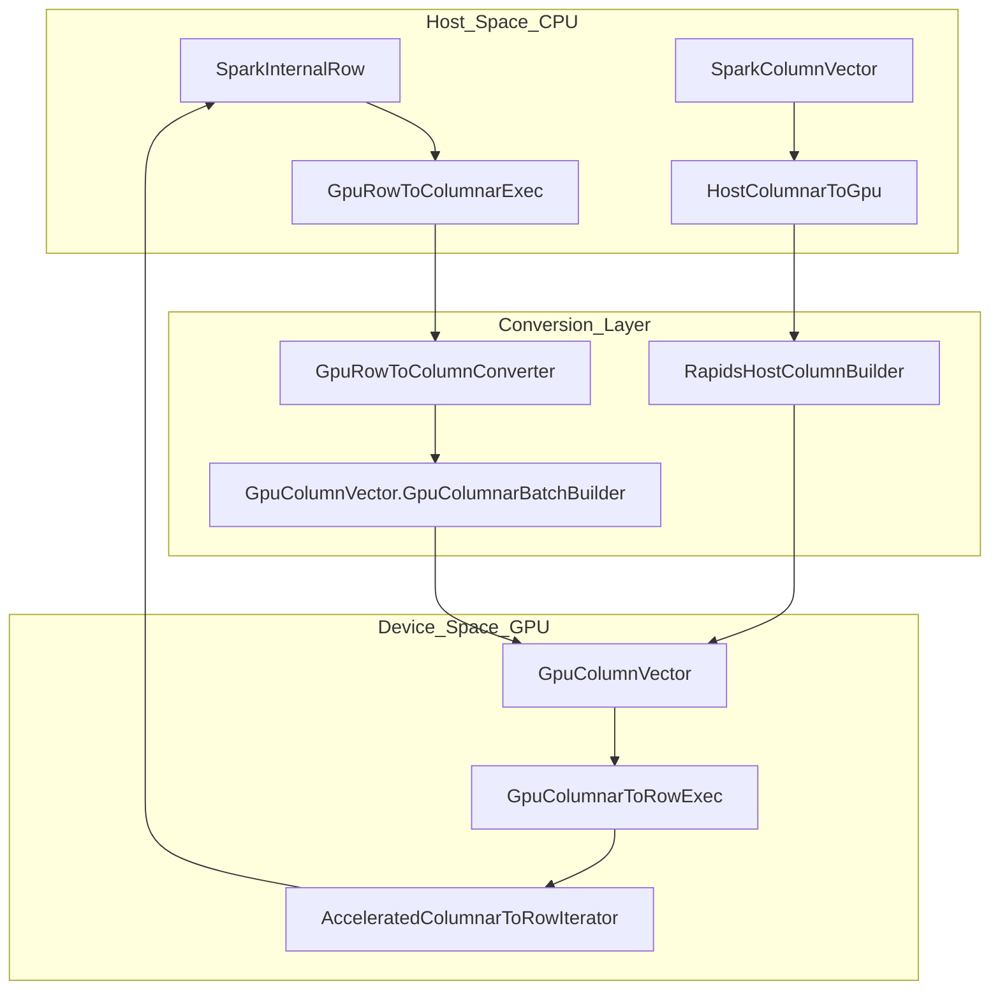
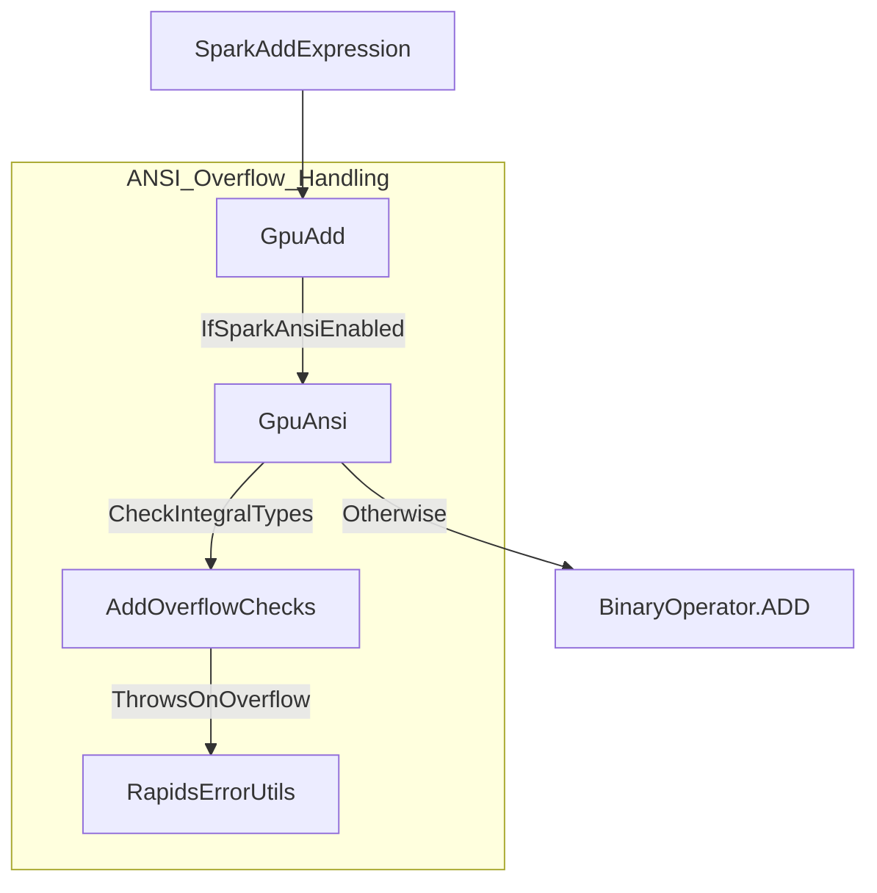
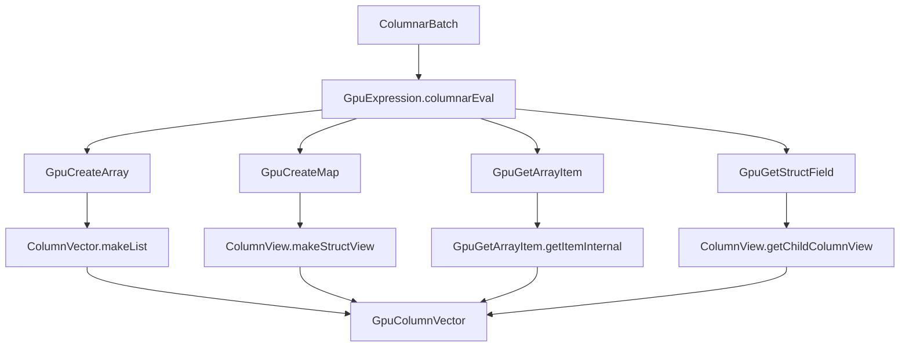

<!-- source: DeepWiki mcp.deepwiki.com · repo NVIDIA/cudf-spark · page 3 GPU Expression & Operator Implementations · fetched 2026-10-26 -->

# GPU Expression & Operator Implementations

Relevant source files

The following files were used as context for generating this wiki page:

- [integration_tests/src/main/python/arithmetic_ops_test.py](integration_tests/src/main/python/arithmetic_ops_test.py)
- [integration_tests/src/main/python/array_test.py](integration_tests/src/main/python/array_test.py)
- [integration_tests/src/main/python/collection_ops_test.py](integration_tests/src/main/python/collection_ops_test.py)
- [integration_tests/src/main/python/map_test.py](integration_tests/src/main/python/map_test.py)
- [integration_tests/src/main/python/struct_test.py](integration_tests/src/main/python/struct_test.py)
- [sql-plugin/src/main/scala/com/nvidia/spark/rapids/GpuCanonicalize.scala](sql-plugin/src/main/scala/com/nvidia/spark/rapids/GpuCanonicalize.scala)
- [sql-plugin/src/main/scala/com/nvidia/spark/rapids/GpuExpressions.scala](sql-plugin/src/main/scala/com/nvidia/spark/rapids/GpuExpressions.scala)
- [sql-plugin/src/main/scala/com/nvidia/spark/rapids/higherOrderFunctions.scala](sql-plugin/src/main/scala/com/nvidia/spark/rapids/higherOrderFunctions.scala)
- [sql-plugin/src/main/scala/com/nvidia/spark/rapids/nullExpressions.scala](sql-plugin/src/main/scala/com/nvidia/spark/rapids/nullExpressions.scala)
- [sql-plugin/src/main/scala/org/apache/spark/sql/rapids/arithmetic.scala](sql-plugin/src/main/scala/org/apache/spark/sql/rapids/arithmetic.scala)
- [sql-plugin/src/main/scala/org/apache/spark/sql/rapids/bitwise.scala](sql-plugin/src/main/scala/org/apache/spark/sql/rapids/bitwise.scala)
- [sql-plugin/src/main/scala/org/apache/spark/sql/rapids/collectionOperations.scala](sql-plugin/src/main/scala/org/apache/spark/sql/rapids/collectionOperations.scala)
- [sql-plugin/src/main/scala/org/apache/spark/sql/rapids/complexTypeCreator.scala](sql-plugin/src/main/scala/org/apache/spark/sql/rapids/complexTypeCreator.scala)
- [sql-plugin/src/main/scala/org/apache/spark/sql/rapids/complexTypeExtractors.scala](sql-plugin/src/main/scala/org/apache/spark/sql/rapids/complexTypeExtractors.scala)
- [sql-plugin/src/main/scala/org/apache/spark/sql/rapids/mathExpressions.scala](sql-plugin/src/main/scala/org/apache/spark/sql/rapids/mathExpressions.scala)
- [sql-plugin/src/main/spark330db/scala/com/nvidia/spark/rapids/shims/DecimalArithmeticOverrides.scala](sql-plugin/src/main/spark330db/scala/com/nvidia/spark/rapids/shims/DecimalArithmeticOverrides.scala)
- [sql-plugin/src/main/spark330db/scala/org/apache/spark/sql/rapids/arithmetic.scala](sql-plugin/src/main/spark330db/scala/org/apache/spark/sql/rapids/arithmetic.scala)
- [tests/src/test/scala/com/nvidia/spark/rapids/LogOperatorUnitTestSuite.scala](tests/src/test/scala/com/nvidia/spark/rapids/LogOperatorUnitTestSuite.scala)
- [tests/src/test/scala/org/apache/spark/sql/rapids/catalyst/expressions/GpuEquivalentExpressionsSuite.scala](tests/src/test/scala/org/apache/spark/sql/rapids/catalyst/expressions/GpuEquivalentExpressionsSuite.scala)

This page provides a high-level overview of how Spark expressions and physical operators are implemented and accelerated on the GPU within the RAPIDS Accelerator for Apache Spark. The plugin intercepts Spark's logical and physical plans, replacing CPU-bound operations with GPU-accelerated equivalents where possible. This involves converting data to a GPU-compatible columnar format (`GpuColumnVector`), executing operations using the cuDF library, and converting results back to Spark's native formats when necessary [sql-plugin/src/main/scala/com/nvidia/spark/rapids/GpuExpressions.scala:139-176]().

As a parent page, this document outlines the major architectural categories and delegates deep technical details, implementation specifics, and corner cases to the dedicated child pages.

Sources:
- [sql-plugin/src/main/scala/com/nvidia/spark/rapids/GpuExpressions.scala:139-176]()

---

## GpuColumnVector & Row/Columnar Conversion

At the core of GPU acceleration in Spark is the GPU columnar data structure, `GpuColumnVector`. It wraps a cuDF `ColumnVector` and provides Spark integration including memory management, data type mapping, and debugging utilities [sql-plugin/src/main/scala/com/nvidia/spark/rapids/GpuExpressions.scala:139-176]().

To bridge between Spark's row-based processing and the GPU's columnar format, the plugin implements operators for converting between rows and columnar batches:
- `GpuRowToColumnarExec` converts Spark `InternalRow`s into GPU columnar batches.
- `GpuColumnarToRowExec` converts GPU columnar batches back into Spark's row format.
- `HostColumnarToGpu` efficiently transfers host columnar formats such as Apache Arrow into GPU memory.

The plugin employs Arm resource management techniques and retry-safe iterators to handle GPU out-of-memory conditions gracefully by splitting and retrying batches as needed [sql-plugin/src/main/scala/com/nvidia/spark/rapids/GpuExpressions.scala:32-133](). For details, see [GpuColumnVector & Row/Columnar Conversion](#3.1).

### Diagram: GPU Columnar Conversion Data Flow

Sources:
- [sql-plugin/src/main/scala/com/nvidia/spark/rapids/GpuExpressions.scala:32-176]()

---

## Arithmetic, Math & Bitwise Expressions

GPU-accelerated arithmetic and math expressions are implemented in `arithmetic.scala` and `mathExpressions.scala`. This includes basic arithmetic operators like addition, subtraction, multiplication (`GpuAdd`, `GpuSubtract`, `GpuMultiply`), unary operations (`GpuUnaryMinus`), and a suite of math functions such as trigonometric and logarithmic operations (`GpuAcos`, `GpuAsinh`, `GpuToDegrees`, `GpuBin`, `GpuHex`, etc.) [sql-plugin/src/main/scala/org/apache/spark/sql/rapids/arithmetic.scala:1-125]() [sql-plugin/src/main/scala/org/apache/spark/sql/rapids/mathExpressions.scala:32-70]().

A special focus is on ANSI SQL-compliant overflow detection for integral types when `spark.sql.ansi.enabled` is set. The plugin implements overflow checks that compare sign bits of operands and result and raise exceptions on overflow to match CPU Spark behavior [integration_tests/src/main/python/arithmetic_ops_test.py:110-132]() [sql-plugin/src/main/scala/org/apache/spark/sql/rapids/arithmetic.scala:38-125]().

Bitwise operations and logical predicate expressions are also covered, all implemented to closely follow Spark semantics on the GPU [sql-plugin/src/main/scala/org/apache/spark/sql/rapids/arithmetic.scala:1-125](). Null-related expressions ensure correct GPU-enabled handling of null values [sql-plugin/src/main/scala/com/nvidia/spark/rapids/GpuExpressions.scala:32-108]().

For detailed descriptions and test coverage, see [Arithmetic, Math & Bitwise Expressions](#3.2).

### Diagram: GPU Arithmetic Expression and ANSI Overflow Flow

Sources:
- [integration_tests/src/main/python/arithmetic_ops_test.py:110-132]()
- [sql-plugin/src/main/scala/org/apache/spark/sql/rapids/arithmetic.scala:38-125]()
- [sql-plugin/src/main/scala/org/apache/spark/sql/rapids/mathExpressions.scala:32-70]()
- [sql-plugin/src/main/scala/com/nvidia/spark/rapids/GpuExpressions.scala:32-108]()

---

## String & Regular Expression Expressions

GPU acceleration includes many string functions such as concatenation, substring, and conversion operators. Regular expressions are handled via a multi-stage transpilation pipeline where Spark regex patterns are converted to cuDF-compatible regex ASTs by the `CudfRegexTranspiler`. This allows native execution on the GPU using cuDF regex matching capabilities.

Complex string parsing functions like URL parsing are also accelerated, with fallback mechanisms in place when GPU support is unavailable or conditions are not met [integration_tests/src/main/python/collection_ops_test.py:83-99]().

For comprehensive details and fallback handling, see [String & Regular Expression Expressions](#3.3).

Sources:
- [integration_tests/src/main/python/collection_ops_test.py:83-99]()

---

## Cast, Date/Time & Decimal Expressions

Casting between data types is a fundamental operation handled by `GpuCast` which utilizes cuDF casting capabilities along with JNI extensions for specialized needs.

Date and time GPU expressions leverage utility classes managing time zone conversions, Julian-Gregorian calendar rebasing, and date arithmetic with cuDF acceleration.

High-precision decimal operations support up to 38 digits precision (128-bit decimals). Arithmetic on decimals includes overflow checks and ANSI compliance similar to integral arithmetic [sql-plugin/src/main/scala/org/apache/spark/sql/rapids/arithmetic.scala:77-125]().

For more detailed implementations and corner cases, see [Cast, Date/Time & Decimal Expressions](#3.4).

Sources:
- [sql-plugin/src/main/scala/org/apache/spark/sql/rapids/arithmetic.scala:77-125]()

---

## Complex Types, Collections & Higher-Order Functions

GPU support is extended to complex data types including arrays, maps, and structs. Expressions such as `GpuGetArrayItem` and `GpuGetStructField` handle extracting nested data from these complex types efficiently on the GPU [sql-plugin/src/main/scala/org/apache/spark/sql/rapids/complexTypeExtractors.scala:36-111]().

Operations for collection creation (`GpuCreateArray`, `GpuCreateMap`) and higher-order functions are implemented [sql-plugin/src/main/scala/org/apache/spark/sql/rapids/collectionOperations.scala:45-84]() [sql-plugin/src/main/scala/org/apache/spark/sql/rapids/complexTypeCreator.scala:36-147](). These support lambda expressions and complex binding semantics required for higher-order functions [sql-plugin/src/main/scala/com/nvidia/spark/rapids/higherOrderFunctions.scala:70-136]().

The GPU implementations ensure performance gains while preserving Spark's behavioral contracts. For details, see [Complex Types, Collections & Higher-Order Functions](#3.5).

### Diagram: GPU Expression Dispatch & Complex Type Resolution

Sources:
- [sql-plugin/src/main/scala/org/apache/spark/sql/rapids/collectionOperations.scala:45-84]()
- [sql-plugin/src/main/scala/org/apache/spark/sql/rapids/complexTypeExtractors.scala:36-111]()
- [sql-plugin/src/main/scala/org/apache/spark/sql/rapids/complexTypeCreator.scala:36-147]()
- [sql-plugin/src/main/scala/com/nvidia/spark/rapids/higherOrderFunctions.scala:70-136]()
- [integration_tests/src/main/python/array_test.py:110-147]()
- [integration_tests/src/main/python/map_test.py:63-102]()
- [integration_tests/src/main/python/struct_test.py:21-54]()

---

## Aggregation & Window Functions

Aggregation on the GPU uses `GpuAggregateExec`, which orchestrates various specialized `CudfAggregate` subclasses to deliver GPU-accelerated hash-based and partial aggregations.

Window functions such as `GpuWindowExec` support ranking, analytic, and frame-based window calculations. Multiple variants and meta-programming layers handle complex window function expression translation to GPU [integration_tests/src/main/python/struct_test.py:59-66]().

See [Aggregation & Window Functions](#3.6) for in-depth coverage.

Sources:
- [integration_tests/src/main/python/struct_test.py:59-66]()

---

## Sort, Limit, Expand & Generate Operators

The sorting operator `GpuSortExec` leverages cuDF's sorting implementations, supporting stable sorts and out-of-core sorting when needed.

`GpuCoalesceBatches` merges small GPU columnar batches into larger batches improving GPU kernel efficiency and reducing overhead. It uses configurable batching goals to determine when coalescing is needed.

Limit operations, as well as row expansion and generate operations (`GpuExpandExec`, `GpuGenerateExec`), round out the physical operator implementations accelerated on the GPU [integration_tests/src/main/python/struct_test.py:59-75]().

For details, see [Sort, Limit, Expand & Generate Operators](#3.7).

Sources:
- [integration_tests/src/main/python/struct_test.py:59-75]()

---

For detailed information, implementation specifics, and code examples for each category, refer to the child pages:

- [GpuColumnVector & Row/Columnar Conversion](#3.1)
- [Arithmetic, Math & Bitwise Expressions](#3.2)
- [String & Regular Expression Expressions](#3.3)
- [Cast, Date/Time & Decimal Expressions](#3.4)
- [Complex Types, Collections & Higher-Order Functions](#3.5)
- [Aggregation & Window Functions](#3.6)
- [Sort, Limit, Expand & Generate Operators](#3.7)

---

