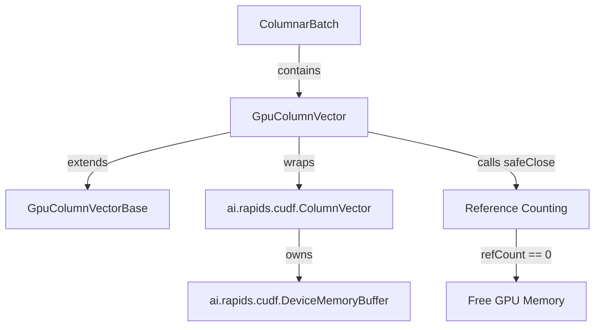
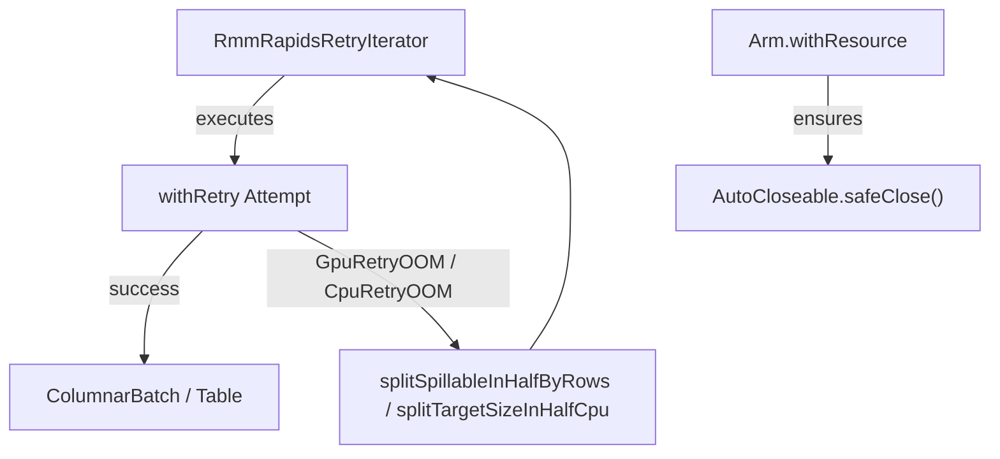
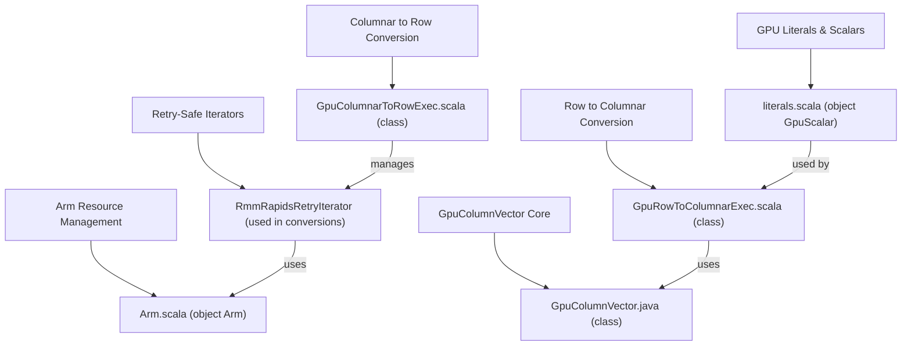
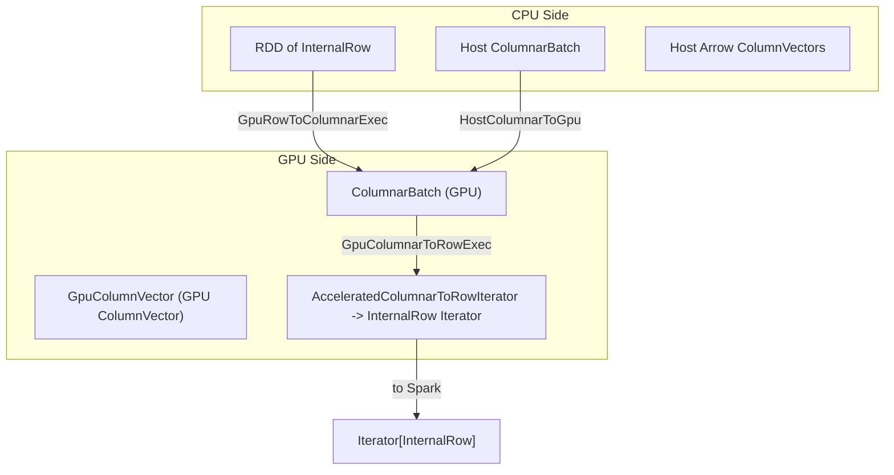

<!-- source: DeepWiki mcp.deepwiki.com · repo NVIDIA/cudf-spark · page 3.1 GpuColumnVector & Row/Columnar Conversion · fetched 2026-10-26 -->

# GpuColumnVector & Row/Columnar Conversion

Relevant source files

The following files were used as context for generating this wiki page:

- [integration_tests/src/main/python/ast_test.py](integration_tests/src/main/python/ast_test.py)
- [integration_tests/src/main/python/col_size_exceeding_cudf_limit_test.py](integration_tests/src/main/python/col_size_exceeding_cudf_limit_test.py)
- [integration_tests/src/main/python/row_conversion_test.py](integration_tests/src/main/python/row_conversion_test.py)
- [sql-plugin/src/main/java/com/nvidia/spark/rapids/GpuColumnVector.java](sql-plugin/src/main/java/com/nvidia/spark/rapids/GpuColumnVector.java)
- [sql-plugin/src/main/java/com/nvidia/spark/rapids/InternalRowToColumnarBatchIterator.java](sql-plugin/src/main/java/com/nvidia/spark/rapids/InternalRowToColumnarBatchIterator.java)
- [sql-plugin/src/main/java/com/nvidia/spark/rapids/RapidsHostColumnVectorCore.java](sql-plugin/src/main/java/com/nvidia/spark/rapids/RapidsHostColumnVectorCore.java)
- [sql-plugin/src/main/scala/com/nvidia/spark/rapids/Arm.scala](sql-plugin/src/main/scala/com/nvidia/spark/rapids/Arm.scala)
- [sql-plugin/src/main/scala/com/nvidia/spark/rapids/BatchWithPartitionData.scala](sql-plugin/src/main/scala/com/nvidia/spark/rapids/BatchWithPartitionData.scala)
- [sql-plugin/src/main/scala/com/nvidia/spark/rapids/ColumnarPartitionReaderWithPartitionValues.scala](sql-plugin/src/main/scala/com/nvidia/spark/rapids/ColumnarPartitionReaderWithPartitionValues.scala)
- [sql-plugin/src/main/scala/com/nvidia/spark/rapids/GpuBatchUtils.scala](sql-plugin/src/main/scala/com/nvidia/spark/rapids/GpuBatchUtils.scala)
- [sql-plugin/src/main/scala/com/nvidia/spark/rapids/GpuColumnarToRowExec.scala](sql-plugin/src/main/scala/com/nvidia/spark/rapids/GpuColumnarToRowExec.scala)
- [sql-plugin/src/main/scala/com/nvidia/spark/rapids/GpuRowToColumnarExec.scala](sql-plugin/src/main/scala/com/nvidia/spark/rapids/GpuRowToColumnarExec.scala)
- [sql-plugin/src/main/scala/com/nvidia/spark/rapids/literals.scala](sql-plugin/src/main/scala/com/nvidia/spark/rapids/literals.scala)
- [sql-plugin/src/main/scala/com/nvidia/spark/rapids/window/GpuBatchedBoundedWindowExec.scala](sql-plugin/src/main/scala/com/nvidia/spark/rapids/window/GpuBatchedBoundedWindowExec.scala)
- [sql-plugin/src/main/scala/com/nvidia/spark/rapids/window/GpuCachedDoublePassWindowExec.scala](sql-plugin/src/main/scala/com/nvidia/spark/rapids/window/GpuCachedDoublePassWindowExec.scala)
- [sql-plugin/src/main/scala/com/nvidia/spark/rapids/window/GpuRunningWindowExec.scala](sql-plugin/src/main/scala/com/nvidia/spark/rapids/window/GpuRunningWindowExec.scala)
- [sql-plugin/src/main/scala/com/nvidia/spark/rapids/window/GpuWindowExec.scala](sql-plugin/src/main/scala/com/nvidia/spark/rapids/window/GpuWindowExec.scala)
- [sql-plugin/src/main/scala/org/apache/spark/sql/rapids/execution/InternalColumnarRddConverter.scala](sql-plugin/src/main/scala/org/apache/spark/sql/rapids/execution/InternalColumnarRddConverter.scala)
- [tests/src/test/scala/com/nvidia/spark/rapids/BatchWithPartitionDataSuite.scala](tests/src/test/scala/com/nvidia/spark/rapids/BatchWithPartitionDataSuite.scala)
- [tests/src/test/scala/com/nvidia/spark/rapids/ColumnToRowIteratorRetrySuite.scala](tests/src/test/scala/com/nvidia/spark/rapids/ColumnToRowIteratorRetrySuite.scala)
- [tests/src/test/scala/com/nvidia/spark/rapids/GeneratedInternalRowToCudfRowIteratorRetrySuite.scala](tests/src/test/scala/com/nvidia/spark/rapids/GeneratedInternalRowToCudfRowIteratorRetrySuite.scala)
- [tests/src/test/scala/com/nvidia/spark/rapids/GpuBatchUtilsSuite.scala](tests/src/test/scala/com/nvidia/spark/rapids/GpuBatchUtilsSuite.scala)
- [tests/src/test/scala/com/nvidia/spark/rapids/GpuCoalesceBatchesRetrySuite.scala](tests/src/test/scala/com/nvidia/spark/rapids/GpuCoalesceBatchesRetrySuite.scala)
- [tests/src/test/scala/com/nvidia/spark/rapids/GpuColumnarToRowSuite.scala](tests/src/test/scala/com/nvidia/spark/rapids/GpuColumnarToRowSuite.scala)
- [tests/src/test/scala/com/nvidia/spark/rapids/HashAggregateRetrySuite.scala](tests/src/test/scala/com/nvidia/spark/rapids/HashAggregateRetrySuite.scala)
- [tests/src/test/scala/com/nvidia/spark/rapids/HostColumnToGpuRetrySuite.scala](tests/src/test/scala/com/nvidia/spark/rapids/HostColumnToGpuRetrySuite.scala)
- [tests/src/test/scala/com/nvidia/spark/rapids/RmmSparkRetrySuiteBase.scala](tests/src/test/scala/com/nvidia/spark/rapids/RmmSparkRetrySuiteBase.scala)
- [tests/src/test/scala/com/nvidia/spark/rapids/RowToColumnarIteratorRetrySuite.scala](tests/src/test/scala/com/nvidia/spark/rapids/RowToColumnarIteratorRetrySuite.scala)
- [tests/src/test/scala/com/nvidia/spark/rapids/WindowRetrySuite.scala](tests/src/test/scala/com/nvidia/spark/rapids/WindowRetrySuite.scala)
- [tests/src/test/scala/org/apache/spark/sql/rapids/execution/InternalColumnarRDDConverterSuite.scala](tests/src/test/scala/org/apache/spark/sql/rapids/execution/InternalColumnarRDDConverterSuite.scala)

## Purpose and Scope
This page covers `GpuColumnVector`, the core GPU-accelerated columnar data structure used throughout the RAPIDS Accelerator for Apache Spark. It details the mechanisms for converting between Spark's row formats and GPU columnar representations using components such as `GpuRowToColumnarExec`, `GpuColumnarToRowExec`, and `HostColumnarToGpu`. Additionally, it explains handling GPU literals via `GpuScalar`, automatic resource management (`Arm`), and the robust retry-safe iterators designed to handle OOM conditions during these conversions.

Sources: [sql-plugin/src/main/java/com/nvidia/spark/rapids/GpuColumnVector.java:37-167](), [sql-plugin/src/main/scala/com/nvidia/spark/rapids/GpuRowToColumnarExec.scala:37-68](), [sql-plugin/src/main/scala/com/nvidia/spark/rapids/GpuColumnarToRowExec.scala:45-152]()

---

## GpuColumnVector & Lifecycle

`GpuColumnVector` is a GPU-accelerated representation of the Spark `ColumnVector`, wrapping around `ai.rapids.cudf.ColumnVector` to manage columnar data resident strictly on GPU device memory. It avoids Spark APIs that assume host-side access in favor of device-native operations, ensuring efficient in-GPU processing [sql-plugin/src/main/java/com/nvidia/spark/rapids/GpuColumnVector.java:37-43]().

### Key Responsibilities

- **Type Conversion:** Implements static methods that recursively translate Spark `DataType` into cuDF-compatible `HostColumnVector.DataType` structures. These conversions support nested complex types such as arrays, maps, structs, and the special `VariantType` [sql-plugin/src/main/java/com/nvidia/spark/rapids/GpuColumnVector.java:106-155]().

- **Batch Construction:** Provides abstract builder interfaces like `GpuColumnarBatchBuilderBase` to incrementally accumulate data and ultimately build `ColumnarBatch` instances backed by GPU memory [sql-plugin/src/main/java/com/nvidia/spark/rapids/GpuColumnVector.java:157-167]().

- **Debugging Utilities:** Supplies multiple legacy debugging methods to dump contents of tables, batches, columns, and host columns for inspection, primarily during development and testing [sql-plugin/src/main/java/com/nvidia/spark/rapids/GpuColumnVector.java:54-75]().

#### GpuColumnVector Memory Management Architecture

Sources: [sql-plugin/src/main/java/com/nvidia/spark/rapids/GpuColumnVector.java:37-167]()

---

## Row/Columnar Conversion Subsystems

### GpuRowToColumnarExec

`GpuRowToColumnarExec` performs the conversion from host-resident Spark `InternalRow` sequences into GPU-backed `ColumnarBatch` instances suitable for GPU processing.

- The conversion uses a `GpuRowToColumnConverter` class that holds an array of per-field `TypeConverter`s specialized to efficiently append values of different Spark data types to column builders [sql-plugin/src/main/scala/com/nvidia/spark/rapids/GpuRowToColumnarExec.scala:37-52]().

- The `convert` method sequentially appends each row's values into builders, tracking an approximate byte size for dynamic batch sizing [sql-plugin/src/main/scala/com/nvidia/spark/rapids/GpuRowToColumnarExec.scala:44-51]().

- To convert multiple rows as a batch, an instance of `GpuColumnarBatchBuilder` is allocated with the schema and row count, and each row is converted sequentially before building the final GPU batch [sql-plugin/src/main/scala/com/nvidia/spark/rapids/GpuRowToColumnarExec.scala:61-66]().

Sources: [sql-plugin/src/main/scala/com/nvidia/spark/rapids/GpuRowToColumnarExec.scala:37-68]()

### GpuColumnarToRowExec

`GpuColumnarToRowExec` converts GPU `ColumnarBatch` instances back into Spark row-based format (`InternalRow`), providing iterator access.

- Uses `AcceleratedColumnarToRowIterator`, which internally maintains a queue of pinned `HostColumnVector`s obtained from GPU columnar data made host-accessible [sql-plugin/src/main/scala/com/nvidia/spark/rapids/GpuColumnarToRowExec.scala:45-51]().

- To optimize memory layout during the row conversion, columns are reordered via a `packMap` sorted by their actual data alignment size (e.g., strings use an 8-byte offset/length slot), minimizing padding and alignment wasted space in the output concatenated rows [sql-plugin/src/main/scala/com/nvidia/spark/rapids/GpuColumnarToRowExec.scala:69-78]().

- Dynamically selects a specialized fixed-width kernel optimized for schemas with all fixed-width columns with row sizes less than ~1536 bytes; otherwise, a generic row conversion GPU kernel is used that supports strings and variable-length types [sql-plugin/src/main/scala/com/nvidia/spark/rapids/GpuColumnarToRowExec.scala:96-104]().

- Produces `CudfUnsafeRow` instances that can directly decode the row bytes without extra copies—enabling lower overhead for downstream Spark operations expecting `InternalRow` [sql-plugin/src/main/scala/com/nvidia/spark/rapids/GpuColumnarToRowExec.scala:85-85]().

Sources: [sql-plugin/src/main/scala/com/nvidia/spark/rapids/GpuColumnarToRowExec.scala:45-152]()

### HostColumnarToGpu

`HostColumnarToGpu` handles copying host columnar data, such as Apache Arrow's `ColumnVector`s, into GPU columnar memory efficiently.

- Employs `ai.rapids.cudf.ArrowColumnBuilder` to map host-side Arrow buffers representing data, validity masks, and offsets directly into GPU memory buffers without unnecessary copying [sql-plugin/src/main/scala/com/nvidia/spark/rapids/HostColumnarToGpu.scala:70-116]().
- Supports recursively processing nested complex types by extracting child column buffers recursively to build a full GPU representation matching the input host schema [sql-plugin/src/main/scala/com/nvidia/spark/rapids/HostColumnarToGpu.scala:126-167]().

Sources: [sql-plugin/src/main/scala/com/nvidia/spark/rapids/HostColumnarToGpu.scala:70-167]()

---

## Arm Resource Management & Retry-Safe Iterators

Given GPU memory is a scarce resource requiring explicit release, the Accelerator leverages `Arm`—an automatic resource management utility—to safely scope GPU resource usage.

- The `Arm.withResource` method wraps an `AutoCloseable` resource usage block, ensuring `.close()` is called after execution or on exception [sql-plugin/src/main/scala/com/nvidia/spark/rapids/Arm.scala:28-34]().

- The `Arm.closeOnExcept` variant only closes the resource when an exception occurs, useful for keeping alive resources on successful execution [sql-plugin/src/main/scala/com/nvidia/spark/rapids/Arm.scala:96-107]().

- Iterators used in row/columnar conversion are wrapped with `RmmRapidsRetryIterator.withRetry`, wrapping conversion with retry logic. If a GPU OOM or CPU OOM exception occurs during conversion, the iterator automatically retries the operation, potentially splitting spillable batches or rows into smaller chunks [sql-plugin/src/main/scala/com/nvidia/spark/rapids/GpuColumnarToRowExec.scala:146-150]().

#### Retry-Safe Execution and Resource Cleanup Flow

Sources:
[sql-plugin/src/main/scala/com/nvidia/spark/rapids/Arm.scala:28-107](),
[sql-plugin/src/main/scala/com/nvidia/spark/rapids/GpuColumnarToRowExec.scala:146-150](),
[sql-plugin/src/main/java/com/nvidia/spark/rapids/InternalRowToColumnarBatchIterator.java:139-142](),
[tests/src/test/scala/com/nvidia/spark/rapids/RowToColumnarIteratorRetrySuite.scala:65-67]()

---

## Literals & GpuScalar

`GpuScalar` manages the bridging and extraction of GPU scalar constants (`ai.rapids.cudf.Scalar`) back into Spark's Catalyst types and provides routines for creating literal GPU column vectors from Spark literals.

- Extracts cuDF scalar values into Spark types, including booleans, floats, doubles, integers, longs, timestamps, strings (via UTF8 encoding), and decimals [sql-plugin/src/main/scala/com/nvidia/spark/rapids/literals.scala:53-72]().

- Converts complex nested literals recursively for array, struct, and map types using the `convertElementTo` helper function, resulting in Java lists or Spark internal structural representations [sql-plugin/src/main/scala/com/nvidia/spark/rapids/literals.scala:121-153]().

- Provides `columnVectorFromLiterals` to create GPU `ColumnVector` instances from sequences of literals efficiently, including boxing for primitive types to preserve null information [sql-plugin/src/main/scala/com/nvidia/spark/rapids/literals.scala:162-166]().

Sources: [sql-plugin/src/main/scala/com/nvidia/spark/rapids/literals.scala:53-166]()

---

# Summary

This page detailed the pivotal role of `GpuColumnVector` as the fundamental GPU-resident column representation supporting RAPIDS Accelerator for Apache Spark. It explained high-throughput row-to-columnar and columnar-to-row conversion mechanisms using `GpuRowToColumnarExec`, `GpuColumnarToRowExec`, and `HostColumnarToGpu`. The page also outlined GPU literal management, automatic resource management with `Arm`, and the robust retry-safe iterator patterns that gracefully handle out-of-memory conditions. Together, these subsystems enable efficient and reliable movement of data between CPU row-based formats and GPU columnar memory while managing GPU memory lifecycles and errors effectively.

Sources: [sql-plugin/src/main/java/com/nvidia/spark/rapids/GpuColumnVector.java:37-167](), [sql-plugin/src/main/scala/com/nvidia/spark/rapids/GpuRowToColumnarExec.scala:37-68](), [sql-plugin/src/main/scala/com/nvidia/spark/rapids/GpuColumnarToRowExec.scala:45-152]()

---

# Code Entity Mapping Diagrams

### Natural Language to Main Code Classes & Concepts

Sources: [sql-plugin/src/main/java/com/nvidia/spark/rapids/GpuColumnVector.java:37-43](), [sql-plugin/src/main/scala/com/nvidia/spark/rapids/GpuRowToColumnarExec.scala:37-52](), [sql-plugin/src/main/scala/com/nvidia/spark/rapids/GpuColumnarToRowExec.scala:45-51](), [sql-plugin/src/main/scala/com/nvidia/spark/rapids/Arm.scala:28-34](), [sql-plugin/src/main/scala/com/nvidia/spark/rapids/literals.scala:53-72]()

---

### Row/Columnar Conversion Data Flow

Sources:
[sql-plugin/src/main/java/com/nvidia/spark/rapids/GpuColumnVector.java:37-167](),
[sql-plugin/src/main/scala/com/nvidia/spark/rapids/GpuRowToColumnarExec.scala:37-68](),
[sql-plugin/src/main/scala/com/nvidia/spark/rapids/GpuColumnarToRowExec.scala:45-152](),
[sql-plugin/src/main/scala/com/nvidia/spark/rapids/Arm.scala:28-107](),
[sql-plugin/src/main/scala/com/nvidia/spark/rapids/literals.scala:53-166]()

---

