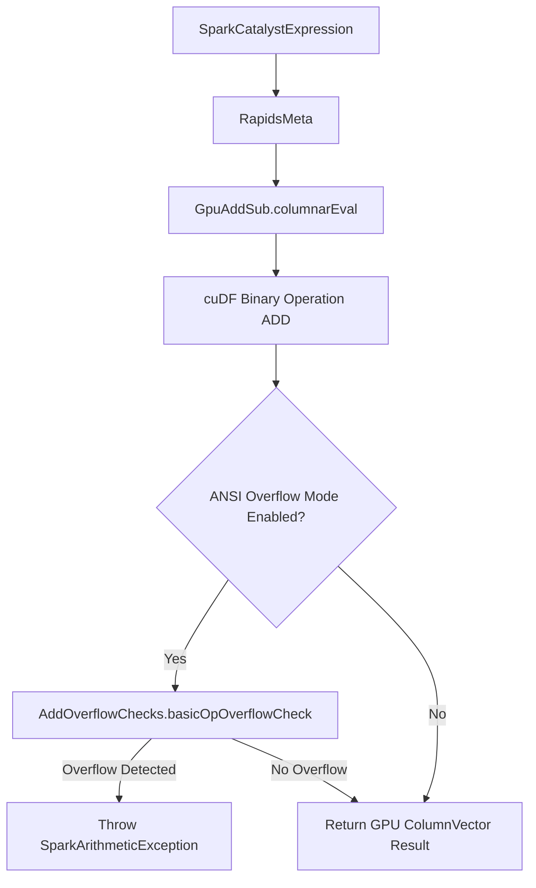
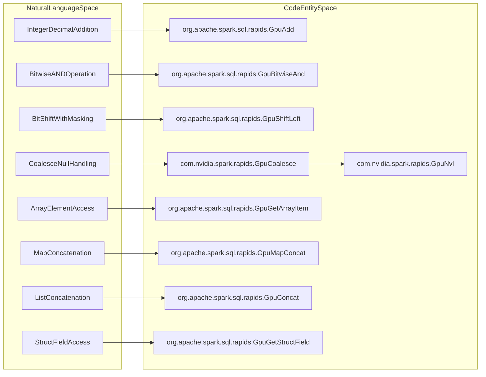

<!-- source: DeepWiki mcp.deepwiki.com · repo NVIDIA/cudf-spark · page 3.2 Arithmetic, Math & Bitwise Expressions · fetched 2026-10-26 -->

# Arithmetic, Math & Bitwise Expressions

Relevant source files

The following files were used as context for generating this wiki page:

- [delta-lake/delta-spark400db173/src/main/scala/com/nvidia/spark/rapids/delta/GpuIncrementMetric.scala](delta-lake/delta-spark400db173/src/main/scala/com/nvidia/spark/rapids/delta/GpuIncrementMetric.scala)
- [integration_tests/src/main/python/arithmetic_ops_test.py](integration_tests/src/main/python/arithmetic_ops_test.py)
- [integration_tests/src/main/python/array_test.py](integration_tests/src/main/python/array_test.py)
- [integration_tests/src/main/python/cmp_test.py](integration_tests/src/main/python/cmp_test.py)
- [integration_tests/src/main/python/collection_ops_test.py](integration_tests/src/main/python/collection_ops_test.py)
- [integration_tests/src/main/python/conditionals_test.py](integration_tests/src/main/python/conditionals_test.py)
- [integration_tests/src/main/python/generate_expr_test.py](integration_tests/src/main/python/generate_expr_test.py)
- [integration_tests/src/main/python/map_test.py](integration_tests/src/main/python/map_test.py)
- [integration_tests/src/main/python/misc_expr_test.py](integration_tests/src/main/python/misc_expr_test.py)
- [integration_tests/src/main/python/rand_test.py](integration_tests/src/main/python/rand_test.py)
- [integration_tests/src/main/python/struct_test.py](integration_tests/src/main/python/struct_test.py)
- [scripts/with_resource_nesting_baseline.json](scripts/with_resource_nesting_baseline.json)
- [sql-plugin/src/main/scala/com/nvidia/spark/rapids/GpuCanonicalize.scala](sql-plugin/src/main/scala/com/nvidia/spark/rapids/GpuCanonicalize.scala)
- [sql-plugin/src/main/scala/com/nvidia/spark/rapids/GpuExpressions.scala](sql-plugin/src/main/scala/com/nvidia/spark/rapids/GpuExpressions.scala)
- [sql-plugin/src/main/scala/com/nvidia/spark/rapids/GpuMonotonicallyIncreasingID.scala](sql-plugin/src/main/scala/com/nvidia/spark/rapids/GpuMonotonicallyIncreasingID.scala)
- [sql-plugin/src/main/scala/com/nvidia/spark/rapids/GpuNondeterministic.scala](sql-plugin/src/main/scala/com/nvidia/spark/rapids/GpuNondeterministic.scala)
- [sql-plugin/src/main/scala/com/nvidia/spark/rapids/GpuSparkPartitionID.scala](sql-plugin/src/main/scala/com/nvidia/spark/rapids/GpuSparkPartitionID.scala)
- [sql-plugin/src/main/scala/com/nvidia/spark/rapids/conditionalExpressions.scala](sql-plugin/src/main/scala/com/nvidia/spark/rapids/conditionalExpressions.scala)
- [sql-plugin/src/main/scala/com/nvidia/spark/rapids/higherOrderFunctions.scala](sql-plugin/src/main/scala/com/nvidia/spark/rapids/higherOrderFunctions.scala)
- [sql-plugin/src/main/scala/com/nvidia/spark/rapids/nullExpressions.scala](sql-plugin/src/main/scala/com/nvidia/spark/rapids/nullExpressions.scala)
- [sql-plugin/src/main/scala/com/nvidia/spark/rapids/shims/AnsiUtil.scala](sql-plugin/src/main/scala/com/nvidia/spark/rapids/shims/AnsiUtil.scala)
- [sql-plugin/src/main/scala/org/apache/spark/sql/rapids/arithmetic.scala](sql-plugin/src/main/scala/org/apache/spark/sql/rapids/arithmetic.scala)
- [sql-plugin/src/main/scala/org/apache/spark/sql/rapids/bitwise.scala](sql-plugin/src/main/scala/org/apache/spark/sql/rapids/bitwise.scala)
- [sql-plugin/src/main/scala/org/apache/spark/sql/rapids/catalyst/expressions/GpuRandomExpressions.scala](sql-plugin/src/main/scala/org/apache/spark/sql/rapids/catalyst/expressions/GpuRandomExpressions.scala)
- [sql-plugin/src/main/scala/org/apache/spark/sql/rapids/collectionOperations.scala](sql-plugin/src/main/scala/org/apache/spark/sql/rapids/collectionOperations.scala)
- [sql-plugin/src/main/scala/org/apache/spark/sql/rapids/complexTypeCreator.scala](sql-plugin/src/main/scala/org/apache/spark/sql/rapids/complexTypeCreator.scala)
- [sql-plugin/src/main/scala/org/apache/spark/sql/rapids/complexTypeExtractors.scala](sql-plugin/src/main/scala/org/apache/spark/sql/rapids/complexTypeExtractors.scala)
- [sql-plugin/src/main/scala/org/apache/spark/sql/rapids/mathExpressions.scala](sql-plugin/src/main/scala/org/apache/spark/sql/rapids/mathExpressions.scala)
- [sql-plugin/src/main/scala/org/apache/spark/sql/rapids/predicates.scala](sql-plugin/src/main/scala/org/apache/spark/sql/rapids/predicates.scala)
- [sql-plugin/src/main/spark330db/scala/com/nvidia/spark/rapids/shims/DecimalArithmeticOverrides.scala](sql-plugin/src/main/spark330db/scala/com/nvidia/spark/rapids/shims/DecimalArithmeticOverrides.scala)
- [sql-plugin/src/main/spark330db/scala/org/apache/spark/sql/rapids/arithmetic.scala](sql-plugin/src/main/spark330db/scala/org/apache/spark/sql/rapids/arithmetic.scala)
- [sql-plugin/src/main/spark350db143/scala/com/nvidia/spark/rapids/shims/RaiseErrorShim.scala](sql-plugin/src/main/spark350db143/scala/com/nvidia/spark/rapids/shims/RaiseErrorShim.scala)
- [sql-plugin/src/main/spark350db143/scala/org/apache/spark/sql/rapids/shims/misc.scala](sql-plugin/src/main/spark350db143/scala/org/apache/spark/sql/rapids/shims/misc.scala)
- [sql-plugin/src/main/spark359/scala/com/nvidia/spark/rapids/shims/mathExpressions.scala](sql-plugin/src/main/spark359/scala/com/nvidia/spark/rapids/shims/mathExpressions.scala)
- [tests/src/test/scala/com/nvidia/spark/rapids/ConditionalSideEffectsSuite.scala](tests/src/test/scala/com/nvidia/spark/rapids/ConditionalSideEffectsSuite.scala)
- [tests/src/test/scala/com/nvidia/spark/rapids/LogOperatorUnitTestSuite.scala](tests/src/test/scala/com/nvidia/spark/rapids/LogOperatorUnitTestSuite.scala)
- [tests/src/test/scala/com/nvidia/spark/rapids/NonDeterministicRetrySuite.scala](tests/src/test/scala/com/nvidia/spark/rapids/NonDeterministicRetrySuite.scala)
- [tests/src/test/scala/org/apache/spark/sql/rapids/catalyst/expressions/GpuEquivalentExpressionsSuite.scala](tests/src/test/scala/org/apache/spark/sql/rapids/catalyst/expressions/GpuEquivalentExpressionsSuite.scala)

This page documents the GPU implementations of arithmetic, mathematical, and bitwise expressions in the RAPIDS Accelerator for Apache Spark plugin. It covers how Spark SQL Catalyst expressions for these operations are translated into GPU computations using NVIDIA cuDF, including handling of nulls, ANSI SQL overflow semantics, decimal calculations, bitwise operations, and expression optimization rules.

Sources: [sql-plugin/src/main/scala/org/apache/spark/sql/rapids/arithmetic.scala:1-125](), [sql-plugin/src/main/scala/org/apache/spark/sql/rapids/mathExpressions.scala:1-43](), [sql-plugin/src/main/scala/org/apache/spark/sql/rapids/bitwise.scala:1-60]()

---

## Arithmetic Expressions

Arithmetic expressions—including addition, subtraction, multiplication, division, and remainder—are implemented primarily in `arithmetic.scala` [sql-plugin/src/main/scala/org/apache/spark/sql/rapids/arithmetic.scala]() and shim-specific arithmetic modules [sql-plugin/src/main/spark330db/scala/org/apache/spark/sql/rapids/arithmetic.scala](). These classes extend `CudfBinaryArithmetic` or `GpuBinaryArithmetic` to map Catalyst expressions directly onto cuDF binary operators.

### Core Classes & Decimal Support

- **GpuAdd / GpuSubtract**: Extend `CudfBinaryArithmetic` and implement columnar evaluation using `GpuAddSub` logic which internally performs necessary casts and arithmetic operations on GPU. For decimals with precision less than 38, operands are cast to the target precision before operator invocation. For 128-bit decimals (precision ≥ 38), specialized 128-bit decimal kernel routines are utilized for multiplication and other arithmetic operations [sql-plugin/src/main/spark330db/scala/org/apache/spark/sql/rapids/arithmetic.scala:110-160]().

- **Decimal Arithmetic Overrides**: Maps Catalyst decimal operations like `Multiply`, `Divide`, `IntegralDivide`, and `Remainder` to their GPU equivalents (`GpuDecimalMultiply`, `GpuDecimalDivide`, etc.). It enforces that arithmetic operations flagged as `try` (e.g., `try_multiply`) are excluded from GPU execution, because such operations require different semantics (e.g., returning null on overflow).

Sources: [sql-plugin/src/main/scala/org/apache/spark/sql/rapids/arithmetic.scala:1-125](), [sql-plugin/src/main/spark330db/scala/org/apache/spark/sql/rapids/arithmetic.scala:68-174]()

---

## ANSI Overflow Handling & Checks

To conform with ANSI SQL semantics (`spark.sql.ansi.enabled`), the plugin implements strict overflow detection on integer and decimal arithmetic operations on the GPU. When overflow occurs, the expressions throw `SparkArithmeticException` exceptions as Spark CPU execution does.

### Overflow Checking Techniques

- **Addition Overflow**: Implemented in `AddOverflowChecks.basicOpOverflowCheck`, it utilizes GPU bitwise XOR and AND operations in the pattern `((lhs ^ result) & (rhs ^ result)) < 0` to detect overflow on signed integers [sql-plugin/src/main/scala/org/apache/spark/sql/rapids/arithmetic.scala:38-75](). If overflow is detected, `RapidsErrorUtils.arithmeticOverflowError` is raised.

- **Subtraction Overflow**: Analogous to addition but uses the expression `((lhs ^ rhs) & (lhs ^ result)) < 0` for detection [sql-plugin/src/main/scala/org/apache/spark/sql/rapids/arithmetic.scala:127-155]().

- **Decimal Overflow**: Due to lack of native 128-bit integer support in cuDF, decimal overflow checking compares signs of operands and result to detect inconsistencies indicating overflow [sql-plugin/src/main/scala/org/apache/spark/sql/rapids/arithmetic.scala:77-125]().

- **Minimum Value Boundaries**: The `GpuAnsi.assertMinValueOverflow` validates cases like `MIN_INT` being negated, which can cause overflow [sql-plugin/src/main/scala/org/apache/spark/sql/rapids/arithmetic.scala:157-184]().

Sources: [sql-plugin/src/main/scala/org/apache/spark/sql/rapids/arithmetic.scala:38-193]()

### Data Flow Diagram: Arithmetic Execution & ANSI Overflow

Title: "Arithmetic Execution Flow with ANSI Checks"

Sources: [sql-plugin/src/main/scala/org/apache/spark/sql/rapids/arithmetic.scala:38-193](), [sql-plugin/src/main/spark330db/scala/org/apache/spark/sql/rapids/arithmetic.scala:110-160]()

---

## Math Functions

Mathematical functions are implemented in `mathExpressions.scala` [sql-plugin/src/main/scala/org/apache/spark/sql/rapids/mathExpressions.scala](), providing support for many unary functions (trigonometric, hyperbolic, logarithmic, etc.) and numeric conversions.

### Key Math Classes & Implementations

- **`GpuUnaryMathExpression` and `CudfUnaryMathExpression`**: Abstract base classes providing a common framework for unary math expressions supporting double precision input/output [sql-plugin/src/main/scala/org/apache/spark/sql/rapids/mathExpressions.scala:32-43]().

- **Native cuDF Operations**: Subclasses like `GpuAcos` map directly onto cuDF unary operators (`UnaryOp.ARCCOS`) to efficiently implement standard math functions [sql-plugin/src/main/scala/org/apache/spark/sql/rapids/mathExpressions.scala:45-48]().

- **Compatibility Adjustments**: Some math functions have compatibility versions that manually build AST-style operations with cuDF to produce results consistent with Spark's CPU functions. For example, `GpuAsinhCompat` implements the expression `log(x + sqrt(x * x + 1.0))` explicitly to match Spark’s semantics including corner cases [sql-plugin/src/main/scala/org/apache/spark/sql/rapids/mathExpressions.scala:154-188]().

- **String Formatting Functions**: `GpuBin` converts long integers to binary string representation using `CastStrings.fromLongToBinary(...)`, whereas `GpuHex` produces hexadecimal strings either from integers or from byte arrays [sql-plugin/src/main/scala/org/apache/spark/sql/rapids/mathExpressions.scala:73-100]().

Sources: [sql-plugin/src/main/scala/org/apache/spark/sql/rapids/mathExpressions.scala:32-188]()

---

## Bitwise Operations

Bitwise and shift operations are implemented in `bitwise.scala` [sql-plugin/src/main/scala/org/apache/spark/sql/rapids/bitwise.scala](), covering standard bitwise operations and Java/Scala compliant shift semantics.

### Supported Operations

- **Standard Bitwise Operations**: `GpuBitwiseAnd`, `GpuBitwiseOr`, and `GpuBitwiseXor` apply the corresponding cuDF binary operators: `BITWISE_AND`, `BITWISE_OR`, and `BITWISE_XOR` on GPU column vectors [sql-plugin/src/main/scala/org/apache/spark/sql/rapids/bitwise.scala:119-150]().

- **Shift Operations**: `GpuShiftLeft` and `GpuShiftRight` derive from `GpuShiftBase` which uses `ShiftHelper.fixupDistanceNoClose` to apply masking on the shift distance value. The mask is 0x1F (5 bits) for 32-bit integers and 0x3F (6 bits) for 64-bit longs, ensuring compliance with Java language shift semantics [sql-plugin/src/main/scala/org/apache/spark/sql/rapids/bitwise.scala:27-89]().

- **Bitwise Not and Count**: `GpuBitwiseNot` maps to the unary operator `BIT_INVERT`. `GpuBitwiseCount` casts integer inputs to unsigned 64-bit integers before calling cuDF’s `bitCount()` to emulate Spark’s bit count behavior [sql-plugin/src/main/scala/org/apache/spark/sql/rapids/bitwise.scala:152-179]().

Sources: [sql-plugin/src/main/scala/org/apache/spark/sql/rapids/bitwise.scala:27-179]()

---

## Null Expressions & Predicates

Null handling is fundamental in Spark SQL, and GPU implementations leverage cuDF capabilities to handle null expressions and predicates efficiently.

### Null Replacement and Coalesce

- **GpuNvl (Null Value Replacement)**: Implements the equivalent of SQL’s `nvl` function, replacing nulls from the left operand with the right. For flat column types, it calls cuDF's `replaceNulls`. For nested types, it uses a conditional expression `isNotNull.ifElse` [sql-plugin/src/main/scala/com/nvidia/spark/rapids/nullExpressions.scala:30-53]().

- **GpuCoalesce**: Implements coalesce logic by folding over multiple child expressions from last to first, combining intermediate results via `GpuNvl` [sql-plugin/src/main/scala/com/nvidia/spark/rapids/nullExpressions.scala:55-122]().

### Predicate Expressions for Null and NaN

- **GpuIsNull / GpuIsNotNull**: Evaluate whether elements are null or not null using cuDF native methods `isNull` and `isNotNull` [sql-plugin/src/main/scala/org/apache/spark/sql/rapids/predicates.scala:1-60]().

- **GpuIsNan / GpuNansToNulls**: Identify "Not a Number" values in floating point datasets and produce predicates accordingly [sql-plugin/src/main/scala/org/apache/spark/sql/rapids/predicates.scala:61-120]().

- **Null Vector Caching**: The `GpuExpressionsUtils` object maintains a thread-local LRU cache (`NullVecCache`) of null column vectors keyed by data type and size [sql-plugin/src/main/scala/com/nvidia/spark/rapids/GpuExpressions.scala:58-68]().

Sources: [sql-plugin/src/main/scala/com/nvidia/spark/rapids/nullExpressions.scala:30-122](), [sql-plugin/src/main/scala/org/apache/spark/sql/rapids/predicates.scala:1-120](), [sql-plugin/src/main/scala/com/nvidia/spark/rapids/GpuExpressions.scala:58-107]()

---

## Natural Language Concepts to Code Entities Mapping

The following diagrams map descriptive operation concepts to concrete classes and functions in the codebase.

### Diagram 1: Expression Class Mapping

Title: "Expression Class Mapping"

Sources: [sql-plugin/src/main/scala/org/apache/spark/sql/rapids/arithmetic.scala:1-125](), [sql-plugin/src/main/scala/org/apache/spark/sql/rapids/bitwise.scala:91-150](), [sql-plugin/src/main/scala/com/nvidia/spark/rapids/nullExpressions.scala:30-122](), [sql-plugin/src/main/scala/org/apache/spark/sql/rapids/complexTypeExtractors.scala:85-112](), [sql-plugin/src/main/scala/org/apache/spark/sql/rapids/collectionOperations.scala:86-115](), [sql-plugin/src/main/scala/org/apache/spark/sql/rapids/collectionOperations.scala:45-84](), [sql-plugin/src/main/scala/org/apache/spark/sql/rapids/complexTypeExtractors.scala:36-78]()

### Diagram 2: Canonicalization and AST Mapping

Title: "Canonicalization and AST Mapping"

```mermaid
graph TD
    subgraph "OptimizationSpace"
        CANON["com.nvidia.spark.rapids.GpuCanonicalize"]
        EQ_EXPR["org.apache.spark.sql.rapids.catalyst.expressions.GpuEquivalentExpressions"]
    end

    subgraph "ImplementationClasses"
        G_ADD_CANON["org.apache.spark.sql.rapids.GpuAdd"]
        G_MUL_CANON["org.apache.spark.sql.rapids.GpuMultiply"]
        G_BIT_OR["org.apache.spark.sql.rapids.GpuBitwiseOr"]
        G_AST_UTIL["com.nvidia.spark.rapids.AstUtil"]
        G_RANDOM_EXPR["org.apache.spark.sql.rapids.catalyst.expressions.GpuRandomExpressions"]
        G_MONO_ID["com.nvidia.spark.rapids.GpuMonotonicallyIncreasingID"]
        G_PART_ID["com.nvidia.spark.rapids.GpuSparkPartitionID"]
        G_NONDETERMINISTIC["com.nvidia.spark.rapids.GpuNondeterministic"]
    end

    CANON --> G_ADD_CANON
    CANON --> G_MUL_CANON
    CANON --> G_BIT_OR
    EQ_EXPR --> G_AST_UTIL
    EQ_EXPR --> G_RANDOM_EXPR
    EQ_EXPR --> G_MONO_ID
    EQ_EXPR --> G_PART_ID
    EQ_EXPR --> G_NONDETERMINISTIC
```

Sources: [sql-plugin/src/main/scala/com/nvidia/spark/rapids/GpuCanonicalize.scala:44-138](), [sql-plugin/src/main/scala/org/apache/spark/sql/rapids/catalyst/expressions/GpuEquivalentExpressions.scala:37-150](), [sql-plugin/src/main/scala/com/nvidia/spark/rapids/AstUtil.scala:1-50](), [sql-plugin/src/main/scala/org/apache/spark/sql/rapids/catalyst/expressions/GpuRandomExpressions.scala:30-100](), [sql-plugin/src/main/scala/com/nvidia/spark/rapids/GpuMonotonicallyIncreasingID.scala:24-50](), [sql-plugin/src/main/scala/com/nvidia/spark/rapids/GpuSparkPartitionID.scala:24-50](), [sql-plugin/src/main/scala/com/nvidia/spark/rapids/GpuNondeterministic.scala:24-50]()

---

