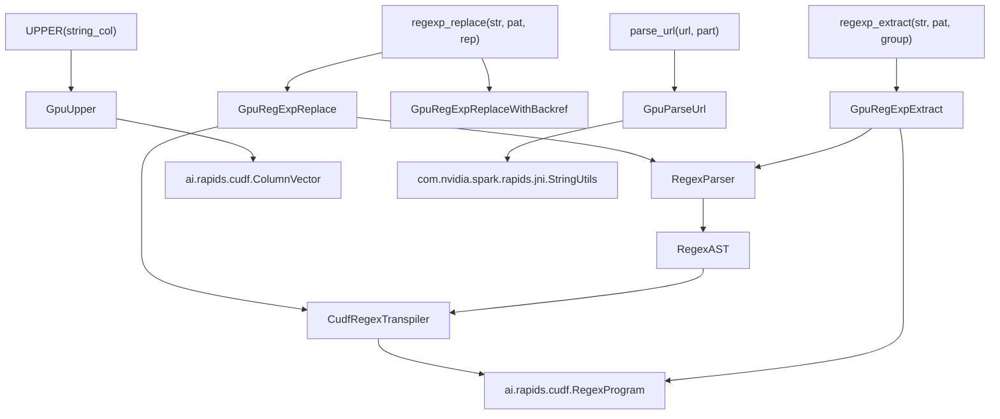
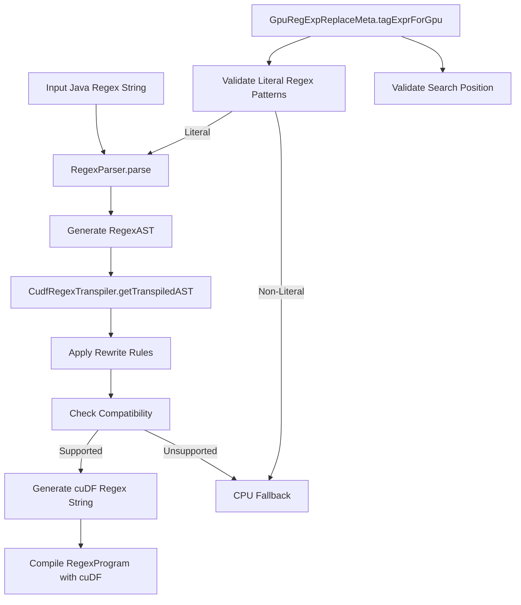

<!-- source: DeepWiki mcp.deepwiki.com · repo NVIDIA/cudf-spark · page 3.3 String & Regular Expression Expressions · fetched 2026-10-26 -->

# String & Regular Expression Expressions

Relevant source files

The following files were used as context for generating this wiki page:

- [docs/compatibility.md](docs/compatibility.md)
- [integration_tests/src/main/python/regexp_test.py](integration_tests/src/main/python/regexp_test.py)
- [integration_tests/src/main/python/string_test.py](integration_tests/src/main/python/string_test.py)
- [integration_tests/src/main/python/string_type_test.py](integration_tests/src/main/python/string_type_test.py)
- [integration_tests/src/main/python/url_test.py](integration_tests/src/main/python/url_test.py)
- [sql-plugin/src/main/scala/com/nvidia/spark/rapids/GpuRegExpReplaceMeta.scala](sql-plugin/src/main/scala/com/nvidia/spark/rapids/GpuRegExpReplaceMeta.scala)
- [sql-plugin/src/main/scala/com/nvidia/spark/rapids/GpuStringAndAggregateExpressionOverrides.scala](sql-plugin/src/main/scala/com/nvidia/spark/rapids/GpuStringAndAggregateExpressionOverrides.scala)
- [sql-plugin/src/main/scala/com/nvidia/spark/rapids/GpuStringAndAggregateExpressionRuleMetas.scala](sql-plugin/src/main/scala/com/nvidia/spark/rapids/GpuStringAndAggregateExpressionRuleMetas.scala)
- [sql-plugin/src/main/scala/com/nvidia/spark/rapids/RegexParser.scala](sql-plugin/src/main/scala/com/nvidia/spark/rapids/RegexParser.scala)
- [sql-plugin/src/main/scala/org/apache/spark/sql/rapids/GpuParseUrl.scala](sql-plugin/src/main/scala/org/apache/spark/sql/rapids/GpuParseUrl.scala)
- [sql-plugin/src/main/scala/org/apache/spark/sql/rapids/aggregate/GpuPercentile.scala](sql-plugin/src/main/scala/org/apache/spark/sql/rapids/aggregate/GpuPercentile.scala)
- [sql-plugin/src/main/scala/org/apache/spark/sql/rapids/stringFunctions.scala](sql-plugin/src/main/scala/org/apache/spark/sql/rapids/stringFunctions.scala)
- [sql-plugin/src/main/spark400/scala/org/apache/spark/sql/rapids/shims/InvokeExprMeta.scala](sql-plugin/src/main/spark400/scala/org/apache/spark/sql/rapids/shims/InvokeExprMeta.scala)
- [sql-plugin/src/main/spark420/scala/com/nvidia/spark/rapids/shims/Spark420PlusShims.scala](sql-plugin/src/main/spark420/scala/com/nvidia/spark/rapids/shims/Spark420PlusShims.scala)
- [sql-plugin/src/main/spark420/scala/com/nvidia/spark/rapids/shims/SparkShims.scala](sql-plugin/src/main/spark420/scala/com/nvidia/spark/rapids/shims/SparkShims.scala)
- [sql-plugin/src/main/spark500/scala/com/nvidia/spark/rapids/shims/SparkShims.scala](sql-plugin/src/main/spark500/scala/com/nvidia/spark/rapids/shims/SparkShims.scala)
- [tests/src/test/scala/com/nvidia/spark/rapids/ConditionalsSuite.scala](tests/src/test/scala/com/nvidia/spark/rapids/ConditionalsSuite.scala)
- [tests/src/test/scala/com/nvidia/spark/rapids/RegularExpressionParserSuite.scala](tests/src/test/scala/com/nvidia/spark/rapids/RegularExpressionParserSuite.scala)
- [tests/src/test/scala/com/nvidia/spark/rapids/RegularExpressionRewriteSuite.scala](tests/src/test/scala/com/nvidia/spark/rapids/RegularExpressionRewriteSuite.scala)
- [tests/src/test/scala/com/nvidia/spark/rapids/RegularExpressionSuite.scala](tests/src/test/scala/com/nvidia/spark/rapids/RegularExpressionSuite.scala)
- [tests/src/test/scala/com/nvidia/spark/rapids/RegularExpressionTranspilerSuite.scala](tests/src/test/scala/com/nvidia/spark/rapids/RegularExpressionTranspilerSuite.scala)
- [tests/src/test/scala/com/nvidia/spark/rapids/StringFunctionSuite.scala](tests/src/test/scala/com/nvidia/spark/rapids/StringFunctionSuite.scala)

This page details the GPU acceleration of string manipulation and regular expression expressions within the RAPIDS Accelerator for Apache Spark. It covers GPU implementations of Spark string functions, the `RegexParser` and `CudfRegexTranspiler` pipeline for regular expressions, various transpilation modes, URL parsing, and fallback conditions. The explanations include implementation details, data flow, and critical classes and functions.

---

## GPU String Functions

The RAPIDS Accelerator provides GPU-accelerated implementations for a broad set of Spark SQL string functions. These functions operate on `GpuColumnVector` instances and leverage cuDF’s native string APIs for high performance.

### Common String Functions

Many basic string expressions are implemented as direct wrappers around cuDF APIs, preserving Spark CPU semantics while accelerating execution on GPU.

| Spark Expression | GPU Implementation | Description |
|------------------|--------------------|-------------|
| `upper`          | `GpuUpper`         | Converts strings to uppercase by calling `ColumnVector.upper()` on the input column. Invokes cuDF string uppercase [sql-plugin/src/main/scala/org/apache/spark/sql/rapids/stringFunctions.scala:53-59](). |
| `lower`          | `GpuLower`         | Converts strings to lowercase by calling `ColumnVector.lower()` [sql-plugin/src/main/scala/org/apache/spark/sql/rapids/stringFunctions.scala:61-67](). |
| `length`         | `GpuLength`        | Returns string character lengths using cuDF `getCharLengths()` [sql-plugin/src/main/scala/org/apache/spark/sql/rapids/stringFunctions.scala:69-77](). |
| `bit_length`     | `GpuBitLength`     | Computes bit length by calling `getByteCount` and then multiplying by 8 (left shift by 3) [sql-plugin/src/main/scala/org/apache/spark/sql/rapids/stringFunctions.scala:79-93](). |
| `octet_length`   | `GpuOctetLength`   | Returns byte count of strings using cuDF `getByteCount()` [sql-plugin/src/main/scala/org/apache/spark/sql/rapids/stringFunctions.scala:95-103](). |
| `instr`          | `GpuStringLocate`  | Finds substring’s first position in each string, adjusting difference of zero-based cuDF and one-based Spark indexing. Handles nulls and start position semantics [sql-plugin/src/main/scala/org/apache/spark/sql/rapids/stringFunctions.scala:105-163](). |
| `startsWith`     | `GpuStartsWith`    | Checks if each string starts with a given prefix using cuDF `startsWith()` [sql-plugin/src/main/scala/org/apache/spark/sql/rapids/stringFunctions.scala:165-183](). |

#### Selected Implementation Notes

- `GpuUpper` and `GpuLower` simply invoke cuDF’s corresponding case conversion APIs on the underlying column vector [sql-plugin/src/main/scala/org/apache/spark/sql/rapids/stringFunctions.scala:57-66]().
- `GpuLength` returns character count per string leveraging `ColumnVector.getCharLengths()` [sql-plugin/src/main/scala/org/apache/spark/sql/rapids/stringFunctions.scala:76]().
- `GpuBitLength` calculates bit length by first obtaining the byte count and then left-shifting by 3 to multiply by 8 bits per byte [sql-plugin/src/main/scala/org/apache/spark/sql/rapids/stringFunctions.scala:85-92]().
- `GpuStringLocate` carefully handles the offset indexing difference: Spark uses 1-based indexing for the start position, whereas cuDF uses zero-based. It also returns 0 when the `start` position is less than 1 or the substring is empty [sql-plugin/src/main/scala/org/apache/spark/sql/rapids/stringFunctions.scala:119-154]().

### Charset Decoding

`GpuDecode` supports decoding binary data into strings with various charsets encoded, relying on JNI bridge calls to cuDF native decoding. GBK charset support is explicitly handled for compatibility between CPU and GPU, including error handling on malformed sequences, mirroring Spark 4.0+ behavior where `codingErrorAction` controls error mode [integration_tests/src/main/python/string_test.py:34-94]().

### JSON Extraction on GPU

The function `GpuGetJsonObject` supports extracting JSON fields via JSON path expressions. It processes nested keys up to a limit depth, and falls back if unsupported wildcards like `[*]` or recursive descent `..` are detected in the path.

Sources:
- `sql-plugin/src/main/scala/org/apache/spark/sql/rapids/stringFunctions.scala:47-183`
- `integration_tests/src/main/python/string_test.py:34-94`

---

## Regular Expression Expressions

The RAPIDS Accelerator enables GPU-accelerated evaluation of Spark’s regular expression functions such as `regexp_extract`, `regexp_replace`, and `regexp_split`. To achieve this, a custom parsing and transpilation pipeline is used.

### RegexParser and AST

The `RegexParser` implements a Pratt parser design for Java-style regex strings, generating a minimal Abstract Syntax Tree (AST) for GPU validation and transpilation. Its aim is not to build a full regex engine but to validate features and support GPU-compatible constructs [sql-plugin/src/main/scala/com/nvidia/spark/rapids/RegexParser.scala:28-61]().

#### Abstract Syntax Tree Nodes

Key regex AST nodes include:
- **RegexSequence**: Represents sequences of regex parts concatenated [sql-plugin/src/main/scala/com/nvidia/spark/rapids/RegexParser.scala:112-123]().
- **RegexChoice**: Represents alternations (`|` operator) in regex [sql-plugin/src/main/scala/com/nvidia/spark/rapids/RegexParser.scala:102-110]().
- **RegexRepetition**: Represents quantifiers such as `*`, `+`, `?`, and bounded `{n,m}` repetitions [sql-plugin/src/main/scala/com/nvidia/spark/rapids/RegexParser.scala:134-155]().

#### Regex String Detection

`RegexParser.isRegExpString` identifies whether a string contains regex meta-characters or is just a literal string, aiding optimization decisions [tests/src/test/scala/com/nvidia/spark/rapids/RegularExpressionParserSuite.scala:30-45]().

Sources:
- `sql-plugin/src/main/scala/com/nvidia/spark/rapids/RegexParser.scala:28-155`
- `tests/src/test/scala/com/nvidia/spark/rapids/RegularExpressionParserSuite.scala:30-45`

---

### CudfRegexTranspiler

The `CudfRegexTranspiler` takes the regex AST produced by `RegexParser` and converts it into a cuDF-compatible regex string form. It also processes replacement strings for `regexp_replace` expressions, identifying and converting Java-style backreferences.

#### Backreference Conversion

For `regexp_replace`, Java-like backreferences (e.g., `$1`, `$13`) are parsed and normalized to a format usable by cuDF using methods in `GpuRegExpUtils`. This ensures compatibility with Java’s `Matcher.appendReplacement` semantics [sql-plugin/src/main/scala/com/nvidia/spark/rapids/GpuRegExpReplaceMeta.scala:55-70]().

#### Transpilation Modes

The transpiler handles different modes depending on the regex usage, influencing the rewrite and validation logic:

| Mode                | Usage in Spark                                       | Fallback Conditions Example                                  |
|---------------------|----------------------------------------------------|--------------------------------------------------------------|
| `RegexFindMode`      | `regexp_extract`, `regexp_like`                     | Fail if pattern contains unsupported constructs              |
| `RegexReplaceMode`   | `regexp_replace`                                    | Reject zero-length repetition on one side of choice (`b*|a`) [tests/src/test/scala/com/nvidia/spark/rapids/RegularExpressionTranspilerSuite.scala:40-44]()|
| `RegexSplitMode`     | `regexp_split`                                      | Reject line anchors (`$`, `\Z`) in delimiter patterns [tests/src/test/scala/com/nvidia/spark/rapids/RegularExpressionTranspilerSuite.scala:124-129]()|

These modes enforce constraints to align with cuDF capabilities and known limitations [tests/src/test/scala/com/nvidia/spark/rapids/RegularExpressionTranspilerSuite.scala:30-160]().

Sources:
- `sql-plugin/src/main/scala/com/nvidia/spark/rapids/GpuRegExpReplaceMeta.scala:31-97`
- `tests/src/test/scala/com/nvidia/spark/rapids/RegularExpressionTranspilerSuite.scala:30-160`

---

### Fallback Conditions for Regex on GPU

GPU acceleration for regex functions falls back to CPU in these situations:
- **Unsupported features** such as possessive quantifiers (`a*+`), lookaround groups, recursive constructs [tests/src/test/scala/com/nvidia/spark/rapids/RegularExpressionTranspilerSuite.scala:148-173]().
- **Non-literal regex patterns or replacements** (only non-null literal strings supported) [sql-plugin/src/main/scala/com/nvidia/spark/rapids/GpuRegExpReplaceMeta.scala:88-90]().
- **Unsupported start position** in `regexp_replace` (only start position 1 supported) [sql-plugin/src/main/scala/com/nvidia/spark/rapids/GpuRegExpReplaceMeta.scala:92-97]().
- **Zero-length repetition** on one side of an alternation, unsupported by cuDF in replace or split modes [tests/src/test/scala/com/nvidia/spark/rapids/RegularExpressionTranspilerSuite.scala:40-44]().
- **Quantifier integer overflow**, i.e., quantifiers exceeding integer range [tests/src/test/scala/com/nvidia/spark/rapids/RegularExpressionParserSuite.scala:131-158]().
- **Unsupported group types** for optimization rewrites like lookaround, named groups [tests/src/test/scala/com/nvidia/spark/rapids/RegularExpressionRewriteSuite.scala:103-121]().
- **Inline case-sensitive scoped flags** with positive flags such as `(?i:...)`, `(?m:...)` that inhibit optimization rewrites [tests/src/test/scala/com/nvidia/spark/rapids/RegularExpressionRewriteSuite.scala:128-164]().

Sources:
- `tests/src/test/scala/com/nvidia/spark/rapids/RegularExpressionTranspilerSuite.scala:35-173`
- `tests/src/test/scala/com/nvidia/spark/rapids/RegularExpressionParserSuite.scala:131-158`
- `tests/src/test/scala/com/nvidia/spark/rapids/RegularExpressionRewriteSuite.scala:103-164`
- `sql-plugin/src/main/scala/com/nvidia/spark/rapids/GpuRegExpReplaceMeta.scala:45-97`

---

## URL Parsing

`parse_url` is GPU-accelerated with `GpuParseUrl` for specific URL components. It supports extracting the following components from URL strings:
- Supported parts: `PROTOCOL`, `HOST`, `QUERY`, `PATH`, `invalid`, `path` [integration_tests/src/main/python/url_test.py:168-173]().
- Unsupported parts like `REF`, `FILE`, `AUTHORITY`, `USERINFO` fall back to CPU [integration_tests/src/main/python/url_test.py:179-185]().

Sources:
- `integration_tests/src/main/python/url_test.py:168-185`

---

## Summary Diagrams

### Diagram: Mapping Spark SQL String Expressions to Code Entities

Sources:
- `sql-plugin/src/main/scala/org/apache/spark/sql/rapids/stringFunctions.scala:47-183`
- `sql-plugin/src/main/scala/com/nvidia/spark/rapids/RegexParser.scala:28-61`
- `sql-plugin/src/main/scala/com/nvidia/spark/rapids/GpuRegExpReplaceMeta.scala:31-131`

### Diagram: Regex Parser & Transpiler Pipeline Data Flow

Sources:
- `sql-plugin/src/main/scala/com/nvidia/spark/rapids/RegexParser.scala:56-71`
- `sql-plugin/src/main/scala/com/nvidia/spark/rapids/GpuRegExpReplaceMeta.scala:45-97`
- `tests/src/test/scala/com/nvidia/spark/rapids/RegularExpressionTranspilerSuite.scala:30-90`

---

# References and Sources

- `[sql-plugin/src/main/scala/org/apache/spark/sql/rapids/stringFunctions.scala:47-183]()`
- `[sql-plugin/src/main/scala/com/nvidia/spark/rapids/RegexParser.scala:28-155]()`
- `[sql-plugin/src/main/scala/com/nvidia/spark/rapids/GpuRegExpReplaceMeta.scala:31-131]()`
- `[tests/src/test/scala/com/nvidia/spark/rapids/RegularExpressionTranspilerSuite.scala:30-160]()`
- `[tests/src/test/scala/com/nvidia/spark/rapids/RegularExpressionParserSuite.scala:30-45,131-158]()`
- `[tests/src/test/scala/com/nvidia/spark/rapids/RegularExpressionRewriteSuite.scala:103-121,128-164]()`
- `[integration_tests/src/main/python/string_test.py:34-94]()`
- `[integration_tests/src/main/python/url_test.py:168-185]()`

---

