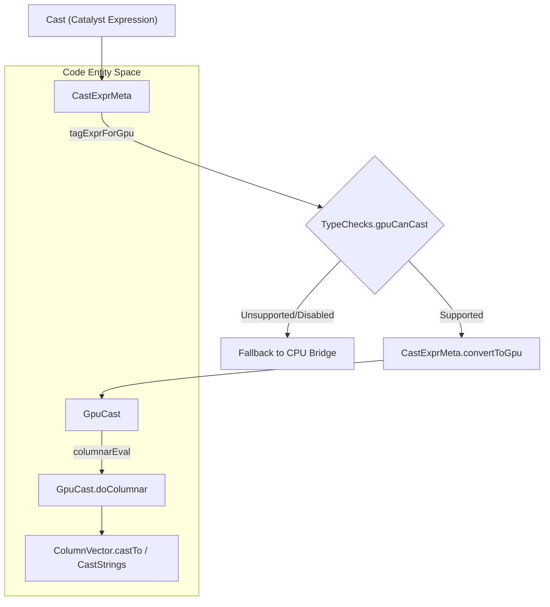
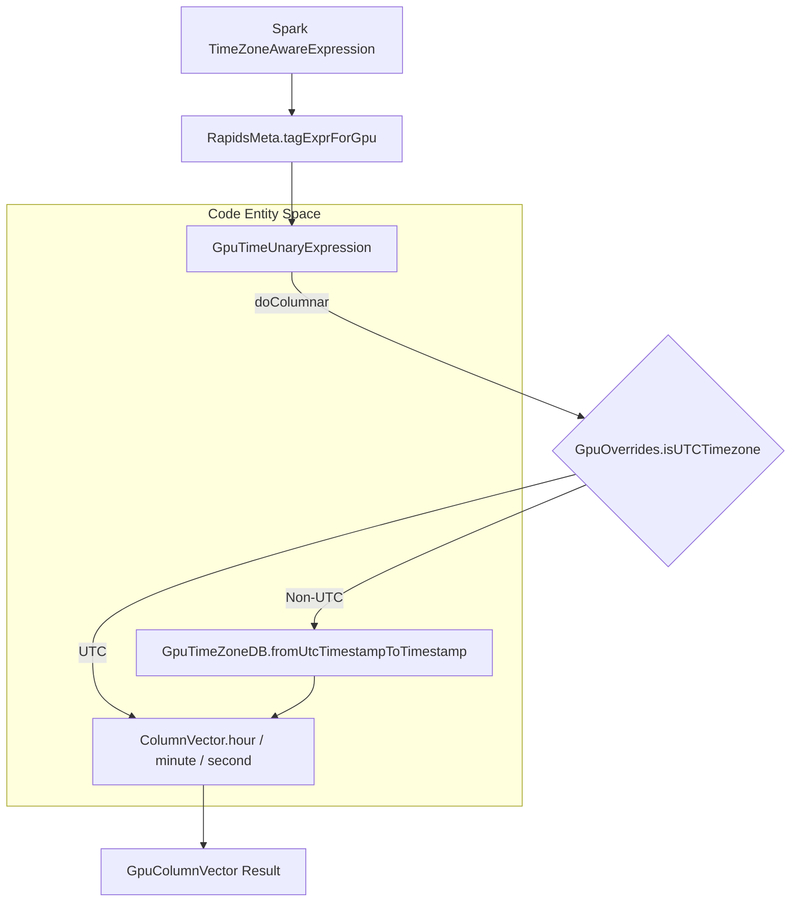

<!-- source: DeepWiki mcp.deepwiki.com · repo NVIDIA/cudf-spark · page 3.4 Cast, Date/Time & Decimal Expressions · fetched 2026-10-26 -->

# Cast, Date/Time & Decimal Expressions

Relevant source files

The following files were used as context for generating this wiki page:

- [integration_tests/src/main/python/cast_test.py](integration_tests/src/main/python/cast_test.py)
- [integration_tests/src/main/python/date_time_test.py](integration_tests/src/main/python/date_time_test.py)
- [integration_tests/src/main/python/orc_cast_test.py](integration_tests/src/main/python/orc_cast_test.py)
- [integration_tests/src/test/resources/before_1582_ts_v2_4.snappy.orc](integration_tests/src/test/resources/before_1582_ts_v2_4.snappy.orc)
- [sql-plugin/src/main/scala/com/nvidia/spark/rapids/DateUtils.scala](sql-plugin/src/main/scala/com/nvidia/spark/rapids/DateUtils.scala)
- [sql-plugin/src/main/scala/com/nvidia/spark/rapids/GpuCast.scala](sql-plugin/src/main/scala/com/nvidia/spark/rapids/GpuCast.scala)
- [sql-plugin/src/main/scala/com/nvidia/spark/rapids/GpuOrcTimezoneUtils.scala](sql-plugin/src/main/scala/com/nvidia/spark/rapids/GpuOrcTimezoneUtils.scala)
- [sql-plugin/src/main/scala/com/nvidia/spark/rapids/GpuTimestampRebaseUtils.scala](sql-plugin/src/main/scala/com/nvidia/spark/rapids/GpuTimestampRebaseUtils.scala)
- [sql-plugin/src/main/scala/com/nvidia/spark/rapids/RapidsMeta.scala](sql-plugin/src/main/scala/com/nvidia/spark/rapids/RapidsMeta.scala)
- [sql-plugin/src/main/scala/com/nvidia/spark/rapids/TypeChecks.scala](sql-plugin/src/main/scala/com/nvidia/spark/rapids/TypeChecks.scala)
- [sql-plugin/src/main/scala/com/nvidia/spark/rapids/shims/OrcCastingShims.scala](sql-plugin/src/main/scala/com/nvidia/spark/rapids/shims/OrcCastingShims.scala)
- [sql-plugin/src/main/scala/org/apache/spark/sql/catalyst/expressions/rapids/Timestamp.scala](sql-plugin/src/main/scala/org/apache/spark/sql/catalyst/expressions/rapids/Timestamp.scala)
- [sql-plugin/src/main/scala/org/apache/spark/sql/rapids/RebaseDateTimeBridge.scala](sql-plugin/src/main/scala/org/apache/spark/sql/rapids/RebaseDateTimeBridge.scala)
- [sql-plugin/src/main/scala/org/apache/spark/sql/rapids/datetimeExpressions.scala](sql-plugin/src/main/scala/org/apache/spark/sql/rapids/datetimeExpressions.scala)
- [sql-plugin/src/main/spark400/scala/com/nvidia/spark/rapids/shims/DateTimeUtilsShims.scala](sql-plugin/src/main/spark400/scala/com/nvidia/spark/rapids/shims/DateTimeUtilsShims.scala)
- [tests/src/test/scala/com/nvidia/spark/rapids/AnsiCastOpSuite.scala](tests/src/test/scala/com/nvidia/spark/rapids/AnsiCastOpSuite.scala)
- [tests/src/test/scala/com/nvidia/spark/rapids/CastOpSuite.scala](tests/src/test/scala/com/nvidia/spark/rapids/CastOpSuite.scala)
- [tests/src/test/scala/com/nvidia/spark/rapids/OrcScanRetrySuite.scala](tests/src/test/scala/com/nvidia/spark/rapids/OrcScanRetrySuite.scala)
- [tests/src/test/scala/com/nvidia/spark/rapids/ParseDateTimeSuite.scala](tests/src/test/scala/com/nvidia/spark/rapids/ParseDateTimeSuite.scala)
- [tests/src/test/scala/com/nvidia/spark/rapids/timezone/OrcTimezonePerfSuite.scala](tests/src/test/scala/com/nvidia/spark/rapids/timezone/OrcTimezonePerfSuite.scala)
- [tests/src/test/scala/com/nvidia/spark/rapids/timezone/OrcTimezoneSuite.scala](tests/src/test/scala/com/nvidia/spark/rapids/timezone/OrcTimezoneSuite.scala)

## Purpose and Scope
This page details the GPU implementations of type conversions, date/time operations, and decimal expressions within the `cudf-spark` plugin. It covers `GpuCast` and `CastExprMeta` [sql-plugin/src/main/scala/com/nvidia/spark/rapids/GpuCast.scala:43-76]() for type conversions, date and time GPU expressions defined in `datetimeExpressions.scala` [sql-plugin/src/main/scala/org/apache/spark/sql/rapids/datetimeExpressions.scala](), parsing and formatting utilities in `DateUtils` [sql-plugin/src/main/scala/com/nvidia/spark/rapids/DateUtils.scala](), decimal operations, timezone handling, and Julian-to-Gregorian rebasing via `GpuOrcTimezoneUtils` [sql-plugin/src/main/scala/com/nvidia/spark/rapids/GpuOrcTimezoneUtils.scala]().

Sources:
[sql-plugin/src/main/scala/com/nvidia/spark/rapids/GpuCast.scala:43-76](),
[sql-plugin/src/main/scala/org/apache/spark/sql/rapids/datetimeExpressions.scala](),
[sql-plugin/src/main/scala/com/nvidia/spark/rapids/DateUtils.scala](),
[sql-plugin/src/main/scala/com/nvidia/spark/rapids/GpuOrcTimezoneUtils.scala]()

---

## GpuCast: Type Conversion on GPU

The `GpuCast` expression implements a GPU-accelerated version of Spark's `Cast` expression. It operates by converting Spark `Cast` expressions to GPU-compatible `GpuCast` expressions during the physical plan replacement phase via the metadata wrapper `CastExprMeta` [sql-plugin/src/main/scala/com/nvidia/spark/rapids/GpuCast.scala:43-76]().

### CastExprMeta and Expression Tagging

`CastExprMeta` inspects the cast operation during query preparation. It analyzes source and target data types, configuration flags, and compatibility with GPU support. Notably, it checks configuration flags such as `spark.rapids.sql.castFloatToIntegralTypes.enabled`, `spark.rapids.sql.castDecimalToFloat.enabled`, `spark.rapids.sql.castFloatToString.enabled`, and `spark.rapids.sql.castStringToFloat.enabled` [sql-plugin/src/main/scala/com/nvidia/spark/rapids/GpuCast.scala:114-140](). Unsupported or disabled casts cause the expression to fall back to CPU.

Sources:
[sql-plugin/src/main/scala/com/nvidia/spark/rapids/GpuCast.scala:43-76](),
[sql-plugin/src/main/scala/com/nvidia/spark/rapids/GpuCast.scala:114-140]()

### GPU Cast Execution Flow (Code Entity Space)

Title: "GpuCast Execution Mapping"

Sources:
[sql-plugin/src/main/scala/com/nvidia/spark/rapids/GpuCast.scala:43-76](),
[sql-plugin/src/main/scala/com/nvidia/spark/rapids/GpuCast.scala:114-140]()

---

## Date/Time Expressions

GPU-accelerated date and time expressions are implemented in `datetimeExpressions.scala` [sql-plugin/src/main/scala/org/apache/spark/sql/rapids/datetimeExpressions.scala]().

### Core Date/Time Expressions

- **Date Unary Expressions**:
  `GpuWeekDay` returns the zero-based day of the week with Monday=0 [sql-plugin/src/main/scala/org/apache/spark/sql/rapids/datetimeExpressions.scala:62-72]().
  `GpuDayOfWeek` provides Sunday=1-based day index [sql-plugin/src/main/scala/org/apache/spark/sql/rapids/datetimeExpressions.scala:74-91]().

- **Time Unary Expressions**:
  `GpuHour`, `GpuMinute`, and `GpuSecond` extract corresponding timestamp fields [sql-plugin/src/main/scala/org/apache/spark/sql/rapids/datetimeExpressions.scala:93-142](). For non-UTC time zones, timestamp columns are shifted using `GpuTimeZoneDB.fromUtcTimestampToTimestamp` [sql-plugin/src/main/scala/org/apache/spark/sql/rapids/datetimeExpressions.scala:104-106]() before extraction.

- **Year Extraction**:
  `GpuYear` extracts the year integer from a date column [sql-plugin/src/main/scala/org/apache/spark/sql/rapids/datetimeExpressions.scala:144-147]().

- **Interval Arithmetic**:
  `GpuTimeMath` (superclass for `GpuTimeAdd`, `GpuTimeSub`) manages arithmetic on timestamps and intervals [sql-plugin/src/main/scala/org/apache/spark/sql/rapids/datetimeExpressions.scala:149-186]().

Sources:
[sql-plugin/src/main/scala/org/apache/spark/sql/rapids/datetimeExpressions.scala:43-142](),
[sql-plugin/src/main/scala/org/apache/spark/sql/rapids/datetimeExpressions.scala:149-186]()

### Date/Time Expression Execution Flow

Title: "DateTime Expression Evaluation Pipeline"

Sources:
[sql-plugin/src/main/scala/org/apache/spark/sql/rapids/datetimeExpressions.scala:43-142]()

---

## DateUtils & Strf Conversion

The `DateUtils` object [sql-plugin/src/main/scala/com/nvidia/spark/rapids/DateUtils.scala]() provides utilities to support date/time format conversions and special date constants.

### Format Pattern Conversion

*   Converts Java time format patterns to cuDF-compatible `strftime` patterns via `DateUtils.toStrf` [sql-plugin/src/main/scala/com/nvidia/spark/rapids/DateUtils.scala:151-155]().
*   Maps tokens such as `yyyy` to `%Y`, `MM` to `%m`, `dd` to `%d`, and fractional seconds correctly [sql-plugin/src/main/scala/com/nvidia/spark/rapids/DateUtils.scala:49-52]().
*   Unsupported format characters trigger fallbacks or exceptions via `TimestampFormatConversionException` [sql-plugin/src/main/scala/com/nvidia/spark/rapids/DateUtils.scala:185-187]() to prevent incorrect parsing.

Sources:
[sql-plugin/src/main/scala/com/nvidia/spark/rapids/DateUtils.scala:49-52](),
[sql-plugin/src/main/scala/com/nvidia/spark/rapids/DateUtils.scala:151-187]()

---

## Timezone Handling & ORC Rebasing

The plugin handles complex timezone semantics and calendar rebasing for legacy data formats, particularly ORC files.

### GpuOrcTimezoneUtils: ORC Timestamp Rebasing

-   **`resolveWriterTimezone`** resolves timezone names from ORC stripe footer metadata to `ZoneId` objects [sql-plugin/src/main/scala/com/nvidia/spark/rapids/GpuOrcTimezoneUtils.scala:32-44]().
-   **`convertOrcIntegerTimestamp`** performs conversion of integer timestamps considering historical timezone rules and transition times via GPU JNI `GpuTimeZoneDB` functions [sql-plugin/src/main/scala/com/nvidia/spark/rapids/GpuOrcTimezoneUtils.scala:61-68]().
-   **Julian to Gregorian Rebasing** is handled by applying `DateTimeRebase.rebaseJulianToGregorian` to timestamp-day columns that are not proleptic Gregorian [sql-plugin/src/main/scala/com/nvidia/spark/rapids/GpuOrcTimezoneUtils.scala:160-161](). This is crucial for handling legacy date formats, especially those written before 1582, as seen in tests like `before_1582_ts_v2_4.snappy.orc` [integration_tests/src/test/resources/before_1582_ts_v2_4.snappy.orc]() and related ORC tests [integration_tests/src/main/python/orc_cast_test.py:132-140]().

Sources:
[sql-plugin/src/main/scala/com/nvidia/spark/rapids/GpuOrcTimezoneUtils.scala:32-44](),
[sql-plugin/src/main/scala/com/nvidia/spark/rapids/GpuOrcTimezoneUtils.scala:61-68](),
[sql-plugin/src/main/scala/com/nvidia/spark/rapids/GpuOrcTimezoneUtils.scala:160-161](),
[integration_tests/src/test/resources/before_1582_ts_v2_4.snappy.orc](),
[integration_tests/src/main/python/orc_cast_test.py:132-140]()

---

## Decimal Expressions

Decimal expression support on the GPU leverages helpers within `GpuCast` and associated utility modules. The `Decimal` type in Spark supports precision up to 38 digits (128-bits), which the cuDF plugin supports up to `DECIMAL128_MAX_PRECISION` [sql-plugin/src/main/scala/com/nvidia/spark/rapids/GpuCast.scala:117-121]().

-   **Overflow Validation**: Validates decimal values against target decimal precision and scale limits, throwing GPU exceptions on overflow to enforce ANSI semantics [sql-plugin/src/main/scala/com/nvidia/spark/rapids/GpuCast.scala:117-121]().
-   **Decimal to Float/Decimal Conversions**: Controlled via configuration properties such as `spark.rapids.sql.castDecimalToFloat.enabled` and `spark.rapids.sql.castFloatToDecimal.enabled` [sql-plugin/src/main/scala/com/nvidia/spark/rapids/GpuCast.scala:122-131]().

Sources:
[sql-plugin/src/main/scala/com/nvidia/spark/rapids/GpuCast.scala:117-131]()

---

