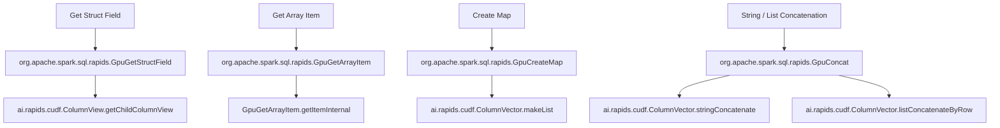
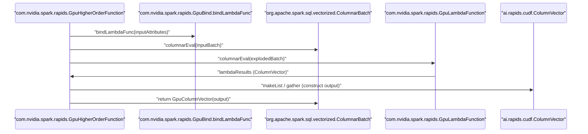

<!-- source: DeepWiki mcp.deepwiki.com · repo NVIDIA/cudf-spark · page 3.5 Complex Types, Collections & Higher-Order Functions · fetched 2026-10-26 -->

# Complex Types, Collections & Higher-Order Functions

Relevant source files

The following files were used as context for generating this wiki page:

- [integration_tests/src/main/python/arithmetic_ops_test.py](integration_tests/src/main/python/arithmetic_ops_test.py)
- [integration_tests/src/main/python/array_test.py](integration_tests/src/main/python/array_test.py)
- [integration_tests/src/main/python/collection_ops_test.py](integration_tests/src/main/python/collection_ops_test.py)
- [integration_tests/src/main/python/map_test.py](integration_tests/src/main/python/map_test.py)
- [integration_tests/src/main/python/struct_test.py](integration_tests/src/main/python/struct_test.py)
- [integration_tests/src/main/python/variant_test.py](integration_tests/src/main/python/variant_test.py)
- [sql-plugin/src/main/scala/com/nvidia/spark/rapids/AstUtil.scala](sql-plugin/src/main/scala/com/nvidia/spark/rapids/AstUtil.scala)
- [sql-plugin/src/main/scala/com/nvidia/spark/rapids/GpuCanonicalize.scala](sql-plugin/src/main/scala/com/nvidia/spark/rapids/GpuCanonicalize.scala)
- [sql-plugin/src/main/scala/com/nvidia/spark/rapids/GpuExpressions.scala](sql-plugin/src/main/scala/com/nvidia/spark/rapids/GpuExpressions.scala)
- [sql-plugin/src/main/scala/com/nvidia/spark/rapids/higherOrderFunctions.scala](sql-plugin/src/main/scala/com/nvidia/spark/rapids/higherOrderFunctions.scala)
- [sql-plugin/src/main/scala/com/nvidia/spark/rapids/nullExpressions.scala](sql-plugin/src/main/scala/com/nvidia/spark/rapids/nullExpressions.scala)
- [sql-plugin/src/main/scala/org/apache/spark/sql/rapids/arithmetic.scala](sql-plugin/src/main/scala/org/apache/spark/sql/rapids/arithmetic.scala)
- [sql-plugin/src/main/scala/org/apache/spark/sql/rapids/bitwise.scala](sql-plugin/src/main/scala/org/apache/spark/sql/rapids/bitwise.scala)
- [sql-plugin/src/main/scala/org/apache/spark/sql/rapids/catalyst/expressions/GpuEquivalentExpressions.scala](sql-plugin/src/main/scala/org/apache/spark/sql/rapids/catalyst/expressions/GpuEquivalentExpressions.scala)
- [sql-plugin/src/main/scala/org/apache/spark/sql/rapids/collectionOperations.scala](sql-plugin/src/main/scala/org/apache/spark/sql/rapids/collectionOperations.scala)
- [sql-plugin/src/main/scala/org/apache/spark/sql/rapids/complexTypeCreator.scala](sql-plugin/src/main/scala/org/apache/spark/sql/rapids/complexTypeCreator.scala)
- [sql-plugin/src/main/scala/org/apache/spark/sql/rapids/complexTypeExtractors.scala](sql-plugin/src/main/scala/org/apache/spark/sql/rapids/complexTypeExtractors.scala)
- [sql-plugin/src/main/scala/org/apache/spark/sql/rapids/mathExpressions.scala](sql-plugin/src/main/scala/org/apache/spark/sql/rapids/mathExpressions.scala)
- [sql-plugin/src/main/spark330/scala/com/nvidia/spark/rapids/shims/ParquetVariantShims.scala](sql-plugin/src/main/spark330/scala/com/nvidia/spark/rapids/shims/ParquetVariantShims.scala)
- [sql-plugin/src/main/spark330db/scala/com/nvidia/spark/rapids/shims/DecimalArithmeticOverrides.scala](sql-plugin/src/main/spark330db/scala/com/nvidia/spark/rapids/shims/DecimalArithmeticOverrides.scala)
- [sql-plugin/src/main/spark330db/scala/org/apache/spark/sql/rapids/arithmetic.scala](sql-plugin/src/main/spark330db/scala/org/apache/spark/sql/rapids/arithmetic.scala)
- [sql-plugin/src/main/spark330db/scala/org/apache/spark/sql/rapids/execution/GpuBroadcastNestedLoopJoinExec.scala](sql-plugin/src/main/spark330db/scala/org/apache/spark/sql/rapids/execution/GpuBroadcastNestedLoopJoinExec.scala)
- [sql-plugin/src/main/spark330db/scala/org/apache/spark/sql/rapids/execution/GpuExecutorBroadcastHelper.scala](sql-plugin/src/main/spark330db/scala/org/apache/spark/sql/rapids/execution/GpuExecutorBroadcastHelper.scala)
- [sql-plugin/src/main/spark340/scala/org/apache/spark/sql/rapids/execution/GpuBroadcastNestedLoopJoinExec.scala](sql-plugin/src/main/spark340/scala/org/apache/spark/sql/rapids/execution/GpuBroadcastNestedLoopJoinExec.scala)
- [sql-plugin/src/main/spark400/scala/com/nvidia/spark/rapids/GpuVariantGet.scala](sql-plugin/src/main/spark400/scala/com/nvidia/spark/rapids/GpuVariantGet.scala)
- [sql-plugin/src/main/spark400/scala/com/nvidia/spark/rapids/shims/ParquetVariantShims.scala](sql-plugin/src/main/spark400/scala/com/nvidia/spark/rapids/shims/ParquetVariantShims.scala)
- [sql-plugin/src/main/spark400/scala/com/nvidia/spark/rapids/shims/Spark400PlusCommonShims.scala](sql-plugin/src/main/spark400/scala/com/nvidia/spark/rapids/shims/Spark400PlusCommonShims.scala)
- [sql-plugin/src/main/spark400db173/scala/com/nvidia/spark/rapids/shims/Spark400PlusDBShims.scala](sql-plugin/src/main/spark400db173/scala/com/nvidia/spark/rapids/shims/Spark400PlusDBShims.scala)
- [sql-plugin/src/test/spark400/scala/com/nvidia/spark/rapids/GpuVariantGetSuite.scala](sql-plugin/src/test/spark400/scala/com/nvidia/spark/rapids/GpuVariantGetSuite.scala)
- [tests/src/test/scala/com/nvidia/spark/rapids/AstUtilSuite.scala](tests/src/test/scala/com/nvidia/spark/rapids/AstUtilSuite.scala)
- [tests/src/test/scala/com/nvidia/spark/rapids/JoinsSuite.scala](tests/src/test/scala/com/nvidia/spark/rapids/JoinsSuite.scala)
- [tests/src/test/scala/com/nvidia/spark/rapids/LogOperatorUnitTestSuite.scala](tests/src/test/scala/com/nvidia/spark/rapids/LogOperatorUnitTestSuite.scala)
- [tests/src/test/scala/org/apache/spark/sql/rapids/TestTrampolineUtil.scala](tests/src/test/scala/org/apache/spark/sql/rapids/TestTrampolineUtil.scala)
- [tests/src/test/scala/org/apache/spark/sql/rapids/catalyst/expressions/GpuEquivalentExpressionsSuite.scala](tests/src/test/scala/org/apache/spark/sql/rapids/catalyst/expressions/GpuEquivalentExpressionsSuite.scala)
- [tests/src/test/spark400/scala/com/nvidia/spark/rapids/GpuVariantGetMetaSuite.scala](tests/src/test/spark400/scala/com/nvidia/spark/rapids/GpuVariantGetMetaSuite.scala)

This page details the GPU acceleration support for complex data types, collection operations, conditional expressions, higher-order functions, and variant types within the NVIDIA RAPIDS Accelerator for Apache Spark. It covers arrays, maps, structs, conditional evaluation, lambda bindings, and Spark 4.0+ `VariantType` extraction support.

Sources: [sql-plugin/src/main/scala/org/apache/spark/sql/rapids/collectionOperations.scala](), [sql-plugin/src/main/scala/org/apache/spark/sql/rapids/complexTypeExtractors.scala](), [sql-plugin/src/main/spark400/scala/com/nvidia/spark/rapids/GpuVariantGet.scala]()

## Complex Type Extractors and Creators

The plugin provides GPU-accelerated implementations for extracting elements from complex types and constructing new complex columns.

### Array and String Operations

GPU support for array and collection operations includes:

*   **`GpuGetArrayItem`**: Extracts an element from an array at a specified ordinal. This operation handles negative indices by replacing them with nulls, consistent with Spark's behavior. It also includes error checking for out-of-bounds access when `failOnError` is enabled (ANSI mode) [sql-plugin/src/main/scala/org/apache/spark/sql/rapids/complexTypeExtractors.scala:85-150]().
    *   The core logic involves casting the index column to `DType.INT32` and invoking cuDF list element extraction via `getItemInternal` [sql-plugin/src/main/scala/org/apache/spark/sql/rapids/complexTypeExtractors.scala:105-111]().
    *   When `failOnError` is true, negative indices or indices exceeding the array size trigger `invalidArrayIndexError` which errors out with the appropriate message [sql-plugin/src/main/scala/org/apache/spark/sql/rapids/complexTypeExtractors.scala:113-142]().
    *   Negative indices are mapped to nulls before extraction under non-ANSI rules (no `failOnError`) [sql-plugin/src/main/scala/org/apache/spark/sql/rapids/complexTypeExtractors.scala:144-150]().
*   **`GpuConcat`**: Concatenates multiple arrays or strings with specialized handling depending on the element types [sql-plugin/src/main/scala/org/apache/spark/sql/rapids/collectionOperations.scala:42-84]().
    *   String concatenation uses `cudf.ColumnVector.stringConcatenate` [sql-plugin/src/main/scala/org/apache/spark/sql/rapids/collectionOperations.scala:70-76]().
    *   List (array) concatenation uses `cudf.ColumnVector.listConcatenateByRow` [sql-plugin/src/main/scala/org/apache/spark/sql/rapids/collectionOperations.scala:78-83]().
*   **`GpuSlice`**: Extracts a slice of an array using utility functions that delegate to cuDF's slice operations [sql-plugin/src/main/scala/org/apache/spark/sql/rapids/collectionOperations.scala:117-168]().

Sources: [sql-plugin/src/main/scala/org/apache/spark/sql/rapids/complexTypeExtractors.scala:85-150](), [sql-plugin/src/main/scala/org/apache/spark/sql/rapids/collectionOperations.scala:42-168]()

### Map and Struct Operations

GPU support for map and struct structures includes:

*   **`GpuMapConcat`**: Concatenates multiple maps by concatenating the underlying key-value structs as arrays by row and reconstructing maps using `listConcatenateByRow` [sql-plugin/src/main/scala/org/apache/spark/sql/rapids/collectionOperations.scala:86-115]().
*   **`GpuCreateMap`**: Creates a map from key-value pairs by building a list of struct keys and values using `ColumnVector.makeList` on `DType.STRUCT` typed views [sql-plugin/src/main/scala/org/apache/spark/sql/rapids/complexTypeCreator.scala:87-131]().
    *   Deduplication of keys is applied using `dropListDuplicatesWithKeysValues`, honoring the `spark.sql.mapKeyDedupPolicy` Spark configuration [sql-plugin/src/main/scala/org/apache/spark/sql/rapids/complexTypeCreator.scala:161-163]().
*   **`GpuCreateArray`**: Constructs an array column from individual child expressions by evaluating them and invoking `ColumnVector.makeList` [sql-plugin/src/main/scala/org/apache/spark/sql/rapids/complexTypeCreator.scala:36-85]().
*   **`GpuGetStructField`**: Extracts a field from a struct by accessing the child column view or the column within a struct scalar, handling nulls appropriately [sql-plugin/src/main/scala/org/apache/spark/sql/rapids/complexTypeExtractors.scala:36-78]().

Sources: [sql-plugin/src/main/scala/org/apache/spark/sql/rapids/collectionOperations.scala:86-115](), [sql-plugin/src/main/scala/org/apache/spark/sql/rapids/complexTypeCreator.scala:36-163](), [sql-plugin/src/main/scala/org/apache/spark/sql/rapids/complexTypeExtractors.scala:36-78]()

### Diagram: Complex Type Operations Code-to-Execution Mapping

Sources: [sql-plugin/src/main/scala/org/apache/spark/sql/rapids/collectionOperations.scala:42-115](), [sql-plugin/src/main/scala/org/apache/spark/sql/rapids/complexTypeExtractors.scala:36-150](), [sql-plugin/src/main/scala/org/apache/spark/sql/rapids/complexTypeCreator.scala:87-163]()

## Conditionals and Predicates

Conditional expressions and logical predicates execute entirely on the GPU:

*   **`GpuIf`**: Evaluates conditional branches similar to Spark's `If` construct via cuDF's conditional APIs.
*   **`GpuCaseWhen`**: Implements SQL `CASE WHEN` semantics using cuDF's native conditional execution paths.
*   **`GpuCoalesce`**: Returns the first non-null value among the inputs by iterating and applying vector coalescing.
*   **Logical Predicates (`GpuAnd`, `GpuOr`, `GpuNot`)**: Implemented as GPU Boolean predicates using cuDF's null-aware logical operators, supporting short-circuiting semantics on GPU for predicates with side effects.

Sources: [sql-plugin/src/main/scala/com/nvidia/spark/rapids/conditionalExpressions.scala](), [sql-plugin/src/main/scala/org/apache/spark/sql/rapids/predicates.scala]()

## Higher-Order Functions & Lambda Evaluation

Higher-order functions in Spark take collection inputs and apply lambda functions, producing new collection or scalar results. This GPU plugin supports these via specialized expression classes and binding mechanisms.

*   **`GpuNamedLambdaVariable`**: Represents a named lambda variable corresponding to a lambda parameter. On the GPU, these are bound to batch columns dynamically during evaluation, as opposed to CPU Spark which uses mutable `AtomicReference` values [sql-plugin/src/main/scala/com/nvidia/spark/rapids/higherOrderFunctions.scala:41-64]().
*   **`GpuLambdaFunction`**: Wraps the lambda function expression and its named arguments, providing columnar evaluation semantics on GPU [sql-plugin/src/main/scala/com/nvidia/spark/rapids/higherOrderFunctions.scala:70-84]().
*   **`bindLambdaFunc`**: Core utility to bind lambda variables, resolving `GpuNamedLambdaVariable` to `GpuBoundReference` instances that refer to columns in the modified batch passed to the lambda function [sql-plugin/src/main/scala/com/nvidia/spark/rapids/higherOrderFunctions.scala:129-165]().

The evaluation flow for higher-order functions involves:

1.  Binding the lambda function and its argument(s) against input batch columns.
2.  Materializing a modified `ColumnarBatch` to feed lambda function parameters.
3.  Executing the lambda function on these batch columns and collecting results.
4.  Combining results using cuDF native APIs like `makeList` or gathers.

Sources: [sql-plugin/src/main/scala/com/nvidia/spark/rapids/higherOrderFunctions.scala:41-165]()

### Diagram: Higher-Order Function Binding and Evaluation

Sources: [sql-plugin/src/main/scala/com/nvidia/spark/rapids/higherOrderFunctions.scala:41-165]()

## Variant Type Support (Spark 4.0+)

Starting with Spark 4.0, `VariantType` support allows semi-structured JSON or Variant data types with nested fields, accessed by paths.

*   **`GpuVariantGetMeta`** performs validation that:
    *   Input child expression is of a `VariantType` (represented as a struct with two children: value and metadata).
    *   Target type is one of supported primitive types (boolean, tinyint, smallint, int, bigint, float, double, string).
    *   Access path is a literal string matching allowed object-field/array-index patterns (e.g., `$.field`, `$.items[0]`).
    *   Strict variant extraction (`failOnError`) is not enabled as it is unsupported.
    *   cuDF native variant extraction APIs are available.
*   **`GpuVariantGet`** implements actual GPU-side variant extraction by:
    *   Ensuring the input `Variant` is represented as a cuDF struct with two children: value and metadata.
    *   Calling `VariantUtils.getVariantFieldValue` using the path to extract sub-fields inside the variant.
    *   Casting or decoding the extracted data to the target type using cuDF APIs and `VariantUtils.castVariantValue`.
    *   Falling back to a CPU bridge expression if some rows cannot be decoded properly on GPU.

Sources: [sql-plugin/src/main/spark400/scala/com/nvidia/spark/rapids/GpuVariantGet.scala:31-187]()

---

