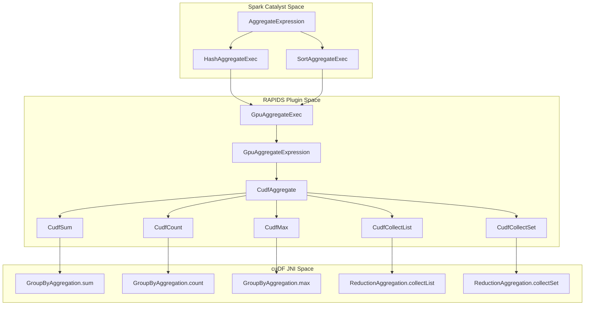
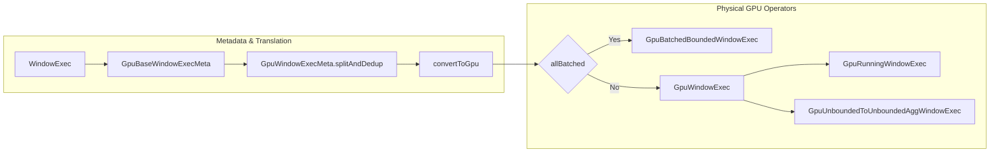

<!-- source: DeepWiki mcp.deepwiki.com · repo NVIDIA/cudf-spark · page 3.6 Aggregation & Window Functions · fetched 2026-10-26 -->

# Aggregation & Window Functions

Relevant source files

The following files were used as context for generating this wiki page:

- [integration_tests/src/main/python/aqe_test.py](integration_tests/src/main/python/aqe_test.py)
- [sql-plugin/src/main/scala/com/nvidia/spark/rapids/CostBasedOptimizer.scala](sql-plugin/src/main/scala/com/nvidia/spark/rapids/CostBasedOptimizer.scala)
- [sql-plugin/src/main/scala/com/nvidia/spark/rapids/GpuAggregateExec.scala](sql-plugin/src/main/scala/com/nvidia/spark/rapids/GpuAggregateExec.scala)
- [sql-plugin/src/main/scala/com/nvidia/spark/rapids/GpuTransitionOverrides.scala](sql-plugin/src/main/scala/com/nvidia/spark/rapids/GpuTransitionOverrides.scala)
- [sql-plugin/src/main/scala/com/nvidia/spark/rapids/SparkShims.scala](sql-plugin/src/main/scala/com/nvidia/spark/rapids/SparkShims.scala)
- [sql-plugin/src/main/scala/com/nvidia/spark/rapids/window/GpuUnboundedToUnboundedAggWindowExec.scala](sql-plugin/src/main/scala/com/nvidia/spark/rapids/window/GpuUnboundedToUnboundedAggWindowExec.scala)
- [sql-plugin/src/main/scala/com/nvidia/spark/rapids/window/GpuWindowExecMeta.scala](sql-plugin/src/main/scala/com/nvidia/spark/rapids/window/GpuWindowExecMeta.scala)
- [sql-plugin/src/main/scala/com/nvidia/spark/rapids/window/GpuWindowExpression.scala](sql-plugin/src/main/scala/com/nvidia/spark/rapids/window/GpuWindowExpression.scala)
- [sql-plugin/src/main/scala/org/apache/spark/sql/rapids/aggregate/aggregateFunctions.scala](sql-plugin/src/main/scala/org/apache/spark/sql/rapids/aggregate/aggregateFunctions.scala)
- [sql-plugin/src/main/spark330/scala/com/nvidia/spark/rapids/shims/TypeUtilsShims.scala](sql-plugin/src/main/spark330/scala/com/nvidia/spark/rapids/shims/TypeUtilsShims.scala)
- [sql-plugin/src/main/spark330db/scala/com/nvidia/spark/rapids/shims/TypeUtilsShims.scala](sql-plugin/src/main/spark330db/scala/com/nvidia/spark/rapids/shims/TypeUtilsShims.scala)
- [sql-plugin/src/main/spark420/scala/com/nvidia/spark/rapids/shims/TypeUtilsShims.scala](sql-plugin/src/main/spark420/scala/com/nvidia/spark/rapids/shims/TypeUtilsShims.scala)
- [tests/src/test/scala/com/nvidia/spark/rapids/AdaptiveQueryExecSuite.scala](tests/src/test/scala/com/nvidia/spark/rapids/AdaptiveQueryExecSuite.scala)
- [tests/src/test/scala/com/nvidia/spark/rapids/BroadcastNestedLoopJoinSuite.scala](tests/src/test/scala/com/nvidia/spark/rapids/BroadcastNestedLoopJoinSuite.scala)
- [tests/src/test/scala/com/nvidia/spark/rapids/CostBasedOptimizerSuite.scala](tests/src/test/scala/com/nvidia/spark/rapids/CostBasedOptimizerSuite.scala)
- [tests/src/test/scala/com/nvidia/spark/rapids/CsvScanSuite.scala](tests/src/test/scala/com/nvidia/spark/rapids/CsvScanSuite.scala)
- [tests/src/test/scala/com/nvidia/spark/rapids/HashAggregatesSuite.scala](tests/src/test/scala/com/nvidia/spark/rapids/HashAggregatesSuite.scala)
- [tests/src/test/scala/com/nvidia/spark/rapids/SparkQueryCompareTestSuite.scala](tests/src/test/scala/com/nvidia/spark/rapids/SparkQueryCompareTestSuite.scala)
- [tests/src/test/scala/com/nvidia/spark/rapids/WindowFunctionSuite.scala](tests/src/test/scala/com/nvidia/spark/rapids/WindowFunctionSuite.scala)
- [tests/src/test/scala/com/nvidia/spark/rapids/window/GpuUnboundedToUnboundedAggWindowSuite.scala](tests/src/test/scala/com/nvidia/spark/rapids/window/GpuUnboundedToUnboundedAggWindowSuite.scala)

This section provides an in-depth exploration of GPU-accelerated aggregation and window function implementations within the RAPIDS Accelerator for Apache Spark plugin. It covers the key classes and mechanisms for aggregation execution (`GpuAggregateExec`), the mapping and implementation of aggregation operations via the cuDF-based subclasses (`CudfAggregate` and its derivatives like `CudfSum`, `CudfCount`, `CudfMin`, `CudfMax`), hash aggregation process, and window function implementations (`GpuWindowExec` and its variants).

---

## 1. GpuAggregateExec: GPU-Accelerated Aggregate Execution Plan

The core class for GPU aggregation execution is `GpuAggregateExec`, which replaces Spark's CPU hash aggregate plans to perform aggregation operations on the GPU via RAPIDS cuDF APIs [sql-plugin/src/main/scala/com/nvidia/spark/rapids/GpuAggregateExec.scala:17-50]().

### Role and Implementation

- `GpuAggregateExec` extends Spark's `BaseAggregateExec` and implements the GPU operator trait `GpuExec`. It primarily supports hash aggregation and reduction-only aggregations optimized for GPU execution [sql-plugin/src/main/scala/com/nvidia/spark/rapids/GpuAggregateExec.scala:44-50]().
- The class manages input batch sizes and memory budgets carefully. It uses the `AggregateUtils.computeTargetBatchSize` method to compute a target batch size considering input and output types, memory per row estimates, and whether the aggregation is grouping or reduction-only [sql-plugin/src/main/scala/com/nvidia/spark/rapids/GpuAggregateExec.scala:93-127]().
- The aggregation computes GPU memory usage budgeting based on an assumption that computation can consume up to 4X the configured batch size, estimating sizes of input rows, output rows, and hash table overhead in this calculation [sql-plugin/src/main/scala/com/nvidia/spark/rapids/GpuAggregateExec.scala:93-127]().

### Key Functions and Data Flow

- **Batch Concatenation and Merge:** When multiple spillable batches exist, `GpuAggregateExec` concatenates them into a single batch for merge aggregation. This is done in `concatenateAndMergeWithRetry`, which handles retries with halving batch sizes to prevent OOM failures [sql-plugin/src/main/scala/com/nvidia/spark/rapids/GpuAggregateExec.scala:136-148]().
- **Aggregation Computation:** The method `computeAggregateAndClose` processes input batches to perform aggregation on GPU and releases resources appropriately [sql-plugin/src/main/scala/com/nvidia/spark/rapids/GpuAggregateExec.scala:25-25]().
- **Retry Logic:** Robust retry mechanisms use `RmmRapidsRetryIterator` to split batches and retry aggregation steps dynamically to prevent memory overruns during execution [sql-plugin/src/main/scala/com/nvidia/spark/rapids/GpuAggregateExec.scala:29-29]().

### Data Flow Summary

Input data batches flow into `GpuAggregateExec`. It batches them respecting GPU memory limits, performs hash aggregation using cuDF, merges partial aggregates as needed, and outputs aggregated results. Spilling and retry logic ensure stability and efficiency in GPU memory use.

Sources: [sql-plugin/src/main/scala/com/nvidia/spark/rapids/GpuAggregateExec.scala:17-150]()

---

## 2. CudfAggregate Subclasses: GPU Aggregation Function Implementations

GPU implementations of Spark's aggregation functions build upon the abstract `CudfAggregate` base class, mapping Spark aggregates to cuDF primitives via JNI for performant GPU execution [sql-plugin/src/main/scala/org/apache/spark/sql/rapids/aggregate/aggregateFunctions.scala:17-40]().

### Major Aggregation Subclasses

- **CudfCount:** Implements count aggregation excluding nulls using `GroupByAggregation.count(NullPolicy.EXCLUDE)` [sql-plugin/src/main/scala/org/apache/spark/sql/rapids/aggregate/aggregateFunctions.scala:40-46]().
- **CudfSum:** Handles sum aggregations with cuDF's `GroupByAggregation.sum()`, mapping Spark data types to cuDF types for correctness [sql-plugin/src/main/scala/org/apache/spark/sql/rapids/aggregate/aggregateFunctions.scala:48-58]().
- **CudfMax / CudfMin:** Implement maximum and minimum functions using respective cuDF aggregation methods [sql-plugin/src/main/scala/org/apache/spark/sql/rapids/aggregate/aggregateFunctions.scala:60-66](), [sql-plugin/src/main/scala/org/apache/spark/sql/rapids/aggregate/aggregateFunctions.scala:77-83]().
- **CudfCollectList / CudfMergeLists:** Support collecting list-typed columns via `ReductionAggregation.collectList` and `mergeLists` respectively [sql-plugin/src/main/scala/org/apache/spark/sql/rapids/aggregate/aggregateFunctions.scala:94-109]().
- **CudfCollectSet:** Implements set-collection aggregations with special NaN equality handling for floats/doubles, honoring Spark semantics that treat NaNs as equal in nested types [sql-plugin/src/main/scala/org/apache/spark/sql/rapids/aggregate/aggregateFunctions.scala:119-158]().

### Implementation Details

Each subclass overrides aggregation behavior, providing implementations for reduction aggregations (one-row results) and group-by aggregations (multiple groups). They integrate tightly into the GPU aggregate expression framework (`GpuAggregateExpression`) that coordinates aggregation evaluation at runtime.

Sources: [sql-plugin/src/main/scala/org/apache/spark/sql/rapids/aggregate/aggregateFunctions.scala:17-160]()

---

## 3. Window Function Implementations: GpuWindowExec and Variants

Window functions enable computations over partitions of data with explicit ordering and frame boundaries. RAPIDS supports a range of window function variants optimized for GPU execution.

### Key Variants

- **GpuRunningWindowExec:** Implements running window calculations where the window frame extends from the partition start up to the current row.
- **GpuBatchedBoundedWindowExec:** Handles window functions with explicit bounded frame boundaries for both lower and upper limits, processing data in batches for efficiency.
- **GpuUnboundedToUnboundedAggWindowExec:** Optimized for windows that cover entire partitions without bounds (`UNBOUNDED PRECEDING` to `UNBOUNDED FOLLOWING`), often used for global aggregations within each partition [sql-plugin/src/main/scala/com/nvidia/spark/rapids/window/GpuUnboundedToUnboundedAggWindowExec.scala:38-38]().

### Expression Meta for Window Functions

`GpuWindowExpressionMetaBase` performs validation and tagging of window expressions for GPU compatibility [sql-plugin/src/main/scala/com/nvidia/spark/rapids/window/GpuWindowExpression.scala:44-50]().

- **Row Frame Boundaries:** It accepts boundaries expressed as literals, `UnboundedPreending` (`Int.MinValue`), `UnboundedFollowing` (`Int.MaxValue`), or `CurrentRow` (0). It rejects unsupported boundary types or negative bounds for certain aggregate functions that do not support them [sql-plugin/src/main/scala/com/nvidia/spark/rapids/window/GpuWindowExpression.scala:51-66]().
- **Range Frame Support:** It validates that if `RangeFrame` is used rather than `RowFrame`, the order-by columns are of supported types such as integral, floating, date/time, string, or decimal types [sql-plugin/src/main/scala/com/nvidia/spark/rapids/window/GpuWindowExpression.scala:113-150]().

These meta checks ensure only supported window expressions get converted to GPU-executed operators.

Sources: [sql-plugin/src/main/scala/com/nvidia/spark/rapids/window/GpuWindowExpression.scala:42-150]()

---

## 4. Hash Aggregation and Cost-Based Optimizer (CBO) Integration

### Hash Aggregation Process

GPU hash aggregation involves reading input batches as GPU columnar data, hashing rows by group keys and performing aggregation via cuDF hash tables. The algorithm supports multi-pass processing handling partial aggregates, spilling intermediate outputs, and retrying in memory-constrained scenarios [sql-plugin/src/main/scala/com/nvidia/spark/rapids/GpuAggregateExec.scala:23-31]().

### Cost-Based Optimizer (CBO)

The plugin includes `CostBasedOptimizer`, which analyzes CPU and GPU execution costs for operators, including aggregation stages. It evaluates the cost of transitioning between CPU and GPU execution and may avoid GPU transitions when they are not beneficial, effectively balancing performance and resource consumption [sql-plugin/src/main/scala/com/nvidia/spark/rapids/CostBasedOptimizer.scala:54-77]().

Sources: [sql-plugin/src/main/scala/com/nvidia/spark/rapids/GpuAggregateExec.scala:51-127](), [sql-plugin/src/main/scala/com/nvidia/spark/rapids/CostBasedOptimizer.scala:54-77]()

---

## 5. Summary Diagrams

### Diagram 1: Aggregation Logic Mapping

This diagram bridges Spark Catalyst aggregate operations to RAPIDS aggregation implementations and underlying cuDF library calls.

Sources: [sql-plugin/src/main/scala/com/nvidia/spark/rapids/GpuAggregateExec.scala:38-48](), [sql-plugin/src/main/scala/org/apache/spark/sql/rapids/aggregate/aggregateFunctions.scala:39-160]()

### Diagram 2: Window Execution Pipeline

This diagram illustrates the transformation from Spark logical window definitions to physical GPU window operators.

Sources: [sql-plugin/src/main/scala/com/nvidia/spark/rapids/window/GpuWindowExpression.scala:44-150]()

---

## Summary Table: Key Classes and Their Roles

| Class Name | Role | Source File |
| :--- | :--- | :--- |
| `GpuAggregateExec` | Base GPU physical operator for executing aggregate operations on GPU | [sql-plugin/src/main/scala/com/nvidia/spark/rapids/GpuAggregateExec.scala]() |
| `CudfAggregate` | Abstract base class for defining GPU aggregation implementations via cuDF | [sql-plugin/src/main/scala/org/apache/spark/sql/rapids/aggregate/aggregateFunctions.scala]() |
| `CudfSum` / `CudfCount` | Implementations of sum and count aggregations using cuDF | [sql-plugin/src/main/scala/org/apache/spark/sql/rapids/aggregate/aggregateFunctions.scala]() |
| `GpuWindowExpressionMetaBase` | Metadata wrapper that validates and tags window expressions for GPU execution | [sql-plugin/src/main/scala/com/nvidia/spark/rapids/window/GpuWindowExpression.scala]() |
| `AggregateUtils` | Utility functions for batch size computation and aggregation validation | [sql-plugin/src/main/scala/com/nvidia/spark/rapids/GpuAggregateExec.scala]() |
| `GpuBatchedBoundedWindowExec` | GPU operator for bounded window frame computations in batches | `sql-plugin/src/main/scala/com/nvidia/spark/rapids/window/GpuBatchedBoundedWindowExec.scala` |
| `GpuRunningWindowExec` | GPU operator for running window frames | `sql-plugin/src/main/scala/com/nvidia/spark/rapids/window/GpuRunningWindowExec.scala` |
| `GpuUnboundedToUnboundedAggWindowExec` | GPU operator optimized for unbounded window aggregations | [sql-plugin/src/main/scala/com/nvidia/spark/rapids/window/GpuUnboundedToUnboundedAggWindowExec.scala]() |

Sources:
- [sql-plugin/src/main/scala/com/nvidia/spark/rapids/GpuAggregateExec.scala:17-150]()
- [sql-plugin/src/main/scala/org/apache/spark/sql/rapids/aggregate/aggregateFunctions.scala:17-160]()
- [sql-plugin/src/main/scala/com/nvidia/spark/rapids/window/GpuWindowExpression.scala:42-150]()

---

