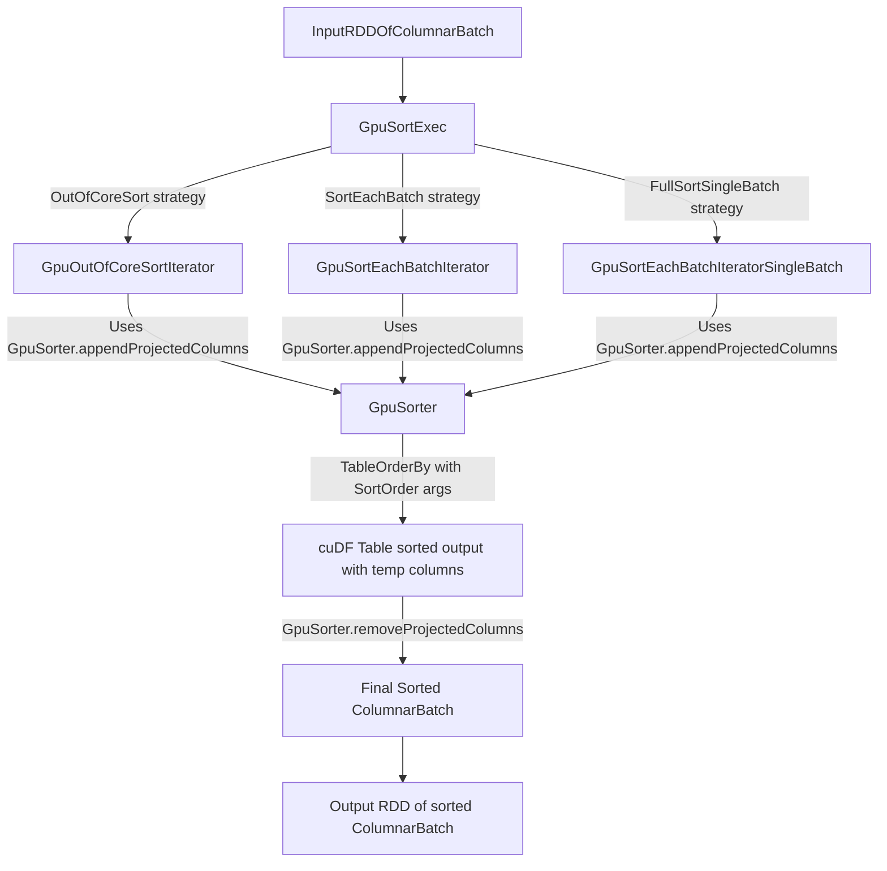
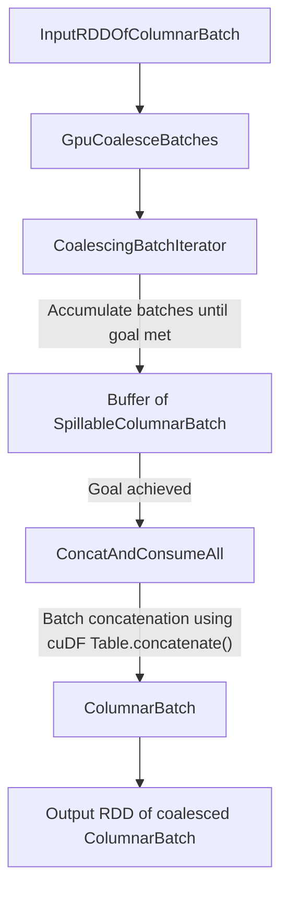
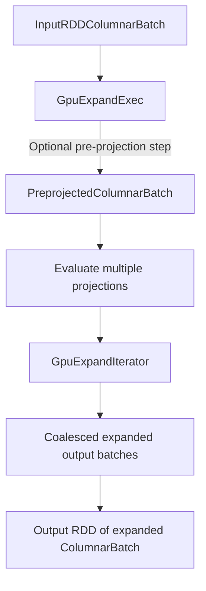
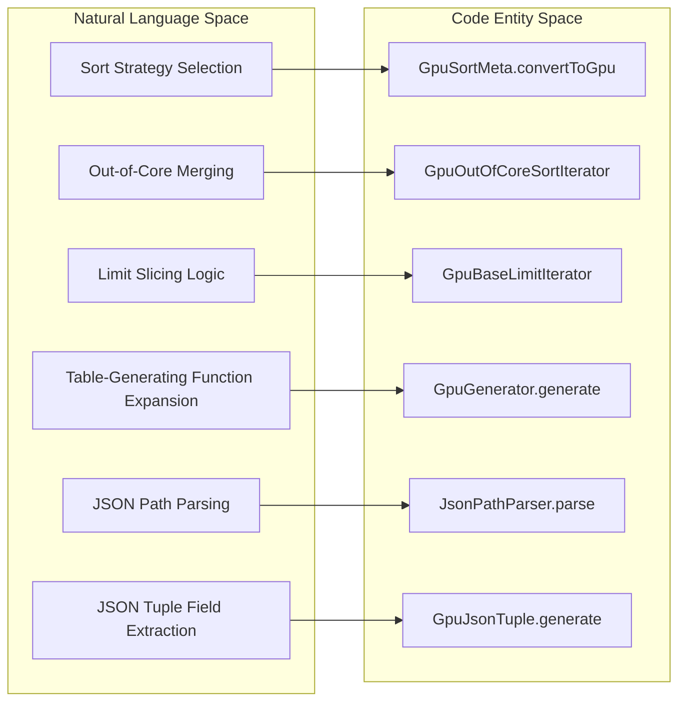
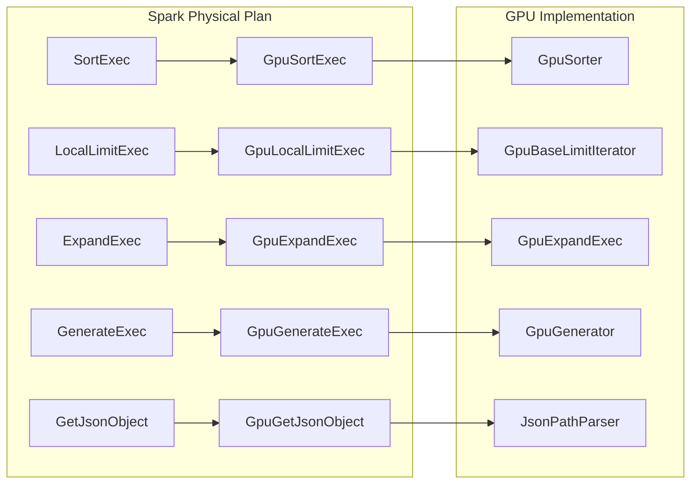

<!-- source: DeepWiki mcp.deepwiki.com · repo NVIDIA/cudf-spark · page 3.7 Sort, Limit, Expand & Generate Operators · fetched 2026-10-26 -->

# Sort, Limit, Expand & Generate Operators

Relevant source files

The following files were used as context for generating this wiki page:

- [integration_tests/src/main/python/get_json_test.py](integration_tests/src/main/python/get_json_test.py)
- [integration_tests/src/main/python/group_partitions_test.py](integration_tests/src/main/python/group_partitions_test.py)
- [integration_tests/src/main/python/json_tuple_test.py](integration_tests/src/main/python/json_tuple_test.py)
- [integration_tests/src/main/python/limit_test.py](integration_tests/src/main/python/limit_test.py)
- [integration_tests/src/main/scala/com/nvidia/spark/rapids/tests/datasourcev2/GroupPartitionsDataSource.scala](integration_tests/src/main/scala/com/nvidia/spark/rapids/tests/datasourcev2/GroupPartitionsDataSource.scala)
- [integration_tests/src/main/spark420/scala/com/nvidia/spark/rapids/tests/datasourcev2/GroupPartitionsSortedDataSource.scala](integration_tests/src/main/spark420/scala/com/nvidia/spark/rapids/tests/datasourcev2/GroupPartitionsSortedDataSource.scala)
- [integration_tests/src/test/resources/t0.csv](integration_tests/src/test/resources/t0.csv)
- [integration_tests/src/test/resources/t1.csv](integration_tests/src/test/resources/t1.csv)
- [sql-plugin-api/src/main/java/com/nvidia/spark/rapids/SparkPlanSubqueries.java](sql-plugin-api/src/main/java/com/nvidia/spark/rapids/SparkPlanSubqueries.java)
- [sql-plugin-api/src/main/scala/com/nvidia/spark/rapids/ConfVersionInfo.scala](sql-plugin-api/src/main/scala/com/nvidia/spark/rapids/ConfVersionInfo.scala)
- [sql-plugin-api/src/main/scala/com/nvidia/spark/rapids/PathInstruction.scala](sql-plugin-api/src/main/scala/com/nvidia/spark/rapids/PathInstruction.scala)
- [sql-plugin-api/src/main/scala/com/nvidia/spark/rapids/TypeSupport.scala](sql-plugin-api/src/main/scala/com/nvidia/spark/rapids/TypeSupport.scala)
- [sql-plugin-api/src/main/scala/com/nvidia/spark/rapids/window/AggAndReplace.scala](sql-plugin-api/src/main/scala/com/nvidia/spark/rapids/window/AggAndReplace.scala)
- [sql-plugin-api/src/main/scala/com/nvidia/spark/rapids/window/RangeBoundaryValue.scala](sql-plugin-api/src/main/scala/com/nvidia/spark/rapids/window/RangeBoundaryValue.scala)
- [sql-plugin/src/main/scala/com/nvidia/spark/rapids/GpuBoundAttribute.scala](sql-plugin/src/main/scala/com/nvidia/spark/rapids/GpuBoundAttribute.scala)
- [sql-plugin/src/main/scala/com/nvidia/spark/rapids/GpuCoalesceBatches.scala](sql-plugin/src/main/scala/com/nvidia/spark/rapids/GpuCoalesceBatches.scala)
- [sql-plugin/src/main/scala/com/nvidia/spark/rapids/GpuExpandExec.scala](sql-plugin/src/main/scala/com/nvidia/spark/rapids/GpuExpandExec.scala)
- [sql-plugin/src/main/scala/com/nvidia/spark/rapids/GpuGenerateExec.scala](sql-plugin/src/main/scala/com/nvidia/spark/rapids/GpuGenerateExec.scala)
- [sql-plugin/src/main/scala/com/nvidia/spark/rapids/GpuGetJsonObject.scala](sql-plugin/src/main/scala/com/nvidia/spark/rapids/GpuGetJsonObject.scala)
- [sql-plugin/src/main/scala/com/nvidia/spark/rapids/GpuHashPartitioningBase.scala](sql-plugin/src/main/scala/com/nvidia/spark/rapids/GpuHashPartitioningBase.scala)
- [sql-plugin/src/main/scala/com/nvidia/spark/rapids/GpuJsonTuple.scala](sql-plugin/src/main/scala/com/nvidia/spark/rapids/GpuJsonTuple.scala)
- [sql-plugin/src/main/scala/com/nvidia/spark/rapids/GpuRangePartitioner.scala](sql-plugin/src/main/scala/com/nvidia/spark/rapids/GpuRangePartitioner.scala)
- [sql-plugin/src/main/scala/com/nvidia/spark/rapids/GpuRoundRobinPartitioning.scala](sql-plugin/src/main/scala/com/nvidia/spark/rapids/GpuRoundRobinPartitioning.scala)
- [sql-plugin/src/main/scala/com/nvidia/spark/rapids/GpuSinglePartitioning.scala](sql-plugin/src/main/scala/com/nvidia/spark/rapids/GpuSinglePartitioning.scala)
- [sql-plugin/src/main/scala/com/nvidia/spark/rapids/GpuSortExec.scala](sql-plugin/src/main/scala/com/nvidia/spark/rapids/GpuSortExec.scala)
- [sql-plugin/src/main/scala/com/nvidia/spark/rapids/HostColumnarToGpu.scala](sql-plugin/src/main/scala/com/nvidia/spark/rapids/HostColumnarToGpu.scala)
- [sql-plugin/src/main/scala/com/nvidia/spark/rapids/RapidsConfSqlEntries.scala](sql-plugin/src/main/scala/com/nvidia/spark/rapids/RapidsConfSqlEntries.scala)
- [sql-plugin/src/main/scala/com/nvidia/spark/rapids/SortUtils.scala](sql-plugin/src/main/scala/com/nvidia/spark/rapids/SortUtils.scala)
- [sql-plugin/src/main/scala/com/nvidia/spark/rapids/basicPhysicalOperators.scala](sql-plugin/src/main/scala/com/nvidia/spark/rapids/basicPhysicalOperators.scala)
- [sql-plugin/src/main/scala/com/nvidia/spark/rapids/limit.scala](sql-plugin/src/main/scala/com/nvidia/spark/rapids/limit.scala)
- [sql-plugin/src/main/scala/com/nvidia/spark/rapids/namedExpressions.scala](sql-plugin/src/main/scala/com/nvidia/spark/rapids/namedExpressions.scala)
- [sql-plugin/src/main/scala/com/nvidia/spark/rapids/window/BasicWindowCalc.scala](sql-plugin/src/main/scala/com/nvidia/spark/rapids/window/BasicWindowCalc.scala)
- [sql-plugin/src/main/scala/org/apache/spark/sql/rapids/execution/GpuRangeBoundaryPlan.scala](sql-plugin/src/main/scala/org/apache/spark/sql/rapids/execution/GpuRangeBoundaryPlan.scala)
- [sql-plugin/src/main/spark330/scala/com/nvidia/spark/rapids/shims/GetJsonObjectShim.scala](sql-plugin/src/main/spark330/scala/com/nvidia/spark/rapids/shims/GetJsonObjectShim.scala)
- [sql-plugin/src/main/spark353/scala/com/nvidia/spark/rapids/shims/GetJsonObjectShim.scala](sql-plugin/src/main/spark353/scala/com/nvidia/spark/rapids/shims/GetJsonObjectShim.scala)
- [sql-plugin/src/main/spark400/scala/com/nvidia/spark/rapids/shims/GetJsonObjectShim.scala](sql-plugin/src/main/spark400/scala/com/nvidia/spark/rapids/shims/GetJsonObjectShim.scala)
- [sql-plugin/src/main/spark420/scala/com/nvidia/spark/rapids/shims/GpuGroupPartitionsExec.scala](sql-plugin/src/main/spark420/scala/com/nvidia/spark/rapids/shims/GpuGroupPartitionsExec.scala)
- [sql-plugin/src/main/spark420/scala/com/nvidia/spark/rapids/shims/GpuGroupPartitionsShims.scala](sql-plugin/src/main/spark420/scala/com/nvidia/spark/rapids/shims/GpuGroupPartitionsShims.scala)
- [sql-plugin/src/main/spark500/scala/com/nvidia/spark/rapids/shims/GpuGroupPartitionsShims.scala](sql-plugin/src/main/spark500/scala/com/nvidia/spark/rapids/shims/GpuGroupPartitionsShims.scala)
- [tests/src/test/scala/com/nvidia/spark/rapids/GpuCoalesceBatchesSuite.scala](tests/src/test/scala/com/nvidia/spark/rapids/GpuCoalesceBatchesSuite.scala)
- [tests/src/test/scala/com/nvidia/spark/rapids/GpuGenerateSuite.scala](tests/src/test/scala/com/nvidia/spark/rapids/GpuGenerateSuite.scala)
- [tests/src/test/scala/com/nvidia/spark/rapids/GpuSortRetrySuite.scala](tests/src/test/scala/com/nvidia/spark/rapids/GpuSortRetrySuite.scala)
- [tests/src/test/scala/com/nvidia/spark/rapids/JsonPathParserSuite.scala](tests/src/test/scala/com/nvidia/spark/rapids/JsonPathParserSuite.scala)
- [tests/src/test/scala/com/nvidia/spark/rapids/LimitRetrySuite.scala](tests/src/test/scala/com/nvidia/spark/rapids/LimitRetrySuite.scala)
- [tests/src/test/scala/com/nvidia/spark/rapids/unit/DecimalUnitTest.scala](tests/src/test/scala/com/nvidia/spark/rapids/unit/DecimalUnitTest.scala)
- [tests/src/test/scala/org/apache/spark/sql/rapids/execution/GpuRangeBoundaryPlanSuite.scala](tests/src/test/scala/org/apache/spark/sql/rapids/execution/GpuRangeBoundaryPlanSuite.scala)
- [tests/src/test/spark420/scala/com/nvidia/spark/rapids/GroupPartitionsExecSuite.scala](tests/src/test/spark420/scala/com/nvidia/spark/rapids/GroupPartitionsExecSuite.scala)
- [tests/src/test/spark420/scala/org/apache/spark/sql/rapids/shims/GroupPartitionsExecTestShim.scala](tests/src/test/spark420/scala/org/apache/spark/sql/rapids/shims/GroupPartitionsExecTestShim.scala)

This page documents the GPU-accelerated implementations of sorting, limiting, expanding, generating, JSON path parsing, and partition-grouping operators within the NVIDIA RAPIDS Accelerator for Apache Spark codebase. It covers `GpuSortExec`, `SortUtils`, `GpuCoalesceBatches`, limit operators (`GpuLocalLimitExec`, `GpuGlobalLimitExec`), `GpuExpandExec`, `GpuGenerateExec`, JSON path expressions, and group-partitions executors.

---

## GpuSortExec

The `GpuSortExec` operator is the GPU-accelerated equivalent of Spark’s `SortExec`. It manages sorting of columnar batches on the GPU. Due to sorting being a memory-intensive operation, `GpuSortExec` supports both in-memory and out-of-core sorting strategies.

### Implementation Details

`GpuSortExec` is defined as a `ShimUnaryExecNode` and implements `GpuExec` [sql-plugin/src/main/scala/com/nvidia/spark/rapids/GpuSortExec.scala:87-93](). It accepts:

- a sequence of GPU `SortOrder` expressions (`gpuSortOrder`),
- a `global` flag indicating whether the sort is global or local,
- a `child` Spark plan,
- a `sortType` (`SortExecType`) specifying the sorting approach (`OutOfCoreSort`, `FullSortSingleBatch`, or `SortEachBatch`).

The converting meta class `GpuSortMeta` converts CPU `SortExec` into `GpuSortExec`, preserving output attributes from its child for type correctness [sql-plugin/src/main/scala/com/nvidia/spark/rapids/GpuSortExec.scala:48-72]().

There are three supported sorting strategies:

- **FullSortSingleBatch**: Used when the entire partition's data fits into a single batch; it requires a single input batch guaranteed by `RequireSingleBatch` [sql-plugin/src/main/scala/com/nvidia/spark/rapids/GpuSortExec.scala:97-99]().

- **OutOfCoreSort**: Default when stable sort is enabled; uses external memory spilling to handle large datasets with `GpuOutOfCoreSortIterator` [sql-plugin/src/main/scala/com/nvidia/spark/rapids/GpuSortExec.scala:143-146]().

- **SortEachBatch**: Sorts each input batch independently via `GpuSortEachBatchIterator` [sql-plugin/src/main/scala/com/nvidia/spark/rapids/GpuSortExec.scala:148-151]().

The default target size for sorting batches is based on the Spark configuration `spark.rapids.sql.batchSizeBytes` with a lower bound of 16KB to avoid tiny batch issues [sql-plugin/src/main/scala/com/nvidia/spark/rapids/GpuSortExec.scala:75-84]().

### Data Flow

Diagram: Sort Execution Data Flow

Sources: [sql-plugin/src/main/scala/com/nvidia/spark/rapids/GpuSortExec.scala:42-166]()

### GpuSorter & SortUtils

The `GpuSorter` utility class facilitates sorting operations. It works by:

- Binding `SortOrder` expressions to the input schema for sorting.
- Detecting `SortOrder`s that require computed columns to enable sorting on expressions like sorting by string length.
- Adding these computed columns to the input batches via `appendProjectedColumns`.
- Removing the added columns after sorting for output consistency using `removeProjectedColumns`.

The companion object `SortUtils` provides helper functions such as `getOrder` to convert Spark's `SortOrder` into cuDF's native sorting metadata (`OrderByArg`) [sql-plugin/src/main/scala/com/nvidia/spark/rapids/SortUtils.scala:30-44]().

Sources: [sql-plugin/src/main/scala/com/nvidia/spark/rapids/SortUtils.scala:30-145](), [sql-plugin/src/main/scala/com/nvidia/spark/rapids/GpuSortExec.scala:131-131]()

---

## GpuCoalesceBatches

`GpuCoalesceBatches` is an operator responsible for concatenating multiple small `ColumnarBatch`es into larger batches. This reduces GPU kernel launch overhead and improves execution efficiency.

### Coalesce Goals

The behavior is governed by a `CoalesceGoal` sealed trait hierarchy [sql-plugin/src/main/scala/com/nvidia/spark/rapids/GpuCoalesceBatches.scala:167-170]():

- **RequireSingleBatch**: Ensures all input data fits in a single batch, required for operators like `GpuSortExec` in stable sort mode [sql-plugin/src/main/scala/com/nvidia/spark/rapids/GpuSortExec.scala:97-98]().
- **TargetSize(targetSizeBytes)**: Targets output batches near a certain size in bytes.
- **BatchedByKey(ordering)**: Attempts to batch rows grouped by key ordering.

### Implementation Details

`GpuCoalesceBatches` uses an internal coalescing iterator that buffers spillable batches, combining them when the goal is achieved. The core concatenation uses cuDF's `Table.concatenate()` for efficient GPU device memory merging [sql-plugin/src/main/scala/com/nvidia/spark/rapids/GpuCoalesceBatches.scala:40-89]().

### Data Flow

Diagram: Coalesce Batches Data Flow

Sources: [sql-plugin/src/main/scala/com/nvidia/spark/rapids/GpuCoalesceBatches.scala:40-89](), [sql-plugin/src/main/scala/com/nvidia/spark/rapids/GpuSortExec.scala:97-98]()

---

## Limit Operators

### GpuLocalLimitExec & GpuGlobalLimitExec

- **GpuLocalLimitExec** applies a limit on each partition independently, emitting at most `limit` rows per partition [sql-plugin/src/main/scala/com/nvidia/spark/rapids/limit.scala:171-171]().
- **GpuGlobalLimitExec** applies a global limit, requiring the child plan to output a single partition.

Both use the core `GpuBaseLimitIterator` to manage slicing batches according to `limit` and `offset` constraints [sql-plugin/src/main/scala/com/nvidia/spark/rapids/limit.scala:39-164]().

### GpuBaseLimitIterator

`GpuBaseLimitIterator` is an iterator that slices batches. It maintains `remainingLimit` and `remainingOffset` counters, skipping rows and slicing batches as needed using cuDF `subVector` operations. It also safely retries slicing using `RmmRapidsRetryIterator` to handle GPU out-of-memory or transient errors [sql-plugin/src/main/scala/com/nvidia/spark/rapids/limit.scala:39-125]().

Sources: [sql-plugin/src/main/scala/com/nvidia/spark/rapids/limit.scala:39-164]()

---

## GpuExpandExec

`GpuExpandExec` implements the GPU version of Spark's `ExpandExec` plan, which applies multiple expression projections to each row, producing multiple rows from a single input row (e.g., for `ROLLUP`, `CUBE`) [sql-plugin/src/main/scala/com/nvidia/spark/rapids/basicPhysicalOperators.scala:52-97]().

### Implementation Details

`GpuExpandExecMeta` converts Spark CPU plans to GPU `GpuExpandExec` during plan replacement [sql-plugin/src/main/scala/com/nvidia/spark/rapids/basicPhysicalOperators.scala:52-97](). It supports:

- **Pre-projection**: Optionally enabled via config, this performs a tiered projection step to factor out and cache common sub-expressions before applying the expand projections.
- **Coalescing output** after expand if enabled.

### Data Flow

Diagram: Expand Execution Data Flow

Sources: [sql-plugin/src/main/scala/com/nvidia/spark/rapids/basicPhysicalOperators.scala:52-97]()

---

## GpuGenerateExec, JSON Path Expressions & Group-Partitions Exec

### GpuGenerateExec

`GpuGenerateExec` corresponds to Spark's `GenerateExec` GPU implementation, which manages table-generating functions (TGFs) such as `explode`, `posexplode`, `json_tuple`, and `stack` [sql-plugin/src/main/scala/com/nvidia/spark/rapids/GpuGenerateExec.scala:40-100]().

The meta class `GpuGenerateExecSparkPlanMeta` decides how to convert these to GPU:
- If the generator is a `Stack` expression, it converts the stack into an equivalent `GpuExpandExec` with appropriate projections [sql-plugin/src/main/scala/com/nvidia/spark/rapids/GpuGenerateExec.scala:58-84]().
- Otherwise, it creates a `GpuGenerateExec` with the GPU-native generator [sql-plugin/src/main/scala/com/nvidia/spark/rapids/GpuGenerateExec.scala:86-99]().

Generators implement the `GpuGenerator` trait that defines a GPU-aware `generate` method for processing `ColumnarBatch` iterators into expanded output batches using cuDF operations [sql-plugin/src/main/scala/com/nvidia/spark/rapids/GpuGenerateExec.scala:147-172]().

### JSON Tuple & JSON Path Expressions

`GpuJsonTuple` implements `GpuGenerator` and processes the `JSON_TUPLE` operator, extracting multiple fields from a JSON string column using the native JNI `JSONUtils.getJsonObjectMultiplePaths` API [sql-plugin/src/main/scala/com/nvidia/spark/rapids/GpuJsonTuple.scala:32-104]().

JSON path expressions are parsed and analyzed by the `JsonPathParser` [sql-plugin/src/main/scala/com/nvidia/spark/rapids/GpuGetJsonObject.scala:38-105](). The meta class `GpuGetJsonObjectMeta` extracts literal JSON paths, parses them, and checks for unsupported features before converting to GPU [sql-plugin/src/main/scala/com/nvidia/spark/rapids/GpuGetJsonObject.scala:115-139]().

### Group-Partitions Exec

Group-partitions operators (`GpuGroupPartitionsExec`) handle partitioned and sorted group streams in newer Spark versions (e.g. Spark 4.2.0+ shims), allowing specialized GPU processing of contiguous partition boundaries. The associated metadata classes and shims manage plan replacement and execution dispatch for grouped partition workloads.

Sources: [sql-plugin/src/main/scala/com/nvidia/spark/rapids/GpuGenerateExec.scala:40-172](), [sql-plugin/src/main/scala/com/nvidia/spark/rapids/GpuGetJsonObject.scala:38-139](), [sql-plugin/src/main/scala/com/nvidia/spark/rapids/GpuJsonTuple.scala:32-104]()

---

## Natural Language to Code Entity Mapping & Operator Relationships

### Natural Language to Code Entity Mapping

Diagram: Natural Language to Code Entity Mapping

Sources: [sql-plugin/src/main/scala/com/nvidia/spark/rapids/GpuSortExec.scala:48-72](), [sql-plugin/src/main/scala/com/nvidia/spark/rapids/limit.scala:39-46](), [sql-plugin/src/main/scala/com/nvidia/spark/rapids/GpuGenerateExec.scala:40-100](), [sql-plugin/src/main/scala/com/nvidia/spark/rapids/GpuGetJsonObject.scala:46-48](), [sql-plugin/src/main/scala/com/nvidia/spark/rapids/GpuJsonTuple.scala:55-105]()

### Physical Plan to GPU Operator Mapping

Diagram: Physical Plan to GPU Operator Mapping

Sources: [sql-plugin/src/main/scala/com/nvidia/spark/rapids/GpuSortExec.scala:87-166](), [sql-plugin/src/main/scala/com/nvidia/spark/rapids/limit.scala:132-172](), [sql-plugin/src/main/scala/com/nvidia/spark/rapids/basicPhysicalOperators.scala:52-97](), [sql-plugin/src/main/scala/com/nvidia/spark/rapids/GpuGenerateExec.scala:90-100](), [sql-plugin/src/main/scala/com/nvidia/spark/rapids/GpuGetJsonObject.scala:46-48]()

---

