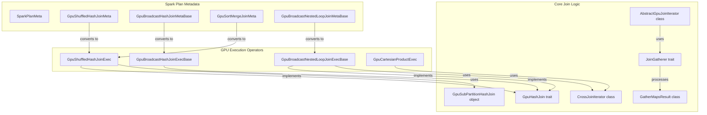
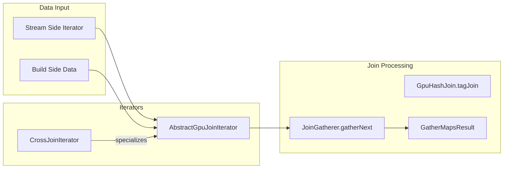

<!-- source: DeepWiki mcp.deepwiki.com · repo NVIDIA/cudf-spark · page 4 Join Execution on GPU · fetched 2026-10-26 -->

# Join Execution on GPU

Relevant source files

The following files were used as context for generating this wiki page:

- [integration_tests/src/main/python/join_test.py](integration_tests/src/main/python/join_test.py)
- [sql-plugin/src/main/scala/com/nvidia/spark/rapids/AbstractGpuJoinIterator.scala](sql-plugin/src/main/scala/com/nvidia/spark/rapids/AbstractGpuJoinIterator.scala)
- [sql-plugin/src/main/scala/com/nvidia/spark/rapids/GpuColumnarBatchSerializer.scala](sql-plugin/src/main/scala/com/nvidia/spark/rapids/GpuColumnarBatchSerializer.scala)
- [sql-plugin/src/main/scala/com/nvidia/spark/rapids/GpuExec.scala](sql-plugin/src/main/scala/com/nvidia/spark/rapids/GpuExec.scala)
- [sql-plugin/src/main/scala/com/nvidia/spark/rapids/GpuShuffleCoalesceExec.scala](sql-plugin/src/main/scala/com/nvidia/spark/rapids/GpuShuffleCoalesceExec.scala)
- [sql-plugin/src/main/scala/com/nvidia/spark/rapids/GpuShuffledHashJoinExec.scala](sql-plugin/src/main/scala/com/nvidia/spark/rapids/GpuShuffledHashJoinExec.scala)
- [sql-plugin/src/main/scala/com/nvidia/spark/rapids/GpuShuffledSizedHashJoinExec.scala](sql-plugin/src/main/scala/com/nvidia/spark/rapids/GpuShuffledSizedHashJoinExec.scala)
- [sql-plugin/src/main/scala/com/nvidia/spark/rapids/GpuSortMergeJoinMeta.scala](sql-plugin/src/main/scala/com/nvidia/spark/rapids/GpuSortMergeJoinMeta.scala)
- [sql-plugin/src/main/scala/com/nvidia/spark/rapids/JoinGatherer.scala](sql-plugin/src/main/scala/com/nvidia/spark/rapids/JoinGatherer.scala)
- [sql-plugin/src/main/scala/com/nvidia/spark/rapids/RmmRapidsRetryIterator.scala](sql-plugin/src/main/scala/com/nvidia/spark/rapids/RmmRapidsRetryIterator.scala)
- [sql-plugin/src/main/scala/org/apache/spark/sql/rapids/GpuCartesianProductExec.scala](sql-plugin/src/main/scala/org/apache/spark/sql/rapids/GpuCartesianProductExec.scala)
- [sql-plugin/src/main/scala/org/apache/spark/sql/rapids/execution/GpuBroadcastHashJoinExecBase.scala](sql-plugin/src/main/scala/org/apache/spark/sql/rapids/execution/GpuBroadcastHashJoinExecBase.scala)
- [sql-plugin/src/main/scala/org/apache/spark/sql/rapids/execution/GpuBroadcastNestedLoopJoinExecBase.scala](sql-plugin/src/main/scala/org/apache/spark/sql/rapids/execution/GpuBroadcastNestedLoopJoinExecBase.scala)
- [sql-plugin/src/main/scala/org/apache/spark/sql/rapids/execution/GpuHashJoin.scala](sql-plugin/src/main/scala/org/apache/spark/sql/rapids/execution/GpuHashJoin.scala)
- [sql-plugin/src/main/scala/org/apache/spark/sql/rapids/execution/GpuShuffleExchangeExecBase.scala](sql-plugin/src/main/scala/org/apache/spark/sql/rapids/execution/GpuShuffleExchangeExecBase.scala)
- [sql-plugin/src/main/scala/org/apache/spark/sql/rapids/execution/GpuSubPartitionHashJoin.scala](sql-plugin/src/main/scala/org/apache/spark/sql/rapids/execution/GpuSubPartitionHashJoin.scala)
- [sql-plugin/src/main/spark330db/scala/org/apache/spark/sql/rapids/execution/GpuBroadcastHashJoinExec.scala](sql-plugin/src/main/spark330db/scala/org/apache/spark/sql/rapids/execution/GpuBroadcastHashJoinExec.scala)
- [tests/src/test/scala/com/nvidia/spark/rapids/GpuShuffledHashJoinExecSuite.scala](tests/src/test/scala/com/nvidia/spark/rapids/GpuShuffledHashJoinExecSuite.scala)
- [tests/src/test/scala/com/nvidia/spark/rapids/GpuSubPartitionSuite.scala](tests/src/test/scala/com/nvidia/spark/rapids/GpuSubPartitionSuite.scala)
- [tests/src/test/scala/com/nvidia/spark/rapids/WithRetrySuite.scala](tests/src/test/scala/com/nvidia/spark/rapids/WithRetrySuite.scala)

This page provides a high-level overview of how the RAPIDS Accelerator for Apache Spark handles join operations on the GPU. It introduces the core `GpuHashJoin` trait and explains the dispatching mechanisms for various join types. Detailed explanations for each join variant, including their specific implementations and optimizations, are covered in dedicated child pages:

- [Hash Joins (Shuffled & Sized)](#4.1) — Covers `GpuShuffledHashJoinExec`, `GpuShuffledSizedHashJoinExec`, `GpuSubPartitionHashJoin`, `JoinGatherer`, and build/stream side selection.
- [Broadcast Joins & Nested Loop Joins](#4.2) — Covers `GpuBroadcastHashJoinExecBase`, `GpuBroadcastNestedLoopJoinExecBase`, `GpuCartesianProductExec`, `GpuBroadcastExchangeExec`, and Databricks executor broadcast.
- [OOM Retry & Memory-Safe Iteration](#4.3) — Covers `RmmRapidsRetryIterator`, `SpillableColumnarBatch`, the Spill Framework, and how joins handle GPU OOM.

Sources:
* [integration_tests/src/main/python/join_test.py:32-36]()
* [sql-plugin/src/main/scala/org/apache/spark/sql/rapids/execution/GpuHashJoin.scala:1-160]()

## Overview of GPU Join Strategies

The RAPIDS Accelerator accelerates various Spark SQL join operations by converting Spark physical join plans into GPU-compatible operations leveraging cuDF. The main join strategies implemented are:

- **Shuffled Hash Joins:** Efficient hash joins using shuffled key-partitioned data.
- **Broadcast Hash Joins:** Broadcast one side to all executors and join on the GPU.
- **Nested Loop Joins:** Used for joins without equi-join predicates or with complex conditions, including Cartesian products.

The choice of strategy depends on join type, data size, join keys, conditions, and configuration flags.

A key part of enabling GPU joins is the plan replacement process, where Spark CPU join operators are detected and replaced by GPU-enabled operators through rules registered in `GpuOverrides` and `GpuTransitionOverrides`.

Sources:
* [integration_tests/src/main/python/join_test.py:32-36]()

## The `GpuHashJoin` Trait

The `GpuHashJoin` trait defines core interfaces, utilities, and shared logic for GPU-accelerated hash joins. Highlights include:

- **Join Type Validation:** The `JoinTypeChecks` object provides methods like `tagForGpu` that verify if a join type is enabled and supported on GPU, guided by the Rapids configurations [sql-plugin/src/main/scala/org/apache/spark/sql/rapids/execution/GpuHashJoin.scala:34-64](). For example, inner, outer, semi, anti, and existence joins have per-type enable flags.

- **Join Key Type Support:** Defines the sets of supported data types for join keys on GPU. The `cudfSupportedKeyTypes` and `sparkSupportedJoinKeyTypes` ensure joins operate on types compatible with cuDF and Spark, respectively [sql-plugin/src/main/scala/org/apache/spark/sql/rapids/execution/GpuHashJoin.scala:70-73]().

- **Equi-Join Metadata:** The `equiJoinMeta` function maps left keys, right keys, and optional conditions to metadata used in plan replacement [sql-plugin/src/main/scala/org/apache/spark/sql/rapids/execution/GpuHashJoin.scala:86-93]().

- **Result Gather Maps:** The `GatherMapsResult` class encapsulates left and right gather maps resulting from a GPU join, crucial for reconstructing joined output tables [sql-plugin/src/main/scala/org/apache/spark/sql/rapids/execution/GpuHashJoin.scala:117-143]().

These components enable consistent validity checks and data flow for all GPU join implementations.

Sources:
* [sql-plugin/src/main/scala/org/apache/spark/sql/rapids/execution/GpuHashJoin.scala:16-162]()

## Join Dispatching

The RAPIDS Accelerator dispatches to different GPU join implementations depending on the physical Spark plan, join type, and runtime configuration.

### Hash Joins

Hash joins are the primary accelerated join strategy, supporting a broad range of join types.

#### Shuffled Hash Joins

Shuffled hash joins process data partitioned and shuffled by join keys. The `GpuShuffledHashJoinMeta` replaces Spark's `ShuffledHashJoinExec` and selects among variants like `GpuShuffledHashJoinExec`, `GpuShuffledSymmetricHashJoinExec`, and `GpuShuffledAsymmetricHashJoinExec` based on join type and configuration flags (e.g. `useShuffledSymmetricHashJoin`) to optimize execution [sql-plugin/src/main/scala/com/nvidia/spark/rapids/GpuShuffledHashJoinExec.scala:40-158]().

Shard-level partitioning and dynamic build side selection are handled here, with downstream iterations supported by `GpuSubPartitionHashJoin`.

For a detailed dive, see the child page [Hash Joins (Shuffled & Sized)](#4.1).

Sources:
* [sql-plugin/src/main/scala/com/nvidia/spark/rapids/GpuShuffledHashJoinExec.scala:1-160]()
* [sql-plugin/src/main/scala/com/nvidia/spark/rapids/GpuShuffledSizedHashJoinExec.scala:46-140]()

#### Broadcast Hash Joins

Broadcast hash joins broadcast the smaller build side to all executor nodes. The broadcast logic handles GPU batch serialization/deserialization and caching using classes like `SerializeConcatHostBuffersDeserializeBatch` [sql-plugin/src/main/scala/org/apache/spark/sql/rapids/execution/GpuBroadcastExchangeExec.scala:73-85]().

`GpuBroadcastHashJoinExecBase` and subclasses implement this pattern, replacing Spark's `BroadcastHashJoinExec`. Specialized logic handles null-aware anti joins and executor broadcast modes [sql-plugin/src/main/scala/org/apache/spark/sql/rapids/execution/GpuBroadcastHashJoinExecBase.scala:35-138]().

For details, see the child page [Broadcast Joins & Nested Loop Joins](#4.2).

Sources:
* [sql-plugin/src/main/scala/org/apache/spark/sql/rapids/execution/GpuBroadcastHashJoinExecBase.scala:20-154]()
* [sql-plugin/src/main/spark330db/scala/org/apache/spark/sql/rapids/execution/GpuBroadcastHashJoinExec.scala:41-156]()

### Nested Loop Joins

Nested loop joins support join types or conditions that are incompatible with hash joins, including joins without equality predicates.

`GpuBroadcastNestedLoopJoinExecBase` implements broadcast nested loop joins, including condition AST analysis to leverage GPU AST predicate evaluation when possible [sql-plugin/src/main/scala/org/apache/spark/sql/rapids/execution/GpuBroadcastNestedLoopJoinExecBase.scala:43-75]().

Cross joins (Cartesian products) are handled by `GpuCartesianProductExec`. These joins operate as nested loops over streamed batches paired against build side batches.

For details, see the child page [Broadcast Joins & Nested Loop Joins](#4.2).

Sources:
* [sql-plugin/src/main/scala/org/apache/spark/sql/rapids/execution/GpuBroadcastNestedLoopJoinExecBase.scala:42-144]()
* [sql-plugin/src/main/scala/com/nvidia/spark/rapids/GpuCartesianProductExec.scala:117-130]()

### Join Execution Flow

The general execution flow of joins on GPU broadly proceeds as follows:

1. **Plan Replacement:** The plugin replaces CPU join nodes in Spark plans with GPU-enabled physical operators.
2. **Join Execution:** The GPU join operators execute, generating gather maps that describe how rows from the build and stream sides correspond after the join.
3. **JoinGatherer:** The `JoinGatherer` interface consumes these gather maps to build output batches, managing batching, spilling, and memory constraints [sql-plugin/src/main/scala/com/nvidia/spark/rapids/JoinGatherer.scala:60-68]().
4. **Result Iteration:** The `AbstractGpuJoinIterator` provides the iterator abstraction to fetch joined `ColumnarBatch` results on demand, with built-in retry and error handling [sql-plugin/src/main/scala/com/nvidia/spark/rapids/AbstractGpuJoinIterator.scala:63-75]().

This architecture modularizes the join process into metadata, execution, join result gathering, and iteration, simplifying the implementation of new join types.

Sources:
* [sql-plugin/src/main/scala/org/apache/spark/sql/rapids/execution/GpuHashJoin.scala:119-142]()
* [sql-plugin/src/main/scala/com/nvidia/spark/rapids/JoinGatherer.scala:1-80]()
* [sql-plugin/src/main/scala/com/nvidia/spark/rapids/AbstractGpuJoinIterator.scala:63-175]()

## Code Entity Relationship Diagrams

### Join Execution Class Relationships

Sources:
* [sql-plugin/src/main/scala/com/nvidia/spark/rapids/GpuShuffledHashJoinExec.scala]()
* [sql-plugin/src/main/scala/org/apache/spark/sql/rapids/execution/GpuHashJoin.scala]()
* [sql-plugin/src/main/scala/com/nvidia/spark/rapids/JoinGatherer.scala]()
* [sql-plugin/src/main/scala/org/apache/spark/sql/rapids/execution/GpuBroadcastNestedLoopJoinExecBase.scala]()
* [sql-plugin/src/main/scala/com/nvidia/spark/rapids/AbstractGpuJoinIterator.scala]()
* [sql-plugin/src/main/scala/com/nvidia/spark/rapids/GpuCartesianProductExec.scala]()

### Join Data Flow and Iterators

Sources:
* [sql-plugin/src/main/scala/com/nvidia/spark/rapids/AbstractGpuJoinIterator.scala]()
* [sql-plugin/src/main/scala/com/nvidia/spark/rapids/JoinGatherer.scala]()
* [sql-plugin/src/main/scala/org/apache/spark/sql/rapids/GpuCartesianProductExec.scala]()

## Memory Management and OOM Retry

GPU execution of joins consumes large amounts of memory and can hit GPU Out-Of-Memory (OOM) errors. To address this:

- **OOM Retry:** The plugin employs `RmmRapidsRetryIterator` mechanisms in join iterators to catch OOM errors and retry join batches with smaller batch sizes or by splitting data [sql-plugin/src/main/scala/com/nvidia/spark/rapids/RmmRapidsRetryIterator.scala:23-24](). This retry logic requires idempotency of the functions it wraps.
- **Spillable Batches:** Join inputs and outputs are wrapped in spillable abstractions such as `SpillableColumnarBatch` and `LazySpillableColumnarBatch`, allowing the Rapids Memory Manager (RMM) to spill GPU data to host memory under pressure, reducing OOM likelihood [sql-plugin/src/main/scala/com/nvidia/spark/rapids/JoinGatherer.scala:41-50]().
- **JoinGatherer Management:** The `JoinGatherer` interface manages the iteration, batch sizing, and spilling decisions to produce memory-safe join outputs [sql-plugin/src/main/scala/com/nvidia/spark/rapids/JoinGatherer.scala:60-142]().

For detailed memory management strategies in joins, see the child page [OOM Retry & Memory-Safe Iteration](#4.3).

Sources:
* [sql-plugin/src/main/scala/com/nvidia/spark/rapids/AbstractGpuJoinIterator.scala:140-175]()
* [sql-plugin/src/main/scala/com/nvidia/spark/rapids/JoinGatherer.scala:36-60]()
* [sql-plugin/src/main/scala/com/nvidia/spark/rapids/RmmRapidsRetryIterator.scala:23-24]()

---

This parent page outlined the major join execution strategies on the GPU, key interfaces such as `GpuHashJoin`, and the dispatching logic used to choose and instantiate appropriate GPU join implementations in the RAPIDS Accelerator. For comprehensive technical details on each aspect, please consult the respective child pages listed above.

---

