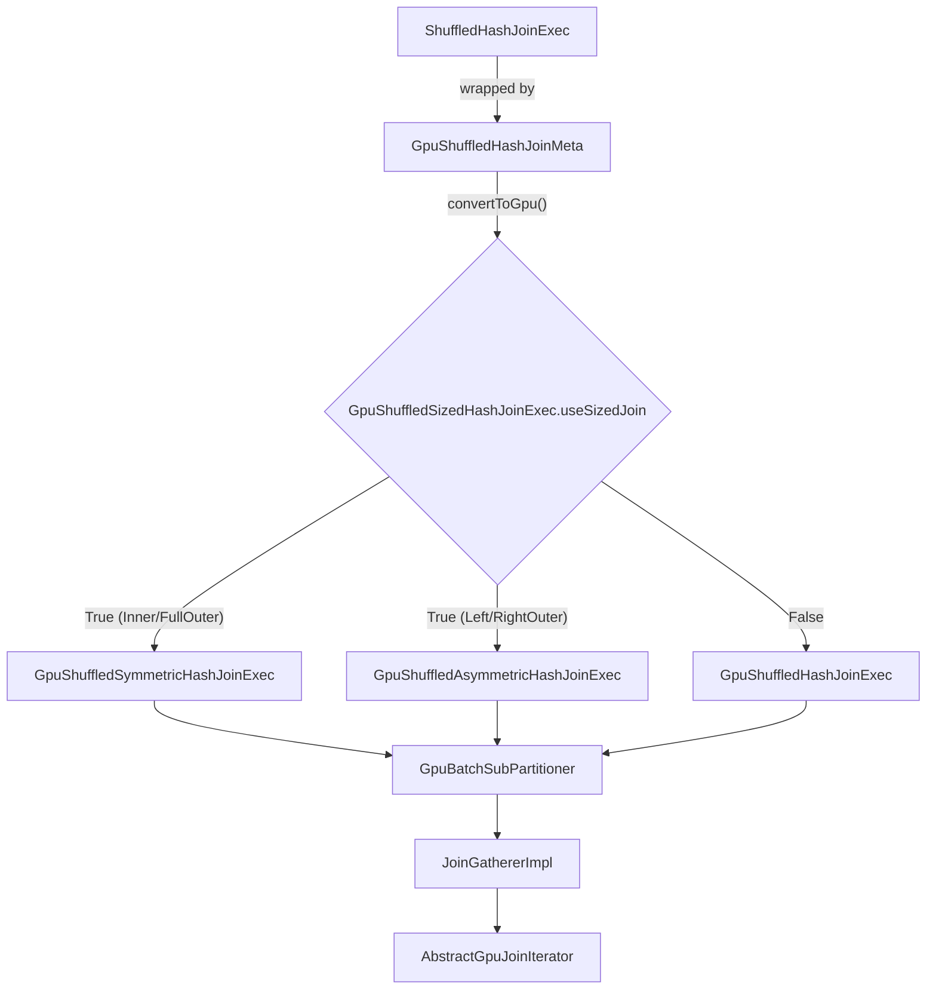
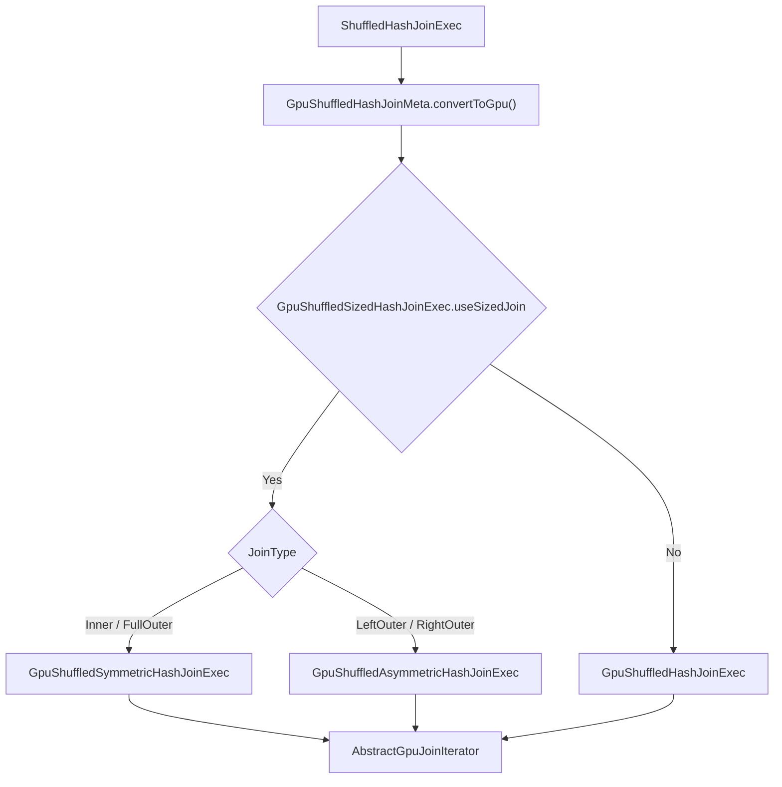

<!-- source: DeepWiki mcp.deepwiki.com · repo NVIDIA/cudf-spark · page 4.1 Hash Joins (Shuffled & Sized) · fetched 2026-10-26 -->

# Hash Joins (Shuffled & Sized)

Relevant source files

The following files were used as context for generating this wiki page:

- [integration_tests/src/main/python/join_test.py](integration_tests/src/main/python/join_test.py)
- [sql-plugin/src/main/scala/com/nvidia/spark/rapids/AbstractGpuJoinIterator.scala](sql-plugin/src/main/scala/com/nvidia/spark/rapids/AbstractGpuJoinIterator.scala)
- [sql-plugin/src/main/scala/com/nvidia/spark/rapids/GpuBringBackToHost.scala](sql-plugin/src/main/scala/com/nvidia/spark/rapids/GpuBringBackToHost.scala)
- [sql-plugin/src/main/scala/com/nvidia/spark/rapids/GpuColumnarBatchSerializer.scala](sql-plugin/src/main/scala/com/nvidia/spark/rapids/GpuColumnarBatchSerializer.scala)
- [sql-plugin/src/main/scala/com/nvidia/spark/rapids/GpuExec.scala](sql-plugin/src/main/scala/com/nvidia/spark/rapids/GpuExec.scala)
- [sql-plugin/src/main/scala/com/nvidia/spark/rapids/GpuShuffleCoalesceExec.scala](sql-plugin/src/main/scala/com/nvidia/spark/rapids/GpuShuffleCoalesceExec.scala)
- [sql-plugin/src/main/scala/com/nvidia/spark/rapids/GpuShuffledHashJoinExec.scala](sql-plugin/src/main/scala/com/nvidia/spark/rapids/GpuShuffledHashJoinExec.scala)
- [sql-plugin/src/main/scala/com/nvidia/spark/rapids/GpuShuffledSizedHashJoinExec.scala](sql-plugin/src/main/scala/com/nvidia/spark/rapids/GpuShuffledSizedHashJoinExec.scala)
- [sql-plugin/src/main/scala/com/nvidia/spark/rapids/GpuSortMergeJoinMeta.scala](sql-plugin/src/main/scala/com/nvidia/spark/rapids/GpuSortMergeJoinMeta.scala)
- [sql-plugin/src/main/scala/com/nvidia/spark/rapids/JoinGatherer.scala](sql-plugin/src/main/scala/com/nvidia/spark/rapids/JoinGatherer.scala)
- [sql-plugin/src/main/scala/com/nvidia/spark/rapids/RmmRapidsRetryIterator.scala](sql-plugin/src/main/scala/com/nvidia/spark/rapids/RmmRapidsRetryIterator.scala)
- [sql-plugin/src/main/scala/org/apache/spark/sql/rapids/GpuCartesianProductExec.scala](sql-plugin/src/main/scala/org/apache/spark/sql/rapids/GpuCartesianProductExec.scala)
- [sql-plugin/src/main/scala/org/apache/spark/sql/rapids/execution/GpuBroadcastHashJoinExecBase.scala](sql-plugin/src/main/scala/org/apache/spark/sql/rapids/execution/GpuBroadcastHashJoinExecBase.scala)
- [sql-plugin/src/main/scala/org/apache/spark/sql/rapids/execution/GpuBroadcastNestedLoopJoinExecBase.scala](sql-plugin/src/main/scala/org/apache/spark/sql/rapids/execution/GpuBroadcastNestedLoopJoinExecBase.scala)
- [sql-plugin/src/main/scala/org/apache/spark/sql/rapids/execution/GpuHashJoin.scala](sql-plugin/src/main/scala/org/apache/spark/sql/rapids/execution/GpuHashJoin.scala)
- [sql-plugin/src/main/scala/org/apache/spark/sql/rapids/execution/GpuShuffleExchangeExecBase.scala](sql-plugin/src/main/scala/org/apache/spark/sql/rapids/execution/GpuShuffleExchangeExecBase.scala)
- [sql-plugin/src/main/scala/org/apache/spark/sql/rapids/execution/GpuSubPartitionHashJoin.scala](sql-plugin/src/main/scala/org/apache/spark/sql/rapids/execution/GpuSubPartitionHashJoin.scala)
- [sql-plugin/src/main/spark330db/scala/org/apache/spark/sql/rapids/execution/GpuBroadcastHashJoinExec.scala](sql-plugin/src/main/spark330db/scala/org/apache/spark/sql/rapids/execution/GpuBroadcastHashJoinExec.scala)
- [tests/src/test/scala/com/nvidia/spark/rapids/ExpandExecSuite.scala](tests/src/test/scala/com/nvidia/spark/rapids/ExpandExecSuite.scala)
- [tests/src/test/scala/com/nvidia/spark/rapids/GpuBringBackToHostSuite.scala](tests/src/test/scala/com/nvidia/spark/rapids/GpuBringBackToHostSuite.scala)
- [tests/src/test/scala/com/nvidia/spark/rapids/GpuShuffledHashJoinExecSuite.scala](tests/src/test/scala/com/nvidia/spark/rapids/GpuShuffledHashJoinExecSuite.scala)
- [tests/src/test/scala/com/nvidia/spark/rapids/GpuSubPartitionSuite.scala](tests/src/test/scala/com/nvidia/spark/rapids/GpuSubPartitionSuite.scala)
- [tests/src/test/scala/com/nvidia/spark/rapids/HashSortOptimizeSuite.scala](tests/src/test/scala/com/nvidia/spark/rapids/HashSortOptimizeSuite.scala)
- [tests/src/test/scala/com/nvidia/spark/rapids/UnaryOperatorsSuite.scala](tests/src/test/scala/com/nvidia/spark/rapids/UnaryOperatorsSuite.scala)
- [tests/src/test/scala/com/nvidia/spark/rapids/WithRetrySuite.scala](tests/src/test/scala/com/nvidia/spark/rapids/WithRetrySuite.scala)
- [tests/src/test/scala/org/apache/spark/sql/rapids/OrcFilterSuite.scala](tests/src/test/scala/org/apache/spark/sql/rapids/OrcFilterSuite.scala)
- [tests/src/test/scala/org/apache/spark/sql/rapids/ParquetFilterSuite.scala](tests/src/test/scala/org/apache/spark/sql/rapids/ParquetFilterSuite.scala)

## Purpose and Scope

This page covers the GPU-accelerated shuffled and sized hash join execution subsystems in the RAPIDS Accelerator for Apache Spark. It details `GpuShuffledHashJoinExec`, `GpuShuffledSizedHashJoinExec` (including symmetric and asymmetric variants), `GpuSubPartitionHashJoin`, `GpuBatchSubPartitioner`, the `JoinGatherer` pipeline, and build/stream side selection mechanics.

These components implement the core logic for efficiently performing large-scale hash joins on GPU hardware using RAPIDS cuDF libraries and integration with Spark's execution plans.

Sources:
- [sql-plugin/src/main/scala/com/nvidia/spark/rapids/GpuShuffledHashJoinExec.scala:40-160]()
- [sql-plugin/src/main/scala/com/nvidia/spark/rapids/GpuShuffledSizedHashJoinExec.scala:47-65]()
- [sql-plugin/src/main/scala/org/apache/spark/sql/rapids/execution/GpuSubPartitionHashJoin.scala:33-156]()
- [sql-plugin/src/main/scala/com/nvidia/spark/rapids/JoinGatherer.scala:60-142]()

---

## GpuShuffledHashJoinExec & Meta

The `GpuShuffledHashJoinExec` operator implements GPU-accelerated shuffled hash joins corresponding to Spark's `ShuffledHashJoinExec`. The meta class `GpuShuffledHashJoinMeta` manages plan tagging and validation before conversion to the GPU execution node [sql-plugin/src/main/scala/com/nvidia/spark/rapids/GpuShuffledHashJoinExec.scala:40-45]().

- **Meta class:** `GpuShuffledHashJoinMeta` captures:
  - `leftKeys: Seq[BaseExprMeta[_]]`
  - `rightKeys: Seq[BaseExprMeta[_]]`
  - `conditionMeta: Option[BaseExprMeta[_]]`
  - `buildSide: GpuBuildSide` to indicate which side will be built in the hash table on GPU [sql-plugin/src/main/scala/com/nvidia/spark/rapids/GpuShuffledHashJoinExec.scala:46-52]()

### Build Side Validation

`GpuShuffledHashJoinMeta.tagBuildSide` enforces compatibility of build side with join type:

- `canBuildRight(joinType)` returns true if right side build is supported [sql-plugin/src/main/scala/com/nvidia/spark/rapids/GpuShuffledHashJoinExec.scala:87-91]().
- `canBuildLeft(joinType)` returns true if left side build is supported [sql-plugin/src/main/scala/com/nvidia/spark/rapids/GpuShuffledHashJoinExec.scala:94-98]().

Unsupported side/build combos call `willNotWorkOnGpu` to disable GPU execution of the join [sql-plugin/src/main/scala/com/nvidia/spark/rapids/GpuShuffledHashJoinExec.scala:75-83]().

### Plan Conversion and Join Type Dispatch

The `convertToGpu()` method decides which join executor to instantiate:

- Uses `GpuShuffledSizedHashJoinExec` methods to check if a sized join variant should be used for the join type and keys [sql-plugin/src/main/scala/com/nvidia/spark/rapids/GpuShuffledHashJoinExec.scala:110-111]().
- For sized joins:
  - `Inner` and `FullOuter` join types dispatch to `GpuShuffledSymmetricHashJoinExec` [sql-plugin/src/main/scala/com/nvidia/spark/rapids/GpuShuffledHashJoinExec.scala:131-144]().
  - `LeftOuter` and `RightOuter` dispatch to `GpuShuffledAsymmetricHashJoinExec` [sql-plugin/src/main/scala/com/nvidia/spark/rapids/GpuShuffledHashJoinExec.scala:114-129]().
- Otherwise, defaults to plain `GpuShuffledHashJoinExec` [sql-plugin/src/main/scala/com/nvidia/spark/rapids/GpuShuffledHashJoinExec.scala:146-158]().

Sources:
- [sql-plugin/src/main/scala/com/nvidia/spark/rapids/GpuShuffledHashJoinExec.scala:40-160]()
- [sql-plugin/src/main/scala/com/nvidia/spark/rapids/GpuShuffledSizedHashJoinExec.scala:47-65]()
- [sql-plugin/src/main/scala/org/apache/spark/sql/rapids/execution/GpuHashJoin.scala:33-103]()

---

## GpuShuffledSizedHashJoinExec (Symmetric & Asymmetric Variants)

Specialized sized join executors handle joins with significant size disparities to maximize GPU memory usage efficiency.

### `useSizedJoin` Method

`GpuShuffledSizedHashJoinExec.useSizedJoin` is a static method that determines whether to use a sized join based on config flags and join types:

- If `conf.useShuffledSymmetricHashJoin` is true [sql-plugin/src/main/scala/com/nvidia/spark/rapids/GpuShuffledSizedHashJoinExec.scala:52]():
  - `Inner` and `FullOuter` use symmetric sized join (`GpuShuffledSymmetricHashJoinExec`) [sql-plugin/src/main/scala/com/nvidia/spark/rapids/GpuShuffledSizedHashJoinExec.scala:53-54]().
  - `LeftOuter` and `RightOuter` can use asymmetric sized join (`GpuShuffledAsymmetricHashJoinExec`) if asymmetric sized join is enabled, and neither side has nullable struct children in join keys (which cuDF cannot handle natively) [sql-plugin/src/main/scala/com/nvidia/spark/rapids/GpuShuffledSizedHashJoinExec.scala:55-60]().

### BoundJoinExprs

This case class encapsulates all bound GPU expressions and metadata needed for join execution:

- Contains build keys, stream keys, their DataTypes, output attributes, condition expression bound to output schema, and flags for null handling [sql-plugin/src/main/scala/com/nvidia/spark/rapids/GpuShuffledSizedHashJoinExec.scala:68-80]().
- Provides a method `flipped(...)` to swap build and stream sides for asymmetric joins [sql-plugin/src/main/scala/com/nvidia/spark/rapids/GpuShuffledSizedHashJoinExec.scala:92-111]().
- Static method `BoundJoinExprs.bind(...)` binds expressions to Spark attributes and metrics, preparing them for GPU processing [sql-plugin/src/main/scala/com/nvidia/spark/rapids/GpuShuffledSizedHashJoinExec.scala:114-156]().

### JoinInfo

`JoinInfo` carries runtime iterator, size, and metric data for active join state on build and stream sides [sql-plugin/src/main/scala/com/nvidia/spark/rapids/GpuShuffledSizedHashJoinExec.scala:159-163]().

Sources:
- [sql-plugin/src/main/scala/com/nvidia/spark/rapids/GpuShuffledSizedHashJoinExec.scala:47-163]()

---

## GpuSubPartitionHashJoin & GpuBatchSubPartitioner

`GpuSubPartitionHashJoin` trait adds capability for sub-partitioning partitioned data further inside a Spark partition, enabling finer-grained control over GPU memory usage and data distribution during shuffle joins [sql-plugin/src/main/scala/org/apache/spark/sql/rapids/execution/GpuSubPartitionHashJoin.scala:33-45]().

### GpuBatchSubPartitioner

- Extends `GpuHashPartitioner` applying GPU hash partitioning logic directly on `ColumnarBatch` inputs [sql-plugin/src/main/scala/org/apache/spark/sql/rapids/execution/GpuSubPartitionHashJoin.scala:86-91]().
- Inputs batches via an iterator and partitions them into `numPartitions` sub-batches [sql-plugin/src/main/scala/org/apache/spark/sql/rapids/execution/GpuSubPartitionHashJoin.scala:87-89]().
- Uses `GpuMurmur3Hash` built on given bound keys and a hash seed [sql-plugin/src/main/scala/org/apache/spark/sql/rapids/execution/GpuSubPartitionHashJoin.scala:101]().
- Maintains an array of buffers (`ArrayBuffer[SpillableColumnarBatch]`) per partition [sql-plugin/src/main/scala/org/apache/spark/sql/rapids/execution/GpuSubPartitionHashJoin.scala:98-99]().
- Provides methods:
  - `getBatchesByPartition(partId: Int)` returns batches in a sub-partition (read-only access) [sql-plugin/src/main/scala/org/apache/spark/sql/rapids/execution/GpuSubPartitionHashJoin.scala:122-130]().
  - `releaseBatchesByPartition(partId: Int)` returns ownership of batches to caller (caller must close them) [sql-plugin/src/main/scala/org/apache/spark/sql/rapids/execution/GpuSubPartitionHashJoin.scala:140-150]().
- Implements lazy partition initialization on first access, splitting each batch by computing hash values and gathering rows per partition [sql-plugin/src/main/scala/org/apache/spark/sql/rapids/execution/GpuSubPartitionHashJoin.scala:158-185]().

Sources:
- [sql-plugin/src/main/scala/org/apache/spark/sql/rapids/execution/GpuSubPartitionHashJoin.scala:33-192]()

---

## JoinGatherer & AbstractGpuJoinIterator

### JoinGatherer Trait

Manages creating cuDF gather maps from join output to materialize result batches [sql-plugin/src/main/scala/com/nvidia/spark/rapids/JoinGatherer.scala:60-68]().

- Defines `gatherNext(n: Int): ColumnarBatch` to produce the next batch of joined rows [sql-plugin/src/main/scala/com/nvidia/spark/rapids/JoinGatherer.scala:67]().
- Implements `LazySpillable` interface with `allowSpilling()` to allow intermediate spilling of GPU memory objects [sql-plugin/src/main/scala/com/nvidia/spark/rapids/JoinGatherer.scala:41-49]().
- Provides `gatherRowEstimate(targetSize: Long): Int` to estimate how many rows fit into a target batch size, optimizing batches for GPU memory pressure [sql-plugin/src/main/scala/com/nvidia/spark/rapids/JoinGatherer.scala:105-141]().

### AbstractGpuJoinIterator

- Abstract iterator traversing stream-side batches, creating and consuming `JoinGatherer` instances [sql-plugin/src/main/scala/com/nvidia/spark/rapids/AbstractGpuJoinIterator.scala:63-71]().
- Tracks GPU join metrics and supports automatic resource closing via `TaskAutoCloseableResource` [sql-plugin/src/main/scala/com/nvidia/spark/rapids/AbstractGpuJoinIterator.scala:32-69]().
- On `hasNext()`, will invoke `setupNextGatherer()` if no current gatherer is active, and use `JoinGatherer` to generate batches with retry semantics on OOM via `RmmRapidsRetryIterator` [sql-plugin/src/main/scala/com/nvidia/spark/rapids/AbstractGpuJoinIterator.scala:88-119, 154-160]().

Sources:
- [sql-plugin/src/main/scala/com/nvidia/spark/rapids/JoinGatherer.scala:60-142]()
- [sql-plugin/src/main/scala/com/nvidia/spark/rapids/AbstractGpuJoinIterator.scala:32-175]()

---

### Diagram: Plan Conversion and Execution Workflow (Code Entity Space)

Sources:
- [sql-plugin/src/main/scala/com/nvidia/spark/rapids/GpuShuffledHashJoinExec.scala:40-160]()
- [sql-plugin/src/main/scala/com/nvidia/spark/rapids/GpuShuffledSizedHashJoinExec.scala:47-65]()
- [sql-plugin/src/main/scala/org/apache/spark/sql/rapids/execution/GpuSubPartitionHashJoin.scala:86-101]()
- [sql-plugin/src/main/scala/com/nvidia/spark/rapids/JoinGatherer.scala:144-148]()
- [sql-plugin/src/main/scala/com/nvidia/spark/rapids/AbstractGpuJoinIterator.scala:63-71]()

---

### Diagram: Shuffled Hash Join Dispatch & Sizing Flow

Sources:
- [sql-plugin/src/main/scala/com/nvidia/spark/rapids/GpuShuffledHashJoinExec.scala:106-160]()
- [sql-plugin/src/main/scala/com/nvidia/spark/rapids/GpuShuffledSizedHashJoinExec.scala:47-65]()

---

## OOM Retry Integration

All hash join iterators and batch producers integrate with the RAPIDS `RmmRapidsRetryIterator` framework to recover from GPU out-of-memory failures gracefully.

- `withRetryNoSplit` wraps non-splittable operations like hash table builds, retrying on OOM with exponential backoff [sql-plugin/src/main/scala/com/nvidia/spark/rapids/RmmRapidsRetryIterator.scala:23-24]().
- `withRestoreOnRetry` rewinds `JoinGatherer` state pointers to resume from a consistent state on retries with smaller batch targets [sql-plugin/src/main/scala/com/nvidia/spark/rapids/AbstractGpuJoinIterator.scala:154-160]().

This integration ensures that hash joins avoid job failures by dynamically shrinking batch sizes or splitting problematic work.

Sources:
- [sql-plugin/src/main/scala/com/nvidia/spark/rapids/RmmRapidsRetryIterator.scala:23-24]()
- [sql-plugin/src/main/scala/com/nvidia/spark/rapids/AbstractGpuJoinIterator.scala:154-160]()

---

## Build/Stream Side Selection Logic

Build side selection is vital in hash join implementation, as the build side's data is loaded into the GPU hash table, and the stream side is probed.

### GpuBuildSide

- Enum-like trait representing build sides: `GpuBuildLeft` and `GpuBuildRight` [sql-plugin/src/main/scala/com/nvidia/spark/rapids/GpuShuffledHashJoinExec.scala:52]().
- Used in meta to determine which side is built on GPU.

### Validation during Tagging

- `tagBuildSide` in `GpuShuffledHashJoinMeta` verifies if the chosen build side is compatible with join type semantics, preventing unsupported build direction (e.g., forbidding left-side build for certain anti/semi joins) [sql-plugin/src/main/scala/com/nvidia/spark/rapids/GpuShuffledHashJoinExec.scala:75-83]().

Sources:
- [sql-plugin/src/main/scala/com/nvidia/spark/rapids/GpuShuffledHashJoinExec.scala:52,75-83]()

---

## Summary

This subsystem orchestrates GPU-accelerated shuffled and sized hash join execution through:

- The `GpuShuffledHashJoinExec` class implementing joins via Spark plan conversion rules [sql-plugin/src/main/scala/com/nvidia/spark/rapids/GpuShuffledHashJoinExec.scala:106-160]().
- The `GpuShuffledSizedHashJoinExec` variants for performance-tuned symmetric and asymmetric sized joins [sql-plugin/src/main/scala/com/nvidia/spark/rapids/GpuShuffledSizedHashJoinExec.scala:47-65]().
- The `GpuSubPartitionHashJoin` utilities that allow subdividing partitioned batches into smaller units [sql-plugin/src/main/scala/org/apache/spark/sql/rapids/execution/GpuSubPartitionHashJoin.scala:33-45]().
- The `JoinGatherer` abstraction responsible for efficient result batch materialization [sql-plugin/src/main/scala/com/nvidia/spark/rapids/JoinGatherer.scala:60-68]().
- The `AbstractGpuJoinIterator` that coordinates iteration and integrates GPU OOM retry logic [sql-plugin/src/main/scala/com/nvidia/spark/rapids/AbstractGpuJoinIterator.scala:63-71]().

Sources:
- [sql-plugin/src/main/scala/com/nvidia/spark/rapids/GpuShuffledHashJoinExec.scala:1-160]()
- [sql-plugin/src/main/scala/com/nvidia/spark/rapids/GpuShuffledSizedHashJoinExec.scala:1-163]()
- [sql-plugin/src/main/scala/org/apache/spark/sql/rapids/execution/GpuSubPartitionHashJoin.scala:1-192]()
- [sql-plugin/src/main/scala/com/nvidia/spark/rapids/JoinGatherer.scala:60-142]()
- [sql-plugin/src/main/scala/com/nvidia/spark/rapids/AbstractGpuJoinIterator.scala:63-175]()
- [sql-plugin/src/main/scala/com/nvidia/spark/rapids/RmmRapidsRetryIterator.scala:23-24]()

---

