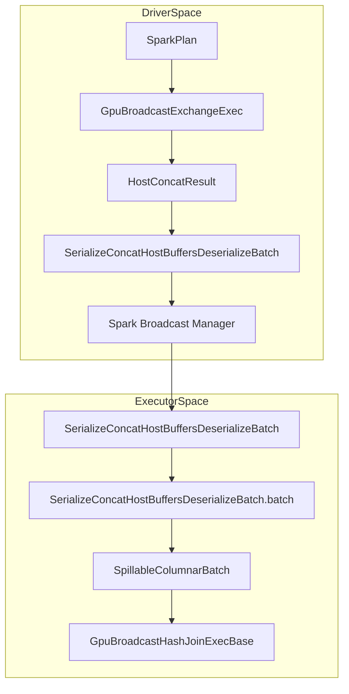
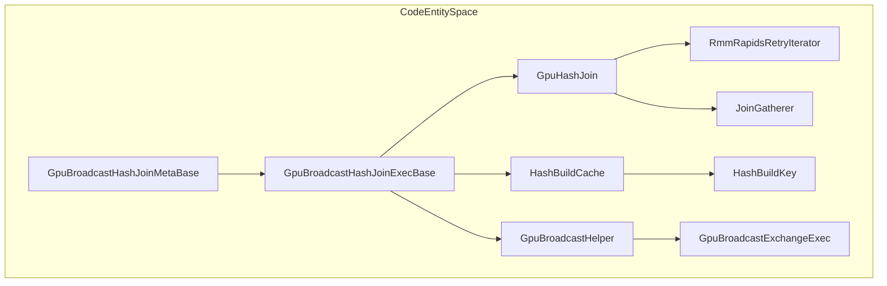

<!-- source: DeepWiki mcp.deepwiki.com · repo NVIDIA/cudf-spark · page 4.2 Broadcast Joins & Nested Loop Joins · fetched 2026-10-26 -->

# Broadcast Joins & Nested Loop Joins

Relevant source files

The following files were used as context for generating this wiki page:

- [sql-plugin/src/main/scala/com/nvidia/spark/rapids/AstUtil.scala](sql-plugin/src/main/scala/com/nvidia/spark/rapids/AstUtil.scala)
- [sql-plugin/src/main/scala/com/nvidia/spark/rapids/SpillableKudoTable.scala](sql-plugin/src/main/scala/com/nvidia/spark/rapids/SpillableKudoTable.scala)
- [sql-plugin/src/main/scala/com/nvidia/spark/rapids/spill/SpillFramework.scala](sql-plugin/src/main/scala/com/nvidia/spark/rapids/spill/SpillFramework.scala)
- [sql-plugin/src/main/scala/com/nvidia/spark/rapids/spill/SpillOutputChannel.scala](sql-plugin/src/main/scala/com/nvidia/spark/rapids/spill/SpillOutputChannel.scala)
- [sql-plugin/src/main/scala/org/apache/spark/sql/rapids/catalyst/expressions/GpuEquivalentExpressions.scala](sql-plugin/src/main/scala/org/apache/spark/sql/rapids/catalyst/expressions/GpuEquivalentExpressions.scala)
- [sql-plugin/src/main/scala/org/apache/spark/sql/rapids/execution/GpuBroadcastExchangeExec.scala](sql-plugin/src/main/scala/org/apache/spark/sql/rapids/execution/GpuBroadcastExchangeExec.scala)
- [sql-plugin/src/main/scala/org/apache/spark/sql/rapids/execution/GpuBroadcastHelper.scala](sql-plugin/src/main/scala/org/apache/spark/sql/rapids/execution/GpuBroadcastHelper.scala)
- [sql-plugin/src/main/scala/org/apache/spark/sql/rapids/execution/GpuBroadcastToRowExec.scala](sql-plugin/src/main/scala/org/apache/spark/sql/rapids/execution/GpuBroadcastToRowExec.scala)
- [sql-plugin/src/main/scala/org/apache/spark/sql/rapids/execution/HashBuild.scala](sql-plugin/src/main/scala/org/apache/spark/sql/rapids/execution/HashBuild.scala)
- [sql-plugin/src/main/spark330db/scala/org/apache/spark/sql/rapids/execution/GpuBroadcastNestedLoopJoinExec.scala](sql-plugin/src/main/spark330db/scala/org/apache/spark/sql/rapids/execution/GpuBroadcastNestedLoopJoinExec.scala)
- [sql-plugin/src/main/spark330db/scala/org/apache/spark/sql/rapids/execution/GpuExecutorBroadcastHelper.scala](sql-plugin/src/main/spark330db/scala/org/apache/spark/sql/rapids/execution/GpuExecutorBroadcastHelper.scala)
- [sql-plugin/src/main/spark340/scala/org/apache/spark/sql/rapids/execution/GpuBroadcastNestedLoopJoinExec.scala](sql-plugin/src/main/spark340/scala/org/apache/spark/sql/rapids/execution/GpuBroadcastNestedLoopJoinExec.scala)
- [tests/src/test/scala/com/nvidia/spark/rapids/AstUtilSuite.scala](tests/src/test/scala/com/nvidia/spark/rapids/AstUtilSuite.scala)
- [tests/src/test/scala/com/nvidia/spark/rapids/BroadcastHashJoinSuite.scala](tests/src/test/scala/com/nvidia/spark/rapids/BroadcastHashJoinSuite.scala)
- [tests/src/test/scala/com/nvidia/spark/rapids/FuzzerUtils.scala](tests/src/test/scala/com/nvidia/spark/rapids/FuzzerUtils.scala)
- [tests/src/test/scala/com/nvidia/spark/rapids/HostByteBufferIteratorSuite.scala](tests/src/test/scala/com/nvidia/spark/rapids/HostByteBufferIteratorSuite.scala)
- [tests/src/test/scala/com/nvidia/spark/rapids/JoinsSuite.scala](tests/src/test/scala/com/nvidia/spark/rapids/JoinsSuite.scala)
- [tests/src/test/scala/com/nvidia/spark/rapids/RapidsSerializerManagerSuite.scala](tests/src/test/scala/com/nvidia/spark/rapids/RapidsSerializerManagerSuite.scala)
- [tests/src/test/scala/com/nvidia/spark/rapids/SerializationSuite.scala](tests/src/test/scala/com/nvidia/spark/rapids/SerializationSuite.scala)
- [tests/src/test/scala/com/nvidia/spark/rapids/spill/SharedRecomputableHandleSuite.scala](tests/src/test/scala/com/nvidia/spark/rapids/spill/SharedRecomputableHandleSuite.scala)
- [tests/src/test/scala/com/nvidia/spark/rapids/spill/SpillFrameworkSuite.scala](tests/src/test/scala/com/nvidia/spark/rapids/spill/SpillFrameworkSuite.scala)
- [tests/src/test/scala/com/nvidia/spark/rapids/spill/SpillOutputChannelSuite.scala](tests/src/test/scala/com/nvidia/spark/rapids/spill/SpillOutputChannelSuite.scala)
- [tests/src/test/scala/com/nvidia/spark/rapids/spill/SpillUnitTestBase.scala](tests/src/test/scala/com/nvidia/spark/rapids/spill/SpillUnitTestBase.scala)
- [tests/src/test/scala/com/nvidia/spark/rapids/spill/SpillableTableHandleSuite.scala](tests/src/test/scala/com/nvidia/spark/rapids/spill/SpillableTableHandleSuite.scala)
- [tests/src/test/scala/org/apache/spark/sql/rapids/TestTrampolineUtil.scala](tests/src/test/scala/org/apache/spark/sql/rapids/TestTrampolineUtil.scala)
- [tests/src/test/scala/org/apache/spark/sql/rapids/execution/CoalescedBatchPartitionerSuite.scala](tests/src/test/scala/org/apache/spark/sql/rapids/execution/CoalescedBatchPartitionerSuite.scala)
- [tests/src/test/scala/org/apache/spark/sql/rapids/execution/HashBuildPlannerSuite.scala](tests/src/test/scala/org/apache/spark/sql/rapids/execution/HashBuildPlannerSuite.scala)
- [tests/src/test/scala/org/apache/spark/sql/rapids/execution/HashBuildSemaphoreSuite.scala](tests/src/test/scala/org/apache/spark/sql/rapids/execution/HashBuildSemaphoreSuite.scala)
- [tests/src/test/spark350/scala/org/apache/iceberg/spark/functions/GpuBucketExpressionSuite.scala](tests/src/test/spark350/scala/org/apache/iceberg/spark/functions/GpuBucketExpressionSuite.scala)
- [tests/src/test/spark420/scala/com/nvidia/spark/rapids/GpuBroadcastToRowExecSuite.scala](tests/src/test/spark420/scala/com/nvidia/spark/rapids/GpuBroadcastToRowExecSuite.scala)

This page details the implementation of GPU-accelerated broadcast joins, nested loop joins, Cartesian products, and broadcast exchanges within the RAPIDS Accelerator for Apache Spark. It covers `GpuBroadcastHashJoinExecBase`, `GpuBroadcastNestedLoopJoinExecBase`, `GpuCartesianProductExec`, `GpuBroadcastExchangeExec`, and Databricks executor broadcast integration. These components enable efficient execution of join operations where one side of the join is small enough to be broadcast to all executor nodes.

Sources:
* `sql-plugin/src/main/scala/org/apache/spark/sql/rapids/execution/GpuBroadcastHashJoinExecBase.scala`
* `sql-plugin/src/main/scala/org/apache/spark/sql/rapids/execution/GpuBroadcastNestedLoopJoinExecBase.scala`
* `sql-plugin/src/main/scala/org/apache/spark/sql/rapids/execution/GpuBroadcastExchangeExec.scala`
* `sql-plugin/src/main/scala/org/apache/spark/sql/rapids/GpuCartesianProductExec.scala`

---

## GpuBroadcastExchangeExec

The `GpuBroadcastExchangeExec` operator is responsible for broadcasting data from the driver to all executor nodes in a GPU-compatible columnar format. This operator manages the serialization of columnar batches on the driver and their deserialization on executors, enabling broadcast joins on the GPU.

### Data Flow

- **Driver-side Serialization**  
  - The `GpuBroadcastExchangeExec` operator on the driver collects columnar batches from its child plan.  
  - These batches are concatenated into a single `HostConcatResult` object, which holds the serialized cuDF table data in host memory buffers [sql-plugin/src/main/scala/org/apache/spark/sql/rapids/execution/GpuBroadcastExchangeExec.scala:28-29]().  
  - The concatenated result is wrapped in a `SerializeConcatHostBuffersDeserializeBatch` instance, capturing the serialized data, output schema attributes, number of rows, and total data length [sql-plugin/src/main/scala/org/apache/spark/sql/rapids/execution/GpuBroadcastExchangeExec.scala:73-78]().  
  - This wrapper is then serialized and broadcast by Spark's broadcast framework.

- **Executor-side Deserialization**  
  - Executors deserialize the `SerializeConcatHostBuffersDeserializeBatch` object upon receiving the broadcast.  
  - When the operator's `batch` method is called, it lazily converts the host memory buffers back into a GPU `SpillableColumnarBatch` [sql-plugin/src/main/scala/org/apache/spark/sql/rapids/execution/GpuBroadcastExchangeExec.scala:95-127]().  
  - The original host buffers are closed and nulled after the first conversion to free memory resources [sql-plugin/src/main/scala/org/apache/spark/sql/rapids/execution/GpuBroadcastExchangeExec.scala:121-122]().  
  - The deserialized GPU batch is made available for use by GPU join operators.

### Key Classes and Functions

| Class/Method | Description |
|--------------|-------------|
| `GpuBroadcastExchangeExec` | The main GPU broadcast executor plan node extending `ShimUnaryExecNode` that performs broadcast exchange of data [sql-plugin/src/main/scala/org/apache/spark/sql/rapids/execution/GpuBroadcastExchangeExec.scala:36-37]() |
| `SerializeConcatHostBuffersDeserializeBatch` | Wrapper around concatenated host buffers for broadcast data. Responsible for serialization on the driver and lazy deserialization into GPU batches on executors [sql-plugin/src/main/scala/org/apache/spark/sql/rapids/execution/GpuBroadcastExchangeExec.scala:73-127]() |
| `batch` method | Lazily creates a `SpillableColumnarBatch` on GPU from host buffers on executor side. Memoizes the batch for reuse [sql-plugin/src/main/scala/org/apache/spark/sql/rapids/execution/GpuBroadcastExchangeExec.scala:95-127]() |
| `hostBatch` method | Allows creation of host columnar batches from serialized buffers or device batches. Mainly used on the driver to reuse GPU broadcast results on CPU [sql-plugin/src/main/scala/org/apache/spark/sql/rapids/execution/GpuBroadcastExchangeExec.scala:136-155]() |
| `HostConcatResult` | cuDF JNI class holding concatenated host memory buffers representing a serialized table [sql-plugin/src/main/scala/org/apache/spark/sql/rapids/execution/GpuBroadcastExchangeExec.scala:28-29]() |

Sources:
* `sql-plugin/src/main/scala/org/apache/spark/sql/rapids/execution/GpuBroadcastExchangeExec.scala:28-155`

### Diagram: GpuBroadcastExchangeExec Data Flow and Code Mapping

Sources:
* `sql-plugin/src/main/scala/org/apache/spark/sql/rapids/execution/GpuBroadcastExchangeExec.scala:28-127`

### Databricks Executor Broadcast

Integration for Databricks runtimes includes supporting the `executorBroadcast` directive and `ExecutorBroadcastMode` for broadcast join build sides. This enables broadcast data to be available across executors efficiently by leveraging specialized helpers and broadcast modes, avoiding redundant serialization overhead. The `GpuBroadcastToRowExec` is a specialized operator that implements `doExecuteBroadcast` and converts GPU columnar data to rows on the CPU for broadcasting, ensuring that the driver does not perform GPU operations [sql-plugin/src/main/scala/org/apache/spark/sql/rapids/execution/GpuBroadcastToRowExec.scala:43-78]().

Sources:
* `sql-plugin/src/main/scala/org/apache/spark/sql/rapids/execution/GpuBroadcastToRowExec.scala:43-78`

---

## GpuBroadcastHashJoinExecBase

`GpuBroadcastHashJoinExecBase` implements the broadcast hash join execution on the GPU, a join strategy where the smaller "build" side dataset is broadcast to all executor nodes, and the larger "stream" side dataset is partitioned and streamed for join probing. This operator utilizes cuDF hash join capabilities for efficient GPU join execution.

### Join Metadata

- `GpuBroadcastHashJoinMetaBase` handles metadata analysis and GPU plan replacement rules. It wraps the left keys, right keys, and optional join condition expressions into GPU-compatible metadata and verifies if the build side and broadcast child plans are GPU feasible.

### Join Execution Flow

1. **Build-Side Broadcast**  
   The build-side data is collected and broadcast using `GpuBroadcastExchangeExec`, hence available as a GPU `SpillableColumnarBatch` on all executors. The `GpuBroadcastHelper.getBroadcastBuiltBatchAndStreamIter` function is used to acquire the GPU semaphore only after the first stream batch has been produced, delaying GPU resource acquisition [sql-plugin/src/main/scala/org/apache/spark/sql/rapids/execution/GpuBroadcastHelper.scala:110-136]().

2. **Stream-Side Probing**  
   Stream-side input data is iterated partition-wise. Each stream batch is probed against the broadcasted hash table built from the build-side batch.

3. **Hash Table Construction**  
   Hash tables are created from the broadcasted build side batch using cuDF primitives and maintained with retry capability for Out-Of-Memory (OOM) handling via `RmmRapidsRetryIterator` [sql-plugin/src/main/scala/com/nvidia/spark/rapids/RmmRapidsRetryIterator.scala](). The `HashBuildCache` is used to store and reuse hash tables across multiple joins, reducing redundant computation and memory usage [sql-plugin/src/main/scala/org/apache/spark/sql/rapids/execution/HashBuild.scala:136-169]().

4. **Join Result Generation**  
   For each streamed batch, the hash join gathers matching rows using `JoinGatherer` instances that apply join semantics and optionally filter using AST-compiled expressions.

### Key Classes and Functions

| Class/Method | Description |
|--------------|-------------|
| `GpuBroadcastHashJoinMetaBase` | Metadata and tagging for GPU broadcast hash joins. |
| `GpuBroadcastHashJoinExecBase` | Core GPU broadcast hash join operator, defines join metrics, tagging, and conversion hooks. |
| `GpuBroadcastHashJoinExec` | Concrete class that extends the base and integrates with Databricks executor broadcast mode and broadcast shuffle exchanges. |
| `RmmRapidsRetryIterator.withRetryNoSplit` | Wraps join logic with retry and splitting for GPU OOM robustness [sql-plugin/src/main/scala/com/nvidia/spark/rapids/RmmRapidsRetryIterator.scala:32-33](). |
| `GpuHashJoin` | Trait used for GPU hash join semantics and common behaviors. |
| `HashBuildCache` | Executor-local cache for build-side hash join state, enabling reuse of hash tables [sql-plugin/src/main/scala/org/apache/spark/sql/rapids/execution/GpuBroadcastExchangeExec.scala:90-93](). |
| `HashBuildKey` | Identifies derived hash-build state within a `HashBuildCache`, including projection, join keys, null-handling, and filtering [sql-plugin/src/main/scala/org/apache/spark/sql/rapids/execution/HashBuild.scala:49-51](). |
| `HashBuildPlanner` | Selects the optimal build side for hash joins based on various factors like row counts, build status, and key types [tests/src/test/scala/org/apache/spark/sql/rapids/execution/HashBuildPlannerSuite.scala:89-99](). |
| `GpuBroadcastHelper.getBroadcastBuiltBatchAndStreamIter` | Delays GPU semaphore acquisition until the first stream batch is produced, then materializes the broadcasted build side to GPU [sql-plugin/src/main/scala/org/apache/spark/sql/rapids/execution/GpuBroadcastHelper.scala:110-136](). |

Sources:
* `sql-plugin/src/main/scala/org/apache/spark/sql/rapids/execution/GpuBroadcastHashJoinExecBase.scala`
* `sql-plugin/src/main/scala/com/nvidia/spark/rapids/RmmRapidsRetryIterator.scala`
* `sql-plugin/src/main/scala/org/apache/spark/sql/rapids/execution/HashBuild.scala:136-169`
* `sql-plugin/src/main/scala/org/apache/spark/sql/rapids/execution/GpuBroadcastExchangeExec.scala:90-93`
* `sql-plugin/src/main/scala/org/apache/spark/sql/rapids/execution/HashBuild.scala:49-51`
* `tests/src/test/scala/org/apache/spark/sql/rapids/execution/HashBuildPlannerSuite.scala:89-99`
* `sql-plugin/src/main/scala/org/apache/spark/sql/rapids/execution/GpuBroadcastHelper.scala:110-136`
* `sql-plugin/src/main/scala/com/nvidia/spark/rapids/RmmRapidsRetryIterator.scala:32-33`

### Diagram: Broadcast Hash Join Code Architecture & Entity Mapping

Sources:
* `sql-plugin/src/main/scala/org/apache/spark/sql/rapids/execution/GpuBroadcastHashJoinExecBase.scala`
* `sql-plugin/src/main/scala/org/apache/spark/sql/rapids/execution/HashBuild.scala`
* `sql-plugin/src/main/scala/org/apache/spark/sql/rapids/execution/GpuBroadcastHelper.scala`
* `sql-plugin/src/main/scala/org/apache/spark/sql/rapids/execution/GpuBroadcastExchangeExec.scala`

---

## GpuBroadcastNestedLoopJoinExecBase

`GpuBroadcastNestedLoopJoinExecBase` provides GPU-accelerated broadcast nested loop join execution for scenarios without join keys or with complex join conditions that cannot be simplified into hash joins.

### Join Strategy & Data Flow

- The build side is broadcast as a `SpillableColumnarBatch` and reused on executors.
- The stream side is iterated over batches.
- For each stream batch, a cross join is performed against the entire broadcasted build table using cuDF join gather primitives inside the `CrossJoinIterator`.
- If there is a join condition, it is compiled into a cuDF AST expression and used to filter the cross join results efficiently.
- Only supported join types (e.g., inner joins, left semi, left anti, etc.) and building on compatible build sides are accelerated on GPU.

### Key Classes and Functions

| Class/Method | Description |
|--------------|-------------|
| `GpuBroadcastNestedLoopJoinMetaBase` | Metadata and validation for nested loop joins with AST condition checks. |
| `CrossJoinIterator` | Iterates over stream batches and produces cross-joined result batches on GPU by applying CPU-controlled iteration with cuDF cross join and filtering. |

Sources:
* `sql-plugin/src/main/scala/org/apache/spark/sql/rapids/execution/GpuBroadcastNestedLoopJoinExecBase.scala`

---

## GpuCartesianProductExec

`GpuCartesianProductExec` executes Cartesian product joins on the GPU by computing the cross product of two input relations. It constructs all possible row combinations between the left and right inputs.

### Implementation Details

- Cartesian products are computed across RDD partitions in a distributed manner, combining each pair of partitions from the left and right inputs.
- Uses cuDF table serialization via `JCudfSerialization` for transmitting columnar batch data between JVM and GPU, and for handling partitioned operations.
- Emits joined batches with correct row counts and column ordering.

Sources:
* `sql-plugin/src/main/scala/org/apache/spark/sql/rapids/GpuCartesianProductExec.scala`

---

## Join Memory Management, OOM Retry & Iterators

Join operations on GPU are memory intensive. The RAPIDS Accelerator employs sophisticated iterator-based designs and retry frameworks to handle GPU Out-Of-Memory (OOM) conditions gracefully by retrying with smaller batch sizes or spilling intermediate data.

### Key Components

| Component | Description |
|-----------|-------------|
| `AbstractGpuJoinIterator` | Base iterator class managing join execution iteration, batch sizing, and resource lifecycle. It decides how many rows to gather per batch and handles transitions between batches. |
| `JoinGatherer` | Uses cuDF join gather maps to produce actual joined record batches. Provides size estimation and batch materialization operations for join results. |
| `RmmRapidsRetryIterator` | General-purpose iterator wrapper that intercepts GPU OOM (`GpuSplitAndRetryOOM`) exceptions, splits input batches into smaller parts, and retries the operation to avoid OOM failures [sql-plugin/src/main/scala/com/nvidia/spark/rapids/RmmRapidsRetryIterator.scala:66-138](). |
| `SpillFramework` | The core spill framework tracks device/host/disk object lifecycle, enabling objects to be copied to host or disk during OOM conditions [sql-plugin/src/main/scala/com/nvidia/spark/rapids/spill/SpillFramework.scala:17-137](). |
| `SharedRecomputableHandle` | Manages pinning, spilling, rebuilding, and deferred closing of resources, particularly useful for cached hash tables that can be recomputed if evicted [tests/src/test/scala/com/nvidia/spark/rapids/spill/SharedRecomputableHandleSuite.scala:41-97](). |

These components collaborate to achieve memory-safe join implementations with automatic retry, batch splitting, and spill management.

Sources:
* `sql-plugin/src/main/scala/com/nvidia/spark/rapids/AbstractGpuJoinIterator.scala`
* `sql-plugin/src/main/scala/com/nvidia/spark/rapids/JoinGatherer.scala`
* `sql-plugin/src/main/scala/com/nvidia/spark/rapids/RmmRapidsRetryIterator.scala:66-138`
* `sql-plugin/src/main/scala/com/nvidia/spark/rapids/spill/SpillFramework.scala:17-137`
* `tests/src/test/scala/com/nvidia/spark/rapids/spill/SharedRecomputableHandleSuite.scala:41-97`

---

# Summary

The Broadcast Joins and Nested Loop Joins in the RAPIDS Accelerator leverage GPU memory and compute capabilities via cuDF integration. Data from the build side is broadcast efficiently using GPU columnar formats and specialized serialization helpers (`GpuBroadcastExchangeExec`). Broadcast hash joins (`GpuBroadcastHashJoinExecBase` and variants) implement scalable hash join processing using broadcasted GPU tables and stream data probing with GPU-accelerated gather operations. Nested loop joins and Cartesian products are handled for cases where hash join is unsuitable, leveraging cross join iterators and cuDF AST predicates for filtering.

Sophisticated memory management and retry logic underpin all these join operators to handle GPU memory pressure, allowing automatic retry with smaller batch sizes or spilling to host memory. The Databricks executor broadcast mode is supported to optimize broadcasting in that runtime environment.

These implementations significantly accelerate Spark SQL join workloads where broadcast strategies are applicable, especially when join keys enforce selective matching or for small to medium-sized build-side datasets.

---

# References

- `sql-plugin/src/main/scala/org/apache/spark/sql/rapids/execution/GpuBroadcastHashJoinExecBase.scala`
- `sql-plugin/src/main/scala/org/apache/spark/sql/rapids/execution/GpuBroadcastNestedLoopJoinExecBase.scala`
- `sql-plugin/src/main/scala/org/apache/spark/sql/rapids/execution/GpuBroadcastExchangeExec.scala`
- `sql-plugin/src/main/scala/org/apache/spark/sql/rapids/GpuCartesianProductExec.scala`
- `sql-plugin/src/main/spark340/scala/org/apache/spark/sql/rapids/execution/GpuBroadcastHashJoinExec.scala`
- `sql-plugin/src/main/scala/com/nvidia/spark/rapids/RmmRapidsRetryIterator.scala`
- `sql-plugin/src/main/scala/com/nvidia/spark/rapids/AbstractGpuJoinIterator.scala`
- `sql-plugin/src/main/scala/com/nvidia/spark/rapids/JoinGatherer.scala`
- `sql-plugin/src/main/scala/org/apache/spark/sql/rapids/execution/GpuBroadcastToRowExec.scala`
- `sql-plugin/src/main/scala/org/apache/spark/sql/rapids/execution/HashBuild.scala`
- `sql-plugin/src/main/scala/org/apache/spark/sql/rapids/execution/GpuBroadcastHelper.scala`
- `sql-plugin/src/main/scala/com/nvidia/spark/rapids/spill/SpillFramework.scala`
- `tests/src/test/scala/com/nvidia/spark/rapids/spill/SharedRecomputableHandleSuite.scala`
- `tests/src/test/scala/org/apache/spark/sql/rapids/execution/HashBuildPlannerSuite.scala`

---

