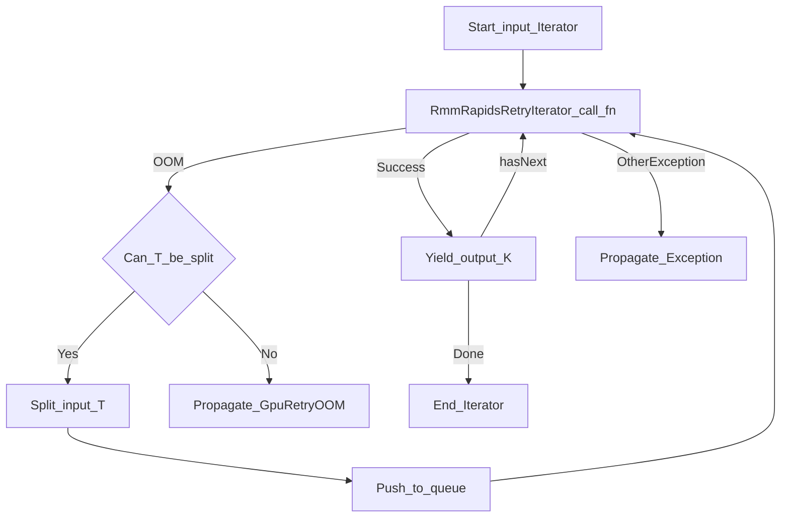
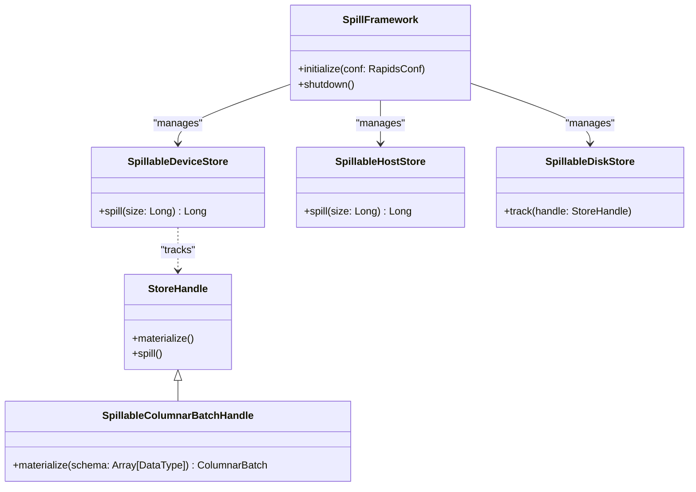
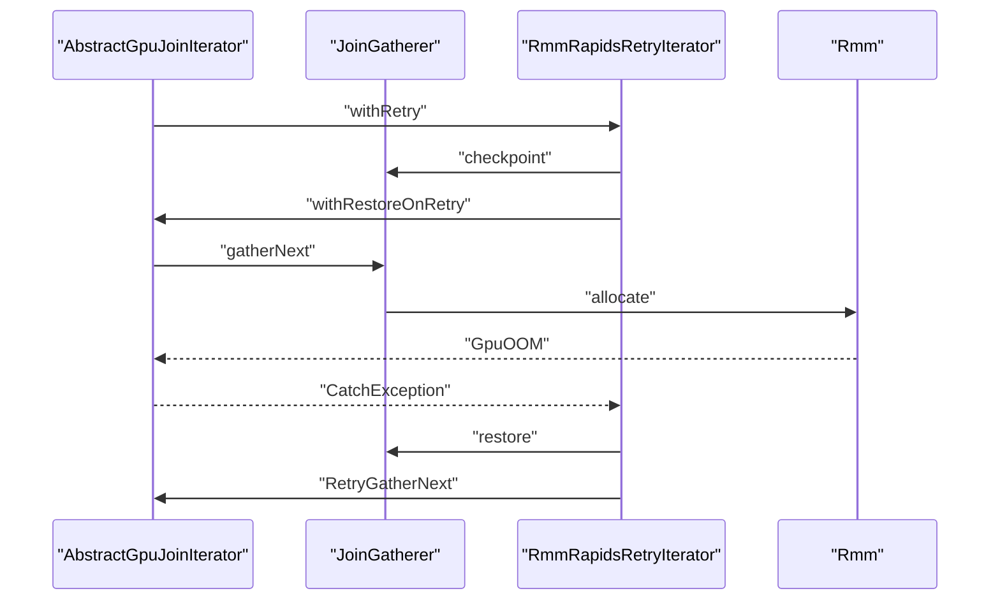
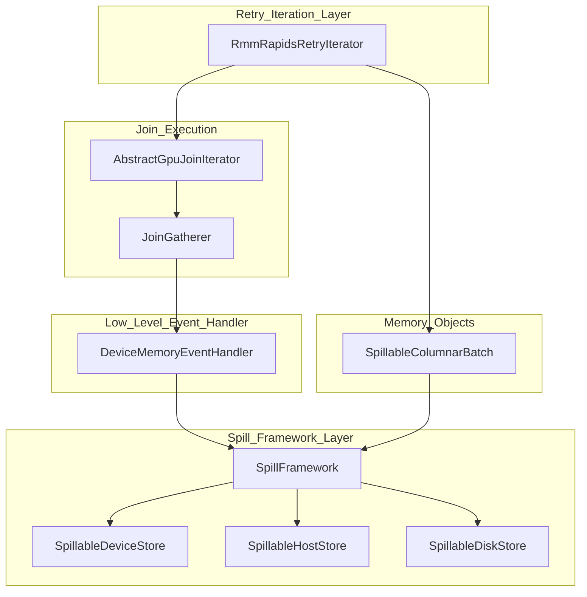

<!-- source: DeepWiki mcp.deepwiki.com · repo NVIDIA/cudf-spark · page 4.3 OOM Retry & Memory-Safe Iteration · fetched 2026-10-26 -->

# OOM Retry & Memory-Safe Iteration

<details>
<summary>Relevant source files</summary>

The following files were used as context for generating this wiki page:

- [sql-plugin/src/main/java/com/nvidia/spark/rapids/InternalRowToColumnarBatchIterator.java](sql-plugin/src/main/java/com/nvidia/spark/rapids/InternalRowToColumnarBatchIterator.java)
- [sql-plugin/src/main/scala/com/nvidia/spark/rapids/DeviceMemoryEventHandler.scala](sql-plugin/src/main/scala/com/nvidia/spark/rapids/DeviceMemoryEventHandler.scala)
- [sql-plugin/src/main/scala/com/nvidia/spark/rapids/SpillableColumnarBatch.scala](sql-plugin/src/main/scala/com/nvidia/spark/rapids/SpillableColumnarBatch.scala)
- [sql-plugin/src/main/scala/com/nvidia/spark/rapids/window/GpuBatchedBoundedWindowExec.scala](sql-plugin/src/main/scala/com/nvidia/spark/rapids/window/GpuBatchedBoundedWindowExec.scala)
- [sql-plugin/src/main/scala/com/nvidia/spark/rapids/window/GpuCachedDoublePassWindowExec.scala](sql-plugin/src/main/scala/com/nvidia/spark/rapids/window/GpuCachedDoublePassWindowExec.scala)
- [sql-plugin/src/main/scala/com/nvidia/spark/rapids/window/GpuRunningWindowExec.scala](sql-plugin/src/main/scala/com/nvidia/spark/rapids/window/GpuRunningWindowExec.scala)
- [sql-plugin/src/main/scala/com/nvidia/spark/rapids/window/GpuWindowExec.scala](sql-plugin/src/main/scala/com/nvidia/spark/rapids/window/GpuWindowExec.scala)
- [tests/src/test/scala/com/nvidia/spark/rapids/ColumnToRowIteratorRetrySuite.scala](tests/src/test/scala/com/nvidia/spark/rapids/ColumnToRowIteratorRetrySuite.scala)
- [tests/src/test/scala/com/nvidia/spark/rapids/DeviceMemoryEventHandlerSuite.scala](tests/src/test/scala/com/nvidia/spark/rapids/DeviceMemoryEventHandlerSuite.scala)
- [tests/src/test/scala/com/nvidia/spark/rapids/GeneratedInternalRowToCudfRowIteratorRetrySuite.scala](tests/src/test/scala/com/nvidia/spark/rapids/GeneratedInternalRowToCudfRowIteratorRetrySuite.scala)
- [tests/src/test/scala/com/nvidia/spark/rapids/GpuCoalesceBatchesRetrySuite.scala](tests/src/test/scala/com/nvidia/spark/rapids/GpuCoalesceBatchesRetrySuite.scala)
- [tests/src/test/scala/com/nvidia/spark/rapids/HashAggregateRetrySuite.scala](tests/src/test/scala/com/nvidia/spark/rapids/HashAggregateRetrySuite.scala)
- [tests/src/test/scala/com/nvidia/spark/rapids/HostColumnToGpuRetrySuite.scala](tests/src/test/scala/com/nvidia/spark/rapids/HostColumnToGpuRetrySuite.scala)
- [tests/src/test/scala/com/nvidia/spark/rapids/RmmSparkRetrySuiteBase.scala](tests/src/test/scala/com/nvidia/spark/rapids/RmmSparkRetrySuiteBase.scala)
- [tests/src/test/scala/com/nvidia/spark/rapids/WindowRetrySuite.scala](tests/src/test/scala/com/nvidia/spark/rapids/WindowRetrySuite.scala)
- [tests/src/test/scala/org/apache/spark/sql/rapids/SpillableColumnarBatchSuite.scala](tests/src/test/scala/org/apache/spark/sql/rapids/SpillableColumnarBatchSuite.scala)

</details>


## Purpose and Scope

This page details the mechanisms employed by the RAPIDS Accelerator for Apache Spark to handle GPU Out-Of-Memory (OOM) conditions and ensure memory-safe iteration. It covers the following key elements:

- **`RmmRapidsRetryIterator`** [sql-plugin/src/main/scala/com/nvidia/spark/rapids/RmmRapidsRetryIterator.scala:36-147](): For transparent retrying of GPU operations that may fail with OOM, including optional splitting of large batches into smaller chunks.
- **`SpillableColumnarBatch`** [sql-plugin/src/main/scala/com/nvidia/spark/rapids/SpillableColumnarBatch.scala:31-63](): Abstraction for GPU columnar batches whose underlying memory can be spilled to host or disk.
- **`SpillFramework`** [sql-plugin/src/main/scala/com/nvidia/spark/rapids/spill/SpillFramework.scala:52-137](): The management layer coordinating multi-tier (device, host, disk) spillable stores.
- **`DeviceMemoryEventHandler`** [sql-plugin/src/main/scala/com/nvidia/spark/rapids/DeviceMemoryEventHandler.scala:36-180](): Listens to low-level cuDF (RMM) allocation failures to trigger spilling and synchronize GPU.
- Handling of GPU OOM in join execution via memory-safe iteration and checkpoint/restoration.

These components work together to allow GPU operators (e.g., joins, window operations, aggregations) to retry on OOM by spilling and dynamically adjusting batch sizes, ensuring stable GPU memory use under high memory pressure.

Sources:
* [sql-plugin/src/main/scala/com/nvidia/spark/rapids/RmmRapidsRetryIterator.scala:36-147]()
* [sql-plugin/src/main/scala/com/nvidia/spark/rapids/SpillableColumnarBatch.scala:31-63]()
* [sql-plugin/src/main/scala/com/nvidia/spark/rapids/spill/SpillFramework.scala:52-137]()
* [sql-plugin/src/main/scala/com/nvidia/spark/rapids/DeviceMemoryEventHandler.scala:36-180]()

---

## `RmmRapidsRetryIterator` & Retry Mechanics

The `RmmRapidsRetryIterator` [sql-plugin/src/main/scala/com/nvidia/spark/rapids/RmmRapidsRetryIterator.scala:36-147]() is the foundational mechanism for handling GPU OOM errors gracefully during data processing. It wraps an iterator over GPU resources and intercepts exceptions indicative of GPU memory pressure (e.g., `GpuRetryOOM`, `GpuSplitAndRetryOOM`). Upon such failures, it triggers retries of the operation, optionally splitting large input batches into smaller ones according to a provided split policy.

### Characteristics

- The input type `T` must be a subtype of `AutoCloseable` (typically `SpillableColumnarBatch`) so resources can be safely closed on retries or splits.
- The user must supply an **idempotent** function `fn: T => K` since `fn` may be called multiple times per item.
- The retry logic is transparent to the caller, exposing a clean iterator interface yielding outputs of type `K`.
- Splitting policy (`splitPolicy: T => Seq[T]`) allows recursive division of large inputs to avoid repeated OOM by processing smaller chunks.

### Key Entry Points

| Method Signature | Description |
|------------------|-------------|
| `withRetry[T <: AutoCloseable, K](input: Iterator[T], splitPolicy: T => Seq[T])(fn: T => K): Iterator[K]` [sql-plugin/src/main/scala/com/nvidia/spark/rapids/RmmRapidsRetryIterator.scala:66-72]() | Retry-enabled iterator that processes each input item `T` with retries and optional splits. |
| `withRetry[T <: AutoCloseable, K](input: T, splitPolicy: T => Seq[T])(fn: T => K): Iterator[K]` [sql-plugin/src/main/scala/com/nvidia/spark/rapids/RmmRapidsRetryIterator.scala:100-106]() | Retry-enabled iterator for a single input item `T`. |
| `withRetryNoSplit[T <: AutoCloseable, K](input: T)(fn: T => K): K` [sql-plugin/src/main/scala/com/nvidia/spark/rapids/RmmRapidsRetryIterator.scala:131-138]() | Retry without any splitting for a single input item `T`. |
| `withRetryNoSplit[T <: AutoCloseable, K](input: Seq[T])(fn: Seq[T] => K): K` [sql-plugin/src/main/scala/com/nvidia/spark/rapids/RmmRapidsRetryIterator.scala:140-146]() | Retry without splitting for a full sequence of inputs. |

### Typical Flow



Sources:
* [sql-plugin/src/main/scala/com/nvidia/spark/rapids/RmmRapidsRetryIterator.scala:36-147]()
* [sql-plugin/src/main/scala/com/nvidia/spark/rapids/RmmRapidsRetryIterator.scala:66-72]()
* [sql-plugin/src/main/scala/com/nvidia/spark/rapids/RmmRapidsRetryIterator.scala:100-106]()
* [sql-plugin/src/main/scala/com/nvidia/spark/rapids/RmmRapidsRetryIterator.scala:131-138]()
* [sql-plugin/src/main/scala/com/nvidia/spark/rapids/RmmRapidsRetryIterator.scala:140-146]()

---

## `SpillableColumnarBatch` & Memory Management

`SpillableColumnarBatch` [sql-plugin/src/main/scala/com/nvidia/spark/rapids/SpillableColumnarBatch.scala:31-63]() describes an abstraction representing a `ColumnarBatch` whose underlying memory buffers can be spilled, reclaimed, and restored. It enables join and other GPU operators to hold data safely while allowing the framework to spill memory as required to avoid OOM.

### Core Interface

```scala
trait SpillableColumnarBatch extends AutoCloseable with SizeProvider {
  def numRows(): Int
  def setSpillPriority(priority: Long): Unit
  def incRefCount(): SpillableColumnarBatch
  def getColumnarBatch(): ColumnarBatch
  def sizeInBytes: Long
  def dataTypes: Array[DataType]
}
```

- `numRows`: Number of rows in the batch [sql-plugin/src/main/scala/com/nvidia/spark/rapids/SpillableColumnarBatch.scala:35]().
- `setSpillPriority`: Used to update priority for spilling [sql-plugin/src/main/scala/com/nvidia/spark/rapids/SpillableColumnarBatch.scala:40]().
- `incRefCount`: Increments reference count to safely share the batch [sql-plugin/src/main/scala/com/nvidia/spark/rapids/SpillableColumnarBatch.scala:46]().
- `getColumnarBatch`: Materializes and returns the actual `ColumnarBatch` on GPU [sql-plugin/src/main/scala/com/nvidia/spark/rapids/SpillableColumnarBatch.scala:55]().
- `sizeInBytes` / `dataTypes`: Provides metadata on batch size and data types [sql-plugin/src/main/scala/com/nvidia/spark/rapids/SpillableColumnarBatch.scala:57-59]().

### Implementations

- **`SpillableColumnarBatchImpl`** [sql-plugin/src/main/scala/com/nvidia/spark/rapids/SpillableColumnarBatch.scala:97-151](): Backed by a `SpillableColumnarBatchHandle` which manages the lifecycle of device, host, or disk buffers. Reference counting manages closing and spilling.
- **`SpillableCompressedColumnarBatchImpl`** [sql-plugin/src/main/scala/com/nvidia/spark/rapids/SpillableColumnarBatch.scala:153-202](): Specialized to handle compressed form buffers to reduce memory footprint.
- **`JustRowsColumnarBatch`** [sql-plugin/src/main/scala/com/nvidia/spark/rapids/SpillableColumnarBatch.scala:70-89](): A lightweight implementation used for batches with zero columns but non-zero rows, since cuDF cannot represent tables with columns and zero rows.

Sources:
* [sql-plugin/src/main/scala/com/nvidia/spark/rapids/SpillableColumnarBatch.scala:31-202]()
* [sql-plugin/src/main/scala/com/nvidia/spark/rapids/SpillableColumnarBatch.scala:35]()
* [sql-plugin/src/main/scala/com/nvidia/spark/rapids/SpillableColumnarBatch.scala:40]()
* [sql-plugin/src/main/scala/com/nvidia/spark/rapids/SpillableColumnarBatch.scala:46]()
* [sql-plugin/src/main/scala/com/nvidia/spark/rapids/SpillableColumnarBatch.scala:55]()
* [sql-plugin/src/main/scala/com/nvidia/spark/rapids/SpillableColumnarBatch.scala:57-59]()
* [sql-plugin/src/main/scala/com/nvidia/spark/rapids/SpillableColumnarBatch.scala:97-151]()
* [sql-plugin/src/main/scala/com/nvidia/spark/rapids/SpillableColumnarBatch.scala:153-202]()
* [sql-plugin/src/main/scala/com/nvidia/spark/rapids/SpillableColumnarBatch.scala:70-89]()

---

## `SpillFramework` Architecture

The `SpillFramework` [sql-plugin/src/main/scala/com/nvidia/spark/rapids/spill/SpillFramework.scala:52-137]() orchestrates coordinated, hierarchical spilling across device memory, host memory, and disk for spillable objects like `SpillableColumnarBatch`.

### Core Principles

- **Ownership Transfer:** When passed to the framework, objects transfer ownership; callers retrieve live references via `materialize()`.
- **Reference Counting and Aliasing:** When multiple references exist outside the framework’s knowledge, spilling is skipped to avoid race conditions.
- **Cascading Spill:** Device memory store spills to host memory store, which in turn can spill to disk store under memory pressure.

### Components Class Diagram



Sources:
* [sql-plugin/src/main/scala/com/nvidia/spark/rapids/spill/SpillFramework.scala:52-137]()

---

## `DeviceMemoryEventHandler` & Low-Level OOM Handling

`DeviceMemoryEventHandler` [sql-plugin/src/main/scala/com/nvidia/spark/rapids/DeviceMemoryEventHandler.scala:36-180]() implements the cuDF RAPIDS Memory Manager (RMM) `RmmEventHandler` interface to listen for GPU device memory allocation failures.

### Workflow on Allocation Failure

- `onAllocFailure(allocSize: Long, retryCount: Int)` is invoked by RMM when it fails to allocate GPU memory [sql-plugin/src/main/scala/com/nvidia/spark/rapids/DeviceMemoryEventHandler.scala:107]().
- It triggers spilling in the `SpillableDeviceStore` by attempting to free at least `allocSize` bytes [sql-plugin/src/main/scala/com/nvidia/spark/rapids/DeviceMemoryEventHandler.scala:124]().
- If spilling frees no memory (`amountSpilled == 0`), it uses a retry tracking state `OOMRetryState` [sql-plugin/src/main/scala/com/nvidia/spark/rapids/DeviceMemoryEventHandler.scala:55-99]() to limit active retries [sql-plugin/src/main/scala/com/nvidia/spark/rapids/DeviceMemoryEventHandler.scala:130]().
- When retry limit allows, it calls `Cuda.deviceSynchronize()` and retries allocation to avoid deadlock scenarios [sql-plugin/src/main/scala/com/nvidia/spark/rapids/DeviceMemoryEventHandler.scala:131]().
- If retries are exhausted, it logs detailed stack traces, triggers heap dumps if configured, and signals that allocation should fail [sql-plugin/src/main/scala/com/nvidia/spark/rapids/DeviceMemoryEventHandler.scala:138-146]().

Sources:
* [sql-plugin/src/main/scala/com/nvidia/spark/rapids/DeviceMemoryEventHandler.scala:36-180]()
* [sql-plugin/src/main/scala/com/nvidia/spark/rapids/DeviceMemoryEventHandler.scala:107]()
* [sql-plugin/src/main/scala/com/nvidia/spark/rapids/DeviceMemoryEventHandler.scala:124]()
* [sql-plugin/src/main/scala/com/nvidia/spark/rapids/DeviceMemoryEventHandler.scala:55-99]()
* [sql-plugin/src/main/scala/com/nvidia/spark/rapids/DeviceMemoryEventHandler.scala:130]()
* [sql-plugin/src/main/scala/com/nvidia/spark/rapids/DeviceMemoryEventHandler.scala:131]()
* [sql-plugin/src/main/scala/com/nvidia/spark/rapids/DeviceMemoryEventHandler.scala:138-146]()

---

## Join Execution Handling of GPU OOM

Join operators (e.g., `GpuShuffledHashJoinExec`, `GpuBroadcastNestedLoopJoinExecBase`, `GpuCartesianProductExec`) leverage the above abstractions to handle GPU memory pressure robustly during join output construction.

### `AbstractGpuJoinIterator` & `JoinGatherer`

The `AbstractGpuJoinIterator` [sql-plugin/src/main/scala/com/nvidia/spark/rapids/AbstractGpuJoinIterator.scala:63-175]() forms the base iterator for producing join result batches via a `JoinGatherer` [sql-plugin/src/main/scala/com/nvidia/spark/rapids/JoinGatherer.scala:60-142](). This iterator:

- Manages the lifecycle and state of a `JoinGatherer` that produces output gather maps.
- Uses `RmmRapidsRetryIterator.withRetry` [sql-plugin/src/main/scala/com/nvidia/spark/rapids/RmmRapidsRetryIterator.scala:65-105]() to perform gather operations safely.
- Incorporates checkpoint and restoration within gatherers so that when an OOM occurs during gather, state can be restored to retry with smaller target batch sizes.

### Join Gather OOM Recovery Sequence



Sources:
* [sql-plugin/src/main/scala/com/nvidia/spark/rapids/AbstractGpuJoinIterator.scala:63-175]()
* [sql-plugin/src/main/scala/com/nvidia/spark/rapids/JoinGatherer.scala:60-142]()
* [sql-plugin/src/main/scala/com/nvidia/spark/rapids/RmmRapidsRetryIterator.scala:65-105]()

---

## Component Integration and Data Flow



Sources:
* [sql-plugin/src/main/scala/com/nvidia/spark/rapids/RmmRapidsRetryIterator.scala:36-147]()
* [sql-plugin/src/main/scala/com/nvidia/spark/rapids/SpillableColumnarBatch.scala:31-202]()
* [sql-plugin/src/main/scala/com/nvidia/spark/rapids/spill/SpillFramework.scala:52-137]()
* [sql-plugin/src/main/scala/com/nvidia/spark/rapids/DeviceMemoryEventHandler.scala:36-180]()
* [sql-plugin/src/main/scala/com/nvidia/spark/rapids/AbstractGpuJoinIterator.scala:63-175]()
* [sql-plugin/src/main/scala/com/nvidia/spark/rapids/JoinGatherer.scala:60-142]()

---

