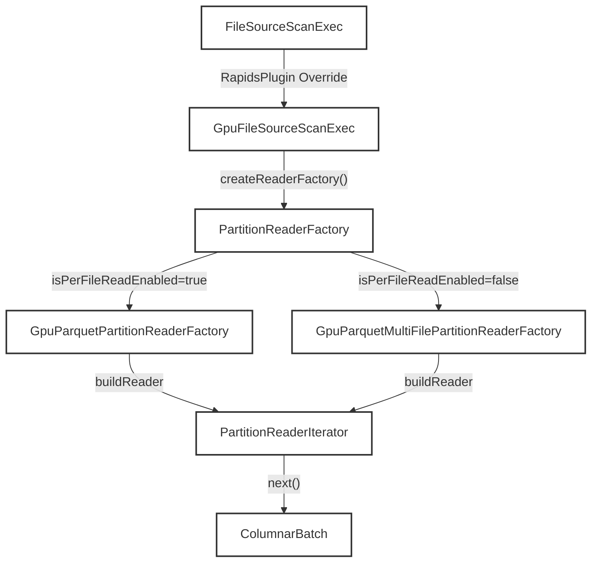
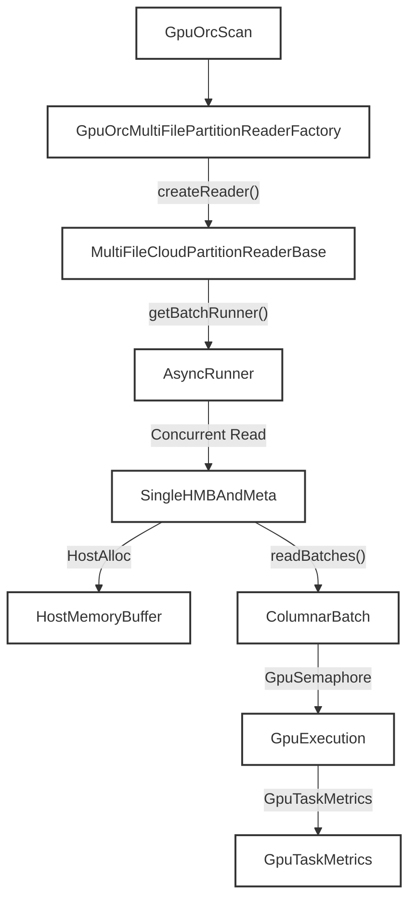
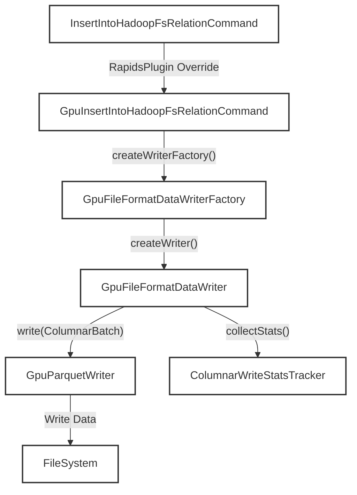

<!-- source: DeepWiki mcp.deepwiki.com · repo NVIDIA/cudf-spark · page 5 File Format Support (Reading & Writing) · fetched 2026-10-26 -->

# File Format Support (Reading & Writing)

Relevant source files

The following files were used as context for generating this wiki page:

- [dist/root-safe-module-classes.txt](dist/root-safe-module-classes.txt)
- [iceberg-common/src/main/scala/com/nvidia/spark/rapids/iceberg/spark/GpuSparkSQLProperties.scala](iceberg-common/src/main/scala/com/nvidia/spark/rapids/iceberg/spark/GpuSparkSQLProperties.scala)
- [integration_tests/src/main/python/csv_test.py](integration_tests/src/main/python/csv_test.py)
- [integration_tests/src/main/python/orc_test.py](integration_tests/src/main/python/orc_test.py)
- [integration_tests/src/main/python/parquet_test.py](integration_tests/src/main/python/parquet_test.py)
- [sql-plugin-columnar/src/main/java/com/nvidia/spark/rapids/FloatUtils.java](sql-plugin-columnar/src/main/java/com/nvidia/spark/rapids/FloatUtils.java)
- [sql-plugin-columnar/src/main/java/com/nvidia/spark/rapids/GpuColumnVectorBase.java](sql-plugin-columnar/src/main/java/com/nvidia/spark/rapids/GpuColumnVectorBase.java)
- [sql-plugin-columnar/src/main/java/com/nvidia/spark/rapids/GpuPackedTableColumn.java](sql-plugin-columnar/src/main/java/com/nvidia/spark/rapids/GpuPackedTableColumn.java)
- [sql-plugin-columnar/src/main/java/com/nvidia/spark/rapids/WithTableBuffer.java](sql-plugin-columnar/src/main/java/com/nvidia/spark/rapids/WithTableBuffer.java)
- [sql-plugin-columnar/src/main/scala/com/nvidia/spark/rapids/HostMemoryStreams.scala](sql-plugin-columnar/src/main/scala/com/nvidia/spark/rapids/HostMemoryStreams.scala)
- [sql-plugin-columnar/src/main/scala/com/nvidia/spark/rapids/SpillPriorities.scala](sql-plugin-columnar/src/main/scala/com/nvidia/spark/rapids/SpillPriorities.scala)
- [sql-plugin-fileio/src/main/java/com/nvidia/spark/rapids/fileio/hadoop/HadoopInputFile.java](sql-plugin-fileio/src/main/java/com/nvidia/spark/rapids/fileio/hadoop/HadoopInputFile.java)
- [sql-plugin-fileio/src/main/java/com/nvidia/spark/rapids/fileio/hadoop/HadoopInputStream.java](sql-plugin-fileio/src/main/java/com/nvidia/spark/rapids/fileio/hadoop/HadoopInputStream.java)
- [sql-plugin-fileio/src/main/java/com/nvidia/spark/rapids/fileio/hadoop/HadoopOutputFile.java](sql-plugin-fileio/src/main/java/com/nvidia/spark/rapids/fileio/hadoop/HadoopOutputFile.java)
- [sql-plugin-fileio/src/main/java/com/nvidia/spark/rapids/fileio/hadoop/HadoopOutputStream.java](sql-plugin-fileio/src/main/java/com/nvidia/spark/rapids/fileio/hadoop/HadoopOutputStream.java)
- [sql-plugin/src/main/scala/com/nvidia/spark/rapids/GpuMultiFileReader.scala](sql-plugin/src/main/scala/com/nvidia/spark/rapids/GpuMultiFileReader.scala)
- [sql-plugin/src/main/scala/com/nvidia/spark/rapids/GpuOrcScan.scala](sql-plugin/src/main/scala/com/nvidia/spark/rapids/GpuOrcScan.scala)
- [sql-plugin/src/main/scala/com/nvidia/spark/rapids/GpuRunnableCommand.scala](sql-plugin/src/main/scala/com/nvidia/spark/rapids/GpuRunnableCommand.scala)
- [sql-plugin/src/main/scala/com/nvidia/spark/rapids/parquet/GpuParquetScan.scala](sql-plugin/src/main/scala/com/nvidia/spark/rapids/parquet/GpuParquetScan.scala)
- [sql-plugin/src/main/scala/org/apache/spark/sql/rapids/GpuAvroScan.scala](sql-plugin/src/main/scala/org/apache/spark/sql/rapids/GpuAvroScan.scala)
- [sql-plugin/src/main/scala/org/apache/spark/sql/rapids/GpuFileSourceScanExec.scala](sql-plugin/src/main/scala/org/apache/spark/sql/rapids/GpuFileSourceScanExec.scala)
- [tests/src/test/scala/com/nvidia/spark/rapids/GpuMultiFileReaderSuite.scala](tests/src/test/scala/com/nvidia/spark/rapids/GpuMultiFileReaderSuite.scala)

This page provides a high-level overview of how the RAPIDS Accelerator for Apache Spark enables GPU-accelerated file I/O for various data formats. It covers the core architecture for reading data, including `GpuFileSourceScanExec` and `GpuMultiFileReader`, and introduces the GPU write-path mechanics. Detailed format-specific and write-path information is available in dedicated child pages.

---

## GPU-Accelerated File Reading

The RAPIDS Accelerator intercepts Spark's file scanning operations and replaces them with GPU-accelerated counterparts to leverage GPU parallelism and memory bandwidth. The main gateway for GPU-accelerated file reads is the `GpuFileSourceScanExec` class, which processes file metadata, manages partition pruning, pushes down filters, and delegates the actual GPU-enabled reading to specialized reader factories based on file format and configuration.

### GpuFileSourceScanExec

`GpuFileSourceScanExec` is the GPU equivalent of Spark’s standard `FileSourceScanExec` [sql-plugin/src/main/scala/org/apache/spark/sql/rapids/GpuFileSourceScanExec.scala:50-79](). Its responsibilities include:

- Managing file partitions and pruning based on partition and data filters [sql-plugin/src/main/scala/org/apache/spark/sql/rapids/GpuFileSourceScanExec.scala:56-74]().
- Interfacing with the underlying file format implementations that support GPU acceleration via `GpuReadFileFormatWithMetrics` [sql-plugin/src/main/scala/org/apache/spark/sql/rapids/GpuFileSourceScanExec.scala:94-97]().
- Instantiating reader factories for per-file or multi-file readers based on `RapidsConf` settings and format capabilities [sql-plugin/src/main/scala/org/apache/spark/sql/rapids/GpuFileSourceScanExec.scala:99-99](), [sql-plugin/src/main/scala/com/nvidia/spark/rapids/GpuOrcScan.scala:106-118]().

Title: GpuFileSourceScanExec and Reader Factory Dispatch

Sources: [sql-plugin/src/main/scala/org/apache/spark/sql/rapids/GpuFileSourceScanExec.scala:50-99](), [sql-plugin/src/main/scala/com/nvidia/spark/rapids/GpuOrcScan.scala:106-118](), [integration_tests/src/main/python/parquet_test.py:83-124]()

---

### GpuMultiFileReader Architecture

For scenarios involving numerous small files—common in cloud storage or partitioned datasets—`GpuMultiFileReader` provides a multi-threaded, asynchronous, multi-file reading abstraction that batches files together before processing on the GPU [sql-plugin/src/main/scala/com/nvidia/spark/rapids/GpuMultiFileReader.scala:56-174](). This enables:

- More efficient use of GPU resources by reducing kernel invocation overhead per file.
- Better overlap of I/O and GPU processing via asynchronous host memory buffering using `HostMemoryBuffersWithMetaDataBase` [sql-plugin/src/main/scala/com/nvidia/spark/rapids/GpuMultiFileReader.scala:94-174]().
- Memory management using `SingleHMBAndMeta` objects representing the host buffers read for multiple files [sql-plugin/src/main/scala/com/nvidia/spark/rapids/GpuMultiFileReader.scala:56-82]().

Title: GpuMultiFileReader Asynchronous Execution Flow

Sources: [sql-plugin/src/main/scala/com/nvidia/spark/rapids/GpuMultiFileReader.scala:56-174](), [tests/src/test/scala/com/nvidia/spark/rapids/GpuMultiFileReaderSuite.scala:68-100]()

---

## Supported File Formats (Reading)

The RAPIDS Accelerator provides GPU-accelerated readers for multiple common file formats. Each format is handled by a specialized `GpuScan` implementation. Most formats support multi-file readers for improved parallelism and efficiency.

| Format       | Main GPU Scan Class                            | Multi-File Support               | Configuration Examples                                                     |
|--------------|-----------------------------------------------|---------------------------------|--------------------------------------------------------------------------|
| **Parquet**  | `GpuParquetScan` [sql-plugin/src/main/scala/com/nvidia/spark/rapids/parquet/GpuParquetScan.scala:109-122]() | Yes: `MULTITHREADED`, `COALESCING` | `spark.rapids.sql.format.parquet.reader.type` [integration_tests/src/main/python/parquet_test.py:83-87]()  |
| **ORC**      | `GpuOrcScan` [sql-plugin/src/main/scala/com/nvidia/spark/rapids/GpuOrcScan.scala:82-95]()         | Yes: `MULTITHREADED`, `COALESCING` | `spark.rapids.sql.format.orc.reader.type` [integration_tests/src/main/python/orc_test.py:51-85]()          |
| **CSV**      | `GpuCSVScan`                                      | No                              | `spark.rapids.sql.csv.read.float.enabled` [integration_tests/src/main/python/csv_test.py:169-172]()             |
| **JSON**     | `GpuJsonScan`                                    | No                              | `spark.rapids.sql.json.read.enabled`                                    |
| **Avro**     | `GpuAvroScan` [sql-plugin/src/main/scala/org/apache/spark/sql/rapids/GpuAvroScan.scala:98-109]()       | Yes                             | `spark.rapids.sql.avro.read.enabled` [sql-plugin/src/main/scala/org/apache/spark/sql/rapids/GpuAvroScan.scala:79-87]()         |

Sources: [sql-plugin/src/main/scala/com/nvidia/spark/rapids/parquet/GpuParquetScan.scala:109-122](), [sql-plugin/src/main/scala/com/nvidia/spark/rapids/GpuOrcScan.scala:82-95](), [sql-plugin/src/main/scala/org/apache/spark/sql/rapids/GpuAvroScan.scala:79-109]()

---

### Parquet (Read & Write)

The plugin’s Parquet support includes multiple reader types (per-file, multi-threaded, and coalescing), datetime rebasing modes, schema evolution, and filter pushdown. 

For complete technical details, see the child page: [Parquet (Read & Write)](#5.1).

Sources: [sql-plugin/src/main/scala/com/nvidia/spark/rapids/parquet/GpuParquetScan.scala:109-142](), [integration_tests/src/main/python/parquet_test.py:83-124]()

---

### ORC, CSV, JSON & Avro (Read & Write)

GPU-accelerated ORC reading provides support for multiple reader types, timestamp range handling, and zone adjustments via `GpuOrcScan`. CSV GPU acceleration includes schema inference and extensive parsing options. JSON provides text parsing into columnar batches backed by `GpuReadJsonFileFormat`. Avro features cuDF-backed record decoding and multi-file reader execution factories.

For complete technical details, see the child page: [ORC, CSV, JSON & Avro (Read & Write)](#5.2).

Sources: [sql-plugin/src/main/scala/com/nvidia/spark/rapids/GpuOrcScan.scala:82-141](), [integration_tests/src/main/python/orc_test.py:51-95](), [integration_tests/src/main/python/csv_test.py:169-182](), [sql-plugin/src/main/scala/org/apache/spark/sql/rapids/GpuAvroScan.scala:62-131]()

---

## GPU-Accelerated File Writing

The GPU write path manages converting GPU-accelerated columnar data back into standard file formats to commit to storage. This is orchestrated by GPU-enabled data writer factories and writers specific to each file format. The write path collects statistics on columns and batches, manages asynchronous I/O, and integrates with Spark’s `InsertIntoHadoopFsRelationCommand`.

Key components in the write path:
- `GpuInsertIntoHadoopFsRelationCommand` – GPU-enabled version of the standard write command.
- `GpuFileFormatDataWriterFactory` and `GpuFileFormatDataWriter` – Abstract writer factories and writers for GPU-friendly serialization.
- Format-specific writers such as `GpuParquetFileFormat` and `GpuHiveFileFormat`.
- Collection and tracking of write-time statistics by `ColumnarWriteStatsTracker`.

Title: GPU File Write Architecture

For complete technical details, see the child page: [Write Path: GpuFileFormatDataWriter & Statistics](#5.3).

Sources: [sql-plugin/src/main/scala/org/apache/spark/sql/rapids/GpuFileSourceScanExec.scala:50-79]()

---

This page serves as a focal overview of GPU-accelerated file I/O in the RAPIDS Accelerator plugin for Spark. For in-depth implementation details, configurations, and examples, consult the child pages linked above.

---

