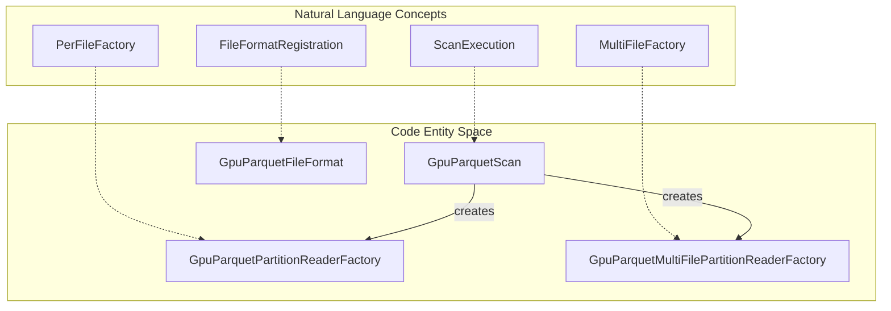
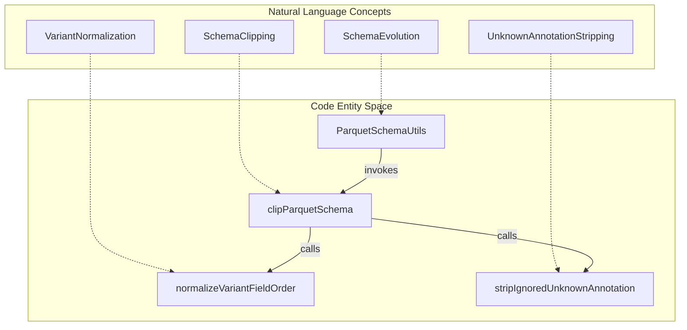
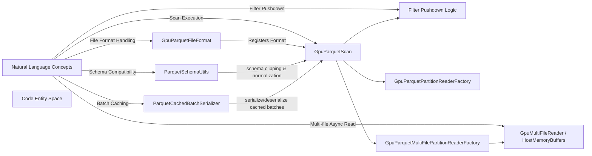

<!-- source: DeepWiki mcp.deepwiki.com · repo NVIDIA/cudf-spark · page 5.1 Parquet (Read & Write) · fetched 2026-10-26 -->

# Parquet (Read & Write)

Relevant source files

The following files were used as context for generating this wiki page:

- [.gitmodules](.gitmodules)
- [integration_tests/src/main/python/cache_test.py](integration_tests/src/main/python/cache_test.py)
- [integration_tests/src/main/python/csv_test.py](integration_tests/src/main/python/csv_test.py)
- [integration_tests/src/main/python/hyper_log_log_plus_plus_test.py](integration_tests/src/main/python/hyper_log_log_plus_plus_test.py)
- [integration_tests/src/main/python/orc_test.py](integration_tests/src/main/python/orc_test.py)
- [integration_tests/src/main/python/parquet_test.py](integration_tests/src/main/python/parquet_test.py)
- [integration_tests/src/main/python/parquet_testing_test.py](integration_tests/src/main/python/parquet_testing_test.py)
- [integration_tests/src/main/python/project_lit_alias_test.py](integration_tests/src/main/python/project_lit_alias_test.py)
- [integration_tests/src/main/python/prune_partition_column_test.py](integration_tests/src/main/python/prune_partition_column_test.py)
- [sql-plugin-columnar/src/main/java/com/nvidia/spark/rapids/ColumnLimitExceededException.java](sql-plugin-columnar/src/main/java/com/nvidia/spark/rapids/ColumnLimitExceededException.java)
- [sql-plugin-columnar/src/main/java/com/nvidia/spark/rapids/RapidsHostColumnBuilder.java](sql-plugin-columnar/src/main/java/com/nvidia/spark/rapids/RapidsHostColumnBuilder.java)
- [sql-plugin/src/main/scala/com/nvidia/spark/rapids/GpuMultiFileReader.scala](sql-plugin/src/main/scala/com/nvidia/spark/rapids/GpuMultiFileReader.scala)
- [sql-plugin/src/main/scala/com/nvidia/spark/rapids/GpuOrcScan.scala](sql-plugin/src/main/scala/com/nvidia/spark/rapids/GpuOrcScan.scala)
- [sql-plugin/src/main/scala/com/nvidia/spark/rapids/parquet/GpuParquetScan.scala](sql-plugin/src/main/scala/com/nvidia/spark/rapids/parquet/GpuParquetScan.scala)
- [sql-plugin/src/main/scala/com/nvidia/spark/rapids/parquet/ParquetCachedBatchSerializer.scala](sql-plugin/src/main/scala/com/nvidia/spark/rapids/parquet/ParquetCachedBatchSerializer.scala)
- [sql-plugin/src/main/scala/com/nvidia/spark/rapids/parquet/ParquetSchemaUtils.scala](sql-plugin/src/main/scala/com/nvidia/spark/rapids/parquet/ParquetSchemaUtils.scala)
- [sql-plugin/src/main/scala/org/apache/spark/sql/rapids/GpuAvroScan.scala](sql-plugin/src/main/scala/org/apache/spark/sql/rapids/GpuAvroScan.scala)
- [sql-plugin/src/main/scala/org/apache/spark/sql/rapids/GpuFileSourceScanExec.scala](sql-plugin/src/main/scala/org/apache/spark/sql/rapids/GpuFileSourceScanExec.scala)
- [sql-plugin/src/main/scala/org/apache/spark/sql/rapids/PCBSSchemaHelper.scala](sql-plugin/src/main/scala/org/apache/spark/sql/rapids/PCBSSchemaHelper.scala)
- [sql-plugin/src/main/scala/org/apache/spark/sql/rapids/aggregate/GpuHyperLogLogPlusPlus.scala](sql-plugin/src/main/scala/org/apache/spark/sql/rapids/aggregate/GpuHyperLogLogPlusPlus.scala)
- [sql-plugin/src/main/scala/org/apache/spark/sql/rapids/execution/TrampolineUtil.scala](sql-plugin/src/main/scala/org/apache/spark/sql/rapids/execution/TrampolineUtil.scala)
- [sql-plugin/src/main/spark330/scala/com/nvidia/spark/rapids/shims/ParquetMissingStructShims.scala](sql-plugin/src/main/spark330/scala/com/nvidia/spark/rapids/shims/ParquetMissingStructShims.scala)
- [sql-plugin/src/main/spark411/scala/com/nvidia/spark/rapids/shims/ParquetMissingStructShims.scala](sql-plugin/src/main/spark411/scala/com/nvidia/spark/rapids/shims/ParquetMissingStructShims.scala)
- [sql-plugin/src/test/scala/com/nvidia/spark/rapids/parquet/ByteArrayOutputFileSuite.scala](sql-plugin/src/test/scala/com/nvidia/spark/rapids/parquet/ByteArrayOutputFileSuite.scala)
- [sql-plugin/src/test/scala/com/nvidia/spark/rapids/parquet/ParquetSchemaUtilsSuite.scala](sql-plugin/src/test/scala/com/nvidia/spark/rapids/parquet/ParquetSchemaUtilsSuite.scala)
- [tests/src/test/resources/test-data/text-partitioned/year=2014/data.txt](tests/src/test/resources/test-data/text-partitioned/year=2014/data.txt)
- [tests/src/test/resources/test-data/text-partitioned/year=2015/data.txt](tests/src/test/resources/test-data/text-partitioned/year=2015/data.txt)
- [tests/src/test/resources/test-data/text-suite.txt](tests/src/test/resources/test-data/text-suite.txt)
- [tests/src/test/scala/com/nvidia/spark/rapids/CachedBatchWriterSuite.scala](tests/src/test/scala/com/nvidia/spark/rapids/CachedBatchWriterSuite.scala)
- [tests/src/test/scala/com/nvidia/spark/rapids/CudfTestHelper.scala](tests/src/test/scala/com/nvidia/spark/rapids/CudfTestHelper.scala)
- [tests/src/test/scala/com/nvidia/spark/rapids/GpuFileScanPrunePartitionSuite.scala](tests/src/test/scala/com/nvidia/spark/rapids/GpuFileScanPrunePartitionSuite.scala)
- [tests/src/test/scala/com/nvidia/spark/rapids/GpuMultiFileReaderSuite.scala](tests/src/test/scala/com/nvidia/spark/rapids/GpuMultiFileReaderSuite.scala)
- [tests/src/test/scala/com/nvidia/spark/rapids/GpuReaderTypeSuites.scala](tests/src/test/scala/com/nvidia/spark/rapids/GpuReaderTypeSuites.scala)
- [tests/src/test/scala/com/nvidia/spark/rapids/LargeHostMemorySuite.scala](tests/src/test/scala/com/nvidia/spark/rapids/LargeHostMemorySuite.scala)
- [tests/src/test/scala/com/nvidia/spark/rapids/RapidsHostColumnBuilderSuite.scala](tests/src/test/scala/com/nvidia/spark/rapids/RapidsHostColumnBuilderSuite.scala)
- [tests/src/test/spark330/scala/org/apache/spark/sql/rapids/suites/RapidsBinaryFileFormatSuite.scala](tests/src/test/spark330/scala/org/apache/spark/sql/rapids/suites/RapidsBinaryFileFormatSuite.scala)
- [tests/src/test/spark330/scala/org/apache/spark/sql/rapids/suites/RapidsDataSourceV2DataFrameSessionCatalogSuite.scala](tests/src/test/spark330/scala/org/apache/spark/sql/rapids/suites/RapidsDataSourceV2DataFrameSessionCatalogSuite.scala)
- [tests/src/test/spark330/scala/org/apache/spark/sql/rapids/suites/RapidsFileSourceCodecSuite.scala](tests/src/test/spark330/scala/org/apache/spark/sql/rapids/suites/RapidsFileSourceCodecSuite.scala)
- [tests/src/test/spark330/scala/org/apache/spark/sql/rapids/suites/RapidsSaveLoadSuite.scala](tests/src/test/spark330/scala/org/apache/spark/sql/rapids/suites/RapidsSaveLoadSuite.scala)
- [tests/src/test/spark330/scala/org/apache/spark/sql/rapids/suites/RapidsTableScanSuite.scala](tests/src/test/spark330/scala/org/apache/spark/sql/rapids/suites/RapidsTableScanSuite.scala)
- [tests/src/test/spark330/scala/org/apache/spark/sql/rapids/suites/RapidsTextSuite.scala](tests/src/test/spark330/scala/org/apache/spark/sql/rapids/suites/RapidsTextSuite.scala)
- [tests/src/test/spark400/scala/com/nvidia/spark/rapids/CachedBatchWriterVariantSuite.scala](tests/src/test/spark400/scala/com/nvidia/spark/rapids/CachedBatchWriterVariantSuite.scala)

This page details the GPU-accelerated support for reading and writing Parquet files within the NVIDIA RAPIDS Accelerator for Apache Spark. It covers core components such as `GpuParquetScan`, `GpuParquetFileFormat`, `ParquetSchemaUtils`, `ParquetCachedBatchSerializer`, reader factories, multi-file readers, schema evolution, and filter pushdown handling.

Sources: [sql-plugin/src/main/scala/com/nvidia/spark/rapids/parquet/GpuParquetScan.scala:109-142]()

---

## Parquet Reading & File Formats: `GpuParquetScan` & `GpuParquetFileFormat`

`GpuParquetScan` is the GPU-accelerated equivalent of Spark's `ParquetScan`. It extends Spark's `FileScan` and the plugin's `GpuScan` trait, integrating GPU-based Parquet reading into Spark's execution plans. It is responsible for managing the reading strategy based on RAPIDS-configured reader types and is designed to leverage GPU processing for scan and filtering operations on Parquet data.

Key responsibilities include:

- **Reader Factory Creation**:  
  - Depending on the RAPIDS configuration, `GpuParquetScan` creates either a per-file reader factory (`GpuParquetPartitionReaderFactory`) for sequential reading or a multi-file reader factory (`GpuParquetMultiFilePartitionReaderFactory`) optimized for concurrent or coalesced file reading. This decision is controlled by the config key `spark.rapids.sql.format.parquet.reader.type` [sql-plugin/src/main/scala/com/nvidia/spark/rapids/parquet/GpuParquetScan.scala:126-142]().

- **Splitability**:  
  - Parquet files are marked as splittable by default via `isSplitable`, enabling parallel processing by splitting large files into chunks [sql-plugin/src/main/scala/com/nvidia/spark/rapids/parquet/GpuParquetScan.scala:124]().

- **Query Metadata Support**:  
  - Supports optional read metadata such as `InputFileName`, `InputFileBlockStart`, and `InputFileBlockLength` when `queryUsesInputFile` is enabled [sql-plugin/src/main/scala/com/nvidia/spark/rapids/parquet/GpuParquetScan.scala:109-121]().

**Diagram: Parquet Read Path Entity Mapping**

Sources: [sql-plugin/src/main/scala/com/nvidia/spark/rapids/parquet/GpuParquetScan.scala:126-142]()

---

## Parquet Reader Types & Footer Parsing

RAPIDS supports multiple reading architectures for Parquet files, configured via `spark.rapids.sql.format.parquet.reader.type`. The modes optimize for different file layout and environment characteristics:

- **`PERFILE`**:  
  Reads files individually in a traditional manner [integration_tests/src/main/python/parquet_test.py:83-100]().

- **`MULTITHREADED`**:  
  Uses a thread pool to read multiple files concurrently which is beneficial for cloud object stores to hide latency and maximize throughput [integration_tests/src/main/python/parquet_test.py:84-86]().

- **`COALESCING`**:  
  Combines multiple small Parquet files into fewer larger host memory buffers before GPU processing, improving task efficiency in scenarios with many small files [integration_tests/src/main/python/parquet_test.py:87]().

For footer parsing, two modes are configurable:

- **`JAVA`**: Uses the original Java-based Parquet metadata reader.  
- **`NATIVE`**: Uses a JNI-based native (`com.nvidia.spark.rapids.jni.ParquetFooter`) reader implemented in C++, improving footer parsing performance by offloading it to GPU-native code [integration_tests/src/main/python/parquet_test.py:100-114](), [sql-plugin/src/main/scala/com/nvidia/spark/rapids/parquet/GpuParquetScan.scala:37-43]().

Footer metadata is vital for schema resolution, filter pushdown decisions, and split planning.

Sources: [integration_tests/src/main/python/parquet_test.py:83-114](), [sql-plugin/src/main/scala/com/nvidia/spark/rapids/parquet/GpuParquetScan.scala:37-43]()

---

## Schema Evolution, Clipping & `ParquetSchemaUtils`

`ParquetSchemaUtils` provides utilities to handle schema evolution, clipping, and normalization matching between Parquet file schemas and Catalyst read schemas. It ensures GPU reads respect Spark's expected schema semantics and supports schema evolution during reads.

Key utilities include:

- **Schema Clipping (`clipParquetSchema`)**:  
  Prunes Parquet schema columns that are missing from the Catalyst read schema without introducing unrequested fields. This reduces unnecessary GPU reads and matches Spark's schema evolution expectations [sql-plugin/src/main/scala/com/nvidia/spark/rapids/parquet/ParquetSchemaUtils.scala:1-100]().

- **Variant Types Normalization**:  
  Normalizes unshredded Variant groups so their children `value` and `metadata` are ordered as expected by Spark, preventing downstream schema mismatches [sql-plugin/src/main/scala/com/nvidia/spark/rapids/parquet/ParquetSchemaUtils.scala:1-100]().

- **Unknown Annotation Stripping**:  
  Removes logical annotation flags marked as `UNKNOWN` when Spark corresponds these to `NullType`, preventing unnecessary schema or reader confusion [sql-plugin/src/main/scala/com/nvidia/spark/rapids/parquet/ParquetSchemaUtils.scala:1-100]().

**Diagram: Schema Clipping & Utilities Entity Mapping**

Sources: [sql-plugin/src/main/scala/com/nvidia/spark/rapids/parquet/ParquetSchemaUtils.scala:1-100]()

---

## Filter Pushdown & Predicate Handling

Filter pushdown is key to minimizing I/O and GPU work by filtering data before the scan:

- **Pushed Filters**:  
  `GpuParquetScan` takes non-partition filters (`pushedFilters`) and uses these to prune row groups or pages by evaluating them early against Parquet file metadata, including column statistics [sql-plugin/src/main/scala/com/nvidia/spark/rapids/parquet/GpuParquetScan.scala:109-121]().

- **Native SARG (Search Argument) Application**:  
  These filters are translated into Parquet-compatible predicates and passed down to native cuDF readers (via `ParquetChunkedReader`) to skip irrelevant row groups or pages, thus avoiding unnecessary GPU decode and compute [sql-plugin/src/main/scala/com/nvidia/spark/rapids/parquet/GpuParquetScan.scala:31-33]().

This integration enables efficient predicate evaluation aligned with the GPU scan pipeline.

Sources: [sql-plugin/src/main/scala/com/nvidia/spark/rapids/parquet/GpuParquetScan.scala:31-33](), [sql-plugin/src/main/scala/com/nvidia/spark/rapids/parquet/GpuParquetScan.scala:109-121]()

---

## `ParquetCachedBatchSerializer` & Batch Serialization

The class `ParquetCachedBatchSerializer` enables serialization and deserialization of CUDA columnar batches to and from a cached Parquet format representation. This is critical for GPU-accelerated caching to disk or memory, allowing efficient reuse of GPU data structures across query stages or caching layers [tests/src/test/scala/com/nvidia/spark/rapids/CachedBatchWriterSuite.scala:77-85]().

- **Columnar Layout**:  
  Retains columnar batch format consistent with cuDF’s GPU tables.

- **Integration with Parquet**:  
  Uses internal Parquet writing and reading mechanisms optimized for host memory buffers, making caching operations fast and minimizing CPU/GPU transfers [sql-plugin/src/main/scala/com/nvidia/spark/rapids/parquet/GpuParquetScan.scala:1-143]().

Sources: [tests/src/test/scala/com/nvidia/spark/rapids/CachedBatchWriterSuite.scala:77-85](), [sql-plugin/src/main/scala/com/nvidia/spark/rapids/parquet/GpuParquetScan.scala:1-143]()

---

## Multi-File Reader & Memory Buffer Management

For efficient reads in multi-file and cloud object storage scenarios, RAPIDS implements asynchronous multi-file readers that coalesce data buffers before transferring to GPU:

- **`SingleHMBAndMeta`**:  
  Encapsulates one or more `SpillableHostBuffer`s along with metadata such as total byte size, row counts, and data block metadata used for reassembly or caching [sql-plugin/src/main/scala/com/nvidia/spark/rapids/GpuMultiFileReader.scala:71-82]().

- **`HostMemoryBuffersWithMetaDataBase`**:  
  Manages the lifecycle of these buffers, tracking filtering time, buffering time, scheduling delays, and supports resource release callbacks [sql-plugin/src/main/scala/com/nvidia/spark/rapids/GpuMultiFileReader.scala:94-174]().

- **OOM-Safe Retry Logic**:  
  Integrated with `RmmRapidsRetryIterator` to handle GPU memory pressure gracefully by retrying reads, splitting batches, or spilling as necessary [sql-plugin/src/main/scala/com/nvidia/spark/rapids/parquet/GpuParquetScan.scala:39]().

Sources: [sql-plugin/src/main/scala/com/nvidia/spark/rapids/GpuMultiFileReader.scala:56-177](), [sql-plugin/src/main/scala/com/nvidia/spark/rapids/parquet/GpuParquetScan.scala:39]()

---

## Configuration Summary

The following configuration properties govern Parquet reading and writing behavior in RAPIDS:

| Property | Description | Default |
| :--- | :--- | :--- |
| `spark.rapids.sql.format.parquet.reader.type` | Reader type architecture: `PERFILE`, `MULTITHREADED`, or `COALESCING`. | `COALESCING` |
| `spark.rapids.sql.format.parquet.reader.footer.type` | Footer parsing mode: `NATIVE` (JNI/C++) or `JAVA`. | `JAVA` |
| `spark.rapids.sql.format.parquet.write.enabled` | Enables GPU-accelerated Parquet writer for faster writes. | `true` |
| `spark.rapids.sql.parquet.int96RebaseModeInWrite` | Controls the timestamp INT96 rebasing mode during write. | `EXCEPTION` |
| `spark.rapids.sql.reader.chunked` | Enables chunked batch reading for better parallelism on large files. | `false` |

Sources: [integration_tests/src/main/python/parquet_test.py:83-124](), [sql-plugin/src/main/scala/com/nvidia/spark/rapids/parquet/GpuParquetScan.scala:37-48]()

---

## Summary Diagram: Parquet GPU Path Overview

**Diagram: Mapping Parquet GPU System to Code Entities**

Sources: [sql-plugin/src/main/scala/com/nvidia/spark/rapids/parquet/GpuParquetScan.scala:109-142](), [sql-plugin/src/main/scala/com/nvidia/spark/rapids/parquet/ParquetCachedBatchSerializer.scala:1-50](), [sql-plugin/src/main/scala/com/nvidia/spark/rapids/GpuMultiFileReader.scala:56-177]()

---

