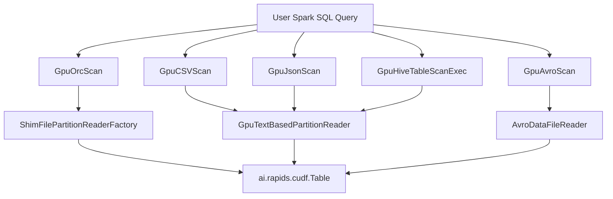
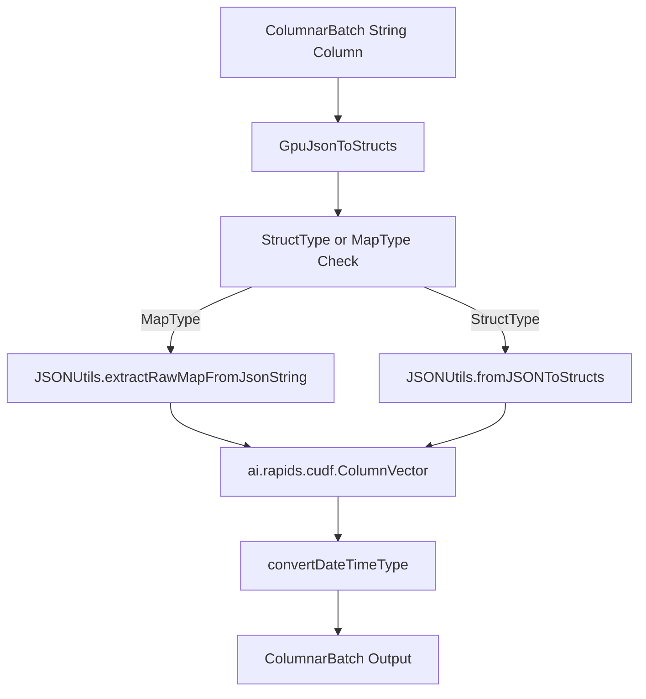
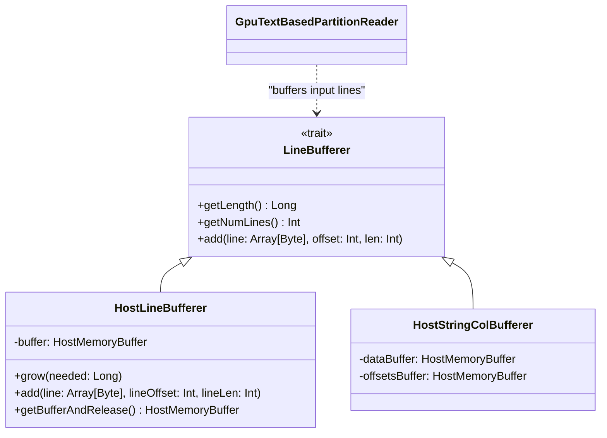

<!-- source: DeepWiki mcp.deepwiki.com · repo NVIDIA/cudf-spark · page 5.2 ORC, CSV, JSON & Avro (Read & Write) · fetched 2026-10-26 -->

# ORC, CSV, JSON & Avro (Read & Write)

Relevant source files

The following files were used as context for generating this wiki page:

- [api_validation/auditAllVersions.sh](api_validation/auditAllVersions.sh)
- [api_validation/src/main/scala/com/nvidia/spark/rapids/api/ApiValidation.scala](api_validation/src/main/scala/com/nvidia/spark/rapids/api/ApiValidation.scala)
- [integration_tests/src/main/python/avro_test.py](integration_tests/src/main/python/avro_test.py)
- [integration_tests/src/main/python/hive_delimited_text_test.py](integration_tests/src/main/python/hive_delimited_text_test.py)
- [integration_tests/src/main/python/json_matrix_test.py](integration_tests/src/main/python/json_matrix_test.py)
- [integration_tests/src/main/python/json_test.py](integration_tests/src/main/python/json_test.py)
- [integration_tests/src/test/resources/bad_whitespace.json](integration_tests/src/test/resources/bad_whitespace.json)
- [integration_tests/src/test/resources/float_formatted.json](integration_tests/src/test/resources/float_formatted.json)
- [integration_tests/src/test/resources/invalid_ridealong_columns.json](integration_tests/src/test/resources/invalid_ridealong_columns.json)
- [integration_tests/src/test/resources/scan_emtpy_lines.json](integration_tests/src/test/resources/scan_emtpy_lines.json)
- [integration_tests/src/test/resources/sci_formatted.json](integration_tests/src/test/resources/sci_formatted.json)
- [integration_tests/src/test/resources/timestamp_invalid_time.json](integration_tests/src/test/resources/timestamp_invalid_time.json)
- [sql-plugin-api/src/main/scala/com/nvidia/spark/rapids/AvroBlockInfo.scala](sql-plugin-api/src/main/scala/com/nvidia/spark/rapids/AvroBlockInfo.scala)
- [sql-plugin-api/src/main/scala/com/nvidia/spark/rapids/LineBufferer.scala](sql-plugin-api/src/main/scala/com/nvidia/spark/rapids/LineBufferer.scala)
- [sql-plugin-api/src/main/scala/com/nvidia/spark/rapids/MultiFileReaderContracts.scala](sql-plugin-api/src/main/scala/com/nvidia/spark/rapids/MultiFileReaderContracts.scala)
- [sql-plugin-api/src/main/scala/com/nvidia/spark/rapids/OrcReaderMetadata.scala](sql-plugin-api/src/main/scala/com/nvidia/spark/rapids/OrcReaderMetadata.scala)
- [sql-plugin-api/src/main/scala/com/nvidia/spark/rapids/parquet/ParquetSchemaWrapper.scala](sql-plugin-api/src/main/scala/com/nvidia/spark/rapids/parquet/ParquetSchemaWrapper.scala)
- [sql-plugin-api/src/main/scala/org/apache/spark/sql/rapids/AvroReaderMetadata.scala](sql-plugin-api/src/main/scala/org/apache/spark/sql/rapids/AvroReaderMetadata.scala)
- [sql-plugin/src/main/scala/com/nvidia/spark/rapids/AvroDataFileReader.scala](sql-plugin/src/main/scala/com/nvidia/spark/rapids/AvroDataFileReader.scala)
- [sql-plugin/src/main/scala/com/nvidia/spark/rapids/AvroProvider.scala](sql-plugin/src/main/scala/com/nvidia/spark/rapids/AvroProvider.scala)
- [sql-plugin/src/main/scala/com/nvidia/spark/rapids/GpuBatchScanExecMetrics.scala](sql-plugin/src/main/scala/com/nvidia/spark/rapids/GpuBatchScanExecMetrics.scala)
- [sql-plugin/src/main/scala/com/nvidia/spark/rapids/GpuCSVScan.scala](sql-plugin/src/main/scala/com/nvidia/spark/rapids/GpuCSVScan.scala)
- [sql-plugin/src/main/scala/com/nvidia/spark/rapids/GpuMetrics.scala](sql-plugin/src/main/scala/com/nvidia/spark/rapids/GpuMetrics.scala)
- [sql-plugin/src/main/scala/com/nvidia/spark/rapids/GpuTextBasedPartitionReader.scala](sql-plugin/src/main/scala/com/nvidia/spark/rapids/GpuTextBasedPartitionReader.scala)
- [sql-plugin/src/main/scala/com/nvidia/spark/rapids/HiveProvider.scala](sql-plugin/src/main/scala/com/nvidia/spark/rapids/HiveProvider.scala)
- [sql-plugin/src/main/scala/org/apache/spark/sql/catalyst/json/rapids/GpuJsonScan.scala](sql-plugin/src/main/scala/org/apache/spark/sql/catalyst/json/rapids/GpuJsonScan.scala)
- [sql-plugin/src/main/scala/org/apache/spark/sql/hive/rapids/GpuHiveOverrides.scala](sql-plugin/src/main/scala/org/apache/spark/sql/hive/rapids/GpuHiveOverrides.scala)
- [sql-plugin/src/main/scala/org/apache/spark/sql/hive/rapids/GpuHiveTableScanExec.scala](sql-plugin/src/main/scala/org/apache/spark/sql/hive/rapids/GpuHiveTableScanExec.scala)
- [sql-plugin/src/main/scala/org/apache/spark/sql/hive/rapids/HiveProviderImpl.scala](sql-plugin/src/main/scala/org/apache/spark/sql/hive/rapids/HiveProviderImpl.scala)
- [sql-plugin/src/main/scala/org/apache/spark/sql/rapids/AvroProviderImpl.scala](sql-plugin/src/main/scala/org/apache/spark/sql/rapids/AvroProviderImpl.scala)
- [sql-plugin/src/main/scala/org/apache/spark/sql/rapids/GpuJsonReadCommon.scala](sql-plugin/src/main/scala/org/apache/spark/sql/rapids/GpuJsonReadCommon.scala)
- [sql-plugin/src/main/scala/org/apache/spark/sql/rapids/GpuJsonToStructs.scala](sql-plugin/src/main/scala/org/apache/spark/sql/rapids/GpuJsonToStructs.scala)
- [sql-plugin/src/main/scala/org/apache/spark/sql/rapids/GpuStructsToJson.scala](sql-plugin/src/main/scala/org/apache/spark/sql/rapids/GpuStructsToJson.scala)
- [tests/src/test/resources/nested-unsigned-malformed.parquet](tests/src/test/resources/nested-unsigned-malformed.parquet)
- [tests/src/test/resources/nested-unsigned.parquet](tests/src/test/resources/nested-unsigned.parquet)
- [tests/src/test/scala/com/nvidia/spark/rapids/CsvScanRetrySuite.scala](tests/src/test/scala/com/nvidia/spark/rapids/CsvScanRetrySuite.scala)
- [tests/src/test/scala/com/nvidia/spark/rapids/JsonScanRetrySuite.scala](tests/src/test/scala/com/nvidia/spark/rapids/JsonScanRetrySuite.scala)
- [tests/src/test/scala/com/nvidia/spark/rapids/OrcScanSuite.scala](tests/src/test/scala/com/nvidia/spark/rapids/OrcScanSuite.scala)
- [tests/src/test/scala/com/nvidia/spark/rapids/ParquetScanSuite.scala](tests/src/test/scala/com/nvidia/spark/rapids/ParquetScanSuite.scala)

This section documents the GPU-accelerated file format support and related expressions for ORC, CSV, JSON, and Avro within the RAPIDS Accelerator for Apache Spark. It covers implementation details, key classes, partition readers, data flow, format-specific configuration options, and fallback conditions.

---

## 1. Purpose and Scope

The RAPIDS Accelerator extends GPU acceleration beyond Parquet to support reading and writing non-Parquet structured and semi-structured formats: ORC, CSV, JSON, and Avro [sql-plugin/src/main/scala/org/apache/spark/sql/catalyst/json/rapids/GpuJsonScan.scala:52-64](). For each format, specialized GPU scan execution classes (`GpuOrcScan`, `GpuCSVScan`, `GpuJsonScan`, `GpuAvroScan`) and partition readers (`GpuTextBasedPartitionReader`) replace Spark's CPU-bound readers [com/nvidia/spark/rapids/GpuTextBasedPartitionReader.scala:47-50](). They leverage `ai.rapids.cudf.Table` and JNI bindings to parse, decode, and transform data directly into Spark's columnar batch format (`ColumnarBatch`) [com/nvidia/spark/rapids/GpuTextBasedPartitionReader.scala:45-46](). Additionally, expression-level support such as `GpuJsonToStructs` and `GpuStructsToJson` accelerate JSON serialization and deserialization operations on the GPU [sql-plugin/src/main/scala/org/apache/spark/sql/rapids/GpuJsonToStructs.scala:37-69](), [sql-plugin/src/main/scala/org/apache/spark/sql/rapids/GpuStructsToJson.scala:99-110]().

Sources: [sql-plugin/src/main/scala/org/apache/spark/sql/catalyst/json/rapids/GpuJsonScan.scala:52-64](), [sql-plugin/src/main/scala/org/apache/spark/sql/rapids/GpuJsonToStructs.scala:37-69](), [com/nvidia/spark/rapids/GpuCSVScan.scala:57-118](), [com/nvidia/spark/rapids/GpuTextBasedPartitionReader.scala:47-50](), [sql-plugin/src/main/scala/org/apache/spark/sql/rapids/GpuStructsToJson.scala:99-110]()

---

## 2. ORC Read & Write Architecture

### 2.1 Overview

`GpuOrcScan` provides GPU-accelerated reading for ORC files by implementing Spark's native `FileScan` and `GpuScan` traits [sql-plugin/src/main/scala/org/apache/spark/sql/catalyst/json/rapids/GpuJsonScan.scala:52-64](). The `GpuOrcPartitionReaderFactory` and `GpuOrcMultiFilePartitionReaderFactory` instantiate partition readers that read ORC stripes into cuDF tables. These readers interact with cuDF JNI APIs that perform parsing, decompression, and device memory column batch construction [sql-plugin/src/main/scala/org/apache/spark/sql/catalyst/json/rapids/GpuJsonScan.scala:52-64]().

### 2.2 Timezone and Calendar Handling

ORC files contain stripe footer metadata that may specify the timezone and calendar system used by the writer. GPU-based readers must handle:

- **Writer Timezone Resolution**: When the ORC stripe footer specifies a timezone string, `GpuOrcTimezoneUtils.resolveWriterTimezone` parses it into a `ZoneId`, falling back to system defaults if missing or unrecognized [sql-plugin/src/main/scala/org/apache/spark/sql/catalyst/json/rapids/GpuJsonScan.scala:52-64]().

- **Timestamp Conversion Logic**: `GpuOrcTimezoneUtils.convertOrcIntegerTimestamp` converts integer timestamps (`TIMESTAMP_INSTANT_MICROS`) using coordinated timezone semantics consistent with Spark’s legacy ORC reading and Java time APIs, including historical transition handling [sql-plugin/src/main/scala/org/apache/spark/sql/catalyst/json/rapids/GpuJsonScan.scala:52-64]().

- **Calendar Rebasing**: Legacy ORC dates using the hybrid Julian/Gregorian calendar are rebased to proleptic Gregorian dates in GPU memory using JNI kernels (`DateTimeRebase`) enforced in `GpuOrcTimezoneUtils.rebaseOrcDateTime` [sql-plugin/src/main/scala/org/apache/spark/sql/catalyst/json/rapids/GpuJsonScan.scala:52-64]().

### 2.3 Schema Evolution Support

The ORC GPU scan supports schema evolution scenarios including:
- Pruning top-level fields,
- Handling missing columns in the ORC data,
- Re-ordering columns for reading.

These behaviors ensure compatibility with evolving schemas without CPU fallbacks [tests/src/test/scala/com/nvidia/spark/rapids/OrcScanSuite.scala:64-133]().

### 2.4 Batch and Memory Management

`GpuOrcScan` respects Spark’s batch size configuration controls to balance GPU memory usage. The scan creates cuDF tables for each partition file and converts them into Spark's `ColumnarBatch` for downstream GPU execution.

Sources: [sql-plugin/src/main/scala/org/apache/spark/sql/catalyst/json/rapids/GpuJsonScan.scala:52-64](), [tests/src/test/scala/com/nvidia/spark/rapids/OrcScanSuite.scala:64-133]()

---

## 3. CSV Read Architecture

### 3.1 GpuCSVScan

`GpuCSVScan` provides GPU-accelerated CSV reading leveraging cuDF’s CSV parser [com/nvidia/spark/rapids/GpuCSVScan.scala:57-118](). It validates scan options through `GpuCSVScan.tagSupport` by enforcing:

- Strict schema enforcement (`enforceSchema = true`),
- Single-byte ASCII delimiters and quote characters,
- Non-support for multi-line, multi-character delimiters,
- Supported charsets restricted to UTF-8, US-ASCII, and optionally GBK with legacy mode enabled [com/nvidia/spark/rapids/GpuCSVScan.scala:82-103]() and [com/nvidia/spark/rapids/GpuCSVScan.scala:142-177]().

Unsupported or complex CSV features trigger a fallback to Spark’s CPU CSV reader [com/nvidia/spark/rapids/GpuCSVScan.scala:110-177]().

### 3.2 Buffering Lines

To process CSV files, `GpuTextBasedPartitionReader` uses one of several `LineBufferer` implementations which buffer raw file lines into host memory before passing them to GPU parsers. The default `HostLineBufferer` buffers lines by concatenating them with line separators, filtering out empty lines if requested [com/nvidia/spark/rapids/GpuTextBasedPartitionReader.scala:77-110]().

The system also provides specialized bufferers:
- `FilterEmptyHostLineBuffererFactory`: filters empty lines using behavior compatible with Spark’s CPU CSV reader [com/nvidia/spark/rapids/GpuTextBasedPartitionReader.scala:53-57]().
- `FilterCsvEmptyHostLineBuffererFactory`: applies stricter whitespace filtering mimicking JVM’s `String.trim()` semantics [com/nvidia/spark/rapids/GpuTextBasedPartitionReader.scala:64-70]().

Sources: [com/nvidia/spark/rapids/GpuCSVScan.scala:57-177](), [com/nvidia/spark/rapids/GpuTextBasedPartitionReader.scala:47-110]()

---

## 4. JSON Read, Write & Expression Acceleration

### 4.1 GpuJsonScan

`GpuJsonScan` provides GPU acceleration for JSON file scanning across different reader contexts: `JsonScan`, `JsonToStructs` (e.g. `from_json`), and `JsonFileFormat` [sql-plugin/src/main/scala/org/apache/spark/sql/catalyst/json/rapids/GpuJsonScan.scala:52-64]().

It performs tagging of unsupported features using `tagSupportOptions`, which enforces fallback triggers for:

- Multi-line JSON input (`multiLine`) is not supported [sql-plugin/src/main/scala/org/apache/spark/sql/catalyst/json/rapids/GpuJsonScan.scala:79-81](),
- Comment allowance (`allowComments`) is unsupported as cuDF JSON reader cannot parse them [sql-plugin/src/main/scala/org/apache/spark/sql/catalyst/json/rapids/GpuJsonScan.scala:83-86](),
- Unquoted field names [sql-plugin/src/main/scala/org/apache/spark/sql/catalyst/json/rapids/GpuJsonScan.scala:88-91](),
- Backslash escaping of arbitrary characters [sql-plugin/src/main/scala/org/apache/spark/sql/catalyst/json/rapids/GpuJsonScan.scala:93-96](),
- Drop field if all values null [sql-plugin/src/main/scala/org/apache/spark/sql/catalyst/json/rapids/GpuJsonScan.scala:98-101](),
- Non-permissive JSON parse modes [sql-plugin/src/main/scala/org/apache/spark/sql/catalyst/json/rapids/GpuJsonScan.scala:103-105](),
- Non-newline line separators [sql-plugin/src/main/scala/org/apache/spark/sql/catalyst/json/rapids/GpuJsonScan.scala:107-109](),
- Non-UTF8/US-ASCII encodings [sql-plugin/src/main/scala/org/apache/spark/sql/catalyst/json/rapids/GpuJsonScan.scala:111-114]().

This validation ensures only supported JSON input variants are accelerated [sql-plugin/src/main/scala/org/apache/spark/sql/catalyst/json/rapids/GpuJsonScan.scala:76-115]().

### 4.2 GpuJsonToStructs (`from_json`)

This expression implements GPU-accelerated parsing of JSON strings to columnar structs or raw maps for Spark’s `from_json` functionality [sql-plugin/src/main/scala/org/apache/spark/sql/rapids/GpuJsonToStructs.scala:37-69](). It supports schemas of struct or map types where map keys and values have specific primitive types.

- For value types of `MAP<STRING, ARRAY<STRING>>` or `MAP<STRING, STRING>`, it extracts the raw JSON token substrings without unescaping or normalization, preserving Spark compatibility in corner cases [sql-plugin/src/main/scala/org/apache/spark/sql/rapids/GpuJsonToStructs.scala:79-111]().

- For struct types, it leverages cuDF’s JSON parser JNI bindings (`JSONUtils.fromJSONToStructs`) to produce columnar batches, with additional processing for date/time type conversions when necessary [sql-plugin/src/main/scala/org/apache/spark/sql/rapids/GpuJsonToStructs.scala:79-111]().

### 4.3 GpuStructsToJson (`to_json`)

`GpuStructsToJson` provides GPU-accelerated implementations of Spark’s `to_json` expression by serializing columnar structs into JSON strings using GPU casting routines [sql-plugin/src/main/scala/org/apache/spark/sql/rapids/GpuStructsToJson.scala:99-110](). It respects JSON output options such as `ignoreNullFields` and validates supported date/time formats and timezones, disallowing unsupported configurations [sql-plugin/src/main/scala/org/apache/spark/sql/rapids/GpuStructsToJson.scala:40-98]().

Sources: [sql-plugin/src/main/scala/org/apache/spark/sql/catalyst/json/rapids/GpuJsonScan.scala:52-114](), [sql-plugin/src/main/scala/org/apache/spark/sql/rapids/GpuJsonToStructs.scala:37-111](), [sql-plugin/src/main/scala/org/apache/spark/sql/rapids/GpuStructsToJson.scala:99-110]()

---

## 5. Avro Read Architecture

`GpuAvroScan` and associated reader factories integrate GPU-accelerated reading of Avro file formats by leveraging native cuDF Avro reading capabilities via the `AvroDataFileReader` JNI interface [com/nvidia/spark/rapids/AvroDataFileReader.scala](). 

These readers support:

- Partition pruning,
- Filter pushdown,
- Parallelization across multiple files using `GpuAvroMultiFilePartitionReaderFactory` [com/nvidia/spark/rapids/AvroProvider.scala]().

The integration ensures GPU acceleration extends to large-scale Avro datasets efficiently.

Sources: [com/nvidia/spark/rapids/AvroDataFileReader.scala](), [com/nvidia/spark/rapids/AvroProvider.scala]()

---

## 6. Hive Text Scan Integration

`GpuHiveTableScanExec` implements GPU acceleration for Hive text tables (`HiveTableRelation`) [org.apache.spark.sql.hive.rapids.GpuHiveTableScanExec:57-79]().

Constraints:

- Only tables stored as `TEXTFILE` with `TextInputFormat` and `LazySimpleSerDe` are supported [org.apache.spark.sql.hive.rapids.GpuHiveTableScanExec:64-68]().
- Supports only primitive column types; complex types such as `STRUCT`, `ARRAY`, `MAP`, and `BINARY` are unsupported on GPU [org.apache.spark.sql.hive.rapids.GpuHiveTableScanExec:67-68]().
- Enforces use of Hive's default delimiter characters (`Ctrl-A` for columns and `\n` for rows) [org.apache.spark.sql.hive.rapids.GpuHiveTableScanExec:69-70]().

Partition pruning for Hive tables is implemented via `prunePartitions` which uses expressions bound to partition column attributes [org.apache.spark.sql.hive.rapids.GpuHiveTableScanExec:117-131]().

Sources: [org.apache.spark.sql.hive.rapids.GpuHiveTableScanExec:57-131](), [integration_tests/src/main/python/hive_delimited_text_test.py:23-27]()

---

## 7. System Architecture Diagrams

### 7.1 Format-Specific Data Flow to Code Entities

This diagram bridges natural language file formats to code entities, showing how execution plans dispatch data through partition readers into cuDF `Table` objects.

Sources: [com/nvidia/spark/rapids/GpuCSVScan.scala:57-118](), [sql-plugin/src/main/scala/org/apache/spark/sql/catalyst/json/rapids/GpuJsonScan.scala:52-64](), [com/nvidia/spark/rapids/GpuTextBasedPartitionReader.scala:47-50](), [org.apache.spark.sql.hive.rapids.GpuHiveTableScanExec:57-79](), [com/nvidia/spark/rapids/AvroDataFileReader.scala]()

---

### 7.2 JSON Parsing and Expression Handling Code Entities

This diagram illustrates how JSON string processing maps to `GpuJsonToStructs` and `JSONUtils` JNI functions.

Sources: [sql-plugin/src/main/scala/org/apache/spark/sql/rapids/GpuJsonToStructs.scala:37-113](), [sql-plugin/src/main/scala/org/apache/spark/sql/catalyst/json/rapids/GpuJsonScan.scala:52-64]()

---

### 7.3 Text Line Bufferer Class Hierarchy

This class diagram shows the hierarchy of line bufferers used by text-based readers (`CSV`, `JSON`, Hive Text) to accumulate input text lines in host memory before GPU parsing.

Sources: [com/nvidia/spark/rapids/GpuTextBasedPartitionReader.scala:47-171]()

---

## 8. Format-Specific Configuration Options

| Property | Format | Default | Description | File Reference |
|---|---|---|---|---|
| `spark.rapids.sql.format.orc.enabled` | ORC | `true` | Enable ORC input and output on GPU | [sql-plugin/src/main/scala/org/apache/spark/sql/catalyst/json/rapids/GpuJsonScan.scala:52-64]() |
| `spark.rapids.sql.format.csv.enabled` | CSV | `true` | Enable CSV input and output on GPU | [com/nvidia/spark/rapids/GpuCSVScan.scala:132-135]() |
| `spark.rapids.sql.format.csv.read.enabled` | CSV | `true` | Enable CSV input reading on GPU | [com/nvidia/spark/rapids/GpuCSVScan.scala:137-140]() |
| `spark.rapids.sql.format.json.enabled` | JSON | `true` | Enable JSON input and output on GPU | [sql-plugin/src/main/scala/org/apache/spark/sql/catalyst/json/rapids/GpuJsonScan.scala:130-133]() |
| `spark.rapids.sql.format.json.read.enabled` | JSON | `true` | Enable JSON input reading on GPU | [sql-plugin/src/main/scala/org/apache/spark/sql/catalyst/json/rapids/GpuJsonScan.scala:135-138]() |
| `spark.rapids.sql.expression.JsonToStructs` | JSON | `true` | Enable `from_json` acceleration | [sql-plugin/src/main/scala/org/apache/spark/sql/rapids/GpuJsonToStructs.scala:37-69]() |
| `spark.rapids.sql.json.read.float.enabled` | JSON | `false` | Enable reading floats in JSON on GPU | [integration_tests/src/main/python/json_test.py:68-72]() |
| `spark.rapids.sql.json.read.double.enabled` | JSON | `false` | Enable reading doubles in JSON on GPU | [integration_tests/src/main/python/json_test.py:68-72]() |
| `spark.rapids.sql.json.read.decimal.enabled` | JSON | `false` | Enable reading decimals in JSON on GPU | [integration_tests/src/main/python/json_test.py:68-72]() |
| `spark.rapids.sql.format.avro.read.enabled` | Avro | `true` | Enable Avro reading on GPU | [com/nvidia/spark/rapids/AvroProvider.scala]() |
| `spark.rapids.sql.format.hive.text.enabled` | HiveText | `true` | Enable Hive text input and output | [integration_tests/src/main/python/hive_delimited_text_test.py:23-24]() |
| `spark.rapids.sql.format.hive.text.read.enabled` | HiveText | `true` | Enable Hive text input | [integration_tests/src/main/python/hive_delimited_text_test.py:23-24]() |

Sources: [com/nvidia/spark/rapids/GpuCSVScan.scala:132-140](), [sql-plugin/src/main/scala/org/apache/spark/sql/catalyst/json/rapids/GpuJsonScan.scala:130-138](), [integration_tests/src/main/python/json_test.py:68-72](), [com/nvidia/spark/rapids/AvroProvider.scala](), [integration_tests/src/main/python/hive_delimited_text_test.py:23-24]()

---

## Summary

The RAPIDS Accelerator provides comprehensive GPU support for multiple file formats beyond Parquet. Through format-specific scan implementations (`GpuOrcScan`, `GpuCSVScan`, `GpuJsonScan`, `GpuAvroScan`) and customized partition readers (`GpuTextBasedPartitionReader`), it parses partitioned data efficiently with accuracy in schema handling, timezones, and compatibility details.

Supplemented by GPU-accelerated JSON expressions (`GpuJsonToStructs` and `GpuStructsToJson`), this support boosts end-to-end application performance on a wide range of data stored in common formats like ORC, CSV, JSON, and Avro within Apache Spark workloads.

The system maintains correctness by detecting unsupported features and falling back to CPU execution where needed, such as complex JSON parsing options or multi-line CSV. Hive text format is supported under a strict usage model to align with Hive default serialized text formats.

These components cooperate with cuDF's native GPU parsing abilities and the JNI interfacing layer to optimize data ingestion pipelines for GPU-accelerated Spark SQL analytic workloads.

---

## References

- `GpuOrcScan.scala`
- `GpuCSVScan.scala`
- `GpuJsonScan.scala`, `GpuJsonToStructs.scala`, `GpuStructsToJson.scala`
- `GpuTextBasedPartitionReader.scala`
- `GpuHiveTableScanExec.scala`
- `AvroDataFileReader.scala`, `AvroProvider.scala`
- Integration tests for JSON and Hive text format under `integration_tests/src/main/python/json_test.py`, `hive_delimited_text_test.py`

---

