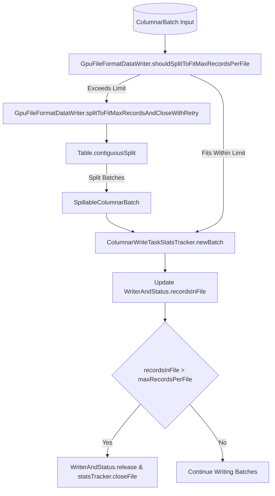
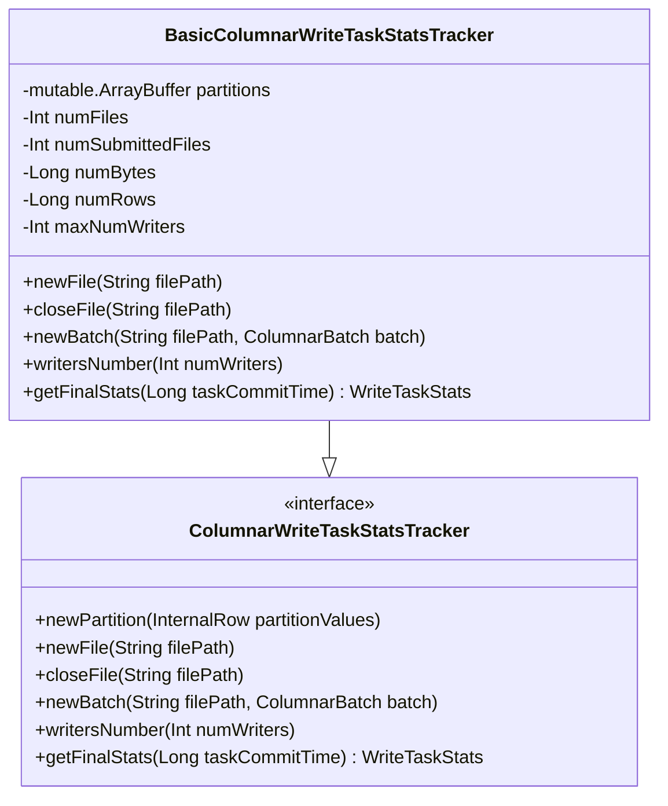
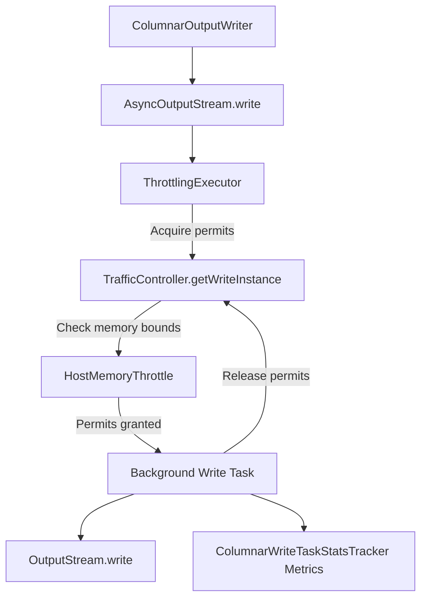

<!-- source: DeepWiki mcp.deepwiki.com · repo NVIDIA/cudf-spark · page 5.3 Write Path: GpuFileFormatDataWriter & Statistics · fetched 2026-10-26 -->

# Write Path: GpuFileFormatDataWriter & Statistics

Relevant source files

The following files were used as context for generating this wiki page:

- [delta-lake/common/src/main/scala/com/nvidia/spark/rapids/delta/GpuDeltaIdentityColumnStatsTracker.scala](delta-lake/common/src/main/scala/com/nvidia/spark/rapids/delta/GpuDeltaIdentityColumnStatsTracker.scala)
- [delta-lake/common/src/main/scala/com/nvidia/spark/rapids/delta/GpuDeltaTaskStatisticsTracker.scala](delta-lake/common/src/main/scala/com/nvidia/spark/rapids/delta/GpuDeltaTaskStatisticsTracker.scala)
- [delta-lake/delta-33x/src/main/scala/org/apache/spark/sql/delta/rapids/delta33x/GpuDeltaFileFormatWriter.scala](delta-lake/delta-33x/src/main/scala/org/apache/spark/sql/delta/rapids/delta33x/GpuDeltaFileFormatWriter.scala)
- [integration_tests/src/main/python/datasourcev2_write_test.py](integration_tests/src/main/python/datasourcev2_write_test.py)
- [integration_tests/src/main/python/hive_parquet_write_test.py](integration_tests/src/main/python/hive_parquet_write_test.py)
- [integration_tests/src/main/python/hive_write_test.py](integration_tests/src/main/python/hive_write_test.py)
- [integration_tests/src/main/python/orc_write_test.py](integration_tests/src/main/python/orc_write_test.py)
- [integration_tests/src/main/python/parquet_test_utils.py](integration_tests/src/main/python/parquet_test_utils.py)
- [integration_tests/src/main/python/parquet_write_test.py](integration_tests/src/main/python/parquet_write_test.py)
- [integration_tests/src/main/python/schema_evolution_test.py](integration_tests/src/main/python/schema_evolution_test.py)
- [sql-plugin/src/main/scala-2.12/com/nvidia/spark/rapids/implicits.scala](sql-plugin/src/main/scala-2.12/com/nvidia/spark/rapids/implicits.scala)
- [sql-plugin/src/main/scala-2.13/com/nvidia/spark/rapids/implicits.scala](sql-plugin/src/main/scala-2.13/com/nvidia/spark/rapids/implicits.scala)
- [sql-plugin/src/main/scala/com/nvidia/spark/rapids/ColumnarOutputWriter.scala](sql-plugin/src/main/scala/com/nvidia/spark/rapids/ColumnarOutputWriter.scala)
- [sql-plugin/src/main/scala/com/nvidia/spark/rapids/GpuDataWritingCommandExec.scala](sql-plugin/src/main/scala/com/nvidia/spark/rapids/GpuDataWritingCommandExec.scala)
- [sql-plugin/src/main/scala/com/nvidia/spark/rapids/GpuParquetFileFormat.scala](sql-plugin/src/main/scala/com/nvidia/spark/rapids/GpuParquetFileFormat.scala)
- [sql-plugin/src/main/scala/com/nvidia/spark/rapids/GpuShuffleAsyncCoalesceIterator.scala](sql-plugin/src/main/scala/com/nvidia/spark/rapids/GpuShuffleAsyncCoalesceIterator.scala)
- [sql-plugin/src/main/scala/com/nvidia/spark/rapids/SchemaUtils.scala](sql-plugin/src/main/scala/com/nvidia/spark/rapids/SchemaUtils.scala)
- [sql-plugin/src/main/scala/com/nvidia/spark/rapids/io/async/AsyncOutputStream.scala](sql-plugin/src/main/scala/com/nvidia/spark/rapids/io/async/AsyncOutputStream.scala)
- [sql-plugin/src/main/scala/com/nvidia/spark/rapids/io/async/TrafficController.scala](sql-plugin/src/main/scala/com/nvidia/spark/rapids/io/async/TrafficController.scala)
- [sql-plugin/src/main/scala/org/apache/spark/sql/hive/rapids/GpuHiveFileFormat.scala](sql-plugin/src/main/scala/org/apache/spark/sql/hive/rapids/GpuHiveFileFormat.scala)
- [sql-plugin/src/main/scala/org/apache/spark/sql/rapids/BasicColumnarWriteStatsTracker.scala](sql-plugin/src/main/scala/org/apache/spark/sql/rapids/BasicColumnarWriteStatsTracker.scala)
- [sql-plugin/src/main/scala/org/apache/spark/sql/rapids/GpuFileFormatDataWriter.scala](sql-plugin/src/main/scala/org/apache/spark/sql/rapids/GpuFileFormatDataWriter.scala)
- [sql-plugin/src/main/scala/org/apache/spark/sql/rapids/GpuInsertIntoHadoopFsRelationCommand.scala](sql-plugin/src/main/scala/org/apache/spark/sql/rapids/GpuInsertIntoHadoopFsRelationCommand.scala)
- [sql-plugin/src/main/scala/org/apache/spark/sql/rapids/GpuOrcFileFormat.scala](sql-plugin/src/main/scala/org/apache/spark/sql/rapids/GpuOrcFileFormat.scala)
- [sql-plugin/src/main/scala/org/apache/spark/sql/rapids/GpuWriteStatsTracker.scala](sql-plugin/src/main/scala/org/apache/spark/sql/rapids/GpuWriteStatsTracker.scala)
- [sql-plugin/src/main/spark330/scala/org/apache/spark/sql/rapids/GpuFileFormatWriter.scala](sql-plugin/src/main/spark330/scala/org/apache/spark/sql/rapids/GpuFileFormatWriter.scala)
- [sql-plugin/src/main/spark332db/scala/org/apache/spark/sql/execution/datasources/GpuWriteFiles.scala](sql-plugin/src/main/spark332db/scala/org/apache/spark/sql/execution/datasources/GpuWriteFiles.scala)
- [sql-plugin/src/main/spark332db/scala/org/apache/spark/sql/rapids/GpuFileFormatWriter.scala](sql-plugin/src/main/spark332db/scala/org/apache/spark/sql/rapids/GpuFileFormatWriter.scala)
- [sql-plugin/src/test/scala/com/nvidia/spark/rapids/io/async/AsyncOutputStreamSuite.scala](sql-plugin/src/test/scala/com/nvidia/spark/rapids/io/async/AsyncOutputStreamSuite.scala)
- [sql-plugin/src/test/scala/com/nvidia/spark/rapids/io/async/ThrottlingExecutorSuite.scala](sql-plugin/src/test/scala/com/nvidia/spark/rapids/io/async/ThrottlingExecutorSuite.scala)
- [sql-plugin/src/test/scala/com/nvidia/spark/rapids/io/async/TrafficControllerSuite.scala](sql-plugin/src/test/scala/com/nvidia/spark/rapids/io/async/TrafficControllerSuite.scala)
- [tests/src/test/scala/com/nvidia/spark/rapids/GpuMetricCompanionSuite.scala](tests/src/test/scala/com/nvidia/spark/rapids/GpuMetricCompanionSuite.scala)
- [tests/src/test/scala/com/nvidia/spark/rapids/ImplicitsTestSuite.scala](tests/src/test/scala/com/nvidia/spark/rapids/ImplicitsTestSuite.scala)
- [tests/src/test/scala/com/nvidia/spark/rapids/MetricsEventLogValidationSuite.scala](tests/src/test/scala/com/nvidia/spark/rapids/MetricsEventLogValidationSuite.scala)
- [tests/src/test/scala/com/nvidia/spark/rapids/OrcCalendarSuite.scala](tests/src/test/scala/com/nvidia/spark/rapids/OrcCalendarSuite.scala)
- [tests/src/test/scala/com/nvidia/spark/rapids/OrcQuerySuite.scala](tests/src/test/scala/com/nvidia/spark/rapids/OrcQuerySuite.scala)
- [tests/src/test/scala/com/nvidia/spark/rapids/ParquetWriterSuite.scala](tests/src/test/scala/com/nvidia/spark/rapids/ParquetWriterSuite.scala)
- [tests/src/test/scala/com/nvidia/spark/rapids/SchemaUtilsSuite.scala](tests/src/test/scala/com/nvidia/spark/rapids/SchemaUtilsSuite.scala)
- [tests/src/test/scala/com/nvidia/spark/rapids/timezone/OrcDateRebasePerfSuite.scala](tests/src/test/scala/com/nvidia/spark/rapids/timezone/OrcDateRebasePerfSuite.scala)
- [tests/src/test/scala/org/apache/spark/sql/rapids/GpuFileFormatDataWriterSuite.scala](tests/src/test/scala/org/apache/spark/sql/rapids/GpuFileFormatDataWriterSuite.scala)
- [tests/src/test/spark330/scala/org/apache/spark/sql/rapids/suites/RapidsBucketedReadWithoutHiveSupportSuite.scala](tests/src/test/spark330/scala/org/apache/spark/sql/rapids/suites/RapidsBucketedReadWithoutHiveSupportSuite.scala)
- [tests/src/test/spark330/scala/org/apache/spark/sql/rapids/suites/RapidsDataFrameReaderWriterSuite.scala](tests/src/test/spark330/scala/org/apache/spark/sql/rapids/suites/RapidsDataFrameReaderWriterSuite.scala)
- [tests/src/test/spark330/scala/org/apache/spark/sql/rapids/suites/RapidsDataSourceV2Suite.scala](tests/src/test/spark330/scala/org/apache/spark/sql/rapids/suites/RapidsDataSourceV2Suite.scala)
- [tests/src/test/spark330/scala/org/apache/spark/sql/rapids/suites/RapidsGlobalTempViewSuite.scala](tests/src/test/spark330/scala/org/apache/spark/sql/rapids/suites/RapidsGlobalTempViewSuite.scala)
- [tests/src/test/spark330/scala/org/apache/spark/sql/rapids/suites/RapidsInMemoryColumnarQuerySuite.scala](tests/src/test/spark330/scala/org/apache/spark/sql/rapids/suites/RapidsInMemoryColumnarQuerySuite.scala)
- [tests/src/test/spark330/scala/org/apache/spark/sql/rapids/suites/RapidsInsertSuite.scala](tests/src/test/spark330/scala/org/apache/spark/sql/rapids/suites/RapidsInsertSuite.scala)
- [tests/src/test/spark330/scala/org/apache/spark/sql/rapids/suites/RapidsJsonParsingOptionsSuite.scala](tests/src/test/spark330/scala/org/apache/spark/sql/rapids/suites/RapidsJsonParsingOptionsSuite.scala)
- [tests/src/test/spark330/scala/org/apache/spark/sql/rapids/suites/RapidsPartitionedWriteSuite.scala](tests/src/test/spark330/scala/org/apache/spark/sql/rapids/suites/RapidsPartitionedWriteSuite.scala)

This page details the GPU-accelerated write path in the RAPIDS Accelerator for Apache Spark, focusing on `GpuFileFormatDataWriter` [sql-plugin/src/main/scala/org/apache/spark/sql/rapids/GpuFileFormatDataWriter.scala:121-127]() and its associated components. It covers how columnar data is written to various file formats (such as Parquet and ORC), the mechanisms for splitting files to satisfy record count limits, statistics tracking via `ColumnarWriteTaskStatsTracker` [sql-plugin/src/main/scala/org/apache/spark/sql/rapids/GpuFileFormatDataWriter.scala:162-163](), and the asynchronous I/O and throttling infrastructure (`AsyncOutputStream` [sql-plugin/src/main/scala/com/nvidia/spark/rapids/io/async/AsyncOutputStream.scala:45-155](), `TrafficController` [sql-plugin/src/main/scala/com/nvidia/spark/rapids/io/async/TrafficController.scala:30-31]()) that optimizes write performance.

## GpuFileFormatDataWriter & Record Splitting

The `GpuFileFormatDataWriter` [sql-plugin/src/main/scala/org/apache/spark/sql/rapids/GpuFileFormatDataWriter.scala:121-127]() is an abstract base class responsible for writing columnar data from the GPU within a single Spark task, acting as the GPU counterpart to Spark's `FileFormatDataWriter`. It processes input `ColumnarBatch` instances and routes them through a `ColumnarOutputWriter` [sql-plugin/src/main/scala/com/nvidia/spark/rapids/GpuFileFormatDataWriter.scala:128-150]().

Key responsibilities include:
- Managing one or more file writers (`ColumnarOutputWriter` instances) per task to handle file creation.
- Tracking the number of records written per file, enforcing limits such as `maxRecordsPerFile` [sql-plugin/src/main/scala/org/apache/spark/sql/rapids/GpuFileFormatDataWriter.scala:56-59]().
- Splitting large GPU `ColumnarBatch`es when the batch size would cause the record count to surpass `maxRecordsPerFile` [sql-plugin/src/main/scala/org/apache/spark/sql/rapids/GpuFileFormatDataWriter.scala:90-116]().
- Coordinating the lifecycle of writers and files, including resource release and notifying statistics trackers when files close [sql-plugin/src/main/scala/org/apache/spark/sql/rapids/GpuFileFormatDataWriter.scala:140-149]().

The splitting logic uses `shouldSplitToFitMaxRecordsPerFile` [sql-plugin/src/main/scala/org/apache/spark/sql/rapids/GpuFileFormatDataWriter.scala:56-59]() to determine whether a batch should be split. If so, `splitToFitMaxRecordsAndCloseWithRetry` [sql-plugin/src/main/scala/org/apache/spark/sql/rapids/GpuFileFormatDataWriter.scala:90-116]() calculates split points and invokes `contiguousSplit` on the underlying cuDF GPU table to produce spillable sub-batches, preserving efficient GPU memory use.

**Title: GpuFileFormatDataWriter Write & Splitting Code Flow**

Sources: [sql-plugin/src/main/scala/org/apache/spark/sql/rapids/GpuFileFormatDataWriter.scala:51-177]()

## GpuInsertIntoHadoopFsRelationCommand & Job Orchestration

`GpuInsertIntoHadoopFsRelationCommand` orchestrates writing data to Hadoop-compatible file systems, supporting insertions and CTAS (Create Table As Select) GPU-accelerated commands [sql-plugin/src/main/scala/org/apache/spark/sql/rapids/GpuInsertIntoHadoopFsRelationCommand.scala:41-57]().

Main features and data flow:
- **Validation**: Checks for duplicate output columns preventing data corruption via `SchemaUtilsShims.checkColumnNameDuplication` [sql-plugin/src/main/scala/org/apache/spark/sql/rapids/GpuInsertIntoHadoopFsRelationCommand.scala:60-64]().
- **Partition Management**: Supports dynamic partition overwrite modes, staging directories for transactional writes, and partition tracking against Hive metastore catalog [sql-plugin/src/main/scala/org/apache/spark/sql/rapids/GpuInsertIntoHadoopFsRelationCommand.scala:72-116]().
- **SaveMode Handling**: Implements logic for SaveMode semantics (`Append`, `Overwrite`, `Ignore`, `ErrorIfExists`), including partition existence checks and recursive deletion of matched partitions [sql-plugin/src/main/scala/org/apache/spark/sql/rapids/GpuInsertIntoHadoopFsRelationCommand.scala:124-148]().
- **Commit Coordination**: Utilizes Spark's `FileCommitProtocol` to manage commit lifecycle and output paths [sql-plugin/src/main/scala/org/apache/spark/sql/rapids/GpuInsertIntoHadoopFsRelationCommand.scala:118-123]().

The command delegates actual data writing to GPU-enabled writers like `GpuFileFormatDataWriter`.

Sources: [sql-plugin/src/main/scala/org/apache/spark/sql/rapids/GpuInsertIntoHadoopFsRelationCommand.scala:41-156]()

## Format-Specific Writers: Parquet, ORC, & Hive

The RAPIDS Accelerator includes GPU-accelerated support for multiple file formats. Each format enforces usage rules and config restrictions during plan tagging and write preparation.

- **Parquet (`GpuParquetFileFormat`)**
  - Validates compression codec support.
  - Disables GPU support if encryption keys or bloom filters are enabled [sql-plugin/src/main/scala/com/nvidia/spark/rapids/GpuParquetFileFormat.scala:152-159]().
  - Checks for legacy format options disallowing GPU acceleration.
  - Supports parameter-based invocation of cuDF writers with tuning advice regarding row group size specifications [sql-plugin/src/main/scala/com/nvidia/spark/rapids/GpuParquetFileFormat.scala:91-105]().

- **ORC (`GpuOrcFileFormat`)**
  - Disallows encryption and unsupported encoding configurations during GPU writes [org/apache/spark/sql/rapids/GpuOrcFileFormat.scala:65-74]().
  - Handles timezone restrictions (GPU ORC writes only supported in UTC due to cuDF limitations) [org/apache/spark/sql/rapids/GpuOrcFileFormat.scala:99-104]().
  - Validates compression codec and other ORC-related configuration parameters [org/apache/spark/sql/rapids/GpuOrcFileFormat.scala:130-135]().

- **Hive Integration (`GpuHiveFileFormat`)**
  - Integrates Hive table write capabilities with GPU support.
  - Supports format-specific row group size and flush size configurations [tests/src/test/scala/com/nvidia/spark/rapids/ParquetWriterSuite.scala:141-156]().

- **ColumnarOutputWriter** [com/nvidia/spark/rapids/ColumnarOutputWriter.scala:75-88]()
  - Abstract class for producing columnar file writers on executors.
  - Handles debug dumping of batches, asynchronous output stream creation, and stats tracking during write execution [com/nvidia/spark/rapids/ColumnarOutputWriter.scala:102-153]().

Sources: [sql-plugin/src/main/scala/com/nvidia/spark/rapids/GpuParquetFileFormat.scala:91-161](), [org/apache/spark/sql/rapids/GpuOrcFileFormat.scala:50-111](), [com/nvidia/spark/rapids/ColumnarOutputWriter.scala:46-84]()

## ColumnarWriteStatsTracker & BasicColumnarWriteStatsTracker

The write statistics framework collects metrics such as row counts, file sizes, partition information, and concurrent writer counts for each writing task.

### ColumnarWriteTaskStatsTracker Interface

This interface defines callbacks invoked during various points in the write process:
- `newPartition(partitionValues: InternalRow)` [org/apache/spark/sql/rapids/BasicColumnarWriteStatsTracker.scala:139-141]()
- `newFile(filePath: String)` [org/apache/spark/sql/rapids/BasicColumnarWriteStatsTracker.scala:143-146]()
- `closeFile(filePath: String)` [org/apache/spark/sql/rapids/BasicColumnarWriteStatsTracker.scala:148-151]()
- `newBatch(filePath: String, batch: ColumnarBatch)` [org/apache/spark/sql/rapids/BasicColumnarWriteStatsTracker.scala:160-162]()
- `writersNumber(numWriters: Int)` [org/apache/spark/sql/rapids/BasicColumnarWriteStatsTracker.scala:169-173]()
- `getFinalStats(taskCommitTime: Long)` [org/apache/spark/sql/rapids/BasicColumnarWriteStatsTracker.scala:175-182]()

### BasicColumnarWriteTaskStatsTracker Implementation

- Maintains mutable state of tracked partitions, number of files, submitted files, byte counts, and rows written [org/apache/spark/sql/rapids/BasicColumnarWriteStatsTracker.scala:60-65]().
- Supports reading file sizes via Hadoop `FileSystem`. For zero-length files, it attempts to read the file size from extended attributes (`fs.getXAttr`) if supported by the storage system [org/apache/spark/sql/rapids/BasicColumnarWriteStatsTracker.scala:74-137]().
- Emits metrics to Spark output metrics for bytes and rows written [org/apache/spark/sql/rapids/BasicColumnarWriteStatsTracker.scala:177-181]().

**Title: Columnar Write Statistics Tracker Hierarchy**

Sources: [org/apache/spark/sql/rapids/BasicColumnarWriteStatsTracker.scala:56-185]()

## Asynchronous I/O Pipeline (`AsyncOutputStream`, `ThrottlingExecutor`, `TrafficController`)

To maintain high throughput during GPU data serialization and file writes, RAPIDS Accelerator employs an asynchronous I/O mechanism controlled by a write throttling pipeline.

- **ColumnarOutputWriter** creates an `AsyncOutputStream` if asynchronous writing (`useAsyncWrite`) is enabled [com/nvidia/spark/rapids/ColumnarOutputWriter.scala:146-153]().
- **AsyncOutputStream** hands off write requests to background threads while interacting with limits managed by `TrafficController` [com/nvidia/spark/rapids/io/async/AsyncOutputStream.scala:45-155]().
- **TrafficController** manages permits controlling memory pressure and number of in-flight host buffers [sql-plugin/src/main/scala/com/nvidia/spark/rapids/io/async/TrafficController.scala:30-60]().

**Title: Asynchronous Write Path & Throttling Code Flow**

Sources: [com/nvidia/spark/rapids/ColumnarOutputWriter.scala:146-153](), [sql-plugin/src/main/scala/com/nvidia/spark/rapids/io/async/TrafficController.scala:30-60]()

---

Sources:
[sql-plugin/src/main/scala/org/apache/spark/sql/rapids/GpuFileFormatDataWriter.scala:51-177](),
[sql-plugin/src/main/scala/org/apache/spark/sql/rapids/GpuInsertIntoHadoopFsRelationCommand.scala:41-156](),
[com/nvidia/spark/rapids/ColumnarOutputWriter.scala:46-176](),
[org/apache/spark/sql/rapids/BasicColumnarWriteStatsTracker.scala:56-185](),
[sql-plugin/src/main/scala/com/nvidia/spark/rapids/io/async/TrafficController.scala:30-60]()

---

