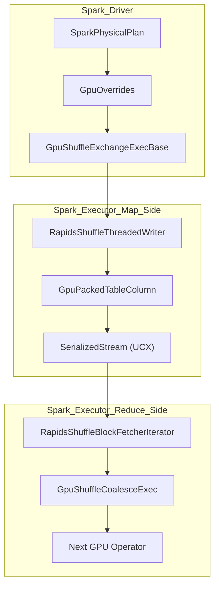
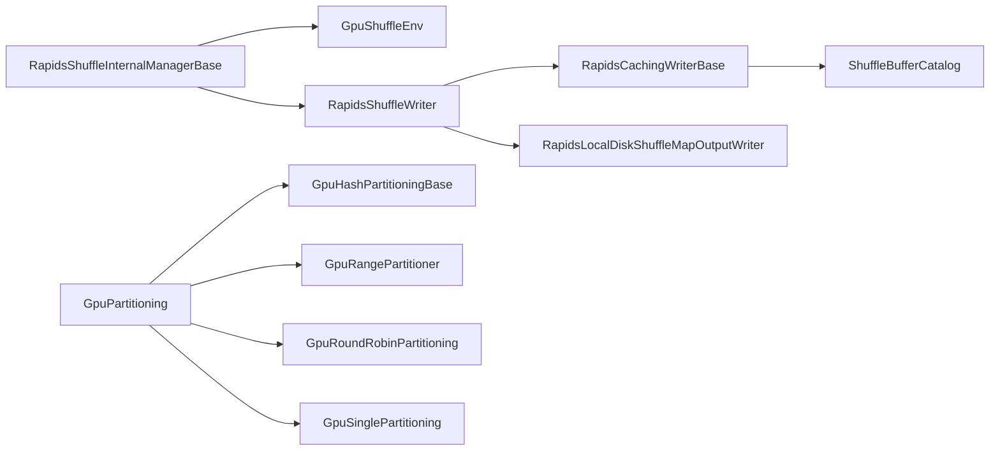

<!-- source: DeepWiki mcp.deepwiki.com · repo NVIDIA/cudf-spark · page 6 Shuffle & Data Exchange · fetched 2026-10-26 -->

# Shuffle & Data Exchange

Relevant source files

The following files were used as context for generating this wiki page:

- [sql-plugin/src/main/scala/com/nvidia/spark/rapids/ShuffleBufferCatalog.scala](sql-plugin/src/main/scala/com/nvidia/spark/rapids/ShuffleBufferCatalog.scala)
- [sql-plugin/src/main/scala/org/apache/spark/shuffle/sort/io/RapidsLocalDiskShuffleMapOutputWriter.scala](sql-plugin/src/main/scala/org/apache/spark/shuffle/sort/io/RapidsLocalDiskShuffleMapOutputWriter.scala)
- [sql-plugin/src/main/scala/org/apache/spark/sql/rapids/GpuShuffleEnv.scala](sql-plugin/src/main/scala/org/apache/spark/sql/rapids/GpuShuffleEnv.scala)
- [sql-plugin/src/main/scala/org/apache/spark/sql/rapids/RapidsShuffleInternalManagerBase.scala](sql-plugin/src/main/scala/org/apache/spark/sql/rapids/RapidsShuffleInternalManagerBase.scala)
- [sql-plugin/src/main/spark330/scala/org/apache/spark/sql/rapids/RapidsShuffleWriter.scala](sql-plugin/src/main/spark330/scala/org/apache/spark/sql/rapids/RapidsShuffleWriter.scala)
- [sql-plugin/src/main/spark350db143/scala/org/apache/spark/sql/rapids/RapidsShuffleWriter.scala](sql-plugin/src/main/spark350db143/scala/org/apache/spark/sql/rapids/RapidsShuffleWriter.scala)
- [tests/src/test/scala/com/nvidia/spark/rapids/RapidsShuffleIntegrationSuite.scala](tests/src/test/scala/com/nvidia/spark/rapids/RapidsShuffleIntegrationSuite.scala)
- [tests/src/test/scala/com/nvidia/spark/rapids/ShuffleBufferCatalogSuite.scala](tests/src/test/scala/com/nvidia/spark/rapids/ShuffleBufferCatalogSuite.scala)
- [tests/src/test/scala/com/nvidia/spark/rapids/ShuffleBufferCatalogTestUtils.scala](tests/src/test/scala/com/nvidia/spark/rapids/ShuffleBufferCatalogTestUtils.scala)
- [tests/src/test/scala/org/apache/spark/shuffle/sort/io/RapidsLocalDiskShuffleMapOutputWriterSuite.scala](tests/src/test/scala/org/apache/spark/shuffle/sort/io/RapidsLocalDiskShuffleMapOutputWriterSuite.scala)
- [tests/src/test/scala/org/apache/spark/sql/rapids/RapidsCachingWriterSuite.scala](tests/src/test/scala/org/apache/spark/sql/rapids/RapidsCachingWriterSuite.scala)
- [tests/src/test/scala/org/apache/spark/sql/rapids/spill/SpillablePartialFileHandleMetricSuite.scala](tests/src/test/scala/org/apache/spark/sql/rapids/spill/SpillablePartialFileHandleMetricSuite.scala)
- [tests/src/test/spark330/scala/org/apache/spark/sql/rapids/RapidsShuffleManagerUnregisterSuite.scala](tests/src/test/spark330/scala/org/apache/spark/sql/rapids/RapidsShuffleManagerUnregisterSuite.scala)

This page provides a high-level overview of how the RAPIDS Accelerator for Apache Spark handles data shuffling and exchange, a critical component for distributed query execution. It covers the custom `RapidsShuffleManager`, the UCX-based transport layer, GPU partitioning strategies, and columnar serialization. Deeper technical details for each of these areas are provided in linked child pages.

## GPU Shuffle Overview

The RAPIDS Accelerator replaces Spark's default shuffle mechanism with a GPU-accelerated implementation to keep data on the GPU throughout the shuffle process, minimizing costly host-device transfers. This involves a custom shuffle manager, optimized data transport, and GPU-native partitioning and serialization.

The core components of the GPU shuffle are:

- **`RapidsShuffleManager`**: The entry point for Spark to interact with the GPU-accelerated shuffle. The foundational shuffle manager logic is implemented in `RapidsShuffleInternalManagerBase`, which coordinates shuffle writing and reading with GPU-aware mechanisms [sql-plugin/src/main/scala/org/apache/spark/sql/rapids/RapidsShuffleInternalManagerBase.scala:151-154]().

- **UCX Transport**: A high-performance, GPU-aware communication protocol that enables direct data transfers between GPU devices across the network, reducing latency and CPU overhead.

- **GPU Partitioning**: Partitioning strategies like hash, range, round-robin, and single partitioning are performed natively on the GPU using the `GpuPartitioning` trait and its concrete implementations to slice and distribute data efficiently for shuffle.

- **Columnar Serialization**: Efficient columnar batch serialization, leveraging GPU-native formats such as the Kudo serialization format, facilitates high-throughput data encoding and decoding in GPU memory, minimizing serialization overhead.

- **Checksum Support**: While Spark 4.1+ introduced row-based shuffle checksums to detect non-deterministic shuffle output, this feature is not yet supported by the RAPIDS Shuffle Manager (would require GPU-side checksum computation). The `GpuShuffleEnv` checks this status via `RowBasedShuffleChecksumConf.isEnabled` [sql-plugin/src/main/scala/org/apache/spark/sql/rapids/GpuShuffleEnv.scala:148-151]().

The objective is to maximize shuffle throughput by minimizing CPU overhead, avoiding unnecessary CPU-GPU data movement, and harnessing GPU direct communication protocols.

---

### Diagram: High-Level GPU Shuffle Architecture

This diagram maps the data flow across Spark driver and executors, linking major system components to their code entities in the RAPIDS Accelerator project.

Sources:  
- [sql-plugin/src/main/scala/org/apache/spark/sql/rapids/RapidsShuffleInternalManagerBase.scala:151-154]()  
- [sql-plugin/src/main/scala/org/apache/spark/sql/rapids/GpuShuffleEnv.scala:148-151]()

---

## RapidsShuffleManager & GPU Partitioning

The `RapidsShuffleManager` is the custom Spark `ShuffleManager` implementation orchestrating GPU-accelerated shuffles. It interfaces with Spark’s shuffle API to create specialized `ShuffleWriter` and `ShuffleReader` instances that employ GPU-centric data layouts and transport [sql-plugin/src/main/scala/org/apache/spark/sql/rapids/RapidsShuffleInternalManagerBase.scala:151-154]().

GPU partitioning defines how data is divided into shuffle partitions directly on GPU memory. The central abstraction is the `GpuPartitioning` trait, with various implementations optimizing for different strategies.

The `RapidsShuffleWriter` [sql-plugin/src/main/spark350db143/scala/org/apache/spark/sql/rapids/RapidsShuffleWriter.scala:36-44]() and `RapidsCachingWriterBase` [sql-plugin/src/main/spark350db143/scala/org/apache/spark/sql/rapids/RapidsShuffleWriter.scala:91-96]() classes manage the lifecycle of shuffle writes, including tracking `ShuffleMapOutputWriter` instances for cleanup and handling `MapStatus` reporting. The `RapidsLocalDiskShuffleMapOutputWriter` [sql-plugin/src/main/scala/org/apache/spark/shuffle/sort/io/RapidsLocalDiskShuffleMapOutputWriter.scala:39-45]() is a key component for writing shuffle data, potentially to host memory first and then spilling to disk. The `ShuffleBufferCatalog` [sql-plugin/src/main/scala/com/nvidia/spark/rapids/ShuffleBufferCatalog.scala:53-54]() is used by `RapidsCachingWriterBase` to manage the buffers written to the catalog [sql-plugin/src/main/spark350db143/scala/org/apache/spark/sql/rapids/RapidsShuffleWriter.scala:108-109]().

For detailed technical coverage of the shuffle manager and GPU partitioning, including multi-threaded shuffle buffer catalogs, heartbeats, and disk-spill fallback via `RapidsLocalDiskShuffleMapOutputWriter`, refer to [RapidsShuffleManager & GPU Partitioning](#6.1).

---

### Diagram: GPU Shuffle Manager and Partitioning Code Relations

This diagram shows the primary relationships between the GPU shuffle management and partitioning code entities:

Sources:  
- [sql-plugin/src/main/scala/org/apache/spark/sql/rapids/RapidsShuffleInternalManagerBase.scala:151-154]()  
- [sql-plugin/src/main/scala/org/apache/spark/sql/rapids/GpuShuffleEnv.scala:29-50]()  
- [sql-plugin/src/main/spark350db143/scala/org/apache/spark/sql/rapids/RapidsShuffleWriter.scala:36-44]()
- [sql-plugin/src/main/spark350db143/scala/org/apache/spark/sql/rapids/RapidsShuffleWriter.scala:91-96]()
- [sql-plugin/src/main/scala/org/apache/spark/shuffle/sort/io/RapidsLocalDiskShuffleMapOutputWriter.scala:39-45]()
- [sql-plugin/src/main/scala/com/nvidia/spark/rapids/ShuffleBufferCatalog.scala:53-54]()

---

## UCX Transport & Shuffle Protocol

To minimize CPU involvement and leverage GPU-to-GPU direct communication, the RAPIDS Accelerator employs UCX (Unified Communication X) as the underlying transport protocol for shuffle data transfers.

`GpuShuffleEnv` manages internal shuffle buffer catalogs to coordinate these transfers:

- `ShuffleBufferCatalog` tracks outbound shuffle buffers currently being managed [sql-plugin/src/main/scala/com/nvidia/spark/rapids/ShuffleBufferCatalog.scala:53-54](). It supports tracking both `SpillableDeviceBufferHandle` for device-backed buffers and degenerate buffers (metadata only) [sql-plugin/src/main/scala/com/nvidia/spark/rapids/ShuffleBufferCatalog.scala:84-94](). The catalog also handles removing cached handles and closing their resources [sql-plugin/src/main/scala/com/nvidia/spark/rapids/ShuffleBufferCatalog.scala:101-129]().

- `ShuffleReceivedBufferCatalog` keeps track of inbound shuffle buffers received from remote executors [sql-plugin/src/main/scala/org/apache/spark/sql/rapids/GpuShuffleEnv.scala:31-32]().

- `MultithreadedShuffleBufferCatalog` supports an optional multi-threaded shuffle mode that buffers and merges shuffle data, commonly used when External Shuffle Service is disabled and memory limits are enforced [sql-plugin/src/main/scala/org/apache/spark/sql/rapids/GpuShuffleEnv.scala:32-33]().

The shuffle transport layer establishes communication channels using UCX-based `RapidsShuffleClient` and `RapidsShuffleServer` components, handling buffer send/receive states, metadata, compression codecs, and the FlatBuffers protocol for efficient protocol serialization [sql-plugin/src/main/scala/org/apache/spark/sql/rapids/RapidsShuffleInternalManagerBase.scala:36]().

For exhaustive protocol and transport layer details, see [UCX Transport & Shuffle Protocol](#6.2).

Sources:  
- [sql-plugin/src/main/scala/org/apache/spark/sql/rapids/GpuShuffleEnv.scala:29-50]()  
- [sql-plugin/src/main/scala/org/apache/spark/sql/rapids/RapidsShuffleInternalManagerBase.scala:36]()  
- [sql-plugin/src/main/scala/com/nvidia/spark/rapids/ShuffleBufferCatalog.scala:53-54]()
- [sql-plugin/src/main/scala/com/nvidia/spark/rapids/ShuffleBufferCatalog.scala:84-94]()
- [sql-plugin/src/main/scala/com/nvidia/spark/rapids/ShuffleBufferCatalog.scala:101-129]()

---

## Columnar Serialization & Shuffle Coalescing

The shuffle process requires efficient serialization and deserialization of GPU-resident columnar data.

- **`GpuColumnarBatchSerializer`** handles converting GPU columnar batches to/from serialized formats efficiently, often utilizing formats optimized for GPU data layouts and minimal overhead.

- **`GpuShuffleCoalesceExec`** coalesces multiple small serialized shuffle partitions into larger batches, reducing CPU overhead and improving GPU processing efficiency during downstream shuffle operations.

- Advanced asynchronous coalesce iterators and shuffle exchange executors (`GpuShuffleExchangeExecBase`, `GpuExec`) integrate with these serializers and coalescers, enabling smooth shuffle data flow and memory-safe retry semantics alongside spill and batching mechanisms.

Together, these components maximize shuffle data throughput by optimizing serialization performance and minimizing fragmentation.

---

### Diagram: Columnar Data Life Cycle in Shuffle

This diagram links conceptual data stages with the corresponding key code entities managing them:

```mermaid
graph LR
    GCV["GpuColumnVector"]
    PARTITIONING["GpuPartitioning"]
    PACKED_TABLE["GpuPackedTableColumn"]
    KUDO_SERIALIZER["GpuColumnarBatchSerializer"]
    SHUFFLE_TRANSPORT["RapidsShuffleTransport"]
    SHUFFLE_COALESCE["GpuShuffleCoalesceExec"]
    SPILLABLE_BATCH["SpillableColumnarBatch"]

    GCV --> PARTITIONING
    PARTITIONING --> PACKED_TABLE
    PACKED_TABLE --> KUDO_SERIALIZER
    KUDO_SERIALIZER --> SHUFFLE_TRANSPORT
    SHUFFLE_TRANSPORT --> SHUFFLE_COALESCE
    SHUFFLE_COALESCE --> SPILLABLE_BATCH
```

Sources:  
- [sql-plugin/src/main/scala/org/apache/spark/sql/rapids/RapidsShuffleInternalManagerBase.scala:151-154]()

For detailed insights on columnar serialization, shuffle coalescing executors, and their asynchronous processing iterators, refer to [Columnar Serialization & Shuffle Coalescing](#6.3).

---

This page serves as a parent overview bridging major shuffle and data exchange concepts to the underlying GPU-accelerated implementations. For thorough technical details, configuration, and class-level explanations, see the linked child pages:

- [RapidsShuffleManager & GPU Partitioning](#6.1)  
- [UCX Transport & Shuffle Protocol](#6.2)  
- [Columnar Serialization & Shuffle Coalescing](#6.3)

---

