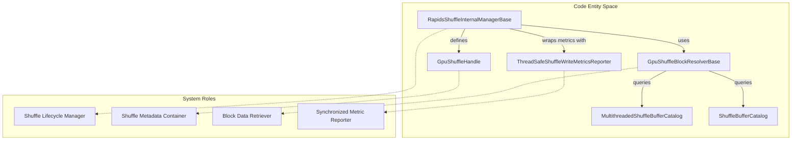
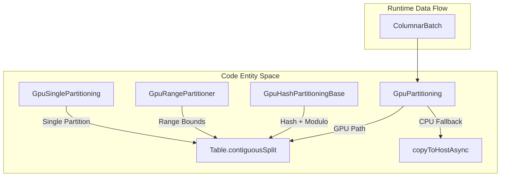
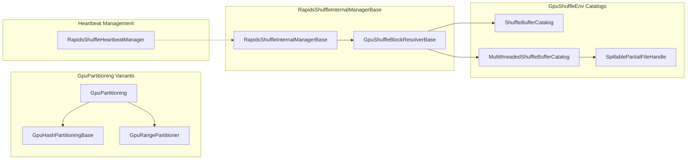

<!-- source: DeepWiki mcp.deepwiki.com · repo NVIDIA/cudf-spark · page 6.1 RapidsShuffleManager & GPU Partitioning · fetched 2026-10-26 -->

# RapidsShuffleManager & GPU Partitioning

Relevant source files

The following files were used as context for generating this wiki page:

- [docs/design/rapids_shuffle_manager_v2_phase1_design.md](docs/design/rapids_shuffle_manager_v2_phase1_design.md)
- [docs/design/rapids_shuffle_manager_v2_phase2_design.md](docs/design/rapids_shuffle_manager_v2_phase2_design.md)
- [docs/dev/shuffle-metrics.md](docs/dev/shuffle-metrics.md)
- [integration_tests/src/main/python/repart_test.py](integration_tests/src/main/python/repart_test.py)
- [integration_tests/src/main/python/sort_test.py](integration_tests/src/main/python/sort_test.py)
- [sql-plugin-api/src/main/scala/com/nvidia/spark/rapids/GpuKryoRegistrator.scala](sql-plugin-api/src/main/scala/com/nvidia/spark/rapids/GpuKryoRegistrator.scala)
- [sql-plugin-api/src/main/scala/com/nvidia/spark/rapids/RapidsShuffleHeartbeatHandler.scala](sql-plugin-api/src/main/scala/com/nvidia/spark/rapids/RapidsShuffleHeartbeatHandler.scala)
- [sql-plugin/src/main/scala/com/nvidia/spark/rapids/GpuPartitioning.scala](sql-plugin/src/main/scala/com/nvidia/spark/rapids/GpuPartitioning.scala)
- [sql-plugin/src/main/scala/com/nvidia/spark/rapids/MultithreadedShuffleBufferCatalog.scala](sql-plugin/src/main/scala/com/nvidia/spark/rapids/MultithreadedShuffleBufferCatalog.scala)
- [sql-plugin/src/main/scala/com/nvidia/spark/rapids/RapidsShuffleHeartbeatManager.scala](sql-plugin/src/main/scala/com/nvidia/spark/rapids/RapidsShuffleHeartbeatManager.scala)
- [sql-plugin/src/main/scala/com/nvidia/spark/rapids/ShuffleBufferCatalog.scala](sql-plugin/src/main/scala/com/nvidia/spark/rapids/ShuffleBufferCatalog.scala)
- [sql-plugin/src/main/scala/com/nvidia/spark/rapids/ShuffleCleanupEndpoint.scala](sql-plugin/src/main/scala/com/nvidia/spark/rapids/ShuffleCleanupEndpoint.scala)
- [sql-plugin/src/main/scala/com/nvidia/spark/rapids/ShuffleCleanupManager.scala](sql-plugin/src/main/scala/com/nvidia/spark/rapids/ShuffleCleanupManager.scala)
- [sql-plugin/src/main/scala/com/nvidia/spark/rapids/sparkRapidsListeners.scala](sql-plugin/src/main/scala/com/nvidia/spark/rapids/sparkRapidsListeners.scala)
- [sql-plugin/src/main/scala/com/nvidia/spark/rapids/spill/SpillablePartialFileHandle.scala](sql-plugin/src/main/scala/com/nvidia/spark/rapids/spill/SpillablePartialFileHandle.scala)
- [sql-plugin/src/main/scala/org/apache/spark/shuffle/sort/io/RapidsLocalDiskShuffleMapOutputWriter.scala](sql-plugin/src/main/scala/org/apache/spark/shuffle/sort/io/RapidsLocalDiskShuffleMapOutputWriter.scala)
- [sql-plugin/src/main/scala/org/apache/spark/sql/rapids/GpuShuffleEnv.scala](sql-plugin/src/main/scala/org/apache/spark/sql/rapids/GpuShuffleEnv.scala)
- [sql-plugin/src/main/scala/org/apache/spark/sql/rapids/RapidsShuffleInternalManagerBase.scala](sql-plugin/src/main/scala/org/apache/spark/sql/rapids/RapidsShuffleInternalManagerBase.scala)
- [sql-plugin/src/main/spark330/scala/org/apache/spark/sql/rapids/RapidsShuffleWriter.scala](sql-plugin/src/main/spark330/scala/org/apache/spark/sql/rapids/RapidsShuffleWriter.scala)
- [sql-plugin/src/main/spark350db143/scala/org/apache/spark/sql/rapids/RapidsShuffleWriter.scala](sql-plugin/src/main/spark350db143/scala/org/apache/spark/sql/rapids/RapidsShuffleWriter.scala)
- [sql-plugin/src/test/scala/com/nvidia/spark/rapids/MultiSegmentFileRegionSuite.scala](sql-plugin/src/test/scala/com/nvidia/spark/rapids/MultiSegmentFileRegionSuite.scala)
- [tests/src/test/scala/com/nvidia/spark/rapids/GpuPartitioningSuite.scala](tests/src/test/scala/com/nvidia/spark/rapids/GpuPartitioningSuite.scala)
- [tests/src/test/scala/com/nvidia/spark/rapids/GpuSinglePartitioningSuite.scala](tests/src/test/scala/com/nvidia/spark/rapids/GpuSinglePartitioningSuite.scala)
- [tests/src/test/scala/com/nvidia/spark/rapids/MultithreadedShuffleBufferCatalogSuite.scala](tests/src/test/scala/com/nvidia/spark/rapids/MultithreadedShuffleBufferCatalogSuite.scala)
- [tests/src/test/scala/com/nvidia/spark/rapids/RapidsShuffleIntegrationSuite.scala](tests/src/test/scala/com/nvidia/spark/rapids/RapidsShuffleIntegrationSuite.scala)
- [tests/src/test/scala/com/nvidia/spark/rapids/ShuffleBufferCatalogSuite.scala](tests/src/test/scala/com/nvidia/spark/rapids/ShuffleBufferCatalogSuite.scala)
- [tests/src/test/scala/com/nvidia/spark/rapids/ShuffleBufferCatalogTestUtils.scala](tests/src/test/scala/com/nvidia/spark/rapids/ShuffleBufferCatalogTestUtils.scala)
- [tests/src/test/scala/com/nvidia/spark/rapids/TestUtils.scala](tests/src/test/scala/com/nvidia/spark/rapids/TestUtils.scala)
- [tests/src/test/scala/com/nvidia/spark/rapids/spill/SpillablePartialFileHandleSuite.scala](tests/src/test/scala/com/nvidia/spark/rapids/spill/SpillablePartialFileHandleSuite.scala)
- [tests/src/test/scala/org/apache/spark/shuffle/sort/io/RapidsLocalDiskShuffleMapOutputWriterSuite.scala](tests/src/test/scala/org/apache/spark/shuffle/sort/io/RapidsLocalDiskShuffleMapOutputWriterSuite.scala)
- [tests/src/test/scala/org/apache/spark/sql/rapids/RapidsCachingWriterSuite.scala](tests/src/test/scala/org/apache/spark/sql/rapids/RapidsCachingWriterSuite.scala)
- [tests/src/test/scala/org/apache/spark/sql/rapids/spill/SpillablePartialFileHandleMetricSuite.scala](tests/src/test/scala/org/apache/spark/sql/rapids/spill/SpillablePartialFileHandleMetricSuite.scala)
- [tests/src/test/spark330/scala/org/apache/spark/sql/rapids/RapidsShuffleManagerUnregisterSuite.scala](tests/src/test/spark330/scala/org/apache/spark/sql/rapids/RapidsShuffleManagerUnregisterSuite.scala)
- [tests/src/test/spark330/scala/org/apache/spark/sql/rapids/RapidsShuffleThreadedReaderSuite.scala](tests/src/test/spark330/scala/org/apache/spark/sql/rapids/RapidsShuffleThreadedReaderSuite.scala)
- [tests/src/test/spark330/scala/org/apache/spark/sql/rapids/RapidsShuffleThreadedWriterSuite.scala](tests/src/test/spark330/scala/org/apache/spark/sql/rapids/RapidsShuffleThreadedWriterSuite.scala)

This wiki page covers the technical architecture and implementation details of GPU-accelerated shuffle management within the RAPIDS Accelerator for Apache Spark. It details the core shuffle management base (`RapidsShuffleInternalManagerBase`), the runtime shuffle environment (`GpuShuffleEnv`), GPU device and memory management, GPU partitioning mechanisms (`GpuPartitioning` trait and its variants), multithreaded shuffle buffer catalogs, and liveness heartbeats that track shuffle executor status.

---

## RapidsShuffleInternalManagerBase & Block Resolution

`RapidsShuffleInternalManagerBase` is an abstract base class providing common infrastructure for GPU-accelerated shuffle managers extending Spark's shuffle manager interface [sql-plugin/src/main/scala/org/apache/spark/sql/rapids/RapidsShuffleInternalManagerBase.scala:57-149]().

Key architectural components:
- **`GpuShuffleHandle`**: Encapsulates Spark's native `ShuffleHandle` along with `GpuShuffleDependency` references [sql-plugin/src/main/scala/org/apache/spark/sql/rapids/RapidsShuffleInternalManagerBase.scala:56-62]().
- **`GpuShuffleBlockResolverBase`**: Extends Spark's `ShuffleBlockResolver` to intercept block retrieval requests (`getBlockData`), checking `MultithreadedShuffleBufferCatalog` or active in-memory catalogs before falling back to local disk resolvers [sql-plugin/src/main/scala/org/apache/spark/sql/rapids/RapidsShuffleInternalManagerBase.scala:71-118]().
- **`ThreadSafeShuffleWriteMetricsReporter`**: Wraps Spark's thread-unsafe shuffle write accumulators with synchronization primitives to safely record metrics across concurrent threads [sql-plugin/src/main/scala/org/apache/spark/sql/rapids/RapidsShuffleInternalManagerBase.scala:126-148]().

*Diagram: RapidsShuffleInternalManager Architecture Mapping*

Sources:
* [sql-plugin/src/main/scala/org/apache/spark/sql/rapids/RapidsShuffleInternalManagerBase.scala:57-149]()

---

## GpuShuffleEnv & Catalogs

`GpuShuffleEnv` manages the initialization, reference retention, and lifecycle for GPU shuffle catalogs, codecs, and environment configurations [sql-plugin/src/main/scala/org/apache/spark/sql/rapids/GpuShuffleEnv.scala:29-92]().

### Initialization and Catalogs

When `GpuShuffleEnv.init()` is invoked, if the RAPIDS shuffle manager is active (`spark.shuffle.manager` matches `RAPIDS_SHUFFLE_CLASS`), it sets up [sql-plugin/src/main/scala/org/apache/spark/sql/rapids/GpuShuffleEnv.scala:50-78]():
1. **`ShuffleBufferCatalog`**: Tracks active shuffle buffers for UCX and cache-only transport modes [sql-plugin/src/main/scala/org/apache/spark/sql/rapids/GpuShuffleEnv.scala:52-53]().
2. **`ShuffleReceivedBufferCatalog`**: Tracks shuffle blocks received during shuffle fetch [sql-plugin/src/main/scala/org/apache/spark/sql/rapids/GpuShuffleEnv.scala:54-55]().
3. **`MultithreadedShuffleBufferCatalog`**: Conditionally enabled when skip-merge is configured, the External Shuffle Service (ESS) is disabled, and off-heap memory limits are active [sql-plugin/src/main/scala/org/apache/spark/sql/rapids/GpuShuffleEnv.scala:60-76]().

### Configuration and Verification Checks
- **`rapidsShuffleCodec`**: Instantiates a `TableCompressionCodec` (e.g., LZ4, ZSTD) based on configuration properties [sql-plugin/src/main/scala/org/apache/spark/sql/rapids/GpuShuffleEnv.scala:40-48]().
- **`isRowBasedChecksumEnabled`**: Detects whether Spark 4.1+ order-independent row-based checksums are enabled, which require CPU fallback since they are not natively accelerated on the GPU [sql-plugin/src/main/scala/org/apache/spark/sql/rapids/GpuShuffleEnv.scala:148-151]().

Sources:
* [sql-plugin/src/main/scala/org/apache/spark/sql/rapids/GpuShuffleEnv.scala:29-151]()

---

## GPU Partitioning Variants

GPU shuffle partitioning is implemented via the `GpuPartitioning` trait and concrete partitioner subclasses [com/nvidia/spark/rapids/GpuPartitioning.scala:33-102]().

### Overview of Slicing Execution

The `GpuPartitioning` trait supports two primary slicing paths [com/nvidia/spark/rapids/GpuPartitioning.scala:33-148]():
- **`sliceInternalOnGpuAndClose`**: Evaluates batch partition columns using cuDF's `contiguousSplit` method, producing zero-copy contiguous memory blocks on device memory [com/nvidia/spark/rapids/GpuPartitioning.scala:70-95]().
- **`sliceInternalOnCpuAndClose`**: Asynchronously copies columnar buffers to host memory via `copyToHostAsync` and partitions them on the CPU host when GPU slicing is bypassed [com/nvidia/spark/rapids/GpuPartitioning.scala:127-148]().

### Partitioning Implementations
- **`GpuHashPartitioningBase`**: Evaluates hash expressions (Murmur3 or Hive hash) and applies modulo arithmetic on the GPU to route rows into partition buckets [sql-plugin/src/main/scala/org/apache/spark/sql/rapids/GpuHashPartitioningBase.scala:74-135]().
- **`GpuRangePartitioner`**: Collects sample keys using reservoir sampling and determines partition boundary splits for ordered sorting [com/nvidia/spark/rapids/GpuRangePartitioner.scala:34-164]().
- **`GpuSinglePartitioning`**: Avoids partitioning overhead entirely when a single output partition is required.

*Diagram: GPU Partitioning Code Entity Mapping*

Sources:
* [com/nvidia/spark/rapids/GpuPartitioning.scala:33-148]()
* [com/nvidia/spark/rapids/GpuRangePartitioner.scala:34-164]()
* [sql-plugin/src/main/scala/org/apache/spark/sql/rapids/GpuHashPartitioningBase.scala:74-135]()

---

## Multithreaded Shuffle Buffer Catalogs & SpillablePartialFileHandle

### MultithreadedShuffleBufferCatalog & MapOutputSegments
`MultithreadedShuffleBufferCatalog` caches shuffle buffers in host off-heap memory to support concurrent multithreaded readers without hitting local disk [com/nvidia/spark/rapids/MultithreadedShuffleBufferCatalog.scala:36-188](). `MapOutputSegments` groups a map task's output by reduce partition IDs, enabling direct binary search retrieval of partition byte ranges [com/nvidia/spark/rapids/MultithreadedShuffleBufferCatalog.scala:127-162]().

### SpillablePartialFileHandle
`SpillablePartialFileHandle` provides a unified spillable buffer abstraction that transparently transitions between host memory buffers (`HOST_MEMORY`) and local spill files (`FILE_ONLY`) based on memory usage thresholds and allocation capacity limits [com/nvidia/spark/rapids/spill/SpillablePartialFileHandle.scala:75-145](). It tracks active read leases (`ShuffleHandleLease`) to defer physical file or buffer closure until all concurrent shuffle network reads have completed [com/nvidia/spark/rapids/MultithreadedShuffleBufferCatalog.scala:55-70]().

Sources:
* [com/nvidia/spark/rapids/MultithreadedShuffleBufferCatalog.scala:36-188]()
* [com/nvidia/spark/rapids/spill/SpillablePartialFileHandle.scala:75-145]()

---

## Shuffle Heartbeats & Executor Liveness

`RapidsShuffleHeartbeatManager` runs on the driver to track liveness and registration state for shuffle executors engaged in early-start shuffle transport [sql-plugin/src/main/scala/org/apache/spark/sql/rapids/RapidsShuffleHeartbeatManager.scala:33-94]().

Key functions:
- **`registerExecutor`**: Handles incoming executor registrations, assigns monotonically increasing registration order tokens, and returns active peer executor lists [sql-plugin/src/main/scala/org/apache/spark/sql/rapids/RapidsShuffleHeartbeatManager.scala:80-94]().
- **`executorHeartbeat`**: Processes periodic heartbeats from executors, updates minimum priority heaps tracking the least recently heartbeating peers, and evicts stale executors that exceed timeout thresholds [sql-plugin/src/main/scala/org/apache/spark/sql/rapids/RapidsShuffleHeartbeatManager.scala:101-137]().

Sources:
* [sql-plugin/src/main/scala/org/apache/spark/sql/rapids/RapidsShuffleHeartbeatManager.scala:33-137]()

---

# Summary Overview Diagram

*Diagram: System Components & Interactions in RAPIDS Shuffle Manager*

Sources:
* [sql-plugin/src/main/scala/org/apache/spark/sql/rapids/RapidsShuffleInternalManagerBase.scala:57-149]()
* [sql-plugin/src/main/scala/org/apache/spark/sql/rapids/GpuShuffleEnv.scala:29-151]()
* [com/nvidia/spark/rapids/GpuPartitioning.scala:33-148]()
* [com/nvidia/spark/rapids/MultithreadedShuffleBufferCatalog.scala:36-188]()
* [sql-plugin/src/main/scala/org/apache/spark/sql/rapids/RapidsShuffleHeartbeatManager.scala:33-137]()

---

