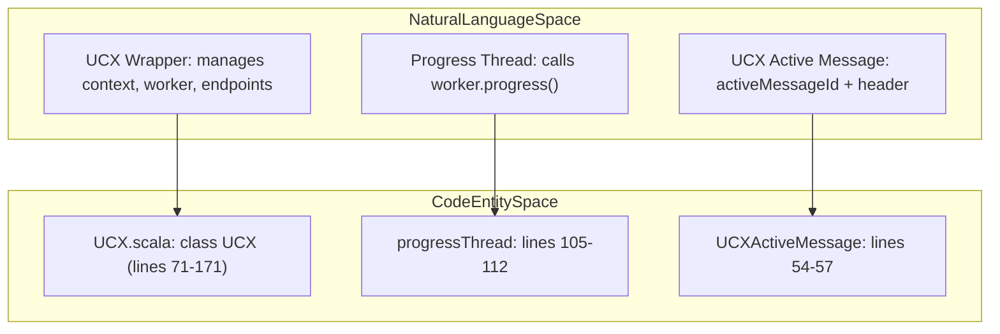
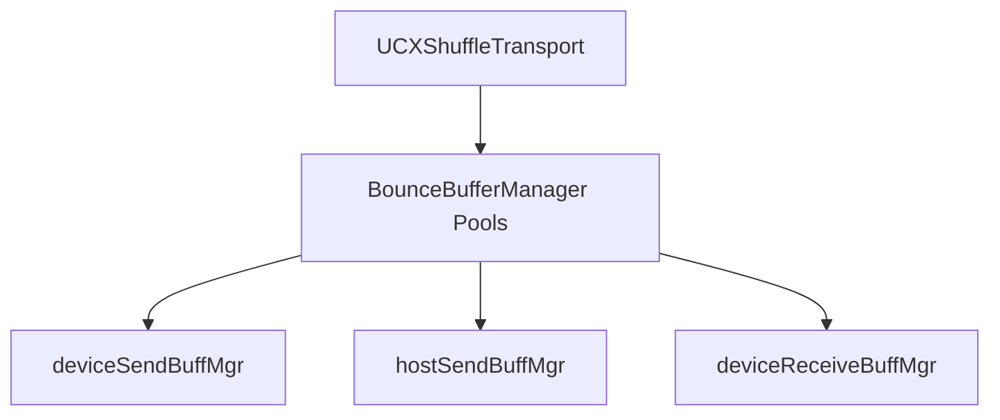
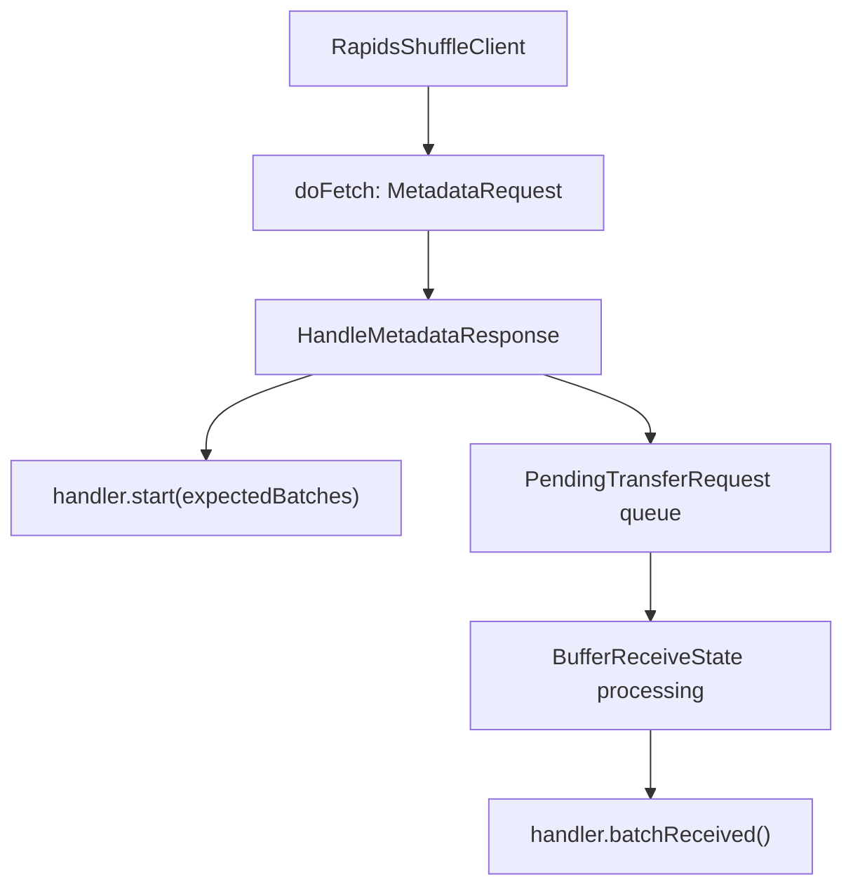
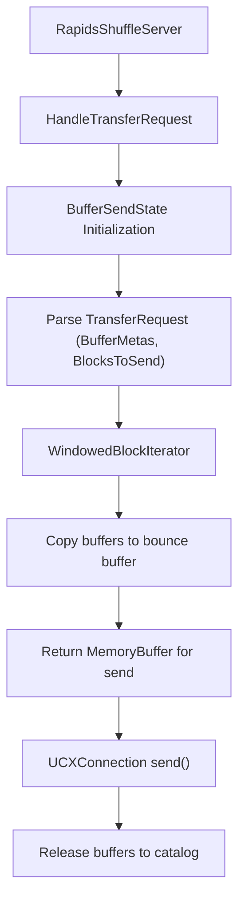
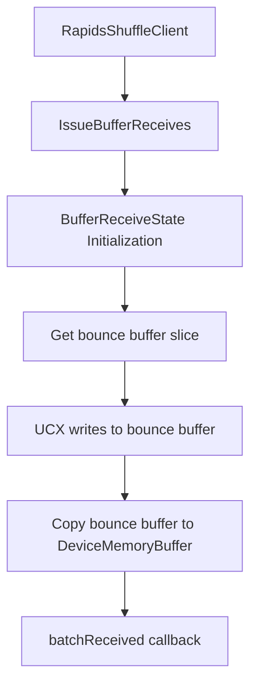
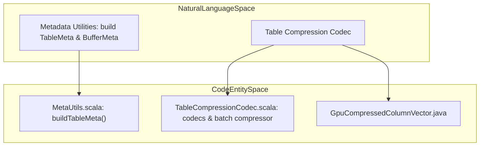

<!-- source: DeepWiki mcp.deepwiki.com · repo NVIDIA/cudf-spark · page 6.2 UCX Transport & Shuffle Protocol · fetched 2026-10-26 -->

# UCX Transport & Shuffle Protocol

Relevant source files

The following files were used as context for generating this wiki page:

- [shuffle-plugin/src/main/scala/com/nvidia/spark/rapids/shuffle/ucx/UCX.scala](shuffle-plugin/src/main/scala/com/nvidia/spark/rapids/shuffle/ucx/UCX.scala)
- [shuffle-plugin/src/main/scala/com/nvidia/spark/rapids/shuffle/ucx/UCXConnection.scala](shuffle-plugin/src/main/scala/com/nvidia/spark/rapids/shuffle/ucx/UCXConnection.scala)
- [shuffle-plugin/src/main/scala/com/nvidia/spark/rapids/shuffle/ucx/UCXShuffleTransport.scala](shuffle-plugin/src/main/scala/com/nvidia/spark/rapids/shuffle/ucx/UCXShuffleTransport.scala)
- [shuffle-plugin/src/main/scala/com/nvidia/spark/rapids/shuffle/ucx/UCXTransaction.scala](shuffle-plugin/src/main/scala/com/nvidia/spark/rapids/shuffle/ucx/UCXTransaction.scala)
- [sql-plugin-columnar/src/main/scala/org/apache/spark/shuffle/rapids/RapidsShuffleExceptions.scala](sql-plugin-columnar/src/main/scala/org/apache/spark/shuffle/rapids/RapidsShuffleExceptions.scala)
- [sql-plugin/src/main/format/ShuffleCommon.fbs](sql-plugin/src/main/format/ShuffleCommon.fbs)
- [sql-plugin/src/main/format/ShuffleTransferRequest.fbs](sql-plugin/src/main/format/ShuffleTransferRequest.fbs)
- [sql-plugin/src/main/java/com/nvidia/spark/rapids/GpuColumnVectorFromBuffer.java](sql-plugin/src/main/java/com/nvidia/spark/rapids/GpuColumnVectorFromBuffer.java)
- [sql-plugin/src/main/java/com/nvidia/spark/rapids/GpuCompressedColumnVector.java](sql-plugin/src/main/java/com/nvidia/spark/rapids/GpuCompressedColumnVector.java)
- [sql-plugin/src/main/scala/com/nvidia/spark/rapids/CopyCompressionCodec.scala](sql-plugin/src/main/scala/com/nvidia/spark/rapids/CopyCompressionCodec.scala)
- [sql-plugin/src/main/scala/com/nvidia/spark/rapids/MetaUtils.scala](sql-plugin/src/main/scala/com/nvidia/spark/rapids/MetaUtils.scala)
- [sql-plugin/src/main/scala/com/nvidia/spark/rapids/NvcompLZ4CompressionCodec.scala](sql-plugin/src/main/scala/com/nvidia/spark/rapids/NvcompLZ4CompressionCodec.scala)
- [sql-plugin/src/main/scala/com/nvidia/spark/rapids/NvcompZSTDCompressionCodec.scala](sql-plugin/src/main/scala/com/nvidia/spark/rapids/NvcompZSTDCompressionCodec.scala)
- [sql-plugin/src/main/scala/com/nvidia/spark/rapids/TableCompressionCodec.scala](sql-plugin/src/main/scala/com/nvidia/spark/rapids/TableCompressionCodec.scala)
- [sql-plugin/src/main/scala/com/nvidia/spark/rapids/shuffle/BounceBufferManager.scala](sql-plugin/src/main/scala/com/nvidia/spark/rapids/shuffle/BounceBufferManager.scala)
- [sql-plugin/src/main/scala/com/nvidia/spark/rapids/shuffle/BufferSendState.scala](sql-plugin/src/main/scala/com/nvidia/spark/rapids/shuffle/BufferSendState.scala)
- [sql-plugin/src/main/scala/com/nvidia/spark/rapids/shuffle/RapidsShuffleClient.scala](sql-plugin/src/main/scala/com/nvidia/spark/rapids/shuffle/RapidsShuffleClient.scala)
- [sql-plugin/src/main/scala/com/nvidia/spark/rapids/shuffle/RapidsShuffleServer.scala](sql-plugin/src/main/scala/com/nvidia/spark/rapids/shuffle/RapidsShuffleServer.scala)
- [sql-plugin/src/main/scala/com/nvidia/spark/rapids/shuffle/RapidsShuffleTransport.scala](sql-plugin/src/main/scala/com/nvidia/spark/rapids/shuffle/RapidsShuffleTransport.scala)
- [tests/src/test/scala/com/nvidia/spark/rapids/MetaUtilsSuite.scala](tests/src/test/scala/com/nvidia/spark/rapids/MetaUtilsSuite.scala)
- [tests/src/test/scala/com/nvidia/spark/rapids/shuffle/RapidsShuffleClientSuite.scala](tests/src/test/scala/com/nvidia/spark/rapids/shuffle/RapidsShuffleClientSuite.scala)
- [tests/src/test/scala/com/nvidia/spark/rapids/shuffle/RapidsShuffleIteratorSuite.scala](tests/src/test/scala/com/nvidia/spark/rapids/shuffle/RapidsShuffleIteratorSuite.scala)
- [tests/src/test/scala/com/nvidia/spark/rapids/shuffle/RapidsShuffleServerSuite.scala](tests/src/test/scala/com/nvidia/spark/rapids/shuffle/RapidsShuffleServerSuite.scala)
- [tests/src/test/scala/com/nvidia/spark/rapids/shuffle/ShuffleBufferLifetimeSuite.scala](tests/src/test/scala/com/nvidia/spark/rapids/shuffle/ShuffleBufferLifetimeSuite.scala)

## Purpose and Scope
This page provides an in-depth technical overview of the UCX-based shuffle transport within the RAPIDS Accelerator for Apache Spark project. Section 6.2 specifically covers the UCX interconnect integration (`UCX` class), the transport implementation (`UCXShuffleTransport`), client-server coordination (`RapidsShuffleClient` and `RapidsShuffleServer`), transfer state management (`BufferSendState` and `BufferReceiveState`), metadata utilities and GPU compression codecs, and the FlatBuffers protocol underlying shuffle metadata and buffer transfers.

---

## UCX Integration

### Overview

The `UCX` class encapsulates the Java UCX (JUCX) library and oversees peer-to-peer communication for shuffle data exchange [shuffle-plugin/src/main/scala/com/nvidia/spark/rapids/shuffle/ucx/UCX.scala:71-72](). It initializes the UCX context (`UcpContext`) and a worker (`UcpWorker`) that drives asynchronous communication progress [shuffle-plugin/src/main/scala/com/nvidia/spark/rapids/shuffle/ucx/UCX.scala:74-95](). It holds a map of endpoints (`UcpEndpointManager`) connecting to peers and manages a dedicated progress thread to continuously invoke `worker.progress()`, ensuring non-blocking operations advancement [shuffle-plugin/src/main/scala/com/nvidia/spark/rapids/shuffle/ucx/UCX.scala:95-168]().

Initialization uses parameters configured from `RapidsConf` to enable features such as tagged messaging and optional wakeup support for event-driven processing [shuffle-plugin/src/main/scala/com/nvidia/spark/rapids/shuffle/ucx/UCX.scala:74-82](). The local executor is identified by `BlockManagerId.executorId` [shuffle-plugin/src/main/scala/com/nvidia/spark/rapids/shuffle/ucx/UCX.scala:86](). For peer endpoint connections, UCX uses auxiliary TCP-based management connections allowing handshake and port discovery apart from the UCX transport, with port information shared via the Spark `BlockManagerId` topology property.

### UCX Active Messages

The communication relies on UCX Active Messages, represented by the `UCXActiveMessage` case class, combining a fire-and-forget `activeMessageId` with a modifiable `header` long value encoding transaction and executor identification [shuffle-plugin/src/main/scala/com/nvidia/spark/rapids/shuffle/ucx/UCX.scala:54-57](). This allows requests to be tracked and echoed back upon completion.

### Memory Registration and Bounce Buffers

Since UCX requires memory registrations for zero-copy RDMA transfers, the `UCX` class tracks active registered buffers to ensure proper deregistration upon shutdown [shuffle-plugin/src/main/scala/com/nvidia/spark/rapids/shuffle/ucx/UCX.scala:121](). This is critical to manage pinned GPU and host memory safely.

The UCX integration collaborates closely with bounce buffers — pre-allocated, registered memory buffers in either device or host space — to facilitate data copying during shuffle transfers, minimizing registration overhead and improving throughput.

---

### UCX Integration: Natural Language to Code Mapping

Sources:  
* [shuffle-plugin/src/main/scala/com/nvidia/spark/rapids/shuffle/ucx/UCX.scala:54-57,71-171]()  
* [shuffle-plugin/src/main/scala/com/nvidia/spark/rapids/shuffle/ucx/UCXShuffleTransport.scala:71-90]()

---

## UCXShuffleTransport

### Overview

`UCXShuffleTransport` implements the `RapidsShuffleTransport` trait for UCX-based shuffle networking [shuffle-plugin/src/main/scala/com/nvidia/spark/rapids/shuffle/ucx/UCXShuffleTransport.scala:49-51](). It instantiates a single `RapidsShuffleServer` for the local executor and manages multiple `RapidsShuffleClient` instances for connecting to remote peers [shuffle-plugin/src/main/scala/com/nvidia/spark/rapids/shuffle/ucx/UCXShuffleTransport.scala:69]().

UCX transport manages the lifecycle of bounce buffers allocated in device and host memory:

- `deviceSendBuffMgr`: Device buffers used on the send path [shuffle-plugin/src/main/scala/com/nvidia/spark/rapids/shuffle/ucx/UCXShuffleTransport.scala:65]().
- `deviceReceiveBuffMgr`: Device buffers for receiving incoming data [shuffle-plugin/src/main/scala/com/nvidia/spark/rapids/shuffle/ucx/UCXShuffleTransport.scala:67]().
- `hostSendBuffMgr`: Host memory buffers used primarily for spilled batches [shuffle-plugin/src/main/scala/com/nvidia/spark/rapids/shuffle/ucx/UCXShuffleTransport.scala:66]().

This layered bounce buffer management avoids repeated memory pinning and registration overhead while facilitating large shuffle transfers.

### In-flight Byte Throttling & Metadata Pool

`UCXShuffleTransport` maintains a limit on the volume of data in flight (`inflightLimit`) to guard against GPU Out-Of-Memory errors [shuffle-plugin/src/main/scala/com/nvidia/spark/rapids/shuffle/ucx/UCXShuffleTransport.scala:53-54](). Requests exceeding this limit queue in a priority queue (`altList`) sorted by transfer size [shuffle-plugin/src/main/scala/com/nvidia/spark/rapids/shuffle/ucx/UCXShuffleTransport.scala:93-97]().

A dedicated `shuffleMetadataPool` holds direct `ByteBuffer` instances to efficiently reuse buffers for small FlatBuffers metadata messages describing shuffle batches [shuffle-plugin/src/main/scala/com/nvidia/spark/rapids/shuffle/ucx/UCXShuffleTransport.scala:58-59](). 

### Additional Features

- Early memory registration of device and host bounce buffers on transport initialization [shuffle-plugin/src/main/scala/com/nvidia/spark/rapids/shuffle/ucx/UCXShuffleTransport.scala:79-90]().
- Wrapping thread factories with device association management for UCX progress threads to avoid memory leaks.

---

### Bounce Buffer Management Diagram

Sources:  
* [shuffle-plugin/src/main/scala/com/nvidia/spark/rapids/shuffle/ucx/UCXShuffleTransport.scala:49-162]()  
* [shuffle-plugin/src/main/scala/com/nvidia/spark/rapids/shuffle/ucx/UCXShuffleTransport.scala:129-163]()

---

## UCXConnection & Transaction Management

`UCXConnection` implements both client (`ClientConnection`) and server (`ServerConnection`) interfaces for UCX transport.

### Client Side

It manages a `UcpEndpoint` per peer, issues requests, and receives replies wrapped as `UCXTransaction` objects. This supports asynchronous and callback-based shuffle data exchanges.

### Server Side

It manages a management TCP port per executor, accepting incoming connection requests and handling registered message callbacks triggered on receiving various message types (e.g., metadata and transfer requests). It integrates with the Spark shuffle components for channel lifecycle and error handling.

Sources:  
* [shuffle-plugin/src/main/scala/com/nvidia/spark/rapids/shuffle/ucx/UCXConnection.scala]()  
* [shuffle-plugin/src/main/scala/com/nvidia/spark/rapids/shuffle/ucx/UCXTransaction.scala]()  
* [sql-plugin/src/main/scala/com/nvidia/spark/rapids/shuffle/RapidsShuffleTransport.scala:30-32]()

---

## RapidsShuffleClient

The `RapidsShuffleClient` class coordinates client-side fetches of shuffle data from remote executors [sql-plugin/src/main/scala/com/nvidia/spark/rapids/shuffle/RapidsShuffleClient.scala:95-100]().

### Fetch Operations

- `doFetch(shuffleRequests, handler)` issues a `MetadataRequest` for a sequence of `ShuffleBlockBatchId`s to a remote `ClientConnection`.
- Upon receiving a `MetadataResponse` message, it parses and invokes `handler.start(expectedBatches)` indicating the number of batches expected [sql-plugin/src/main/scala/com/nvidia/spark/rapids/shuffle/RapidsShuffleClient.scala:36-41]().
- It creates a collection of `PendingTransferRequest`s, each corresponding to individual buffers to fetch, and queues them in the transport for scheduling [sql-plugin/src/main/scala/com/nvidia/spark/rapids/shuffle/RapidsShuffleClient.scala:73-77]().

### Buffer Receives

- Buffer data responses are tracked through `BufferReceiveState` objects that manage flows of large GPU buffers [sql-plugin/src/main/scala/com/nvidia/spark/rapids/shuffle/RapidsShuffleClient.scala:122-125]().
- Upon receiving a complete buffer, the client invokes `batchReceived(handle: RapidsShuffleHandle)` on the fetch handler, notifying that a batch is available [sql-plugin/src/main/scala/com/nvidia/spark/rapids/shuffle/RapidsShuffleClient.scala:43-49]().
- Errors and cancellations are propagated via `transferError` [sql-plugin/src/main/scala/com/nvidia/spark/rapids/shuffle/RapidsShuffleClient.scala:50-58]().

---

### RapidsShuffleClient Data Flow Diagram

Sources:  
* [sql-plugin/src/main/scala/com/nvidia/spark/rapids/shuffle/RapidsShuffleClient.scala:36-64, 95-171]()  
* [sql-plugin/src/main/scala/com/nvidia/spark/rapids/shuffle/RapidsShuffleClient.scala:114-135]()

---

## RapidsShuffleServer

The server-side shuffle logic resides in `RapidsShuffleServer` [sql-plugin/src/main/scala/com/nvidia/spark/rapids/shuffle/RapidsShuffleServer.scala:73-79]().

### Responsibilities

- Listens for incoming metadata and transfer requests on the management TCP port [sql-plugin/src/main/scala/com/nvidia/spark/rapids/shuffle/RapidsShuffleServer.scala:160-166]().
- Queries the `RapidsShuffleRequestHandler` to obtain shuffle block metadata (`TableMeta`) and acquire buffer handles for data transfer [sql-plugin/src/main/scala/com/nvidia/spark/rapids/shuffle/RapidsShuffleServer.scala:39-54]().
- Manages the sending of shuffle buffers to clients using a CUDA stream for device-to-device copies via `BufferSendState` [sql-plugin/src/main/scala/com/nvidia/spark/rapids/shuffle/RapidsShuffleServer.scala:54-78]().
- Coordinates bounce buffer availability via a thread pool executor (`bssExec`) to handle buffer sends efficiently [sql-plugin/src/main/scala/com/nvidia/spark/rapids/shuffle/RapidsShuffleServer.scala:78]().

### Lifecycle

- `start()` binds the server’s management port and registers callbacks for message types `MessageType.MetadataRequest` and `MessageType.TransferRequest` [sql-plugin/src/main/scala/com/nvidia/spark/rapids/shuffle/RapidsShuffleServer.scala:160-166]().
- Upon `TransferRequest`, it creates one or more `BufferSendState` instances representing the stateful transmission of shuffle batch buffers [sql-plugin/src/main/scala/com/nvidia/spark/rapids/shuffle/RapidsShuffleServer.scala:133-138]().
- Implements OOM retry with timeout and exponential backoff controlled via `oomRetryTimeoutNanos` and `oomRetryBackoffMillis` [sql-plugin/src/main/scala/com/nvidia/spark/rapids/shuffle/RapidsShuffleServer.scala:131-141]().

---

## BufferSendState

This class encapsulates the server-side transfer state of shuffle buffers for an active shuffle `Transaction` [sql-plugin/src/main/scala/com/nvidia/spark/rapids/shuffle/BufferSendState.scala:54-59]().

### Key Functionalities

- Parses the `TransferRequest` FlatBuffer to identify which buffers to send and their metadata [sql-plugin/src/main/scala/com/nvidia/spark/rapids/shuffle/BufferSendState.scala:81-95]().
- Iterates over `SendBlock`s implementing `BlockWithSize` for send windowing [sql-plugin/src/main/scala/com/nvidia/spark/rapids/shuffle/BufferSendState.scala:61-72]().
- Uses a `WindowedBlockIterator` to slice buffers fitting into the bounce buffer memory window [sql-plugin/src/main/scala/com/nvidia/spark/rapids/shuffle/BufferSendState.scala:104-105]().
- Copies the current window's buffer slices to a bounce buffer (device and optionally host memory).
- Returns a `MemoryBuffer` slice representing the serialized data ready to be sent over UCX.
- Coordinates reference counting and resource release back to the shuffle catalog after sends complete [sql-plugin/src/main/scala/com/nvidia/spark/rapids/shuffle/BufferSendState.scala:172-177]().
- Implements OOM retry with timeout and exponential backoff controlled via `oomRetryStartNanos` and `oomRetryAttempts` [sql-plugin/src/main/scala/com/nvidia/spark/rapids/shuffle/BufferSendState.scala:124-148]().

---

### BufferSendState Data Flow Diagram

Sources:  
* [sql-plugin/src/main/scala/com/nvidia/spark/rapids/shuffle/BufferSendState.scala:54-179]()  
* [sql-plugin/src/main/scala/com/nvidia/spark/rapids/shuffle/RapidsShuffleServer.scala:71-77]()

---

## BufferReceiveState

`BufferReceiveState` handles receiving shuffle buffers on the client side.

### Functions

- Manages the lifecycle of bounce buffer slices where incoming data arrives.
- Upon data arrival, copies network-bounced data asynchronously into `DeviceMemoryBuffer`s representing shuffle partitions.
- Coordinates with `RapidsShuffleFetchHandler.batchReceived()` to signal availability of new data batches.
- Works in tandem with `BufferSendState` at the sender for zero-copy or bounce buffer mediated shuffle.

---

### BufferReceiveState Data Flow Diagram

Sources:  
* [sql-plugin/src/main/scala/com/nvidia/spark/rapids/shuffle/BufferReceiveState.scala]()  
* [sql-plugin/src/main/scala/com/nvidia/spark/rapids/shuffle/RapidsShuffleClient.scala:120-135]()

---

## FlatBuffers Shuffle Protocol & Compression Codecs

### Shuffle Metadata Protocol

The shuffle communication protocol uses FlatBuffers (defined in `ShuffleCommon.fbs` and `ShuffleTransferRequest.fbs`) to serialize metadata for shuffle batches efficiently.

- `TableMeta` and `BufferMeta` describe the table structure, buffer sizes, compression metadata, and row counts [sql-plugin/src/main/scala/com/nvidia/spark/rapids/MetaUtils.scala:47-70]().
- Metadata includes codec descriptions compliant with the `CodecType` enum for handling compressed shuffle batches [sql-plugin/src/main/scala/com/nvidia/spark/rapids/MetaUtils.scala:81-104]().

### Metadata Utilities (`MetaUtils`)

- Functions to build `TableMeta` for contiguous GPU tables (`ContiguousTable`) and compressed batches (`GpuCompressedColumnVector`) [sql-plugin/src/main/scala/com/nvidia/spark/rapids/MetaUtils.scala:47-60]().
- Supports degenerate batches (empty rows or columns) [sql-plugin/src/main/scala/com/nvidia/spark/rapids/MetaUtils.scala:139-162]().
- Constructs FlatBuffers in heap-based `ByteBuffer`s for shuffle metadata communication [sql-plugin/src/main/scala/com/nvidia/spark/rapids/MetaUtils.scala:61-70]().

### Compression Codecs

`TableCompressionCodec` abstracts GPU compression codecs applied to contiguous tables before shuffle.

- Supports multiple codec implementations:
  - NVCOMP ZSTD and LZ4 (native GPU compression libraries).
  - Copy codec for uncompressed data.
- Includes batch compressor and decompressor abstractions (`BatchedTableCompressor`, `BatchedBufferDecompressor`).
- Codec configuration parameters (chunk sizes) are set via `RapidsConf`.

### GPU Compression Integration

Compression wrappers interact with `GpuCompressedColumnVector` abstractions that represent compressed columnar batches in GPU memory.

---

### Protocol & Codec Mapping Diagram

Sources:  
* [sql-plugin/src/main/scala/com/nvidia/spark/rapids/MetaUtils.scala:33-132]()  
* [sql-plugin/src/main/scala/com/nvidia/spark/rapids/TableCompressionCodec.scala]()  
* [sql-plugin/src/main/java/com/nvidia/spark/rapids/GpuCompressedColumnVector.java]()  
* [sql-plugin/src/main/scala/com/nvidia/spark/rapids/shuffle/RapidsShuffleTransport.scala:96-119]()  

---

# Summary

Section 6.2 covers the core UCX transport and shuffle protocol mechanisms enabling high-performance GPU shuffle in RAPIDS Accelerator for Apache Spark. The architecture leverages asynchronous UCX communication, bounce buffer memory management, FlatBuffers metadata, and GPU-aware compression to manage shuffle data movement efficiently between executors.

The key classes coordinate as follows:

- `UCX` and `UCXShuffleTransport` setup and manage low-level UCX communication and memory resources.
- `UCXConnection` mediates client-server UCX messaging.
- `RapidsShuffleClient` initiates shuffle fetches and processes incoming data buffers.
- `RapidsShuffleServer` serves shuffle metadata and data on demand.
- `BufferSendState` and `BufferReceiveState` track per-transfer progress and memory copying state.
- `MetaUtils` provides metadata serialization utilities and codec support interfaces.
  
This infrastructure collectively enables low-latency, GPU-aware shuffle data transfer essential for GPU-accelerated Spark workloads.

---

# References to Source Files

- UCX Wrapper and Integration:  
  `shuffle-plugin/src/main/scala/com/nvidia/spark/rapids/shuffle/ucx/UCX.scala:54-57,71-171`  
  `shuffle-plugin/src/main/scala/com/nvidia/spark/rapids/shuffle/ucx/UCXShuffleTransport.scala:40-162`

- UCX Connections and Transactions:  
  `shuffle-plugin/src/main/scala/com/nvidia/spark/rapids/shuffle/ucx/UCXConnection.scala`  
  `shuffle-plugin/src/main/scala/com/nvidia/spark/rapids/shuffle/ucx/UCXTransaction.scala`  
  `sql-plugin/src/main/scala/com/nvidia/spark/rapids/shuffle/RapidsShuffleTransport.scala:30-32`

- Shuffle Client:  
  `sql-plugin/src/main/scala/com/nvidia/spark/rapids/shuffle/RapidsShuffleClient.scala:36-64, 95-171`

- Shuffle Server:  
  `sql-plugin/src/main/scala/com/nvidia/spark/rapids/shuffle/RapidsShuffleServer.scala:37-77`

- Buffer Send State:  
  `sql-plugin/src/main/scala/com/nvidia/spark/rapids/shuffle/BufferSendState.scala:54-179`

- Buffer Receive State:  
  `sql-plugin/src/main/scala/com/nvidia/spark/rapids/shuffle/BufferReceiveState.scala`

- Metadata Utilities and Compression:  
  `sql-plugin/src/main/scala/com/nvidia/spark/rapids/MetaUtils.scala:33-132, 139-162`  
  `sql-plugin/src/main/scala/com/nvidia/spark/rapids/TableCompressionCodec.scala`

- FlatBuffers Protocol and Message Types:  
  `sql-plugin/src/main/scala/com/nvidia/spark/rapids/shuffle/RapidsShuffleTransport.scala:96-119`

- GPU Compression Interface:  
  `sql-plugin/src/main/java/com/nvidia/spark/rapids/GpuCompressedColumnVector.java`

---

# End of Section 6.2 Documentation

---

