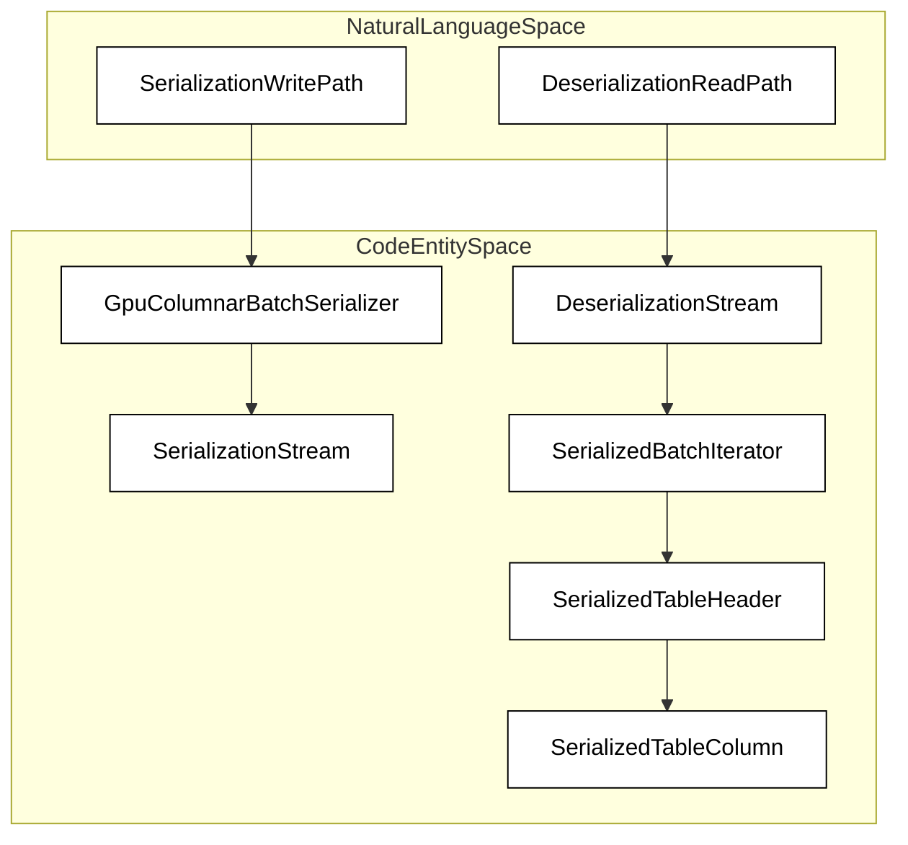
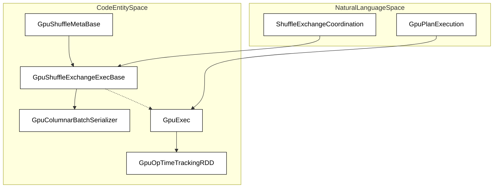

<!-- source: DeepWiki mcp.deepwiki.com · repo NVIDIA/cudf-spark · page 6.3 Columnar Serialization & Shuffle Coalescing · fetched 2026-10-26 -->

# Columnar Serialization & Shuffle Coalescing

Relevant source files

The following files were used as context for generating this wiki page:

- [integration_tests/src/main/python/join_test.py](integration_tests/src/main/python/join_test.py)
- [sql-plugin/src/main/scala-2.12/com/nvidia/spark/rapids/implicits.scala](sql-plugin/src/main/scala-2.12/com/nvidia/spark/rapids/implicits.scala)
- [sql-plugin/src/main/scala-2.13/com/nvidia/spark/rapids/implicits.scala](sql-plugin/src/main/scala-2.13/com/nvidia/spark/rapids/implicits.scala)
- [sql-plugin/src/main/scala/com/nvidia/spark/rapids/AbstractGpuJoinIterator.scala](sql-plugin/src/main/scala/com/nvidia/spark/rapids/AbstractGpuJoinIterator.scala)
- [sql-plugin/src/main/scala/com/nvidia/spark/rapids/ColumnarOutputWriter.scala](sql-plugin/src/main/scala/com/nvidia/spark/rapids/ColumnarOutputWriter.scala)
- [sql-plugin/src/main/scala/com/nvidia/spark/rapids/GpuColumnarBatchSerializer.scala](sql-plugin/src/main/scala/com/nvidia/spark/rapids/GpuColumnarBatchSerializer.scala)
- [sql-plugin/src/main/scala/com/nvidia/spark/rapids/GpuExec.scala](sql-plugin/src/main/scala/com/nvidia/spark/rapids/GpuExec.scala)
- [sql-plugin/src/main/scala/com/nvidia/spark/rapids/GpuShuffleAsyncCoalesceIterator.scala](sql-plugin/src/main/scala/com/nvidia/spark/rapids/GpuShuffleAsyncCoalesceIterator.scala)
- [sql-plugin/src/main/scala/com/nvidia/spark/rapids/GpuShuffleCoalesceExec.scala](sql-plugin/src/main/scala/com/nvidia/spark/rapids/GpuShuffleCoalesceExec.scala)
- [sql-plugin/src/main/scala/com/nvidia/spark/rapids/GpuShuffledHashJoinExec.scala](sql-plugin/src/main/scala/com/nvidia/spark/rapids/GpuShuffledHashJoinExec.scala)
- [sql-plugin/src/main/scala/com/nvidia/spark/rapids/GpuShuffledSizedHashJoinExec.scala](sql-plugin/src/main/scala/com/nvidia/spark/rapids/GpuShuffledSizedHashJoinExec.scala)
- [sql-plugin/src/main/scala/com/nvidia/spark/rapids/GpuSortMergeJoinMeta.scala](sql-plugin/src/main/scala/com/nvidia/spark/rapids/GpuSortMergeJoinMeta.scala)
- [sql-plugin/src/main/scala/com/nvidia/spark/rapids/JoinGatherer.scala](sql-plugin/src/main/scala/com/nvidia/spark/rapids/JoinGatherer.scala)
- [sql-plugin/src/main/scala/com/nvidia/spark/rapids/RmmRapidsRetryIterator.scala](sql-plugin/src/main/scala/com/nvidia/spark/rapids/RmmRapidsRetryIterator.scala)
- [sql-plugin/src/main/scala/com/nvidia/spark/rapids/io/async/AsyncOutputStream.scala](sql-plugin/src/main/scala/com/nvidia/spark/rapids/io/async/AsyncOutputStream.scala)
- [sql-plugin/src/main/scala/com/nvidia/spark/rapids/io/async/TrafficController.scala](sql-plugin/src/main/scala/com/nvidia/spark/rapids/io/async/TrafficController.scala)
- [sql-plugin/src/main/scala/org/apache/spark/sql/hive/rapids/GpuHiveFileFormat.scala](sql-plugin/src/main/scala/org/apache/spark/sql/hive/rapids/GpuHiveFileFormat.scala)
- [sql-plugin/src/main/scala/org/apache/spark/sql/rapids/GpuCartesianProductExec.scala](sql-plugin/src/main/scala/org/apache/spark/sql/rapids/GpuCartesianProductExec.scala)
- [sql-plugin/src/main/scala/org/apache/spark/sql/rapids/execution/GpuBroadcastHashJoinExecBase.scala](sql-plugin/src/main/scala/org/apache/spark/sql/rapids/execution/GpuBroadcastHashJoinExecBase.scala)
- [sql-plugin/src/main/scala/org/apache/spark/sql/rapids/execution/GpuBroadcastNestedLoopJoinExecBase.scala](sql-plugin/src/main/scala/org/apache/spark/sql/rapids/execution/GpuBroadcastNestedLoopJoinExecBase.scala)
- [sql-plugin/src/main/scala/org/apache/spark/sql/rapids/execution/GpuHashJoin.scala](sql-plugin/src/main/scala/org/apache/spark/sql/rapids/execution/GpuHashJoin.scala)
- [sql-plugin/src/main/scala/org/apache/spark/sql/rapids/execution/GpuShuffleExchangeExecBase.scala](sql-plugin/src/main/scala/org/apache/spark/sql/rapids/execution/GpuShuffleExchangeExecBase.scala)
- [sql-plugin/src/main/scala/org/apache/spark/sql/rapids/execution/GpuSubPartitionHashJoin.scala](sql-plugin/src/main/scala/org/apache/spark/sql/rapids/execution/GpuSubPartitionHashJoin.scala)
- [sql-plugin/src/main/spark330db/scala/org/apache/spark/sql/rapids/execution/GpuBroadcastHashJoinExec.scala](sql-plugin/src/main/spark330db/scala/org/apache/spark/sql/rapids/execution/GpuBroadcastHashJoinExec.scala)
- [sql-plugin/src/test/scala/com/nvidia/spark/rapids/io/async/AsyncOutputStreamSuite.scala](sql-plugin/src/test/scala/com/nvidia/spark/rapids/io/async/AsyncOutputStreamSuite.scala)
- [sql-plugin/src/test/scala/com/nvidia/spark/rapids/io/async/ThrottlingExecutorSuite.scala](sql-plugin/src/test/scala/com/nvidia/spark/rapids/io/async/ThrottlingExecutorSuite.scala)
- [sql-plugin/src/test/scala/com/nvidia/spark/rapids/io/async/TrafficControllerSuite.scala](sql-plugin/src/test/scala/com/nvidia/spark/rapids/io/async/TrafficControllerSuite.scala)
- [tests/src/test/scala/com/nvidia/spark/rapids/GpuShuffledHashJoinExecSuite.scala](tests/src/test/scala/com/nvidia/spark/rapids/GpuShuffledHashJoinExecSuite.scala)
- [tests/src/test/scala/com/nvidia/spark/rapids/GpuSubPartitionSuite.scala](tests/src/test/scala/com/nvidia/spark/rapids/GpuSubPartitionSuite.scala)
- [tests/src/test/scala/com/nvidia/spark/rapids/ImplicitsTestSuite.scala](tests/src/test/scala/com/nvidia/spark/rapids/ImplicitsTestSuite.scala)
- [tests/src/test/scala/com/nvidia/spark/rapids/WithRetrySuite.scala](tests/src/test/scala/com/nvidia/spark/rapids/WithRetrySuite.scala)
- [tests/src/test/scala/org/apache/spark/sql/rapids/GpuFileFormatDataWriterSuite.scala](tests/src/test/scala/org/apache/spark/sql/rapids/GpuFileFormatDataWriterSuite.scala)

This page details the mechanisms for efficient columnar data serialization and shuffle coalescing implemented in the RAPIDS Accelerator for Apache Spark. The key components covered include `GpuColumnarBatchSerializer`, `GpuShuffleCoalesceExec`, `GpuShuffleExchangeExecBase`, the `GpuExec` trait, and asynchronous coalescing iterators with I/O throttling.

---

## GpuColumnarBatchSerializer

The `GpuColumnarBatchSerializer` is a specialized Spark `Serializer` for `ColumnarBatch` objects used in shuffle read and write paths [sql-plugin/src/main/scala/com/nvidia/spark/rapids/GpuColumnarBatchSerializer.scala:1-40](). It facilitates zero-copy or minimal-copy operation between Spark’s shuffle infrastructure and GPU memory by operating primarily on host memory buffers that contain serialized cuDF table data.

### Serialization (Writing)

On the shuffle write path, the serializer converts a GPU-resident cuDF `Table` underlying the `ColumnarBatch` to a sequence of serialized bytes in host memory using cuDF's serialization API [sql-plugin/src/main/scala/com/nvidia/spark/rapids/GpuColumnarBatchSerializer.scala:1-40](). These serialized bytes are then compressed by Spark’s CPU shuffle compression mechanisms and spilled to disk or sent over the network.

### Deserialization (Reading)

The read path notably differs: instead of eagerly deserializing the serialized bytes into GPU tables, the bytes are read into host memory as `SerializedTableColumn` objects wrapped in `ColumnarBatch`es [sql-plugin/src/main/scala/com/nvidia/spark/rapids/GpuColumnarBatchSerializer.scala:89-151](). This deferred deserialization allows the shuffle coalescer (`GpuShuffleCoalesceExec`) to efficiently concatenate multiple small batches on the host before triggering a single, larger GPU deserialization operation.

### Data Flow Diagram: GpuColumnarBatchSerializer

**Figure 1:** Bridging serialization concepts to code entities in `GpuColumnarBatchSerializer`.

Sources: `sql-plugin/src/main/scala/com/nvidia/spark/rapids/GpuColumnarBatchSerializer.scala`

---

## GpuShuffleCoalesceExec

The `GpuShuffleCoalesceExec` physical plan operator coalesces multiple serialized shuffle batches into larger batches on the CPU host before transferring them to the GPU for deserialization [sql-plugin/src/main/scala/com/nvidia/spark/rapids/GpuShuffleCoalesceExec.scala:72-108](). It typically appears downstream of a shuffle read when the RAPIDS shuffle mechanism is not in use.

### Purpose and Benefits

- **Batch Coalescing:** Aggregates small serialized batches into a single larger batch to reduce GPU semaphore contention and amortize GPU data transfer overhead [sql-plugin/src/main/scala/com/nvidia/spark/rapids/GpuShuffleCoalesceExec.scala:67-71]().
- **Host-side Concatenation:** Utilizes efficient concatenation of serialized buffers on the host (using cuDF host concatenation APIs) to merge multiple serialized tables before GPU deserialization [sql-plugin/src/main/scala/com/nvidia/spark/rapids/GpuShuffleCoalesceExec.scala:25-39]().
- **Memory and Performance Optimization:** By batching shuffle blocks on the host, it permits asynchronous reading and reduces GPU memory pressure [sql-plugin/src/main/scala/com/nvidia/spark/rapids/GpuShuffleCoalesceExec.scala:67-71]().

### Internal Execution Flow

- The `internalDoExecuteColumnar` method runs on executor partitions, wrapping child shuffle batches in an iterator that coalesces data up to a `targetBatchByteSize` [sql-plugin/src/main/scala/com/nvidia/spark/rapids/GpuShuffleCoalesceExec.scala:98-108]().
- The coalescing logic invokes `getGpuShuffleCoalesceIterator`, which uses cuDF's host serialization APIs to concatenate serialized table buffers while applying retry logic to handle GPU memory allocation failures by splitting large batches flexibly [sql-plugin/src/main/scala/com/nvidia/spark/rapids/GpuShuffleCoalesceExec.scala:25-33]().

### Memory Retry Mechanism

If a coalesced batch is too large to fit in GPU memory, an `RmmRapidsRetryIterator.withRetry` mechanism attempts to split the batch into smaller sizes, recursively halving the coalesce target size until the batch fits or decomposition is impossible, at which point an OOM failure is propagated [sql-plugin/src/main/scala/com/nvidia/spark/rapids/GpuShuffleCoalesceExec.scala:25-33](). The `RmmRapidsRetryIterator` provides `withRetry` and `withRetryNoSplit` methods to handle retryable operations, optionally splitting the input `SpillableColumnarBatch` instances if an OOM occurs [sql-plugin/src/main/scala/com/nvidia/spark/rapids/RmmRapidsRetryIterator.scala:66-107](). The `splitPolicy` function is crucial for breaking down large inputs into smaller, manageable chunks [sql-plugin/src/main/scala/com/nvidia/spark/rapids/RmmRapidsRetryIterator.scala:67-68]().

Sources: 
- `sql-plugin/src/main/scala/com/nvidia/spark/rapids/GpuShuffleCoalesceExec.scala`
- `sql-plugin/src/main/scala/com/nvidia/spark/rapids/RmmRapidsRetryIterator.scala`
- `tests/src/test/scala/com/nvidia/spark/rapids/WithRetrySuite.scala`

---

## GpuShuffleExchangeExecBase & GpuExec

### GpuShuffleExchangeExecBase

The `GpuShuffleExchangeExecBase` class is the basis for GPU-accelerated shuffle exchanges [sql-plugin/src/main/scala/org/apache/spark/sql/rapids/execution/GpuShuffleExchangeExecBase.scala:49-54](). It orchestrates the shuffle process with respect to GPU requirements, such as specifying the partitioning and managing shuffle dependencies for GPU-serialized columnar batches.

Key responsibilities:
- Preparing dependencies for GPU shuffle with metadata preservation for Adaptive Query Execution (AQE) [sql-plugin/src/main/scala/org/apache/spark/sql/rapids/execution/GpuShuffleExchangeExecBase.scala:112-120]().
- Maintaining compatibility with different partitioning strategies like hash or range partitioning [sql-plugin/src/main/scala/org/apache/spark/sql/rapids/execution/GpuShuffleExchangeExecBase.scala:94-108]().
- Handling metrics related to GPU shuffle write and read operations [sql-plugin/src/main/scala/org/apache/spark/sql/rapids/execution/GpuShuffleExchangeExecBase.scala:40-45]().

### GpuExec Trait

The `GpuExec` trait extends the Spark `SparkPlan` execution model with GPU-specific features and utilities [sql-plugin/src/main/scala/com/nvidia/spark/rapids/GpuExec.scala:106-172](). It provides:

- Metrics creation and tracking APIs (e.g., for timing, row counts, batch sizes) [sql-plugin/src/main/scala/com/nvidia/spark/rapids/GpuExec.scala:146-163]().
- Output batch coalescing hints via methods like `coalesceAfter` and `outputBatching` [sql-plugin/src/main/scala/com/nvidia/spark/rapids/GpuExec.scala:127-145]().
- Facilities to wrap child RDDs into `GpuOpTimeTrackingRDD`s, which measure operator execution times including compositional timings excluding child execution time overlaps [sql-plugin/src/main/scala/com/nvidia/spark/rapids/GpuExec.scala:56-96]().
- Interfaces to coordinate GPU session state and configurations [sql-plugin/src/main/scala/com/nvidia/spark/rapids/GpuExec.scala:113-116]().

### Interactions Diagram: Shuffle Exchange and GPU Execution Traits

**Figure 2:** Bridging shuffle exchange coordination and GPU execution traits to the corresponding code entities.

Sources: 
- `sql-plugin/src/main/scala/org/apache/spark/sql/rapids/execution/GpuShuffleExchangeExecBase.scala`
- `sql-plugin/src/main/scala/com/nvidia/spark/rapids/GpuExec.scala`

---

## Asynchronous Coalesce Iterators & I/O Throttling

`GpuShuffleCoalesceExec` supports asynchronous coalescing during shuffle reads to improve IO throughput, controlled by a throttling mechanism.

### Async Coalesce Iterators

When enabled (`spark.rapids.sql.shuffle.async.read.enabled`), the coalescer fetches and merges serialized shuffle blocks asynchronously in parallel to downstream GPU operations, improving data pipeline parallelism [sql-plugin/src/main/scala/com/nvidia/spark/rapids/GpuShuffleCoalesceExec.scala:111-150](). The `GpuShuffleAsyncCoalesceIterator` is responsible for managing this asynchronous reading and coalescing of shuffle data.

### Traffic Control and Memory Management

- **TrafficController:** A concurrency control primitive that blocks/shields tasks based on host memory usage, preventing overcommit of host memory during async reads or writes [sql-plugin/src/main/scala/com/nvidia/spark/rapids/io/async/TrafficController.scala:30-77](). It manages `numTasks` and uses a `ReentrantLock` with a `Condition` to signal when tasks can be scheduled [sql-plugin/src/main/scala/com/nvidia/spark/rapids/io/async/TrafficController.scala:34-36]().
- **HostMemoryThrottle:** Implements throttling by tracking and enforcing a maximum limit on concurrent host memory held by inflight async tasks [sql-plugin/src/main/scala/com/nvidia/spark/rapids/io/async/TrafficController.scala:96-111]().
- **ThrottlingExecutor:** An executor service that wraps task submission with host memory accounting, integrating with `TrafficController` [sql-plugin/src/main/scala/com/nvidia/spark/rapids/GpuShuffleCoalesceExec.scala:34]().
- **AsyncOutputStream:** An `OutputStream` implementation that performs writes asynchronously, leveraging the `TrafficController` to manage concurrent writes and host memory usage [sql-plugin/src/main/scala/com/nvidia/spark/rapids/ColumnarOutputWriter.scala:149-150]().

This architecture provides robust concurrency management for shuffle data movement, avoiding memory overload and ensuring smooth GPU shuffle coalescing in high-throughput scenarios.

Sources: 
- `sql-plugin/src/main/scala/com/nvidia/spark/rapids/GpuShuffleCoalesceExec.scala`
- `sql-plugin/src/main/scala/com/nvidia/spark/rapids/io/async/TrafficController.scala`
- `sql-plugin/src/main/scala/com/nvidia/spark/rapids/ColumnarOutputWriter.scala`

---

# Summary

The RAPIDS Accelerator codebase integrates tightly with Spark's shuffle and execution framework to optimize columnar data serialization and exchange on GPUs. `GpuColumnarBatchSerializer` enables efficient serialization/deserialization of columnar batches into GPU-ready buffers, while `GpuShuffleCoalesceExec` and the base shuffle execution classes coordinate batch coalescing and partitioning with GPU memory considerations. The async iteration and throttling infrastructure provide scalable, safe, and performant GPU shuffle data paths.

---

