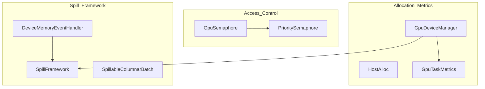
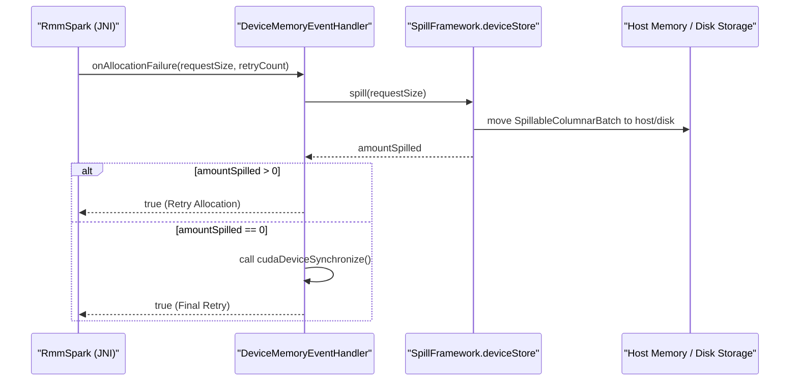

<!-- source: DeepWiki mcp.deepwiki.com · repo NVIDIA/cudf-spark · page 7 GPU Memory Management · fetched 2026-10-26 -->

# GPU Memory Management

Relevant source files

The following files were used as context for generating this wiki page:

- [sql-plugin/src/main/scala/com/nvidia/spark/rapids/GpuSemaphore.scala](sql-plugin/src/main/scala/com/nvidia/spark/rapids/GpuSemaphore.scala)
- [sql-plugin/src/main/scala/com/nvidia/spark/rapids/HostAlloc.scala](sql-plugin/src/main/scala/com/nvidia/spark/rapids/HostAlloc.scala)
- [sql-plugin/src/main/scala/com/nvidia/spark/rapids/PrioritySemaphore.scala](sql-plugin/src/main/scala/com/nvidia/spark/rapids/PrioritySemaphore.scala)
- [sql-plugin/src/main/scala/org/apache/spark/sql/rapids/GpuTaskMetrics.scala](sql-plugin/src/main/scala/org/apache/spark/sql/rapids/GpuTaskMetrics.scala)
- [sql-plugin/src/test/scala/com/nvidia/spark/rapids/HostAllocSuite.scala](sql-plugin/src/test/scala/com/nvidia/spark/rapids/HostAllocSuite.scala)
- [tests/src/test/scala/com/nvidia/spark/rapids/GpuSemaphoreSuite.scala](tests/src/test/scala/com/nvidia/spark/rapids/GpuSemaphoreSuite.scala)
- [tests/src/test/scala/com/nvidia/spark/rapids/PrioritySemaphoreSuite.scala](tests/src/test/scala/com/nvidia/spark/rapids/PrioritySemaphoreSuite.scala)

GPU memory is a constrained resource that must be efficiently shared across multiple concurrent Spark tasks and subsystems such as shuffles, joins, and file I/O. The RAPIDS Accelerator implements a comprehensive GPU memory management system combining controlled access, dynamic memory estimation, spilling, host memory allocation, and detailed task metrics tracking to prevent Out-Of-Memory (OOM) failures and improve stability.

---

### Architectural Overview

The system spans controlling concurrent GPU usage via device managers and semaphores, tracking memory consumption configuration, handling memory pressure through spilling, and managing host (CPU) memory allocations. It integrates closely with Spark’s task execution model to ensure fairness, priority handling, and dynamic adaptation based on real-time task behavior.

Below is a high-level diagram bridging conceptual components to key code entities:

**Memory Management Entity Mapping**

*This diagram associates system concepts with their primary Scala/Java implementing classes within the plugin.*

Sources: [sql-plugin/src/main/scala/com/nvidia/spark/rapids/GpuSemaphore.scala:183-204](), [sql-plugin/src/main/scala/com/nvidia/spark/rapids/PrioritySemaphore.scala:26-53](), [sql-plugin/src/main/scala/com/nvidia/spark/rapids/HostAlloc.scala:36-44](), [sql-plugin/src/main/scala/org/apache/spark/sql/rapids/GpuTaskMetrics.scala:27-30]()

---

### GPU Access Control: The Semaphore

The centerpiece of GPU concurrency control is the singleton `GpuSemaphore` class [sql-plugin/src/main/scala/com/nvidia/spark/rapids/GpuSemaphore.scala:183-185](). It regulates how many Spark tasks may simultaneously hold GPU resources, ensuring the system does not oversubscribe the device.

- **Concurrency Control:** `GpuSemaphore` limits the number of concurrent GPU tasks based on configuration [sql-plugin/src/main/scala/com/nvidia/spark/rapids/GpuSemaphore.scala:204-204](). It uses a `PrioritySemaphore` internally to manage access [sql-plugin/src/main/scala/com/nvidia/spark/rapids/GpuSemaphore.scala:210-210]().
- **Prioritized Access:** The `PrioritySemaphore` allows tasks to acquire permits based on their priority, ensuring higher-priority tasks get GPU access first [sql-plugin/src/main/scala/com/nvidia/spark/rapids/PrioritySemaphore.scala:26-53]().
- **Dynamic Memory Estimation:** `GpuSemaphore` incorporates `GpuStageMemoryEstimator` and `GpuTaskMemoryEstimator` to dynamically estimate memory usage for tasks and stages, influencing permit acquisition [sql-plugin/src/main/scala/com/nvidia/spark/rapids/GpuSemaphore.scala:134-137]().

For detailed descriptions and API info, see [GpuSemaphore, HostAlloc & Task Metrics](#7.1).

Sources: [sql-plugin/src/main/scala/com/nvidia/spark/rapids/GpuSemaphore.scala:183-210](), [sql-plugin/src/main/scala/com/nvidia/spark/rapids/PrioritySemaphore.scala:26-53](), [sql-plugin/src/main/scala/com/nvidia/spark/rapids/GpuSemaphore.scala:134-137]()

---

### Spill Framework & OOM Handling

The plugin employs an automatic spill framework to gracefully handle memory exhaustion on the GPU by offloading data to host memory or disk. This process reduces the incidence of task failure when GPU memory is full.

**OOM-triggered Spill Workflow**

*This sequence shows how memory allocation failure triggers spill operations to free GPU memory.*

- **Spillable Objects:** Data units like column batches are wrapped in spillable containers (`SpillableColumnarBatch`). The spill framework manages their lifecycle, decides when and what to spill, and tracks memory stores on device, host, or disk.
- **Event-Driven Handling:** `DeviceMemoryEventHandler` receives allocation failure events from RMM and invokes the spill logic during runtime.

For a deep dive on spill architecture and OOM event handling, see [Spill Framework & Device Memory Events](#7.2).

Sources: [sql-plugin/src/main/scala/com/nvidia/spark/rapids/HostAlloc.scala:158-192]()

---

### Host Memory Allocation & Task Metrics Tracking

Host memory management is crucial since spilled GPU data requires pinned or pageable host memory before optionally being written to disk.

- **Host Allocators:** The `HostAlloc` class manages both pinned and non-pinned host memory allocations, respecting configured limits [sql-plugin/src/main/scala/com/nvidia/spark/rapids/HostAlloc.scala:36-44](). It integrates with `PinnedMemoryPool` for pinned allocations [sql-plugin/src/main/scala/com/nvidia/spark/rapids/HostAlloc.scala:112-121]().
- **Task Metrics Collection:** `GpuTaskMetrics` maintains per-task accumulators for various GPU-related statistics, including host and device memory allocations, time spent waiting for GPU, and concurrent task counts [sql-plugin/src/main/scala/org/apache/spark/sql/rapids/GpuTaskMetrics.scala:27-30](). It provides custom accumulators like `SizeInBytesAccumulator` and `NanoSecondAccumulator` for user-friendly reporting [sql-plugin/src/main/scala/org/apache/spark/sql/rapids/GpuTaskMetrics.scala:110-139]().

For full details, see [GpuSemaphore, HostAlloc & Task Metrics](#7.1).

Sources: [sql-plugin/src/main/scala/com/nvidia/spark/rapids/HostAlloc.scala:36-44](), [sql-plugin/src/main/scala/com/nvidia/spark/rapids/HostAlloc.scala:112-121](), [sql-plugin/src/main/scala/org/apache/spark/sql/rapids/GpuTaskMetrics.scala:27-30](), [sql-plugin/src/main/scala/org/apache/spark/sql/rapids/GpuTaskMetrics.scala:110-139]()

---

### Summary of Key Classes and Their Roles

| Class / Object               | Responsibility                                          | Source Code Range & Notes                                    |
|-----------------------------|---------------------------------------------------------|-------------------------------------------------------------|
| `GpuSemaphore`              | Global singleton controlling GPU task concurrency       | [sql-plugin/src/main/scala/com/nvidia/spark/rapids/GpuSemaphore.scala:183-185]() |
| `PrioritySemaphore`         | Manages prioritized access to GPU resources             | [sql-plugin/src/main/scala/com/nvidia/spark/rapids/PrioritySemaphore.scala:26-53]() |
| `HostAlloc`                 | Manages pinned and non-pinned host memory allocations   | [sql-plugin/src/main/scala/com/nvidia/spark/rapids/HostAlloc.scala:36-44]() |
| `GpuTaskMetrics`            | Collects and reports GPU-related task metrics           | [sql-plugin/src/main/scala/org/apache/spark/sql/rapids/GpuTaskMetrics.scala:27-30]() |
| `DeviceMemoryEventHandler`  | Handles GPU allocation failures, invokes spilling       | Detailed in child page 7.2                                  |
| `SpillFramework`            | Manages spilling lifecycle and device/host/disk stores  | Detailed in child page 7.2                                  |

Sources: [sql-plugin/src/main/scala/com/nvidia/spark/rapids/GpuSemaphore.scala:183-185](), [sql-plugin/src/main/scala/com/nvidia/spark/rapids/PrioritySemaphore.scala:26-53](), [sql-plugin/src/main/scala/com/nvidia/spark/rapids/HostAlloc.scala:36-44](), [sql-plugin/src/main/scala/org/apache/spark/sql/rapids/GpuTaskMetrics.scala:27-30]()

---

### Navigation to Child Pages

This page serves as a high-level overview. For comprehensive technical details of the subcomponents described here, consult the child pages:

- **[GpuSemaphore, HostAlloc & Task Metrics](#7.1)** — Detailed exploration of GPU concurrency control, semaphore implementation, host memory allocation, task metrics internals, spill priorities, file I/O byte tracking, and GPU device manager integration.
- **[Spill Framework & Device Memory Events](#7.2)** — In-depth breakdown of the spill framework architecture, batch lifecycle, partial file handles, instrumentation of device memory events, and how OOM-triggered spilling is orchestrated.

---

Sources Summary:
[sql-plugin/src/main/scala/com/nvidia/spark/rapids/GpuSemaphore.scala](),
[sql-plugin/src/main/scala/com/nvidia/spark/rapids/PrioritySemaphore.scala](),
[sql-plugin/src/main/scala/com/nvidia/spark/rapids/HostAlloc.scala](),
[sql-plugin/src/main/scala/org/apache/spark/sql/rapids/GpuTaskMetrics.scala]()

---

