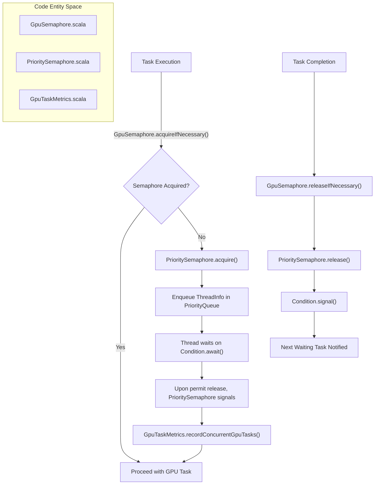
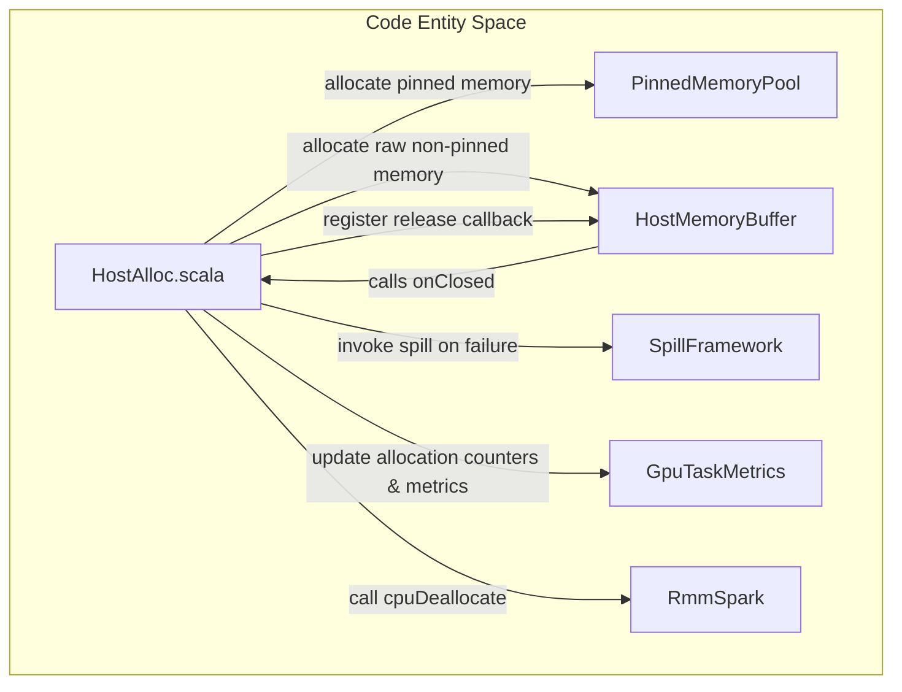
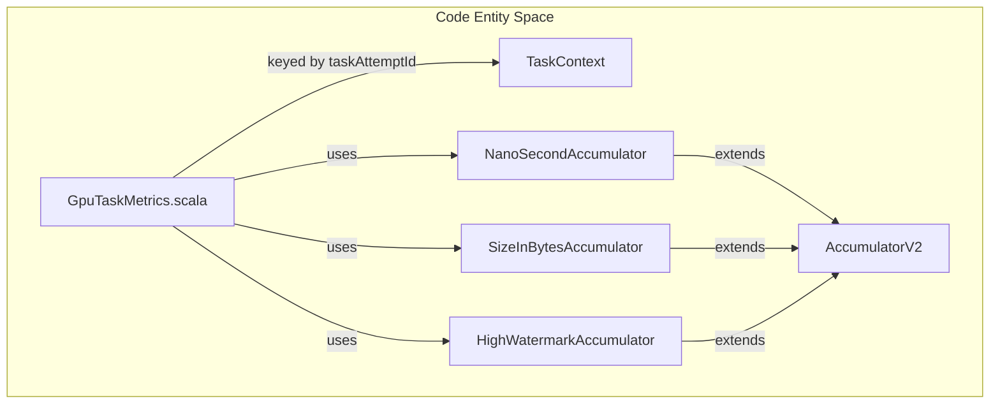
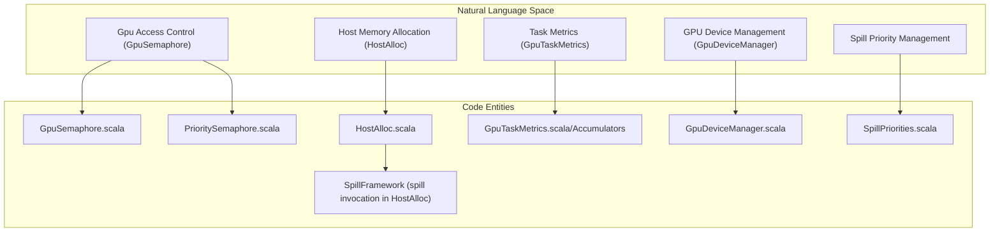

<!-- source: DeepWiki mcp.deepwiki.com · repo NVIDIA/cudf-spark · page 7.1 GpuSemaphore, HostAlloc & Task Metrics · fetched 2026-10-26 -->

# GpuSemaphore, HostAlloc & Task Metrics

Relevant source files

The following files were used as context for generating this wiki page:

- [sql-plugin-api/src/main/scala/org/apache/spark/sql/rapids/ProxyRapidsShuffleInternalManagerBase.scala](sql-plugin-api/src/main/scala/org/apache/spark/sql/rapids/ProxyRapidsShuffleInternalManagerBase.scala)
- [sql-plugin/src/main/scala/com/nvidia/spark/rapids/GpuDeviceManager.scala](sql-plugin/src/main/scala/com/nvidia/spark/rapids/GpuDeviceManager.scala)
- [sql-plugin/src/main/scala/com/nvidia/spark/rapids/GpuSemaphore.scala](sql-plugin/src/main/scala/com/nvidia/spark/rapids/GpuSemaphore.scala)
- [sql-plugin/src/main/scala/com/nvidia/spark/rapids/HostAlloc.scala](sql-plugin/src/main/scala/com/nvidia/spark/rapids/HostAlloc.scala)
- [sql-plugin/src/main/scala/com/nvidia/spark/rapids/PrioritySemaphore.scala](sql-plugin/src/main/scala/com/nvidia/spark/rapids/PrioritySemaphore.scala)
- [sql-plugin/src/main/scala/com/nvidia/spark/rapids/RapidsConfResourceEntries.scala](sql-plugin/src/main/scala/com/nvidia/spark/rapids/RapidsConfResourceEntries.scala)
- [sql-plugin/src/main/scala/org/apache/spark/sql/rapids/GpuTaskMetrics.scala](sql-plugin/src/main/scala/org/apache/spark/sql/rapids/GpuTaskMetrics.scala)
- [sql-plugin/src/test/scala/com/nvidia/spark/rapids/HostAllocSuite.scala](sql-plugin/src/test/scala/com/nvidia/spark/rapids/HostAllocSuite.scala)
- [tests/src/test/java/com/nvidia/spark/rapids/TestStats.java](tests/src/test/java/com/nvidia/spark/rapids/TestStats.java)
- [tests/src/test/scala/com/nvidia/spark/rapids/GpuDeviceManagerSuite.scala](tests/src/test/scala/com/nvidia/spark/rapids/GpuDeviceManagerSuite.scala)
- [tests/src/test/scala/com/nvidia/spark/rapids/GpuSemaphoreSuite.scala](tests/src/test/scala/com/nvidia/spark/rapids/GpuSemaphoreSuite.scala)
- [tests/src/test/scala/com/nvidia/spark/rapids/ParallelUnitTestRunner.scala](tests/src/test/scala/com/nvidia/spark/rapids/ParallelUnitTestRunner.scala)
- [tests/src/test/scala/com/nvidia/spark/rapids/ParallelUnitTestRunnerSuite.scala](tests/src/test/scala/com/nvidia/spark/rapids/ParallelUnitTestRunnerSuite.scala)
- [tests/src/test/scala/com/nvidia/spark/rapids/PrioritySemaphoreSuite.scala](tests/src/test/scala/com/nvidia/spark/rapids/PrioritySemaphoreSuite.scala)
- [tests/src/test/scala/com/nvidia/spark/rapids/shuffle/RapidsShuffleHeartbeatManagerSuite.scala](tests/src/test/scala/com/nvidia/spark/rapids/shuffle/RapidsShuffleHeartbeatManagerSuite.scala)
- [tests/src/test/spark330/scala/org/apache/spark/sql/rapids/suites/RapidsDataFrameAggregateSuite.scala](tests/src/test/spark330/scala/org/apache/spark/sql/rapids/suites/RapidsDataFrameAggregateSuite.scala)
- [tests/src/test/spark330/scala/org/apache/spark/sql/rapids/suites/RapidsMathFunctionsSuite.scala](tests/src/test/spark330/scala/org/apache/spark/sql/rapids/suites/RapidsMathFunctionsSuite.scala)
- [tests/src/test/spark330/scala/org/apache/spark/sql/rapids/utils/BackendTestSettings.scala](tests/src/test/spark330/scala/org/apache/spark/sql/rapids/utils/BackendTestSettings.scala)
- [tests/src/test/spark330/scala/org/apache/spark/sql/rapids/utils/RapidsTestsBaseTrait.scala](tests/src/test/spark330/scala/org/apache/spark/sql/rapids/utils/RapidsTestsBaseTrait.scala)

This page details the core components responsible for managing GPU concurrency, host memory allocation, task metrics collection, spill priorities, file I/O byte tracking, and GPU device management in the RAPIDS Accelerator for Apache Spark.

---

## GPU Access Control: `GpuSemaphore`

The `GpuSemaphore` singleton controls concurrent GPU access across Spark tasks to prevent oversubscription and resource contention. It governs how many tasks can simultaneously use the GPU by managing permits and prioritizing task scheduling [sql-plugin/src/main/scala/com/nvidia/spark/rapids/GpuSemaphore.scala:183-204]().

### Key Implementation Elements

- **Priority Semaphore Integration**  
  `GpuSemaphore` internally uses a `PrioritySemaphore` which maintains a priority-ordered wait queue of tasks requesting GPU permits [sql-plugin/src/main/scala/com/nvidia/spark/rapids/GpuSemaphore.scala:220-252]().  
  The priority ordering favors tasks with higher `TaskPriority` and uses task attempt IDs as a tie-breaker [sql-plugin/src/main/scala/com/nvidia/spark/rapids/PrioritySemaphore.scala:45-47]().

- **Dynamic Memory Estimation**  
  To optimize permit allocation, `GpuSemaphore` uses memory estimators:
  - `GpuTaskMemoryEstimator` tracks per-task GPU memory usage and estimated blocked time to refine memory allocation estimates dynamically [sql-plugin/src/main/scala/com/nvidia/spark/rapids/GpuSemaphore.scala:58-92]().  
  - `GpuStageMemoryEstimator` aggregates task estimators per stage and computes an 80th percentile memory estimate for incoming tasks to better manage GPU memory demands [sql-plugin/src/main/scala/com/nvidia/spark/rapids/GpuSemaphore.scala:134-181]().

These memory estimates feed into permit calculations, influencing whether a task can acquire the semaphore immediately or must wait.

### Data Flow Diagram: GpuSemaphore and PrioritySemaphore Code Flow

Sources:  
[sql-plugin/src/main/scala/com/nvidia/spark/rapids/GpuSemaphore.scala:183-204]()  
[sql-plugin/src/main/scala/com/nvidia/spark/rapids/PrioritySemaphore.scala:26-151]()  
[sql-plugin/src/main/scala/org/apache/spark/sql/rapids/GpuTaskMetrics.scala:29-30]()

---

## PrioritySemaphore: Priority-based Permit Management

`PrioritySemaphore` is a concurrency primitive tailored for GPU task permit management with priority scheduling and concurrent task limits [sql-plugin/src/main/scala/com/nvidia/spark/rapids/PrioritySemaphore.scala:26-151](). The key attributes and behaviors include:

- **Permits and Limits**  
  Each task requests a number of permits representing resource units (e.g., memory slots). The semaphore maintains the total permits in use (`occupiedSlots`) and enforces a maximum concurrent GPU task limit (`maxConcurrentGpuTasksLimit`), blocking additional tasks even if permits remain [sql-plugin/src/main/scala/com/nvidia/spark/rapids/PrioritySemaphore.scala:32-35,145-150]().

- **Wait Queue with Priority**  
  Tasks denied immediate acquisition are enqueued into a priority queue, ordered by:
  - Priority value (higher first)
  - Task attempt ID as a tie-breaker to prevent inversion  
  This ensures fairness and prioritization toward critical tasks [sql-plugin/src/main/scala/com/nvidia/spark/rapids/PrioritySemaphore.scala:45-53]().

- **Wait Tracking for Metrics**  
  While waiting, `PrioritySemaphore` counts how many of the pending tasks have previously held GPU resources, reporting this through `GpuTaskMetrics` [sql-plugin/src/main/scala/com/nvidia/spark/rapids/PrioritySemaphore.scala:87-91]().

- **Wait/Signal Mechanism**  
  The implementation uses a `ReentrantLock` with multiple condition variables so threads block waiting for permissions without busy waiting. Upon release, waiting tasks are signaled in priority order to acquire permits as available [sql-plugin/src/main/scala/com/nvidia/spark/rapids/PrioritySemaphore.scala:32-32,119-143]().

Sources:  
[sql-plugin/src/main/scala/com/nvidia/spark/rapids/PrioritySemaphore.scala:26-151]()

---

## Host Memory Management: `HostAlloc`

The `HostAlloc` class manages host memory allocations, distinguishing pinned (page-locked) memory from regular pageable non-pinned memory. It integrates tightly with the RAPIDS spill framework to enable spilling host buffers when memory limits are approached [sql-plugin/src/main/scala/com/nvidia/spark/rapids/HostAlloc.scala:36-143,158-192]().

### Core Functionality

- **Dual Allocation Pools**  
  - *Pinned Memory:* Allocated from `PinnedMemoryPool`, tracked separately to respect pinned pool size limits [sql-plugin/src/main/scala/com/nvidia/spark/rapids/HostAlloc.scala:38-43]().  
  - *Non-pinned Memory:* Directly allocated off-heap buffers up to a configured limit or unbounded if unlimited [sql-plugin/src/main/scala/com/nvidia/spark/rapids/HostAlloc.scala:36-44]().  
  Allocations attempt pinned first (depending on configuration) then fall back to non-pinned [sql-plugin/src/main/scala/com/nvidia/spark/rapids/HostAlloc.scala:112-143]().

- **Callbacks and Lifecycle Tracking**  
  Both pinned and non-pinned buffers register `EventHandler` callbacks (`OnCloseCallback` and `OnPinnedCloseCallback`) that decrement internal allocation counters and update `GpuTaskMetrics` upon buffer release, ensuring accurate tracking and memory deallocation through `RmmSpark.cpuDeallocate` [sql-plugin/src/main/scala/com/nvidia/spark/rapids/HostAlloc.scala:58-81,92-110]().

- **Spill Framework Integration**  
  Before an allocation is attempted, if limits are exceeded, `HostAlloc` invokes `SpillFramework.stores.hostStore.spill()` to free host memory by spilling data to disk. It retries allocations based on spill success, assisting in alleviating memory pressure gracefully [sql-plugin/src/main/scala/com/nvidia/spark/rapids/HostAlloc.scala:158-192]().

### Diagram: Host Memory Allocation Code Entity Mapping

Sources:  
[sql-plugin/src/main/scala/com/nvidia/spark/rapids/HostAlloc.scala:36-143,158-192]()  
[sql-plugin/src/main/scala/org/apache/spark/sql/rapids/GpuTaskMetrics.scala:83-90]()  

---

## GPU Device Management: `GpuDeviceManager`

`GpuDeviceManager` orchestrates GPU device selection and initialization for Spark tasks and executors, including RMM and pinned memory pool configuration [sql-plugin/src/main/scala/com/nvidia/spark/rapids/GpuDeviceManager.scala:41-184]().

### Responsibilities

- **Device Acquisition and Binding**  
  Retrieves GPU device IDs from Spark resource configurations (`CUDA_VISIBLE_DEVICES` or scheduler resource info), sets the active CUDA device for the executor, and performs a device bind operation (`Cuda.freeZero()`) to ensure device context correctness [sql-plugin/src/main/scala/com/nvidia/spark/rapids/GpuDeviceManager.scala:114-180]().

- **Memory Limit Calculations**  
  Calculates pinned memory pool size and off-heap memory limits based on executor and host memory configurations to avoid exceeding allowable memory footprints [tests/src/test/scala/com/nvidia/spark/rapids/GpuDeviceManagerSuite.scala:125-145]().

- **Initialization Mode**  
  Determines whether RMM and pinned pool initialization is performed once per executor or per task using `rmmTaskInitEnabled` flag, allowing flexible memory management models [sql-plugin/src/main/scala/com/nvidia/spark/rapids/GpuDeviceManager.scala:42-48]().

Sources:  
[sql-plugin/src/main/scala/com/nvidia/spark/rapids/GpuDeviceManager.scala:41-184]()  
[tests/src/test/scala/com/nvidia/spark/rapids/GpuDeviceManagerSuite.scala:125-145]()

---

## Task Metrics: `GpuTaskMetrics`

The `GpuTaskMetrics` class provides comprehensive GPU-related metrics tracking for Spark tasks using specialized Spark accumulator types [sql-plugin/src/main/scala/org/apache/spark/sql/rapids/GpuTaskMetrics.scala:29-230]().

### Accumulators for Metric Types

| Accumulator Class       | Purpose                                       | Source Location                                    |
|------------------------|-----------------------------------------------|---------------------------------------------------|
| `NanoSecondAccumulator` | Tracks time durations (e.g., GPU semaphore wait time) | [sql-plugin/src/main/scala/org/apache/spark/sql/rapids/GpuTaskMetrics.scala:72-104]() |
| `SizeInBytesAccumulator`| Sums total bytes allocated or processed      | [sql-plugin/src/main/scala/org/apache/spark/sql/rapids/GpuTaskMetrics.scala:110-139]() |
| `HighWatermarkAccumulator` | Tracks peak memory usage (maximum value)    | [sql-plugin/src/main/scala/org/apache/spark/sql/rapids/GpuTaskMetrics.scala:141-168]() |
| `MaxLongAccumulator`      | Tracks maximum values of counters             | [sql-plugin/src/main/scala/org/apache/spark/sql/rapids/GpuTaskMetrics.scala:170-206]() |
| `AvgLongAccumulator`      | Tracks average of long values                  | [sql-plugin/src/main/scala/org/apache/spark/sql/rapids/GpuTaskMetrics.scala:208-230]() |

Metrics instances are keyed by task attempt ID from Spark's `TaskContext` and cleaned up automatically on task completion via registered callbacks [sql-plugin/src/main/scala/org/apache/spark/sql/rapids/GpuTaskMetrics.scala:29-30]().

### Tracking File IO Bytes

When RAPIDS PerfIO metrics collection is enabled, `GpuTaskMetrics` tracks bytes read/written by optimized file I/O layers for remote file systems [sql-plugin/src/main/scala/org/apache/spark/sql/rapids/GpuTaskMetrics.scala:27-27](). This integration supports fine-grained diagnostics for I/O bottlenecks.

### Diagram: Metrics Tracking Code Entity Mapping

Sources:  
[sql-plugin/src/main/scala/org/apache/spark/sql/rapids/GpuTaskMetrics.scala:27-230]()

---

## SpillPriorities

`SpillPriorities` defines integer priority ranges used to manage which buffers get spilled first under memory pressure in the RAPIDS spill framework [sql-plugin-columnar/src/main/scala/com/nvidia/spark/rapids/SpillPriorities.scala:20-54]().

- **Recomputable Cache Priority:** Lowest possible priority (`Long.MinValue`), assigned to cached device data that can be recomputed if lost [sql-plugin-columnar/src/main/scala/com/nvidia/spark/rapids/SpillPriorities.scala:28-28].  
- **Output For Shuffle:** Same lowest priority as recomputable cache to enable quick eviction [sql-plugin-columnar/src/main/scala/com/nvidia/spark/rapids/SpillPriorities.scala:33-33].  
- **Input From Shuffle:** High priority just below `Long.MaxValue`, ensuring buffers just received for shuffle input are retained longer [sql-plugin-columnar/src/main/scala/com/nvidia/spark/rapids/SpillPriorities.scala:41-41].  
- **Active Buffers:** High priorities above shuffle input for data actively being processed (`ACTIVE_ON_DECK_PRIORITY`, `ACTIVE_BATCHING_PRIORITY`) [sql-plugin-columnar/src/main/scala/com/nvidia/spark/rapids/SpillPriorities.scala:47-52].

Sources:  
[sql-plugin-columnar/src/main/scala/com/nvidia/spark/rapids/SpillPriorities.scala:20-54]()

---

# Summary Diagram: High-Level System Interactions

Sources:  
[sql-plugin/src/main/scala/com/nvidia/spark/rapids/GpuSemaphore.scala:183-204]()  
[sql-plugin/src/main/scala/com/nvidia/spark/rapids/PrioritySemaphore.scala:26-151]()  
[sql-plugin/src/main/scala/com/nvidia/spark/rapids/HostAlloc.scala:36-192]()  
[sql-plugin/src/main/scala/org/apache/spark/sql/rapids/GpuTaskMetrics.scala:29-230]()  
[sql-plugin/src/main/scala/com/nvidia/spark/rapids/GpuDeviceManager.scala:41-184]()  
[sql-plugin-columnar/src/main/scala/com/nvidia/spark/rapids/SpillPriorities.scala:20-54]()

---

# References

- `GpuSemaphore.scala`: [sql-plugin/src/main/scala/com/nvidia/spark/rapids/GpuSemaphore.scala:1-204]()
- `PrioritySemaphore.scala`: [sql-plugin/src/main/scala/com/nvidia/spark/rapids/PrioritySemaphore.scala:1-151]()
- `HostAlloc.scala`: [sql-plugin/src/main/scala/com/nvidia/spark/rapids/HostAlloc.scala:1-192]()
- `GpuTaskMetrics.scala`: [sql-plugin/src/main/scala/org/apache/spark/sql/rapids/GpuTaskMetrics.scala:29-230]()
- `SpillPriorities.scala`: [sql-plugin-columnar/src/main/scala/com/nvidia/spark/rapids/SpillPriorities.scala:20-54]()
- `GpuDeviceManager.scala`: [sql-plugin/src/main/scala/com/nvidia/spark/rapids/GpuDeviceManager.scala:41-184]()

Sources:  
[sql-plugin/src/main/scala/com/nvidia/spark/rapids/GpuSemaphore.scala:1-204]()  
[sql-plugin/src/main/scala/com/nvidia/spark/rapids/PrioritySemaphore.scala:1-151]()  
[sql-plugin/src/main/scala/com/nvidia/spark/rapids/HostAlloc.scala:1-192]()  
[sql-plugin/src/main/scala/org/apache/spark/sql/rapids/GpuTaskMetrics.scala:29-230]()  
[sql-plugin-columnar/src/main/scala/com/nvidia/spark/rapids/SpillPriorities.scala:20-54]()  
[sql-plugin/src/main/scala/com/nvidia/spark/rapids/GpuDeviceManager.scala:41-184]()

---

