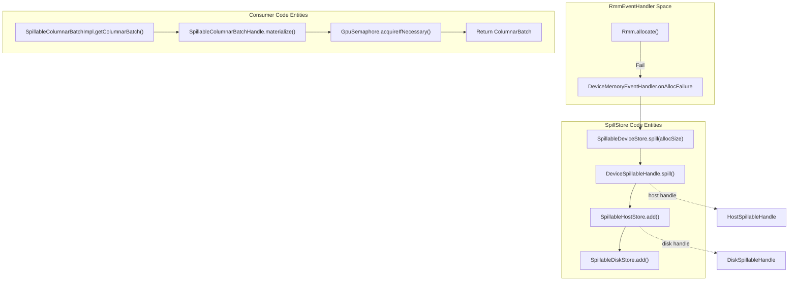
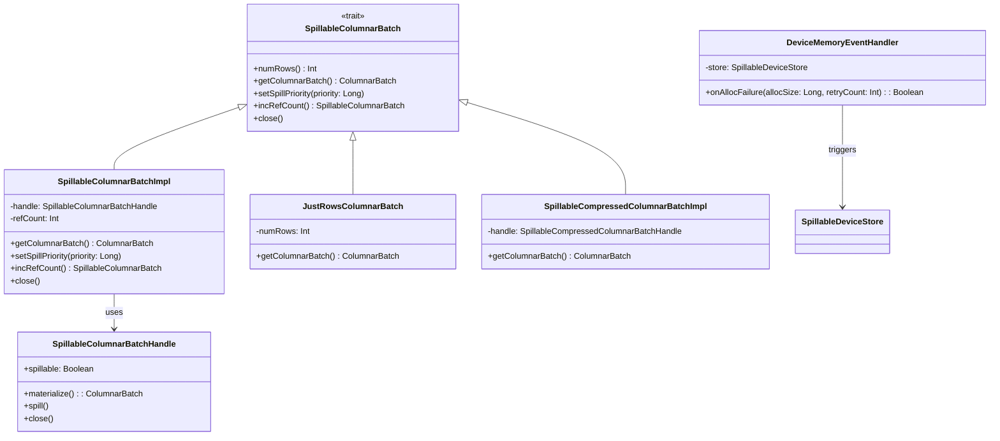
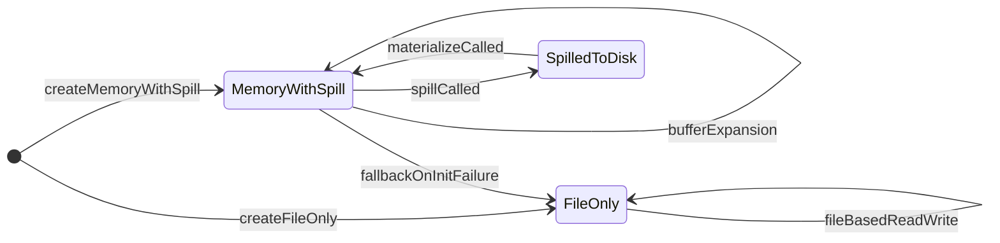

<!-- source: DeepWiki mcp.deepwiki.com · repo NVIDIA/cudf-spark · page 7.2 Spill Framework & Device Memory Events · fetched 2026-10-26 -->

# Spill Framework & Device Memory Events

Relevant source files

The following files were used as context for generating this wiki page:

- [sql-plugin/src/main/scala/com/nvidia/spark/rapids/DeviceMemoryEventHandler.scala](sql-plugin/src/main/scala/com/nvidia/spark/rapids/DeviceMemoryEventHandler.scala)
- [sql-plugin/src/main/scala/com/nvidia/spark/rapids/SpillableColumnarBatch.scala](sql-plugin/src/main/scala/com/nvidia/spark/rapids/SpillableColumnarBatch.scala)
- [sql-plugin/src/main/scala/com/nvidia/spark/rapids/SpillableKudoTable.scala](sql-plugin/src/main/scala/com/nvidia/spark/rapids/SpillableKudoTable.scala)
- [sql-plugin/src/main/scala/com/nvidia/spark/rapids/spill/SpillFramework.scala](sql-plugin/src/main/scala/com/nvidia/spark/rapids/spill/SpillFramework.scala)
- [sql-plugin/src/main/scala/com/nvidia/spark/rapids/spill/SpillOutputChannel.scala](sql-plugin/src/main/scala/com/nvidia/spark/rapids/spill/SpillOutputChannel.scala)
- [sql-plugin/src/main/scala/org/apache/spark/sql/rapids/execution/GpuBroadcastExchangeExec.scala](sql-plugin/src/main/scala/org/apache/spark/sql/rapids/execution/GpuBroadcastExchangeExec.scala)
- [sql-plugin/src/main/scala/org/apache/spark/sql/rapids/execution/HashBuild.scala](sql-plugin/src/main/scala/org/apache/spark/sql/rapids/execution/HashBuild.scala)
- [tests/src/test/scala/com/nvidia/spark/rapids/BroadcastHashJoinSuite.scala](tests/src/test/scala/com/nvidia/spark/rapids/BroadcastHashJoinSuite.scala)
- [tests/src/test/scala/com/nvidia/spark/rapids/DeviceMemoryEventHandlerSuite.scala](tests/src/test/scala/com/nvidia/spark/rapids/DeviceMemoryEventHandlerSuite.scala)
- [tests/src/test/scala/com/nvidia/spark/rapids/RapidsSerializerManagerSuite.scala](tests/src/test/scala/com/nvidia/spark/rapids/RapidsSerializerManagerSuite.scala)
- [tests/src/test/scala/com/nvidia/spark/rapids/spill/SharedRecomputableHandleSuite.scala](tests/src/test/scala/com/nvidia/spark/rapids/spill/SharedRecomputableHandleSuite.scala)
- [tests/src/test/scala/com/nvidia/spark/rapids/spill/SpillFrameworkSuite.scala](tests/src/test/scala/com/nvidia/spark/rapids/spill/SpillFrameworkSuite.scala)
- [tests/src/test/scala/com/nvidia/spark/rapids/spill/SpillOutputChannelSuite.scala](tests/src/test/scala/com/nvidia/spark/rapids/spill/SpillOutputChannelSuite.scala)
- [tests/src/test/scala/com/nvidia/spark/rapids/spill/SpillUnitTestBase.scala](tests/src/test/scala/com/nvidia/spark/rapids/spill/SpillUnitTestBase.scala)
- [tests/src/test/scala/com/nvidia/spark/rapids/spill/SpillableTableHandleSuite.scala](tests/src/test/scala/com/nvidia/spark/rapids/spill/SpillableTableHandleSuite.scala)
- [tests/src/test/scala/org/apache/spark/sql/rapids/SpillableColumnarBatchSuite.scala](tests/src/test/scala/org/apache/spark/sql/rapids/SpillableColumnarBatchSuite.scala)
- [tests/src/test/scala/org/apache/spark/sql/rapids/execution/HashBuildPlannerSuite.scala](tests/src/test/scala/org/apache/spark/sql/rapids/execution/HashBuildPlannerSuite.scala)
- [tests/src/test/scala/org/apache/spark/sql/rapids/execution/HashBuildSemaphoreSuite.scala](tests/src/test/scala/org/apache/spark/sql/rapids/execution/HashBuildSemaphoreSuite.scala)

## Purpose & Scope
This page provides an in-depth technical description of the memory management and spilling subsystem in the RAPIDS Accelerator for Apache Spark. This subsystem is designed to handle GPU out-of-memory events by automatically spilling data through a hierarchy of memory tiers—from GPU device memory to host memory and finally disk storage—thereby preventing hard OOM failures. It centers around the following key components:

- `SpillFramework`: The main orchestration framework managing spillable data lifecycles (`[sql-plugin/src/main/scala/com/nvidia/spark/rapids/spill/SpillFramework.scala:52-137]()`).
- `SpillableColumnarBatch`: Interface for batches of Spark data whose buffers can be spilled (`[sql-plugin/src/main/scala/com/nvidia/spark/rapids/SpillableColumnarBatch.scala:31-63]()`).
- `SpillablePartialFileHandle`: Specialized handle for spillable shuffle segments supporting dynamic storage tier transitions (`[sql-plugin/src/main/scala/com/nvidia/spark/rapids/spill/SpillablePartialFileHandle.scala:75-85]()`).
- `DeviceMemoryEventHandler`: Listens for GPU memory allocation failures and triggers spilling (`[sql-plugin/src/main/scala/com/nvidia/spark/rapids/DeviceMemoryEventHandler.scala:36-39]()`).
- OOM-triggered spilling mechanism that coordinates across memory tiers (`[sql-plugin/src/main/scala/com/nvidia/spark/rapids/DeviceMemoryEventHandler.scala:107-156]()`).

Sources:  
[sql-plugin/src/main/scala/com/nvidia/spark/rapids/spill/SpillFramework.scala:52-137](),  
[sql-plugin/src/main/scala/com/nvidia/spark/rapids/SpillableColumnarBatch.scala:31-63](),  
[sql-plugin/src/main/scala/com/nvidia/spark/rapids/DeviceMemoryEventHandler.scala:36-39](),  
[sql-plugin/src/main/scala/com/nvidia/spark/rapids/spill/SpillablePartialFileHandle.scala:75-85]()

---

## Spill Framework Architecture

The foundation of the RAPIDS Accelerator’s memory safety lies in the `SpillFramework`, which tracks and manages the lifecycle of objects backed by GPU device memory, CPU host memory, and disk files (`[sql-plugin/src/main/scala/com/nvidia/spark/rapids/spill/SpillFramework.scala:52-65]()`). These objects are wrapped in hierarchical handles that manage their state and lifecycle, with dedicated stores responsible for each memory tier.

### Core Components and Ownership Model

The spilling model follows an ownership transfer and controlled borrowing paradigm:

- **Ownership Transfer**: Once an object (e.g., a GPU table or host buffer) is handed to the spill framework via factory methods, the framework assumes ownership and is responsible for managing the object's lifecycle (`[sql-plugin/src/main/scala/com/nvidia/spark/rapids/spill/SpillFramework.scala:61-66]()`). Clients must not use the original reference directly.
- **Materialization API**: Clients call `materialize` on spill handles to obtain a usable copy or reference of the object (`[sql-plugin/src/main/scala/com/nvidia/spark/rapids/spill/SpillFramework.scala:97-100]()`). This materialized object must be closed by the caller to signal it is no longer actively referenced.
- **Reference Counting & Aliasing**: Handles maintain reference counts to detect aliasing or active usage (`[sql-plugin/src/main/scala/com/nvidia/spark/rapids/spill/SpillFramework.scala:87-89]()`). Objects with a reference count above expected are considered aliased and not eligible for spilling until all aliases are closed.

#### Table: Key Classes and Their Roles
| Class/Entity | Description |
|--------------|-------------|
| `SpillableHandle` | Abstract base interface for objects spillable across GPU, host, and disk (`[sql-plugin/src/main/scala/com/nvidia/spark/rapids/spill/SpillFramework.scala]()`) |
| `DeviceSpillableHandle` | Handle tracking device-resident objects and their spill states (`[sql-plugin/src/main/scala/com/nvidia/spark/rapids/spill/SpillFramework.scala]()`) |
| `SpillableColumnarBatch` | Interface wrapping Spark `ColumnarBatch` to enable buffer spills (`[sql-plugin/src/main/scala/com/nvidia/spark/rapids/SpillableColumnarBatch.scala:31-63]()`) |
| `SpillableDeviceStore`, `SpillableHostStore`, `SpillableDiskStore` | Stores managing spillable handles by memory tier (`[sql-plugin/src/main/scala/com/nvidia/spark/rapids/spill/SpillFramework.scala]()`) |
| `SpillablePartialFileHandle` | Manages shuffle segment spilling with dynamic buffer/disk fallback (`[sql-plugin/src/main/scala/com/nvidia/spark/rapids/spill/SpillablePartialFileHandle.scala:75-85]()`) |

### Cascading Spill Tiers

The framework cascades spills through three main tiers:

1. **Device (GPU memory)**: The primary location for active operational data, managed by `SpillableDeviceStore`.
2. **Host (CPU memory)**: When device memory is exhausted, data spills to host memory, managed by `SpillableHostStore`.
3. **Disk**: If host memory limits or failures occur, data is spilled to disk files, managed by `SpillableDiskStore` and integrated with Spark’s temporary block file infrastructure (`[sql-plugin/src/main/scala/com/nvidia/spark/rapids/spill/SpillFramework.scala:125-136]()`).

### Spill Framework Code Entity Interaction Flow

Diagram: Spill Framework Code Entity Interaction Flow

Sources:  
[sql-plugin/src/main/scala/com/nvidia/spark/rapids/DeviceMemoryEventHandler.scala:107-128](),  
[sql-plugin/src/main/scala/com/nvidia/spark/rapids/spill/SpillFramework.scala:52-137](),  
[sql-plugin/src/main/scala/com/nvidia/spark/rapids/SpillableColumnarBatch.scala:119-122]()

---

## Device Memory Event Handler

`DeviceMemoryEventHandler` implements the RAPIDS Memory Manager (RMM) `RmmEventHandler` interface and intercepts low-level CUDA GPU memory allocation failures to trigger framework spill operations (`[sql-plugin/src/main/scala/com/nvidia/spark/rapids/DeviceMemoryEventHandler.scala:36-156]()`).

### Behavior on Allocation Failure

When `onAllocFailure(allocSize, retryCount)` is invoked (`[sql-plugin/src/main/scala/com/nvidia/spark/rapids/DeviceMemoryEventHandler.scala:107-156]()`):

- **Trigger Spill**: Calls `spill(allocSize)` on the `SpillableDeviceStore` to free GPU memory (`[sql-plugin/src/main/scala/com/nvidia/spark/rapids/DeviceMemoryEventHandler.scala:124]()`).
- If **spill succeeds** (non-zero bytes freed), returns `true` to retry allocation (`[sql-plugin/src/main/scala/com/nvidia/spark/rapids/DeviceMemoryEventHandler.scala:148-150]()`).
- If **spill fails** (no bytes freed):
  - It retries synchronization (`Cuda.deviceSynchronize()`) up to a maximum number of `maxFailedOOMRetries`, controlled by `OOMRetryState` (`[sql-plugin/src/main/scala/com/nvidia/spark/rapids/DeviceMemoryEventHandler.scala:129-136]()`).
  - If retries are exhausted, it logs GPU semaphore stack traces for debugging and returns `false` to indicate unrecoverable OOM (`[sql-plugin/src/main/scala/com/nvidia/spark/rapids/DeviceMemoryEventHandler.scala:137-147]()`).

### OOMRetryState Internal

Encapsulates tracking of:
- Number of synchronization retry attempts (`[sql-plugin/src/main/scala/com/nvidia/spark/rapids/DeviceMemoryEventHandler.scala:55-60]()`).
- The last `retryCount` to detect new distinct allocations (`[sql-plugin/src/main/scala/com/nvidia/spark/rapids/DeviceMemoryEventHandler.scala:71-80]()`).
- Reset conditions based on spill progress or retry count decrease (`[sql-plugin/src/main/scala/com/nvidia/spark/rapids/DeviceMemoryEventHandler.scala:94-98]()`).

Sources:  
[sql-plugin/src/main/scala/com/nvidia/spark/rapids/DeviceMemoryEventHandler.scala:36-180]()

---

## SpillableColumnarBatch Interface & Implementations

`SpillableColumnarBatch` abstracts a Spark `ColumnarBatch` whose backing buffers can be spilled across memory tiers without disrupting consumer semantics (`[sql-plugin/src/main/scala/com/nvidia/spark/rapids/SpillableColumnarBatch.scala:31-63]()`).

### Key Implementations and Roles

| Class | Description |
|-------|-------------|
| `SpillableColumnarBatch` (trait) | Core interface defining spillable batch objects (`[sql-plugin/src/main/scala/com/nvidia/spark/rapids/SpillableColumnarBatch.scala:31-63]()`) |
| `SpillableColumnarBatchImpl` | Standard implementation managing a spill handle, reference counting, and batch materialization (`[sql-plugin/src/main/scala/com/nvidia/spark/rapids/SpillableColumnarBatch.scala:97-151]()`) |
| `JustRowsColumnarBatch` | Optimized implementation for batches with zero columns (only row count) to avoid GPU object overhead (`[sql-plugin/src/main/scala/com/nvidia/spark/rapids/SpillableColumnarBatch.scala:70-89]()`) |
| `SpillableCompressedColumnarBatchImpl` | Handles compressed GPU batches with specialized materialization (`[sql-plugin/src/main/scala/com/nvidia/spark/rapids/SpillableColumnarBatch.scala:153-200]()`) |

### Reference Counting & Spill Priority

- Each batch tracks a reference count for safe sharing and alias detection (`[sql-plugin/src/main/scala/com/nvidia/spark/rapids/SpillableColumnarBatch.scala:102]()`). A count of zero marks it safe to close or spill.
- Spill priority can be set to indicate eviction order (`[sql-plugin/src/main/scala/com/nvidia/spark/rapids/SpillableColumnarBatch.scala:40]()`).

### Materialization

Calling `getColumnarBatch()` materializes a batch from the underlying spill handles, acquiring a GPU semaphore via `GpuSemaphore.acquireIfNecessary(TaskContext.get())` to enforce concurrency rules (`[sql-plugin/src/main/scala/com/nvidia/spark/rapids/SpillableColumnarBatch.scala:119-122]()`).

### SpillableColumnarBatch Class Relationships

Diagram: SpillableColumnarBatch Class Hierarchy and Device Event Integration

Sources:  
[sql-plugin/src/main/scala/com/nvidia/spark/rapids/SpillableColumnarBatch.scala:31-151](),  
[sql-plugin/src/main/scala/com/nvidia/spark/rapids/DeviceMemoryEventHandler.scala:36-39](),  
[sql-plugin/src/main/scala/com/nvidia/spark/rapids/spill/SpillFramework.scala:52-142]()

---

## SpillablePartialFileHandle & Multithreaded Shuffle Spills

`SpillablePartialFileHandle` manages spilling for shuffle data in complex multithreaded scenarios, supporting seamless transitioning between memory-backed buffers and disk files for reading and writing (`[sql-plugin/src/main/scala/com/nvidia/spark/rapids/spill/SpillablePartialFileHandle.scala:75-85]()`). This is particularly relevant for the `MultithreadedShuffleBufferCatalog` which uses these handles to manage shuffle data segments (`[sql-plugin/src/main/scala/com/nvidia/spark/rapids/MultithreadedShuffleBufferCatalog.scala:29-30]()`).

### Features

- Implements read/write interfaces unified across storage tiers (`[sql-plugin/src/main/scala/com/nvidia/spark/rapids/spill/SpillablePartialFileHandle.scala:53-54]()`).
- Uses expansion buffers in host memory, which can progressively grow up to a configured limit (`[sql-plugin/src/main/scala/com/nvidia/spark/rapids/spill/SpillablePartialFileHandle.scala:155-157]()`).
- If host memory allocation fails or buffer size exceeds the limit, data spills to disk files transparently (`[sql-plugin/src/main/scala/com/nvidia/spark/rapids/spill/SpillablePartialFileHandle.scala:136-144]()`).
- Supports sequential and random access reads (`[sql-plugin/src/main/scala/com/nvidia/spark/rapids/spill/SpillablePartialFileHandle.scala:117-126]()`).
- Provides a read-lease mechanism (`ShuffleHandleLease`) to ensure handles are not physically closed while being read by multiple consumers (`[sql-plugin/src/main/scala/com/nvidia/spark/rapids/MultithreadedShuffleBufferCatalog.scala:55-69]()`).

### SpillablePartialFileHandle State Transitions

Diagram: SpillablePartialFileHandle State Transitions

Sources:  
[sql-plugin/src/main/scala/com/nvidia/spark/rapids/spill/SpillablePartialFileHandle.scala:75-85](),  
[sql-plugin/src/main/scala/com/nvidia/spark/rapids/MultithreadedShuffleBufferCatalog.scala:29-30](),  
[sql-plugin/src/main/scala/com/nvidia/spark/rapids/spill/SpillablePartialFileHandle.scala:53-54](),  
[sql-plugin/src/main/scala/com/nvidia/spark/rapids/spill/SpillablePartialFileHandle.scala:155-157](),  
[sql-plugin/src/main/scala/com/nvidia/spark/rapids/spill/SpillablePartialFileHandle.scala:136-144](),  
[sql-plugin/src/main/scala/com/nvidia/spark/rapids/spill/SpillablePartialFileHandle.scala:117-126](),  
[sql-plugin/src/main/scala/com/nvidia/spark/rapids/MultithreadedShuffleBufferCatalog.scala:55-69]()

---

## Implementation Notes and Best Practices

### Synchronization & Thread Safety

- Device-side objects added to the device spill store must be fully materialized and CUDA stream synchronized with the CPU thread (`[sql-plugin/src/main/scala/com/nvidia/spark/rapids/spill/SpillFramework.scala:67-74]()`). This avoids race conditions during asynchronous spills that could write incomplete or corrupted data.

### Spill Priorities

- Spillable handles accept a spill priority that guides victim selection during forced spills. Lower priority items are evicted before higher priority ones to optimize active data retention (`[sql-plugin/src/main/scala/com/nvidia/spark/rapids/SpillableColumnarBatch.scala:38-41]()`).

Sources:  
[sql-plugin/src/main/scala/com/nvidia/spark/rapids/spill/SpillFramework.scala:67-74](),  
[sql-plugin/src/main/scala/com/nvidia/spark/rapids/SpillableColumnarBatch.scala:38-41]()

---

