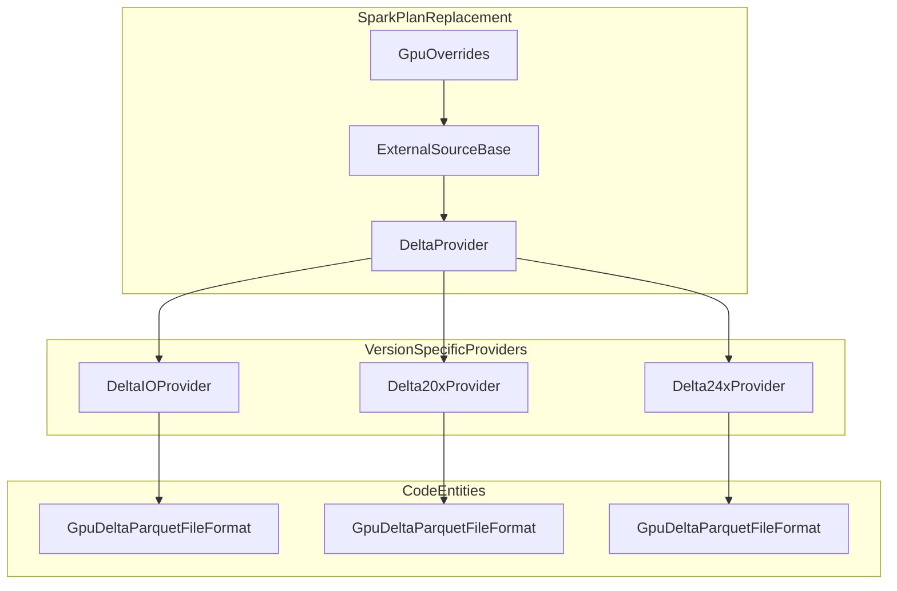
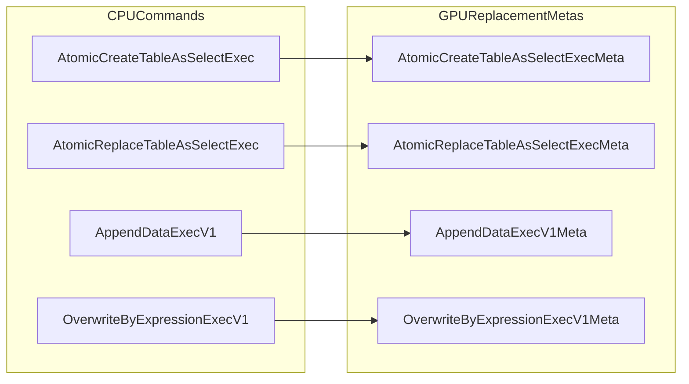

<!-- source: DeepWiki mcp.deepwiki.com · repo NVIDIA/cudf-spark · page 8 Delta Lake Integration · fetched 2026-10-26 -->

# Delta Lake Integration

Relevant source files

The following files were used as context for generating this wiki page:

- [delta-lake/common/src/main/delta-io/scala/com/nvidia/spark/rapids/delta/DeltaIOProvider.scala](delta-lake/common/src/main/delta-io/scala/com/nvidia/spark/rapids/delta/DeltaIOProvider.scala)
- [delta-lake/delta-20x/pom.xml](delta-lake/delta-20x/pom.xml)
- [delta-lake/delta-20x/src/main/scala/com/nvidia/spark/rapids/delta/delta20x/Delta20xProvider.scala](delta-lake/delta-20x/src/main/scala/com/nvidia/spark/rapids/delta/delta20x/Delta20xProvider.scala)
- [delta-lake/delta-21x/pom.xml](delta-lake/delta-21x/pom.xml)
- [delta-lake/delta-21x/src/main/scala/com/nvidia/spark/rapids/delta/delta21x/Delta21xProvider.scala](delta-lake/delta-21x/src/main/scala/com/nvidia/spark/rapids/delta/delta21x/Delta21xProvider.scala)
- [delta-lake/delta-22x/pom.xml](delta-lake/delta-22x/pom.xml)
- [delta-lake/delta-22x/src/main/scala/com/nvidia/spark/rapids/delta/delta22x/Delta22xProvider.scala](delta-lake/delta-22x/src/main/scala/com/nvidia/spark/rapids/delta/delta22x/Delta22xProvider.scala)
- [delta-lake/delta-23x/pom.xml](delta-lake/delta-23x/pom.xml)
- [delta-lake/delta-23x/src/main/scala/com/nvidia/spark/rapids/delta/delta23x/Delta23xProvider.scala](delta-lake/delta-23x/src/main/scala/com/nvidia/spark/rapids/delta/delta23x/Delta23xProvider.scala)
- [delta-lake/delta-24x/pom.xml](delta-lake/delta-24x/pom.xml)
- [delta-lake/delta-24x/src/main/scala/com/nvidia/spark/rapids/delta/delta24x/Delta24xProvider.scala](delta-lake/delta-24x/src/main/scala/com/nvidia/spark/rapids/delta/delta24x/Delta24xProvider.scala)
- [delta-lake/delta-spark330db/pom.xml](delta-lake/delta-spark330db/pom.xml)
- [delta-lake/delta-spark332db/pom.xml](delta-lake/delta-spark332db/pom.xml)
- [delta-lake/delta-stub/pom.xml](delta-lake/delta-stub/pom.xml)
- [scala2.13/delta-lake/delta-20x/pom.xml](scala2.13/delta-lake/delta-20x/pom.xml)
- [scala2.13/delta-lake/delta-21x/pom.xml](scala2.13/delta-lake/delta-21x/pom.xml)
- [scala2.13/delta-lake/delta-22x/pom.xml](scala2.13/delta-lake/delta-22x/pom.xml)
- [scala2.13/delta-lake/delta-23x/pom.xml](scala2.13/delta-lake/delta-23x/pom.xml)
- [scala2.13/delta-lake/delta-24x/pom.xml](scala2.13/delta-lake/delta-24x/pom.xml)
- [sql-plugin/src/main/scala/com/nvidia/spark/rapids/delta/DeltaProvider.scala](sql-plugin/src/main/scala/com/nvidia/spark/rapids/delta/DeltaProvider.scala)
- [sql-plugin/src/main/scala/com/nvidia/spark/rapids/v2WriteCommandMetas.scala](sql-plugin/src/main/scala/com/nvidia/spark/rapids/v2WriteCommandMetas.scala)
- [sql-plugin/src/main/scala/org/apache/spark/sql/rapids/ExternalSource.scala](sql-plugin/src/main/scala/org/apache/spark/sql/rapids/ExternalSource.scala)

The purpose of this page is to provide a high-level overview of GPU-accelerated Delta Lake support in the RAPIDS Accelerator for Apache Spark. This includes the `DeltaProvider` architecture, version-specific modules, and GPU transaction/write paths.

For deep technical details on specific paths, see the child pages:
- [Delta Lake Read Path & Deletion Vectors](#8.1)
- [Delta Lake Write Path & Transactions](#8.2)

---

## DeltaProvider Architecture

Delta Lake evolves rapidly across multiple Spark versions and distributions including open-source Spark (OSS) and Databricks Runtime (DBR). To manage these differences, the RAPIDS Accelerator uses a `DeltaProvider` pattern to isolate version-specific logic and implementation details. The core `DeltaProvider` trait defines the contract for registering GPU rules for commands, expressions, scans, and write paths specific to Delta Lake operations [delta-lake/common/src/main/scala/com/nvidia/spark/rapids/delta/DeltaProvider.scala:49-114]().

The `ExternalSourceBase` trait serves as the entry point in the plugin's plan replacement pipeline, delegating determination of GPU support and conversion to the appropriate `DeltaProvider` [sql-plugin/src/main/scala/org/apache/spark/sql/rapids/ExternalSource.scala:44-58](). Common implementations like `DeltaIOProvider` handle open-source Delta Lake integration [delta-lake/common/src/main/delta-io/scala/com/nvidia/spark/rapids/delta/DeltaIOProvider.scala:50]().

### Version-Specific Modules

To support different Delta Lake versions and Spark distributions, the accelerator includes multiple provider implementations:

- **Open-Source Delta Lake Support**:  
  Implemented for Delta Lake 2.0.x, 2.1.x, 2.2.x, 2.3.x, and 2.4.x in separate modules (e.g., `rapids-4-spark-delta-20x_2.12`, `rapids-4-spark-delta-21x_2.12`, `rapids-4-spark-delta-22x_2.12`, `rapids-4-spark-delta-24x_2.12`) [delta-lake/delta-20x/pom.xml:29-32](), [delta-lake/delta-21x/pom.xml:29-32](), [delta-lake/delta-22x/pom.xml:29-32](), [delta-lake/delta-24x/pom.xml:29-32]().
  
- **Databricks Delta Lake Support**:  
  Databricks DBR versions have specialized modules handling proprietary features like advanced deletion vectors and optimized writes, such as `rapids-4-spark-delta-spark330db_2.12` and `rapids-4-spark-delta-spark332db_2.12` [delta-lake/delta-spark330db/pom.xml:29-32](), [delta-lake/delta-spark332db/pom.xml:29-32]().

### Provider Logic Flow

Sources:  
[sql-plugin/src/main/scala/org/apache/spark/sql/rapids/ExternalSource.scala:44-58](),  
[delta-lake/common/src/main/scala/com/nvidia/spark/rapids/delta/DeltaProvider.scala:49-114](),  
[delta-lake/common/src/main/delta-io/scala/com/nvidia/spark/rapids/delta/DeltaIOProvider.scala:50-75](),  
[delta-lake/delta-20x/pom.xml:29-32](), [delta-lake/delta-21x/pom.xml:29-32](), [delta-lake/delta-22x/pom.xml:29-32](), [delta-lake/delta-24x/pom.xml:29-32](),  
[delta-lake/delta-spark330db/pom.xml:29-32](), [delta-lake/delta-spark332db/pom.xml:29-32]()

---

## Read Path & Deletion Vectors

GPU acceleration of Delta Lake reading primarily revolves around replacing the default `DeltaParquetFileFormat` with RAPIDS-optimized GPU file formats. A significant feature of Delta in modern deployments is efficient row-level deletes using **Deletion Vectors (DVs)**. The RAPIDS Accelerator provides native DV support by enabling GPU-side filtering of deleted rows, minimizing CPU fallback and enhancing performance [delta-lake/common/src/main/scala/com/nvidia/spark/rapids/delta/DeltaProvider.scala:65-114]().

- **GpuDeltaParquetFileFormat**: The core GPU implementation for reading Delta Parquet files, integrating with RAPIDS scan rules to apply columnar GPU reading [delta-lake/common/src/main/scala/com/nvidia/spark/rapids/delta/DeltaProvider.scala:69-71]().
- **Native Deletion Vector Support**: Enables pushing predicates directly into the GPU Parquet reader to prune deleted rows via deletion vector metadata.

For more details on the GPU-accelerated Delta read path and deletion vector handling, see the child page:  
[Delta Lake Read Path & Deletion Vectors](#8.1)

Sources:  
[delta-lake/common/src/main/scala/com/nvidia/spark/rapids/delta/DeltaProvider.scala:65-114](),  
[delta-lake/common/src/main/delta-io/scala/com/nvidia/spark/rapids/delta/DeltaIOProvider.scala:55-75]()

---

## Write Path & Transactions

The RAPIDS Accelerator adds GPU-accelerated support for Delta Lake Data Manipulation Language (DML) commands such as `DELETE`, `UPDATE`, and `MERGE`, as well as table optimization operations and atomic table creation/replacement (`AtomicCreateTableAsSelectExec` and `AtomicReplaceTableAsSelectExec`) [delta-lake/common/src/main/scala/com/nvidia/spark/rapids/delta/DeltaProvider.scala:75-99]().

Specialized GPU transaction logic includes sophisticated statistics tracking, auto-compaction via execution hooks, and layout optimization techniques.

### Write Path Mapping Diagram

For further details on write paths, transactions, and DML commands, see the child page:  
[Delta Lake Write Path & Transactions](#8.2)

Sources:  
[delta-lake/common/src/main/scala/com/nvidia/spark/rapids/delta/DeltaProvider.scala:75-99](),  
[delta-lake/common/src/main/delta-io/scala/com/nvidia/spark/rapids/delta/DeltaIOProvider.scala:88-112]()

---

## Configuration Summary

| Property | Description | Default |
| :--- | :--- | :--- |
| `spark.rapids.sql.format.delta.read.enabled` | Enables GPU acceleration for Delta Lake reads. | `true` |
| `spark.rapids.sql.format.delta.write.enabled` | Enables GPU acceleration for Delta Lake writes/DML. | `false` |
| `spark.rapids.sql.command.DeleteCommand` | Enables GPU acceleration for `DELETE`. | `false` |
| `spark.rapids.sql.command.UpdateCommand` | Enables GPU acceleration for `UPDATE`. | `false` |
| `spark.rapids.sql.command.MergeIntoCommand` | Enables GPU acceleration for `MERGE`. | `false` |
| `spark.rapids.sql.delta.deletionVectors.predicatePushdown.enabled` | Enables pushing predicates into native deletion vector scan. | `true` |

Sources:  
[delta-lake/common/src/main/scala/com/nvidia/spark/rapids/delta/DeltaProvider.scala:104-105]()

---

This page provides the foundational understanding of how Delta Lake GPU acceleration is structured and integrated in the RAPIDS Accelerator. For further in-depth technical details, usage examples, and tuning tips, please consult the child pages:

- [Delta Lake Read Path & Deletion Vectors](#8.1)
- [Delta Lake Write Path & Transactions](#8.2)

---

