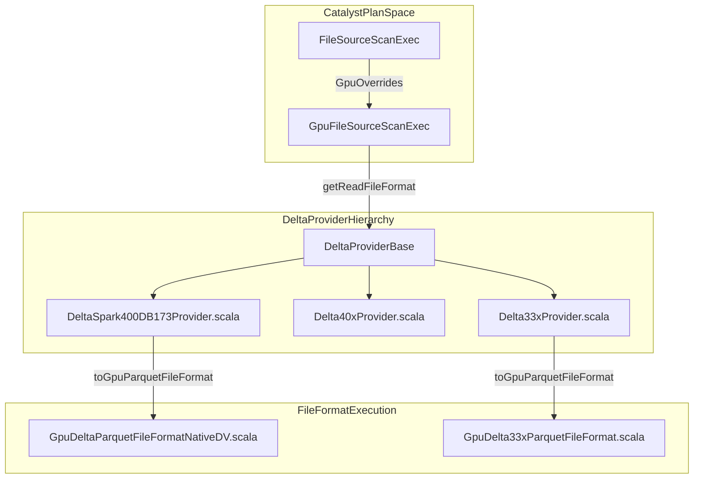
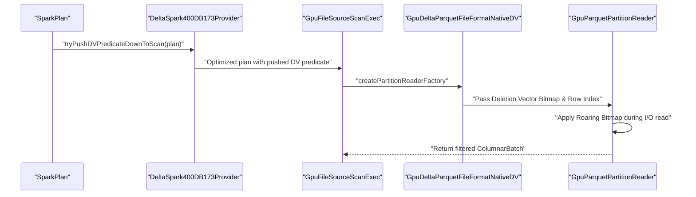
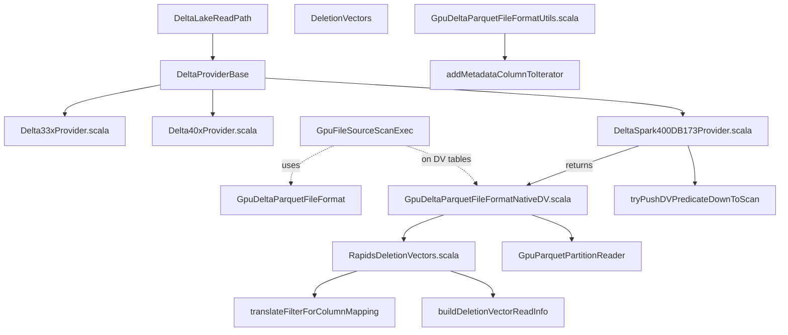

<!-- source: DeepWiki mcp.deepwiki.com · repo NVIDIA/cudf-spark · page 8.1 Delta Lake Read Path & Deletion Vectors · fetched 2026-10-26 -->

# Delta Lake Read Path & Deletion Vectors

Relevant source files

The following files were used as context for generating this wiki page:

- [delta-lake/common/src/main/delta-33x-42x/scala/com/nvidia/spark/rapids/delta/common/GpuDeltaParquetFileFormatBase2.scala](delta-lake/common/src/main/delta-33x-42x/scala/com/nvidia/spark/rapids/delta/common/GpuDeltaParquetFileFormatBase2.scala)
- [delta-lake/common/src/main/delta-io/scala/com/nvidia/spark/rapids/delta/DeltaIOProvider.scala](delta-lake/common/src/main/delta-io/scala/com/nvidia/spark/rapids/delta/DeltaIOProvider.scala)
- [delta-lake/common/src/main/scala/com/nvidia/spark/rapids/delta/GpuDeltaParquetFileFormatUtils.scala](delta-lake/common/src/main/scala/com/nvidia/spark/rapids/delta/GpuDeltaParquetFileFormatUtils.scala)
- [delta-lake/delta-20x/src/main/scala/com/nvidia/spark/rapids/delta/delta20x/Delta20xProvider.scala](delta-lake/delta-20x/src/main/scala/com/nvidia/spark/rapids/delta/delta20x/Delta20xProvider.scala)
- [delta-lake/delta-21x/src/main/scala/com/nvidia/spark/rapids/delta/delta21x/Delta21xProvider.scala](delta-lake/delta-21x/src/main/scala/com/nvidia/spark/rapids/delta/delta21x/Delta21xProvider.scala)
- [delta-lake/delta-22x/src/main/scala/com/nvidia/spark/rapids/delta/delta22x/Delta22xProvider.scala](delta-lake/delta-22x/src/main/scala/com/nvidia/spark/rapids/delta/delta22x/Delta22xProvider.scala)
- [delta-lake/delta-23x/src/main/scala/com/nvidia/spark/rapids/delta/delta23x/Delta23xProvider.scala](delta-lake/delta-23x/src/main/scala/com/nvidia/spark/rapids/delta/delta23x/Delta23xProvider.scala)
- [delta-lake/delta-24x/src/main/scala/com/nvidia/spark/rapids/delta/delta24x/Delta24xProvider.scala](delta-lake/delta-24x/src/main/scala/com/nvidia/spark/rapids/delta/delta24x/Delta24xProvider.scala)
- [delta-lake/delta-24x/src/main/scala/org/apache/spark/sql/delta/rapids/delta24x/GpuLowShuffleMergeCommand.scala](delta-lake/delta-24x/src/main/scala/org/apache/spark/sql/delta/rapids/delta24x/GpuLowShuffleMergeCommand.scala)
- [delta-lake/delta-33x/src/main/scala/com/nvidia/spark/rapids/delta/delta33x/Delta33xProvider.scala](delta-lake/delta-33x/src/main/scala/com/nvidia/spark/rapids/delta/delta33x/Delta33xProvider.scala)
- [delta-lake/delta-40x/src/main/scala/com/nvidia/spark/rapids/delta/delta40x/Delta40xProvider.scala](delta-lake/delta-40x/src/main/scala/com/nvidia/spark/rapids/delta/delta40x/Delta40xProvider.scala)
- [delta-lake/delta-41x/src/main/scala/com/nvidia/spark/rapids/delta/delta41x/Delta41xProvider.scala](delta-lake/delta-41x/src/main/scala/com/nvidia/spark/rapids/delta/delta41x/Delta41xProvider.scala)
- [delta-lake/delta-spark400db173/src/main/scala/com/databricks/sql/transaction/tahoe/rapids/GpuCheckOverflowInTableWrite.scala](delta-lake/delta-spark400db173/src/main/scala/com/databricks/sql/transaction/tahoe/rapids/GpuCheckOverflowInTableWrite.scala)
- [delta-lake/delta-spark400db173/src/main/scala/com/databricks/sql/transaction/tahoe/rapids/GpuLowShuffleMergeCommand.scala](delta-lake/delta-spark400db173/src/main/scala/com/databricks/sql/transaction/tahoe/rapids/GpuLowShuffleMergeCommand.scala)
- [delta-lake/delta-spark400db173/src/main/scala/com/nvidia/spark/rapids/delta/DeltaSpark400DB173Provider.scala](delta-lake/delta-spark400db173/src/main/scala/com/nvidia/spark/rapids/delta/DeltaSpark400DB173Provider.scala)
- [delta-lake/delta-spark400db173/src/main/scala/com/nvidia/spark/rapids/delta/GpuDeltaParquetFileFormat.scala](delta-lake/delta-spark400db173/src/main/scala/com/nvidia/spark/rapids/delta/GpuDeltaParquetFileFormat.scala)
- [delta-lake/delta-spark400db173/src/main/scala/com/nvidia/spark/rapids/delta/GpuDeltaParquetFileFormatNativeDV.scala](delta-lake/delta-spark400db173/src/main/scala/com/nvidia/spark/rapids/delta/GpuDeltaParquetFileFormatNativeDV.scala)
- [delta-lake/delta-spark400db173/src/main/scala/com/nvidia/spark/rapids/delta/RapidsDeletionVectors.scala](delta-lake/delta-spark400db173/src/main/scala/com/nvidia/spark/rapids/delta/RapidsDeletionVectors.scala)
- [integration_tests/src/main/python/delta_lake_low_shuffle_merge_test.py](integration_tests/src/main/python/delta_lake_low_shuffle_merge_test.py)
- [integration_tests/src/main/python/delta_lake_test.py](integration_tests/src/main/python/delta_lake_test.py)
- [sql-plugin/src/main/scala/com/nvidia/spark/rapids/delta/DeltaProvider.scala](sql-plugin/src/main/scala/com/nvidia/spark/rapids/delta/DeltaProvider.scala)
- [sql-plugin/src/main/scala/com/nvidia/spark/rapids/v2WriteCommandMetas.scala](sql-plugin/src/main/scala/com/nvidia/spark/rapids/v2WriteCommandMetas.scala)
- [sql-plugin/src/main/scala/org/apache/spark/sql/rapids/ExternalSource.scala](sql-plugin/src/main/scala/org/apache/spark/sql/rapids/ExternalSource.scala)

## Purpose and Scope

This page covers the architecture, implementation details, and data flow for GPU-accelerated Delta Lake reads within the RAPIDS Accelerator for Apache Spark. It focuses on how Delta tables are scanned on the GPU using `GpuDeltaParquetFileFormat` and its variants, how deletion vectors (DVs) are processed via `RapidsDeletionVectors` and `GpuDeltaParquetFileFormatNativeDV`, how row metadata and deletion filtering are coordinated via `GpuDeltaParquetFileFormatUtils`, and how the `DeltaProvider` pattern isolates version-specific Delta Lake dependencies across open-source Delta and Databricks Runtime (DBR) environments.

Sources:
[delta-lake/delta-33x/src/main/scala/com/nvidia/spark/rapids/delta/delta33x/Delta33xProvider.scala:32-120](),
[delta-lake/delta-spark400db173/src/main/scala/com/nvidia/spark/rapids/delta/DeltaSpark400DB173Provider.scala:83-143](),
[delta-lake/common/src/main/scala/com/nvidia/spark/rapids/delta/GpuDeltaParquetFileFormatUtils.scala:28-100]()

---

## Overview and Provider Pattern

Delta Lake support in the RAPIDS Accelerator uses a **provider pattern** to cleanly decouple Delta version-specific classes and optional libraries from core plugin logic. The `DeltaProvider` trait and its base implementations define the stable interface for accelerating Delta Lake operations, such as file format translations, metadata handling, and rule registrations.

At runtime, specialized providers such as:

- `Delta33xProvider` (for Delta 3.3.x series)
- `Delta40xProvider` (for Delta 4.0.x series)
- `DeltaSpark400DB173Provider` (for Databricks Runtime 17.3 and Spark 4.0)

handle version discrepancies across Databricks Runtime and open-source Delta Lake releases.

### System Architecture: Delta Read Path Integration

The architecture below illustrates how Catalyst CPU execution plans featuring Delta Lake scans are intercepted and replaced with GPU-accelerated counterparts via provider-driven file format translations and scan rule overrides.

### Diagram: Delta Read Path Provider Architecture

Sources:
[sql-plugin/src/main/scala/com/nvidia/spark/rapids/delta/DeltaProvider.scala:48-114](),
[delta-lake/delta-33x/src/main/scala/com/nvidia/spark/rapids/delta/delta33x/Delta33xProvider.scala:32-118](),
[delta-lake/delta-spark400db173/src/main/scala/com/nvidia/spark/rapids/delta/DeltaSpark400DB173Provider.scala:120-143]()

---

## GpuDeltaParquetFileFormat and Variants

The GPU file format classes bridge Delta Lake's native `DeltaParquetFileFormat` and the RAPIDS Accelerator's columnar Parquet reading pipeline.

### Key Responsibilities

- **Column Mapping Handling:** Delta Lake supports column mapping modes (`IdMapping` and `NameMapping`), where physical Parquet column names differ from logical Spark schema names. The `GpuDeltaParquetFileFormat` classes rewrite column names and pushdown filters to physical names so that GPU readers correctly target underlying Parquet file data, even after schema evolution such as column renaming or dropping (`[delta-lake/delta-spark400db173/src/main/scala/com/nvidia/spark/rapids/delta/GpuDeltaParquetFileFormatNativeDV.scala:102-132]()`).

- **Deletion Vector Integration:** These classes accept deletion vector descriptors and directly pass them to the native cuDF Parquet readers or coordinate with row-index filters. This allows filtering of rows at the I/O layer itself by enforcing deletion vector bitmaps, avoiding extra CPU-side post-filtering (`[delta-lake/delta-spark400db173/src/main/scala/com/nvidia/spark/rapids/delta/GpuDeltaParquetFileFormatNativeDV.scala:72-100]()`).

- **Filter Pushdown Rewriting:** Catalyst `Filter` expressions targeting logical column names are translated into filters on the physical column names before applying predicate pushdown to Parquet readers (`[delta-lake/delta-spark400db173/src/main/scala/com/nvidia/spark/rapids/delta/GpuDeltaParquetFileFormatNativeDV.scala:154-180]()`).

- **Base2 Format Variants:** Classes such as `GpuDeltaParquetFileFormatBase2` extend standard Delta Parquet file format logic to support modern Databricks features, type widening assertions, and internal row index metadata (`[delta-lake/common/src/main/delta-33x-42x/scala/com/nvidia/spark/rapids/delta/common/GpuDeltaParquetFileFormatBase2.scala:79-110]()`).

Sources:
[delta-lake/delta-spark400db173/src/main/scala/com/nvidia/spark/rapids/delta/GpuDeltaParquetFileFormatNativeDV.scala:72-132](),
[delta-lake/common/src/main/delta-33x-42x/scala/com/nvidia/spark/rapids/delta/common/GpuDeltaParquetFileFormatBase2.scala:79-138]()

---

## Deletion Vectors (DV) & RapidsDeletionVectors

Deletion Vectors implement **soft deletes** in Delta Lake by storing delete bitmaps externally from immutable Parquet files. This avoids repeated rewrites of large immutable Parquet data files on logical delete operations.

The RAPIDS Accelerator supports two modes for deletion vector processing:

### 1. Fallback / Filter-Based Deletion Vectors

If native GPU deletion vector pushdown is disabled or unavailable on a runtime/version, Delta tables containing DVs cause scan plan fallback to CPU or use standard Spark `FilterExec` expressions to enforce deletions downstream from the scan (`[delta-lake/delta-33x/src/main/scala/com/nvidia/spark/rapids/delta/delta33x/Delta33xProvider.scala:95-120]()`).

### 2. Native GPU Deletion Vectors with `GpuDeltaParquetFileFormatNativeDV`

On supported runtimes (e.g., Databricks 17.3+, Spark 4.0+), the plugin uses:

- The `GpuDeltaParquetFileFormatNativeDV` class to apply native deletion vector filters during Parquet reading (`[delta-lake/delta-spark400db173/src/main/scala/com/nvidia/spark/rapids/delta/GpuDeltaParquetFileFormatNativeDV.scala:72-83]()`).
- The `RapidsDeletionVectors` utility to decode deletion vector descriptors and provide row index filters (`[delta-lake/delta-spark400db173/src/main/scala/com/nvidia/spark/rapids/delta/RapidsDeletionVectors.scala:48-60]()`).
- Native cuDF APIs implementing Roaring Bitmap filters applied during the scan to skip deleted rows at the GPU I/O layer directly.

#### Deletion Vector Data Flow

### Diagram: Deletion Vector Processing Data Flow

Sources:
[delta-lake/delta-spark400db173/src/main/scala/com/nvidia/spark/rapids/delta/DeltaSpark400DB173Provider.scala:155-160](),
[delta-lake/delta-spark400db173/src/main/scala/com/nvidia/spark/rapids/delta/GpuDeltaParquetFileFormatNativeDV.scala:72-83]()

---

## Metadata Columns & Utilities

The `GpuDeltaParquetFileFormatUtils` object and related helper classes manage internal row index metadata and deletion marker columns required when evaluating scans and mapping batch ranges (`[delta-lake/common/src/main/scala/com/nvidia/spark/rapids/delta/GpuDeltaParquetFileFormatUtils.scala:28-48]()`).

### Key Utilities

- **`METADATA_ROW_IDX_COL` (`__metadata_row_index`)**: Represents the physical row number within the source file, which acts as a unique row identifier when paired with file paths (`[delta-lake/common/src/main/scala/com/nvidia/spark/rapids/delta/GpuDeltaParquetFileFormatUtils.scala:34-36]()`).
- **`METADATA_ROW_DEL_COL` (`__metadata_row_del`)**: Boolean column tracking whether a row has been marked deleted (`[delta-lake/common/src/main/scala/com/nvidia/spark/rapids/delta/GpuDeltaParquetFileFormatUtils.scala:38-40]()`).
- **`addMetadataColumnToIterator`**: Injects row index sequences and scatter-maps roaring bitmap deletion vectors onto columnar batches on the GPU (`[delta-lake/common/src/main/scala/com/nvidia/spark/rapids/delta/GpuDeltaParquetFileFormatUtils.scala:50-88]()`).
- **`RoaringBitmapIterator`**: Adapts Roaring Bitmap iterators to chunk position streams for vectorized table scattering operations (`[delta-lake/common/src/main/scala/com/nvidia/spark/rapids/delta/GpuDeltaParquetFileFormatUtils.scala:163-173]()`).

Sources:
[delta-lake/common/src/main/scala/com/nvidia/spark/rapids/delta/GpuDeltaParquetFileFormatUtils.scala:28-173]()

---

## RapidsDeletionVectors: Implementation Details

The `RapidsDeletionVectors` object manages decoding and accessing deletion vector metadata, and translates row-level filters for Delta column mapping when necessary.

### Highlights

- **Filter Translation for Column Mapping:** The method `translateFilterForColumnMapping` converts Catalyst filters on logical names to those on physical column names, compatible with Parquet files in Delta tables with column mapping enabled (`[delta-lake/delta-spark400db173/src/main/scala/com/nvidia/spark/rapids/delta/RapidsDeletionVectors.scala:65-122]()`).

- **Deletion Vector Lookup:** The `buildDeletionVectorReadInfo` function maps Delta table files to their associated deletion vector descriptors and the corresponding `RowIndexFilterProvider` instances (`[delta-lake/delta-spark400db173/src/main/scala/com/nvidia/spark/rapids/delta/RapidsDeletionVectors.scala:124-160]()`).

- **Missing Filter Handling:** Contains robust assertions and exception checks (`isMissingRowIndexFilterAssertion`) to handle missing row index filters gracefully across Databricks and open-source Delta implementations (`[delta-lake/delta-spark400db173/src/main/scala/com/nvidia/spark/rapids/delta/RapidsDeletionVectors.scala:57-60]()`).

Sources:
[delta-lake/delta-spark400db173/src/main/scala/com/nvidia/spark/rapids/delta/RapidsDeletionVectors.scala:48-160]()

---

## Configuration Properties

| Property | Default | Description |
| :--- | :--- | :--- |
| `spark.rapids.sql.delta.deletionVectors.predicatePushdown.enabled` | `true` | Enables pushing deletion vector predicates into the GPU Parquet reader. |
| `spark.databricks.delta.deletionVectors.useMetadataRowIndex` | `true` | Enables use of the Delta table's metadata row index needed for native deletion vector filtering on Databricks. |
| `spark.rapids.sql.format.delta.write.enabled` | `false` | Enables accelerating Delta Lake write operations on GPU. |

These flags control whether native DV support is enabled at runtime and how Delta file formats are translated to GPU-accelerated variants with or without DV predicate pushdown.

Sources:
[delta-lake/delta-spark400db173/src/main/scala/com/nvidia/spark/rapids/delta/DeltaSpark400DB173Provider.scala:147-155](),
[delta-lake/delta-33x/src/main/scala/com/nvidia/spark/rapids/delta/delta33x/Delta33xProvider.scala:46-49]()

---

## GPU Parquet Scan Integration for Delta Tables

Delta table scans in the RAPIDS Accelerator integrate tightly with `GpuFileSourceScanExec` and the underlying GPU Parquet reader by:

- Supporting **row index offset tracking** per file and row group, required for native DV enforcement where row position is needed to filter based on Roaring Bitmaps.

- Providing specialized implementations in the providers (e.g., `DeltaSpark400DB173Provider`) to:

  - Inject native deletion vector predicate pushdown via `tryPushDVPredicateDownToScan` which rewrites the plan with references to DV-based row index filters (`[delta-lake/delta-spark400db173/src/main/scala/com/nvidia/spark/rapids/delta/DeltaSpark400DB173Provider.scala:157-160]()`).

  - Return GPU-compatible Parquet file formats (`GpuDeltaParquetFileFormatNativeDV` or variants) that override the native scan `createReaderFactory` to propagate deletion vector information to the GPU scan operators (`[delta-lake/delta-spark400db173/src/main/scala/com/nvidia/spark/rapids/delta/DeltaSpark400DB173Provider.scala:125-145]()`).

  - Prune temporary row-index metadata columns via `pruneFileMetadata` after native evaluation occurs (`[delta-lake/delta-spark400db173/src/main/scala/com/nvidia/spark/rapids/delta/DeltaSpark400DB173Provider.scala:162-165]()`).

Sources:
[delta-lake/delta-spark400db173/src/main/scala/com/nvidia/spark/rapids/delta/DeltaSpark400DB173Provider.scala:125-165]()

---

## Summary Diagram: Natural Language to Code Entity Mapping

The following diagram bridges high-level domain concepts to concrete code entities in the codebase:

### Diagram: Delta Lake Read Path Code Mapping

Sources:
[sql-plugin/src/main/scala/com/nvidia/spark/rapids/delta/DeltaProvider.scala:48-114](),
[delta-lake/delta-spark400db173/src/main/scala/com/nvidia/spark/rapids/delta/DeltaSpark400DB173Provider.scala:83-165](),
[delta-lake/delta-spark400db173/src/main/scala/com/nvidia/spark/rapids/delta/RapidsDeletionVectors.scala:48-160](),
[delta-lake/delta-spark400db173/src/main/scala/com/nvidia/spark/rapids/delta/GpuDeltaParquetFileFormatNativeDV.scala:72-132](),
[delta-lake/common/src/main/scala/com/nvidia/spark/rapids/delta/GpuDeltaParquetFileFormatUtils.scala:28-100]()

---

## Summary

The RAPIDS Accelerator implements GPU-accelerated Delta Lake reads via a version-aware provider pattern encapsulating the complexities of Delta versions and Databricks Runtime nuances. Native GPU support for Delta Deletion Vectors enables efficient soft delete handling by applying Roaring Bitmap filters at the Parquet I/O layer, reducing CPU and I/O overheads. The integration spans plan replacement, file format translation, filter rewriting, metadata injection via `GpuDeltaParquetFileFormatUtils`, and native scan enhancements.

Sources:
[delta-lake/delta-33x/src/main/scala/com/nvidia/spark/rapids/delta/delta33x/Delta33xProvider.scala:32-118](),
[delta-lake/delta-spark400db173/src/main/scala/com/nvidia/spark/rapids/delta/DeltaSpark400DB173Provider.scala:83-158](),
[delta-lake/delta-spark400db173/src/main/scala/com/nvidia/spark/rapids/delta/RapidsDeletionVectors.scala:48-148](),
[delta-lake/delta-spark400db173/src/main/scala/com/nvidia/spark/rapids/delta/GpuDeltaParquetFileFormatNativeDV.scala:72-132](),
[delta-lake/common/src/main/scala/com/nvidia/spark/rapids/delta/GpuDeltaParquetFileFormatUtils.scala:28-100]()

---

