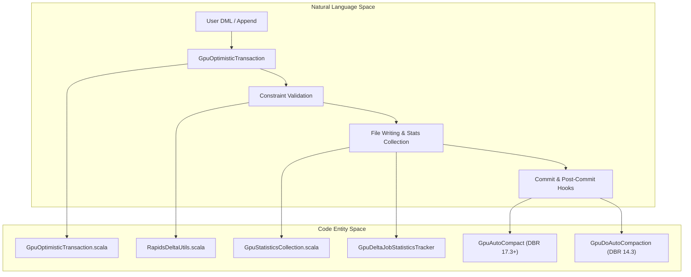
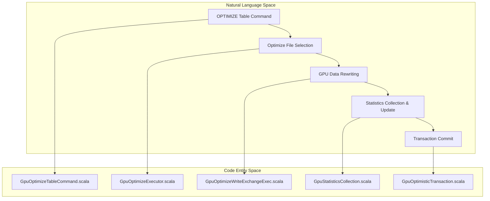

<!-- source: DeepWiki mcp.deepwiki.com · repo NVIDIA/cudf-spark · page 8.2 Delta Lake Write Path & Transactions · fetched 2026-10-26 -->

# Delta Lake Write Path & Transactions

Relevant source files

The following files were used as context for generating this wiki page:

- [delta-lake/common/src/main/databricks/scala/com/databricks/sql/transaction/tahoe/rapids/GpuDeltaLog.scala](delta-lake/common/src/main/databricks/scala/com/databricks/sql/transaction/tahoe/rapids/GpuDeltaLog.scala)
- [delta-lake/common/src/main/databricks/scala/com/nvidia/spark/rapids/delta/RapidsDeltaSQLConf.scala](delta-lake/common/src/main/databricks/scala/com/nvidia/spark/rapids/delta/RapidsDeltaSQLConf.scala)
- [delta-lake/common/src/main/databricks/scala/com/nvidia/spark/rapids/delta/RapidsDeltaUtils.scala](delta-lake/common/src/main/databricks/scala/com/nvidia/spark/rapids/delta/RapidsDeltaUtils.scala)
- [delta-lake/common/src/main/databricks/scala/org/apache/spark/sql/rapids/delta/GpuOptimizeWriteExchangeExec.scala](delta-lake/common/src/main/databricks/scala/org/apache/spark/sql/rapids/delta/GpuOptimizeWriteExchangeExec.scala)
- [delta-lake/common/src/main/db-350db143-400db173/scala/com/databricks/sql/transaction/tahoe/rapids/GpuOptimisticTransactionBaseCommon.scala](delta-lake/common/src/main/db-350db143-400db173/scala/com/databricks/sql/transaction/tahoe/rapids/GpuOptimisticTransactionBaseCommon.scala)
- [delta-lake/common/src/main/db-350db143-400db173/scala/com/databricks/sql/transaction/tahoe/rapids/GpuOptimisticTransactionWriteBase.scala](delta-lake/common/src/main/db-350db143-400db173/scala/com/databricks/sql/transaction/tahoe/rapids/GpuOptimisticTransactionWriteBase.scala)
- [delta-lake/common/src/main/db-350db143-400db173/scala/com/databricks/sql/transaction/tahoe/rapids/GpuOptimizeExecutorBase.scala](delta-lake/common/src/main/db-350db143-400db173/scala/com/databricks/sql/transaction/tahoe/rapids/GpuOptimizeExecutorBase.scala)
- [delta-lake/common/src/main/delta-33x/scala/org/apache/spark/sql/delta/rapids/GpuOptimizeWriteExchangeExec.scala](delta-lake/common/src/main/delta-33x/scala/org/apache/spark/sql/delta/rapids/GpuOptimizeWriteExchangeExec.scala)
- [delta-lake/common/src/main/delta-40x-42x/scala/org/apache/spark/sql/delta/rapids/GpuOptimizeWriteExchangeExec.scala](delta-lake/common/src/main/delta-40x-42x/scala/org/apache/spark/sql/delta/rapids/GpuOptimizeWriteExchangeExec.scala)
- [delta-lake/common/src/main/scala/com/nvidia/spark/rapids/delta/GpuRapidsProcessDeltaMergeJoinExec.scala](delta-lake/common/src/main/scala/com/nvidia/spark/rapids/delta/GpuRapidsProcessDeltaMergeJoinExec.scala)
- [delta-lake/common/src/main/scala/com/nvidia/spark/rapids/delta/GpuStatisticsCollection.scala](delta-lake/common/src/main/scala/com/nvidia/spark/rapids/delta/GpuStatisticsCollection.scala)
- [delta-lake/delta-20x/src/main/scala/org/apache/spark/sql/delta/rapids/delta20x/GpuOptimisticTransaction.scala](delta-lake/delta-20x/src/main/scala/org/apache/spark/sql/delta/rapids/delta20x/GpuOptimisticTransaction.scala)
- [delta-lake/delta-21x/src/main/scala/org/apache/spark/sql/delta/rapids/delta21x/GpuOptimisticTransaction.scala](delta-lake/delta-21x/src/main/scala/org/apache/spark/sql/delta/rapids/delta21x/GpuOptimisticTransaction.scala)
- [delta-lake/delta-22x/src/main/scala/org/apache/spark/sql/delta/rapids/delta22x/GpuOptimisticTransaction.scala](delta-lake/delta-22x/src/main/scala/org/apache/spark/sql/delta/rapids/delta22x/GpuOptimisticTransaction.scala)
- [delta-lake/delta-24x/src/main/scala/org/apache/spark/sql/delta/rapids/delta24x/GpuOptimisticTransaction.scala](delta-lake/delta-24x/src/main/scala/org/apache/spark/sql/delta/rapids/delta24x/GpuOptimisticTransaction.scala)
- [delta-lake/delta-spark330db/src/main/scala/com/databricks/sql/transaction/tahoe/rapids/GpuDoAutoCompaction.scala](delta-lake/delta-spark330db/src/main/scala/com/databricks/sql/transaction/tahoe/rapids/GpuDoAutoCompaction.scala)
- [delta-lake/delta-spark330db/src/main/scala/com/databricks/sql/transaction/tahoe/rapids/GpuOptimisticTransaction.scala](delta-lake/delta-spark330db/src/main/scala/com/databricks/sql/transaction/tahoe/rapids/GpuOptimisticTransaction.scala)
- [delta-lake/delta-spark332db/src/main/scala/com/databricks/sql/transaction/tahoe/rapids/GpuOptimisticTransaction.scala](delta-lake/delta-spark332db/src/main/scala/com/databricks/sql/transaction/tahoe/rapids/GpuOptimisticTransaction.scala)
- [delta-lake/delta-spark350db143/src/main/scala/com/databricks/sql/transaction/tahoe/rapids/GpuOptimisticTransaction.scala](delta-lake/delta-spark350db143/src/main/scala/com/databricks/sql/transaction/tahoe/rapids/GpuOptimisticTransaction.scala)
- [delta-lake/delta-spark350db143/src/main/scala/com/databricks/sql/transaction/tahoe/rapids/GpuOptimisticTransactionBase.scala](delta-lake/delta-spark350db143/src/main/scala/com/databricks/sql/transaction/tahoe/rapids/GpuOptimisticTransactionBase.scala)
- [delta-lake/delta-spark400db173/src/main/scala/com/databricks/sql/transaction/tahoe/rapids/GpuMergeIntoCommand.scala](delta-lake/delta-spark400db173/src/main/scala/com/databricks/sql/transaction/tahoe/rapids/GpuMergeIntoCommand.scala)
- [delta-lake/delta-spark400db173/src/main/scala/com/databricks/sql/transaction/tahoe/rapids/GpuOptimisticTransaction.scala](delta-lake/delta-spark400db173/src/main/scala/com/databricks/sql/transaction/tahoe/rapids/GpuOptimisticTransaction.scala)
- [delta-lake/delta-spark400db173/src/main/scala/com/databricks/sql/transaction/tahoe/rapids/GpuOptimisticTransactionBase.scala](delta-lake/delta-spark400db173/src/main/scala/com/databricks/sql/transaction/tahoe/rapids/GpuOptimisticTransactionBase.scala)
- [delta-lake/delta-spark400db173/src/main/scala/com/databricks/sql/transaction/tahoe/rapids/GpuOptimizeExecutor.scala](delta-lake/delta-spark400db173/src/main/scala/com/databricks/sql/transaction/tahoe/rapids/GpuOptimizeExecutor.scala)
- [delta-lake/delta-spark400db173/src/main/scala/com/databricks/sql/transaction/tahoe/rapids/GpuOptimizeTableCommand.scala](delta-lake/delta-spark400db173/src/main/scala/com/databricks/sql/transaction/tahoe/rapids/GpuOptimizeTableCommand.scala)
- [delta-lake/delta-spark400db173/src/main/scala/com/nvidia/spark/rapids/delta/OptimizeTableCommandMeta.scala](delta-lake/delta-spark400db173/src/main/scala/com/nvidia/spark/rapids/delta/OptimizeTableCommandMeta.scala)
- [delta-lake/delta-spark400db173/src/main/scala/com/nvidia/spark/rapids/delta/shims/MergeIntoCommandMetaShim.scala](delta-lake/delta-spark400db173/src/main/scala/com/nvidia/spark/rapids/delta/shims/MergeIntoCommandMetaShim.scala)
- [delta-lake/delta-spark400db173/src/main/scala/com/nvidia/spark/rapids/delta/shims/OptimizeTableCommandMetaShim.scala](delta-lake/delta-spark400db173/src/main/scala/com/nvidia/spark/rapids/delta/shims/OptimizeTableCommandMetaShim.scala)
- [integration_tests/src/main/python/asserts.py](integration_tests/src/main/python/asserts.py)
- [integration_tests/src/main/python/delta_lake_auto_compact_test.py](integration_tests/src/main/python/delta_lake_auto_compact_test.py)
- [integration_tests/src/main/python/delta_lake_delete_test.py](integration_tests/src/main/python/delta_lake_delete_test.py)
- [integration_tests/src/main/python/delta_lake_liquid_clustering_test.py](integration_tests/src/main/python/delta_lake_liquid_clustering_test.py)
- [integration_tests/src/main/python/delta_lake_merge_common.py](integration_tests/src/main/python/delta_lake_merge_common.py)
- [integration_tests/src/main/python/delta_lake_merge_test.py](integration_tests/src/main/python/delta_lake_merge_test.py)
- [integration_tests/src/main/python/delta_lake_update_test.py](integration_tests/src/main/python/delta_lake_update_test.py)
- [integration_tests/src/main/python/delta_lake_utils.py](integration_tests/src/main/python/delta_lake_utils.py)
- [integration_tests/src/main/python/delta_lake_write_test.py](integration_tests/src/main/python/delta_lake_write_test.py)
- [sql-plugin/src/main/scala/org/apache/spark/sql/rapids/ExecutionPlanCaptureCallback.scala](sql-plugin/src/main/scala/org/apache/spark/sql/rapids/ExecutionPlanCaptureCallback.scala)
- [sql-plugin/src/main/scala/org/apache/spark/sql/rapids/ShimmedExecutionPlanCaptureCallbackImpl.scala](sql-plugin/src/main/scala/org/apache/spark/sql/rapids/ShimmedExecutionPlanCaptureCallbackImpl.scala)
- [sql-plugin/src/test/scala/com/nvidia/spark/rapids/RangeInputBatchingSuite.scala](sql-plugin/src/test/scala/com/nvidia/spark/rapids/RangeInputBatchingSuite.scala)

This page documents the GPU-accelerated write path, statistics collection, transaction management, DML commands (delete, update, merge), table optimization, auto-compaction, and liquid clustering integrations for Delta Lake within the RAPIDS Accelerator for Apache Spark.

---

## Purpose & Scope

The write path and transactional subsystem in the RAPIDS Accelerator bridges Apache Spark's Delta Lake commands and transactions with GPU-accelerated execution pipelines. By replacing standard CPU execution with classes such as `GpuOptimisticTransaction`, `GpuStatisticsCollection`, `GpuMergeIntoCommand`, and `GpuOptimizeExecutor`, the plugin ensures that file writing, constraint evaluation, data skipping statistics collection, and maintenance operations execute directly on GPU memory without unnecessary host-device roundtrips.

Sources:
`[delta-lake/delta-spark330db/src/main/scala/com/databricks/sql/transaction/tahoe/rapids/GpuOptimisticTransaction.scala:66-88]`,
`[delta-lake/common/src/main/scala/com/nvidia/spark/rapids/delta/GpuStatisticsCollection.scala:37-44]`,
`[delta-lake/common/src/main/databricks/scala/com/nvidia/spark/rapids/delta/RapidsDeltaUtils.scala:28-44]`

---

## GpuOptimisticTransaction Variants & Transaction Flow

`GpuOptimisticTransaction` manages GPU-accelerated transactions in Delta Lake, mirroring the CPU's `OptimisticTransaction` while routing file-writing, constraint-checking, and statistics collection phases to GPU-native operators.

### Version Variants
Because Delta Lake and Databricks runtime APIs frequently evolve across minor and patch versions, the plugin implements multiple version-specific subclasses of `GpuOptimisticTransaction`:

- **Databricks 3.3.0 / DBR Variants**
  GPU transaction implementation:
  `[delta-lake/delta-spark330db/src/main/scala/com/databricks/sql/transaction/tahoe/rapids/GpuOptimisticTransaction.scala:66-88]`

- **Databricks 3.5.0 / DBR 14.3 Variants**
  GPU transaction implementation:
  `[delta-lake/delta-spark350db143/src/main/scala/com/databricks/sql/transaction/tahoe/rapids/GpuOptimisticTransaction.scala:33-56]`

- **Databricks 4.0.0 / DBR 17.3 Variants**
  GPU transaction implementation:
  `[delta-lake/delta-spark400db173/src/main/scala/com/databricks/sql/transaction/tahoe/rapids/GpuOptimisticTransaction.scala:55-79]`

- **OSS Delta Shims**
  Separate versions for OSS Delta Lake 2.0.x, 2.1.x, 2.2.x, and 2.4.x:
  - 2.0.x: `[delta-lake/delta-20x/src/main/scala/org/apache/spark/sql/delta/rapids/delta20x/GpuOptimisticTransaction.scala:65-88]`
  - 2.1.x: `[delta-lake/delta-21x/src/main/scala/org/apache/spark/sql/delta/rapids/delta21x/GpuOptimisticTransaction.scala:65-107]`
  - 2.2.x: `[delta-lake/delta-22x/src/main/scala/org/apache/spark/sql/delta/rapids/delta22x/GpuOptimisticTransaction.scala:65-88]`
  - 2.4.x: `[delta-lake/delta-24x/src/main/scala/org/apache/spark/sql/delta/rapids/delta24x/GpuOptimisticTransaction.scala:65-88]`

### Key Responsibilities

1.  **Constraint Enforcement**
    Before committing, `GpuOptimisticTransaction` coordinates table invariants and validation checks ensuring data correctness on the GPU.
    Source: `[delta-lake/delta-spark330db/src/main/scala/com/databricks/sql/transaction/tahoe/rapids/GpuOptimisticTransaction.scala:146-160]`

2.  **Optimized Write & Normalization**
    Inserts a stub `RapidsDeltaWrite` logical node to work around undesired transitions between columns and rows when AQE is involved, ensuring downstream Spark plans receive proper columnar contexts. For DBR 17.3+, it applies columnar rules to preserve GPU eligibility and metadata-query fallback.
    Source: `[delta-lake/delta-21x/src/main/scala/org/apache/spark/sql/delta/rapids/delta21x/GpuOptimisticTransaction.scala:93-105]`, `[delta-lake/delta-spark400db173/src/main/scala/com/databricks/sql/transaction/tahoe/rapids/GpuOptimisticTransaction.scala:81-97]`

3.  **Incompatible Configurations Check**
    `RapidsDeltaUtils` validates settings such as `sortBeforeRepartition` to ensure round-robin partitioning does not attempt unorderable types on the GPU.
    Source: `[delta-lake/common/src/main/databricks/scala/com/nvidia/spark/rapids/delta/RapidsDeltaUtils.scala:46-96]`

---

### Transaction Execution Flow Diagram

*Diagram 1: Bridging transaction execution concepts to `GpuOptimisticTransaction` and related code entities.*

Sources:
`[delta-lake/delta-spark330db/src/main/scala/com/databricks/sql/transaction/tahoe/rapids/GpuOptimisticTransaction.scala:66-144]`,
`[delta-lake/common/src/main/databricks/scala/com/nvidia/spark/rapids/delta/RapidsDeltaUtils.scala:28-96]`,
`[delta-lake/delta-spark400db173/src/main/scala/com/databricks/sql/transaction/tahoe/rapids/GpuOptimisticTransaction.scala:109-117]`,
`[delta-lake/delta-spark350db143/src/main/scala/com/databricks/sql/transaction/tahoe/rapids/GpuOptimisticTransaction.scala:59-74]`

---

## Statistics Collection & Tracking

Delta Lake leverages file statistics for data skipping. The RAPIDS plugin implements full GPU-backed statistics collection.

### GpuStatisticsCollection

- Defines the schema and aggregation calculations of statistics such as min, max, and null counts (`[delta-lake/common/src/main/scala/com/nvidia/spark/rapids/delta/GpuStatisticsCollection.scala:73-114]`).
- Supports configurations like `numIndexedCols` and `stringPrefixLength` to manage statistics accuracy and serialized size (`[delta-lake/common/src/main/scala/com/nvidia/spark/rapids/delta/GpuStatisticsCollection.scala:40-43]`).
- Implements GPU aggregations for string truncation (`truncateMinStringAgg`, `truncateMaxStringAgg`) for efficient JSON-compatible metadata generation (`[delta-lake/common/src/main/scala/com/nvidia/spark/rapids/delta/GpuStatisticsCollection.scala:87-103]`).
- Uses GPU-accelerated JSON serialization via `to_json` to produce statistics JSON in pure GPU memory without CPU copying (`[delta-lake/delta-spark330db/src/main/scala/com/databricks/sql/transaction/tahoe/rapids/GpuOptimisticTransaction.scala:89-95]`).
- Supports `tightBounds` for deletion vectors, indicating whether min/max statistics are tight bounds or approximations (`[delta-lake/common/src/main/scala/com/nvidia/spark/rapids/delta/GpuStatisticsCollection.scala:77-81]`).

### GpuDeltaJobStatisticsTracker

- A GPU statistics listener plugged into the file-writing pipeline.
- Converts Spark's batch-level metrics into row metadata per written file using `batchStatsToRow` (`[delta-lake/delta-spark330db/src/main/scala/com/databricks/sql/transaction/tahoe/rapids/GpuOptimisticTransaction.scala:136-140]`).

Sources:
`[delta-lake/delta-spark330db/src/main/scala/com/databricks/sql/transaction/tahoe/rapids/GpuOptimisticTransaction.scala:89-144]`,
`[delta-lake/common/src/main/scala/com/nvidia/spark/rapids/delta/GpuStatisticsCollection.scala:37-114]`

---

## GPU-Accelerated DML Commands: Delete, Update, and Merge

The plugin implements GPU-native DML commands that execute efficiently by leveraging GPU join processing, filtering, and rewrite phases.

### GpuDeleteCommand & GpuUpdateCommand

- Replace Spark/Delta CPU implementations with GPU variants.
- Perform targeted scans to identify affected files, then rewrite with filtered data on GPU (`[integration_tests/src/main/python/delta_lake_delete_test.py:30-32]`, `[integration_tests/src/main/python/delta_lake_update_test.py:26-28]`).
- Integrated with delta write path and statistics collection.

### GpuMergeIntoCommand & GpuRapidsProcessDeltaMergeJoinExec

- GPU implementation of Delta `MERGE INTO` command uses optimized GPU join processing for matching source and target rows (`[integration_tests/src/main/python/delta_lake_merge_test.py:29-33]`).
- Applies matched and unmatched clauses with full on-GPU projection and filtering.

Sources:
`[integration_tests/src/main/python/delta_lake_delete_test.py:30-35]`,
`[integration_tests/src/main/python/delta_lake_update_test.py:26-30]`,
`[integration_tests/src/main/python/delta_lake_merge_test.py:29-33]`

---

## Optimize, Auto-Compaction & Liquid Clustering

### GpuOptimizeExecutor

The `GpuOptimizeExecutor` is responsible for executing the `OPTIMIZE` command on the GPU. It orchestrates the compaction of small files into larger ones, leveraging GPU-native file format writers and statistics collectors.

- **File Selection**: Identifies files to be compacted based on optimization strategies.
- **Data Rewriting**: Reads data from selected files, processes it on the GPU, and writes new, larger files.
- **Statistics Update**: Collects and updates statistics for the newly written files.
- **Deletion Vectors**: Handles deletion vectors during optimization, potentially rewriting files to remove deleted rows or consolidating deletion vectors.
  Source: `[delta-lake/delta-spark400db173/src/main/scala/com/databricks/sql/transaction/tahoe/rapids/GpuOptimizeExecutor.scala]`

### Auto-Compaction

Inline auto-compaction triggers post-commit when writes exceed configured file count thresholds, invoking the optimizer on GPU.

- **DBR 14.3**: Uses `GpuDoAutoCompaction` as a post-commit hook.
  Source: `[delta-lake/delta-spark350db143/src/main/scala/com/databricks/sql/transaction/tahoe/rapids/GpuOptimisticTransaction.scala:59-74]`
- **DBR 17.3+**: Uses `GpuAutoCompact` as a post-commit hook.
  Source: `[delta-lake/delta-spark400db173/src/main/scala/com/databricks/sql/transaction/tahoe/rapids/GpuOptimisticTransaction.scala:109-117]`

### Liquid Clustering

Support for Delta Liquid Clustering (`CLUSTER BY` during CTAS or RTAS) is GPU-accelerated as part of integration testing, ensuring clustering plans run efficiently on GPU.
Source: `[integration_tests/src/main/python/delta_lake_liquid_clustering_test.py:68-100]`

### Optimize Execution Flow Diagram

*Diagram 2: Flow of the GPU-accelerated `OPTIMIZE` command bridging concepts to code entities.*

Sources:
`[integration_tests/src/main/python/delta_lake_liquid_clustering_test.py:68-100]`,
`[delta-lake/delta-spark400db173/src/main/scala/com/databricks/sql/transaction/tahoe/rapids/GpuOptimizeExecutor.scala]`,
`[delta-lake/delta-spark350db143/src/main/scala/com/databricks/sql/transaction/tahoe/rapids/GpuOptimisticTransaction.scala:59-74]`,
`[delta-lake/delta-spark400db173/src/main/scala/com/databricks/sql/transaction/tahoe/rapids/GpuOptimisticTransaction.scala:109-117]`

---

## Configuration & Fallback Matrix

| Configuration Property | Default | Description |
|-------------------|---------|-------------|
| `spark.rapids.sql.format.delta.write.enabled` | `false` | Enable GPU acceleration for Delta Lake write path. |
| `spark.rapids.sql.command.DeleteCommand` | `false` | Enable GPU acceleration for DELETE DML commands. |
| `spark.rapids.sql.command.UpdateCommand` | `false` | Enable GPU acceleration for UPDATE DML commands. |
| `spark.rapids.sql.command.MergeIntoCommand` | `false` | Enable GPU acceleration for MERGE INTO DML commands. |
| `spark.rapids.sql.command.OptimizeTableCommand` | `false` | Enable GPU acceleration for OPTIMIZE TABLE command. |
| `spark.rapids.sql.command.OptimizeTableCommandEdge` | `false` | Enable GPU acceleration for OPTIMIZE TABLE command (edge cases). |

Fallback to CPU execution occurs automatically if unsupported features or incompatible configurations are detected, ensuring correctness over performance.

Sources:
`[integration_tests/src/main/python/delta_lake_utils.py:1-65]`,
`[delta-lake/common/src/main/databricks/scala/com/nvidia/spark/rapids/delta/RapidsDeltaUtils.scala:46-96]`

---

