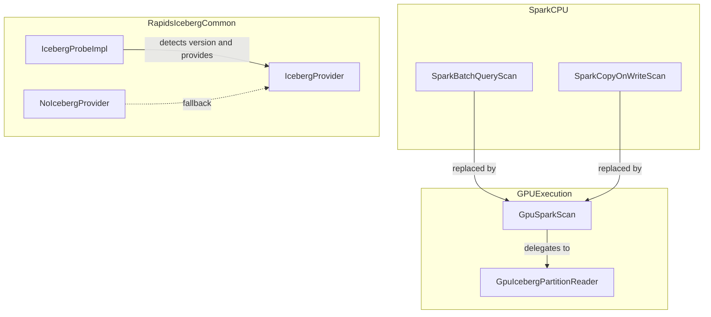
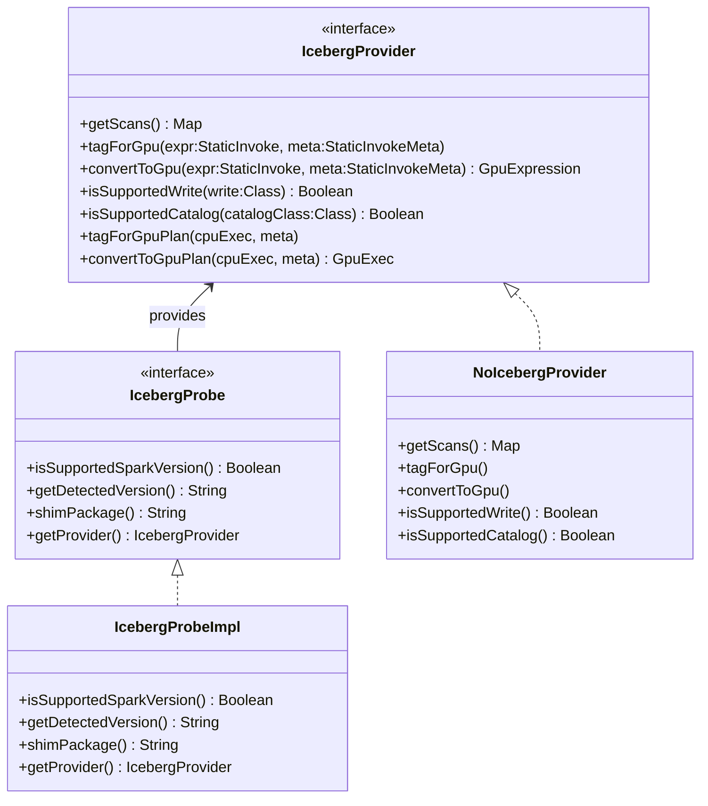

<!-- source: DeepWiki mcp.deepwiki.com · repo NVIDIA/cudf-spark · page 9 Iceberg Integration · fetched 2026-10-26 -->

# Iceberg Integration

Relevant source files

The following files were used as context for generating this wiki page:

- [dist/unshimmed-from-each-spark3xx.txt](dist/unshimmed-from-each-spark3xx.txt)
- [iceberg/common/src/main/scala/com/nvidia/spark/rapids/iceberg/IcebergProbeImpl.scala](iceberg/common/src/main/scala/com/nvidia/spark/rapids/iceberg/IcebergProbeImpl.scala)
- [iceberg/iceberg-1-11-x/src/main/spark411/scala/com/nvidia/spark/rapids/iceberg/iceberg111x/IcebergProviderImpl.scala](iceberg/iceberg-1-11-x/src/main/spark411/scala/com/nvidia/spark/rapids/iceberg/iceberg111x/IcebergProviderImpl.scala)
- [iceberg/iceberg-1-11-x/src/main/spark411/scala/org/apache/iceberg/spark/source/GpuSparkIncrementalAppendScan.scala](iceberg/iceberg-1-11-x/src/main/spark411/scala/org/apache/iceberg/spark/source/GpuSparkIncrementalAppendScan.scala)
- [iceberg/iceberg-stub/src/main/scala/com/nvidia/spark/rapids/iceberg/IcebergProbeImpl.scala](iceberg/iceberg-stub/src/main/scala/com/nvidia/spark/rapids/iceberg/IcebergProbeImpl.scala)
- [integration_tests/src/main/python/iceberg/iceberg_test.py](integration_tests/src/main/python/iceberg/iceberg_test.py)
- [integration_tests/src/main/python/iceberg/iceberg_version_detection_test.py](integration_tests/src/main/python/iceberg/iceberg_version_detection_test.py)
- [sql-plugin/src/main/java/com/nvidia/spark/rapids/iceberg/IcebergProviderAccess.java](sql-plugin/src/main/java/com/nvidia/spark/rapids/iceberg/IcebergProviderAccess.java)
- [sql-plugin/src/main/scala/com/nvidia/spark/rapids/iceberg/IcebergProvider.scala](sql-plugin/src/main/scala/com/nvidia/spark/rapids/iceberg/IcebergProvider.scala)
- [sql-plugin/src/main/spark340/scala/com/nvidia/spark/rapids/shims/GpuBatchScanExec.scala](sql-plugin/src/main/spark340/scala/com/nvidia/spark/rapids/shims/GpuBatchScanExec.scala)
- [sql-plugin/src/main/spark340/scala/com/nvidia/spark/rapids/shims/KeyGroupedPartitioningShim.scala](sql-plugin/src/main/spark340/scala/com/nvidia/spark/rapids/shims/KeyGroupedPartitioningShim.scala)
- [sql-plugin/src/main/spark350/scala/com/nvidia/spark/rapids/shims/KeyGroupedPartitioningShim.scala](sql-plugin/src/main/spark350/scala/com/nvidia/spark/rapids/shims/KeyGroupedPartitioningShim.scala)
- [sql-plugin/src/main/spark350db143/scala/com/nvidia/spark/rapids/shims/GpuBatchScanExec.scala](sql-plugin/src/main/spark350db143/scala/com/nvidia/spark/rapids/shims/GpuBatchScanExec.scala)
- [sql-plugin/src/main/spark359/scala/com/nvidia/spark/rapids/shims/KeyGroupedPartitioningShim.scala](sql-plugin/src/main/spark359/scala/com/nvidia/spark/rapids/shims/KeyGroupedPartitioningShim.scala)
- [sql-plugin/src/main/spark500/java/com/nvidia/spark/rapids/spark500/RapidsShuffleManager.java](sql-plugin/src/main/spark500/java/com/nvidia/spark/rapids/spark500/RapidsShuffleManager.java)
- [sql-plugin/src/main/spark500/java/org/apache/spark/shuffle/RapidsBlockingShuffleManagerBase.java](sql-plugin/src/main/spark500/java/org/apache/spark/shuffle/RapidsBlockingShuffleManagerBase.java)
- [sql-plugin/src/test/spark359/scala/com/nvidia/spark/rapids/shims/KeyGroupedPartitioningShimSuite.scala](sql-plugin/src/test/spark359/scala/com/nvidia/spark/rapids/shims/KeyGroupedPartitioningShimSuite.scala)
- [tests/src/test/spark340/scala/com/nvidia/spark/rapids/shims/GpuBatchScanExecHashSuite.scala](tests/src/test/spark340/scala/com/nvidia/spark/rapids/shims/GpuBatchScanExecHashSuite.scala)
- [tests/src/test/spark350db143/scala/com/nvidia/spark/rapids/shims/GpuBatchScanExecHashSuite.scala](tests/src/test/spark350db143/scala/com/nvidia/spark/rapids/shims/GpuBatchScanExecHashSuite.scala)

The purpose of this wiki page is to provide a high-level overview of the GPU-accelerated Apache Iceberg support in the RAPIDS Accelerator for Apache Spark. The integration optimizes both read and write paths for Iceberg tables (V1 and V2) using cuDF Parquet readers and writers, while remaining fully compliant with the Iceberg table format specification.

Because Iceberg introduces breaking API changes across different minor and major versions (such as 1.6.x, 1.9.x, 1.10.x, and 1.11.x), the codebase isolates version-specific logic using a provider and shim architecture.

For detailed technical dives into specific pipelines, refer to the child pages:
- [Iceberg Read Path & GPU Parquet Readers](#9.1) — GpuSparkScan, GpuReaderFactory, GpuIcebergPartitionReader, coalescing/multi-threaded readers, GpuParquetReaderPostProcessor, S3 input files, GpuDeleteLoader.
- [Iceberg Write Path & DML Operations](#9.2) — GPU-accelerated Iceberg DML: append, overwrite, merge, update, delete, RTAS/CTAS, merge-on-read, partitioning, GpuIcebergParquetAppender.

---

### Core Architecture & Versioning

The Iceberg integration relies on several core abstractions to decouple runtime dependencies and handle version variations:

- **`IcebergProvider`**: A trait defined in core code that specifies the interface for plan tagging, GPU expression conversion, write and catalog support checking, and GPU plan conversions. This avoids direct dependencies on specific Iceberg jars at compile time and enables dynamic loading of version-appropriate implementations [sql-plugin/src/main/scala/com/nvidia/spark/rapids/iceberg/IcebergProvider.scala:27-38]().
  
- **`IcebergProbe` and `IcebergProbeImpl`**: These components perform runtime detection of the Iceberg version present on the classpath by inspecting `iceberg-build.properties` commit IDs or JAR path patterns. They verify supported Spark versions and provide the correct `IcebergProvider` implementation and shim package name [sql-plugin/src/main/scala/com/nvidia/spark/rapids/iceberg/IcebergProvider.scala:44-49](), [iceberg/common/src/main/scala/com/nvidia/spark/rapids/iceberg/IcebergProbeImpl.scala:24-102]().

- **Fallback `NoIcebergProvider`**: Provides a no-op or unsupported fallback for environments where Iceberg integration is not enabled or compatible [sql-plugin/src/main/scala/com/nvidia/spark/rapids/iceberg/IcebergProvider.scala:75-88]().

#### Iceberg Integration Bridge Diagram

Sources: [sql-plugin/src/main/scala/com/nvidia/spark/rapids/iceberg/IcebergProvider.scala:27-88](), [iceberg/common/src/main/scala/com/nvidia/spark/rapids/iceberg/IcebergProbeImpl.scala:24-102]()

---

### Read Path & GPU Parquet Readers

The Iceberg read path converts standard Spark Iceberg scans into GPU-accelerated scans by replacing them with GPU-optimized scan representations [sql-plugin/src/main/scala/com/nvidia/spark/rapids/iceberg/IcebergProvider.scala:27-38](). This ensures that all data reading is performed leveraging GPU-optimized Parquet readers. The read logic fully supports advanced Iceberg features such as:

- Merge-on-Read (MoR) handling with position and equality deletes.
- Schema evolution compatibility.
- Splitting strategies like coalescing small files and multi-threaded reading to optimize GPU utilization.
- Specialized readers for S3 input files and integrated GPU-backed delete file loading.

For full technical details and examples, see the child page:
- [Iceberg Read Path & GPU Parquet Readers](#9.1).

Sources: [sql-plugin/src/main/scala/com/nvidia/spark/rapids/iceberg/IcebergProvider.scala:27-38]()

---

### Write Path & DML Operations

On the write side, the RAPIDS Accelerator provides GPU-accelerated support for Iceberg DML operations that include appends, overwrites, merges, updates, and deletes. Additionally, it supports SQL constructs such as:

- Create Table As Select (CTAS).
- Replace Table As Select (RTAS).
- Merge-on-read scenarios involving rewriting deletes.

Data is partitioned and encoded on the GPU before being committed to Iceberg tables, ensuring end-to-end GPU acceleration. Partitioning strategies are handled with GPU-aware transforms for optimal performance.

For detailed information, see the child page:
- [Iceberg Write Path & DML Operations](#9.2).

Sources: [sql-plugin/src/main/scala/com/nvidia/spark/rapids/iceberg/IcebergProvider.scala:27-38]()

---

### Code Entity Map

A concise class relationship diagram overlaying key Iceberg integration abstractions and their roles:

Sources: [sql-plugin/src/main/scala/com/nvidia/spark/rapids/iceberg/IcebergProvider.scala:27-88](), [iceberg/common/src/main/scala/com/nvidia/spark/rapids/iceberg/IcebergProbeImpl.scala:24-102]()

---

This page summarizes the key components and architectural considerations for GPU-accelerated Iceberg integration, highlighting the modular provider/shim approach and the major pathways for read and write acceleration.

For detailed implementation and usage examples, please consult the linked child pages.

---

