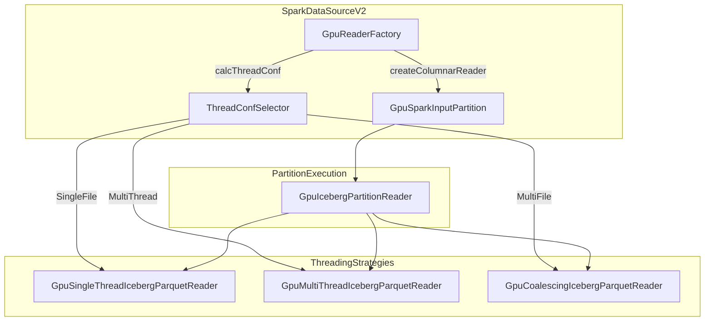
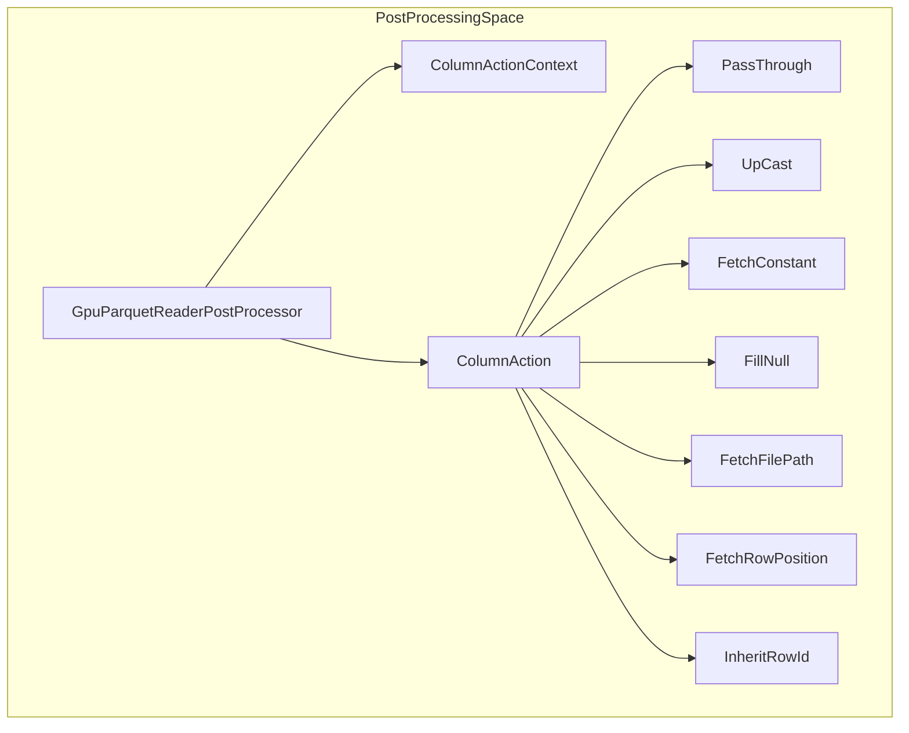

<!-- source: DeepWiki mcp.deepwiki.com · repo NVIDIA/cudf-spark · page 9.1 Iceberg Read Path & GPU Parquet Readers · fetched 2026-10-26 -->

# Iceberg Read Path & GPU Parquet Readers

Relevant source files

The following files were used as context for generating this wiki page:

- [iceberg-common/src/main/java/com/nvidia/spark/rapids/iceberg/IcebergDeletionVector.java](iceberg-common/src/main/java/com/nvidia/spark/rapids/iceberg/IcebergDeletionVector.java)
- [iceberg-common/src/main/scala/com/nvidia/spark/rapids/iceberg/parquet/FileSchemaAccessors.scala](iceberg-common/src/main/scala/com/nvidia/spark/rapids/iceberg/parquet/FileSchemaAccessors.scala)
- [iceberg-common/src/main/scala/com/nvidia/spark/rapids/iceberg/parquet/GpuIcebergParquetReaderUtils.scala](iceberg-common/src/main/scala/com/nvidia/spark/rapids/iceberg/parquet/GpuIcebergParquetReaderUtils.scala)
- [iceberg-common/src/main/scala/com/nvidia/spark/rapids/iceberg/parquet/ThreadConf.scala](iceberg-common/src/main/scala/com/nvidia/spark/rapids/iceberg/parquet/ThreadConf.scala)
- [iceberg-common/src/main/scala/org/apache/iceberg/io/GpuPositionDeleteFieldIds.scala](iceberg-common/src/main/scala/org/apache/iceberg/io/GpuPositionDeleteFieldIds.scala)
- [iceberg/common/src/main/scala/com/nvidia/spark/rapids/iceberg/data/GpuDeleteFilter.scala](iceberg/common/src/main/scala/com/nvidia/spark/rapids/iceberg/data/GpuDeleteFilter.scala)
- [iceberg/common/src/main/scala/com/nvidia/spark/rapids/iceberg/data/GpuDeleteLoader.scala](iceberg/common/src/main/scala/com/nvidia/spark/rapids/iceberg/data/GpuDeleteLoader.scala)
- [iceberg/common/src/main/scala/com/nvidia/spark/rapids/iceberg/parquet/GpuCoalescingIcebergParquetReader.scala](iceberg/common/src/main/scala/com/nvidia/spark/rapids/iceberg/parquet/GpuCoalescingIcebergParquetReader.scala)
- [iceberg/common/src/main/scala/com/nvidia/spark/rapids/iceberg/parquet/GpuMultiThreadIcebergParquetReader.scala](iceberg/common/src/main/scala/com/nvidia/spark/rapids/iceberg/parquet/GpuMultiThreadIcebergParquetReader.scala)
- [iceberg/common/src/main/scala/com/nvidia/spark/rapids/iceberg/parquet/GpuParquetReaderPostProcessor.scala](iceberg/common/src/main/scala/com/nvidia/spark/rapids/iceberg/parquet/GpuParquetReaderPostProcessor.scala)
- [iceberg/common/src/main/scala/com/nvidia/spark/rapids/iceberg/parquet/GpuSingleThreadIcebergParquetReader.scala](iceberg/common/src/main/scala/com/nvidia/spark/rapids/iceberg/parquet/GpuSingleThreadIcebergParquetReader.scala)
- [iceberg/common/src/main/scala/com/nvidia/spark/rapids/iceberg/parquet/reader.scala](iceberg/common/src/main/scala/com/nvidia/spark/rapids/iceberg/parquet/reader.scala)
- [iceberg/common/src/main/scala/org/apache/iceberg/io/rolling.scala](iceberg/common/src/main/scala/org/apache/iceberg/io/rolling.scala)
- [iceberg/common/src/main/scala/org/apache/iceberg/spark/source/GpuIcebergPartitionReader.scala](iceberg/common/src/main/scala/org/apache/iceberg/spark/source/GpuIcebergPartitionReader.scala)
- [iceberg/common/src/main/scala/org/apache/iceberg/spark/source/GpuReaderFactory.scala](iceberg/common/src/main/scala/org/apache/iceberg/spark/source/GpuReaderFactory.scala)
- [iceberg/common/src/main/scala/org/apache/iceberg/spark/source/GpuSparkInputPartition.scala](iceberg/common/src/main/scala/org/apache/iceberg/spark/source/GpuSparkInputPartition.scala)
- [integration_tests/src/main/python/iceberg/iceberg_merge_on_read_test.py](integration_tests/src/main/python/iceberg/iceberg_merge_on_read_test.py)
- [tests/src/test/spark350/scala/com/nvidia/spark/rapids/iceberg/GpuPostProcessorSuite.scala](tests/src/test/spark350/scala/com/nvidia/spark/rapids/iceberg/GpuPostProcessorSuite.scala)
- [tests/src/test/spark350/scala/com/nvidia/spark/rapids/iceberg/data/GpuDeleteFilterSuite.scala](tests/src/test/spark350/scala/com/nvidia/spark/rapids/iceberg/data/GpuDeleteFilterSuite.scala)

## Purpose and Scope

This page covers the GPU-accelerated read path for Apache Iceberg within the RAPIDS Accelerator for Apache Spark. It details how physical plans instantiate `GpuReaderFactory` and `GpuIcebergPartitionReader` to read data files via single-threaded, multi-threaded, or coalesced Parquet readers. Furthermore, it explains schema evolution handling through `GpuParquetReaderPostProcessor`, delete processing via `GpuDeleteLoader` and `GpuDeleteFilter`, and S3/cloud file I/O integrations.

---

## Reader Factory & Partition Reader Architecture

The Iceberg read flow starts when Spark requests columnar reads via `GpuReaderFactory`, which evaluates the task partitioning and configuration to determine the threading and file combination strategy [org/apache/iceberg/spark/source/GpuReaderFactory.scala:37-66]().

`GpuReaderFactory` inspects metadata columns, delete requirements, and file formats inside `calcThreadConf` to select one of three concrete reader modes: `SingleFile`, `MultiThread`, or `MultiFile` (coalescing) [org/apache/iceberg/spark/source/GpuReaderFactory.scala:68-123]().

`GpuIcebergPartitionReader` implements the DataSource V2 `PartitionReader[ColumnarBatch]` interface, collecting encrypted input files and file scan tasks from `GpuSparkInputPartition` and dispatching them to the chosen reader implementation [iceberg/common/src/main/scala/org/apache/iceberg/spark/source/GpuIcebergPartitionReader.scala:38-110]().

### Reader Factory & Dispatcher Architecture

Sources: [org/apache/iceberg/spark/source/GpuReaderFactory.scala:37-124](), [iceberg/common/src/main/scala/org/apache/iceberg/spark/source/GpuIcebergPartitionReader.scala:38-110]()

---

## Coalescing and Multi-Threaded Readers

Depending on configuration settings and file sizes, Iceberg scans utilize specialized reader classes to fetch and process columnar data:

- **`GpuSingleThreadIcebergParquetReader`**: Processes files or splits sequentially, instantiating a `SingleFileReader` per file along with optional `GpuDeleteFilter` and `IcebergDeletionVector` instances [iceberg/common/src/main/scala/com/nvidia/spark/rapids/iceberg/parquet/GpuSingleThreadIcebergParquetReader.scala:39-78]().
- **`GpuMultiThreadIcebergParquetReader`**: Executes concurrent GPU reads across multiple files or splits utilizing a thread pool configuration and handling asynchronous buffer processing via `MultiFileCloudParquetPartitionReader` [iceberg/common/src/main/scala/com/nvidia/spark/rapids/iceberg/parquet/GpuMultiThreadIcebergParquetReader.scala:38-107]().
- **`GpuCoalescingIcebergParquetReader`**: Extends `MultiFileParquetPartitionReader` to merge multiple small Parquet files into larger read batches [iceberg/common/src/main/scala/com/nvidia/spark/rapids/iceberg/parquet/GpuCoalescingIcebergParquetReader.scala:29-43](). Position-dependent scans (`_pos` or `_row_id` metadata) are strictly prohibited from using this reader via an explicit `require` check [iceberg/common/src/main/scala/com/nvidia/spark/rapids/iceberg/parquet/GpuCoalescingIcebergParquetReader.scala:35-43]().

Sources: [iceberg/common/src/main/scala/com/nvidia/spark/rapids/iceberg/parquet/GpuSingleThreadIcebergParquetReader.scala:39-105](), [iceberg/common/src/main/scala/com/nvidia/spark/rapids/iceberg/parquet/GpuMultiThreadIcebergParquetReader.scala:38-124](), [iceberg/common/src/main/scala/com/nvidia/spark/rapids/iceberg/parquet/GpuCoalescingIcebergParquetReader.scala:29-143]()

---

## GpuParquetReaderPostProcessor & Schema Evolution

Because Parquet file schemas often differ from the expected Iceberg table schema due to schema evolution, type promotions, or added metadata columns, `GpuParquetReaderPostProcessor` transforms raw GPU-read batches [iceberg/common/src/main/scala/com/nvidia/spark/rapids/iceberg/parquet/GpuParquetReaderPostProcessor.scala:49-56]().

It builds a pre-computed action tree consisting of `ColumnAction` implementations executed per batch:
- **`PassThrough`**: Retains columns that match between file and expected schemas [iceberg/common/src/main/scala/com/nvidia/spark/rapids/iceberg/parquet/GpuParquetReaderPostProcessor.scala:99-107]().
- **`UpCast`**: Promotes types using `GpuCast.doCast` [iceberg/common/src/main/scala/com/nvidia/spark/rapids/iceberg/parquet/GpuParquetReaderPostProcessor.scala:110-122]().
- **`FetchConstant`**: Injects constant partition values from the `idToConstant` mapping [iceberg/common/src/main/scala/com/nvidia/spark/rapids/iceberg/parquet/GpuParquetReaderPostProcessor.scala:125-139]().
- **`FillNull`**: Generates null columns for missing optional fields [iceberg/common/src/main/scala/com/nvidia/spark/rapids/iceberg/parquet/GpuParquetReaderPostProcessor.scala:141-150]().
- **`FetchFilePath`**: Materializes the `_file` metadata column containing the file path string [iceberg/common/src/main/scala/com/nvidia/spark/rapids/iceberg/parquet/GpuParquetReaderPostProcessor.scala:153-163]().
- **`FetchRowPosition`**: Materializes the `_pos` row position metadata column [iceberg/common/src/main/scala/com/nvidia/spark/rapids/iceberg/parquet/GpuParquetReaderPostProcessor.scala:165-174]().
- **`InheritRowId`**: Handles Iceberg `_row_id` metadata column materialization or inheritance [iceberg/common/src/main/scala/com/nvidia/spark/rapids/iceberg/parquet/GpuParquetReaderPostProcessor.scala:176-179]().

### Post-Processor & Action Tree Code Entity Space

Sources: [iceberg/common/src/main/scala/com/nvidia/spark/rapids/iceberg/parquet/GpuParquetReaderPostProcessor.scala:49-179]()

---

## Delete File Loading & Merge-on-Read

Iceberg merge-on-read tables make use of equality delete files, position delete files, and Puffin deletion vectors. 

- **`GpuDeleteFileInfo`**: Parses and classifies delete files into deletion vectors, position deletes, and equality deletes, ensuring correct precedence and avoiding duplicate application [iceberg/common/src/main/scala/com/nvidia/spark/rapids/iceberg/data/GpuDeleteFilter.scala:43-74]().
- **`GpuDeleteLoader`**: Implemented by `DefaultDeleteLoader`, it loads Puffin deletion vectors via `ShimUtils.readDeletionVector` and materializes equality delete files into `LazySpillableColumnarBatch` instances by running internal reader pipelines [iceberg/common/src/main/scala/com/nvidia/spark/rapids/iceberg/data/GpuDeleteLoader.scala:37-143]().
- **`GpuDeleteFilter`**: Applies delete masks on GPU columnar data batches to filter out deleted records before returning final results to Spark [iceberg/common/src/main/scala/com/nvidia/spark/rapids/iceberg/data/GpuDeleteFilter.scala:117-137]().

Sources: [iceberg/common/src/main/scala/com/nvidia/spark/rapids/iceberg/data/GpuDeleteFilter.scala:43-137](), [iceberg/common/src/main/scala/com/nvidia/spark/rapids/iceberg/data/GpuDeleteLoader.scala:37-143]()

---

## S3 Input Files and File I/O Integration

Iceberg tasks interact with cloud storage (such as AWS S3 or compatible object stores) through decrypted input files wrapped by `IcebergFileIO` and `IcebergInputFile`. `GpuIcebergPartitionReader` decrypts files using table encryption settings and registers them with `IcebergFileIO` before passing them to the underlying parquet readers [iceberg/common/src/main/scala/org/apache/iceberg/spark/source/GpuIcebergPartitionReader.scala:46-130]().

Sources: [iceberg/common/src/main/scala/org/apache/iceberg/spark/source/GpuIcebergPartitionReader.scala:46-130]()

---

