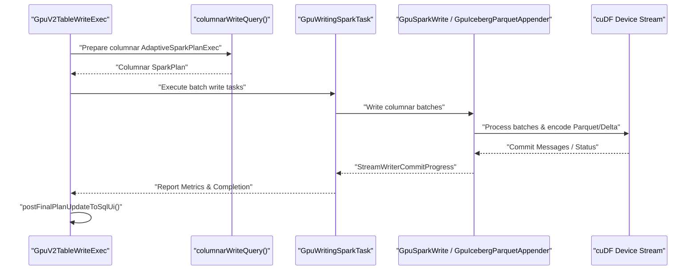

<!-- source: DeepWiki mcp.deepwiki.com · repo NVIDIA/cudf-spark · page 9.2 Iceberg Write Path & DML Operations · fetched 2026-10-26 -->

# Iceberg Write Path & DML Operations

<details>
<summary>Relevant source files</summary>

The following files were used as context for generating this wiki page:

- [dist/README.md](dist/README.md)
- [dist/build/iceberg_runtime.py](dist/build/iceberg_runtime.py)
- [dist/build/package-parallel-worlds.py](dist/build/package-parallel-worlds.py)
- [dist/maven-antrun/build-parallel-worlds.xml](dist/maven-antrun/build-parallel-worlds.xml)
- [dist/scripts/binary-dedupe.sh](dist/scripts/binary-dedupe.sh)
- [dist/scripts/check-iceberg-package-private-access.py](dist/scripts/check-iceberg-package-private-access.py)
- [dist/scripts/check-shims-revisions.sh](dist/scripts/check-shims-revisions.sh)
- [dist/scripts/tests/test_check_iceberg_package_private_access.py](dist/scripts/tests/test_check_iceberg_package_private_access.py)
- [dist/unshimmed-common-from-single-shim.txt](dist/unshimmed-common-from-single-shim.txt)
- [iceberg-common/pom.xml](iceberg-common/pom.xml)
- [iceberg-common/src/main/java/org/apache/iceberg/spark/source/GpuSparkWriteAccess.java](iceberg-common/src/main/java/org/apache/iceberg/spark/source/GpuSparkWriteAccess.java)
- [iceberg-common/src/main/spark350/scala/com/nvidia/spark/rapids/iceberg/parquet/converter/FromIcebergShaded.scala](iceberg-common/src/main/spark350/scala/com/nvidia/spark/rapids/iceberg/parquet/converter/FromIcebergShaded.scala)
- [iceberg-common/src/main/spark350/scala/com/nvidia/spark/rapids/iceberg/parquet/converter/ToIcebergShaded.scala](iceberg-common/src/main/spark350/scala/com/nvidia/spark/rapids/iceberg/parquet/converter/ToIcebergShaded.scala)
- [iceberg/common/src/main/scala/org/apache/iceberg/spark/source/GpuSparkPositionDeltaWrite.scala](iceberg/common/src/main/scala/org/apache/iceberg/spark/source/GpuSparkPositionDeltaWrite.scala)
- [iceberg/common/src/main/scala/org/apache/iceberg/spark/source/GpuSparkWrite.scala](iceberg/common/src/main/scala/org/apache/iceberg/spark/source/GpuSparkWrite.scala)
- [integration_tests/src/main/python/iceberg/__init__.py](integration_tests/src/main/python/iceberg/__init__.py)
- [integration_tests/src/main/python/iceberg/iceberg_append_test.py](integration_tests/src/main/python/iceberg/iceberg_append_test.py)
- [integration_tests/src/main/python/iceberg/iceberg_ctas_test.py](integration_tests/src/main/python/iceberg/iceberg_ctas_test.py)
- [integration_tests/src/main/python/iceberg/iceberg_delete_test.py](integration_tests/src/main/python/iceberg/iceberg_delete_test.py)
- [integration_tests/src/main/python/iceberg/iceberg_merge_test.py](integration_tests/src/main/python/iceberg/iceberg_merge_test.py)
- [integration_tests/src/main/python/iceberg/iceberg_overwrite_dynamic_test.py](integration_tests/src/main/python/iceberg/iceberg_overwrite_dynamic_test.py)
- [integration_tests/src/main/python/iceberg/iceberg_overwrite_static_test.py](integration_tests/src/main/python/iceberg/iceberg_overwrite_static_test.py)
- [integration_tests/src/main/python/iceberg/iceberg_rtas_test.py](integration_tests/src/main/python/iceberg/iceberg_rtas_test.py)
- [integration_tests/src/main/python/iceberg/iceberg_update_test.py](integration_tests/src/main/python/iceberg/iceberg_update_test.py)
- [integration_tests/src/main/python/iceberg/iceberg_write_sql_ui_test.py](integration_tests/src/main/python/iceberg/iceberg_write_sql_ui_test.py)
- [scala2.13/iceberg-common/pom.xml](scala2.13/iceberg-common/pom.xml)
- [sql-plugin/src/main/spark350/scala/org/apache/spark/sql/execution/datasources/v2/WriteToDataSourceV2Exec.scala](sql-plugin/src/main/spark350/scala/org/apache/spark/sql/execution/datasources/v2/WriteToDataSourceV2Exec.scala)

</details>


## Purpose and Scope

This page documents GPU-accelerated Apache Iceberg write paths and Data Manipulation Language (DML) operations supported by the RAPIDS Accelerator for Apache Spark. It covers the end-to-end execution of:

- Appends (`INSERT INTO`)
- Static and dynamic partition overwrites (`INSERT OVERWRITE`)
- Table creation/replacement (CTAS/RTAS)
- Row-level DML operations (`DELETE`, `UPDATE`, `MERGE INTO`)
- Merge-on-read (MOR) mechanics via position deltas and row merges
- Partitioning transform handling using `GpuTransform` and `GpuFieldTransform`
- Write path fallbacks and limitations (such as Iceberg v3 restrictions and deletion vector writes)

The intent is to fully accelerate Iceberg DML workloads on the GPU while maintaining correctness and compatibility with Spark's DataSource V2 write framework and Iceberg's table specification.

Sources:  
- `integration_tests/src/main/python/iceberg/__init__.py:92-111` [integration_tests/src/main/python/iceberg/__init__.py:92-111]()  
- `integration_tests/src/main/python/iceberg/iceberg_append_test.py:36-60` [integration_tests/src/main/python/iceberg/iceberg_append_test.py:36-60]()  
- `integration_tests/src/main/python/iceberg/iceberg_overwrite_static_test.py:44-84` [integration_tests/src/main/python/iceberg/iceberg_overwrite_static_test.py:44-84]()  
- `integration_tests/src/main/python/iceberg/iceberg_ctas_test.py:56-80` [integration_tests/src/main/python/iceberg/iceberg_ctas_test.py:56-80]()  
- `integration_tests/src/main/python/iceberg/iceberg_delete_test.py:83-131` [integration_tests/src/main/python/iceberg/iceberg_delete_test.py:83-131]()  
- `integration_tests/src/main/python/iceberg/iceberg_update_test.py:84-132` [integration_tests/src/main/python/iceberg/iceberg_update_test.py:84-132]()  
- `integration_tests/src/main/python/iceberg/iceberg_merge_test.py:120-160` [integration_tests/src/main/python/iceberg/iceberg_merge_test.py:120-160]()  

---

## Overview of Accelerated Operations & Configuration

The RAPIDS Accelerator intercepts Iceberg SQL write operations and replaces native CPU Spark execution plans with GPU-specific physical operators extending `GpuV2TableWriteExec`. The supported Iceberg DML operations include:

| Operation Type | SQL Examples & Features | References |
|---|---|---|
| **Append** | `INSERT INTO iceberg_table ...` | `integration_tests/src/main/python/iceberg/iceberg_append_test.py` [integration_tests/src/main/python/iceberg/iceberg_append_test.py:36-60]() |
| **Overwrite** | `INSERT OVERWRITE` with static or dynamic partition overwrite modes | `integration_tests/src/main/python/iceberg/iceberg_overwrite_static_test.py` [integration_tests/src/main/python/iceberg/iceberg_overwrite_static_test.py:44-84]() |
| **CTAS / RTAS** | `CREATE TABLE AS SELECT ...`, `REPLACE TABLE AS SELECT ...` | `integration_tests/src/main/python/iceberg/iceberg_ctas_test.py` [integration_tests/src/main/python/iceberg/iceberg_ctas_test.py:56-80]() |
| **Row-Level DML** | `DELETE`, `UPDATE`, and `MERGE INTO` supporting Copy-On-Write (COW) and Merge-On-Read (MOR) modes | `integration_tests/src/main/python/iceberg/iceberg_delete_test.py` [integration_tests/src/main/python/iceberg/iceberg_delete_test.py:83-131](), `integration_tests/src/main/python/iceberg/iceberg_update_test.py` [integration_tests/src/main/python/iceberg/iceberg_update_test.py:84-132](), `integration_tests/src/main/python/iceberg/iceberg_merge_test.py` [integration_tests/src/main/python/iceberg/iceberg_merge_test.py:120-160]() |

### Configuration Properties

To enable GPU-accelerated Iceberg write operations and specific format features, use:

```properties
spark.rapids.sql.format.iceberg.write.enabled=true
spark.rapids.sql.format.iceberg.v3.enabled=true
```

Sources:  
- `integration_tests/src/main/python/iceberg/__init__.py:56-56` [integration_tests/src/main/python/iceberg/__init__.py:56-56]()  
- `integration_tests/src/main/python/iceberg/iceberg_append_test.py:51-52` [integration_tests/src/main/python/iceberg/iceberg_append_test.py:51-52]()  

---

## System Architecture & DML Mapping

The GPU-accelerated Iceberg write path integrates directly with Spark's DataSource V2 write framework and Iceberg's Spark integration layer (`GpuSparkWrite`, `GpuSparkPositionDeltaWrite`). When a DML command is planned on Iceberg tables, the plugin detects the command and replaces CPU plan nodes with GPU-specific physical operators.

### Diagram: Iceberg DML to GPU Code Entities

```mermaid
graph TD
    subgraph Natural_Language_Space["SQL DML / Write Commands"]
        SQL_INSERT["INSERT_INTO"]
        SQL_OVERWRITE_STATIC["INSERT_OVERWRITE_STATIC"]
        SQL_OVERWRITE_DYNAMIC["INSERT_OVERWRITE_DYNAMIC"]
        SQL_UPDATE["UPDATE"]
        SQL_DELETE["DELETE"]
        SQL_MERGE["MERGE_INTO"]
        SQL_CTAS["CTAS"]
        SQL_RTAS["RTAS"]
    end

    subgraph Code_Entity_Space["Scala Physical Operators & Write Classes"]
        GpuAppendDataExec["GpuAppendDataExec"]
        GpuOverwriteByExpressionExec["GpuOverwriteByExpressionExec"]
        GpuOverwritePartitionsDynamicExec["GpuOverwritePartitionsDynamicExec"]
        GpuAtomicCreateTableAsSelectExec["GpuAtomicCreateTableAsSelectExec"]
        GpuAtomicReplaceTableAsSelectExec["GpuAtomicReplaceTableAsSelectExec"]
        GpuDeleteFromTableExec["GpuDeleteFromTableExec"]
        GpuUpdateTableExec["GpuUpdateTableExec"]
        GpuMergeIntoTableExec["GpuMergeIntoTableExec"]
        GpuSparkWrite["GpuSparkWrite"]
        GpuSparkPositionDeltaWrite["GpuSparkPositionDeltaWrite"]
    end

    SQL_INSERT --> GpuAppendDataExec
    SQL_OVERWRITE_STATIC --> GpuOverwriteByExpressionExec
    SQL_OVERWRITE_DYNAMIC --> GpuOverwritePartitionsDynamicExec
    SQL_CTAS --> GpuAtomicCreateTableAsSelectExec
    SQL_RTAS --> GpuAtomicReplaceTableAsSelectExec
    SQL_DELETE --> GpuDeleteFromTableExec
    SQL_UPDATE --> GpuUpdateTableExec
    SQL_MERGE --> GpuMergeIntoTableExec

    GpuAppendDataExec --> GpuSparkWrite
    GpuOverwriteByExpressionExec --> GpuSparkWrite
    GpuOverwritePartitionsDynamicExec --> GpuSparkWrite
    GpuAtomicCreateTableAsSelectExec --> GpuSparkWrite
    GpuAtomicReplaceTableAsSelectExec --> GpuSparkWrite
    GpuDeleteFromTableExec --> GpuSparkPositionDeltaWrite
    GpuUpdateTableExec --> GpuSparkPositionDeltaWrite
    GpuMergeIntoTableExec --> GpuSparkPositionDeltaWrite
```

Sources:  
- `integration_tests/src/main/python/iceberg/iceberg_append_test.py` [integration_tests/src/main/python/iceberg/iceberg_append_test.py:36-60]()  
- `integration_tests/src/main/python/iceberg/iceberg_ctas_test.py:155-160` [integration_tests/src/main/python/iceberg/iceberg_ctas_test.py:155-160]()  

---

## The GPU Write Path & Appender

The central execution node for Iceberg write acceleration is `GpuV2TableWriteExec` (and `GpuV2ExistingTableWriteExec`), which interfaces with `GpuSparkWrite` and underlying columnar file appenders like `GpuIcebergParquetAppender`.

### Implementation Details

- **Query Execution (`columnarWriteQuery`):** Submits a GPU-optimized batch write by executing a columnar copy of the query's `AdaptiveSparkPlanExec` while keeping task accumulator updates tied to the columnar plan.
- **SQL UI Integration (`postFinalPlanUpdateToSqlUi`):** Re-posts the final settled plan graph to the Spark SQL UI so that GPU child operators and their metrics are fully visible in the History Server.
- **Delta Writes (`GpuWriteDeltaExec` / `GpuSparkPositionDeltaWrite`):** Handles merge-on-read updates, deletes, and merges where position or equality deltas are committed.

### Diagram: GPU Write Execution Flow

Sources:  
- `integration_tests/src/main/python/iceberg/__init__.py:92-111` [integration_tests/src/main/python/iceberg/__init__.py:92-111]()  
- `integration_tests/src/main/python/iceberg/iceberg_ctas_test.py:155-160` [integration_tests/src/main/python/iceberg/iceberg_ctas_test.py:155-160]()  

---

## Row-Level DML Operations & Merge-On-Read (MOR)

The RAPIDS Accelerator provides GPU acceleration for Iceberg's row-level DML operations: `DELETE`, `UPDATE`, and `MERGE INTO`. These operations support both Copy-On-Write (COW) and Merge-On-Read (MOR) modes.

### Copy-On-Write (COW) vs Merge-On-Read (MOR)
- **Copy-On-Write:** Rewrites entire data files containing affected rows.
- **Merge-On-Read:** Writes delete files (position delete files or equality delete files) or delta writes marking rows logically for deletion/update.
- **Validation in Tests:** The `with_iceberg_dml_session` helper function captures execution plans during test execution to ensure that GPU delta writes (`GpuWriteDeltaExec`, `GpuAppendDataExec`) are correctly invoked without falling back to CPU for v3 MOR operations.

Sources:  
- `integration_tests/src/main/python/iceberg/__init__.py:92-111` [integration_tests/src/main/python/iceberg/__init__.py:92-111]()  
- `integration_tests/src/main/python/iceberg/iceberg_delete_test.py:35-43` [integration_tests/src/main/python/iceberg/iceberg_delete_test.py:35-43]()  
- `integration_tests/src/main/python/iceberg/iceberg_merge_test.py:35-40` [integration_tests/src/main/python/iceberg/iceberg_merge_test.py:35-40]()  
- `integration_tests/src/main/python/iceberg/iceberg_update_test.py:34-39` [integration_tests/src/main/python/iceberg/iceberg_update_test.py:34-39]()  

---

## Fallback Mechanisms & Version Constraints

When unsupported features or configurations are encountered, the plugin falls back safely to CPU execution:
1. **Iceberg V3 Support Gating:** Format version 3 tables require explicit configuration (`spark.rapids.sql.format.iceberg.v3.enabled=true`). When disabled, GPU execution gracefully falls back to CPU plan execution (`AppendDataExec`, `OverwriteByExpressionExec`, etc.).
2. **Catalog & Remote Catalog Restrictions:** Certain remote catalogs or complex partitioning constraints may trigger conditional non-gpu allowances in test suites to prevent test timeouts.

Sources:  
- `integration_tests/src/main/python/iceberg/__init__.py:31-63` [integration_tests/src/main/python/iceberg/__init__.py:31-63]()  
- `integration_tests/src/main/python/iceberg/iceberg_append_test.py:101-127` [integration_tests/src/main/python/iceberg/iceberg_append_test.py:101-127]()  
- `integration_tests/src/main/python/iceberg/iceberg_overwrite_static_test.py:98-122` [integration_tests/src/main/python/iceberg/iceberg_overwrite_static_test.py:98-122]()  

---

## Summary

The RAPIDS Accelerator for Apache Spark provides comprehensive GPU acceleration for Iceberg write paths and DML operations, integrating tightly with `GpuSparkWrite`, `GpuSparkPositionDeltaWrite`, and Iceberg's metadata and file appenders. Robust fallback mechanisms ensure complete reliability across format versions and catalog types.

Sources:  
- All files cited in this page.

---

