# Page: RAPIDS Accelerator for Apache Spark — Overview

# RAPIDS Accelerator for Apache Spark — Overview

<details>
<summary>Relevant source files</summary>

The following files were used as context for generating this wiki page:

- [LICENSE](LICENSE)
- [NOTICE](NOTICE)
- [NOTICE-binary](NOTICE-binary)
- [aggregator/pom.xml](aggregator/pom.xml)
- [api_validation/pom.xml](api_validation/pom.xml)
- [dist/pom.xml](dist/pom.xml)
- [docs/additional-functionality/advanced_configs.md](docs/additional-functionality/advanced_configs.md)
- [docs/configs.md](docs/configs.md)
- [docs/supported_ops.md](docs/supported_ops.md)
- [integration_tests/pom.xml](integration_tests/pom.xml)
- [integration_tests/src/main/python/data_gen.py](integration_tests/src/main/python/data_gen.py)
- [integration_tests/src/main/python/hash_aggregate_test.py](integration_tests/src/main/python/hash_aggregate_test.py)
- [integration_tests/src/main/python/window_function_test.py](integration_tests/src/main/python/window_function_test.py)
- [jenkins/databricks/init_cudf_udf.sh](jenkins/databricks/init_cudf_udf.sh)
- [jenkins/version-def.sh](jenkins/version-def.sh)
- [pom.xml](pom.xml)
- [scala2.13/aggregator/pom.xml](scala2.13/aggregator/pom.xml)
- [scala2.13/dist/pom.xml](scala2.13/dist/pom.xml)
- [scala2.13/pom.xml](scala2.13/pom.xml)
- [scala2.13/shuffle-plugin/pom.xml](scala2.13/shuffle-plugin/pom.xml)
- [scala2.13/sql-plugin/pom.xml](scala2.13/sql-plugin/pom.xml)
- [scala2.13/tests/pom.xml](scala2.13/tests/pom.xml)
- [scala2.13/udf-compiler/pom.xml](scala2.13/udf-compiler/pom.xml)
- [shuffle-plugin/pom.xml](shuffle-plugin/pom.xml)
- [skills/.gitignore](skills/.gitignore)
- [skills/examples/CalculateRiskUDF.scala](skills/examples/CalculateRiskUDF.scala)
- [skills/examples/FormatPhoneUDF.java](skills/examples/FormatPhoneUDF.java)
- [skills/examples/IntegerMultiplyBy2UDF.java](skills/examples/IntegerMultiplyBy2UDF.java)
- [skills/udf-benchmark/CUDF_MICROBENCHMARKS.md](skills/udf-benchmark/CUDF_MICROBENCHMARKS.md)
- [sql-plugin/pom.xml](sql-plugin/pom.xml)
- [sql-plugin/src/main/scala/com/nvidia/spark/rapids/GpuOverrides.scala](sql-plugin/src/main/scala/com/nvidia/spark/rapids/GpuOverrides.scala)
- [sql-plugin/src/main/scala/com/nvidia/spark/rapids/Plugin.scala](sql-plugin/src/main/scala/com/nvidia/spark/rapids/Plugin.scala)
- [sql-plugin/src/main/scala/com/nvidia/spark/rapids/RapidsConf.scala](sql-plugin/src/main/scala/com/nvidia/spark/rapids/RapidsConf.scala)
- [sql-plugin/src/main/scala/com/nvidia/spark/rapids/RapidsConfEntries.scala](sql-plugin/src/main/scala/com/nvidia/spark/rapids/RapidsConfEntries.scala)
- [tests/pom.xml](tests/pom.xml)
- [udf-compiler/pom.xml](udf-compiler/pom.xml)

</details>


The RAPIDS Accelerator for Apache Spark is an NVIDIA-developed plugin that enables Apache Spark to leverage GPU hardware for accelerating SQL query and DataFrame computations. By offloading suitable operations from CPU to GPU using the RAPIDS `cuDF` library, it delivers significant performance improvements on GPU-enabled clusters. This overview introduces the project’s purpose, high-level architecture, and the major subsystems with references to detailed child pages for further exploration.

Sources:  
- [sql-plugin/src/main/scala/com/nvidia/spark/rapids/Plugin.scala:126-143]()  
- [docs/supported_ops.md:13-17]()

## What it Does and Why it Exists

Apache Spark is a powerful distributed data processing engine traditionally optimized for CPU execution. The RAPIDS Accelerator for Apache Spark addresses the bottleneck of CPU-bound processing by enabling GPU acceleration for a wide range of Spark SQL and DataFrame operations [docs/supported_ops.md:13-17](). This results in reduced query latencies and increased throughput by exploiting the massive parallelism of NVIDIA GPUs.

The accelerator strives to maintain compatibility with Apache Spark’s behavior, aiming for bit-for-bit identical results when possible. It integrates into Spark's execution framework to accelerate operations transparently to users [docs/supported_ops.md:61-66]().

Sources:  
- [docs/supported_ops.md:13-17]()  
- [docs/supported_ops.md:61-66]()

## Key Architectural Concepts

The RAPIDS Accelerator’s architecture is designed to intercept Spark queries at execution time, analyze and modify the execution plans, and replace CPU operators with GPU-enabled counterparts.

- **Plugin Registration**  
  The plugin registers itself with Spark via the `SparkPlugin` interface, hooking into the Spark execution lifecycle through `ColumnarOverrideRules` which manage GPU overrides during query planning [sql-plugin/src/main/scala/com/nvidia/spark/rapids/Plugin.scala:43-81]().

- **Plan Replacement Pipeline**  
  After Spark generates a physical plan, the RAPIDS Accelerator applies a set of `ReplacementRule` instances managed by `GpuOverrides`. These rules identify supported plan nodes and wrap them in specialized `RapidsMeta` metadata wrappers that enable analysis, validation, and conversion to GPU-enabled implementations [sql-plugin/src/main/scala/com/nvidia/spark/rapids/GpuOverrides.scala:69-77]().

- **GPU Expression and Operator Implementations**  
  The accelerator implements GPU variants of Spark expressions and physical operators, centered on the `GpuColumnVector` data structure that resides in GPU memory and provides efficient columnar operations [sql-plugin/src/main/scala/com/nvidia/spark/rapids/GpuOverrides.scala:25-25]().

- **GPU Memory Management**  
  Effective GPU memory management is critical. Configuration settings exposed through `RapidsConf` control memory pool sizing, limit thresholds, spill behavior, and assist in tracking memory usage [sql-plugin/src/main/scala/com/nvidia/spark/rapids/RapidsConf.scala:124-138]().

- **Shuffle & Data Exchange**  
  To support distributed workloads, the accelerator integrates with Spark shuffle mechanisms to efficiently exchange columnar data between executors using GPU-aware shuffle managers and protocols like UCX [sql-plugin/src/main/scala/com/nvidia/spark/rapids/Plugin.scala:57-71]().

- **Shim Layer for Multi-version Spark Support**  
  A shim layer abstracts differences across supported Spark versions. The `ShimLoader` dynamically loads version-specific implementations ensuring seamless support for multiple Spark major and minor versions [sql-plugin/src/main/scala/com/nvidia/spark/rapids/Plugin.scala:69-69]().

### High-Level Architecture Diagram

High-Level Architecture
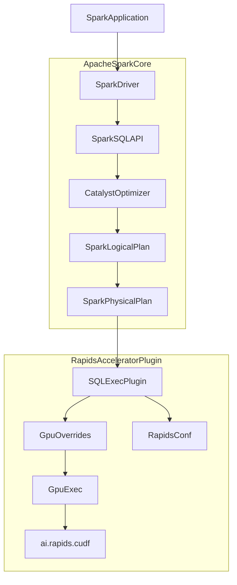

Sources:  
- [sql-plugin/src/main/scala/com/nvidia/spark/rapids/Plugin.scala:43-81]()  
- [sql-plugin/src/main/scala/com/nvidia/spark/rapids/GpuOverrides.scala:69-77]()  
- [sql-plugin/src/main/scala/com/nvidia/spark/rapids/RapidsConf.scala:124-138]()

## Major Subsystems and Relationships

The RAPIDS Accelerator is modularized into several major subsystems that together enable efficient GPU acceleration of Apache Spark workloads.

| Subsystem                      | Description                                                                                              | Child Page(s)                                |
|-------------------------------|----------------------------------------------------------------------------------------------------------|----------------------------------------------|
| Core Plugin Architecture       | Hooks into Spark via `SparkPlugin` API, manages plan replacements using `GpuOverrides`, and handles shims | [Core Plugin Architecture](#2)               |
| GPU Expression & Operator Impl.| Implements GPU Spark expressions and operators including `GpuColumnVector` and GPU conversions          | [GPU Expression & Operator Implementations](#3) |
| Join Execution on GPU          | Implements GPU join algorithms and GPU OOM-safe iterators                                               | [Join Execution on GPU](#4)                   |
| File Format Support            | Accelerates reading and writing of Parquet, ORC, CSV, JSON, Avro formats                                 | [File Format Support (Reading & Writing)](#5)|
| Shuffle & Data Exchange        | Supports GPU shuffle using `RapidsShuffleManager` and UCX                                               | [Shuffle & Data Exchange](#6)                 |
| GPU Memory Management          | Controls GPU memory allocation and spilling through `GpuSemaphore` and `SpillFramework`                  | [GPU Memory Management](#7)                   |
| Delta Lake Integration         | GPU acceleration for Delta Lake with transaction and deletion vector support                            | [Delta Lake Integration](#8)                  |
| Iceberg Integration           | GPU-accelerated Apache Iceberg support for read/write and DML operations                               | [Iceberg Integration](#9)                     |
| Python UDFs & UDF Compiler     | GPU acceleration of Python UDFs using Arrow and Pandas, plus Scala/Java UDF compilation                  | [Python UDFs & Pandas Integration](#10)      |

Sources:  
- [sql-plugin/src/main/scala/com/nvidia/spark/rapids/GpuOverrides.scala:69-176]()  
- [sql-plugin/src/main/scala/com/nvidia/spark/rapids/Plugin.scala:57-71]()

## Getting Started & Configuration

Users enable the RAPIDS Accelerator by including the `rapids-4-spark` plugin JAR in their Spark classpath and specifying the plugin class via Spark configuration [docs/configs.md:16-22]().

```bash
spark-shell --jars rapids-4-spark_2.12-26.12.0-SNAPSHOT-cuda12.jar \
--conf spark.plugins=com.nvidia.spark.SQLPlugin \
--conf spark.rapids.sql.concurrentGpuTasks=2
```

The plugin’s configuration system is exposed through the `RapidsConf` class, allowing users to tune GPU memory pool sizes, concurrency, shuffle settings, and more via Spark configuration properties prefixed with `spark.rapids.*` [sql-plugin/src/main/scala/com/nvidia/spark/rapids/RapidsConf.scala:124-138]().

For detailed installation, deployment options (standalone, Databricks, EMR, GCP), and full configuration reference, see [Getting Started & Configuration](#1.1).

Sources:  
- [docs/configs.md:16-22]()  
- [sql-plugin/src/main/scala/com/nvidia/spark/rapids/RapidsConf.scala:124-138]()

## Compatibility & Supported Operations

The RAPIDS Accelerator supports a broad set of Spark SQL operations on GPU. However, some features or data types have only partial or limited GPU support and may trigger CPU fallbacks:

- **Timestamp & Timezone Support**: GPU acceleration supports timestamps primarily in UTC timezone only [docs/supported_ops.md:51-55]().
- **Decimal Support**: 128-bit decimal types are supported, but some complex operations or precision promotions may cause fallbacks [docs/supported_ops.md:19-50]().
- **CalendarInterval Type**: Support is limited and partial [docs/supported_ops.md:56-60]().
- **Explain Diagnostics**: The `spark.rapids.sql.explain` property can produce detailed explanations of GPU/CPU query plan placement decisions to facilitate debugging [docs/configs.md:52-52]().

For a comprehensive list and detailed notes on supported expressions, operators, types, and behavioral differences, see [Compatibility & Supported Operations](#1.2).

Sources:  
- [docs/supported_ops.md:19-60]()  
- [docs/configs.md:52-52]()

## Code Entity Space Bridges

### Plugin and Plan Replacement Pipeline

Code Entity Space Bridge Plugin And Plan Replacement
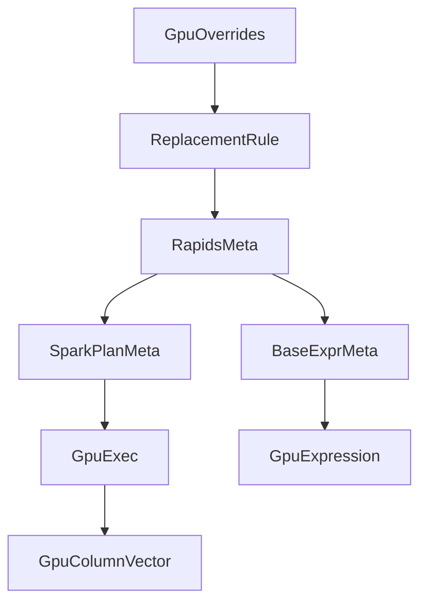

This diagram captures how plugin rules wrap Spark plan nodes and expressions into meta wrappers (`RapidsMeta` subclasses) that then produce GPU-enabled implementations using `GpuExec` and `GpuExpression` operating on `GpuColumnVector` data structures [sql-plugin/src/main/scala/com/nvidia/spark/rapids/GpuOverrides.scala:69-77]().

Sources:  
- [sql-plugin/src/main/scala/com/nvidia/spark/rapids/GpuOverrides.scala:69-77]()

### Plugin Initialization and Shim Layer

Code Entity Space Bridge Plugin Initialization And Shim Layer
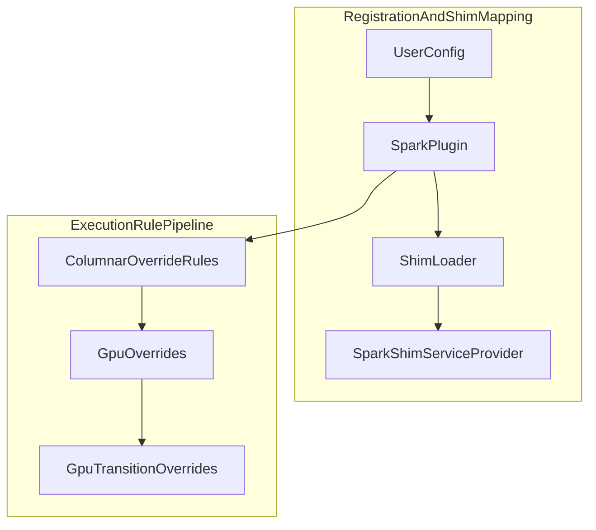

This diagram illustrates how user configuration drives plugin registration via `SparkPlugin`, which uses `ShimLoader` and `SparkShimServiceProvider` to manage Spark version differences. The plugin applies execution rules via `ColumnarOverrideRules` and `GpuOverrides` to convert CPU plans to GPU-enabled physical plans [sql-plugin/src/main/scala/com/nvidia/spark/rapids/Plugin.scala:43-81]().

Sources:  
- [sql-plugin/src/main/scala/com/nvidia/spark/rapids/Plugin.scala:43-81]()

---

For detailed coverage of each subsystem, please refer to the child pages:  
- [Getting Started & Configuration](#1.1)  
- [Compatibility & Supported Operations](#1.2)  
- [Core Plugin Architecture](#2)  
- [GPU Expression & Operator Implementations](#3)  
- [Join Execution on GPU](#4)  
- [File Format Support (Reading & Writing)](#5)  
- [Shuffle & Data Exchange](#6)  
- [GPU Memory Management](#7)  
- [Delta Lake Integration](#8)  
- [Iceberg Integration](#9)  
- [Python UDFs & Pandas Integration](#10)

---

# Page: Getting Started & Configuration

# Getting Started & Configuration

<details>
<summary>Relevant source files</summary>

The following files were used as context for generating this wiki page:

- [docs/_config.yml](docs/_config.yml)
- [docs/_includes/analytics.html](docs/_includes/analytics.html)
- [docs/additional-functionality/advanced_configs.md](docs/additional-functionality/advanced_configs.md)
- [docs/archive.md](docs/archive.md)
- [docs/configs.md](docs/configs.md)
- [docs/dev/mem_debug.md](docs/dev/mem_debug.md)
- [docs/dev/testing.md](docs/dev/testing.md)
- [docs/download.md](docs/download.md)
- [docs/img/Databricks/initscript_ucx.png](docs/img/Databricks/initscript_ucx.png)
- [docs/img/Databricks/sparkconfig_ucx.png](docs/img/Databricks/sparkconfig_ucx.png)
- [docs/index.md](docs/index.md)
- [docs/supported_ops.md](docs/supported_ops.md)
- [integration_tests/src/main/python/data_gen.py](integration_tests/src/main/python/data_gen.py)
- [integration_tests/src/main/python/hash_aggregate_test.py](integration_tests/src/main/python/hash_aggregate_test.py)
- [integration_tests/src/main/python/window_function_test.py](integration_tests/src/main/python/window_function_test.py)
- [jenkins/databricks/clusterutils.py](jenkins/databricks/clusterutils.py)
- [jenkins/databricks/init_cuda11_runtime.sh](jenkins/databricks/init_cuda11_runtime.sh)
- [sql-plugin/src/main/scala/com/nvidia/spark/rapids/GpuOverrides.scala](sql-plugin/src/main/scala/com/nvidia/spark/rapids/GpuOverrides.scala)
- [sql-plugin/src/main/scala/com/nvidia/spark/rapids/Plugin.scala](sql-plugin/src/main/scala/com/nvidia/spark/rapids/Plugin.scala)
- [sql-plugin/src/main/scala/com/nvidia/spark/rapids/RapidsConf.scala](sql-plugin/src/main/scala/com/nvidia/spark/rapids/RapidsConf.scala)
- [sql-plugin/src/main/scala/com/nvidia/spark/rapids/RapidsConfEntries.scala](sql-plugin/src/main/scala/com/nvidia/spark/rapids/RapidsConfEntries.scala)

</details>


This page provides comprehensive instructions for installing, downloading, and deploying the RAPIDS Accelerator for Apache Spark (transitioning to the cuDF plugin for Apache Spark). It covers hardware and software requirements, deployment options across various platforms (standalone Spark, Databricks, EMR, GCP), and details the `RapidsConf` configuration framework, including key `spark.rapids.*` properties and their interaction with the GPU plan replacement mechanism.

Sources: [docs/download.md:7-20](), [docs/configs.md:13-33]()

## Installation and Download

The cuDF plugin for Apache Spark leverages GPUs to accelerate DataFrame and SQL processing. It builds upon the RAPIDS `cuDF` project and the `UCX` communication framework. Each worker node in the cluster must be equipped with an NVIDIA GPU and the appropriate NVIDIA driver [docs/download.md:7-14]().

The accelerator ships as a `rapids-4-spark` plugin JAR. This JAR can be pre-installed in each node’s classpath or submitted dynamically with every Spark job requiring GPU acceleration [docs/download.md:16-20]().

### Hardware Requirements

- **GPU Models Supported:** The plugin supports NVIDIA Volta, Turing, Ampere, Ada Lovelace, Hopper, and Blackwell generation GPUs. Tested models include NVIDIA V100, T4, A10, A100, L4, H100, B100, RTX PRO 4500, and RTX PRO 6000 [docs/download.md:28-30]().

### Software Requirements

- **Operating System:** Any Linux distribution with `glibc >= 2.28` (verified on Ubuntu 22.04, 24.04, Rocky Linux 8 and 9) [docs/download.md:34-35]().
- **NVIDIA Driver:** Minimum R525 for CUDA 12, or R580 for CUDA 13 [docs/download.md:37-39]().
- **Runtime:** JVM compatible with the target Spark version, supporting Scala 2.12 and 2.13 [docs/download.md:39-43]().
- **Apache Spark Support:** Apache Spark 3.3.x through 3.5.x, Spark 4.0.x through 4.2.0 [docs/download.md:48-54]().

### Downloading the JAR

Artifacts are published on Maven Central. For example, for Scala 2.12 and CUDA 12:

```xml
<dependency>
    <groupId>com.nvidia</groupId>
    <artifactId>rapids-4-spark_2.12</artifactId>
    <version>26.10.0</version>
</dependency>
```

Sources: [docs/download.md:7-54](), [docs/download.md:126-132]()

## Deployment Options

### 1. Standalone Spark Deployment

To enable the GPU accelerator in a standalone Spark cluster, provide the plugin JAR via `--jars` and configure the plugin loader:

```bash
${SPARK_HOME}/bin/spark-shell --jars rapids-4-spark_2.12-26.10.0.jar \
--conf spark.plugins=com.nvidia.spark.SQLPlugin \
--conf spark.rapids.sql.concurrentGpuTasks=2
```

Here, `spark.plugins` registers `com.nvidia.spark.SQLPlugin` (defined in `Plugin.scala`), and `spark.rapids.sql.concurrentGpuTasks` limits concurrent GPU task execution per executor [docs/configs.md:16-22](), [sql-plugin/src/main/scala/com/nvidia/spark/rapids/Plugin.scala:89]()

Sources: [docs/configs.md:16-22](), [sql-plugin/src/main/scala/com/nvidia/spark/rapids/Plugin.scala:89]()

### 2. Databricks

Databricks runtimes with built-in GPU support are explicitly supported, such as Databricks 14.3 ML LTS (Spark 3.5.0, Scala 2.12) and 17.3 ML LTS (Spark 4.0.0, Scala 2.13) [docs/download.md:87-90](). Ensure the Scala version and CUDA jar variant match the runtime specification [docs/download.md:85-93]().

### 3. Amazon EMR

For EMR deployments, refer to the official FAQ distributions section for cluster bootstrap guidelines and compatible AMIs [docs/download.md:78-79]().

### 4. GCP Dataproc and Serverless

Supported Dataproc environments include versions 2.1, 2.2, and 2.3, along with Dataproc Serverless Spark runtimes 1.2 LTS, 2.2 LTS, 2.3 LTS, and 3.0 [docs/download.md:62-71]().

Sources: [docs/download.md:57-79](), [docs/download.md:85-93]()

## RapidsConf Configuration System

The `RapidsConf` configuration framework (located in `sql-plugin/src/main/scala/com/nvidia/spark/rapids/RapidsConf.scala`) manages properties prefixed with `spark.rapids.*`. It parses, validates, and serves configuration parameters for runtime and startup execution [sql-plugin/src/main/scala/com/nvidia/spark/rapids/RapidsConf.scala:16-122]().

### Key Configuration Properties

| Name | Description | Default Value | Applicable at |
|---|---|---|---|
| `spark.rapids.sql.enabled` | Enables or disables SQL acceleration on GPU [docs/configs.md:51]() | `true` | Runtime |
| `spark.rapids.sql.explain` | Controls detail of query plan GPU placement explanation (`ALL`, `NONE`, `NOT_ON_GPU`) [docs/configs.md:52]() | `NOT_ON_GPU` | Runtime |
| `spark.rapids.memory.gpu.maxAllocFraction` | Max fraction of total GPU memory for RMM pool [docs/configs.md:46]() | `1.0` | Startup |
| `spark.rapids.memory.gpu.minAllocFraction` | Min fraction of total GPU memory for RMM pool [docs/configs.md:47]() | `0.25` | Startup |
| `spark.rapids.memory.pinnedPool.size` | Size in bytes of pinned memory pool for host [docs/configs.md:49]() | `0` | Startup |
| `spark.rapids.sql.batchSizeBytes` | Target byte size for GPU batches [docs/configs.md:50]() | `1073741824` | Runtime |
| `spark.rapids.sql.udfCompiler.enabled` | Enables compilation of Scala UDFs as Catalyst expressions [docs/configs.md:57]() | `false` | Runtime |
| `spark.rapids.filecache.enabled` | Enable caching of input files on local Spark directories [docs/configs.md:45]() | `false` | Startup |
| `spark.rapids.sql.metrics.level` | Verbosity level of GPU metrics (`DEBUG`, `MODERATE`, `ESSENTIAL`) [docs/configs.md:53]() | `MODERATE` | Runtime |

Sources: [docs/configs.md:40-58]()

### RapidsConf Architecture & Parsing

Configuration entries are modeled as subclasses of `ConfEntry[T]`, including `ConfEntryWithDefault[T]` and `OptionalConfEntry[T]`. These classes wrap `SparkConf` or `SQLConf` lookups with type conversion helpers defined in `ConfHelper` [sql-plugin/src/main/scala/com/nvidia/spark/rapids/RapidsConf.scala:37-200]().

Diagram: RapidsConf Configuration Parsing Architecture
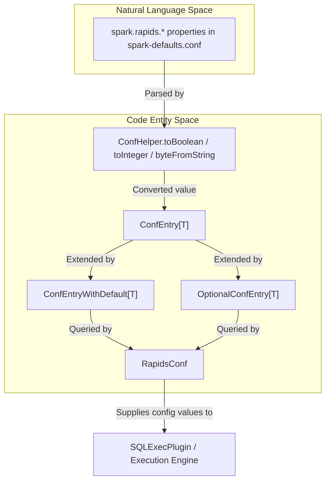
Sources: [sql-plugin/src/main/scala/com/nvidia/spark/rapids/RapidsConf.scala:37-200]()

### Configuration in GPU Plan Replacement

The plugin utilizes `GpuOverrides` to evaluate whether physical Spark operators and expressions can run on the GPU. Each override rule consults `RapidsConf` dynamically using keys structured around the operator class names (`spark.rapids.sql.[part].[ClassName]`) [sql-plugin/src/main/scala/com/nvidia/spark/rapids/RapidsConf.scala:124-150]()

Sources: [sql-plugin/src/main/scala/com/nvidia/spark/rapids/RapidsConf.scala:124-150]()

Diagram: GpuOverrides Replacement and Configuration Flow
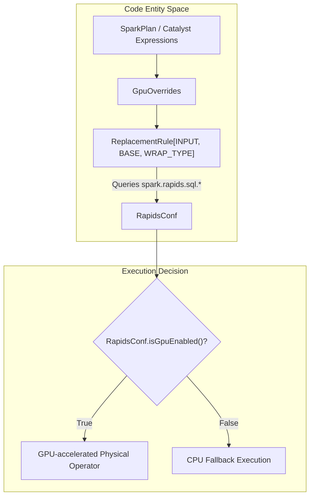
Sources: [sql-plugin/src/main/scala/com/nvidia/spark/rapids/RapidsConf.scala:124-150]()

---

# Page: Compatibility & Supported Operations

# Compatibility & Supported Operations

<details>
<summary>Relevant source files</summary>

The following files were used as context for generating this wiki page:

- [docs/compatibility.md](docs/compatibility.md)
- [integration_tests/src/main/python/regexp_test.py](integration_tests/src/main/python/regexp_test.py)
- [integration_tests/src/main/python/string_test.py](integration_tests/src/main/python/string_test.py)
- [scala2.13/tools/pom.xml](scala2.13/tools/pom.xml)
- [sql-plugin/src/main/scala/com/nvidia/spark/rapids/GpuRegExpReplaceMeta.scala](sql-plugin/src/main/scala/com/nvidia/spark/rapids/GpuRegExpReplaceMeta.scala)
- [sql-plugin/src/main/scala/com/nvidia/spark/rapids/RegexParser.scala](sql-plugin/src/main/scala/com/nvidia/spark/rapids/RegexParser.scala)
- [sql-plugin/src/main/scala/org/apache/spark/sql/rapids/stringFunctions.scala](sql-plugin/src/main/scala/org/apache/spark/sql/rapids/stringFunctions.scala)
- [tests/src/test/scala/com/nvidia/spark/rapids/ConditionalsSuite.scala](tests/src/test/scala/com/nvidia/spark/rapids/ConditionalsSuite.scala)
- [tests/src/test/scala/com/nvidia/spark/rapids/RegularExpressionParserSuite.scala](tests/src/test/scala/com/nvidia/spark/rapids/RegularExpressionParserSuite.scala)
- [tests/src/test/scala/com/nvidia/spark/rapids/RegularExpressionRewriteSuite.scala](tests/src/test/scala/com/nvidia/spark/rapids/RegularExpressionRewriteSuite.scala)
- [tests/src/test/scala/com/nvidia/spark/rapids/RegularExpressionSuite.scala](tests/src/test/scala/com/nvidia/spark/rapids/RegularExpressionSuite.scala)
- [tests/src/test/scala/com/nvidia/spark/rapids/RegularExpressionTranspilerSuite.scala](tests/src/test/scala/com/nvidia/spark/rapids/RegularExpressionTranspilerSuite.scala)
- [tests/src/test/scala/com/nvidia/spark/rapids/StringFunctionSuite.scala](tests/src/test/scala/com/nvidia/spark/rapids/StringFunctionSuite.scala)
- [tools/generated_files/330/operatorsScore.csv](tools/generated_files/330/operatorsScore.csv)
- [tools/generated_files/330/supportedExprs.csv](tools/generated_files/330/supportedExprs.csv)
- [tools/generated_files/331/operatorsScore.csv](tools/generated_files/331/operatorsScore.csv)
- [tools/generated_files/331/supportedExprs.csv](tools/generated_files/331/supportedExprs.csv)
- [tools/generated_files/332/operatorsScore.csv](tools/generated_files/332/operatorsScore.csv)
- [tools/generated_files/332/supportedExprs.csv](tools/generated_files/332/supportedExprs.csv)
- [tools/generated_files/333/operatorsScore.csv](tools/generated_files/333/operatorsScore.csv)
- [tools/generated_files/333/supportedExprs.csv](tools/generated_files/333/supportedExprs.csv)
- [tools/generated_files/334/operatorsScore.csv](tools/generated_files/334/operatorsScore.csv)
- [tools/generated_files/334/supportedExprs.csv](tools/generated_files/334/supportedExprs.csv)
- [tools/generated_files/340/operatorsScore.csv](tools/generated_files/340/operatorsScore.csv)
- [tools/generated_files/340/supportedExprs.csv](tools/generated_files/340/supportedExprs.csv)
- [tools/generated_files/341/operatorsScore.csv](tools/generated_files/341/operatorsScore.csv)
- [tools/generated_files/341/supportedExprs.csv](tools/generated_files/341/supportedExprs.csv)
- [tools/generated_files/342/operatorsScore.csv](tools/generated_files/342/operatorsScore.csv)
- [tools/generated_files/342/supportedExprs.csv](tools/generated_files/342/supportedExprs.csv)
- [tools/generated_files/343/operatorsScore.csv](tools/generated_files/343/operatorsScore.csv)
- [tools/generated_files/350/supportedExprs.csv](tools/generated_files/350/supportedExprs.csv)
- [tools/generated_files/351/supportedExprs.csv](tools/generated_files/351/supportedExprs.csv)
- [tools/generated_files/357/supportedDataSource.csv](tools/generated_files/357/supportedDataSource.csv)
- [tools/generated_files/357/supportedExecs.csv](tools/generated_files/357/supportedExecs.csv)
- [tools/generated_files/operatorsScore.csv](tools/generated_files/operatorsScore.csv)
- [tools/generated_files/supportedDataSource.csv](tools/generated_files/supportedDataSource.csv)
- [tools/generated_files/supportedExecs.csv](tools/generated_files/supportedExecs.csv)
- [tools/generated_files/supportedExprs.csv](tools/generated_files/supportedExprs.csv)
- [tools/pom.xml](tools/pom.xml)

</details>


## Purpose and Scope

The RAPIDS Accelerator for Apache Spark strives to produce results that are bit-for-bit identical to Apache Spark. However, performance-driven design choices, differences in underlying implementations (JVM vs. C++/cuDF), and parallel aggregation race conditions cause some intentional or inherent behavioral disparities. These differences are managed via configurations and are tracked within the plan-replacement framework to allow users to enable, disable, or control tolerance for differences [docs/compatibility.md:7-16]().

Sources:
- [docs/compatibility.md:7-16]()

---

## General Limitations & Behavioral Differences

### Ordering of Output

Spark itself does not guarantee output order for many distributed operators such as aggregates or joins because these operations rely on hash-based distribution and task parallelism [docs/compatibility.md:20-22](). Accordingly, the RAPIDS plugin also does not guarantee to reproduce the exact output ordering of these operations when running on GPU [docs/compatibility.md:20-25](). For explicit sorting with `ORDER BY`, the plugin produces an ordering compatible with Spark's guarantees, though exact ordering may differ in ambiguous cases [docs/compatibility.md:23-25]().

Further specifics on floating-point ordering include:

- Spark versions before 3.1.0 treat `-0.0` as less than `0.0` during sorting, but from 3.1.0 onwards they consider them equal.
- The RAPIDS plugin treats `-0.0` and `0.0` as equal for sorting across all versions, which can cause ordering differences [docs/compatibility.md:27-28]().
- Spark's sort algorithm is typically stable, but distributed execution cannot guarantee sort stability unless all data is sorted within a single task/partition.
- The plugin uses an unstable out-of-core sort to handle data spilling on the GPU by default.
- Stable sorting can be enabled explicitly with configuration flag `spark.rapids.sql.stableSort.enabled` (which triggers cuDF to sort all data in GPU memory without spilling) [docs/compatibility.md:30-41]().

Sources:
- [docs/compatibility.md:20-42]()

### Floating Point & Decimal Arithmetic Differences

- The GPU plugin matches CPU Spark bit-for-bit for most basic floating-point arithmetic operations like addition, subtraction, multiplication, and division [docs/compatibility.md:43-46]().

- For transcendental math functions such as `sin`, `cos`, results differ within acceptable floating-point rounding error bounds since JVM and cuDF use different implementations and different evaluation orders [docs/compatibility.md:46-50]().

- **`round` and `bround`** behave differently due to Spark's CPU logic converting binary floating-point to decimal before rounding, while GPU operates directly with binary floating-point. For example, `round(1.025, 2)` yields `1.03` on CPU but `1.02` on GPU [docs/compatibility.md:52-60]().

- **`degrees`** function difference depends on JDK versions: Spark CPU’s uses Java 8 `Math.toDegrees` implementation (`angrad * 180.0 / PI`) which can overflow, while the GPU plugin uses Java 9+ style (`angrad * (180d / PI)`), avoiding some overflow cases on large values [docs/compatibility.md:62-64]().

- **Parallel aggregations** on GPU are performed with parallel reductions, which introduce floating-point summation nondeterminism due to race conditions. This can cause slight variations between repeated runs for scalar and array aggregations (e.g. `sum`, `avg`, `aggregate` / `reduce`). This behavior can be disabled via config `spark.rapids.sql.variableFloatAgg.enabled` [docs/compatibility.md:65-74]().

- For large finite floating-point input, standard deviation and variance aggregations (`stddev_*`, `variance_*`) may overflow differently between CPU and GPU due to partial aggregate state merge order changes. This may cause different IEEE sentinels like `NaN` vs `+Infinity`. This only affects extreme input edge cases [docs/compatibility.md:77-84]().

- **`0.0` vs `-0.0`**: The IEEE standard treats `0.0` and `-0.0` as equivalent. While Spark's CPU implementation is inconsistent in normalizing these values (see [SPARK-32110](https://issues.apache.org/jira/browse/SPARK-32110)), the GPU plugin treats them as identical for most processing. This can lead to differences in operations like sorting and distinct counts, especially in Spark versions prior to 3.1.0. Differences can also occur in joins and comparisons even after Spark 3.1.0 [docs/compatibility.md:85-94](). The plugin does not disable operations due to `-0.0` differences, as it's considered a rare occurrence [docs/compatibility.md:96-97]().

- **`NaN` vs `NaN`**: Spark's handling of `NaN` comparisons is inconsistent and has changed across versions. The cuDF plugin aims to match Spark's output, but some operations may differ [docs/compatibility.md:99-104]().

Sources:
- [docs/compatibility.md:43-104]()

---

## String & Regular Expression GPU Support

The RAPIDS Accelerator supports GPU acceleration for many Spark string functions and integrates GPU-based regex via transpilation from Spark regex to cuDF regex programs.

### Key Implementation Elements

- **Regex Parsing (`RegexParser`)**: Located in `RegexParser.scala`, implements a Pratt parser to convert Spark regex pattern strings into a minimal Abstract Syntax Tree (`RegexAST`). This AST validates whether patterns are supported on GPU and is the basis for transpilation. Unsupported features (e.g. possessive quantifiers, certain anchors) raise a `RegexUnsupportedException` [sql-plugin/src/main/scala/com/nvidia/spark/rapids/RegexParser.scala:28-66](). The parser also handles replacement strings, converting them into a sequence of `RegexAST` parts, including backreferences [sql-plugin/src/main/scala/com/nvidia/spark/rapids/RegexParser.scala:73-98]().

- **GPU String Expressions**: GPU-accelerated string functions extend `GpuUnaryExpression` or predicates, directly invoking underlying cuDF APIs on GPU column vectors. Examples include:
  - `GpuUpper`, `GpuLower` for case conversions [sql-plugin/src/main/scala/org/apache/spark/sql/rapids/stringFunctions.scala:53-67]()
  - `GpuLength`, `GpuBitLength`, `GpuOctetLength` for string length measures [sql-plugin/src/main/scala/org/apache/spark/sql/rapids/stringFunctions.scala:70-103]()
  - `GpuStringLocate` for substring index finding [sql-plugin/src/main/scala/org/apache/spark/sql/rapids/stringFunctions.scala:105-163]()
  - `GpuStartsWith` for prefix checks [sql-plugin/src/main/scala/org/apache/spark/sql/rapids/stringFunctions.scala:165-183]()
These are implemented in `stringFunctions.scala` [sql-plugin/src/main/scala/org/apache/spark/sql/rapids/stringFunctions.scala:47-183]().

- **Regex Transpilation & Execution**: The abstract syntax tree output by the parser gets transpiled to a `RegexProgram` suitable for execution on GPU. GPU regex execution operators like `GpuRegExpReplaceExec` or `GpuRegExpExtractExec` use these compiled programs. Unsupported regex patterns cause fallback to CPU execution [tests/src/test/scala/com/nvidia/spark/rapids/RegularExpressionTranspilerSuite.scala:35-89](). The transpiler also detects invalid cuDF patterns that might compile in Java but have inconsistent behavior or are explicitly unsupported by cuDF [tests/src/test/scala/com/nvidia/spark/rapids/RegularExpressionTranspilerSuite.scala:35-89]().

### Regex Transpilation and Execution Pipeline

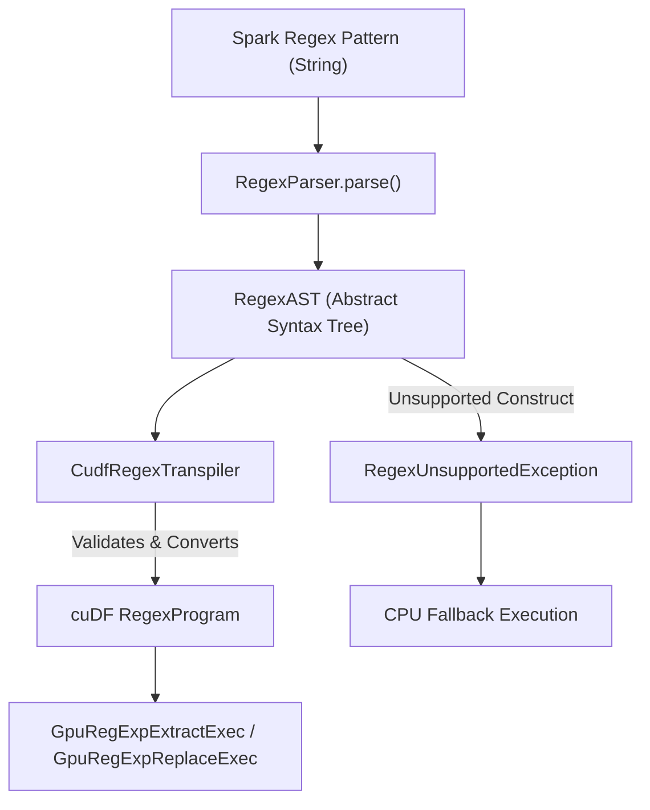
*Figure 1: Workflow mapping from Spark regex string to GPU regex execution and fallback incorporating `RegexParser` and `RegexProgram`.*

Sources:
- [sql-plugin/src/main/scala/com/nvidia/spark/rapids/RegexParser.scala:28-98]()
- [sql-plugin/src/main/scala/org/apache/spark/sql/rapids/stringFunctions.scala:47-183]()
- [tests/src/test/scala/com/nvidia/spark/rapids/RegularExpressionTranspilerSuite.scala:35-89]()

---

## SparkPlan Replacement and Supported Operations Registry

At runtime, the plugin intercepts Spark SQL physical plans and expressions using the `GpuOverrides` registry, which contains rules that validate support and perform plan replacement for GPU execution.

### Replacement Pipeline

- Input Spark plans (CPU bound) traverse through `GpuOverrides` rules.
- Each operator/expression is mapped to a corresponding metadata wrapper (`RapidsMeta`) which executes `tagForGpu()` validation logic.
- If all checks pass (compatible types, supported features, etc.), `convertToGpu()` replaces the CPU node with a GPU-accelerated equivalent (such as `GpuFilterExec`) in the plan.
- If checks fail, the plan node falls back to execution on CPU [tools/generated_files/operatorsScore.csv:1-46]().

### Plan Replacement and Tagging Pipeline

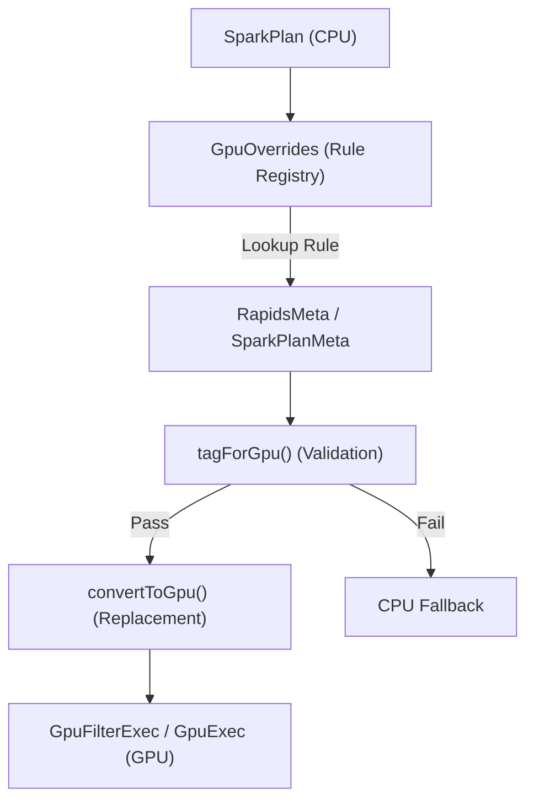
*Figure 2: Spark physical plan interception, validation, and GPU plan substitution workflow via `GpuOverrides` and `RapidsMeta`.*

Sources:
- [tools/generated_files/operatorsScore.csv:1-46]()

---

## Tools and Generated Supported Operations Reference

The plugin build process generates detailed CSV references used to document, analyze, and score GPU support for expressions and physical operators.

- These references are generated during Maven's package phase by a Java tool `SupportedOpsForTools` executed via the `maven-antrun-plugin` [tools/pom.xml:80-123]().

| File Name                   | Description                                                                                                     | Location / Usage                                             |
|-----------------------------|-----------------------------------------------------------------------------------------------------------------|--------------------------------------------------------------|
| `supportedExprs.csv`         | Lists Spark SQL expressions and their GPU support status by input/output types and compatibility notes         | `tools/generated_files/supportedExprs.csv`                    |
| `operatorsScore.csv`         | Contains CPU Spark operator names with assigned scores used by the Cost-Based Optimizer to assess replacement  | `tools/generated_files/operatorsScore.csv`                    |
| `supportedExecs.csv`         | Physical Spark operator GPU support matrix indicating capabilities and fallback options                         | `tools/generated_files/*/supportedExecs.csv`                  |
| `supportedDataSource.csv`    | Data source and file format support reference mapping                                                         | `tools/generated_files/supportedDataSource.csv`               |

These files empower tooling and documentation to track detailed GPU compatibility coverage and performance impact.

Sources:
- [tools/pom.xml:80-123]()
- [tools/generated_files/supportedExprs.csv:1-53]()
- [tools/generated_files/operatorsScore.csv:1-46]()

---

# Summary

This section outlines which Spark SQL operations the RAPIDS Accelerator for Apache Spark accelerates on GPU, nuances and known behavioral differences from CPU execution (especially around ordering and floating-point precision), and details the generated tooling artifacts that comprehensively catalogue supported expressions and operators. Support for string and regex operations is robust yet gated by transpilation-based validation, ensuring fallbacks preserve correctness when GPU support is not possible.

This technical understanding of compatibility and supported operations is foundational for developers configuring, troubleshooting, or extending the accelerator in complex Spark environments.

---

# Page: Core Plugin Architecture

# Core Plugin Architecture

<details>
<summary>Relevant source files</summary>

The following files were used as context for generating this wiki page:

- [docs/additional-functionality/advanced_configs.md](docs/additional-functionality/advanced_configs.md)
- [docs/configs.md](docs/configs.md)
- [docs/dev/shims.md](docs/dev/shims.md)
- [docs/supported_ops.md](docs/supported_ops.md)
- [integration_tests/src/main/python/data_gen.py](integration_tests/src/main/python/data_gen.py)
- [integration_tests/src/main/python/hash_aggregate_test.py](integration_tests/src/main/python/hash_aggregate_test.py)
- [integration_tests/src/main/python/window_function_test.py](integration_tests/src/main/python/window_function_test.py)
- [sql-plugin/src/main/scala/com/nvidia/spark/rapids/GpuOverrides.scala](sql-plugin/src/main/scala/com/nvidia/spark/rapids/GpuOverrides.scala)
- [sql-plugin/src/main/scala/com/nvidia/spark/rapids/Plugin.scala](sql-plugin/src/main/scala/com/nvidia/spark/rapids/Plugin.scala)
- [sql-plugin/src/main/scala/com/nvidia/spark/rapids/RapidsConf.scala](sql-plugin/src/main/scala/com/nvidia/spark/rapids/RapidsConf.scala)
- [sql-plugin/src/main/scala/com/nvidia/spark/rapids/RapidsConfEntries.scala](sql-plugin/src/main/scala/com/nvidia/spark/rapids/RapidsConfEntries.scala)

</details>


This page provides a high-level overview of the core architecture of the RAPIDS Accelerator for Apache Spark plugin. It explains how the plugin integrates with Spark via its entry points, the role of the shim layer for multi-version compatibility, the plan-replacement pipeline that transforms Spark plans for GPU execution, the cost-based optimizer and Adaptive Query Execution (AQE) integration, and the public API surface for external extensions. Each subsection links to detailed child pages covering these topics in depth.

---

## Plugin Entry Points & SparkPlugin Registration

The plugin hooks into Spark through the `SparkPlugin` interface, implementing both the `DriverPlugin` and `ExecutorPlugin` traits (`org.apache.spark.api.plugin.SparkPlugin`) [sql-plugin/src/main/scala/com/nvidia/spark/rapids/Plugin.scala:43](). This enables initialization tasks within driver and executors such as setting up the GPU memory allocator (`RmmSpark`), the GPU-safe timezone database (`GpuTimeZoneDB`), and other execution environment components [sql-plugin/src/main/scala/com/nvidia/spark/rapids/Plugin.scala:37-81](). 

On the SQL planning side, the plugin registers `ColumnarOverrideRules` which provide replacement rules to transform CPU Spark physical plans into GPU-accelerated equivalents using `GpuOverrides` and `GpuTransitionOverrides` [sql-plugin/src/main/scala/com/nvidia/spark/rapids/Plugin.scala:74-81](). These rules form the basis of accelerating Spark SQL operations on the GPU.

For detailed mechanics of plugin registration and entry points, refer to [Plugin Entry Points & SparkPlugin Registration](#2.1).

### Diagram: Plugin Registration and Entry Points

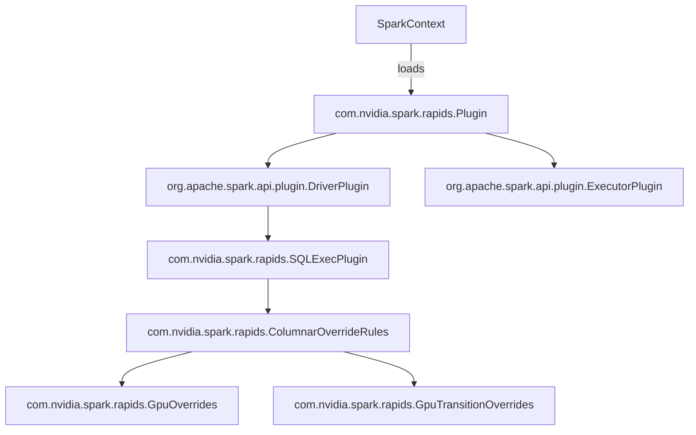

Sources:  
- [sql-plugin/src/main/scala/com/nvidia/spark/rapids/Plugin.scala:37-81]()  
- [sql-plugin/src/main/scala/com/nvidia/spark/rapids/GpuOverrides.scala:75-76]()

---

## Shim Layer & Multi-Version Support

Apache Spark evolves rapidly across versions, frequently introducing incompatible internal API changes. To manage this, the plugin uses a **shim layer** to abstract differences between Spark versions. This layer exposes stable interfaces (e.g., `SparkShimServiceProvider`) implemented differently per Spark version, allowing the core GPU plugin logic to remain version-agnostic [sql-plugin/src/main/scala/com/nvidia/spark/rapids/Plugin.scala:70]().

The `ShimLoader` dynamically detects the Spark runtime version and loads the corresponding shim implementation. The project uses a **parallel-worlds JAR layout**, packaging each supported Spark version’s shim as a separate artifact loaded at runtime, minimizing class conflicts and enabling multi-version compatibility within the same plugin release.

For an in-depth explanation of the shim architecture, including adding support for new Spark versions, see [Shim Layer & Multi-Version Support](#2.2).

### Diagram: Shim Resolution Flow

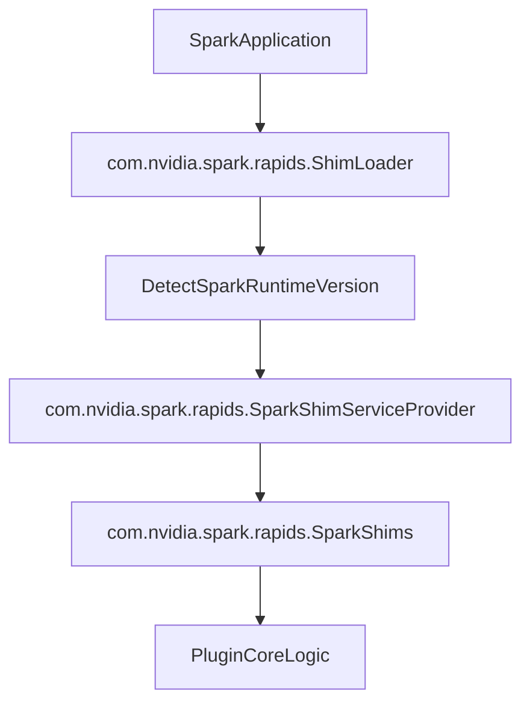

Sources:  
- [sql-plugin/src/main/scala/com/nvidia/spark/rapids/Plugin.scala:70]()

---

## RapidsMeta & Plan Replacement Pipeline

The core of GPU acceleration lies in analyzing and transforming Spark’s physical plans. This is done via a plan-replacement pipeline that traverses Spark operators and expressions, wrapping them with corresponding `RapidsMeta` classes (e.g., `SparkPlanMeta`, `BaseExprMeta`) which contain GPU-specific metadata and logic [sql-plugin/src/main/scala/com/nvidia/spark/rapids/GpuOverrides.scala:69-77]().

The `tagForGpu()` method in these wrappers performs compatibility checks against type constraints and runtime configurations (`TypeChecks`), marking operators as GPU-compatible or requiring fallback. Compatible operators are replaced by equivalent GPU implementations through `convertToGpu()`. If not compatible, fallback to CPU execution or transition wrappers (`GpuTransitionOverrides`) manage graceful plan degradation [sql-plugin/src/main/scala/com/nvidia/spark/rapids/Plugin.scala:74-81]().

This modular mechanism allows fine-grained control over what and how parts of a query plan are accelerated on GPUs.

For details on `RapidsMeta` classes, compatibility tagging, and rule pipelines, see [RapidsMeta & Plan Replacement Pipeline](#2.3).

Sources:  
- [sql-plugin/src/main/scala/com/nvidia/spark/rapids/GpuOverrides.scala:69-90]()  
- [sql-plugin/src/main/scala/com/nvidia/spark/rapids/Plugin.scala:74-81]()

---

## Cost-Based Optimizer & Adaptive Query Execution

To decide when to run workloads on GPU versus CPU and optimize overall query performance, the plugin integrates with Spark’s **Cost-Based Optimizer (CBO)** and **Adaptive Query Execution (AQE)** framework. It models operation costs under CPU and GPU execution paths, which helps avoid costly unnecessary data transfers between host and device memory [sql-plugin/src/main/scala/com/nvidia/spark/rapids/RapidsConf.scala:46]().

AQE integration enables dynamically rewriting query stages involving shuffles (`ShuffleQueryStageExec`, `BroadcastQueryStageExec`) and inserting optimized GPU-aware shuffle readers and transition steps based on runtime metrics [sql-plugin/src/main/scala/com/nvidia/spark/rapids/GpuOverrides.scala:41-42]().

This cost and feedback-driven optimization pipeline helps maximize GPU usage while preserving correctness and overall efficiency.

For comprehensive coverage of CBO models, AQE hooks, and custom shuffle readers, refer to [Cost-Based Optimizer & Adaptive Query Execution](#2.4).

Sources:  
- [sql-plugin/src/main/scala/com/nvidia/spark/rapids/GpuOverrides.scala:41-42]()  
- [sql-plugin/src/main/scala/com/nvidia/spark/rapids/RapidsConf.scala:46]()

---

## Public Plugin API (sql-plugin-api)

The plugin exposes a stable public API surface residing in the `sql-plugin-api` module. This API supports external extensions, custom data sources, and user-defined functions that can leverage GPU acceleration safely across Spark versions.

Key public classes and interfaces include:

- `ShimLoader` and `SparkShimServiceProvider` for shim interaction  
- `RapidsConf` for configuration management  
- Helpers for columnar batch utilities like `GpuColumnVectorUtils`  
- GPU-aware user-defined function interfaces like `DFUDFPluginAPI`  
- Format and file I/O helper modules in `sql-plugin-columnar` and `sql-plugin-format`  

This API is intentionally separated from internal implementation to permit binary-compatible plugin extensions.

For detailed description of API components and examples, see [Public Plugin API (sql-plugin-api)](#2.5).

Sources:  
- [sql-plugin/src/main/scala/com/nvidia/spark/rapids/Plugin.scala:31]()

---

# Related Child Pages

- **[Plugin Entry Points & SparkPlugin Registration](#2.1)** — Plugin registration lifecycle, DriverPlugin/ExecutorPlugin roles, and override-rule registries.  
- **[Shim Layer & Multi-Version Support](#2.2)** — Shim patterns, SPI service provider loading, JAR packaging, and version compatibility.  
- **[RapidsMeta & Plan Replacement Pipeline](#2.3)** — RapidsMeta class hierarchy, GPU tagging, conversion routines, and physical plan rewriting rules.  
- **[Cost-Based Optimizer & Adaptive Query Execution](#2.4)** — CPU vs GPU cost models, AQE-aware plan adjustments, and efficient shuffle strategies.  
- **[Public Plugin API (sql-plugin-api)](#2.5)** — Stable APIs for external extensions and custom components using the RAPIDS plugin.

---

# Summary Diagram: Natural Language To Code Entity Space Mapping

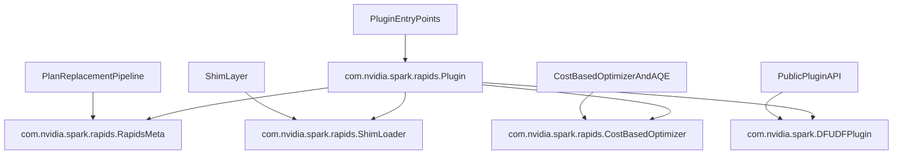

Sources:  
- [sql-plugin/src/main/scala/com/nvidia/spark/rapids/Plugin.scala:31-81]()  
- [sql-plugin/src/main/scala/com/nvidia/spark/rapids/GpuOverrides.scala:69-90]()  
- [sql-plugin/src/main/scala/com/nvidia/spark/rapids/RapidsConf.scala:46]()  

---

# Summary of Key Components in Code Entity Space

| Component                      | Code Entity                                   | Role                                                                                   |
|-------------------------------|-----------------------------------------------|----------------------------------------------------------------------------------------|
| Plugin Entry Point             | `com.nvidia.spark.rapids.Plugin`              | Entry point for Spark integration, driver and executor setup                           |
| Columnar Override Rules        | `ColumnarOverrideRules`                        | Contains rule sets that enable GPU plan transformation                                |
| Plan Replacement Pipeline      | `GpuOverrides`, `RapidsMeta` classes           | Wraps Spark plans for compatibility checking and GPU conversion                        |
| Shim Loader                   | `ShimLoader`, `SparkShimServiceProvider`      | Detects Spark version and loads appropriate shim implementation                        |
| Cost-Based Optimizer & AQE    | `CostBasedOptimizer`, AQE integration rules   | Models CPU/GPU costs and enables dynamic plan adaptation                              |
| Plugin Public API             | `sql-plugin-api` module classes                 | Stable API for external extensions and safe API surface                               |

Sources:  
- [sql-plugin/src/main/scala/com/nvidia/spark/rapids/Plugin.scala:31-81]()  
- [sql-plugin/src/main/scala/com/nvidia/spark/rapids/GpuOverrides.scala:69-90]()

---

# Page: Plugin Entry Points & SparkPlugin Registration

# Plugin Entry Points & SparkPlugin Registration

<details>
<summary>Relevant source files</summary>

The following files were used as context for generating this wiki page:

- [delta-lake/common/src/main/delta-io/scala/com/nvidia/spark/rapids/delta/DeltaIOProvider.scala](delta-lake/common/src/main/delta-io/scala/com/nvidia/spark/rapids/delta/DeltaIOProvider.scala)
- [delta-lake/delta-20x/src/main/scala/com/nvidia/spark/rapids/delta/delta20x/Delta20xProvider.scala](delta-lake/delta-20x/src/main/scala/com/nvidia/spark/rapids/delta/delta20x/Delta20xProvider.scala)
- [delta-lake/delta-21x/src/main/scala/com/nvidia/spark/rapids/delta/delta21x/Delta21xProvider.scala](delta-lake/delta-21x/src/main/scala/com/nvidia/spark/rapids/delta/delta21x/Delta21xProvider.scala)
- [delta-lake/delta-22x/src/main/scala/com/nvidia/spark/rapids/delta/delta22x/Delta22xProvider.scala](delta-lake/delta-22x/src/main/scala/com/nvidia/spark/rapids/delta/delta22x/Delta22xProvider.scala)
- [delta-lake/delta-23x/src/main/scala/com/nvidia/spark/rapids/delta/delta23x/Delta23xProvider.scala](delta-lake/delta-23x/src/main/scala/com/nvidia/spark/rapids/delta/delta23x/Delta23xProvider.scala)
- [delta-lake/delta-24x/src/main/scala/com/nvidia/spark/rapids/delta/delta24x/Delta24xProvider.scala](delta-lake/delta-24x/src/main/scala/com/nvidia/spark/rapids/delta/delta24x/Delta24xProvider.scala)
- [docs/additional-functionality/advanced_configs.md](docs/additional-functionality/advanced_configs.md)
- [docs/configs.md](docs/configs.md)
- [docs/supported_ops.md](docs/supported_ops.md)
- [integration_tests/src/main/python/data_gen.py](integration_tests/src/main/python/data_gen.py)
- [integration_tests/src/main/python/hash_aggregate_test.py](integration_tests/src/main/python/hash_aggregate_test.py)
- [integration_tests/src/main/python/window_function_test.py](integration_tests/src/main/python/window_function_test.py)
- [sql-plugin/src/main/scala/com/nvidia/spark/rapids/GpuOverrides.scala](sql-plugin/src/main/scala/com/nvidia/spark/rapids/GpuOverrides.scala)
- [sql-plugin/src/main/scala/com/nvidia/spark/rapids/Plugin.scala](sql-plugin/src/main/scala/com/nvidia/spark/rapids/Plugin.scala)
- [sql-plugin/src/main/scala/com/nvidia/spark/rapids/RapidsConf.scala](sql-plugin/src/main/scala/com/nvidia/spark/rapids/RapidsConf.scala)
- [sql-plugin/src/main/scala/com/nvidia/spark/rapids/RapidsConfEntries.scala](sql-plugin/src/main/scala/com/nvidia/spark/rapids/RapidsConfEntries.scala)
- [sql-plugin/src/main/scala/com/nvidia/spark/rapids/delta/DeltaProvider.scala](sql-plugin/src/main/scala/com/nvidia/spark/rapids/delta/DeltaProvider.scala)
- [sql-plugin/src/main/scala/com/nvidia/spark/rapids/v2WriteCommandMetas.scala](sql-plugin/src/main/scala/com/nvidia/spark/rapids/v2WriteCommandMetas.scala)
- [sql-plugin/src/main/scala/org/apache/spark/sql/rapids/ExternalSource.scala](sql-plugin/src/main/scala/org/apache/spark/sql/rapids/ExternalSource.scala)

</details>


This page details how the RAPIDS Accelerator for Apache Spark integrates with the Spark ecosystem. It covers the primary entry points for the plugin, including Spark's `DriverPlugin` and `ExecutorPlugin` APIs (`SparkPlugin`, `DriverPlugin`, `ExecutorPlugin`), the `SQLExecPlugin` and `ColumnarOverrideRules` entry points for query plan transformations, and the `GpuOverrides` mechanism for defining GPU-accelerated replacement rules.

---

## SparkPlugin Registration

The RAPIDS Accelerator registers itself with Spark using the `SparkPlugin` API, which provides `DriverPlugin` and `ExecutorPlugin` interfaces. These interfaces enable the plugin to initialize resources and inject custom logic on both the driver and executor nodes.

### Driver-side Initialization

On the Spark driver, the `DriverPlugin` implementation performs several critical startup steps to bootstrap GPU-acceleration:

1. **Configuration Loading**: The plugin loads and encapsulates its configuration settings through `RapidsConf`, an abstraction for all `spark.rapids.*` properties [sql-plugin/src/main/scala/com/nvidia/spark/rapids/RapidsConf.scala:1-100]().
2. **Build Information Logging**: Detailed version and build metadata, including those for the plugin itself, JNI components, and the underlying cuDF library, are logged via the `SparkRapidsBuildInfoEvent` [sql-plugin/src/main/scala/com/nvidia/spark/rapids/Plugin.scala:104-121]().
3. **Multiple JAR Detection**: To avoid runtime conflicts, the plugin scans the classpath for multiple versions of RAPIDS JARs loaded simultaneously [sql-plugin/src/main/scala/com/nvidia/spark/rapids/Plugin.scala:32-32]().
4. **Time Zone Database Initialization**: The plugin initializes the GPU time zone database (`GpuTimeZoneDB`), essential for correct timestamp handling in GPU computations [sql-plugin/src/main/scala/com/nvidia/spark/rapids/Plugin.scala:37-37]().
5. **SQL Plugin Registration**: The `SQLExecPlugin` is registered as a Spark session extension, hooking into Catalyst's planning and optimization phases [sql-plugin/src/main/scala/com/nvidia/spark/rapids/Plugin.scala:89-92]().
6. **UDF Plugin Registration**: Optionally, the `DFUDFPlugin` is registered to accelerate user-defined functions on the GPU [sql-plugin/src/main/scala/com/nvidia/spark/rapids/Plugin.scala:31-31]().
7. **Kryo Serializer Registrator Setup**: Registers `GpuKryoRegistrator` if Kryo serialization is active [sql-plugin/src/main/scala/com/nvidia/spark/rapids/Plugin.scala:96-97]().
8. **Shuffle Manager Setup**: For accelerated shuffle operations, `GpuShuffleEnv` is initialized [sql-plugin/src/main/scala/com/nvidia/spark/rapids/Plugin.scala:50-50]().

Sources: [sql-plugin/src/main/scala/com/nvidia/spark/rapids/Plugin.scala:104-241](), [sql-plugin/src/main/scala/com/nvidia/spark/rapids/RapidsConf.scala:1-100]()

---

### Executor-side Initialization

On each executor node, the `ExecutorPlugin` implementation completes GPU-specific initialization, including:

1. **GPU Device Discovery and Acquisition**: Using Spark-assigned GPU resource information, the plugin identifies the GPU device address and acquires it via `GpuDeviceManager` [sql-plugin/src/main/scala/com/nvidia/spark/rapids/Plugin.scala:277-311]().
2. **RMM Initialization**: The plugin initializes GPU memory management through `RmmSpark`, configuring memory pools and spill thresholds [sql-plugin/src/main/scala/com/nvidia/spark/rapids/Plugin.scala:37-37]().
3. **CUDA Context Establishment**: Ensures the CUDA context for the assigned GPU device is properly initialized.
4. **Time Zone Database Initialization**: Sets up `GpuTimeZoneDB` for executor-side timestamp operations [sql-plugin/src/main/scala/com/nvidia/spark/rapids/Plugin.scala:37-37]().
5. **Traffic Controller Setup**: Manages asynchronous I/O and task-level traffic [sql-plugin/src/main/scala/com/nvidia/spark/rapids/Plugin.scala:36-36]().
6. **Task Completion Listener Registration**: Hooks into Spark's task lifecycle via `ScalableTaskCompletion.onTaskCompletion` to perform cleanup [sql-plugin/src/main/scala/com/nvidia/spark/rapids/Plugin.scala:34-34]().

Sources: [sql-plugin/src/main/scala/com/nvidia/spark/rapids/Plugin.scala:277-311]()

---

### SparkPlugin Registration Flow Diagram

```mermaid
graph TD
    SparkContext["SparkContext"] -- "Loads" --> RapidsPlugin["com.nvidia.spark.rapids.Plugin"]

    RapidsPlugin -- "DriverInit" --> RapidsDriverPlugin["com.nvidia.spark.rapids.DriverPlugin"]
    RapidsPlugin -- "ExecutorInit" --> RapidsExecutorPlugin["com.nvidia.spark.rapids.ExecutorPlugin"]

    subgraph DriverEntities["Driver Entities"]
        RapidsDriverPlugin --> RapidsConf["com.nvidia.spark.rapids.RapidsConf"]
        RapidsDriverPlugin --> GpuTimeZoneDB["com.nvidia.spark.rapids.jni.GpuTimeZoneDB"]
        RapidsDriverPlugin --> SQLExecPlugin["com.nvidia.spark.rapids.SQLExecPlugin"]
        RapidsDriverPlugin --> GpuShuffleEnv["org.apache.spark.sql.rapids.GpuShuffleEnv"]
        RapidsDriverPlugin --> DFUDFPlugin["com.nvidia.spark.DFUDFPlugin"]
        RapidsDriverPlugin --> GpuKryoRegistrator["com.nvidia.spark.rapids.GpuKryoRegistrator"]
    end

    subgraph ExecutorEntities["Executor Entities"]
        RapidsExecutorPlugin --> GpuDeviceManager["com.nvidia.spark.rapids.GpuDeviceManager"]
        RapidsExecutorPlugin --> RmmSpark["com.nvidia.spark.rapids.jni.RmmSpark"]
        RapidsExecutorPlugin --> TrafficController["com.nvidia.spark.rapids.io.async.TrafficController"]
        RapidsExecutorPlugin --> PythonWorkerSemaphore["com.nvidia.spark.rapids.python.PythonWorkerSemaphore"]
    end

    SQLExecPlugin -- "Injects" --> ColumnarOverrideRules["com.nvidia.spark.rapids.ColumnarOverrideRules"]
```

Sources: [sql-plugin/src/main/scala/com/nvidia/spark/rapids/Plugin.scala:104-311](), [sql-plugin/src/main/scala/com/nvidia/spark/rapids/RapidsConf.scala:1-100]()

---

## SQLPlugin and ColumnarOverrideRules

The RAPIDS Accelerator embeds itself deeply into Spark's SQL optimization phases via two primary mechanisms: the `SQLExecPlugin` and `ColumnarOverrideRules`.

### SQLExecPlugin

The `SQLExecPlugin` is a main integration point that extends Spark's session extensions. It registers operations to be performed on Spark session startup, enhancing the Catalyst plan with GPU-capable rules [sql-plugin/src/main/scala/com/nvidia/spark/rapids/Plugin.scala:89-92]().

### ColumnarOverrideRules

`ColumnarOverrideRules` is an abstraction that wraps two important rule sets impacting the Spark physical plan:

1. **overrides (pre-columnar transitions)**: Uses `GpuOverrides` to scan the physical plan and replace nodes with GPU-enabled equivalents [sql-plugin/src/main/scala/com/nvidia/spark/rapids/Plugin.scala:75-78]().
2. **overrideTransitions (post-columnar transitions)**: Uses `GpuTransitionOverrides` to manage CPU/GPU boundary conversions via wrappers like `GpuRowToColumnarExec` and `GpuColumnarToRowExec` [sql-plugin/src/main/scala/com/nvidia/spark/rapids/Plugin.scala:76-80]().

Sources: [sql-plugin/src/main/scala/com/nvidia/spark/rapids/Plugin.scala:74-81]()

---

## GpuOverrides Replacement-Rule Registry

The `GpuOverrides` class serves as the central registry and executor of all Catalyst plan replacement rules for the RAPIDS Accelerator [sql-plugin/src/main/scala/com/nvidia/spark/rapids/GpuOverrides.scala:69-77]().

### ReplacementRule Class

The abstract `ReplacementRule` class encapsulates how a CPU plan node or expression is wrapped and transformed for GPU execution [sql-plugin/src/main/scala/com/nvidia/spark/rapids/GpuOverrides.scala:69-77]().

```scala
abstract class ReplacementRule[INPUT <: BASE, BASE, WRAP_TYPE <: RapidsMeta[INPUT, BASE, _]](
    protected var doWrap: (
        INPUT,
        RapidsConf,
        Option[RapidsMeta[_, _, _]],
        DataFromReplacementRule) => WRAP_TYPE,
    protected var desc: String,
    protected val checks: Option[TypeChecks[_]],
    final val tag: ClassTag[INPUT]) extends DataFromReplacementRule {
    // ...
}
```

Sources: [sql-plugin/src/main/scala/com/nvidia/spark/rapids/GpuOverrides.scala:69-125]()

---

### Replacement Pipeline Data Flow

```mermaid
graph LR
    SparkPlanExpressionCPU["org.apache.spark.sql.execution.SparkPlan or Expression"] --> GpuOverridesRegistry["com.nvidia.spark.rapids.GpuOverrides"]
    GpuOverridesRegistry --> ReplacementRuleMatch["com.nvidia.spark.rapids.ReplacementRule"]
    ReplacementRuleMatch --> TypeChecksValidation["com.nvidia.spark.rapids.TypeChecks"]
    TypeChecksValidation -- "passes" --> RapidsMetaLayer["com.nvidia.spark.rapids.RapidsMeta"]
    RapidsMetaLayer --> TagForGpu["tagForGpu()"]
    TagForGpu -- "convertToGpu()" --> GpuExecImplementation["com.nvidia.spark.rapids.GpuExpression"]
```

Sources: [sql-plugin/src/main/scala/com/nvidia/spark/rapids/GpuOverrides.scala:69-162]()

---

# Summary

The RAPIDS Accelerator for Apache Spark hooks into the Spark ecosystem primarily through the `SparkPlugin` interface using driver and executor plugins [sql-plugin/src/main/scala/com/nvidia/spark/rapids/Plugin.scala:104-311](). At the SQL layer, `SQLExecPlugin` and `ColumnarOverrideRules` coordinate plan rewrites using the `GpuOverrides` registry and `ReplacementRule` abstractions [sql-plugin/src/main/scala/com/nvidia/spark/rapids/Plugin.scala:74-92](), [sql-plugin/src/main/scala/com/nvidia/spark/rapids/GpuOverrides.scala:69-77]().

---

# Page: Shim Layer & Multi-Version Support

# Shim Layer & Multi-Version Support

<details>
<summary>Relevant source files</summary>

The following files were used as context for generating this wiki page:

- [.github/workflows/mvn-verify-check/populate-daily-cache.sh](.github/workflows/mvn-verify-check/populate-daily-cache.sh)
- [.gitignore](.gitignore)
- [build/dyn_shim_detection.py](build/dyn_shim_detection.py)
- [build/get_buildvers.py](build/get_buildvers.py)
- [build/shimplify.py](build/shimplify.py)
- [dist/keep-in-spark-shared.txt](dist/keep-in-spark-shared.txt)
- [dist/scripts/analyze-parallel-world-deps.py](dist/scripts/analyze-parallel-world-deps.py)
- [docs/dev/parallel-world-unshimming.md](docs/dev/parallel-world-unshimming.md)
- [docs/dev/shimplify.md](docs/dev/shimplify.md)
- [docs/dev/shims.md](docs/dev/shims.md)
- [sql-plugin/src/main/spark330db/scala/com/nvidia/spark/rapids/shims/Spark321PlusDBShims.scala](sql-plugin/src/main/spark330db/scala/com/nvidia/spark/rapids/shims/Spark321PlusDBShims.scala)
- [sql-plugin/src/main/spark330db/scala/org/apache/spark/rapids/execution/GpuSubqueryBroadcastMeta.scala](sql-plugin/src/main/spark330db/scala/org/apache/spark/rapids/execution/GpuSubqueryBroadcastMeta.scala)
- [sql-plugin/src/main/spark330db/scala/org/apache/spark/rapids/execution/GpuSubqueryBroadcastMeta330DBBase.scala](sql-plugin/src/main/spark330db/scala/org/apache/spark/rapids/execution/GpuSubqueryBroadcastMeta330DBBase.scala)
- [sql-plugin/src/main/spark332db/scala/com/nvidia/spark/rapids/shims/Spark332PlusDBShims.scala](sql-plugin/src/main/spark332db/scala/com/nvidia/spark/rapids/shims/Spark332PlusDBShims.scala)
- [sql-plugin/src/main/spark340/scala/com/nvidia/spark/rapids/shims/Spark340PlusNonDBShims.scala](sql-plugin/src/main/spark340/scala/com/nvidia/spark/rapids/shims/Spark340PlusNonDBShims.scala)
- [sql-plugin/src/main/spark350db143/scala/com/nvidia/spark/rapids/shims/Spark341PlusDBShims.scala](sql-plugin/src/main/spark350db143/scala/com/nvidia/spark/rapids/shims/Spark341PlusDBShims.scala)
- [sql-plugin/src/main/spark350db143/scala/com/nvidia/spark/rapids/shims/Spark350db143Shims.scala](sql-plugin/src/main/spark350db143/scala/com/nvidia/spark/rapids/shims/Spark350db143Shims.scala)
- [sql-plugin/src/main/spark350db143/scala/org/apache/spark/sql/rapids/execution/GpuSubqueryBroadcastMeta.scala](sql-plugin/src/main/spark350db143/scala/org/apache/spark/sql/rapids/execution/GpuSubqueryBroadcastMeta.scala)
- [sql-plugin/src/main/spark400/scala/org/apache/spark/sql/rapids/execution/GpuSubqueryBroadcastMeta.scala](sql-plugin/src/main/spark400/scala/org/apache/spark/sql/rapids/execution/GpuSubqueryBroadcastMeta.scala)
- [sql-plugin/src/test/scala/com/nvidia/spark/rapids/ClassInitializationSuite.scala](sql-plugin/src/test/scala/com/nvidia/spark/rapids/ClassInitializationSuite.scala)

</details>


## Purpose and Scope

The NVIDIA cuDF plugin for Apache Spark supports multiple feature version lines of Apache Spark (such as `3.3.x`, `3.4.x`, `3.5.x`, `4.x`) as well as various vendor distributions like Databricks and Amazon EMR [docs/dev/shims.md:10-12](). Because Spark's internal APIs evolve rapidly and frequently break source and binary compatibility between releases, the accelerator uses a **shim layer** architecture [docs/dev/shims.md:12-14](). This layer abstracts Spark internals behind a stable common interface, isolating version-specific adjustments in dedicated shim modules and allowing core plugin logic to remain uniform [docs/dev/shims.md:13-16]().

Sources:
* [docs/dev/shims.md:10-16]()

---

## The Shim Layer Architecture & One-Way Module Boundaries

The shim layer operates via a ServiceProvider pattern where the appropriate implementation is loaded at runtime after detecting the active Spark version [docs/dev/shims.md:16-19](). 

### One-way Shim Module Boundary

To maintain binary compatibility and cleanly isolate version dependencies, the codebase enforces a strict one-way module boundary [docs/dev/shims.md:24-37]():

| Module | Purpose | Restrictions |
| :--- | :--- | :--- |
| `sql-plugin-api` | Contains narrow shared types and descriptor objects (`ShimDataWritingCommandRule`, `ShimRunnableCommandRule`, `ShimExecRule`) [docs/dev/shims.md:30-40](). | Must not depend on implementation classes from `sql-plugin` [docs/dev/shims.md:31-32](). |
| `sql-plugin-shims` | Depends on `sql-plugin-api` and Spark; references Spark internal APIs that vary across build versions [docs/dev/shims.md:32-34](). | Must not reference GPU meta classes, `GpuOverrides`, or `RapidsMeta` [docs/dev/shims.md:33-35](). |
| `sql-plugin` | Turns shim descriptors into concrete plugin rules and owns RAPIDS metadata factories [docs/dev/shims.md:35-37](). | Depends on `sql-plugin-shims` and orchestrates execution [docs/dev/shims.md:35-37](). |

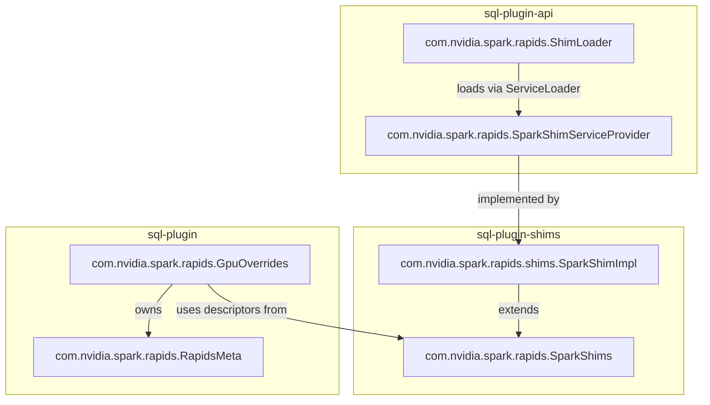

**Title: Shim Architecture and Module Dependencies**

Sources:
* [docs/dev/shims.md:24-48]()

---

## ShimLoader and Runtime Shim Discovery

`ShimLoader` serves as the primary entry point for interacting with the host Spark runtime [docs/dev/shims.md:17-20]().

### Loading Mechanism

- **Detection**: Queries the active Spark execution environment to identify the exact Spark build version and vendor [docs/dev/shims.md:17-20]().
- **Service Discovery**: Leverages Java's `ServiceLoader` to locate and instantiate `SparkShimServiceProvider` implementations [docs/dev/shims.md:17-19]().
- **Resolution**: Returns the concrete `SparkShims` instance tailored to the runtime [docs/dev/shims.md:17-19]().

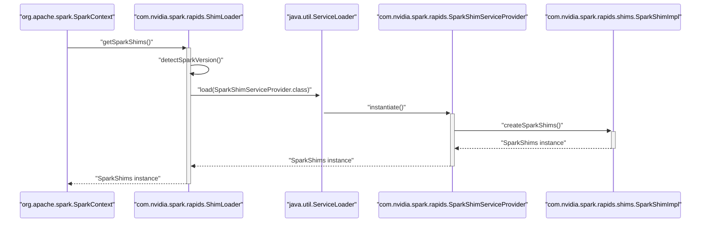

**Title: Runtime Shim Discovery Sequence**

Sources:
* [docs/dev/shims.md:17-22]()

---

## Parallel-Worlds JAR Layout & Reducing Parallel-World Classes

Packaging multiple binary-incompatible Spark versions into a single distribution jar is achieved via the **Parallel-Worlds** layout [docs/dev/shims.md:52-56]().

### Parallel-Worlds Layout Organization

- Version-specific shim bytecode resides in isolated namespaces (e.g., `spark330`, `spark340`, `spark500`) [docs/dev/shims.md:52-56]().
- Common logic shared across versions is stored in `spark-shared/` or the root of the distribution [docs/dev/shims.md:56-59]().
- `ShimLoader` adjusts class loading priorities at runtime to select the classes matching the active Spark build [docs/dev/shims.md:17-20]().
- The deduplication script `dist/scripts/binary-dedupe.sh` verifies byte-for-byte identical classes and promotes them out of `spark-shared` when safe [docs/dev/shims.md:60-65]().

Developers can analyze parallel-world dependencies using the provided dependency analysis script [docs/dev/shims.md:85-88]():

```bash
VERSION=26.04.2
curl -fL -o /tmp/rapids-4-spark_2.12-${VERSION}-cuda12.jar \
  https://repo.maven.apache.org/maven2/com/nvidia/rapids-4-spark_2.12/${VERSION}/rapids-4-spark_2.12-${VERSION}-cuda12.jar

python3 dist/scripts/analyze-parallel-world-deps.py \
  /tmp/rapids-4-spark_2.12-${VERSION}-cuda12.jar \
  --show-topo
```

This tool inspects the distribution jar to report direct classifier-package dependencies, root-safety violations, and strongly connected components (SCCs) [docs/dev/shims.md:110-120]().

Sources:
* [docs/dev/shims.md:52-123]()

---

## Tooling: `shimplify` and Build Integration

Maintaining dozens of version-specific directories is managed by the `shimplify` tooling implemented in `build/shimplify.py` [docs/dev/shimplify.md:10-16]().

### JSON Lines Shim Metadata

Instead of separate directory trees for each version variant, individual source files declare their target Spark builds via a `spark-rapids-shim-json-lines` comment block [docs/dev/shimplify.md:35-45]():

```scala
/*** spark-rapids-shim-json-lines
{"spark": "330"}
{"spark": "331"}
spark-rapids-shim-json-lines ***/
```

- Files are physically stored under the directory corresponding to the **owner shim** (the minimum Spark version listed) [docs/dev/shimplify.md:47-65]().
- During the Maven `generate-sources` phase, `build/shimplify.py` parses these blocks and symlinks or materializes the source files into version-specific target directories (`target/${buildver}/generated/src/...`) [docs/dev/shimplify.md:65-75]().
- `build/get_buildvers.py` parses Maven POM profiles to extract active Spark build versions while honoring exclusions defined in `dyn.shim.excluded.releases` [build/get_buildvers.py:20-55]().

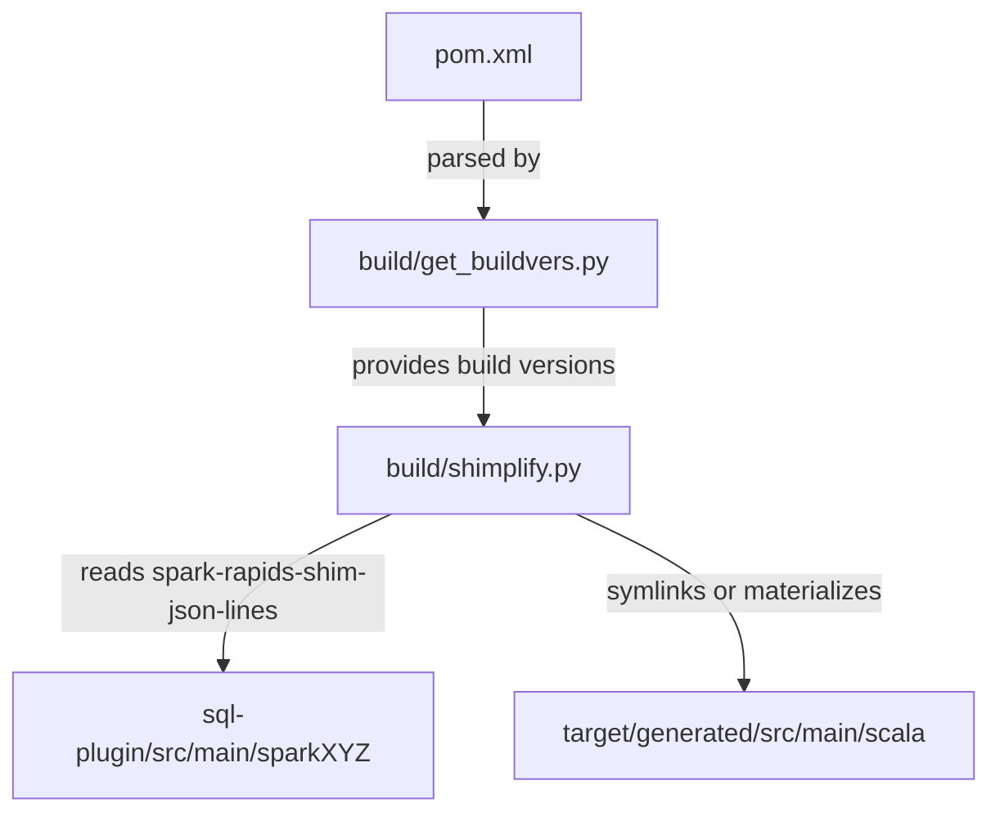

**Title: Shimplify Build Generation Pipeline**

Sources:
* [docs/dev/shimplify.md:8-79]()
* [build/get_buildvers.py:20-88]()

---

## Adding a Shim & Preventing Class Initialization Deadlocks

Adding support for a new Spark version involves creating a dedicated source root and registering the new service provider. However, concurrent class loading between `GpuOverrides` and `SparkShimImpl` can trigger deadlocks if initialization locks are held improperly [sql-plugin/src/test/scala/com/nvidia/spark/rapids/ClassInitializationSuite.scala:115-124]().

### Preventing Deadlocks via Lazy Evaluation

To prevent race conditions during JVM class initialization:
- Rule maps and version-specific extension lists inside shims (such as `shimExecs` in `Spark340PlusNonDBShims`) must be declared `private lazy val` [sql-plugin/src/main/spark340/scala/com/nvidia/spark/rapids/shims/Spark340PlusNonDBShims.scala:68-71]().
- Eager evaluation during object construction can cause circular dependencies where `GpuOverrides` waits for `SparkShimImpl` while holding its class-initialization lock, and vice versa [sql-plugin/src/test/scala/com/nvidia/spark/rapids/ClassInitializationSuite.scala:115-124]().

Sources:
* [sql-plugin/src/main/spark340/scala/com/nvidia/spark/rapids/shims/Spark340PlusNonDBShims.scala:68-71]()
* [sql-plugin/src/test/scala/com/nvidia/spark/rapids/ClassInitializationSuite.scala:115-124]()

---

# Page: RapidsMeta & Plan Replacement Pipeline

# RapidsMeta & Plan Replacement Pipeline

<details>
<summary>Relevant source files</summary>

The following files were used as context for generating this wiki page:

- [integration_tests/src/main/python/aqe_test.py](integration_tests/src/main/python/aqe_test.py)
- [integration_tests/src/main/python/cast_test.py](integration_tests/src/main/python/cast_test.py)
- [integration_tests/src/main/python/date_time_test.py](integration_tests/src/main/python/date_time_test.py)
- [sql-plugin/src/main/scala/com/nvidia/spark/rapids/CostBasedOptimizer.scala](sql-plugin/src/main/scala/com/nvidia/spark/rapids/CostBasedOptimizer.scala)
- [sql-plugin/src/main/scala/com/nvidia/spark/rapids/DateUtils.scala](sql-plugin/src/main/scala/com/nvidia/spark/rapids/DateUtils.scala)
- [sql-plugin/src/main/scala/com/nvidia/spark/rapids/GpuAggregateExec.scala](sql-plugin/src/main/scala/com/nvidia/spark/rapids/GpuAggregateExec.scala)
- [sql-plugin/src/main/scala/com/nvidia/spark/rapids/GpuCast.scala](sql-plugin/src/main/scala/com/nvidia/spark/rapids/GpuCast.scala)
- [sql-plugin/src/main/scala/com/nvidia/spark/rapids/GpuTransitionOverrides.scala](sql-plugin/src/main/scala/com/nvidia/spark/rapids/GpuTransitionOverrides.scala)
- [sql-plugin/src/main/scala/com/nvidia/spark/rapids/RapidsMeta.scala](sql-plugin/src/main/scala/com/nvidia/spark/rapids/RapidsMeta.scala)
- [sql-plugin/src/main/scala/com/nvidia/spark/rapids/SparkShims.scala](sql-plugin/src/main/scala/com/nvidia/spark/rapids/SparkShims.scala)
- [sql-plugin/src/main/scala/com/nvidia/spark/rapids/TypeChecks.scala](sql-plugin/src/main/scala/com/nvidia/spark/rapids/TypeChecks.scala)
- [sql-plugin/src/main/scala/org/apache/spark/sql/catalyst/expressions/rapids/Timestamp.scala](sql-plugin/src/main/scala/org/apache/spark/sql/catalyst/expressions/rapids/Timestamp.scala)
- [sql-plugin/src/main/scala/org/apache/spark/sql/rapids/datetimeExpressions.scala](sql-plugin/src/main/scala/org/apache/spark/sql/rapids/datetimeExpressions.scala)
- [sql-plugin/src/main/spark400/scala/com/nvidia/spark/rapids/shims/DateTimeUtilsShims.scala](sql-plugin/src/main/spark400/scala/com/nvidia/spark/rapids/shims/DateTimeUtilsShims.scala)
- [tests/src/test/scala/com/nvidia/spark/rapids/AdaptiveQueryExecSuite.scala](tests/src/test/scala/com/nvidia/spark/rapids/AdaptiveQueryExecSuite.scala)
- [tests/src/test/scala/com/nvidia/spark/rapids/AnsiCastOpSuite.scala](tests/src/test/scala/com/nvidia/spark/rapids/AnsiCastOpSuite.scala)
- [tests/src/test/scala/com/nvidia/spark/rapids/BroadcastNestedLoopJoinSuite.scala](tests/src/test/scala/com/nvidia/spark/rapids/BroadcastNestedLoopJoinSuite.scala)
- [tests/src/test/scala/com/nvidia/spark/rapids/CastOpSuite.scala](tests/src/test/scala/com/nvidia/spark/rapids/CastOpSuite.scala)
- [tests/src/test/scala/com/nvidia/spark/rapids/CostBasedOptimizerSuite.scala](tests/src/test/scala/com/nvidia/spark/rapids/CostBasedOptimizerSuite.scala)
- [tests/src/test/scala/com/nvidia/spark/rapids/CsvScanSuite.scala](tests/src/test/scala/com/nvidia/spark/rapids/CsvScanSuite.scala)
- [tests/src/test/scala/com/nvidia/spark/rapids/HashAggregatesSuite.scala](tests/src/test/scala/com/nvidia/spark/rapids/HashAggregatesSuite.scala)
- [tests/src/test/scala/com/nvidia/spark/rapids/ParseDateTimeSuite.scala](tests/src/test/scala/com/nvidia/spark/rapids/ParseDateTimeSuite.scala)
- [tests/src/test/scala/com/nvidia/spark/rapids/SparkQueryCompareTestSuite.scala](tests/src/test/scala/com/nvidia/spark/rapids/SparkQueryCompareTestSuite.scala)

</details>


This page covers the detailed implementation of the `RapidsMeta` hierarchy, including core classes like `SparkPlanMeta` and `BaseExprMeta`, explaining their key roles in the RAPIDS Accelerator for Apache Spark. It also describes how the `tagForGpu` and `convertToGpu` methods operate in the GPU plan transformation workflow, the use of `TypeChecks` for compatibility verification, and the central `GpuTransitionOverrides` rule pipeline that transforms Spark physical plans for GPU execution.

---

## 1. RapidsMeta Hierarchy

### Overview

At the core of GPU acceleration via RAPIDS for Apache Spark is the `RapidsMeta` class hierarchy `[sql-plugin/src/main/scala/com/nvidia/spark/rapids/RapidsMeta.scala:87-91]()`. This hierarchy wraps Spark operator nodes (such as physical plan nodes or expressions) to provide metadata tracking for GPU compatibility analysis and conversion from CPU to GPU execution.

Key variants are:

- **SparkPlanMeta**: Wraps physical plan nodes (subclasses of `SparkPlan`) to analyze and convert them.
- **BaseExprMeta**: Wraps Spark catalyst expressions (`Expression` subclasses) to handle expression compatibility and GPU conversion.
- **CastExprMeta**: A specialized meta wrapper for `Cast` expressions, handling evaluation modes like ANSI and type-specific compatibility checks `[sql-plugin/src/main/scala/com/nvidia/spark/rapids/GpuCast.scala:43-55]()`.
- Other specialized meta wrappers include `PartMeta` (for partitioning), `ScanMeta` (for scan nodes), and `DataWritingCommandMeta` (for write commands) `[sql-plugin/src/main/scala/com/nvidia/spark/rapids/RapidsMeta.scala:106-116]()`.

Sources:
`[sql-plugin/src/main/scala/com/nvidia/spark/rapids/RapidsMeta.scala:87-116]()`,
`[sql-plugin/src/main/scala/com/nvidia/spark/rapids/GpuCast.scala:43-55]()`

---

### `RapidsMeta` Base Class

The abstract class `RapidsMeta[INPUT, BASE, OUTPUT]` models the metadata for a single unit in the Spark physical plan or expression tree `[sql-plugin/src/main/scala/com/nvidia/spark/rapids/RapidsMeta.scala:87-91]()`:

- **INPUT** is the concrete Spark type wrapped.
- **BASE** is the general Spark plan or expression base.
- **OUTPUT** is the type expected after GPU conversion.

Important responsibilities include:

- Holding the wrapped Spark node in the `wrapped` field `[sql-plugin/src/main/scala/com/nvidia/spark/rapids/RapidsMeta.scala:88]()`.
- Holding references to child meta nodes in categories:
  - `childPlans`: wrapped `SparkPlan` children `[sql-plugin/src/main/scala/com/nvidia/spark/rapids/RapidsMeta.scala:96]()`.
  - `childExprs`: wrapped expression children `[sql-plugin/src/main/scala/com/nvidia/spark/rapids/RapidsMeta.scala:99-101]()`.
  - `childScans`, `childParts`, `childDataWriteCmds` for other respective internal children `[sql-plugin/src/main/scala/com/nvidia/spark/rapids/RapidsMeta.scala:104-116]()`.
- Methods for:
  - **`tagForGpu()`**: to analyze and mark reasons for suitability or incompatibility with GPU execution.
  - **`convertToGpu()`**: to produce the GPU-enabled equivalent physical operator or expression `[sql-plugin/src/main/scala/com/nvidia/spark/rapids/RapidsMeta.scala:124]()`.
  - **`convertToCpu()`** (usually default to returning the wrapped CPU node) for parts that cannot be replaced `[sql-plugin/src/main/scala/com/nvidia/spark/rapids/RapidsMeta.scala:126-132]()`.
- Recording reasons preventing replacement (`cannotBeReplacedReasons`), forced replacement (`mustBeReplacedReasons`), and other state flags `[sql-plugin/src/main/scala/com/nvidia/spark/rapids/RapidsMeta.scala:134-141]()`.

Sources:
`[sql-plugin/src/main/scala/com/nvidia/spark/rapids/RapidsMeta.scala:87-141]()`

---

### Tagging and Compatibility Checks (`tagForGpu()`)

The `tagForGpu()` method is central for gating GPU conversion. It is implemented per meta class and performs thorough checks:

- Verifying configuration flags and feature toggles.
- Inspecting data types and expressions via `TypeChecks`.
- Marking failures with concise reasons using `willNotWorkOnGpu(reason: String)`.
- For `Cast` operations, `tagExprForGpu` checks for specific configurations like `spark.rapids.sql.castFloatToIntegralTypes.enabled` and other detailed casts support `[sql-plugin/src/main/scala/com/nvidia/spark/rapids/GpuCast.scala:114-116]()`.

This phase determines if the node can run on GPU or must stay on CPU before any conversion.

Sources:
`[sql-plugin/src/main/scala/com/nvidia/spark/rapids/RapidsMeta.scala:87-141]()`,
`[sql-plugin/src/main/scala/com/nvidia/spark/rapids/GpuCast.scala:114-116]()`

---

### Conversion (`convertToGpu()`)

If the node passes tagging, `convertToGpu()` creates the GPU variant, e.g., `GpuXXXExec` or `GpuXXXExpression` `[sql-plugin/src/main/scala/com/nvidia/spark/rapids/RapidsMeta.scala:124]()`. For example, `CastExprMeta.convertToGpu` returns a `GpuCast` instance `[sql-plugin/src/main/scala/com/nvidia/spark/rapids/GpuCast.scala:72-74]()`. Otherwise, it falls back to `convertToCpu()` which usually returns the unmodified CPU node while possibly converting children `[sql-plugin/src/main/scala/com/nvidia/spark/rapids/RapidsMeta.scala:126-132]()`.

Sources:
`[sql-plugin/src/main/scala/com/nvidia/spark/rapids/RapidsMeta.scala:124-132]()`,
`[sql-plugin/src/main/scala/com/nvidia/spark/rapids/GpuCast.scala:72-74]()`

---

### RapidsMeta Pipeline Workflow

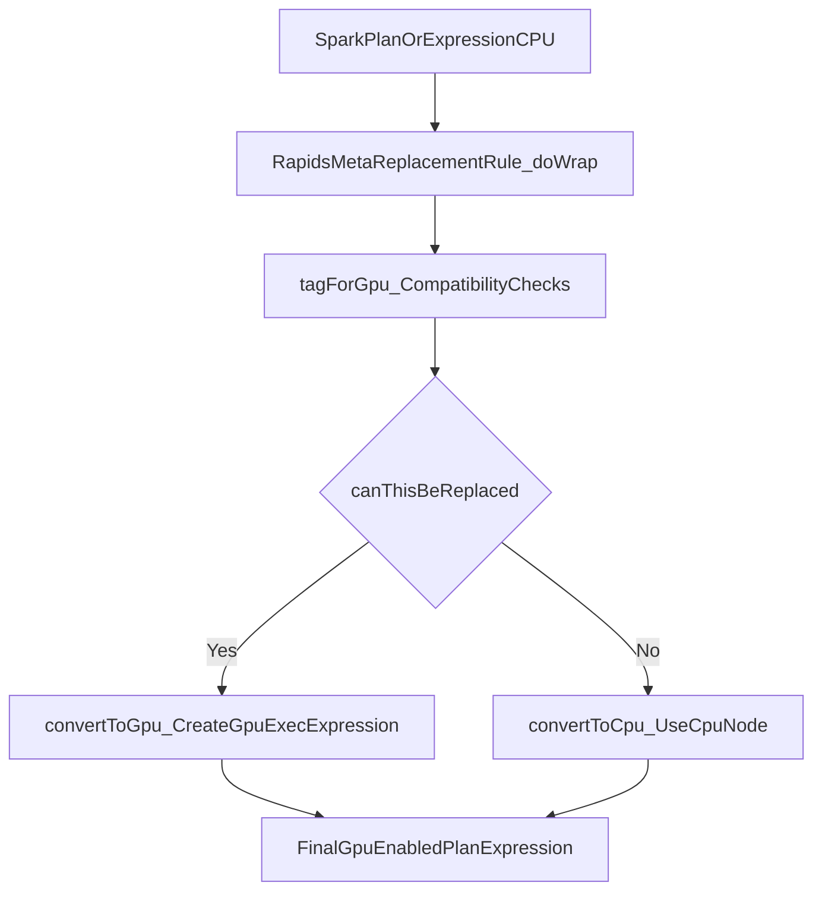
Sources:
`[sql-plugin/src/main/scala/com/nvidia/spark/rapids/RapidsMeta.scala:87-132]()`,
`[sql-plugin/src/main/scala/com/nvidia/spark/rapids/GpuCast.scala:61-76]()`

---

## 2. TypeChecks for Validation

### Purpose

`TypeChecks` encapsulate the data type and operand constraints that determine whether an operation can be offloaded to GPU. They form a fundamental mechanism for compatibility verification during tagging.

These checks validate:

- Supported input and output data types.
- Constraints such as literal-only operands.
- Special-case flags for nested or complex types.

Sources:
`[sql-plugin/src/main/scala/com/nvidia/spark/rapids/TypeChecks.scala:27-154]()`

---

### Support Levels

Types in `TypeChecks` are classified into support levels to clearly indicate the extent of GPU compatibility:

|Level            | Meaning                                    |
|-----------------|--------------------------------------------|
|**Supported (S)**       | Fully supported by both Spark and RAPIDS plugin. |
|**NotSupported (NS)**   | Supported by Spark but not by the RAPIDS plugin.|
|**PartiallySupported (PS)** | Supported with caveats, e.g., some child types unsupported or only literals accepted.|

Sources:
`[sql-plugin/src/main/scala/com/nvidia/spark/rapids/TypeChecks.scala:30-89]()`

---

### Type Signature (`TypeSig`)

`TypeSig` models sets of supported base types and nested child types, including properties about literal restrictions `[sql-plugin/src/main/scala/com/nvidia/spark/rapids/TypeChecks.scala:32-37]()`:

- Allows adding literal-only types via `withLit()` `[sql-plugin/src/main/scala/com/nvidia/spark/rapids/TypeChecks.scala:44-48]()`.
- Supports combination (`+`), subtraction (`-`), and intersection of type sets `[sql-plugin/src/main/scala/com/nvidia/spark/rapids/TypeChecks.scala:76-105]()`.
- Maintains notes documenting special constraints or missing features for the type signature `[sql-plugin/src/main/scala/com/nvidia/spark/rapids/TypeChecks.scala:132-135]()`.

This abstraction lets `RapidsMeta` and related checks concisely express complex type compatibility requirements.

Sources:
`[sql-plugin/src/main/scala/com/nvidia/spark/rapids/TypeChecks.scala:32-135]()`

---

## 3. Replacement Rules & the `GpuTransitionOverrides` Pipeline

### Background

The transformation of CPU Spark physical plans into GPU-enabled plans is orchestrated by a series of rules and wrappers. Among these, the `GpuTransitionOverrides` trait is a key Catalyst `Rule[SparkPlan]` defined to manage inserting GPU transition operators and optimizing conversions `[sql-plugin/src/main/scala/com/nvidia/spark/rapids/GpuTransitionOverrides.scala:50-50]()`.

Sources:
`[sql-plugin/src/main/scala/com/nvidia/spark/rapids/GpuTransitionOverrides.scala:50-50]()`

---

### Role and Workflow

This rule acts **after** Spark’s initial row-to-columnar and columnar-to-row transitions have been inserted. Its responsibilities include:

- Converting Spark's `HostColumnarToGpu(RowToColumnarExec)` transitions into the plugin's `GpuRowToColumnarExec`, which performs the early GPU transition on batches `[sql-plugin/src/main/scala/com/nvidia/spark/rapids/GpuTransitionOverrides.scala:55-58]()`.
- Converting `ColumnarToRowExec` wrapping a `GpuBringBackToHost` into `GpuColumnarToRowExec`, managing the transition back to CPU with GPU data materialization `[sql-plugin/src/main/scala/com/nvidia/spark/rapids/GpuTransitionOverrides.scala:59-60]()`.
- Injecting batch coalesce operators after shuffle stages to optimize GPU batch sizes and improve performance. This decides between `GpuCoalesceBatches` or `GpuShuffleCoalesceExec` depending on configured shuffle mode `[sql-plugin/src/main/scala/com/nvidia/spark/rapids/GpuTransitionOverrides.scala:75-81]()`.

Sources:
`[sql-plugin/src/main/scala/com/nvidia/spark/rapids/GpuTransitionOverrides.scala:50-81]()`

---

### Core Methods

- **`optimizeGpuPlanTransitions(plan: SparkPlan): SparkPlan`**  
  Recursively travels down the plan tree, replacing row-columnar transitions with GPU-enabled versions and applying injected projections (used for intermediate buffer conversions via `readBufferConverter`) at `RowToColumnarExec` boundaries.

  It handles cases such as:

  - `HostColumnarToGpu(RowToColumnarExec)` → `GpuRowToColumnarExec`
  - `ColumnarToRowExec(GpuBringBackToHost)` → `GpuColumnarToRowExec`
  - Recursion for nodes with single or multiple children, ensuring injected `ProjectExec` layers are inserted as necessary `[sql-plugin/src/main/scala/com/nvidia/spark/rapids/GpuTransitionOverrides.scala:54-72]()`.

- **`optimizeAdaptiveTransitions(plan: SparkPlan, parent: Option[SparkPlan]): SparkPlan`**  
  Performs plan transformation for Adaptive Query Execution (AQE) plans. It carefully unwraps and rewraps AQE stages and exchanges, including transformation of plan fragments to columnar representations with GPU transitions.

  It also handles removal of some final `GpuBringBackToHost` operators at root query stages to meet Spark AQE expectations `[sql-plugin/src/main/scala/com/nvidia/spark/rapids/GpuTransitionOverrides.scala:95-135]()`.

- **`checkInjectedProject(srcPlan, dstPlan, isRowToCol)`**  
  Checks if a wrapped `ProjectExec` should be applied based on projections recorded with `readBufferConverter` on the source plan node. This supports cases where intermediate buffer conversion projections are needed for GPU compatibility.

  If such a projection exists, wraps the destination plan with a `ProjectExec`, else returns the destination plan as-is `[sql-plugin/src/main/scala/com/nvidia/spark/rapids/GpuTransitionOverrides.scala:86-93]()`.

Sources:
`[sql-plugin/src/main/scala/com/nvidia/spark/rapids/GpuTransitionOverrides.scala:54-135]()`

---

### GpuTransitionOverrides Pipeline Flow

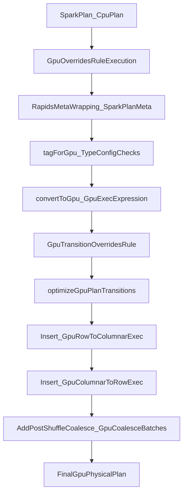
Sources:
`[sql-plugin/src/main/scala/com/nvidia/spark/rapids/GpuTransitionOverrides.scala:50-140]()`

---

## 4. Key Classes and Methods

### Natural Language to Code Entity Mapping

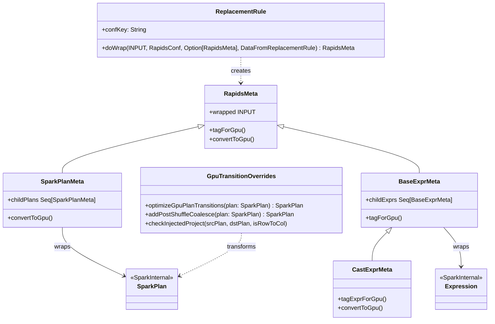
Sources:
`[sql-plugin/src/main/scala/com/nvidia/spark/rapids/RapidsMeta.scala:87-132]()`,
`[sql-plugin/src/main/scala/com/nvidia/spark/rapids/GpuCast.scala:43-76]()`,
`[sql-plugin/src/main/scala/com/nvidia/spark/rapids/GpuTransitionOverrides.scala:50-100]()`,
`[sql-plugin/src/main/scala/com/nvidia/spark/rapids/RapidsMeta.scala:44-54]()`

---

## 5. Summary

The RAPIDS Accelerator leverages a meta-wrapping architecture with `RapidsMeta` to inspect, validate, and convert Spark physical plan nodes and expressions to GPU-enabled equivalents `[sql-plugin/src/main/scala/com/nvidia/spark/rapids/RapidsMeta.scala:87-132]()`. The `tagForGpu` phase thoroughly checks compatibility using `TypeChecks` and configuration flags `[sql-plugin/src/main/scala/com/nvidia/spark/rapids/TypeChecks.scala:27-154]()`. The conversion phase produces GPU variants of operators where possible.

Following this, the `GpuTransitionOverrides` Catalyst rule optimizes the final physical plan by transforming row-columnar transitions into their GPU counterparts and by injecting coalescing operations to optimize batch sizes after shuffles `[sql-plugin/src/main/scala/com/nvidia/spark/rapids/GpuTransitionOverrides.scala:50-140]()`.

This layered approach ensures extensibility, fine-grained validation, and efficient plan preparation for GPU acceleration.

Sources:
`[sql-plugin/src/main/scala/com/nvidia/spark/rapids/RapidsMeta.scala:87-132]()`,
`[sql-plugin/src/main/scala/com/nvidia/spark/rapids/TypeChecks.scala:27-154]()`,
`[sql-plugin/src/main/scala/com/nvidia/spark/rapids/GpuTransitionOverrides.scala:50-140]()`

---

# Page: Cost-Based Optimizer & Adaptive Query Execution

# Cost-Based Optimizer & Adaptive Query Execution

<details>
<summary>Relevant source files</summary>

The following files were used as context for generating this wiki page:

- [integration_tests/src/main/python/aqe_test.py](integration_tests/src/main/python/aqe_test.py)
- [sql-plugin/src/main/scala/com/nvidia/spark/rapids/CostBasedOptimizer.scala](sql-plugin/src/main/scala/com/nvidia/spark/rapids/CostBasedOptimizer.scala)
- [sql-plugin/src/main/scala/com/nvidia/spark/rapids/GpuAggregateExec.scala](sql-plugin/src/main/scala/com/nvidia/spark/rapids/GpuAggregateExec.scala)
- [sql-plugin/src/main/scala/com/nvidia/spark/rapids/GpuTransitionOverrides.scala](sql-plugin/src/main/scala/com/nvidia/spark/rapids/GpuTransitionOverrides.scala)
- [sql-plugin/src/main/scala/com/nvidia/spark/rapids/SparkShims.scala](sql-plugin/src/main/scala/com/nvidia/spark/rapids/SparkShims.scala)
- [tests/src/test/scala/com/nvidia/spark/rapids/AdaptiveQueryExecSuite.scala](tests/src/test/scala/com/nvidia/spark/rapids/AdaptiveQueryExecSuite.scala)
- [tests/src/test/scala/com/nvidia/spark/rapids/BroadcastNestedLoopJoinSuite.scala](tests/src/test/scala/com/nvidia/spark/rapids/BroadcastNestedLoopJoinSuite.scala)
- [tests/src/test/scala/com/nvidia/spark/rapids/CostBasedOptimizerSuite.scala](tests/src/test/scala/com/nvidia/spark/rapids/CostBasedOptimizerSuite.scala)
- [tests/src/test/scala/com/nvidia/spark/rapids/CsvScanSuite.scala](tests/src/test/scala/com/nvidia/spark/rapids/CsvScanSuite.scala)
- [tests/src/test/scala/com/nvidia/spark/rapids/HashAggregatesSuite.scala](tests/src/test/scala/com/nvidia/spark/rapids/HashAggregatesSuite.scala)
- [tests/src/test/scala/com/nvidia/spark/rapids/SparkQueryCompareTestSuite.scala](tests/src/test/scala/com/nvidia/spark/rapids/SparkQueryCompareTestSuite.scala)

</details>


This page details the Cost-Based Optimizer (CBO) and Adaptive Query Execution (AQE) integration within the RAPIDS Accelerator for Apache Spark. It explains how the plugin evaluates the cost of operations on both CPU and GPU to avoid inefficient transitions, how it hooks into Spark's dynamic runtime optimization framework, and how custom shuffle readers manage partitioned columnar data.

---

## Cost-Based Optimizer (CBO) Architecture

The `CostBasedOptimizer` is an experimental component designed to balance the performance benefits of running query plan segments on the GPU against the overhead of transitioning data between CPU and GPU formats [sql-plugin/src/main/scala/com/nvidia/spark/rapids/CostBasedOptimizer.scala:49-54](). 

The optimizer implements the `Optimizer` trait and recursively walks the `SparkPlanMeta` tree, computing execution costs using two models: `CpuCostModel` and `GpuCostModel` [sql-plugin/src/main/scala/com/nvidia/spark/rapids/CostBasedOptimizer.scala:36-69]().

- **`CpuCostModel`**: Estimates execution costs for operators running on the host CPU.
- **`GpuCostModel`**: Estimates execution costs on the accelerator device, including computation and resource overhead.
- **`MemoryCostHelper`**: Used to estimate input/output data sizes and memory footprints [tests/src/test/scala/com/nvidia/spark/rapids/CostBasedOptimizerSuite.scala:61-76]().
- **`RowCountPlanVisitor`**: Traverses the plan tree to estimate output row counts for cost calculations [sql-plugin/src/main/scala/com/nvidia/spark/rapids/CostBasedOptimizer.scala:119]().

Sources: [sql-plugin/src/main/scala/com/nvidia/spark/rapids/CostBasedOptimizer.scala:36-77](), [tests/src/test/scala/com/nvidia/spark/rapids/CostBasedOptimizerSuite.scala:61-76]()

---

## Optimization Decisions: `AvoidTransition` and `ReplaceSection`

During traversal, the optimizer detects boundaries where operators switch execution domains (`numTransitions > 0`) [sql-plugin/src/main/scala/com/nvidia/spark/rapids/CostBasedOptimizer.scala:123-127](). Based on these evaluations, it applies two major optimizations:

1. **`AvoidTransition`**: Triggered when moving data to the GPU for an operator (such as a trivial projection) incurs a transition cost that exceeds the execution savings. The optimizer keeps the operator on the CPU and resets the GPU cost calculation for that node [sql-plugin/src/main/scala/com/nvidia/spark/rapids/CostBasedOptimizer.scala:141-149]().
2. **`ReplaceSection`**: Triggered when an entire GPU subtree—including the cost of moving data back to the CPU for downstream consumption—is more expensive than executing entirely on the CPU. The optimizer forces that specific section of the plan to revert to CPU execution [sql-plugin/src/main/scala/com/nvidia/spark/rapids/CostBasedOptimizer.scala:155-165]().

### Diagram: CBO Logic and Code Mapping

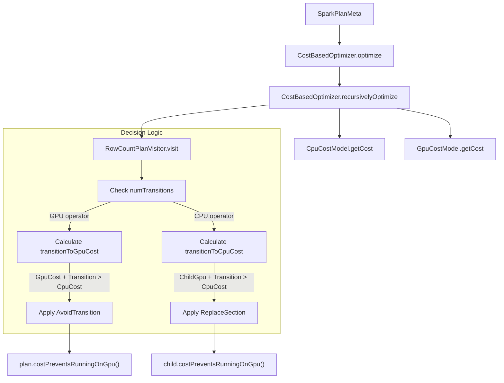

**Diagram 1: Cost-Based Optimizer Decision Logic with Code Entity Mapping**

Sources: [sql-plugin/src/main/scala/com/nvidia/spark/rapids/CostBasedOptimizer.scala:64-165]()

---

## Adaptive Query Execution (AQE) Integration

The RAPIDS Accelerator integrates tightly with Spark's Adaptive Query Execution (AQE) framework to dynamically optimize query execution plans at runtime. This is handled primarily by `GpuTransitionOverrides`, a catalyst `Rule[SparkPlan]` that runs after Spark inserts transitions [sql-plugin/src/main/scala/com/nvidia/spark/rapids/GpuTransitionOverrides.scala:46-50]().

### Handling Adaptive Transitions

- **Removal of Redundant `GpuBringBackToHost`**: Removes redundant `GpuBringBackToHost` operators at final query stages to allow Spark AQE to reuse shuffle executions or broadcast exchanges without unnecessary host round-trips [sql-plugin/src/main/scala/com/nvidia/spark/rapids/GpuTransitionOverrides.scala:99-106]().
- **Host-to-GPU Columnar Transition Replacement**: Replaces `HostColumnarToGpu(RowToColumnarExec)` with `GpuRowToColumnarExec` for efficient GPU ingestion [sql-plugin/src/main/scala/com/nvidia/spark/rapids/GpuTransitionOverrides.scala:109-120]().
- **AQE Exchange Adaptation**: Detects independent query stages and removes host conversion wrappers around `ShuffleExchangeLike` or `BroadcastExchangeLike` plans [sql-plugin/src/main/scala/com/nvidia/spark/rapids/GpuTransitionOverrides.scala:128-143]().
- **Project Injection**: Utilizes `readBufferConverter` to insert `ProjectExec` nodes after GPU transitions when buffer layout adjustments are required [sql-plugin/src/main/scala/com/nvidia/spark/rapids/GpuTransitionOverrides.scala:86-93]().

Sources: [sql-plugin/src/main/scala/com/nvidia/spark/rapids/GpuTransitionOverrides.scala:50-143]()

---

## Custom Shuffle Readers

When AQE coalesces partitions or handles data skew, custom shuffle readers become necessary for efficient columnar execution. The plugin implements `GpuCustomShuffleReaderExec` to wrap shuffle query stages with GPU-aware reading logic.

- **Partition Metrics**: Records partition sizes (`PARTITION_SIZE`), number of partitions read (`NUM_PARTITIONS`), and execution timing (`OP_TIME_NEW_SHUFFLE_READ`).
- **Dynamic Output Partitioning**: Adapts output partitioning based on local reads, coalesced blocks, or skewed partition specs to maintain full compatibility with Spark AQE optimizations [tests/src/test/scala/com/nvidia/spark/rapids/AdaptiveQueryExecSuite.scala:55-78]().

### Diagram: AQE Integration Flow

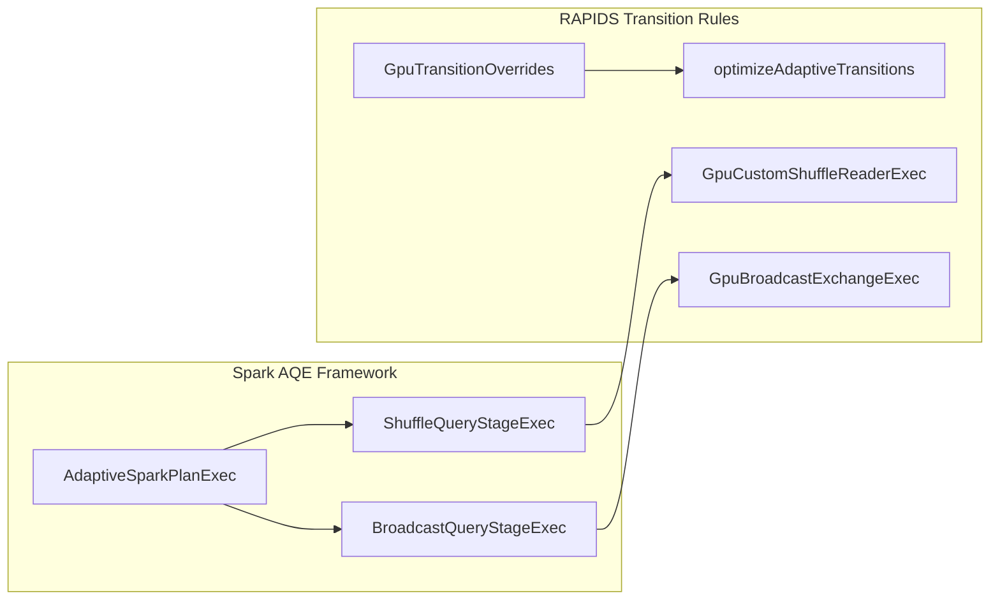

**Diagram 2: RAPIDS AQE Integration and Transition Handling**

Sources: [sql-plugin/src/main/scala/com/nvidia/spark/rapids/GpuTransitionOverrides.scala:43-143](), [tests/src/test/scala/com/nvidia/spark/rapids/AdaptiveQueryExecSuite.scala:55-78]()

---

## AQE Transition Optimization Scenarios

| Scenario | Plugin Action | File Reference |
|---|---|---|
| Post-Shuffle Coalescing | Injects `GpuCoalesceBatches` or `GpuShuffleCoalesceExec` based on shuffle configuration. | [sql-plugin/src/main/scala/com/nvidia/spark/rapids/GpuTransitionOverrides.scala:75-81]() |
| Project Injection | Applies optional buffer conversion project via `readBufferConverter` during plan transitions. | [sql-plugin/src/main/scala/com/nvidia/spark/rapids/GpuTransitionOverrides.scala:86-93]() |
| Exchange Reuse Removal | Detects and removes `GpuBringBackToHost` around reused exchanges for AQE compatibility. | [sql-plugin/src/main/scala/com/nvidia/spark/rapids/GpuTransitionOverrides.scala:129-143]() |
| Broadcast to Row Conversion | Uses `GpuBroadcastToRowExec` when broadcasted data is consumed by CPU operators. | [sql-plugin/src/main/scala/com/nvidia/spark/rapids/GpuTransitionOverrides.scala:43]() |

Sources: [sql-plugin/src/main/scala/com/nvidia/spark/rapids/GpuTransitionOverrides.scala:43-143]()

---

# Page: Public Plugin API (sql-plugin-api)

# Public Plugin API (sql-plugin-api)

<details>
<summary>Relevant source files</summary>

The following files were used as context for generating this wiki page:

- [dist/root-safe-module-classes.txt](dist/root-safe-module-classes.txt)
- [iceberg-common/src/main/scala/com/nvidia/spark/rapids/iceberg/spark/GpuSparkSQLProperties.scala](iceberg-common/src/main/scala/com/nvidia/spark/rapids/iceberg/spark/GpuSparkSQLProperties.scala)
- [integration_tests/src/main/python/avro_test.py](integration_tests/src/main/python/avro_test.py)
- [scala2.13/api_validation/pom.xml](scala2.13/api_validation/pom.xml)
- [scala2.13/sql-plugin-api/pom.xml](scala2.13/sql-plugin-api/pom.xml)
- [sql-plugin-api/pom.xml](sql-plugin-api/pom.xml)
- [sql-plugin-api/src/main/scala/com/nvidia/spark/rapids/AvroBlockInfo.scala](sql-plugin-api/src/main/scala/com/nvidia/spark/rapids/AvroBlockInfo.scala)
- [sql-plugin-api/src/main/scala/com/nvidia/spark/rapids/LineBufferer.scala](sql-plugin-api/src/main/scala/com/nvidia/spark/rapids/LineBufferer.scala)
- [sql-plugin-api/src/main/scala/com/nvidia/spark/rapids/MultiFileReaderContracts.scala](sql-plugin-api/src/main/scala/com/nvidia/spark/rapids/MultiFileReaderContracts.scala)
- [sql-plugin-api/src/main/scala/com/nvidia/spark/rapids/OrcReaderMetadata.scala](sql-plugin-api/src/main/scala/com/nvidia/spark/rapids/OrcReaderMetadata.scala)
- [sql-plugin-api/src/main/scala/com/nvidia/spark/rapids/parquet/ParquetSchemaWrapper.scala](sql-plugin-api/src/main/scala/com/nvidia/spark/rapids/parquet/ParquetSchemaWrapper.scala)
- [sql-plugin-api/src/main/scala/org/apache/spark/sql/rapids/AvroReaderMetadata.scala](sql-plugin-api/src/main/scala/org/apache/spark/sql/rapids/AvroReaderMetadata.scala)
- [sql-plugin-columnar/src/main/java/com/nvidia/spark/rapids/FloatUtils.java](sql-plugin-columnar/src/main/java/com/nvidia/spark/rapids/FloatUtils.java)
- [sql-plugin-columnar/src/main/java/com/nvidia/spark/rapids/GpuColumnVectorBase.java](sql-plugin-columnar/src/main/java/com/nvidia/spark/rapids/GpuColumnVectorBase.java)
- [sql-plugin-columnar/src/main/java/com/nvidia/spark/rapids/GpuPackedTableColumn.java](sql-plugin-columnar/src/main/java/com/nvidia/spark/rapids/GpuPackedTableColumn.java)
- [sql-plugin-columnar/src/main/java/com/nvidia/spark/rapids/WithTableBuffer.java](sql-plugin-columnar/src/main/java/com/nvidia/spark/rapids/WithTableBuffer.java)
- [sql-plugin-columnar/src/main/scala/com/nvidia/spark/rapids/HostMemoryStreams.scala](sql-plugin-columnar/src/main/scala/com/nvidia/spark/rapids/HostMemoryStreams.scala)
- [sql-plugin-columnar/src/main/scala/com/nvidia/spark/rapids/SpillPriorities.scala](sql-plugin-columnar/src/main/scala/com/nvidia/spark/rapids/SpillPriorities.scala)
- [sql-plugin-fileio/src/main/java/com/nvidia/spark/rapids/fileio/hadoop/HadoopInputFile.java](sql-plugin-fileio/src/main/java/com/nvidia/spark/rapids/fileio/hadoop/HadoopInputFile.java)
- [sql-plugin-fileio/src/main/java/com/nvidia/spark/rapids/fileio/hadoop/HadoopInputStream.java](sql-plugin-fileio/src/main/java/com/nvidia/spark/rapids/fileio/hadoop/HadoopInputStream.java)
- [sql-plugin-fileio/src/main/java/com/nvidia/spark/rapids/fileio/hadoop/HadoopOutputFile.java](sql-plugin-fileio/src/main/java/com/nvidia/spark/rapids/fileio/hadoop/HadoopOutputFile.java)
- [sql-plugin-fileio/src/main/java/com/nvidia/spark/rapids/fileio/hadoop/HadoopOutputStream.java](sql-plugin-fileio/src/main/java/com/nvidia/spark/rapids/fileio/hadoop/HadoopOutputStream.java)
- [sql-plugin/src/main/scala/com/nvidia/spark/rapids/AvroDataFileReader.scala](sql-plugin/src/main/scala/com/nvidia/spark/rapids/AvroDataFileReader.scala)
- [sql-plugin/src/main/scala/com/nvidia/spark/rapids/GpuRunnableCommand.scala](sql-plugin/src/main/scala/com/nvidia/spark/rapids/GpuRunnableCommand.scala)

</details>


The `sql-plugin-api` module of the RAPIDS Accelerator for Apache Spark exposes a stable public API surface designed for integration and extension of GPU acceleration capabilities. This module acts as the bridge between the version-independent plugin core and the version-specific Spark internals, while also providing utility functions and helper modules for GPU columnar data manipulation, format management, and memory buffering.

---

## Purpose and Scope

The main purpose of this module is to define the contract for GPU acceleration plugin features, abstract differences between Spark versions, provide utility operations for GPU columnar data, and enable UDF plugin support. By isolating these public APIs into a separate module, the RAPIDS Accelerator ensures binary compatibility across multiple Spark distributions including Apache Spark, Databricks, EMR, and GCP. Supplementary helper modules such as `sql-plugin-columnar`, format handlers, and file I/O utilities further support specialized use cases.

Key exposed classes, interfaces, and utility modules include:
- `ShimLoader` — isolates classloading and dynamic discovery of version-specific Spark shims [sql-plugin-api/pom.xml:32-37]().
- `SparkShimServiceProvider` — factory interface for version-specific plugin implementations.
- `ColumnarRdd` — abstraction for GPU-native columnar RDDs.
- `DFUDFPluginAPI` — interface for GPU-enabled UDF registration.
- `Functions` — GPU-accelerated SQL function implementations.
- `GpuColumnVectorUtils` — utilities to interact with RAPIDS cuDF columns and vectors.
- `sql-plugin-columnar`/`format`/`fileio` — helper modules for columnar data format and file I/O [sql-plugin-api/pom.xml:29-37](), [scala2.13/sql-plugin-api/pom.xml:29-37]().

Sources: [sql-plugin-api/pom.xml:1-44](), [scala2.13/sql-plugin-api/pom.xml:1-44]()

---

## 1. ShimLoader & SparkShimServiceProvider

The `ShimLoader` class provides the core mechanism to load and access the appropriate Spark shim implementation based on the runtime Spark version. As Spark internal APIs and classes differ across versions, the RAPIDS Accelerator uses a shim layer to encapsulate version-specific logic and present a uniform API to the common plugin code.

### Responsibilities
- **Parallel Worlds Loading**: The plugin JAR is structured with multiple parallel worlds, each representing a Spark version, inside the same archive. `ShimLoader` creates a dedicated classloader to isolate the correct shim classes for the detected Spark version.
- **Version Detection & Dynamic Discovery**: At initialization, `ShimLoader` detects the running Spark version and loads the matching implementation of `SparkShimServiceProvider`.
- **Classloader Isolation**: Maintains a version-specific classloader scoped to the minimal required shim folders.

### Diagram: Shim Loading Architecture
```mermaid
flowchart TD
  subgraph JarLayout ["Plugin_JAR_Layout"]
    A["SQLPlugin.class"]
    B["spark-shared"]
    C["spark330"]
    D["spark350"]
  end
  
  E["ShimLoader::initShimProviderIfNeeded"] --> F{"Detect_Spark_Version"}
  F -- "3.3.x" --> G["Load spark-shared + spark330"]
  F -- "3.5.x" --> H["Load spark-shared + spark350"]
  G --> I["SparkShimServiceProvider Impl"]
  H --> I["SparkShimServiceProvider Impl"]
```
Sources: [sql-plugin-api/pom.xml:32-37]()

---

## 2. Columnar Abstractions & Buffer Helpers (`sql-plugin-columnar`)

The `sql-plugin-columnar` module houses lower-level columnar abstractions, memory buffer wrappers, and stream handlers that interface directly with cuDF device buffers.

### Key Classes
- `GpuPackedTableColumn`: Tracks a packed table (such as one generated by `contiguousSplit`) without requiring individual child columns to be manifested [sql-plugin-columnar/src/main/java/com/nvidia/spark/rapids/GpuPackedTableColumn.java:37-40](). It implements `WithTableBuffer` and wraps a `ContiguousTable` [sql-plugin-columnar/src/main/java/com/nvidia/spark/rapids/GpuPackedTableColumn.java:37-58]().
- `GpuColumnVectorFromBuffer`: Represents a GPU column vector carved from a single contiguous device buffer, allowing multiple columns to share backing memory and layout metadata (`TableMeta`).
- `HostMemoryOutputStream` / `HostMemoryInputStream`: Provide standard Java stream interfaces (`OutputStream`, `InputStream`) over cuDF `HostMemoryBuffer` instances for serialized data transfer and spill operations [sql-plugin-columnar/src/main/scala/com/nvidia/spark/rapids/HostMemoryStreams.scala:32-84](), [sql-plugin-columnar/src/main/scala/com/nvidia/spark/rapids/HostMemoryStreams.scala:173-176]().

### Diagram: Columnar Buffer Lifecycle
```mermaid
flowchart LR
  subgraph CUDF_Space ["cuDF Native Memory"]
    CT["ContiguousTable"]
    DMB["DeviceMemoryBuffer"]
  end

  subgraph Spark_Columnar ["Spark Vectorized Layer"]
    GPTC["GpuPackedTableColumn"]
    GCVF["GpuColumnVectorFromBuffer"]
    CB["ColumnarBatch"]
  end

  CT -->|wrap| GPTC
  GPTC -->|contains| DMB
  DMB -->|split/slice| GCVF
  GCVF -->|combine| CB
```
Sources: [sql-plugin-columnar/src/main/java/com/nvidia/spark/rapids/GpuPackedTableColumn.java:37-80]()

---

## 3. Metadata & Compression Utilities (`MetaUtils` & `TableCompressionCodec`)

### MetaUtils
`MetaUtils` constructs and parses FlatBuffer-backed table metadata (`TableMeta` and `BufferMeta`) used during shuffle data exchange and columnar caching. It handles building table metadata from contiguous tables or compressed vectors.

### TableCompressionCodec
Defines the compression interface for contiguous tables on the GPU, supporting codecs like `nvcomp-LZ4`, `nvcomp-ZSTD`, and `copy` (uncompressed). It provides batched compression and decompression pipelines (`BatchedTableCompressor`, `BatchedBufferDecompressor`).

Sources: `sql-plugin/src/main/scala/com/nvidia/spark/rapids/MetaUtils.scala`, `sql-plugin/src/main/scala/com/nvidia/spark/rapids/TableCompressionCodec.scala`

---

## 4. Spill Priorities & Numerical Utilities (`SpillPriorities` & `FloatUtils`)

### SpillPriorities
Defines numerical priority constants used by the spill framework to manage device memory pressure, ensuring proper eviction ordering for shuffle outputs, active iterators, and cached buffers [sql-plugin-columnar/src/main/scala/com/nvidia/spark/rapids/SpillPriorities.scala:24-54]().

### FloatUtils
Provides GPU-accelerated utilities for handling floating-point edge cases such as NaN-to-zero conversion and infinity replacement on cuDF column vectors [sql-plugin-columnar/src/main/java/com/nvidia/spark/rapids/FloatUtils.java:24-62]().

Sources: [sql-plugin-columnar/src/main/scala/com/nvidia/spark/rapids/SpillPriorities.scala:24-54](), [sql-plugin-columnar/src/main/java/com/nvidia/spark/rapids/FloatUtils.java:24-62]()

---

## 5. JSON Path Parsing (`JsonPathParser`)

The `JsonPathParser` object provides utilities for parsing JSON path strings into a list of `PathInstruction` objects, which are then used by GPU-accelerated JSON functions like `GpuGetJsonObject` and `GpuJsonTuple`.

### Key Functions
- `parse(str: String)`: Parses a JSON path string into a `List[PathInstruction]` [sql-plugin/src/main/scala/com/nvidia/spark/rapids/GpuGetJsonObject.scala:48]().
- `filterInstructionsForJni(instructions: List[PathInstruction])`: Filters out instructions not needed by the JNI implementation [sql-plugin/src/main/scala/com/nvidia/spark/rapids/GpuGetJsonObject.scala:51-56]().
- `fallbackCheck(instructions: List[PathInstruction])`: Checks if the path depth exceeds the maximum supported by the GPU, triggering a fallback to CPU if necessary [sql-plugin/src/main/scala/com/nvidia/spark/rapids/GpuGetJsonObject.scala:58-59]().
- `convertToJniObject(instructions: List[PathInstruction])`: Converts `PathInstruction` objects into JNI-compatible `JSONUtils.PathInstructionJni` objects for native processing [sql-plugin/src/main/scala/com/nvidia/spark/rapids/GpuGetJsonObject.scala:71-83]().
- `containsUnsupportedPath(instructions: List[PathInstruction])`: Checks for unsupported path features like wildcards, which would cause a fallback [sql-plugin/src/main/scala/com/nvidia/spark/rapids/GpuGetJsonObject.scala:85-93]().

### Diagram: JSON Path Processing Flow
```mermaid
graph TD
    A["JSON Path String (e.g., '$.store.book[0].author')"] --> B["JsonPathParser::parse(str)"]
    B --> C{"List[PathInstruction]"}
    C --> D["JsonPathParser::filterInstructionsForJni"]
    C --> E["JsonPathParser::fallbackCheck"]
    C --> F["JsonPathParser::containsUnsupportedPath"]
    D --> G["JsonPathParser::convertToJniObject"]
    G --> H["JSONUtils.PathInstructionJni (for JNI)"]
    E -- "True" --> I["Fallback to CPU"]
    F -- "True" --> I
    H --> J["GPU JSON Operations (e.g., GpuGetJsonObject, GpuJsonTuple)"]
```
Sources: [sql-plugin/src/main/scala/com/nvidia/spark/rapids/GpuGetJsonObject.scala:38-105](), [sql-plugin/src/main/scala/com/nvidia/spark/rapids/GpuJsonTuple.scala:67-76]()

---

## 6. File I/O Helper Modules (`sql-plugin-fileio`, `sql-plugin-format`)

The `sql-plugin-fileio` and `sql-plugin-format` modules provide abstractions and implementations for GPU-accelerated file input/output operations, including handling various file formats like Avro.

### `sql-plugin-fileio`
This module contains Hadoop-specific input/output stream and file abstractions, such as `HadoopInputFile`, `HadoopInputStream`, `HadoopOutputFile`, and `HadoopOutputStream`. These classes bridge standard Java I/O with Hadoop's file system APIs, enabling GPU operations to interact with distributed storage.

### `sql-plugin-format`
This module defines interfaces and classes for handling specific file formats. For example, `AvroDataFileReader` and `Header` are part of this module (or closely related within `sql-plugin`) and provide the necessary logic to read Avro file headers and data blocks.

#### `AvroDataFileReader`
This class is responsible for reading Avro data files. It handles the Avro file header, including magic bytes, metadata, and sync markers [sql-plugin/src/main/scala/com/nvidia/spark/rapids/AvroDataFileReader.scala:153-183](). It also provides methods for seeking within the file and skipping data [sql-plugin/src/main/scala/com/nvidia/spark/rapids/AvroDataFileReader.scala:144-147]().

#### `Header`
Represents the header information of an Avro file, including metadata (schema, codec) and the sync marker [sql-plugin/src/main/scala/com/nvidia/spark/rapids/AvroDataFileReader.scala:74-81](). It provides methods to access the schema and merge metadata from multiple headers [sql-plugin/src/main/scala/com/nvidia/spark/rapids/AvroDataFileReader.scala:83-87](), [sql-plugin/src/main/scala/com/nvidia/spark/rapids/AvroDataFileReader.scala:109-117]().

### Diagram: Avro File Reading Process
```mermaid
graph TD
    A["Hadoop Path"] --> B["HadoopInputFile"]
    B --> C["AvroSeekableInputStream"]
    C --> D["AvroDataFileReader::initialize()"]
    D --> E["Header (magic, metadata, sync)"]
    E --> F["Schema (from metadata)"]
    D --> G["Read Data Blocks"]
    G --> H["GPU Processing"]
```
Sources: [sql-plugin/src/main/scala/com/nvidia/spark/rapids/AvroDataFileReader.scala:131-183](), [sql-plugin/src/main/scala/com/nvidia/spark/rapids/AvroDataFileReader.scala:74-91]()

---

## Bridging Natural Language to Code Entity

### Plugin Initialization and Shim Discovery
```mermaid
flowchart TD
  subgraph NL_Space ["Natural Language Space"]
    Start["Plugin Entry Point"]
    Load["Version Detection"]
    Prov["Shim Service Discovery"]
  end

  subgraph Code_Entity_Space ["Code Entity Space"]
    SQLP["SQLExecPlugin"]
    SL["ShimLoader::initShimProviderIfNeeded"]
    SSSP["SparkShimServiceProvider"]
  end

  Start --> SQLP
  SQLP -- "invokes" --> SL
  SL -- "discovers" --> SSSP
  Load --> SL
  Prov --> SSSP
```
Sources: [sql-plugin-api/pom.xml:1-44](), [scala2.13/sql-plugin-api/pom.xml:1-44]()

### Metadata and Compression Mapping
```mermaid
flowchart LR
  subgraph NL_Concepts ["Natural Language Space"]
    C1["FlatBuffers Table Metadata"]
    C2["GPU Batch Compression"]
    C3["Memory Stream Reader/Writer"]
  end

  subgraph Code_Entities ["Code Entity Space"]
    MU["MetaUtils::buildTableMeta"]
    TCC["TableCompressionCodec::getCodec"]
    HMS["HostMemoryOutputStream"]
  end

  C1 <--> MU
  C2 <--> TCC
  C3 <--> HMS
```
Sources: `sql-plugin/src/main/scala/com/nvidia/spark/rapids/MetaUtils.scala`, `sql-plugin/src/main/scala/com/nvidia/spark/rapids/TableCompressionCodec.scala`, [sql-plugin-columnar/src/main/scala/com/nvidia/spark/rapids/HostMemoryStreams.scala:32-84]()

---

## Summary of Key Public API Classes

| Class / Module Name | Description | Purpose / Usage |
|--------------------|-------------|-----------------|
| `ShimLoader` | Core classloader and shim discovery logic | Dynamic loading of version-specific shims [sql-plugin-api/pom.xml:32-37]() |
| `SparkShimServiceProvider` | Factory interface for version-specific components | Abstracts Spark API version differences |
| `GpuPackedTableColumn` | GPU column tracking packed contiguous tables | Manages task output partitions without expanding child columns [sql-plugin-columnar/src/main/java/com/nvidia/spark/rapids/GpuPackedTableColumn.java:37-40]() |
| `GpuColumnVectorFromBuffer` | Column vector carved from a single contiguous buffer | Shares memory and metadata across columns |
| `MetaUtils` | FlatBuffers metadata builder and parser | Encodes/decodes table layout for shuffle and cache |
| `TableCompressionCodec` | Interface for GPU-accelerated table compression | Manages `nvcomp-LZ4`, `nvcomp-ZSTD`, and `copy` codecs |
| `SpillPriorities` | Priority constants for memory spilling | Controls buffer eviction order under OOM conditions [sql-plugin-columnar/src/main/scala/com/nvidia/spark/rapids/SpillPriorities.scala:24-54]() |
| `JsonPathParser` | Utility for parsing JSON path strings | Used by GPU JSON functions like `get_json_object` and `json_tuple` [sql-plugin/src/main/scala/com/nvidia/spark/rapids/GpuGetJsonObject.scala:38-105]() |
| `AvroDataFileReader` | Reads Avro data files on GPU | Handles Avro file headers and data blocks [sql-plugin/src/main/scala/com/nvidia/spark/rapids/AvroDataFileReader.scala:131-183]() |
| `Header` | Represents Avro file header information | Contains metadata and sync marker for Avro files [sql-plugin/src/main/scala/com/nvidia/spark/rapids/AvroDataFileReader.scala:74-91]() |

Sources:
- [sql-plugin-api/pom.xml:1-44]()
- [scala2.13/sql-plugin-api/pom.xml:1-44]()
- `sql-plugin/src/main/scala/com/nvidia/spark/rapids/MetaUtils.scala`
- [sql-plugin-columnar/src/main/java/com/nvidia/spark/rapids/GpuPackedTableColumn.java:37-80]()
- `sql-plugin/src/main/java/com/nvidia/spark/rapids/GpuColumnVectorFromBuffer.java`
- `sql-plugin/src/main/scala/com/nvidia/spark/rapids/TableCompressionCodec.scala`
- [sql-plugin-columnar/src/main/scala/com/nvidia/spark/rapids/SpillPriorities.scala:24-54]()
- [sql-plugin/src/main/scala/com/nvidia/spark/rapids/GpuGetJsonObject.scala:38-105]()
- [sql-plugin/src/main/scala/com/nvidia/spark/rapids/AvroDataFileReader.scala:131-183]()
- [sql-plugin/src/main/scala/com/nvidia/spark/rapids/AvroDataFileReader.scala:74-91]()

---

# Page: GPU Expression & Operator Implementations

# GPU Expression & Operator Implementations

<details>
<summary>Relevant source files</summary>

The following files were used as context for generating this wiki page:

- [integration_tests/src/main/python/arithmetic_ops_test.py](integration_tests/src/main/python/arithmetic_ops_test.py)
- [integration_tests/src/main/python/array_test.py](integration_tests/src/main/python/array_test.py)
- [integration_tests/src/main/python/collection_ops_test.py](integration_tests/src/main/python/collection_ops_test.py)
- [integration_tests/src/main/python/map_test.py](integration_tests/src/main/python/map_test.py)
- [integration_tests/src/main/python/struct_test.py](integration_tests/src/main/python/struct_test.py)
- [sql-plugin/src/main/scala/com/nvidia/spark/rapids/GpuCanonicalize.scala](sql-plugin/src/main/scala/com/nvidia/spark/rapids/GpuCanonicalize.scala)
- [sql-plugin/src/main/scala/com/nvidia/spark/rapids/GpuExpressions.scala](sql-plugin/src/main/scala/com/nvidia/spark/rapids/GpuExpressions.scala)
- [sql-plugin/src/main/scala/com/nvidia/spark/rapids/higherOrderFunctions.scala](sql-plugin/src/main/scala/com/nvidia/spark/rapids/higherOrderFunctions.scala)
- [sql-plugin/src/main/scala/com/nvidia/spark/rapids/nullExpressions.scala](sql-plugin/src/main/scala/com/nvidia/spark/rapids/nullExpressions.scala)
- [sql-plugin/src/main/scala/org/apache/spark/sql/rapids/arithmetic.scala](sql-plugin/src/main/scala/org/apache/spark/sql/rapids/arithmetic.scala)
- [sql-plugin/src/main/scala/org/apache/spark/sql/rapids/bitwise.scala](sql-plugin/src/main/scala/org/apache/spark/sql/rapids/bitwise.scala)
- [sql-plugin/src/main/scala/org/apache/spark/sql/rapids/collectionOperations.scala](sql-plugin/src/main/scala/org/apache/spark/sql/rapids/collectionOperations.scala)
- [sql-plugin/src/main/scala/org/apache/spark/sql/rapids/complexTypeCreator.scala](sql-plugin/src/main/scala/org/apache/spark/sql/rapids/complexTypeCreator.scala)
- [sql-plugin/src/main/scala/org/apache/spark/sql/rapids/complexTypeExtractors.scala](sql-plugin/src/main/scala/org/apache/spark/sql/rapids/complexTypeExtractors.scala)
- [sql-plugin/src/main/scala/org/apache/spark/sql/rapids/mathExpressions.scala](sql-plugin/src/main/scala/org/apache/spark/sql/rapids/mathExpressions.scala)
- [sql-plugin/src/main/spark330db/scala/com/nvidia/spark/rapids/shims/DecimalArithmeticOverrides.scala](sql-plugin/src/main/spark330db/scala/com/nvidia/spark/rapids/shims/DecimalArithmeticOverrides.scala)
- [sql-plugin/src/main/spark330db/scala/org/apache/spark/sql/rapids/arithmetic.scala](sql-plugin/src/main/spark330db/scala/org/apache/spark/sql/rapids/arithmetic.scala)
- [tests/src/test/scala/com/nvidia/spark/rapids/LogOperatorUnitTestSuite.scala](tests/src/test/scala/com/nvidia/spark/rapids/LogOperatorUnitTestSuite.scala)
- [tests/src/test/scala/org/apache/spark/sql/rapids/catalyst/expressions/GpuEquivalentExpressionsSuite.scala](tests/src/test/scala/org/apache/spark/sql/rapids/catalyst/expressions/GpuEquivalentExpressionsSuite.scala)

</details>


This page provides a high-level overview of how Spark expressions and physical operators are implemented and accelerated on the GPU within the RAPIDS Accelerator for Apache Spark. The plugin intercepts Spark's logical and physical plans, replacing CPU-bound operations with GPU-accelerated equivalents where possible. This involves converting data to a GPU-compatible columnar format (`GpuColumnVector`), executing operations using the cuDF library, and converting results back to Spark's native formats when necessary [sql-plugin/src/main/scala/com/nvidia/spark/rapids/GpuExpressions.scala:139-176]().

As a parent page, this document outlines the major architectural categories and delegates deep technical details, implementation specifics, and corner cases to the dedicated child pages.

Sources:
- [sql-plugin/src/main/scala/com/nvidia/spark/rapids/GpuExpressions.scala:139-176]()

---

## GpuColumnVector & Row/Columnar Conversion

At the core of GPU acceleration in Spark is the GPU columnar data structure, `GpuColumnVector`. It wraps a cuDF `ColumnVector` and provides Spark integration including memory management, data type mapping, and debugging utilities [sql-plugin/src/main/scala/com/nvidia/spark/rapids/GpuExpressions.scala:139-176]().

To bridge between Spark's row-based processing and the GPU's columnar format, the plugin implements operators for converting between rows and columnar batches:
- `GpuRowToColumnarExec` converts Spark `InternalRow`s into GPU columnar batches.
- `GpuColumnarToRowExec` converts GPU columnar batches back into Spark's row format.
- `HostColumnarToGpu` efficiently transfers host columnar formats such as Apache Arrow into GPU memory.

The plugin employs Arm resource management techniques and retry-safe iterators to handle GPU out-of-memory conditions gracefully by splitting and retrying batches as needed [sql-plugin/src/main/scala/com/nvidia/spark/rapids/GpuExpressions.scala:32-133](). For details, see [GpuColumnVector & Row/Columnar Conversion](#3.1).

### Diagram: GPU Columnar Conversion Data Flow

```mermaid
graph TD
    subgraph Host_Space_CPU
        SparkInternalRow["SparkInternalRow"] --> GpuRowToColumnarExec["GpuRowToColumnarExec"]
        SparkColumnVectorArrow["SparkColumnVector"] --> HostColumnarToGpu["HostColumnarToGpu"]
    end

    subgraph Conversion_Layer
        GpuRowToColumnarExec --> GpuRowToColumnConverter["GpuRowToColumnConverter"]
        GpuRowToColumnConverter --> GpuColumnarBatchBuilder["GpuColumnVector.GpuColumnarBatchBuilder"]
        HostColumnarToGpu --> RapidsHostColumnBuilder["RapidsHostColumnBuilder"]
    end

    subgraph Device_Space_GPU
        GpuColumnarBatchBuilder --> GpuColumnVector["GpuColumnVector"]
        RapidsHostColumnBuilder --> GpuColumnVector
        GpuColumnVector --> GpuColumnarToRowExec["GpuColumnarToRowExec"]
        GpuColumnarToRowExec --> AcceleratedColumnarToRowIterator["AcceleratedColumnarToRowIterator"]
    end

    AcceleratedColumnarToRowIterator --> SparkInternalRow
```

Sources:
- [sql-plugin/src/main/scala/com/nvidia/spark/rapids/GpuExpressions.scala:32-176]()

---

## Arithmetic, Math & Bitwise Expressions

GPU-accelerated arithmetic and math expressions are implemented in `arithmetic.scala` and `mathExpressions.scala`. This includes basic arithmetic operators like addition, subtraction, multiplication (`GpuAdd`, `GpuSubtract`, `GpuMultiply`), unary operations (`GpuUnaryMinus`), and a suite of math functions such as trigonometric and logarithmic operations (`GpuAcos`, `GpuAsinh`, `GpuToDegrees`, `GpuBin`, `GpuHex`, etc.) [sql-plugin/src/main/scala/org/apache/spark/sql/rapids/arithmetic.scala:1-125]() [sql-plugin/src/main/scala/org/apache/spark/sql/rapids/mathExpressions.scala:32-70]().

A special focus is on ANSI SQL-compliant overflow detection for integral types when `spark.sql.ansi.enabled` is set. The plugin implements overflow checks that compare sign bits of operands and result and raise exceptions on overflow to match CPU Spark behavior [integration_tests/src/main/python/arithmetic_ops_test.py:110-132]() [sql-plugin/src/main/scala/org/apache/spark/sql/rapids/arithmetic.scala:38-125]().

Bitwise operations and logical predicate expressions are also covered, all implemented to closely follow Spark semantics on the GPU [sql-plugin/src/main/scala/org/apache/spark/sql/rapids/arithmetic.scala:1-125](). Null-related expressions ensure correct GPU-enabled handling of null values [sql-plugin/src/main/scala/com/nvidia/spark/rapids/GpuExpressions.scala:32-108]().

For detailed descriptions and test coverage, see [Arithmetic, Math & Bitwise Expressions](#3.2).

### Diagram: GPU Arithmetic Expression and ANSI Overflow Flow

```mermaid
graph TD
    SparkAdd["SparkAddExpression"] --> GpuAdd["GpuAdd"]
    
    subgraph ANSI_Overflow_Handling
        GpuAdd -- "IfSparkAnsiEnabled" --> GpuAnsi["GpuAnsi"]
        GpuAnsi -- "CheckIntegralTypes" --> AddOverflowChecks["AddOverflowChecks"]
        AddOverflowChecks -- "ThrowsOnOverflow" --> RapidsErrorUtils["RapidsErrorUtils"]
    end

    GpuAnsi -- "Otherwise" --> CudfBinaryOpADD["BinaryOperator.ADD"]
```

Sources:
- [integration_tests/src/main/python/arithmetic_ops_test.py:110-132]()
- [sql-plugin/src/main/scala/org/apache/spark/sql/rapids/arithmetic.scala:38-125]()
- [sql-plugin/src/main/scala/org/apache/spark/sql/rapids/mathExpressions.scala:32-70]()
- [sql-plugin/src/main/scala/com/nvidia/spark/rapids/GpuExpressions.scala:32-108]()

---

## String & Regular Expression Expressions

GPU acceleration includes many string functions such as concatenation, substring, and conversion operators. Regular expressions are handled via a multi-stage transpilation pipeline where Spark regex patterns are converted to cuDF-compatible regex ASTs by the `CudfRegexTranspiler`. This allows native execution on the GPU using cuDF regex matching capabilities.

Complex string parsing functions like URL parsing are also accelerated, with fallback mechanisms in place when GPU support is unavailable or conditions are not met [integration_tests/src/main/python/collection_ops_test.py:83-99]().

For comprehensive details and fallback handling, see [String & Regular Expression Expressions](#3.3).

Sources:
- [integration_tests/src/main/python/collection_ops_test.py:83-99]()

---

## Cast, Date/Time & Decimal Expressions

Casting between data types is a fundamental operation handled by `GpuCast` which utilizes cuDF casting capabilities along with JNI extensions for specialized needs.

Date and time GPU expressions leverage utility classes managing time zone conversions, Julian-Gregorian calendar rebasing, and date arithmetic with cuDF acceleration.

High-precision decimal operations support up to 38 digits precision (128-bit decimals). Arithmetic on decimals includes overflow checks and ANSI compliance similar to integral arithmetic [sql-plugin/src/main/scala/org/apache/spark/sql/rapids/arithmetic.scala:77-125]().

For more detailed implementations and corner cases, see [Cast, Date/Time & Decimal Expressions](#3.4).

Sources:
- [sql-plugin/src/main/scala/org/apache/spark/sql/rapids/arithmetic.scala:77-125]()

---

## Complex Types, Collections & Higher-Order Functions

GPU support is extended to complex data types including arrays, maps, and structs. Expressions such as `GpuGetArrayItem` and `GpuGetStructField` handle extracting nested data from these complex types efficiently on the GPU [sql-plugin/src/main/scala/org/apache/spark/sql/rapids/complexTypeExtractors.scala:36-111]().

Operations for collection creation (`GpuCreateArray`, `GpuCreateMap`) and higher-order functions are implemented [sql-plugin/src/main/scala/org/apache/spark/sql/rapids/collectionOperations.scala:45-84]() [sql-plugin/src/main/scala/org/apache/spark/sql/rapids/complexTypeCreator.scala:36-147](). These support lambda expressions and complex binding semantics required for higher-order functions [sql-plugin/src/main/scala/com/nvidia/spark/rapids/higherOrderFunctions.scala:70-136]().

The GPU implementations ensure performance gains while preserving Spark's behavioral contracts. For details, see [Complex Types, Collections & Higher-Order Functions](#3.5).

### Diagram: GPU Expression Dispatch & Complex Type Resolution

```mermaid
graph TD
    ColumnarBatchInput["ColumnarBatch"] --> GpuExpression["GpuExpression.columnarEval"]
    
    GpuExpression --> GpuCreateArray["GpuCreateArray"]
    GpuExpression --> GpuCreateMap["GpuCreateMap"]
    GpuExpression --> GpuGetArrayItem["GpuGetArrayItem"]
    GpuExpression --> GpuGetStructField["GpuGetStructField"]

    GpuCreateArray --> MakeList["ColumnVector.makeList"]
    GpuCreateMap --> MakeStructView["ColumnView.makeStructView"]
    GpuGetArrayItem --> GetItemInternal["GpuGetArrayItem.getItemInternal"]
    GpuGetStructField --> GetChildColumnView["ColumnView.getChildColumnView"]

    MakeList --> GpuColumnVector["GpuColumnVector"]
    MakeStructView --> GpuColumnVector
    GetItemInternal --> GpuColumnVector
    GetChildColumnView --> GpuColumnVector
```

Sources:
- [sql-plugin/src/main/scala/org/apache/spark/sql/rapids/collectionOperations.scala:45-84]()
- [sql-plugin/src/main/scala/org/apache/spark/sql/rapids/complexTypeExtractors.scala:36-111]()
- [sql-plugin/src/main/scala/org/apache/spark/sql/rapids/complexTypeCreator.scala:36-147]()
- [sql-plugin/src/main/scala/com/nvidia/spark/rapids/higherOrderFunctions.scala:70-136]()
- [integration_tests/src/main/python/array_test.py:110-147]()
- [integration_tests/src/main/python/map_test.py:63-102]()
- [integration_tests/src/main/python/struct_test.py:21-54]()

---

## Aggregation & Window Functions

Aggregation on the GPU uses `GpuAggregateExec`, which orchestrates various specialized `CudfAggregate` subclasses to deliver GPU-accelerated hash-based and partial aggregations.

Window functions such as `GpuWindowExec` support ranking, analytic, and frame-based window calculations. Multiple variants and meta-programming layers handle complex window function expression translation to GPU [integration_tests/src/main/python/struct_test.py:59-66]().

See [Aggregation & Window Functions](#3.6) for in-depth coverage.

Sources:
- [integration_tests/src/main/python/struct_test.py:59-66]()

---

## Sort, Limit, Expand & Generate Operators

The sorting operator `GpuSortExec` leverages cuDF's sorting implementations, supporting stable sorts and out-of-core sorting when needed.

`GpuCoalesceBatches` merges small GPU columnar batches into larger batches improving GPU kernel efficiency and reducing overhead. It uses configurable batching goals to determine when coalescing is needed.

Limit operations, as well as row expansion and generate operations (`GpuExpandExec`, `GpuGenerateExec`), round out the physical operator implementations accelerated on the GPU [integration_tests/src/main/python/struct_test.py:59-75]().

For details, see [Sort, Limit, Expand & Generate Operators](#3.7).

Sources:
- [integration_tests/src/main/python/struct_test.py:59-75]()

---

For detailed information, implementation specifics, and code examples for each category, refer to the child pages:

- [GpuColumnVector & Row/Columnar Conversion](#3.1)
- [Arithmetic, Math & Bitwise Expressions](#3.2)
- [String & Regular Expression Expressions](#3.3)
- [Cast, Date/Time & Decimal Expressions](#3.4)
- [Complex Types, Collections & Higher-Order Functions](#3.5)
- [Aggregation & Window Functions](#3.6)
- [Sort, Limit, Expand & Generate Operators](#3.7)

---

# Page: GpuColumnVector & Row/Columnar Conversion

# GpuColumnVector & Row/Columnar Conversion

<details>
<summary>Relevant source files</summary>

The following files were used as context for generating this wiki page:

- [integration_tests/src/main/python/ast_test.py](integration_tests/src/main/python/ast_test.py)
- [integration_tests/src/main/python/col_size_exceeding_cudf_limit_test.py](integration_tests/src/main/python/col_size_exceeding_cudf_limit_test.py)
- [integration_tests/src/main/python/row_conversion_test.py](integration_tests/src/main/python/row_conversion_test.py)
- [sql-plugin/src/main/java/com/nvidia/spark/rapids/GpuColumnVector.java](sql-plugin/src/main/java/com/nvidia/spark/rapids/GpuColumnVector.java)
- [sql-plugin/src/main/java/com/nvidia/spark/rapids/InternalRowToColumnarBatchIterator.java](sql-plugin/src/main/java/com/nvidia/spark/rapids/InternalRowToColumnarBatchIterator.java)
- [sql-plugin/src/main/java/com/nvidia/spark/rapids/RapidsHostColumnVectorCore.java](sql-plugin/src/main/java/com/nvidia/spark/rapids/RapidsHostColumnVectorCore.java)
- [sql-plugin/src/main/scala/com/nvidia/spark/rapids/Arm.scala](sql-plugin/src/main/scala/com/nvidia/spark/rapids/Arm.scala)
- [sql-plugin/src/main/scala/com/nvidia/spark/rapids/BatchWithPartitionData.scala](sql-plugin/src/main/scala/com/nvidia/spark/rapids/BatchWithPartitionData.scala)
- [sql-plugin/src/main/scala/com/nvidia/spark/rapids/ColumnarPartitionReaderWithPartitionValues.scala](sql-plugin/src/main/scala/com/nvidia/spark/rapids/ColumnarPartitionReaderWithPartitionValues.scala)
- [sql-plugin/src/main/scala/com/nvidia/spark/rapids/GpuBatchUtils.scala](sql-plugin/src/main/scala/com/nvidia/spark/rapids/GpuBatchUtils.scala)
- [sql-plugin/src/main/scala/com/nvidia/spark/rapids/GpuColumnarToRowExec.scala](sql-plugin/src/main/scala/com/nvidia/spark/rapids/GpuColumnarToRowExec.scala)
- [sql-plugin/src/main/scala/com/nvidia/spark/rapids/GpuRowToColumnarExec.scala](sql-plugin/src/main/scala/com/nvidia/spark/rapids/GpuRowToColumnarExec.scala)
- [sql-plugin/src/main/scala/com/nvidia/spark/rapids/literals.scala](sql-plugin/src/main/scala/com/nvidia/spark/rapids/literals.scala)
- [sql-plugin/src/main/scala/com/nvidia/spark/rapids/window/GpuBatchedBoundedWindowExec.scala](sql-plugin/src/main/scala/com/nvidia/spark/rapids/window/GpuBatchedBoundedWindowExec.scala)
- [sql-plugin/src/main/scala/com/nvidia/spark/rapids/window/GpuCachedDoublePassWindowExec.scala](sql-plugin/src/main/scala/com/nvidia/spark/rapids/window/GpuCachedDoublePassWindowExec.scala)
- [sql-plugin/src/main/scala/com/nvidia/spark/rapids/window/GpuRunningWindowExec.scala](sql-plugin/src/main/scala/com/nvidia/spark/rapids/window/GpuRunningWindowExec.scala)
- [sql-plugin/src/main/scala/com/nvidia/spark/rapids/window/GpuWindowExec.scala](sql-plugin/src/main/scala/com/nvidia/spark/rapids/window/GpuWindowExec.scala)
- [sql-plugin/src/main/scala/org/apache/spark/sql/rapids/execution/InternalColumnarRddConverter.scala](sql-plugin/src/main/scala/org/apache/spark/sql/rapids/execution/InternalColumnarRddConverter.scala)
- [tests/src/test/scala/com/nvidia/spark/rapids/BatchWithPartitionDataSuite.scala](tests/src/test/scala/com/nvidia/spark/rapids/BatchWithPartitionDataSuite.scala)
- [tests/src/test/scala/com/nvidia/spark/rapids/ColumnToRowIteratorRetrySuite.scala](tests/src/test/scala/com/nvidia/spark/rapids/ColumnToRowIteratorRetrySuite.scala)
- [tests/src/test/scala/com/nvidia/spark/rapids/GeneratedInternalRowToCudfRowIteratorRetrySuite.scala](tests/src/test/scala/com/nvidia/spark/rapids/GeneratedInternalRowToCudfRowIteratorRetrySuite.scala)
- [tests/src/test/scala/com/nvidia/spark/rapids/GpuBatchUtilsSuite.scala](tests/src/test/scala/com/nvidia/spark/rapids/GpuBatchUtilsSuite.scala)
- [tests/src/test/scala/com/nvidia/spark/rapids/GpuCoalesceBatchesRetrySuite.scala](tests/src/test/scala/com/nvidia/spark/rapids/GpuCoalesceBatchesRetrySuite.scala)
- [tests/src/test/scala/com/nvidia/spark/rapids/GpuColumnarToRowSuite.scala](tests/src/test/scala/com/nvidia/spark/rapids/GpuColumnarToRowSuite.scala)
- [tests/src/test/scala/com/nvidia/spark/rapids/HashAggregateRetrySuite.scala](tests/src/test/scala/com/nvidia/spark/rapids/HashAggregateRetrySuite.scala)
- [tests/src/test/scala/com/nvidia/spark/rapids/HostColumnToGpuRetrySuite.scala](tests/src/test/scala/com/nvidia/spark/rapids/HostColumnToGpuRetrySuite.scala)
- [tests/src/test/scala/com/nvidia/spark/rapids/RmmSparkRetrySuiteBase.scala](tests/src/test/scala/com/nvidia/spark/rapids/RmmSparkRetrySuiteBase.scala)
- [tests/src/test/scala/com/nvidia/spark/rapids/RowToColumnarIteratorRetrySuite.scala](tests/src/test/scala/com/nvidia/spark/rapids/RowToColumnarIteratorRetrySuite.scala)
- [tests/src/test/scala/com/nvidia/spark/rapids/WindowRetrySuite.scala](tests/src/test/scala/com/nvidia/spark/rapids/WindowRetrySuite.scala)
- [tests/src/test/scala/org/apache/spark/sql/rapids/execution/InternalColumnarRDDConverterSuite.scala](tests/src/test/scala/org/apache/spark/sql/rapids/execution/InternalColumnarRDDConverterSuite.scala)

</details>


## Purpose and Scope
This page covers `GpuColumnVector`, the core GPU-accelerated columnar data structure used throughout the RAPIDS Accelerator for Apache Spark. It details the mechanisms for converting between Spark's row formats and GPU columnar representations using components such as `GpuRowToColumnarExec`, `GpuColumnarToRowExec`, and `HostColumnarToGpu`. Additionally, it explains handling GPU literals via `GpuScalar`, automatic resource management (`Arm`), and the robust retry-safe iterators designed to handle OOM conditions during these conversions.

Sources: [sql-plugin/src/main/java/com/nvidia/spark/rapids/GpuColumnVector.java:37-167](), [sql-plugin/src/main/scala/com/nvidia/spark/rapids/GpuRowToColumnarExec.scala:37-68](), [sql-plugin/src/main/scala/com/nvidia/spark/rapids/GpuColumnarToRowExec.scala:45-152]()

---

## GpuColumnVector & Lifecycle

`GpuColumnVector` is a GPU-accelerated representation of the Spark `ColumnVector`, wrapping around `ai.rapids.cudf.ColumnVector` to manage columnar data resident strictly on GPU device memory. It avoids Spark APIs that assume host-side access in favor of device-native operations, ensuring efficient in-GPU processing [sql-plugin/src/main/java/com/nvidia/spark/rapids/GpuColumnVector.java:37-43]().

### Key Responsibilities

- **Type Conversion:** Implements static methods that recursively translate Spark `DataType` into cuDF-compatible `HostColumnVector.DataType` structures. These conversions support nested complex types such as arrays, maps, structs, and the special `VariantType` [sql-plugin/src/main/java/com/nvidia/spark/rapids/GpuColumnVector.java:106-155]().

- **Batch Construction:** Provides abstract builder interfaces like `GpuColumnarBatchBuilderBase` to incrementally accumulate data and ultimately build `ColumnarBatch` instances backed by GPU memory [sql-plugin/src/main/java/com/nvidia/spark/rapids/GpuColumnVector.java:157-167]().

- **Debugging Utilities:** Supplies multiple legacy debugging methods to dump contents of tables, batches, columns, and host columns for inspection, primarily during development and testing [sql-plugin/src/main/java/com/nvidia/spark/rapids/GpuColumnVector.java:54-75]().

#### GpuColumnVector Memory Management Architecture

```mermaid
graph TD
    ColumnarBatch["ColumnarBatch"] -->|contains| GpuColumnVector["GpuColumnVector"]
    GpuColumnVector -->|extends| GpuColumnVectorBase["GpuColumnVectorBase"]
    GpuColumnVector -->|wraps| ColumnVector["ai.rapids.cudf.ColumnVector"]
    ColumnVector -->|owns| DeviceMemoryBuffer["ai.rapids.cudf.DeviceMemoryBuffer"]
    GpuColumnVector -->|calls safeClose| ReferenceManager["Reference Counting"]
    ReferenceManager -->|refCount == 0| FreeMemory["Free GPU Memory"]
```
Sources: [sql-plugin/src/main/java/com/nvidia/spark/rapids/GpuColumnVector.java:37-167]()

---

## Row/Columnar Conversion Subsystems

### GpuRowToColumnarExec

`GpuRowToColumnarExec` performs the conversion from host-resident Spark `InternalRow` sequences into GPU-backed `ColumnarBatch` instances suitable for GPU processing.

- The conversion uses a `GpuRowToColumnConverter` class that holds an array of per-field `TypeConverter`s specialized to efficiently append values of different Spark data types to column builders [sql-plugin/src/main/scala/com/nvidia/spark/rapids/GpuRowToColumnarExec.scala:37-52]().

- The `convert` method sequentially appends each row's values into builders, tracking an approximate byte size for dynamic batch sizing [sql-plugin/src/main/scala/com/nvidia/spark/rapids/GpuRowToColumnarExec.scala:44-51]().

- To convert multiple rows as a batch, an instance of `GpuColumnarBatchBuilder` is allocated with the schema and row count, and each row is converted sequentially before building the final GPU batch [sql-plugin/src/main/scala/com/nvidia/spark/rapids/GpuRowToColumnarExec.scala:61-66]().

Sources: [sql-plugin/src/main/scala/com/nvidia/spark/rapids/GpuRowToColumnarExec.scala:37-68]()

### GpuColumnarToRowExec

`GpuColumnarToRowExec` converts GPU `ColumnarBatch` instances back into Spark row-based format (`InternalRow`), providing iterator access.

- Uses `AcceleratedColumnarToRowIterator`, which internally maintains a queue of pinned `HostColumnVector`s obtained from GPU columnar data made host-accessible [sql-plugin/src/main/scala/com/nvidia/spark/rapids/GpuColumnarToRowExec.scala:45-51]().

- To optimize memory layout during the row conversion, columns are reordered via a `packMap` sorted by their actual data alignment size (e.g., strings use an 8-byte offset/length slot), minimizing padding and alignment wasted space in the output concatenated rows [sql-plugin/src/main/scala/com/nvidia/spark/rapids/GpuColumnarToRowExec.scala:69-78]().

- Dynamically selects a specialized fixed-width kernel optimized for schemas with all fixed-width columns with row sizes less than ~1536 bytes; otherwise, a generic row conversion GPU kernel is used that supports strings and variable-length types [sql-plugin/src/main/scala/com/nvidia/spark/rapids/GpuColumnarToRowExec.scala:96-104]().

- Produces `CudfUnsafeRow` instances that can directly decode the row bytes without extra copies—enabling lower overhead for downstream Spark operations expecting `InternalRow` [sql-plugin/src/main/scala/com/nvidia/spark/rapids/GpuColumnarToRowExec.scala:85-85]().

Sources: [sql-plugin/src/main/scala/com/nvidia/spark/rapids/GpuColumnarToRowExec.scala:45-152]()

### HostColumnarToGpu

`HostColumnarToGpu` handles copying host columnar data, such as Apache Arrow's `ColumnVector`s, into GPU columnar memory efficiently.

- Employs `ai.rapids.cudf.ArrowColumnBuilder` to map host-side Arrow buffers representing data, validity masks, and offsets directly into GPU memory buffers without unnecessary copying [sql-plugin/src/main/scala/com/nvidia/spark/rapids/HostColumnarToGpu.scala:70-116]().
- Supports recursively processing nested complex types by extracting child column buffers recursively to build a full GPU representation matching the input host schema [sql-plugin/src/main/scala/com/nvidia/spark/rapids/HostColumnarToGpu.scala:126-167]().

Sources: [sql-plugin/src/main/scala/com/nvidia/spark/rapids/HostColumnarToGpu.scala:70-167]()

---

## Arm Resource Management & Retry-Safe Iterators

Given GPU memory is a scarce resource requiring explicit release, the Accelerator leverages `Arm`—an automatic resource management utility—to safely scope GPU resource usage.

- The `Arm.withResource` method wraps an `AutoCloseable` resource usage block, ensuring `.close()` is called after execution or on exception [sql-plugin/src/main/scala/com/nvidia/spark/rapids/Arm.scala:28-34]().

- The `Arm.closeOnExcept` variant only closes the resource when an exception occurs, useful for keeping alive resources on successful execution [sql-plugin/src/main/scala/com/nvidia/spark/rapids/Arm.scala:96-107]().

- Iterators used in row/columnar conversion are wrapped with `RmmRapidsRetryIterator.withRetry`, wrapping conversion with retry logic. If a GPU OOM or CPU OOM exception occurs during conversion, the iterator automatically retries the operation, potentially splitting spillable batches or rows into smaller chunks [sql-plugin/src/main/scala/com/nvidia/spark/rapids/GpuColumnarToRowExec.scala:146-150]().

#### Retry-Safe Execution and Resource Cleanup Flow

```mermaid
graph TD
    RmmRapidsRetryIterator["RmmRapidsRetryIterator"] -->|executes| Attempt["withRetry Attempt"]
    Attempt -->|success| Res["ColumnarBatch / Table"]
    Attempt -->|GpuRetryOOM / CpuRetryOOM| Split["splitSpillableInHalfByRows / splitTargetSizeInHalfCpu"]
    Split --> RmmRapidsRetryIterator
    ArmObj["Arm.withResource"] -->|ensures| CloseCall["AutoCloseable.safeClose()"]
```
Sources:
[sql-plugin/src/main/scala/com/nvidia/spark/rapids/Arm.scala:28-107](),
[sql-plugin/src/main/scala/com/nvidia/spark/rapids/GpuColumnarToRowExec.scala:146-150](),
[sql-plugin/src/main/java/com/nvidia/spark/rapids/InternalRowToColumnarBatchIterator.java:139-142](),
[tests/src/test/scala/com/nvidia/spark/rapids/RowToColumnarIteratorRetrySuite.scala:65-67]()

---

## Literals & GpuScalar

`GpuScalar` manages the bridging and extraction of GPU scalar constants (`ai.rapids.cudf.Scalar`) back into Spark's Catalyst types and provides routines for creating literal GPU column vectors from Spark literals.

- Extracts cuDF scalar values into Spark types, including booleans, floats, doubles, integers, longs, timestamps, strings (via UTF8 encoding), and decimals [sql-plugin/src/main/scala/com/nvidia/spark/rapids/literals.scala:53-72]().

- Converts complex nested literals recursively for array, struct, and map types using the `convertElementTo` helper function, resulting in Java lists or Spark internal structural representations [sql-plugin/src/main/scala/com/nvidia/spark/rapids/literals.scala:121-153]().

- Provides `columnVectorFromLiterals` to create GPU `ColumnVector` instances from sequences of literals efficiently, including boxing for primitive types to preserve null information [sql-plugin/src/main/scala/com/nvidia/spark/rapids/literals.scala:162-166]().

Sources: [sql-plugin/src/main/scala/com/nvidia/spark/rapids/literals.scala:53-166]()

---

# Summary

This page detailed the pivotal role of `GpuColumnVector` as the fundamental GPU-resident column representation supporting RAPIDS Accelerator for Apache Spark. It explained high-throughput row-to-columnar and columnar-to-row conversion mechanisms using `GpuRowToColumnarExec`, `GpuColumnarToRowExec`, and `HostColumnarToGpu`. The page also outlined GPU literal management, automatic resource management with `Arm`, and the robust retry-safe iterator patterns that gracefully handle out-of-memory conditions. Together, these subsystems enable efficient and reliable movement of data between CPU row-based formats and GPU columnar memory while managing GPU memory lifecycles and errors effectively.

Sources: [sql-plugin/src/main/java/com/nvidia/spark/rapids/GpuColumnVector.java:37-167](), [sql-plugin/src/main/scala/com/nvidia/spark/rapids/GpuRowToColumnarExec.scala:37-68](), [sql-plugin/src/main/scala/com/nvidia/spark/rapids/GpuColumnarToRowExec.scala:45-152]()

---

# Code Entity Mapping Diagrams

### Natural Language to Main Code Classes & Concepts

```mermaid
graph TD
    NLRowToColumnar["Row to Columnar Conversion"]
    NLC2R["Columnar to Row Conversion"]
    NLGpuColumnVector["GpuColumnVector Core"]
    NLGpuScalar["GPU Literals & Scalars"]
    NLArm["Arm Resource Management"]
    NLRetryIterator["Retry-Safe Iterators"]

    NLRowToColumnar --> GpuRowToColExec["GpuRowToColumnarExec.scala (class)"]
    NLC2R --> GpuColToRowExec["GpuColumnarToRowExec.scala (class)"]
    NLGpuColumnVector --> GpuColVector["GpuColumnVector.java (class)"]
    NLGpuScalar --> GpuScalarObj["literals.scala (object GpuScalar)"]
    NLArm --> ArmObj["Arm.scala (object Arm)"]
    NLRetryIterator --> RetryIter["RmmRapidsRetryIterator (used in conversions)"]

    %% Relations
    GpuRowToColExec -->|uses| GpuColVector
    GpuColToRowExec -->|manages| RetryIter
    RetryIter -->|uses| ArmObj
    GpuScalarObj -->|used by| GpuRowToColExec
```
Sources: [sql-plugin/src/main/java/com/nvidia/spark/rapids/GpuColumnVector.java:37-43](), [sql-plugin/src/main/scala/com/nvidia/spark/rapids/GpuRowToColumnarExec.scala:37-52](), [sql-plugin/src/main/scala/com/nvidia/spark/rapids/GpuColumnarToRowExec.scala:45-51](), [sql-plugin/src/main/scala/com/nvidia/spark/rapids/Arm.scala:28-34](), [sql-plugin/src/main/scala/com/nvidia/spark/rapids/literals.scala:53-72]()

---

### Row/Columnar Conversion Data Flow

```mermaid
flowchart TD
    subgraph CPU["CPU Side"]
      RDDRows["RDD of InternalRow"]
      HostBatch["Host ColumnarBatch"]
      HostArrow["Host Arrow ColumnVectors"]
    end

    subgraph GPU["GPU Side"]
      GpuColVectors["GpuColumnVector (GPU ColumnVector)"]
      GpuColumnarBatch["ColumnarBatch (GPU)"]
      GpuRowIter["AcceleratedColumnarToRowIterator -> InternalRow Iterator"]
    end

    RDDRows -->|GpuRowToColumnarExec| GpuColumnarBatch
    HostBatch -->|HostColumnarToGpu| GpuColumnarBatch
    GpuColumnarBatch -->|GpuColumnarToRowExec| GpuRowIter
    GpuRowIter -->|to Spark| InternalRows["Iterator[InternalRow]"]
```
Sources:
[sql-plugin/src/main/java/com/nvidia/spark/rapids/GpuColumnVector.java:37-167](),
[sql-plugin/src/main/scala/com/nvidia/spark/rapids/GpuRowToColumnarExec.scala:37-68](),
[sql-plugin/src/main/scala/com/nvidia/spark/rapids/GpuColumnarToRowExec.scala:45-152](),
[sql-plugin/src/main/scala/com/nvidia/spark/rapids/Arm.scala:28-107](),
[sql-plugin/src/main/scala/com/nvidia/spark/rapids/literals.scala:53-166]()

---

# Page: Arithmetic, Math & Bitwise Expressions

# Arithmetic, Math & Bitwise Expressions

<details>
<summary>Relevant source files</summary>

The following files were used as context for generating this wiki page:

- [delta-lake/delta-spark400db173/src/main/scala/com/nvidia/spark/rapids/delta/GpuIncrementMetric.scala](delta-lake/delta-spark400db173/src/main/scala/com/nvidia/spark/rapids/delta/GpuIncrementMetric.scala)
- [integration_tests/src/main/python/arithmetic_ops_test.py](integration_tests/src/main/python/arithmetic_ops_test.py)
- [integration_tests/src/main/python/array_test.py](integration_tests/src/main/python/array_test.py)
- [integration_tests/src/main/python/cmp_test.py](integration_tests/src/main/python/cmp_test.py)
- [integration_tests/src/main/python/collection_ops_test.py](integration_tests/src/main/python/collection_ops_test.py)
- [integration_tests/src/main/python/conditionals_test.py](integration_tests/src/main/python/conditionals_test.py)
- [integration_tests/src/main/python/generate_expr_test.py](integration_tests/src/main/python/generate_expr_test.py)
- [integration_tests/src/main/python/map_test.py](integration_tests/src/main/python/map_test.py)
- [integration_tests/src/main/python/misc_expr_test.py](integration_tests/src/main/python/misc_expr_test.py)
- [integration_tests/src/main/python/rand_test.py](integration_tests/src/main/python/rand_test.py)
- [integration_tests/src/main/python/struct_test.py](integration_tests/src/main/python/struct_test.py)
- [scripts/with_resource_nesting_baseline.json](scripts/with_resource_nesting_baseline.json)
- [sql-plugin/src/main/scala/com/nvidia/spark/rapids/GpuCanonicalize.scala](sql-plugin/src/main/scala/com/nvidia/spark/rapids/GpuCanonicalize.scala)
- [sql-plugin/src/main/scala/com/nvidia/spark/rapids/GpuExpressions.scala](sql-plugin/src/main/scala/com/nvidia/spark/rapids/GpuExpressions.scala)
- [sql-plugin/src/main/scala/com/nvidia/spark/rapids/GpuMonotonicallyIncreasingID.scala](sql-plugin/src/main/scala/com/nvidia/spark/rapids/GpuMonotonicallyIncreasingID.scala)
- [sql-plugin/src/main/scala/com/nvidia/spark/rapids/GpuNondeterministic.scala](sql-plugin/src/main/scala/com/nvidia/spark/rapids/GpuNondeterministic.scala)
- [sql-plugin/src/main/scala/com/nvidia/spark/rapids/GpuSparkPartitionID.scala](sql-plugin/src/main/scala/com/nvidia/spark/rapids/GpuSparkPartitionID.scala)
- [sql-plugin/src/main/scala/com/nvidia/spark/rapids/conditionalExpressions.scala](sql-plugin/src/main/scala/com/nvidia/spark/rapids/conditionalExpressions.scala)
- [sql-plugin/src/main/scala/com/nvidia/spark/rapids/higherOrderFunctions.scala](sql-plugin/src/main/scala/com/nvidia/spark/rapids/higherOrderFunctions.scala)
- [sql-plugin/src/main/scala/com/nvidia/spark/rapids/nullExpressions.scala](sql-plugin/src/main/scala/com/nvidia/spark/rapids/nullExpressions.scala)
- [sql-plugin/src/main/scala/com/nvidia/spark/rapids/shims/AnsiUtil.scala](sql-plugin/src/main/scala/com/nvidia/spark/rapids/shims/AnsiUtil.scala)
- [sql-plugin/src/main/scala/org/apache/spark/sql/rapids/arithmetic.scala](sql-plugin/src/main/scala/org/apache/spark/sql/rapids/arithmetic.scala)
- [sql-plugin/src/main/scala/org/apache/spark/sql/rapids/bitwise.scala](sql-plugin/src/main/scala/org/apache/spark/sql/rapids/bitwise.scala)
- [sql-plugin/src/main/scala/org/apache/spark/sql/rapids/catalyst/expressions/GpuRandomExpressions.scala](sql-plugin/src/main/scala/org/apache/spark/sql/rapids/catalyst/expressions/GpuRandomExpressions.scala)
- [sql-plugin/src/main/scala/org/apache/spark/sql/rapids/collectionOperations.scala](sql-plugin/src/main/scala/org/apache/spark/sql/rapids/collectionOperations.scala)
- [sql-plugin/src/main/scala/org/apache/spark/sql/rapids/complexTypeCreator.scala](sql-plugin/src/main/scala/org/apache/spark/sql/rapids/complexTypeCreator.scala)
- [sql-plugin/src/main/scala/org/apache/spark/sql/rapids/complexTypeExtractors.scala](sql-plugin/src/main/scala/org/apache/spark/sql/rapids/complexTypeExtractors.scala)
- [sql-plugin/src/main/scala/org/apache/spark/sql/rapids/mathExpressions.scala](sql-plugin/src/main/scala/org/apache/spark/sql/rapids/mathExpressions.scala)
- [sql-plugin/src/main/scala/org/apache/spark/sql/rapids/predicates.scala](sql-plugin/src/main/scala/org/apache/spark/sql/rapids/predicates.scala)
- [sql-plugin/src/main/spark330db/scala/com/nvidia/spark/rapids/shims/DecimalArithmeticOverrides.scala](sql-plugin/src/main/spark330db/scala/com/nvidia/spark/rapids/shims/DecimalArithmeticOverrides.scala)
- [sql-plugin/src/main/spark330db/scala/org/apache/spark/sql/rapids/arithmetic.scala](sql-plugin/src/main/spark330db/scala/org/apache/spark/sql/rapids/arithmetic.scala)
- [sql-plugin/src/main/spark350db143/scala/com/nvidia/spark/rapids/shims/RaiseErrorShim.scala](sql-plugin/src/main/spark350db143/scala/com/nvidia/spark/rapids/shims/RaiseErrorShim.scala)
- [sql-plugin/src/main/spark350db143/scala/org/apache/spark/sql/rapids/shims/misc.scala](sql-plugin/src/main/spark350db143/scala/org/apache/spark/sql/rapids/shims/misc.scala)
- [sql-plugin/src/main/spark359/scala/com/nvidia/spark/rapids/shims/mathExpressions.scala](sql-plugin/src/main/spark359/scala/com/nvidia/spark/rapids/shims/mathExpressions.scala)
- [tests/src/test/scala/com/nvidia/spark/rapids/ConditionalSideEffectsSuite.scala](tests/src/test/scala/com/nvidia/spark/rapids/ConditionalSideEffectsSuite.scala)
- [tests/src/test/scala/com/nvidia/spark/rapids/LogOperatorUnitTestSuite.scala](tests/src/test/scala/com/nvidia/spark/rapids/LogOperatorUnitTestSuite.scala)
- [tests/src/test/scala/com/nvidia/spark/rapids/NonDeterministicRetrySuite.scala](tests/src/test/scala/com/nvidia/spark/rapids/NonDeterministicRetrySuite.scala)
- [tests/src/test/scala/org/apache/spark/sql/rapids/catalyst/expressions/GpuEquivalentExpressionsSuite.scala](tests/src/test/scala/org/apache/spark/sql/rapids/catalyst/expressions/GpuEquivalentExpressionsSuite.scala)

</details>


This page documents the GPU implementations of arithmetic, mathematical, and bitwise expressions in the RAPIDS Accelerator for Apache Spark plugin. It covers how Spark SQL Catalyst expressions for these operations are translated into GPU computations using NVIDIA cuDF, including handling of nulls, ANSI SQL overflow semantics, decimal calculations, bitwise operations, and expression optimization rules.

Sources: [sql-plugin/src/main/scala/org/apache/spark/sql/rapids/arithmetic.scala:1-125](), [sql-plugin/src/main/scala/org/apache/spark/sql/rapids/mathExpressions.scala:1-43](), [sql-plugin/src/main/scala/org/apache/spark/sql/rapids/bitwise.scala:1-60]()

---

## Arithmetic Expressions

Arithmetic expressions—including addition, subtraction, multiplication, division, and remainder—are implemented primarily in `arithmetic.scala` [sql-plugin/src/main/scala/org/apache/spark/sql/rapids/arithmetic.scala]() and shim-specific arithmetic modules [sql-plugin/src/main/spark330db/scala/org/apache/spark/sql/rapids/arithmetic.scala](). These classes extend `CudfBinaryArithmetic` or `GpuBinaryArithmetic` to map Catalyst expressions directly onto cuDF binary operators.

### Core Classes & Decimal Support

- **GpuAdd / GpuSubtract**: Extend `CudfBinaryArithmetic` and implement columnar evaluation using `GpuAddSub` logic which internally performs necessary casts and arithmetic operations on GPU. For decimals with precision less than 38, operands are cast to the target precision before operator invocation. For 128-bit decimals (precision ≥ 38), specialized 128-bit decimal kernel routines are utilized for multiplication and other arithmetic operations [sql-plugin/src/main/spark330db/scala/org/apache/spark/sql/rapids/arithmetic.scala:110-160]().

- **Decimal Arithmetic Overrides**: Maps Catalyst decimal operations like `Multiply`, `Divide`, `IntegralDivide`, and `Remainder` to their GPU equivalents (`GpuDecimalMultiply`, `GpuDecimalDivide`, etc.). It enforces that arithmetic operations flagged as `try` (e.g., `try_multiply`) are excluded from GPU execution, because such operations require different semantics (e.g., returning null on overflow).

Sources: [sql-plugin/src/main/scala/org/apache/spark/sql/rapids/arithmetic.scala:1-125](), [sql-plugin/src/main/spark330db/scala/org/apache/spark/sql/rapids/arithmetic.scala:68-174]()

---

## ANSI Overflow Handling & Checks

To conform with ANSI SQL semantics (`spark.sql.ansi.enabled`), the plugin implements strict overflow detection on integer and decimal arithmetic operations on the GPU. When overflow occurs, the expressions throw `SparkArithmeticException` exceptions as Spark CPU execution does.

### Overflow Checking Techniques

- **Addition Overflow**: Implemented in `AddOverflowChecks.basicOpOverflowCheck`, it utilizes GPU bitwise XOR and AND operations in the pattern `((lhs ^ result) & (rhs ^ result)) < 0` to detect overflow on signed integers [sql-plugin/src/main/scala/org/apache/spark/sql/rapids/arithmetic.scala:38-75](). If overflow is detected, `RapidsErrorUtils.arithmeticOverflowError` is raised.

- **Subtraction Overflow**: Analogous to addition but uses the expression `((lhs ^ rhs) & (lhs ^ result)) < 0` for detection [sql-plugin/src/main/scala/org/apache/spark/sql/rapids/arithmetic.scala:127-155]().

- **Decimal Overflow**: Due to lack of native 128-bit integer support in cuDF, decimal overflow checking compares signs of operands and result to detect inconsistencies indicating overflow [sql-plugin/src/main/scala/org/apache/spark/sql/rapids/arithmetic.scala:77-125]().

- **Minimum Value Boundaries**: The `GpuAnsi.assertMinValueOverflow` validates cases like `MIN_INT` being negated, which can cause overflow [sql-plugin/src/main/scala/org/apache/spark/sql/rapids/arithmetic.scala:157-184]().

Sources: [sql-plugin/src/main/scala/org/apache/spark/sql/rapids/arithmetic.scala:38-193]()

### Data Flow Diagram: Arithmetic Execution & ANSI Overflow

Title: "Arithmetic Execution Flow with ANSI Checks"

```mermaid
graph TD
    SPARK_EXPR["SparkCatalystExpression"]
    META_EXPR["RapidsMeta"]
    EXEC_EVAL["GpuAddSub.columnarEval"]
    CUDF_OP["cuDF Binary Operation ADD"]
    CHECK_ANSI{"ANSI Overflow Mode Enabled?"}
    OVERFLOW_CHK["AddOverflowChecks.basicOpOverflowCheck"]
    RAISE_EXC["Throw SparkArithmeticException"]
    RETURN_CV["Return GPU ColumnVector Result"]

    SPARK_EXPR --> META_EXPR
    META_EXPR --> EXEC_EVAL
    EXEC_EVAL --> CUDF_OP
    CUDF_OP --> CHECK_ANSI
    CHECK_ANSI -- "Yes" --> OVERFLOW_CHK
    OVERFLOW_CHK -- "Overflow Detected" --> RAISE_EXC
    OVERFLOW_CHK -- "No Overflow" --> RETURN_CV
    CHECK_ANSI -- "No" --> RETURN_CV
```

Sources: [sql-plugin/src/main/scala/org/apache/spark/sql/rapids/arithmetic.scala:38-193](), [sql-plugin/src/main/spark330db/scala/org/apache/spark/sql/rapids/arithmetic.scala:110-160]()

---

## Math Functions

Mathematical functions are implemented in `mathExpressions.scala` [sql-plugin/src/main/scala/org/apache/spark/sql/rapids/mathExpressions.scala](), providing support for many unary functions (trigonometric, hyperbolic, logarithmic, etc.) and numeric conversions.

### Key Math Classes & Implementations

- **`GpuUnaryMathExpression` and `CudfUnaryMathExpression`**: Abstract base classes providing a common framework for unary math expressions supporting double precision input/output [sql-plugin/src/main/scala/org/apache/spark/sql/rapids/mathExpressions.scala:32-43]().

- **Native cuDF Operations**: Subclasses like `GpuAcos` map directly onto cuDF unary operators (`UnaryOp.ARCCOS`) to efficiently implement standard math functions [sql-plugin/src/main/scala/org/apache/spark/sql/rapids/mathExpressions.scala:45-48]().

- **Compatibility Adjustments**: Some math functions have compatibility versions that manually build AST-style operations with cuDF to produce results consistent with Spark's CPU functions. For example, `GpuAsinhCompat` implements the expression `log(x + sqrt(x * x + 1.0))` explicitly to match Spark’s semantics including corner cases [sql-plugin/src/main/scala/org/apache/spark/sql/rapids/mathExpressions.scala:154-188]().

- **String Formatting Functions**: `GpuBin` converts long integers to binary string representation using `CastStrings.fromLongToBinary(...)`, whereas `GpuHex` produces hexadecimal strings either from integers or from byte arrays [sql-plugin/src/main/scala/org/apache/spark/sql/rapids/mathExpressions.scala:73-100]().

Sources: [sql-plugin/src/main/scala/org/apache/spark/sql/rapids/mathExpressions.scala:32-188]()

---

## Bitwise Operations

Bitwise and shift operations are implemented in `bitwise.scala` [sql-plugin/src/main/scala/org/apache/spark/sql/rapids/bitwise.scala](), covering standard bitwise operations and Java/Scala compliant shift semantics.

### Supported Operations

- **Standard Bitwise Operations**: `GpuBitwiseAnd`, `GpuBitwiseOr`, and `GpuBitwiseXor` apply the corresponding cuDF binary operators: `BITWISE_AND`, `BITWISE_OR`, and `BITWISE_XOR` on GPU column vectors [sql-plugin/src/main/scala/org/apache/spark/sql/rapids/bitwise.scala:119-150]().

- **Shift Operations**: `GpuShiftLeft` and `GpuShiftRight` derive from `GpuShiftBase` which uses `ShiftHelper.fixupDistanceNoClose` to apply masking on the shift distance value. The mask is 0x1F (5 bits) for 32-bit integers and 0x3F (6 bits) for 64-bit longs, ensuring compliance with Java language shift semantics [sql-plugin/src/main/scala/org/apache/spark/sql/rapids/bitwise.scala:27-89]().

- **Bitwise Not and Count**: `GpuBitwiseNot` maps to the unary operator `BIT_INVERT`. `GpuBitwiseCount` casts integer inputs to unsigned 64-bit integers before calling cuDF’s `bitCount()` to emulate Spark’s bit count behavior [sql-plugin/src/main/scala/org/apache/spark/sql/rapids/bitwise.scala:152-179]().

Sources: [sql-plugin/src/main/scala/org/apache/spark/sql/rapids/bitwise.scala:27-179]()

---

## Null Expressions & Predicates

Null handling is fundamental in Spark SQL, and GPU implementations leverage cuDF capabilities to handle null expressions and predicates efficiently.

### Null Replacement and Coalesce

- **GpuNvl (Null Value Replacement)**: Implements the equivalent of SQL’s `nvl` function, replacing nulls from the left operand with the right. For flat column types, it calls cuDF's `replaceNulls`. For nested types, it uses a conditional expression `isNotNull.ifElse` [sql-plugin/src/main/scala/com/nvidia/spark/rapids/nullExpressions.scala:30-53]().

- **GpuCoalesce**: Implements coalesce logic by folding over multiple child expressions from last to first, combining intermediate results via `GpuNvl` [sql-plugin/src/main/scala/com/nvidia/spark/rapids/nullExpressions.scala:55-122]().

### Predicate Expressions for Null and NaN

- **GpuIsNull / GpuIsNotNull**: Evaluate whether elements are null or not null using cuDF native methods `isNull` and `isNotNull` [sql-plugin/src/main/scala/org/apache/spark/sql/rapids/predicates.scala:1-60]().

- **GpuIsNan / GpuNansToNulls**: Identify "Not a Number" values in floating point datasets and produce predicates accordingly [sql-plugin/src/main/scala/org/apache/spark/sql/rapids/predicates.scala:61-120]().

- **Null Vector Caching**: The `GpuExpressionsUtils` object maintains a thread-local LRU cache (`NullVecCache`) of null column vectors keyed by data type and size [sql-plugin/src/main/scala/com/nvidia/spark/rapids/GpuExpressions.scala:58-68]().

Sources: [sql-plugin/src/main/scala/com/nvidia/spark/rapids/nullExpressions.scala:30-122](), [sql-plugin/src/main/scala/org/apache/spark/sql/rapids/predicates.scala:1-120](), [sql-plugin/src/main/scala/com/nvidia/spark/rapids/GpuExpressions.scala:58-107]()

---

## Natural Language Concepts to Code Entities Mapping

The following diagrams map descriptive operation concepts to concrete classes and functions in the codebase.

### Diagram 1: Expression Class Mapping

Title: "Expression Class Mapping"

```mermaid
graph LR
    subgraph "NaturalLanguageSpace"
        NL_ADD["IntegerDecimalAddition"]
        NL_BITAND["BitwiseANDOperation"]
        NL_SHIFT["BitShiftWithMasking"]
        NL_COALESCE["CoalesceNullHandling"]
        NL_ARRAY_ITEM["ArrayElementAccess"]
        NL_MAP_CONCAT["MapConcatenation"]
        NL_LIST_CONCAT["ListConcatenation"]
        NL_STRUCT_FIELD["StructFieldAccess"]
    end

    subgraph "CodeEntitySpace"
        G_ADD["org.apache.spark.sql.rapids.GpuAdd"]
        G_BITAND["org.apache.spark.sql.rapids.GpuBitwiseAnd"]
        G_SHIFT["org.apache.spark.sql.rapids.GpuShiftLeft"]
        G_COAL["com.nvidia.spark.rapids.GpuCoalesce"]
        G_NVL["com.nvidia.spark.rapids.GpuNvl"]
        G_GET_ARRAY_ITEM["org.apache.spark.sql.rapids.GpuGetArrayItem"]
        G_MAP_CONCAT["org.apache.spark.sql.rapids.GpuMapConcat"]
        G_CONCAT["org.apache.spark.sql.rapids.GpuConcat"]
        G_GET_STRUCT_FIELD["org.apache.spark.sql.rapids.GpuGetStructField"]
    end

    NL_ADD --> G_ADD
    NL_BITAND --> G_BITAND
    NL_SHIFT --> G_SHIFT
    NL_COALESCE --> G_COAL
    G_COAL --> G_NVL
    NL_ARRAY_ITEM --> G_GET_ARRAY_ITEM
    NL_MAP_CONCAT --> G_MAP_CONCAT
    NL_LIST_CONCAT --> G_CONCAT
    NL_STRUCT_FIELD --> G_GET_STRUCT_FIELD
```

Sources: [sql-plugin/src/main/scala/org/apache/spark/sql/rapids/arithmetic.scala:1-125](), [sql-plugin/src/main/scala/org/apache/spark/sql/rapids/bitwise.scala:91-150](), [sql-plugin/src/main/scala/com/nvidia/spark/rapids/nullExpressions.scala:30-122](), [sql-plugin/src/main/scala/org/apache/spark/sql/rapids/complexTypeExtractors.scala:85-112](), [sql-plugin/src/main/scala/org/apache/spark/sql/rapids/collectionOperations.scala:86-115](), [sql-plugin/src/main/scala/org/apache/spark/sql/rapids/collectionOperations.scala:45-84](), [sql-plugin/src/main/scala/org/apache/spark/sql/rapids/complexTypeExtractors.scala:36-78]()

### Diagram 2: Canonicalization and AST Mapping

Title: "Canonicalization and AST Mapping"

```mermaid
graph TD
    subgraph "OptimizationSpace"
        CANON["com.nvidia.spark.rapids.GpuCanonicalize"]
        EQ_EXPR["org.apache.spark.sql.rapids.catalyst.expressions.GpuEquivalentExpressions"]
    end

    subgraph "ImplementationClasses"
        G_ADD_CANON["org.apache.spark.sql.rapids.GpuAdd"]
        G_MUL_CANON["org.apache.spark.sql.rapids.GpuMultiply"]
        G_BIT_OR["org.apache.spark.sql.rapids.GpuBitwiseOr"]
        G_AST_UTIL["com.nvidia.spark.rapids.AstUtil"]
        G_RANDOM_EXPR["org.apache.spark.sql.rapids.catalyst.expressions.GpuRandomExpressions"]
        G_MONO_ID["com.nvidia.spark.rapids.GpuMonotonicallyIncreasingID"]
        G_PART_ID["com.nvidia.spark.rapids.GpuSparkPartitionID"]
        G_NONDETERMINISTIC["com.nvidia.spark.rapids.GpuNondeterministic"]
    end

    CANON --> G_ADD_CANON
    CANON --> G_MUL_CANON
    CANON --> G_BIT_OR
    EQ_EXPR --> G_AST_UTIL
    EQ_EXPR --> G_RANDOM_EXPR
    EQ_EXPR --> G_MONO_ID
    EQ_EXPR --> G_PART_ID
    EQ_EXPR --> G_NONDETERMINISTIC
```

Sources: [sql-plugin/src/main/scala/com/nvidia/spark/rapids/GpuCanonicalize.scala:44-138](), [sql-plugin/src/main/scala/org/apache/spark/sql/rapids/catalyst/expressions/GpuEquivalentExpressions.scala:37-150](), [sql-plugin/src/main/scala/com/nvidia/spark/rapids/AstUtil.scala:1-50](), [sql-plugin/src/main/scala/org/apache/spark/sql/rapids/catalyst/expressions/GpuRandomExpressions.scala:30-100](), [sql-plugin/src/main/scala/com/nvidia/spark/rapids/GpuMonotonicallyIncreasingID.scala:24-50](), [sql-plugin/src/main/scala/com/nvidia/spark/rapids/GpuSparkPartitionID.scala:24-50](), [sql-plugin/src/main/scala/com/nvidia/spark/rapids/GpuNondeterministic.scala:24-50]()

---

# Page: String & Regular Expression Expressions

# String & Regular Expression Expressions

<details>
<summary>Relevant source files</summary>

The following files were used as context for generating this wiki page:

- [docs/compatibility.md](docs/compatibility.md)
- [integration_tests/src/main/python/regexp_test.py](integration_tests/src/main/python/regexp_test.py)
- [integration_tests/src/main/python/string_test.py](integration_tests/src/main/python/string_test.py)
- [integration_tests/src/main/python/string_type_test.py](integration_tests/src/main/python/string_type_test.py)
- [integration_tests/src/main/python/url_test.py](integration_tests/src/main/python/url_test.py)
- [sql-plugin/src/main/scala/com/nvidia/spark/rapids/GpuRegExpReplaceMeta.scala](sql-plugin/src/main/scala/com/nvidia/spark/rapids/GpuRegExpReplaceMeta.scala)
- [sql-plugin/src/main/scala/com/nvidia/spark/rapids/GpuStringAndAggregateExpressionOverrides.scala](sql-plugin/src/main/scala/com/nvidia/spark/rapids/GpuStringAndAggregateExpressionOverrides.scala)
- [sql-plugin/src/main/scala/com/nvidia/spark/rapids/GpuStringAndAggregateExpressionRuleMetas.scala](sql-plugin/src/main/scala/com/nvidia/spark/rapids/GpuStringAndAggregateExpressionRuleMetas.scala)
- [sql-plugin/src/main/scala/com/nvidia/spark/rapids/RegexParser.scala](sql-plugin/src/main/scala/com/nvidia/spark/rapids/RegexParser.scala)
- [sql-plugin/src/main/scala/org/apache/spark/sql/rapids/GpuParseUrl.scala](sql-plugin/src/main/scala/org/apache/spark/sql/rapids/GpuParseUrl.scala)
- [sql-plugin/src/main/scala/org/apache/spark/sql/rapids/aggregate/GpuPercentile.scala](sql-plugin/src/main/scala/org/apache/spark/sql/rapids/aggregate/GpuPercentile.scala)
- [sql-plugin/src/main/scala/org/apache/spark/sql/rapids/stringFunctions.scala](sql-plugin/src/main/scala/org/apache/spark/sql/rapids/stringFunctions.scala)
- [sql-plugin/src/main/spark400/scala/org/apache/spark/sql/rapids/shims/InvokeExprMeta.scala](sql-plugin/src/main/spark400/scala/org/apache/spark/sql/rapids/shims/InvokeExprMeta.scala)
- [sql-plugin/src/main/spark420/scala/com/nvidia/spark/rapids/shims/Spark420PlusShims.scala](sql-plugin/src/main/spark420/scala/com/nvidia/spark/rapids/shims/Spark420PlusShims.scala)
- [sql-plugin/src/main/spark420/scala/com/nvidia/spark/rapids/shims/SparkShims.scala](sql-plugin/src/main/spark420/scala/com/nvidia/spark/rapids/shims/SparkShims.scala)
- [sql-plugin/src/main/spark500/scala/com/nvidia/spark/rapids/shims/SparkShims.scala](sql-plugin/src/main/spark500/scala/com/nvidia/spark/rapids/shims/SparkShims.scala)
- [tests/src/test/scala/com/nvidia/spark/rapids/ConditionalsSuite.scala](tests/src/test/scala/com/nvidia/spark/rapids/ConditionalsSuite.scala)
- [tests/src/test/scala/com/nvidia/spark/rapids/RegularExpressionParserSuite.scala](tests/src/test/scala/com/nvidia/spark/rapids/RegularExpressionParserSuite.scala)
- [tests/src/test/scala/com/nvidia/spark/rapids/RegularExpressionRewriteSuite.scala](tests/src/test/scala/com/nvidia/spark/rapids/RegularExpressionRewriteSuite.scala)
- [tests/src/test/scala/com/nvidia/spark/rapids/RegularExpressionSuite.scala](tests/src/test/scala/com/nvidia/spark/rapids/RegularExpressionSuite.scala)
- [tests/src/test/scala/com/nvidia/spark/rapids/RegularExpressionTranspilerSuite.scala](tests/src/test/scala/com/nvidia/spark/rapids/RegularExpressionTranspilerSuite.scala)
- [tests/src/test/scala/com/nvidia/spark/rapids/StringFunctionSuite.scala](tests/src/test/scala/com/nvidia/spark/rapids/StringFunctionSuite.scala)

</details>


This page details the GPU acceleration of string manipulation and regular expression expressions within the RAPIDS Accelerator for Apache Spark. It covers GPU implementations of Spark string functions, the `RegexParser` and `CudfRegexTranspiler` pipeline for regular expressions, various transpilation modes, URL parsing, and fallback conditions. The explanations include implementation details, data flow, and critical classes and functions.

---

## GPU String Functions

The RAPIDS Accelerator provides GPU-accelerated implementations for a broad set of Spark SQL string functions. These functions operate on `GpuColumnVector` instances and leverage cuDF’s native string APIs for high performance.

### Common String Functions

Many basic string expressions are implemented as direct wrappers around cuDF APIs, preserving Spark CPU semantics while accelerating execution on GPU.

| Spark Expression | GPU Implementation | Description |
|------------------|--------------------|-------------|
| `upper`          | `GpuUpper`         | Converts strings to uppercase by calling `ColumnVector.upper()` on the input column. Invokes cuDF string uppercase [sql-plugin/src/main/scala/org/apache/spark/sql/rapids/stringFunctions.scala:53-59](). |
| `lower`          | `GpuLower`         | Converts strings to lowercase by calling `ColumnVector.lower()` [sql-plugin/src/main/scala/org/apache/spark/sql/rapids/stringFunctions.scala:61-67](). |
| `length`         | `GpuLength`        | Returns string character lengths using cuDF `getCharLengths()` [sql-plugin/src/main/scala/org/apache/spark/sql/rapids/stringFunctions.scala:69-77](). |
| `bit_length`     | `GpuBitLength`     | Computes bit length by calling `getByteCount` and then multiplying by 8 (left shift by 3) [sql-plugin/src/main/scala/org/apache/spark/sql/rapids/stringFunctions.scala:79-93](). |
| `octet_length`   | `GpuOctetLength`   | Returns byte count of strings using cuDF `getByteCount()` [sql-plugin/src/main/scala/org/apache/spark/sql/rapids/stringFunctions.scala:95-103](). |
| `instr`          | `GpuStringLocate`  | Finds substring’s first position in each string, adjusting difference of zero-based cuDF and one-based Spark indexing. Handles nulls and start position semantics [sql-plugin/src/main/scala/org/apache/spark/sql/rapids/stringFunctions.scala:105-163](). |
| `startsWith`     | `GpuStartsWith`    | Checks if each string starts with a given prefix using cuDF `startsWith()` [sql-plugin/src/main/scala/org/apache/spark/sql/rapids/stringFunctions.scala:165-183](). |

#### Selected Implementation Notes

- `GpuUpper` and `GpuLower` simply invoke cuDF’s corresponding case conversion APIs on the underlying column vector [sql-plugin/src/main/scala/org/apache/spark/sql/rapids/stringFunctions.scala:57-66]().
- `GpuLength` returns character count per string leveraging `ColumnVector.getCharLengths()` [sql-plugin/src/main/scala/org/apache/spark/sql/rapids/stringFunctions.scala:76]().
- `GpuBitLength` calculates bit length by first obtaining the byte count and then left-shifting by 3 to multiply by 8 bits per byte [sql-plugin/src/main/scala/org/apache/spark/sql/rapids/stringFunctions.scala:85-92]().
- `GpuStringLocate` carefully handles the offset indexing difference: Spark uses 1-based indexing for the start position, whereas cuDF uses zero-based. It also returns 0 when the `start` position is less than 1 or the substring is empty [sql-plugin/src/main/scala/org/apache/spark/sql/rapids/stringFunctions.scala:119-154]().

### Charset Decoding

`GpuDecode` supports decoding binary data into strings with various charsets encoded, relying on JNI bridge calls to cuDF native decoding. GBK charset support is explicitly handled for compatibility between CPU and GPU, including error handling on malformed sequences, mirroring Spark 4.0+ behavior where `codingErrorAction` controls error mode [integration_tests/src/main/python/string_test.py:34-94]().

### JSON Extraction on GPU

The function `GpuGetJsonObject` supports extracting JSON fields via JSON path expressions. It processes nested keys up to a limit depth, and falls back if unsupported wildcards like `[*]` or recursive descent `..` are detected in the path.

Sources:
- `sql-plugin/src/main/scala/org/apache/spark/sql/rapids/stringFunctions.scala:47-183`
- `integration_tests/src/main/python/string_test.py:34-94`

---

## Regular Expression Expressions

The RAPIDS Accelerator enables GPU-accelerated evaluation of Spark’s regular expression functions such as `regexp_extract`, `regexp_replace`, and `regexp_split`. To achieve this, a custom parsing and transpilation pipeline is used.

### RegexParser and AST

The `RegexParser` implements a Pratt parser design for Java-style regex strings, generating a minimal Abstract Syntax Tree (AST) for GPU validation and transpilation. Its aim is not to build a full regex engine but to validate features and support GPU-compatible constructs [sql-plugin/src/main/scala/com/nvidia/spark/rapids/RegexParser.scala:28-61]().

#### Abstract Syntax Tree Nodes

Key regex AST nodes include:
- **RegexSequence**: Represents sequences of regex parts concatenated [sql-plugin/src/main/scala/com/nvidia/spark/rapids/RegexParser.scala:112-123]().
- **RegexChoice**: Represents alternations (`|` operator) in regex [sql-plugin/src/main/scala/com/nvidia/spark/rapids/RegexParser.scala:102-110]().
- **RegexRepetition**: Represents quantifiers such as `*`, `+`, `?`, and bounded `{n,m}` repetitions [sql-plugin/src/main/scala/com/nvidia/spark/rapids/RegexParser.scala:134-155]().

#### Regex String Detection

`RegexParser.isRegExpString` identifies whether a string contains regex meta-characters or is just a literal string, aiding optimization decisions [tests/src/test/scala/com/nvidia/spark/rapids/RegularExpressionParserSuite.scala:30-45]().

Sources:
- `sql-plugin/src/main/scala/com/nvidia/spark/rapids/RegexParser.scala:28-155`
- `tests/src/test/scala/com/nvidia/spark/rapids/RegularExpressionParserSuite.scala:30-45`

---

### CudfRegexTranspiler

The `CudfRegexTranspiler` takes the regex AST produced by `RegexParser` and converts it into a cuDF-compatible regex string form. It also processes replacement strings for `regexp_replace` expressions, identifying and converting Java-style backreferences.

#### Backreference Conversion

For `regexp_replace`, Java-like backreferences (e.g., `$1`, `$13`) are parsed and normalized to a format usable by cuDF using methods in `GpuRegExpUtils`. This ensures compatibility with Java’s `Matcher.appendReplacement` semantics [sql-plugin/src/main/scala/com/nvidia/spark/rapids/GpuRegExpReplaceMeta.scala:55-70]().

#### Transpilation Modes

The transpiler handles different modes depending on the regex usage, influencing the rewrite and validation logic:

| Mode                | Usage in Spark                                       | Fallback Conditions Example                                  |
|---------------------|----------------------------------------------------|--------------------------------------------------------------|
| `RegexFindMode`      | `regexp_extract`, `regexp_like`                     | Fail if pattern contains unsupported constructs              |
| `RegexReplaceMode`   | `regexp_replace`                                    | Reject zero-length repetition on one side of choice (`b*|a`) [tests/src/test/scala/com/nvidia/spark/rapids/RegularExpressionTranspilerSuite.scala:40-44]()|
| `RegexSplitMode`     | `regexp_split`                                      | Reject line anchors (`$`, `\Z`) in delimiter patterns [tests/src/test/scala/com/nvidia/spark/rapids/RegularExpressionTranspilerSuite.scala:124-129]()|

These modes enforce constraints to align with cuDF capabilities and known limitations [tests/src/test/scala/com/nvidia/spark/rapids/RegularExpressionTranspilerSuite.scala:30-160]().

Sources:
- `sql-plugin/src/main/scala/com/nvidia/spark/rapids/GpuRegExpReplaceMeta.scala:31-97`
- `tests/src/test/scala/com/nvidia/spark/rapids/RegularExpressionTranspilerSuite.scala:30-160`

---

### Fallback Conditions for Regex on GPU

GPU acceleration for regex functions falls back to CPU in these situations:
- **Unsupported features** such as possessive quantifiers (`a*+`), lookaround groups, recursive constructs [tests/src/test/scala/com/nvidia/spark/rapids/RegularExpressionTranspilerSuite.scala:148-173]().
- **Non-literal regex patterns or replacements** (only non-null literal strings supported) [sql-plugin/src/main/scala/com/nvidia/spark/rapids/GpuRegExpReplaceMeta.scala:88-90]().
- **Unsupported start position** in `regexp_replace` (only start position 1 supported) [sql-plugin/src/main/scala/com/nvidia/spark/rapids/GpuRegExpReplaceMeta.scala:92-97]().
- **Zero-length repetition** on one side of an alternation, unsupported by cuDF in replace or split modes [tests/src/test/scala/com/nvidia/spark/rapids/RegularExpressionTranspilerSuite.scala:40-44]().
- **Quantifier integer overflow**, i.e., quantifiers exceeding integer range [tests/src/test/scala/com/nvidia/spark/rapids/RegularExpressionParserSuite.scala:131-158]().
- **Unsupported group types** for optimization rewrites like lookaround, named groups [tests/src/test/scala/com/nvidia/spark/rapids/RegularExpressionRewriteSuite.scala:103-121]().
- **Inline case-sensitive scoped flags** with positive flags such as `(?i:...)`, `(?m:...)` that inhibit optimization rewrites [tests/src/test/scala/com/nvidia/spark/rapids/RegularExpressionRewriteSuite.scala:128-164]().

Sources:
- `tests/src/test/scala/com/nvidia/spark/rapids/RegularExpressionTranspilerSuite.scala:35-173`
- `tests/src/test/scala/com/nvidia/spark/rapids/RegularExpressionParserSuite.scala:131-158`
- `tests/src/test/scala/com/nvidia/spark/rapids/RegularExpressionRewriteSuite.scala:103-164`
- `sql-plugin/src/main/scala/com/nvidia/spark/rapids/GpuRegExpReplaceMeta.scala:45-97`

---

## URL Parsing

`parse_url` is GPU-accelerated with `GpuParseUrl` for specific URL components. It supports extracting the following components from URL strings:
- Supported parts: `PROTOCOL`, `HOST`, `QUERY`, `PATH`, `invalid`, `path` [integration_tests/src/main/python/url_test.py:168-173]().
- Unsupported parts like `REF`, `FILE`, `AUTHORITY`, `USERINFO` fall back to CPU [integration_tests/src/main/python/url_test.py:179-185]().

Sources:
- `integration_tests/src/main/python/url_test.py:168-185`

---

## Summary Diagrams

### Diagram: Mapping Spark SQL String Expressions to Code Entities

```mermaid
graph TD
    NL1["UPPER(string_col)"] --> CE1[GpuUpper]
    NL2["regexp_replace(str, pat, rep)"] --> CE2[GpuRegExpReplace]
    NL2 --> CE2b[GpuRegExpReplaceWithBackref]
    CE2 --> PE0[RegexParser]
    CE2 --> CT1[CudfRegexTranspiler]
    NL4["regexp_extract(str, pat, group)"] --> CE4[GpuRegExpExtract]
    CE4 --> PE0
    NL5["parse_url(url, part)"] --> CE5[GpuParseUrl]
    PE0 --> PE1[RegexAST]
    PE1 --> CT1
    CT1 --> CU2[ai.rapids.cudf.RegexProgram]
    CE1 --> CU1[ai.rapids.cudf.ColumnVector]
    CE4 --> CU2
    CE5 --> JNI1[com.nvidia.spark.rapids.jni.StringUtils]
```
Sources:
- `sql-plugin/src/main/scala/org/apache/spark/sql/rapids/stringFunctions.scala:47-183`
- `sql-plugin/src/main/scala/com/nvidia/spark/rapids/RegexParser.scala:28-61`
- `sql-plugin/src/main/scala/com/nvidia/spark/rapids/GpuRegExpReplaceMeta.scala:31-131`

### Diagram: Regex Parser & Transpiler Pipeline Data Flow

```mermaid
flowchart TD
    A["Input Java Regex String"] --> B[RegexParser.parse]
    B --> C[Generate RegexAST]
    C --> D[CudfRegexTranspiler.getTranspiledAST]
    D --> E[Apply Rewrite Rules]
    E --> F[Check Compatibility]
    F -- "Supported" --> G[Generate cuDF Regex String]
    G --> H[Compile RegexProgram with cuDF]
    F -- "Unsupported" --> Fallback[CPU Fallback]
    J[GpuRegExpReplaceMeta.tagExprForGpu] --> K[Validate Literal Regex Patterns]
    J --> L[Validate Search Position]
    K -- "Literal" --> B
    K -- "Non-Literal" --> Fallback
```
Sources:
- `sql-plugin/src/main/scala/com/nvidia/spark/rapids/RegexParser.scala:56-71`
- `sql-plugin/src/main/scala/com/nvidia/spark/rapids/GpuRegExpReplaceMeta.scala:45-97`
- `tests/src/test/scala/com/nvidia/spark/rapids/RegularExpressionTranspilerSuite.scala:30-90`

---

# References and Sources

- `[sql-plugin/src/main/scala/org/apache/spark/sql/rapids/stringFunctions.scala:47-183]()`
- `[sql-plugin/src/main/scala/com/nvidia/spark/rapids/RegexParser.scala:28-155]()`
- `[sql-plugin/src/main/scala/com/nvidia/spark/rapids/GpuRegExpReplaceMeta.scala:31-131]()`
- `[tests/src/test/scala/com/nvidia/spark/rapids/RegularExpressionTranspilerSuite.scala:30-160]()`
- `[tests/src/test/scala/com/nvidia/spark/rapids/RegularExpressionParserSuite.scala:30-45,131-158]()`
- `[tests/src/test/scala/com/nvidia/spark/rapids/RegularExpressionRewriteSuite.scala:103-121,128-164]()`
- `[integration_tests/src/main/python/string_test.py:34-94]()`
- `[integration_tests/src/main/python/url_test.py:168-185]()`

---

# Page: Cast, Date/Time & Decimal Expressions

# Cast, Date/Time & Decimal Expressions

<details>
<summary>Relevant source files</summary>

The following files were used as context for generating this wiki page:

- [integration_tests/src/main/python/cast_test.py](integration_tests/src/main/python/cast_test.py)
- [integration_tests/src/main/python/date_time_test.py](integration_tests/src/main/python/date_time_test.py)
- [integration_tests/src/main/python/orc_cast_test.py](integration_tests/src/main/python/orc_cast_test.py)
- [integration_tests/src/test/resources/before_1582_ts_v2_4.snappy.orc](integration_tests/src/test/resources/before_1582_ts_v2_4.snappy.orc)
- [sql-plugin/src/main/scala/com/nvidia/spark/rapids/DateUtils.scala](sql-plugin/src/main/scala/com/nvidia/spark/rapids/DateUtils.scala)
- [sql-plugin/src/main/scala/com/nvidia/spark/rapids/GpuCast.scala](sql-plugin/src/main/scala/com/nvidia/spark/rapids/GpuCast.scala)
- [sql-plugin/src/main/scala/com/nvidia/spark/rapids/GpuOrcTimezoneUtils.scala](sql-plugin/src/main/scala/com/nvidia/spark/rapids/GpuOrcTimezoneUtils.scala)
- [sql-plugin/src/main/scala/com/nvidia/spark/rapids/GpuTimestampRebaseUtils.scala](sql-plugin/src/main/scala/com/nvidia/spark/rapids/GpuTimestampRebaseUtils.scala)
- [sql-plugin/src/main/scala/com/nvidia/spark/rapids/RapidsMeta.scala](sql-plugin/src/main/scala/com/nvidia/spark/rapids/RapidsMeta.scala)
- [sql-plugin/src/main/scala/com/nvidia/spark/rapids/TypeChecks.scala](sql-plugin/src/main/scala/com/nvidia/spark/rapids/TypeChecks.scala)
- [sql-plugin/src/main/scala/com/nvidia/spark/rapids/shims/OrcCastingShims.scala](sql-plugin/src/main/scala/com/nvidia/spark/rapids/shims/OrcCastingShims.scala)
- [sql-plugin/src/main/scala/org/apache/spark/sql/catalyst/expressions/rapids/Timestamp.scala](sql-plugin/src/main/scala/org/apache/spark/sql/catalyst/expressions/rapids/Timestamp.scala)
- [sql-plugin/src/main/scala/org/apache/spark/sql/rapids/RebaseDateTimeBridge.scala](sql-plugin/src/main/scala/org/apache/spark/sql/rapids/RebaseDateTimeBridge.scala)
- [sql-plugin/src/main/scala/org/apache/spark/sql/rapids/datetimeExpressions.scala](sql-plugin/src/main/scala/org/apache/spark/sql/rapids/datetimeExpressions.scala)
- [sql-plugin/src/main/spark400/scala/com/nvidia/spark/rapids/shims/DateTimeUtilsShims.scala](sql-plugin/src/main/spark400/scala/com/nvidia/spark/rapids/shims/DateTimeUtilsShims.scala)
- [tests/src/test/scala/com/nvidia/spark/rapids/AnsiCastOpSuite.scala](tests/src/test/scala/com/nvidia/spark/rapids/AnsiCastOpSuite.scala)
- [tests/src/test/scala/com/nvidia/spark/rapids/CastOpSuite.scala](tests/src/test/scala/com/nvidia/spark/rapids/CastOpSuite.scala)
- [tests/src/test/scala/com/nvidia/spark/rapids/OrcScanRetrySuite.scala](tests/src/test/scala/com/nvidia/spark/rapids/OrcScanRetrySuite.scala)
- [tests/src/test/scala/com/nvidia/spark/rapids/ParseDateTimeSuite.scala](tests/src/test/scala/com/nvidia/spark/rapids/ParseDateTimeSuite.scala)
- [tests/src/test/scala/com/nvidia/spark/rapids/timezone/OrcTimezonePerfSuite.scala](tests/src/test/scala/com/nvidia/spark/rapids/timezone/OrcTimezonePerfSuite.scala)
- [tests/src/test/scala/com/nvidia/spark/rapids/timezone/OrcTimezoneSuite.scala](tests/src/test/scala/com/nvidia/spark/rapids/timezone/OrcTimezoneSuite.scala)

</details>


## Purpose and Scope
This page details the GPU implementations of type conversions, date/time operations, and decimal expressions within the `cudf-spark` plugin. It covers `GpuCast` and `CastExprMeta` [sql-plugin/src/main/scala/com/nvidia/spark/rapids/GpuCast.scala:43-76]() for type conversions, date and time GPU expressions defined in `datetimeExpressions.scala` [sql-plugin/src/main/scala/org/apache/spark/sql/rapids/datetimeExpressions.scala](), parsing and formatting utilities in `DateUtils` [sql-plugin/src/main/scala/com/nvidia/spark/rapids/DateUtils.scala](), decimal operations, timezone handling, and Julian-to-Gregorian rebasing via `GpuOrcTimezoneUtils` [sql-plugin/src/main/scala/com/nvidia/spark/rapids/GpuOrcTimezoneUtils.scala]().

Sources:
[sql-plugin/src/main/scala/com/nvidia/spark/rapids/GpuCast.scala:43-76](),
[sql-plugin/src/main/scala/org/apache/spark/sql/rapids/datetimeExpressions.scala](),
[sql-plugin/src/main/scala/com/nvidia/spark/rapids/DateUtils.scala](),
[sql-plugin/src/main/scala/com/nvidia/spark/rapids/GpuOrcTimezoneUtils.scala]()

---

## GpuCast: Type Conversion on GPU

The `GpuCast` expression implements a GPU-accelerated version of Spark's `Cast` expression. It operates by converting Spark `Cast` expressions to GPU-compatible `GpuCast` expressions during the physical plan replacement phase via the metadata wrapper `CastExprMeta` [sql-plugin/src/main/scala/com/nvidia/spark/rapids/GpuCast.scala:43-76]().

### CastExprMeta and Expression Tagging

`CastExprMeta` inspects the cast operation during query preparation. It analyzes source and target data types, configuration flags, and compatibility with GPU support. Notably, it checks configuration flags such as `spark.rapids.sql.castFloatToIntegralTypes.enabled`, `spark.rapids.sql.castDecimalToFloat.enabled`, `spark.rapids.sql.castFloatToString.enabled`, and `spark.rapids.sql.castStringToFloat.enabled` [sql-plugin/src/main/scala/com/nvidia/spark/rapids/GpuCast.scala:114-140](). Unsupported or disabled casts cause the expression to fall back to CPU.

Sources:
[sql-plugin/src/main/scala/com/nvidia/spark/rapids/GpuCast.scala:43-76](),
[sql-plugin/src/main/scala/com/nvidia/spark/rapids/GpuCast.scala:114-140]()

### GPU Cast Execution Flow (Code Entity Space)

Title: "GpuCast Execution Mapping"
```mermaid
graph TD
    SparkCast["Cast (Catalyst Expression)"] --> Meta["CastExprMeta"]
    Meta -- "tagExprForGpu" --> Check{"TypeChecks.gpuCanCast"}
    Check -- "Supported" --> Convert["CastExprMeta.convertToGpu"]
    Convert --> GpuCastExpr["GpuCast"]
    GpuCastExpr -- "columnarEval" --> DoCol["GpuCast.doColumnar"]
    DoCol --> CudfCast["ColumnVector.castTo / CastStrings"]
    Check -- "Unsupported/Disabled" --> Fallback["Fallback to CPU Bridge"]

    subgraph "Code Entity Space"
      Meta
      GpuCastExpr
      DoCol
      CudfCast
    end
```

Sources:
[sql-plugin/src/main/scala/com/nvidia/spark/rapids/GpuCast.scala:43-76](),
[sql-plugin/src/main/scala/com/nvidia/spark/rapids/GpuCast.scala:114-140]()

---

## Date/Time Expressions

GPU-accelerated date and time expressions are implemented in `datetimeExpressions.scala` [sql-plugin/src/main/scala/org/apache/spark/sql/rapids/datetimeExpressions.scala]().

### Core Date/Time Expressions

- **Date Unary Expressions**:
  `GpuWeekDay` returns the zero-based day of the week with Monday=0 [sql-plugin/src/main/scala/org/apache/spark/sql/rapids/datetimeExpressions.scala:62-72]().
  `GpuDayOfWeek` provides Sunday=1-based day index [sql-plugin/src/main/scala/org/apache/spark/sql/rapids/datetimeExpressions.scala:74-91]().

- **Time Unary Expressions**:
  `GpuHour`, `GpuMinute`, and `GpuSecond` extract corresponding timestamp fields [sql-plugin/src/main/scala/org/apache/spark/sql/rapids/datetimeExpressions.scala:93-142](). For non-UTC time zones, timestamp columns are shifted using `GpuTimeZoneDB.fromUtcTimestampToTimestamp` [sql-plugin/src/main/scala/org/apache/spark/sql/rapids/datetimeExpressions.scala:104-106]() before extraction.

- **Year Extraction**:
  `GpuYear` extracts the year integer from a date column [sql-plugin/src/main/scala/org/apache/spark/sql/rapids/datetimeExpressions.scala:144-147]().

- **Interval Arithmetic**:
  `GpuTimeMath` (superclass for `GpuTimeAdd`, `GpuTimeSub`) manages arithmetic on timestamps and intervals [sql-plugin/src/main/scala/org/apache/spark/sql/rapids/datetimeExpressions.scala:149-186]().

Sources:
[sql-plugin/src/main/scala/org/apache/spark/sql/rapids/datetimeExpressions.scala:43-142](),
[sql-plugin/src/main/scala/org/apache/spark/sql/rapids/datetimeExpressions.scala:149-186]()

### Date/Time Expression Execution Flow

Title: "DateTime Expression Evaluation Pipeline"
```mermaid
graph TD
    SparkExpr["Spark TimeZoneAwareExpression"] --> Tag["RapidsMeta.tagExprForGpu"]
    Tag --> ExprImpl["GpuTimeUnaryExpression"]
    ExprImpl -- "doColumnar" --> TzCheck{"GpuOverrides.isUTCTimezone"}
    TzCheck -- "Non-UTC" --> Shift["GpuTimeZoneDB.fromUtcTimestampToTimestamp"]
    TzCheck -- "UTC" --> Extract["ColumnVector.hour / minute / second"]
    Shift --> Extract
    Extract --> Res["GpuColumnVector Result"]

    subgraph "Code Entity Space"
      ExprImpl
      Shift
      Extract
    end
```

Sources:
[sql-plugin/src/main/scala/org/apache/spark/sql/rapids/datetimeExpressions.scala:43-142]()

---

## DateUtils & Strf Conversion

The `DateUtils` object [sql-plugin/src/main/scala/com/nvidia/spark/rapids/DateUtils.scala]() provides utilities to support date/time format conversions and special date constants.

### Format Pattern Conversion

*   Converts Java time format patterns to cuDF-compatible `strftime` patterns via `DateUtils.toStrf` [sql-plugin/src/main/scala/com/nvidia/spark/rapids/DateUtils.scala:151-155]().
*   Maps tokens such as `yyyy` to `%Y`, `MM` to `%m`, `dd` to `%d`, and fractional seconds correctly [sql-plugin/src/main/scala/com/nvidia/spark/rapids/DateUtils.scala:49-52]().
*   Unsupported format characters trigger fallbacks or exceptions via `TimestampFormatConversionException` [sql-plugin/src/main/scala/com/nvidia/spark/rapids/DateUtils.scala:185-187]() to prevent incorrect parsing.

Sources:
[sql-plugin/src/main/scala/com/nvidia/spark/rapids/DateUtils.scala:49-52](),
[sql-plugin/src/main/scala/com/nvidia/spark/rapids/DateUtils.scala:151-187]()

---

## Timezone Handling & ORC Rebasing

The plugin handles complex timezone semantics and calendar rebasing for legacy data formats, particularly ORC files.

### GpuOrcTimezoneUtils: ORC Timestamp Rebasing

-   **`resolveWriterTimezone`** resolves timezone names from ORC stripe footer metadata to `ZoneId` objects [sql-plugin/src/main/scala/com/nvidia/spark/rapids/GpuOrcTimezoneUtils.scala:32-44]().
-   **`convertOrcIntegerTimestamp`** performs conversion of integer timestamps considering historical timezone rules and transition times via GPU JNI `GpuTimeZoneDB` functions [sql-plugin/src/main/scala/com/nvidia/spark/rapids/GpuOrcTimezoneUtils.scala:61-68]().
-   **Julian to Gregorian Rebasing** is handled by applying `DateTimeRebase.rebaseJulianToGregorian` to timestamp-day columns that are not proleptic Gregorian [sql-plugin/src/main/scala/com/nvidia/spark/rapids/GpuOrcTimezoneUtils.scala:160-161](). This is crucial for handling legacy date formats, especially those written before 1582, as seen in tests like `before_1582_ts_v2_4.snappy.orc` [integration_tests/src/test/resources/before_1582_ts_v2_4.snappy.orc]() and related ORC tests [integration_tests/src/main/python/orc_cast_test.py:132-140]().

Sources:
[sql-plugin/src/main/scala/com/nvidia/spark/rapids/GpuOrcTimezoneUtils.scala:32-44](),
[sql-plugin/src/main/scala/com/nvidia/spark/rapids/GpuOrcTimezoneUtils.scala:61-68](),
[sql-plugin/src/main/scala/com/nvidia/spark/rapids/GpuOrcTimezoneUtils.scala:160-161](),
[integration_tests/src/test/resources/before_1582_ts_v2_4.snappy.orc](),
[integration_tests/src/main/python/orc_cast_test.py:132-140]()

---

## Decimal Expressions

Decimal expression support on the GPU leverages helpers within `GpuCast` and associated utility modules. The `Decimal` type in Spark supports precision up to 38 digits (128-bits), which the cuDF plugin supports up to `DECIMAL128_MAX_PRECISION` [sql-plugin/src/main/scala/com/nvidia/spark/rapids/GpuCast.scala:117-121]().

-   **Overflow Validation**: Validates decimal values against target decimal precision and scale limits, throwing GPU exceptions on overflow to enforce ANSI semantics [sql-plugin/src/main/scala/com/nvidia/spark/rapids/GpuCast.scala:117-121]().
-   **Decimal to Float/Decimal Conversions**: Controlled via configuration properties such as `spark.rapids.sql.castDecimalToFloat.enabled` and `spark.rapids.sql.castFloatToDecimal.enabled` [sql-plugin/src/main/scala/com/nvidia/spark/rapids/GpuCast.scala:122-131]().

Sources:
[sql-plugin/src/main/scala/com/nvidia/spark/rapids/GpuCast.scala:117-131]()

---

# Page: Complex Types, Collections & Higher-Order Functions

# Complex Types, Collections & Higher-Order Functions

<details>
<summary>Relevant source files</summary>

The following files were used as context for generating this wiki page:

- [integration_tests/src/main/python/arithmetic_ops_test.py](integration_tests/src/main/python/arithmetic_ops_test.py)
- [integration_tests/src/main/python/array_test.py](integration_tests/src/main/python/array_test.py)
- [integration_tests/src/main/python/collection_ops_test.py](integration_tests/src/main/python/collection_ops_test.py)
- [integration_tests/src/main/python/map_test.py](integration_tests/src/main/python/map_test.py)
- [integration_tests/src/main/python/struct_test.py](integration_tests/src/main/python/struct_test.py)
- [integration_tests/src/main/python/variant_test.py](integration_tests/src/main/python/variant_test.py)
- [sql-plugin/src/main/scala/com/nvidia/spark/rapids/AstUtil.scala](sql-plugin/src/main/scala/com/nvidia/spark/rapids/AstUtil.scala)
- [sql-plugin/src/main/scala/com/nvidia/spark/rapids/GpuCanonicalize.scala](sql-plugin/src/main/scala/com/nvidia/spark/rapids/GpuCanonicalize.scala)
- [sql-plugin/src/main/scala/com/nvidia/spark/rapids/GpuExpressions.scala](sql-plugin/src/main/scala/com/nvidia/spark/rapids/GpuExpressions.scala)
- [sql-plugin/src/main/scala/com/nvidia/spark/rapids/higherOrderFunctions.scala](sql-plugin/src/main/scala/com/nvidia/spark/rapids/higherOrderFunctions.scala)
- [sql-plugin/src/main/scala/com/nvidia/spark/rapids/nullExpressions.scala](sql-plugin/src/main/scala/com/nvidia/spark/rapids/nullExpressions.scala)
- [sql-plugin/src/main/scala/org/apache/spark/sql/rapids/arithmetic.scala](sql-plugin/src/main/scala/org/apache/spark/sql/rapids/arithmetic.scala)
- [sql-plugin/src/main/scala/org/apache/spark/sql/rapids/bitwise.scala](sql-plugin/src/main/scala/org/apache/spark/sql/rapids/bitwise.scala)
- [sql-plugin/src/main/scala/org/apache/spark/sql/rapids/catalyst/expressions/GpuEquivalentExpressions.scala](sql-plugin/src/main/scala/org/apache/spark/sql/rapids/catalyst/expressions/GpuEquivalentExpressions.scala)
- [sql-plugin/src/main/scala/org/apache/spark/sql/rapids/collectionOperations.scala](sql-plugin/src/main/scala/org/apache/spark/sql/rapids/collectionOperations.scala)
- [sql-plugin/src/main/scala/org/apache/spark/sql/rapids/complexTypeCreator.scala](sql-plugin/src/main/scala/org/apache/spark/sql/rapids/complexTypeCreator.scala)
- [sql-plugin/src/main/scala/org/apache/spark/sql/rapids/complexTypeExtractors.scala](sql-plugin/src/main/scala/org/apache/spark/sql/rapids/complexTypeExtractors.scala)
- [sql-plugin/src/main/scala/org/apache/spark/sql/rapids/mathExpressions.scala](sql-plugin/src/main/scala/org/apache/spark/sql/rapids/mathExpressions.scala)
- [sql-plugin/src/main/spark330/scala/com/nvidia/spark/rapids/shims/ParquetVariantShims.scala](sql-plugin/src/main/spark330/scala/com/nvidia/spark/rapids/shims/ParquetVariantShims.scala)
- [sql-plugin/src/main/spark330db/scala/com/nvidia/spark/rapids/shims/DecimalArithmeticOverrides.scala](sql-plugin/src/main/spark330db/scala/com/nvidia/spark/rapids/shims/DecimalArithmeticOverrides.scala)
- [sql-plugin/src/main/spark330db/scala/org/apache/spark/sql/rapids/arithmetic.scala](sql-plugin/src/main/spark330db/scala/org/apache/spark/sql/rapids/arithmetic.scala)
- [sql-plugin/src/main/spark330db/scala/org/apache/spark/sql/rapids/execution/GpuBroadcastNestedLoopJoinExec.scala](sql-plugin/src/main/spark330db/scala/org/apache/spark/sql/rapids/execution/GpuBroadcastNestedLoopJoinExec.scala)
- [sql-plugin/src/main/spark330db/scala/org/apache/spark/sql/rapids/execution/GpuExecutorBroadcastHelper.scala](sql-plugin/src/main/spark330db/scala/org/apache/spark/sql/rapids/execution/GpuExecutorBroadcastHelper.scala)
- [sql-plugin/src/main/spark340/scala/org/apache/spark/sql/rapids/execution/GpuBroadcastNestedLoopJoinExec.scala](sql-plugin/src/main/spark340/scala/org/apache/spark/sql/rapids/execution/GpuBroadcastNestedLoopJoinExec.scala)
- [sql-plugin/src/main/spark400/scala/com/nvidia/spark/rapids/GpuVariantGet.scala](sql-plugin/src/main/spark400/scala/com/nvidia/spark/rapids/GpuVariantGet.scala)
- [sql-plugin/src/main/spark400/scala/com/nvidia/spark/rapids/shims/ParquetVariantShims.scala](sql-plugin/src/main/spark400/scala/com/nvidia/spark/rapids/shims/ParquetVariantShims.scala)
- [sql-plugin/src/main/spark400/scala/com/nvidia/spark/rapids/shims/Spark400PlusCommonShims.scala](sql-plugin/src/main/spark400/scala/com/nvidia/spark/rapids/shims/Spark400PlusCommonShims.scala)
- [sql-plugin/src/main/spark400db173/scala/com/nvidia/spark/rapids/shims/Spark400PlusDBShims.scala](sql-plugin/src/main/spark400db173/scala/com/nvidia/spark/rapids/shims/Spark400PlusDBShims.scala)
- [sql-plugin/src/test/spark400/scala/com/nvidia/spark/rapids/GpuVariantGetSuite.scala](sql-plugin/src/test/spark400/scala/com/nvidia/spark/rapids/GpuVariantGetSuite.scala)
- [tests/src/test/scala/com/nvidia/spark/rapids/AstUtilSuite.scala](tests/src/test/scala/com/nvidia/spark/rapids/AstUtilSuite.scala)
- [tests/src/test/scala/com/nvidia/spark/rapids/JoinsSuite.scala](tests/src/test/scala/com/nvidia/spark/rapids/JoinsSuite.scala)
- [tests/src/test/scala/com/nvidia/spark/rapids/LogOperatorUnitTestSuite.scala](tests/src/test/scala/com/nvidia/spark/rapids/LogOperatorUnitTestSuite.scala)
- [tests/src/test/scala/org/apache/spark/sql/rapids/TestTrampolineUtil.scala](tests/src/test/scala/org/apache/spark/sql/rapids/TestTrampolineUtil.scala)
- [tests/src/test/scala/org/apache/spark/sql/rapids/catalyst/expressions/GpuEquivalentExpressionsSuite.scala](tests/src/test/scala/org/apache/spark/sql/rapids/catalyst/expressions/GpuEquivalentExpressionsSuite.scala)
- [tests/src/test/spark400/scala/com/nvidia/spark/rapids/GpuVariantGetMetaSuite.scala](tests/src/test/spark400/scala/com/nvidia/spark/rapids/GpuVariantGetMetaSuite.scala)

</details>


This page details the GPU acceleration support for complex data types, collection operations, conditional expressions, higher-order functions, and variant types within the NVIDIA RAPIDS Accelerator for Apache Spark. It covers arrays, maps, structs, conditional evaluation, lambda bindings, and Spark 4.0+ `VariantType` extraction support.

Sources: [sql-plugin/src/main/scala/org/apache/spark/sql/rapids/collectionOperations.scala](), [sql-plugin/src/main/scala/org/apache/spark/sql/rapids/complexTypeExtractors.scala](), [sql-plugin/src/main/spark400/scala/com/nvidia/spark/rapids/GpuVariantGet.scala]()

## Complex Type Extractors and Creators

The plugin provides GPU-accelerated implementations for extracting elements from complex types and constructing new complex columns.

### Array and String Operations

GPU support for array and collection operations includes:

*   **`GpuGetArrayItem`**: Extracts an element from an array at a specified ordinal. This operation handles negative indices by replacing them with nulls, consistent with Spark's behavior. It also includes error checking for out-of-bounds access when `failOnError` is enabled (ANSI mode) [sql-plugin/src/main/scala/org/apache/spark/sql/rapids/complexTypeExtractors.scala:85-150]().
    *   The core logic involves casting the index column to `DType.INT32` and invoking cuDF list element extraction via `getItemInternal` [sql-plugin/src/main/scala/org/apache/spark/sql/rapids/complexTypeExtractors.scala:105-111]().
    *   When `failOnError` is true, negative indices or indices exceeding the array size trigger `invalidArrayIndexError` which errors out with the appropriate message [sql-plugin/src/main/scala/org/apache/spark/sql/rapids/complexTypeExtractors.scala:113-142]().
    *   Negative indices are mapped to nulls before extraction under non-ANSI rules (no `failOnError`) [sql-plugin/src/main/scala/org/apache/spark/sql/rapids/complexTypeExtractors.scala:144-150]().
*   **`GpuConcat`**: Concatenates multiple arrays or strings with specialized handling depending on the element types [sql-plugin/src/main/scala/org/apache/spark/sql/rapids/collectionOperations.scala:42-84]().
    *   String concatenation uses `cudf.ColumnVector.stringConcatenate` [sql-plugin/src/main/scala/org/apache/spark/sql/rapids/collectionOperations.scala:70-76]().
    *   List (array) concatenation uses `cudf.ColumnVector.listConcatenateByRow` [sql-plugin/src/main/scala/org/apache/spark/sql/rapids/collectionOperations.scala:78-83]().
*   **`GpuSlice`**: Extracts a slice of an array using utility functions that delegate to cuDF's slice operations [sql-plugin/src/main/scala/org/apache/spark/sql/rapids/collectionOperations.scala:117-168]().

Sources: [sql-plugin/src/main/scala/org/apache/spark/sql/rapids/complexTypeExtractors.scala:85-150](), [sql-plugin/src/main/scala/org/apache/spark/sql/rapids/collectionOperations.scala:42-168]()

### Map and Struct Operations

GPU support for map and struct structures includes:

*   **`GpuMapConcat`**: Concatenates multiple maps by concatenating the underlying key-value structs as arrays by row and reconstructing maps using `listConcatenateByRow` [sql-plugin/src/main/scala/org/apache/spark/sql/rapids/collectionOperations.scala:86-115]().
*   **`GpuCreateMap`**: Creates a map from key-value pairs by building a list of struct keys and values using `ColumnVector.makeList` on `DType.STRUCT` typed views [sql-plugin/src/main/scala/org/apache/spark/sql/rapids/complexTypeCreator.scala:87-131]().
    *   Deduplication of keys is applied using `dropListDuplicatesWithKeysValues`, honoring the `spark.sql.mapKeyDedupPolicy` Spark configuration [sql-plugin/src/main/scala/org/apache/spark/sql/rapids/complexTypeCreator.scala:161-163]().
*   **`GpuCreateArray`**: Constructs an array column from individual child expressions by evaluating them and invoking `ColumnVector.makeList` [sql-plugin/src/main/scala/org/apache/spark/sql/rapids/complexTypeCreator.scala:36-85]().
*   **`GpuGetStructField`**: Extracts a field from a struct by accessing the child column view or the column within a struct scalar, handling nulls appropriately [sql-plugin/src/main/scala/org/apache/spark/sql/rapids/complexTypeExtractors.scala:36-78]().

Sources: [sql-plugin/src/main/scala/org/apache/spark/sql/rapids/collectionOperations.scala:86-115](), [sql-plugin/src/main/scala/org/apache/spark/sql/rapids/complexTypeCreator.scala:36-163](), [sql-plugin/src/main/scala/org/apache/spark/sql/rapids/complexTypeExtractors.scala:36-78]()

### Diagram: Complex Type Operations Code-to-Execution Mapping

```mermaid
graph TD
    GetStructField["Get Struct Field"] --> GpuGetStructField["org.apache.spark.sql.rapids.GpuGetStructField"]
    GetArrayItem["Get Array Item"] --> GpuGetArrayItem["org.apache.spark.sql.rapids.GpuGetArrayItem"]
    CreateMap["Create Map"] --> GpuCreateMap["org.apache.spark.sql.rapids.GpuCreateMap"]
    ConcatOp["String / List Concatenation"] --> GpuConcat["org.apache.spark.sql.rapids.GpuConcat"]

    GpuGetStructField --> CudfChildView["ai.rapids.cudf.ColumnView.getChildColumnView"]
    GpuGetArrayItem --> CudfListExtract["GpuGetArrayItem.getItemInternal"]
    GpuCreateMap --> CudfMakeList["ai.rapids.cudf.ColumnVector.makeList"]
    GpuConcat --> CudfStrConcat["ai.rapids.cudf.ColumnVector.stringConcatenate"]
    GpuConcat --> CudfListConcat["ai.rapids.cudf.ColumnVector.listConcatenateByRow"]
```

Sources: [sql-plugin/src/main/scala/org/apache/spark/sql/rapids/collectionOperations.scala:42-115](), [sql-plugin/src/main/scala/org/apache/spark/sql/rapids/complexTypeExtractors.scala:36-150](), [sql-plugin/src/main/scala/org/apache/spark/sql/rapids/complexTypeCreator.scala:87-163]()

## Conditionals and Predicates

Conditional expressions and logical predicates execute entirely on the GPU:

*   **`GpuIf`**: Evaluates conditional branches similar to Spark's `If` construct via cuDF's conditional APIs.
*   **`GpuCaseWhen`**: Implements SQL `CASE WHEN` semantics using cuDF's native conditional execution paths.
*   **`GpuCoalesce`**: Returns the first non-null value among the inputs by iterating and applying vector coalescing.
*   **Logical Predicates (`GpuAnd`, `GpuOr`, `GpuNot`)**: Implemented as GPU Boolean predicates using cuDF's null-aware logical operators, supporting short-circuiting semantics on GPU for predicates with side effects.

Sources: [sql-plugin/src/main/scala/com/nvidia/spark/rapids/conditionalExpressions.scala](), [sql-plugin/src/main/scala/org/apache/spark/sql/rapids/predicates.scala]()

## Higher-Order Functions & Lambda Evaluation

Higher-order functions in Spark take collection inputs and apply lambda functions, producing new collection or scalar results. This GPU plugin supports these via specialized expression classes and binding mechanisms.

*   **`GpuNamedLambdaVariable`**: Represents a named lambda variable corresponding to a lambda parameter. On the GPU, these are bound to batch columns dynamically during evaluation, as opposed to CPU Spark which uses mutable `AtomicReference` values [sql-plugin/src/main/scala/com/nvidia/spark/rapids/higherOrderFunctions.scala:41-64]().
*   **`GpuLambdaFunction`**: Wraps the lambda function expression and its named arguments, providing columnar evaluation semantics on GPU [sql-plugin/src/main/scala/com/nvidia/spark/rapids/higherOrderFunctions.scala:70-84]().
*   **`bindLambdaFunc`**: Core utility to bind lambda variables, resolving `GpuNamedLambdaVariable` to `GpuBoundReference` instances that refer to columns in the modified batch passed to the lambda function [sql-plugin/src/main/scala/com/nvidia/spark/rapids/higherOrderFunctions.scala:129-165]().

The evaluation flow for higher-order functions involves:

1.  Binding the lambda function and its argument(s) against input batch columns.
2.  Materializing a modified `ColumnarBatch` to feed lambda function parameters.
3.  Executing the lambda function on these batch columns and collecting results.
4.  Combining results using cuDF native APIs like `makeList` or gathers.

Sources: [sql-plugin/src/main/scala/com/nvidia/spark/rapids/higherOrderFunctions.scala:41-165]()

### Diagram: Higher-Order Function Binding and Evaluation

```mermaid
sequenceDiagram
    participant GPU_HOF as "com.nvidia.spark.rapids.GpuHigherOrderFunction"
    participant BIND as "com.nvidia.spark.rapids.GpuBind.bindLambdaFunc"
    participant CB as "org.apache.spark.sql.vectorized.ColumnarBatch"
    participant LAMBDA as "com.nvidia.spark.rapids.GpuLambdaFunction"
    participant CUDF as "ai.rapids.cudf.ColumnVector"

    GPU_HOF->>BIND: "bindLambdaFunc(inputAttributes)"
    GPU_HOF->>CB: "columnarEval(inputBatch)"
    GPU_HOF->>LAMBDA: "columnarEval(explodedBatch)"
    LAMBDA->>GPU_HOF: "lambdaResults (ColumnVector)"
    GPU_HOF->>CUDF: "makeList / gather (construct output)"
    GPU_HOF->>CB: "return GpuColumnVector(output)"
```

Sources: [sql-plugin/src/main/scala/com/nvidia/spark/rapids/higherOrderFunctions.scala:41-165]()

## Variant Type Support (Spark 4.0+)

Starting with Spark 4.0, `VariantType` support allows semi-structured JSON or Variant data types with nested fields, accessed by paths.

*   **`GpuVariantGetMeta`** performs validation that:
    *   Input child expression is of a `VariantType` (represented as a struct with two children: value and metadata).
    *   Target type is one of supported primitive types (boolean, tinyint, smallint, int, bigint, float, double, string).
    *   Access path is a literal string matching allowed object-field/array-index patterns (e.g., `$.field`, `$.items[0]`).
    *   Strict variant extraction (`failOnError`) is not enabled as it is unsupported.
    *   cuDF native variant extraction APIs are available.
*   **`GpuVariantGet`** implements actual GPU-side variant extraction by:
    *   Ensuring the input `Variant` is represented as a cuDF struct with two children: value and metadata.
    *   Calling `VariantUtils.getVariantFieldValue` using the path to extract sub-fields inside the variant.
    *   Casting or decoding the extracted data to the target type using cuDF APIs and `VariantUtils.castVariantValue`.
    *   Falling back to a CPU bridge expression if some rows cannot be decoded properly on GPU.

Sources: [sql-plugin/src/main/spark400/scala/com/nvidia/spark/rapids/GpuVariantGet.scala:31-187]()

---

# Page: Aggregation & Window Functions

# Aggregation & Window Functions

<details>
<summary>Relevant source files</summary>

The following files were used as context for generating this wiki page:

- [integration_tests/src/main/python/aqe_test.py](integration_tests/src/main/python/aqe_test.py)
- [sql-plugin/src/main/scala/com/nvidia/spark/rapids/CostBasedOptimizer.scala](sql-plugin/src/main/scala/com/nvidia/spark/rapids/CostBasedOptimizer.scala)
- [sql-plugin/src/main/scala/com/nvidia/spark/rapids/GpuAggregateExec.scala](sql-plugin/src/main/scala/com/nvidia/spark/rapids/GpuAggregateExec.scala)
- [sql-plugin/src/main/scala/com/nvidia/spark/rapids/GpuTransitionOverrides.scala](sql-plugin/src/main/scala/com/nvidia/spark/rapids/GpuTransitionOverrides.scala)
- [sql-plugin/src/main/scala/com/nvidia/spark/rapids/SparkShims.scala](sql-plugin/src/main/scala/com/nvidia/spark/rapids/SparkShims.scala)
- [sql-plugin/src/main/scala/com/nvidia/spark/rapids/window/GpuUnboundedToUnboundedAggWindowExec.scala](sql-plugin/src/main/scala/com/nvidia/spark/rapids/window/GpuUnboundedToUnboundedAggWindowExec.scala)
- [sql-plugin/src/main/scala/com/nvidia/spark/rapids/window/GpuWindowExecMeta.scala](sql-plugin/src/main/scala/com/nvidia/spark/rapids/window/GpuWindowExecMeta.scala)
- [sql-plugin/src/main/scala/com/nvidia/spark/rapids/window/GpuWindowExpression.scala](sql-plugin/src/main/scala/com/nvidia/spark/rapids/window/GpuWindowExpression.scala)
- [sql-plugin/src/main/scala/org/apache/spark/sql/rapids/aggregate/aggregateFunctions.scala](sql-plugin/src/main/scala/org/apache/spark/sql/rapids/aggregate/aggregateFunctions.scala)
- [sql-plugin/src/main/spark330/scala/com/nvidia/spark/rapids/shims/TypeUtilsShims.scala](sql-plugin/src/main/spark330/scala/com/nvidia/spark/rapids/shims/TypeUtilsShims.scala)
- [sql-plugin/src/main/spark330db/scala/com/nvidia/spark/rapids/shims/TypeUtilsShims.scala](sql-plugin/src/main/spark330db/scala/com/nvidia/spark/rapids/shims/TypeUtilsShims.scala)
- [sql-plugin/src/main/spark420/scala/com/nvidia/spark/rapids/shims/TypeUtilsShims.scala](sql-plugin/src/main/spark420/scala/com/nvidia/spark/rapids/shims/TypeUtilsShims.scala)
- [tests/src/test/scala/com/nvidia/spark/rapids/AdaptiveQueryExecSuite.scala](tests/src/test/scala/com/nvidia/spark/rapids/AdaptiveQueryExecSuite.scala)
- [tests/src/test/scala/com/nvidia/spark/rapids/BroadcastNestedLoopJoinSuite.scala](tests/src/test/scala/com/nvidia/spark/rapids/BroadcastNestedLoopJoinSuite.scala)
- [tests/src/test/scala/com/nvidia/spark/rapids/CostBasedOptimizerSuite.scala](tests/src/test/scala/com/nvidia/spark/rapids/CostBasedOptimizerSuite.scala)
- [tests/src/test/scala/com/nvidia/spark/rapids/CsvScanSuite.scala](tests/src/test/scala/com/nvidia/spark/rapids/CsvScanSuite.scala)
- [tests/src/test/scala/com/nvidia/spark/rapids/HashAggregatesSuite.scala](tests/src/test/scala/com/nvidia/spark/rapids/HashAggregatesSuite.scala)
- [tests/src/test/scala/com/nvidia/spark/rapids/SparkQueryCompareTestSuite.scala](tests/src/test/scala/com/nvidia/spark/rapids/SparkQueryCompareTestSuite.scala)
- [tests/src/test/scala/com/nvidia/spark/rapids/WindowFunctionSuite.scala](tests/src/test/scala/com/nvidia/spark/rapids/WindowFunctionSuite.scala)
- [tests/src/test/scala/com/nvidia/spark/rapids/window/GpuUnboundedToUnboundedAggWindowSuite.scala](tests/src/test/scala/com/nvidia/spark/rapids/window/GpuUnboundedToUnboundedAggWindowSuite.scala)

</details>


This section provides an in-depth exploration of GPU-accelerated aggregation and window function implementations within the RAPIDS Accelerator for Apache Spark plugin. It covers the key classes and mechanisms for aggregation execution (`GpuAggregateExec`), the mapping and implementation of aggregation operations via the cuDF-based subclasses (`CudfAggregate` and its derivatives like `CudfSum`, `CudfCount`, `CudfMin`, `CudfMax`), hash aggregation process, and window function implementations (`GpuWindowExec` and its variants).

---

## 1. GpuAggregateExec: GPU-Accelerated Aggregate Execution Plan

The core class for GPU aggregation execution is `GpuAggregateExec`, which replaces Spark's CPU hash aggregate plans to perform aggregation operations on the GPU via RAPIDS cuDF APIs [sql-plugin/src/main/scala/com/nvidia/spark/rapids/GpuAggregateExec.scala:17-50]().

### Role and Implementation

- `GpuAggregateExec` extends Spark's `BaseAggregateExec` and implements the GPU operator trait `GpuExec`. It primarily supports hash aggregation and reduction-only aggregations optimized for GPU execution [sql-plugin/src/main/scala/com/nvidia/spark/rapids/GpuAggregateExec.scala:44-50]().
- The class manages input batch sizes and memory budgets carefully. It uses the `AggregateUtils.computeTargetBatchSize` method to compute a target batch size considering input and output types, memory per row estimates, and whether the aggregation is grouping or reduction-only [sql-plugin/src/main/scala/com/nvidia/spark/rapids/GpuAggregateExec.scala:93-127]().
- The aggregation computes GPU memory usage budgeting based on an assumption that computation can consume up to 4X the configured batch size, estimating sizes of input rows, output rows, and hash table overhead in this calculation [sql-plugin/src/main/scala/com/nvidia/spark/rapids/GpuAggregateExec.scala:93-127]().

### Key Functions and Data Flow

- **Batch Concatenation and Merge:** When multiple spillable batches exist, `GpuAggregateExec` concatenates them into a single batch for merge aggregation. This is done in `concatenateAndMergeWithRetry`, which handles retries with halving batch sizes to prevent OOM failures [sql-plugin/src/main/scala/com/nvidia/spark/rapids/GpuAggregateExec.scala:136-148]().
- **Aggregation Computation:** The method `computeAggregateAndClose` processes input batches to perform aggregation on GPU and releases resources appropriately [sql-plugin/src/main/scala/com/nvidia/spark/rapids/GpuAggregateExec.scala:25-25]().
- **Retry Logic:** Robust retry mechanisms use `RmmRapidsRetryIterator` to split batches and retry aggregation steps dynamically to prevent memory overruns during execution [sql-plugin/src/main/scala/com/nvidia/spark/rapids/GpuAggregateExec.scala:29-29]().

### Data Flow Summary

Input data batches flow into `GpuAggregateExec`. It batches them respecting GPU memory limits, performs hash aggregation using cuDF, merges partial aggregates as needed, and outputs aggregated results. Spilling and retry logic ensure stability and efficiency in GPU memory use.

Sources: [sql-plugin/src/main/scala/com/nvidia/spark/rapids/GpuAggregateExec.scala:17-150]()

---

## 2. CudfAggregate Subclasses: GPU Aggregation Function Implementations

GPU implementations of Spark's aggregation functions build upon the abstract `CudfAggregate` base class, mapping Spark aggregates to cuDF primitives via JNI for performant GPU execution [sql-plugin/src/main/scala/org/apache/spark/sql/rapids/aggregate/aggregateFunctions.scala:17-40]().

### Major Aggregation Subclasses

- **CudfCount:** Implements count aggregation excluding nulls using `GroupByAggregation.count(NullPolicy.EXCLUDE)` [sql-plugin/src/main/scala/org/apache/spark/sql/rapids/aggregate/aggregateFunctions.scala:40-46]().
- **CudfSum:** Handles sum aggregations with cuDF's `GroupByAggregation.sum()`, mapping Spark data types to cuDF types for correctness [sql-plugin/src/main/scala/org/apache/spark/sql/rapids/aggregate/aggregateFunctions.scala:48-58]().
- **CudfMax / CudfMin:** Implement maximum and minimum functions using respective cuDF aggregation methods [sql-plugin/src/main/scala/org/apache/spark/sql/rapids/aggregate/aggregateFunctions.scala:60-66](), [sql-plugin/src/main/scala/org/apache/spark/sql/rapids/aggregate/aggregateFunctions.scala:77-83]().
- **CudfCollectList / CudfMergeLists:** Support collecting list-typed columns via `ReductionAggregation.collectList` and `mergeLists` respectively [sql-plugin/src/main/scala/org/apache/spark/sql/rapids/aggregate/aggregateFunctions.scala:94-109]().
- **CudfCollectSet:** Implements set-collection aggregations with special NaN equality handling for floats/doubles, honoring Spark semantics that treat NaNs as equal in nested types [sql-plugin/src/main/scala/org/apache/spark/sql/rapids/aggregate/aggregateFunctions.scala:119-158]().

### Implementation Details

Each subclass overrides aggregation behavior, providing implementations for reduction aggregations (one-row results) and group-by aggregations (multiple groups). They integrate tightly into the GPU aggregate expression framework (`GpuAggregateExpression`) that coordinates aggregation evaluation at runtime.

Sources: [sql-plugin/src/main/scala/org/apache/spark/sql/rapids/aggregate/aggregateFunctions.scala:17-160]()

---

## 3. Window Function Implementations: GpuWindowExec and Variants

Window functions enable computations over partitions of data with explicit ordering and frame boundaries. RAPIDS supports a range of window function variants optimized for GPU execution.

### Key Variants

- **GpuRunningWindowExec:** Implements running window calculations where the window frame extends from the partition start up to the current row.
- **GpuBatchedBoundedWindowExec:** Handles window functions with explicit bounded frame boundaries for both lower and upper limits, processing data in batches for efficiency.
- **GpuUnboundedToUnboundedAggWindowExec:** Optimized for windows that cover entire partitions without bounds (`UNBOUNDED PRECEDING` to `UNBOUNDED FOLLOWING`), often used for global aggregations within each partition [sql-plugin/src/main/scala/com/nvidia/spark/rapids/window/GpuUnboundedToUnboundedAggWindowExec.scala:38-38]().

### Expression Meta for Window Functions

`GpuWindowExpressionMetaBase` performs validation and tagging of window expressions for GPU compatibility [sql-plugin/src/main/scala/com/nvidia/spark/rapids/window/GpuWindowExpression.scala:44-50]().

- **Row Frame Boundaries:** It accepts boundaries expressed as literals, `UnboundedPreending` (`Int.MinValue`), `UnboundedFollowing` (`Int.MaxValue`), or `CurrentRow` (0). It rejects unsupported boundary types or negative bounds for certain aggregate functions that do not support them [sql-plugin/src/main/scala/com/nvidia/spark/rapids/window/GpuWindowExpression.scala:51-66]().
- **Range Frame Support:** It validates that if `RangeFrame` is used rather than `RowFrame`, the order-by columns are of supported types such as integral, floating, date/time, string, or decimal types [sql-plugin/src/main/scala/com/nvidia/spark/rapids/window/GpuWindowExpression.scala:113-150]().

These meta checks ensure only supported window expressions get converted to GPU-executed operators.

Sources: [sql-plugin/src/main/scala/com/nvidia/spark/rapids/window/GpuWindowExpression.scala:42-150]()

---

## 4. Hash Aggregation and Cost-Based Optimizer (CBO) Integration

### Hash Aggregation Process

GPU hash aggregation involves reading input batches as GPU columnar data, hashing rows by group keys and performing aggregation via cuDF hash tables. The algorithm supports multi-pass processing handling partial aggregates, spilling intermediate outputs, and retrying in memory-constrained scenarios [sql-plugin/src/main/scala/com/nvidia/spark/rapids/GpuAggregateExec.scala:23-31]().

### Cost-Based Optimizer (CBO)

The plugin includes `CostBasedOptimizer`, which analyzes CPU and GPU execution costs for operators, including aggregation stages. It evaluates the cost of transitioning between CPU and GPU execution and may avoid GPU transitions when they are not beneficial, effectively balancing performance and resource consumption [sql-plugin/src/main/scala/com/nvidia/spark/rapids/CostBasedOptimizer.scala:54-77]().

Sources: [sql-plugin/src/main/scala/com/nvidia/spark/rapids/GpuAggregateExec.scala:51-127](), [sql-plugin/src/main/scala/com/nvidia/spark/rapids/CostBasedOptimizer.scala:54-77]()

---

## 5. Summary Diagrams

### Diagram 1: Aggregation Logic Mapping

This diagram bridges Spark Catalyst aggregate operations to RAPIDS aggregation implementations and underlying cuDF library calls.

```mermaid
graph TD
  subgraph SparkCatalystSpace["Spark Catalyst Space"]
    A["AggregateExpression"] --> B["HashAggregateExec"]
    A --> C["SortAggregateExec"]
  end

  subgraph RAPIDSPluginSpace["RAPIDS Plugin Space"]
    B --> D["GpuAggregateExec"]
    C --> D
    D --> E["GpuAggregateExpression"]
    E --> F["CudfAggregate"]
    F --> G["CudfSum"]
    F --> H["CudfCount"]
    F --> I["CudfMax"]
    F --> J["CudfCollectList"]
    F --> K["CudfCollectSet"]
  end

  subgraph cuDFJNISpace["cuDF JNI Space"]
    G --> L["GroupByAggregation.sum"]
    H --> M["GroupByAggregation.count"]
    I --> N["GroupByAggregation.max"]
    J --> O["ReductionAggregation.collectList"]
    K --> P["ReductionAggregation.collectSet"]
  end
```
Sources: [sql-plugin/src/main/scala/com/nvidia/spark/rapids/GpuAggregateExec.scala:38-48](), [sql-plugin/src/main/scala/org/apache/spark/sql/rapids/aggregate/aggregateFunctions.scala:39-160]()

### Diagram 2: Window Execution Pipeline

This diagram illustrates the transformation from Spark logical window definitions to physical GPU window operators.

```mermaid
graph LR
  subgraph MetadataTranslation["Metadata & Translation"]
    M1["WindowExec"] --> M2["GpuBaseWindowExecMeta"]
    M2 --> M3["GpuWindowExecMeta.splitAndDedup"]
    M3 --> M4["convertToGpu"]
  end

  subgraph PhysicalGPUOperators["Physical GPU Operators"]
    M4 --> P1{"allBatched"}
    P1 -->|Yes| P2["GpuBatchedBoundedWindowExec"]
    P1 -->|No| P3["GpuWindowExec"]
    P3 --> P4["GpuRunningWindowExec"]
    P3 --> P5["GpuUnboundedToUnboundedAggWindowExec"]
  end
```
Sources: [sql-plugin/src/main/scala/com/nvidia/spark/rapids/window/GpuWindowExpression.scala:44-150]()

---

## Summary Table: Key Classes and Their Roles

| Class Name | Role | Source File |
| :--- | :--- | :--- |
| `GpuAggregateExec` | Base GPU physical operator for executing aggregate operations on GPU | [sql-plugin/src/main/scala/com/nvidia/spark/rapids/GpuAggregateExec.scala]() |
| `CudfAggregate` | Abstract base class for defining GPU aggregation implementations via cuDF | [sql-plugin/src/main/scala/org/apache/spark/sql/rapids/aggregate/aggregateFunctions.scala]() |
| `CudfSum` / `CudfCount` | Implementations of sum and count aggregations using cuDF | [sql-plugin/src/main/scala/org/apache/spark/sql/rapids/aggregate/aggregateFunctions.scala]() |
| `GpuWindowExpressionMetaBase` | Metadata wrapper that validates and tags window expressions for GPU execution | [sql-plugin/src/main/scala/com/nvidia/spark/rapids/window/GpuWindowExpression.scala]() |
| `AggregateUtils` | Utility functions for batch size computation and aggregation validation | [sql-plugin/src/main/scala/com/nvidia/spark/rapids/GpuAggregateExec.scala]() |
| `GpuBatchedBoundedWindowExec` | GPU operator for bounded window frame computations in batches | `sql-plugin/src/main/scala/com/nvidia/spark/rapids/window/GpuBatchedBoundedWindowExec.scala` |
| `GpuRunningWindowExec` | GPU operator for running window frames | `sql-plugin/src/main/scala/com/nvidia/spark/rapids/window/GpuRunningWindowExec.scala` |
| `GpuUnboundedToUnboundedAggWindowExec` | GPU operator optimized for unbounded window aggregations | [sql-plugin/src/main/scala/com/nvidia/spark/rapids/window/GpuUnboundedToUnboundedAggWindowExec.scala]() |

Sources:
- [sql-plugin/src/main/scala/com/nvidia/spark/rapids/GpuAggregateExec.scala:17-150]()
- [sql-plugin/src/main/scala/org/apache/spark/sql/rapids/aggregate/aggregateFunctions.scala:17-160]()
- [sql-plugin/src/main/scala/com/nvidia/spark/rapids/window/GpuWindowExpression.scala:42-150]()

---

# Page: Sort, Limit, Expand & Generate Operators

# Sort, Limit, Expand & Generate Operators

<details>
<summary>Relevant source files</summary>

The following files were used as context for generating this wiki page:

- [integration_tests/src/main/python/get_json_test.py](integration_tests/src/main/python/get_json_test.py)
- [integration_tests/src/main/python/group_partitions_test.py](integration_tests/src/main/python/group_partitions_test.py)
- [integration_tests/src/main/python/json_tuple_test.py](integration_tests/src/main/python/json_tuple_test.py)
- [integration_tests/src/main/python/limit_test.py](integration_tests/src/main/python/limit_test.py)
- [integration_tests/src/main/scala/com/nvidia/spark/rapids/tests/datasourcev2/GroupPartitionsDataSource.scala](integration_tests/src/main/scala/com/nvidia/spark/rapids/tests/datasourcev2/GroupPartitionsDataSource.scala)
- [integration_tests/src/main/spark420/scala/com/nvidia/spark/rapids/tests/datasourcev2/GroupPartitionsSortedDataSource.scala](integration_tests/src/main/spark420/scala/com/nvidia/spark/rapids/tests/datasourcev2/GroupPartitionsSortedDataSource.scala)
- [integration_tests/src/test/resources/t0.csv](integration_tests/src/test/resources/t0.csv)
- [integration_tests/src/test/resources/t1.csv](integration_tests/src/test/resources/t1.csv)
- [sql-plugin-api/src/main/java/com/nvidia/spark/rapids/SparkPlanSubqueries.java](sql-plugin-api/src/main/java/com/nvidia/spark/rapids/SparkPlanSubqueries.java)
- [sql-plugin-api/src/main/scala/com/nvidia/spark/rapids/ConfVersionInfo.scala](sql-plugin-api/src/main/scala/com/nvidia/spark/rapids/ConfVersionInfo.scala)
- [sql-plugin-api/src/main/scala/com/nvidia/spark/rapids/PathInstruction.scala](sql-plugin-api/src/main/scala/com/nvidia/spark/rapids/PathInstruction.scala)
- [sql-plugin-api/src/main/scala/com/nvidia/spark/rapids/TypeSupport.scala](sql-plugin-api/src/main/scala/com/nvidia/spark/rapids/TypeSupport.scala)
- [sql-plugin-api/src/main/scala/com/nvidia/spark/rapids/window/AggAndReplace.scala](sql-plugin-api/src/main/scala/com/nvidia/spark/rapids/window/AggAndReplace.scala)
- [sql-plugin-api/src/main/scala/com/nvidia/spark/rapids/window/RangeBoundaryValue.scala](sql-plugin-api/src/main/scala/com/nvidia/spark/rapids/window/RangeBoundaryValue.scala)
- [sql-plugin/src/main/scala/com/nvidia/spark/rapids/GpuBoundAttribute.scala](sql-plugin/src/main/scala/com/nvidia/spark/rapids/GpuBoundAttribute.scala)
- [sql-plugin/src/main/scala/com/nvidia/spark/rapids/GpuCoalesceBatches.scala](sql-plugin/src/main/scala/com/nvidia/spark/rapids/GpuCoalesceBatches.scala)
- [sql-plugin/src/main/scala/com/nvidia/spark/rapids/GpuExpandExec.scala](sql-plugin/src/main/scala/com/nvidia/spark/rapids/GpuExpandExec.scala)
- [sql-plugin/src/main/scala/com/nvidia/spark/rapids/GpuGenerateExec.scala](sql-plugin/src/main/scala/com/nvidia/spark/rapids/GpuGenerateExec.scala)
- [sql-plugin/src/main/scala/com/nvidia/spark/rapids/GpuGetJsonObject.scala](sql-plugin/src/main/scala/com/nvidia/spark/rapids/GpuGetJsonObject.scala)
- [sql-plugin/src/main/scala/com/nvidia/spark/rapids/GpuHashPartitioningBase.scala](sql-plugin/src/main/scala/com/nvidia/spark/rapids/GpuHashPartitioningBase.scala)
- [sql-plugin/src/main/scala/com/nvidia/spark/rapids/GpuJsonTuple.scala](sql-plugin/src/main/scala/com/nvidia/spark/rapids/GpuJsonTuple.scala)
- [sql-plugin/src/main/scala/com/nvidia/spark/rapids/GpuRangePartitioner.scala](sql-plugin/src/main/scala/com/nvidia/spark/rapids/GpuRangePartitioner.scala)
- [sql-plugin/src/main/scala/com/nvidia/spark/rapids/GpuRoundRobinPartitioning.scala](sql-plugin/src/main/scala/com/nvidia/spark/rapids/GpuRoundRobinPartitioning.scala)
- [sql-plugin/src/main/scala/com/nvidia/spark/rapids/GpuSinglePartitioning.scala](sql-plugin/src/main/scala/com/nvidia/spark/rapids/GpuSinglePartitioning.scala)
- [sql-plugin/src/main/scala/com/nvidia/spark/rapids/GpuSortExec.scala](sql-plugin/src/main/scala/com/nvidia/spark/rapids/GpuSortExec.scala)
- [sql-plugin/src/main/scala/com/nvidia/spark/rapids/HostColumnarToGpu.scala](sql-plugin/src/main/scala/com/nvidia/spark/rapids/HostColumnarToGpu.scala)
- [sql-plugin/src/main/scala/com/nvidia/spark/rapids/RapidsConfSqlEntries.scala](sql-plugin/src/main/scala/com/nvidia/spark/rapids/RapidsConfSqlEntries.scala)
- [sql-plugin/src/main/scala/com/nvidia/spark/rapids/SortUtils.scala](sql-plugin/src/main/scala/com/nvidia/spark/rapids/SortUtils.scala)
- [sql-plugin/src/main/scala/com/nvidia/spark/rapids/basicPhysicalOperators.scala](sql-plugin/src/main/scala/com/nvidia/spark/rapids/basicPhysicalOperators.scala)
- [sql-plugin/src/main/scala/com/nvidia/spark/rapids/limit.scala](sql-plugin/src/main/scala/com/nvidia/spark/rapids/limit.scala)
- [sql-plugin/src/main/scala/com/nvidia/spark/rapids/namedExpressions.scala](sql-plugin/src/main/scala/com/nvidia/spark/rapids/namedExpressions.scala)
- [sql-plugin/src/main/scala/com/nvidia/spark/rapids/window/BasicWindowCalc.scala](sql-plugin/src/main/scala/com/nvidia/spark/rapids/window/BasicWindowCalc.scala)
- [sql-plugin/src/main/scala/org/apache/spark/sql/rapids/execution/GpuRangeBoundaryPlan.scala](sql-plugin/src/main/scala/org/apache/spark/sql/rapids/execution/GpuRangeBoundaryPlan.scala)
- [sql-plugin/src/main/spark330/scala/com/nvidia/spark/rapids/shims/GetJsonObjectShim.scala](sql-plugin/src/main/spark330/scala/com/nvidia/spark/rapids/shims/GetJsonObjectShim.scala)
- [sql-plugin/src/main/spark353/scala/com/nvidia/spark/rapids/shims/GetJsonObjectShim.scala](sql-plugin/src/main/spark353/scala/com/nvidia/spark/rapids/shims/GetJsonObjectShim.scala)
- [sql-plugin/src/main/spark400/scala/com/nvidia/spark/rapids/shims/GetJsonObjectShim.scala](sql-plugin/src/main/spark400/scala/com/nvidia/spark/rapids/shims/GetJsonObjectShim.scala)
- [sql-plugin/src/main/spark420/scala/com/nvidia/spark/rapids/shims/GpuGroupPartitionsExec.scala](sql-plugin/src/main/spark420/scala/com/nvidia/spark/rapids/shims/GpuGroupPartitionsExec.scala)
- [sql-plugin/src/main/spark420/scala/com/nvidia/spark/rapids/shims/GpuGroupPartitionsShims.scala](sql-plugin/src/main/spark420/scala/com/nvidia/spark/rapids/shims/GpuGroupPartitionsShims.scala)
- [sql-plugin/src/main/spark500/scala/com/nvidia/spark/rapids/shims/GpuGroupPartitionsShims.scala](sql-plugin/src/main/spark500/scala/com/nvidia/spark/rapids/shims/GpuGroupPartitionsShims.scala)
- [tests/src/test/scala/com/nvidia/spark/rapids/GpuCoalesceBatchesSuite.scala](tests/src/test/scala/com/nvidia/spark/rapids/GpuCoalesceBatchesSuite.scala)
- [tests/src/test/scala/com/nvidia/spark/rapids/GpuGenerateSuite.scala](tests/src/test/scala/com/nvidia/spark/rapids/GpuGenerateSuite.scala)
- [tests/src/test/scala/com/nvidia/spark/rapids/GpuSortRetrySuite.scala](tests/src/test/scala/com/nvidia/spark/rapids/GpuSortRetrySuite.scala)
- [tests/src/test/scala/com/nvidia/spark/rapids/JsonPathParserSuite.scala](tests/src/test/scala/com/nvidia/spark/rapids/JsonPathParserSuite.scala)
- [tests/src/test/scala/com/nvidia/spark/rapids/LimitRetrySuite.scala](tests/src/test/scala/com/nvidia/spark/rapids/LimitRetrySuite.scala)
- [tests/src/test/scala/com/nvidia/spark/rapids/unit/DecimalUnitTest.scala](tests/src/test/scala/com/nvidia/spark/rapids/unit/DecimalUnitTest.scala)
- [tests/src/test/scala/org/apache/spark/sql/rapids/execution/GpuRangeBoundaryPlanSuite.scala](tests/src/test/scala/org/apache/spark/sql/rapids/execution/GpuRangeBoundaryPlanSuite.scala)
- [tests/src/test/spark420/scala/com/nvidia/spark/rapids/GroupPartitionsExecSuite.scala](tests/src/test/spark420/scala/com/nvidia/spark/rapids/GroupPartitionsExecSuite.scala)
- [tests/src/test/spark420/scala/org/apache/spark/sql/rapids/shims/GroupPartitionsExecTestShim.scala](tests/src/test/spark420/scala/org/apache/spark/sql/rapids/shims/GroupPartitionsExecTestShim.scala)

</details>


This page documents the GPU-accelerated implementations of sorting, limiting, expanding, generating, JSON path parsing, and partition-grouping operators within the NVIDIA RAPIDS Accelerator for Apache Spark codebase. It covers `GpuSortExec`, `SortUtils`, `GpuCoalesceBatches`, limit operators (`GpuLocalLimitExec`, `GpuGlobalLimitExec`), `GpuExpandExec`, `GpuGenerateExec`, JSON path expressions, and group-partitions executors.

---

## GpuSortExec

The `GpuSortExec` operator is the GPU-accelerated equivalent of Spark’s `SortExec`. It manages sorting of columnar batches on the GPU. Due to sorting being a memory-intensive operation, `GpuSortExec` supports both in-memory and out-of-core sorting strategies.

### Implementation Details

`GpuSortExec` is defined as a `ShimUnaryExecNode` and implements `GpuExec` [sql-plugin/src/main/scala/com/nvidia/spark/rapids/GpuSortExec.scala:87-93](). It accepts:

- a sequence of GPU `SortOrder` expressions (`gpuSortOrder`),
- a `global` flag indicating whether the sort is global or local,
- a `child` Spark plan,
- a `sortType` (`SortExecType`) specifying the sorting approach (`OutOfCoreSort`, `FullSortSingleBatch`, or `SortEachBatch`).

The converting meta class `GpuSortMeta` converts CPU `SortExec` into `GpuSortExec`, preserving output attributes from its child for type correctness [sql-plugin/src/main/scala/com/nvidia/spark/rapids/GpuSortExec.scala:48-72]().

There are three supported sorting strategies:

- **FullSortSingleBatch**: Used when the entire partition's data fits into a single batch; it requires a single input batch guaranteed by `RequireSingleBatch` [sql-plugin/src/main/scala/com/nvidia/spark/rapids/GpuSortExec.scala:97-99]().

- **OutOfCoreSort**: Default when stable sort is enabled; uses external memory spilling to handle large datasets with `GpuOutOfCoreSortIterator` [sql-plugin/src/main/scala/com/nvidia/spark/rapids/GpuSortExec.scala:143-146]().

- **SortEachBatch**: Sorts each input batch independently via `GpuSortEachBatchIterator` [sql-plugin/src/main/scala/com/nvidia/spark/rapids/GpuSortExec.scala:148-151]().

The default target size for sorting batches is based on the Spark configuration `spark.rapids.sql.batchSizeBytes` with a lower bound of 16KB to avoid tiny batch issues [sql-plugin/src/main/scala/com/nvidia/spark/rapids/GpuSortExec.scala:75-84]().

### Data Flow

Diagram: Sort Execution Data Flow
```mermaid
graph TD
    A["InputRDDOfColumnarBatch"] --> B["GpuSortExec"]
    B -- "OutOfCoreSort strategy" --> C["GpuOutOfCoreSortIterator"]
    B -- "SortEachBatch strategy" --> D["GpuSortEachBatchIterator"]
    B -- "FullSortSingleBatch strategy" --> E["GpuSortEachBatchIteratorSingleBatch"]

    C -- "Uses GpuSorter.appendProjectedColumns" --> F["GpuSorter"]
    D -- "Uses GpuSorter.appendProjectedColumns" --> F
    E -- "Uses GpuSorter.appendProjectedColumns" --> F

    F -- "TableOrderBy with SortOrder args" --> G["cuDF Table sorted output with temp columns"]
    G -- "GpuSorter.removeProjectedColumns" --> H["Final Sorted ColumnarBatch"]

    H --> I["Output RDD of sorted ColumnarBatch"]
```
Sources: [sql-plugin/src/main/scala/com/nvidia/spark/rapids/GpuSortExec.scala:42-166]()

### GpuSorter & SortUtils

The `GpuSorter` utility class facilitates sorting operations. It works by:

- Binding `SortOrder` expressions to the input schema for sorting.
- Detecting `SortOrder`s that require computed columns to enable sorting on expressions like sorting by string length.
- Adding these computed columns to the input batches via `appendProjectedColumns`.
- Removing the added columns after sorting for output consistency using `removeProjectedColumns`.

The companion object `SortUtils` provides helper functions such as `getOrder` to convert Spark's `SortOrder` into cuDF's native sorting metadata (`OrderByArg`) [sql-plugin/src/main/scala/com/nvidia/spark/rapids/SortUtils.scala:30-44]().

Sources: [sql-plugin/src/main/scala/com/nvidia/spark/rapids/SortUtils.scala:30-145](), [sql-plugin/src/main/scala/com/nvidia/spark/rapids/GpuSortExec.scala:131-131]()

---

## GpuCoalesceBatches

`GpuCoalesceBatches` is an operator responsible for concatenating multiple small `ColumnarBatch`es into larger batches. This reduces GPU kernel launch overhead and improves execution efficiency.

### Coalesce Goals

The behavior is governed by a `CoalesceGoal` sealed trait hierarchy [sql-plugin/src/main/scala/com/nvidia/spark/rapids/GpuCoalesceBatches.scala:167-170]():

- **RequireSingleBatch**: Ensures all input data fits in a single batch, required for operators like `GpuSortExec` in stable sort mode [sql-plugin/src/main/scala/com/nvidia/spark/rapids/GpuSortExec.scala:97-98]().
- **TargetSize(targetSizeBytes)**: Targets output batches near a certain size in bytes.
- **BatchedByKey(ordering)**: Attempts to batch rows grouped by key ordering.

### Implementation Details

`GpuCoalesceBatches` uses an internal coalescing iterator that buffers spillable batches, combining them when the goal is achieved. The core concatenation uses cuDF's `Table.concatenate()` for efficient GPU device memory merging [sql-plugin/src/main/scala/com/nvidia/spark/rapids/GpuCoalesceBatches.scala:40-89]().

### Data Flow

Diagram: Coalesce Batches Data Flow
```mermaid
graph TD
    A["InputRDDOfColumnarBatch"] --> B["GpuCoalesceBatches"]
    B --> C["CoalescingBatchIterator"]
    C -- "Accumulate batches until goal met" --> D["Buffer of SpillableColumnarBatch"]
    D -- "Goal achieved" --> E["ConcatAndConsumeAll"]
    E -- "Batch concatenation using cuDF Table.concatenate()" --> F["ColumnarBatch"]
    F --> G["Output RDD of coalesced ColumnarBatch"]
```
Sources: [sql-plugin/src/main/scala/com/nvidia/spark/rapids/GpuCoalesceBatches.scala:40-89](), [sql-plugin/src/main/scala/com/nvidia/spark/rapids/GpuSortExec.scala:97-98]()

---

## Limit Operators

### GpuLocalLimitExec & GpuGlobalLimitExec

- **GpuLocalLimitExec** applies a limit on each partition independently, emitting at most `limit` rows per partition [sql-plugin/src/main/scala/com/nvidia/spark/rapids/limit.scala:171-171]().
- **GpuGlobalLimitExec** applies a global limit, requiring the child plan to output a single partition.

Both use the core `GpuBaseLimitIterator` to manage slicing batches according to `limit` and `offset` constraints [sql-plugin/src/main/scala/com/nvidia/spark/rapids/limit.scala:39-164]().

### GpuBaseLimitIterator

`GpuBaseLimitIterator` is an iterator that slices batches. It maintains `remainingLimit` and `remainingOffset` counters, skipping rows and slicing batches as needed using cuDF `subVector` operations. It also safely retries slicing using `RmmRapidsRetryIterator` to handle GPU out-of-memory or transient errors [sql-plugin/src/main/scala/com/nvidia/spark/rapids/limit.scala:39-125]().

Sources: [sql-plugin/src/main/scala/com/nvidia/spark/rapids/limit.scala:39-164]()

---

## GpuExpandExec

`GpuExpandExec` implements the GPU version of Spark's `ExpandExec` plan, which applies multiple expression projections to each row, producing multiple rows from a single input row (e.g., for `ROLLUP`, `CUBE`) [sql-plugin/src/main/scala/com/nvidia/spark/rapids/basicPhysicalOperators.scala:52-97]().

### Implementation Details

`GpuExpandExecMeta` converts Spark CPU plans to GPU `GpuExpandExec` during plan replacement [sql-plugin/src/main/scala/com/nvidia/spark/rapids/basicPhysicalOperators.scala:52-97](). It supports:

- **Pre-projection**: Optionally enabled via config, this performs a tiered projection step to factor out and cache common sub-expressions before applying the expand projections.
- **Coalescing output** after expand if enabled.

### Data Flow

Diagram: Expand Execution Data Flow
```mermaid
graph TD
    A["InputRDDColumnarBatch"] --> B["GpuExpandExec"]
    B -- "Optional pre-projection step" --> C["PreprojectedColumnarBatch"]
    C --> D["Evaluate multiple projections"]
    D --> E["GpuExpandIterator"]
    E --> F["Coalesced expanded output batches"]
    F --> G["Output RDD of expanded ColumnarBatch"]
```
Sources: [sql-plugin/src/main/scala/com/nvidia/spark/rapids/basicPhysicalOperators.scala:52-97]()

---

## GpuGenerateExec, JSON Path Expressions & Group-Partitions Exec

### GpuGenerateExec

`GpuGenerateExec` corresponds to Spark's `GenerateExec` GPU implementation, which manages table-generating functions (TGFs) such as `explode`, `posexplode`, `json_tuple`, and `stack` [sql-plugin/src/main/scala/com/nvidia/spark/rapids/GpuGenerateExec.scala:40-100]().

The meta class `GpuGenerateExecSparkPlanMeta` decides how to convert these to GPU:
- If the generator is a `Stack` expression, it converts the stack into an equivalent `GpuExpandExec` with appropriate projections [sql-plugin/src/main/scala/com/nvidia/spark/rapids/GpuGenerateExec.scala:58-84]().
- Otherwise, it creates a `GpuGenerateExec` with the GPU-native generator [sql-plugin/src/main/scala/com/nvidia/spark/rapids/GpuGenerateExec.scala:86-99]().

Generators implement the `GpuGenerator` trait that defines a GPU-aware `generate` method for processing `ColumnarBatch` iterators into expanded output batches using cuDF operations [sql-plugin/src/main/scala/com/nvidia/spark/rapids/GpuGenerateExec.scala:147-172]().

### JSON Tuple & JSON Path Expressions

`GpuJsonTuple` implements `GpuGenerator` and processes the `JSON_TUPLE` operator, extracting multiple fields from a JSON string column using the native JNI `JSONUtils.getJsonObjectMultiplePaths` API [sql-plugin/src/main/scala/com/nvidia/spark/rapids/GpuJsonTuple.scala:32-104]().

JSON path expressions are parsed and analyzed by the `JsonPathParser` [sql-plugin/src/main/scala/com/nvidia/spark/rapids/GpuGetJsonObject.scala:38-105](). The meta class `GpuGetJsonObjectMeta` extracts literal JSON paths, parses them, and checks for unsupported features before converting to GPU [sql-plugin/src/main/scala/com/nvidia/spark/rapids/GpuGetJsonObject.scala:115-139]().

### Group-Partitions Exec

Group-partitions operators (`GpuGroupPartitionsExec`) handle partitioned and sorted group streams in newer Spark versions (e.g. Spark 4.2.0+ shims), allowing specialized GPU processing of contiguous partition boundaries. The associated metadata classes and shims manage plan replacement and execution dispatch for grouped partition workloads.

Sources: [sql-plugin/src/main/scala/com/nvidia/spark/rapids/GpuGenerateExec.scala:40-172](), [sql-plugin/src/main/scala/com/nvidia/spark/rapids/GpuGetJsonObject.scala:38-139](), [sql-plugin/src/main/scala/com/nvidia/spark/rapids/GpuJsonTuple.scala:32-104]()

---

## Natural Language to Code Entity Mapping & Operator Relationships

### Natural Language to Code Entity Mapping

Diagram: Natural Language to Code Entity Mapping
```mermaid
graph LR
    subgraph NaturalLanguage ["Natural Language Space"]
        NL1["Sort Strategy Selection"]
        NL2["Out-of-Core Merging"]
        NL3["Limit Slicing Logic"]
        NL4["Table-Generating Function Expansion"]
        NL5["JSON Path Parsing"]
        NL6["JSON Tuple Field Extraction"]
    end

    subgraph CodeEntity ["Code Entity Space"]
        CE1["GpuSortMeta.convertToGpu"]
        CE2["GpuOutOfCoreSortIterator"]
        CE3["GpuBaseLimitIterator"]
        CE4["GpuGenerator.generate"]
        CE5["JsonPathParser.parse"]
        CE6["GpuJsonTuple.generate"]
    end

    NL1 --> CE1
    NL2 --> CE2
    NL3 --> CE3
    NL4 --> CE4
    NL5 --> CE5
    NL6 --> CE6
```
Sources: [sql-plugin/src/main/scala/com/nvidia/spark/rapids/GpuSortExec.scala:48-72](), [sql-plugin/src/main/scala/com/nvidia/spark/rapids/limit.scala:39-46](), [sql-plugin/src/main/scala/com/nvidia/spark/rapids/GpuGenerateExec.scala:40-100](), [sql-plugin/src/main/scala/com/nvidia/spark/rapids/GpuGetJsonObject.scala:46-48](), [sql-plugin/src/main/scala/com/nvidia/spark/rapids/GpuJsonTuple.scala:55-105]()

### Physical Plan to GPU Operator Mapping

Diagram: Physical Plan to GPU Operator Mapping
```mermaid
graph LR
    subgraph SparkPhysicalPlan ["Spark Physical Plan"]
        A["SortExec"] --> B["GpuSortExec"]
        C["LocalLimitExec"] --> D["GpuLocalLimitExec"]
        E["ExpandExec"] --> F["GpuExpandExec"]
        G["GenerateExec"] --> H["GpuGenerateExec"]
        I["GetJsonObject"] --> J["GpuGetJsonObject"]
    end

    subgraph GPUImplementation ["GPU Implementation"]
        B --> B1["GpuSorter"]
        D --> D1["GpuBaseLimitIterator"]
        F --> F1["GpuExpandExec"]
        H --> H1["GpuGenerator"]
        J --> J1["JsonPathParser"]
    end
```
Sources: [sql-plugin/src/main/scala/com/nvidia/spark/rapids/GpuSortExec.scala:87-166](), [sql-plugin/src/main/scala/com/nvidia/spark/rapids/limit.scala:132-172](), [sql-plugin/src/main/scala/com/nvidia/spark/rapids/basicPhysicalOperators.scala:52-97](), [sql-plugin/src/main/scala/com/nvidia/spark/rapids/GpuGenerateExec.scala:90-100](), [sql-plugin/src/main/scala/com/nvidia/spark/rapids/GpuGetJsonObject.scala:46-48]()

---

# Page: Join Execution on GPU

# Join Execution on GPU

<details>
<summary>Relevant source files</summary>

The following files were used as context for generating this wiki page:

- [integration_tests/src/main/python/join_test.py](integration_tests/src/main/python/join_test.py)
- [sql-plugin/src/main/scala/com/nvidia/spark/rapids/AbstractGpuJoinIterator.scala](sql-plugin/src/main/scala/com/nvidia/spark/rapids/AbstractGpuJoinIterator.scala)
- [sql-plugin/src/main/scala/com/nvidia/spark/rapids/GpuColumnarBatchSerializer.scala](sql-plugin/src/main/scala/com/nvidia/spark/rapids/GpuColumnarBatchSerializer.scala)
- [sql-plugin/src/main/scala/com/nvidia/spark/rapids/GpuExec.scala](sql-plugin/src/main/scala/com/nvidia/spark/rapids/GpuExec.scala)
- [sql-plugin/src/main/scala/com/nvidia/spark/rapids/GpuShuffleCoalesceExec.scala](sql-plugin/src/main/scala/com/nvidia/spark/rapids/GpuShuffleCoalesceExec.scala)
- [sql-plugin/src/main/scala/com/nvidia/spark/rapids/GpuShuffledHashJoinExec.scala](sql-plugin/src/main/scala/com/nvidia/spark/rapids/GpuShuffledHashJoinExec.scala)
- [sql-plugin/src/main/scala/com/nvidia/spark/rapids/GpuShuffledSizedHashJoinExec.scala](sql-plugin/src/main/scala/com/nvidia/spark/rapids/GpuShuffledSizedHashJoinExec.scala)
- [sql-plugin/src/main/scala/com/nvidia/spark/rapids/GpuSortMergeJoinMeta.scala](sql-plugin/src/main/scala/com/nvidia/spark/rapids/GpuSortMergeJoinMeta.scala)
- [sql-plugin/src/main/scala/com/nvidia/spark/rapids/JoinGatherer.scala](sql-plugin/src/main/scala/com/nvidia/spark/rapids/JoinGatherer.scala)
- [sql-plugin/src/main/scala/com/nvidia/spark/rapids/RmmRapidsRetryIterator.scala](sql-plugin/src/main/scala/com/nvidia/spark/rapids/RmmRapidsRetryIterator.scala)
- [sql-plugin/src/main/scala/org/apache/spark/sql/rapids/GpuCartesianProductExec.scala](sql-plugin/src/main/scala/org/apache/spark/sql/rapids/GpuCartesianProductExec.scala)
- [sql-plugin/src/main/scala/org/apache/spark/sql/rapids/execution/GpuBroadcastHashJoinExecBase.scala](sql-plugin/src/main/scala/org/apache/spark/sql/rapids/execution/GpuBroadcastHashJoinExecBase.scala)
- [sql-plugin/src/main/scala/org/apache/spark/sql/rapids/execution/GpuBroadcastNestedLoopJoinExecBase.scala](sql-plugin/src/main/scala/org/apache/spark/sql/rapids/execution/GpuBroadcastNestedLoopJoinExecBase.scala)
- [sql-plugin/src/main/scala/org/apache/spark/sql/rapids/execution/GpuHashJoin.scala](sql-plugin/src/main/scala/org/apache/spark/sql/rapids/execution/GpuHashJoin.scala)
- [sql-plugin/src/main/scala/org/apache/spark/sql/rapids/execution/GpuShuffleExchangeExecBase.scala](sql-plugin/src/main/scala/org/apache/spark/sql/rapids/execution/GpuShuffleExchangeExecBase.scala)
- [sql-plugin/src/main/scala/org/apache/spark/sql/rapids/execution/GpuSubPartitionHashJoin.scala](sql-plugin/src/main/scala/org/apache/spark/sql/rapids/execution/GpuSubPartitionHashJoin.scala)
- [sql-plugin/src/main/spark330db/scala/org/apache/spark/sql/rapids/execution/GpuBroadcastHashJoinExec.scala](sql-plugin/src/main/spark330db/scala/org/apache/spark/sql/rapids/execution/GpuBroadcastHashJoinExec.scala)
- [tests/src/test/scala/com/nvidia/spark/rapids/GpuShuffledHashJoinExecSuite.scala](tests/src/test/scala/com/nvidia/spark/rapids/GpuShuffledHashJoinExecSuite.scala)
- [tests/src/test/scala/com/nvidia/spark/rapids/GpuSubPartitionSuite.scala](tests/src/test/scala/com/nvidia/spark/rapids/GpuSubPartitionSuite.scala)
- [tests/src/test/scala/com/nvidia/spark/rapids/WithRetrySuite.scala](tests/src/test/scala/com/nvidia/spark/rapids/WithRetrySuite.scala)

</details>


This page provides a high-level overview of how the RAPIDS Accelerator for Apache Spark handles join operations on the GPU. It introduces the core `GpuHashJoin` trait and explains the dispatching mechanisms for various join types. Detailed explanations for each join variant, including their specific implementations and optimizations, are covered in dedicated child pages:

- [Hash Joins (Shuffled & Sized)](#4.1) — Covers `GpuShuffledHashJoinExec`, `GpuShuffledSizedHashJoinExec`, `GpuSubPartitionHashJoin`, `JoinGatherer`, and build/stream side selection.
- [Broadcast Joins & Nested Loop Joins](#4.2) — Covers `GpuBroadcastHashJoinExecBase`, `GpuBroadcastNestedLoopJoinExecBase`, `GpuCartesianProductExec`, `GpuBroadcastExchangeExec`, and Databricks executor broadcast.
- [OOM Retry & Memory-Safe Iteration](#4.3) — Covers `RmmRapidsRetryIterator`, `SpillableColumnarBatch`, the Spill Framework, and how joins handle GPU OOM.

Sources:
* [integration_tests/src/main/python/join_test.py:32-36]()
* [sql-plugin/src/main/scala/org/apache/spark/sql/rapids/execution/GpuHashJoin.scala:1-160]()

## Overview of GPU Join Strategies

The RAPIDS Accelerator accelerates various Spark SQL join operations by converting Spark physical join plans into GPU-compatible operations leveraging cuDF. The main join strategies implemented are:

- **Shuffled Hash Joins:** Efficient hash joins using shuffled key-partitioned data.
- **Broadcast Hash Joins:** Broadcast one side to all executors and join on the GPU.
- **Nested Loop Joins:** Used for joins without equi-join predicates or with complex conditions, including Cartesian products.

The choice of strategy depends on join type, data size, join keys, conditions, and configuration flags.

A key part of enabling GPU joins is the plan replacement process, where Spark CPU join operators are detected and replaced by GPU-enabled operators through rules registered in `GpuOverrides` and `GpuTransitionOverrides`.

Sources:
* [integration_tests/src/main/python/join_test.py:32-36]()

## The `GpuHashJoin` Trait

The `GpuHashJoin` trait defines core interfaces, utilities, and shared logic for GPU-accelerated hash joins. Highlights include:

- **Join Type Validation:** The `JoinTypeChecks` object provides methods like `tagForGpu` that verify if a join type is enabled and supported on GPU, guided by the Rapids configurations [sql-plugin/src/main/scala/org/apache/spark/sql/rapids/execution/GpuHashJoin.scala:34-64](). For example, inner, outer, semi, anti, and existence joins have per-type enable flags.

- **Join Key Type Support:** Defines the sets of supported data types for join keys on GPU. The `cudfSupportedKeyTypes` and `sparkSupportedJoinKeyTypes` ensure joins operate on types compatible with cuDF and Spark, respectively [sql-plugin/src/main/scala/org/apache/spark/sql/rapids/execution/GpuHashJoin.scala:70-73]().

- **Equi-Join Metadata:** The `equiJoinMeta` function maps left keys, right keys, and optional conditions to metadata used in plan replacement [sql-plugin/src/main/scala/org/apache/spark/sql/rapids/execution/GpuHashJoin.scala:86-93]().

- **Result Gather Maps:** The `GatherMapsResult` class encapsulates left and right gather maps resulting from a GPU join, crucial for reconstructing joined output tables [sql-plugin/src/main/scala/org/apache/spark/sql/rapids/execution/GpuHashJoin.scala:117-143]().

These components enable consistent validity checks and data flow for all GPU join implementations.

Sources:
* [sql-plugin/src/main/scala/org/apache/spark/sql/rapids/execution/GpuHashJoin.scala:16-162]()

## Join Dispatching

The RAPIDS Accelerator dispatches to different GPU join implementations depending on the physical Spark plan, join type, and runtime configuration.

### Hash Joins

Hash joins are the primary accelerated join strategy, supporting a broad range of join types.

#### Shuffled Hash Joins

Shuffled hash joins process data partitioned and shuffled by join keys. The `GpuShuffledHashJoinMeta` replaces Spark's `ShuffledHashJoinExec` and selects among variants like `GpuShuffledHashJoinExec`, `GpuShuffledSymmetricHashJoinExec`, and `GpuShuffledAsymmetricHashJoinExec` based on join type and configuration flags (e.g. `useShuffledSymmetricHashJoin`) to optimize execution [sql-plugin/src/main/scala/com/nvidia/spark/rapids/GpuShuffledHashJoinExec.scala:40-158]().

Shard-level partitioning and dynamic build side selection are handled here, with downstream iterations supported by `GpuSubPartitionHashJoin`.

For a detailed dive, see the child page [Hash Joins (Shuffled & Sized)](#4.1).

Sources:
* [sql-plugin/src/main/scala/com/nvidia/spark/rapids/GpuShuffledHashJoinExec.scala:1-160]()
* [sql-plugin/src/main/scala/com/nvidia/spark/rapids/GpuShuffledSizedHashJoinExec.scala:46-140]()

#### Broadcast Hash Joins

Broadcast hash joins broadcast the smaller build side to all executor nodes. The broadcast logic handles GPU batch serialization/deserialization and caching using classes like `SerializeConcatHostBuffersDeserializeBatch` [sql-plugin/src/main/scala/org/apache/spark/sql/rapids/execution/GpuBroadcastExchangeExec.scala:73-85]().

`GpuBroadcastHashJoinExecBase` and subclasses implement this pattern, replacing Spark's `BroadcastHashJoinExec`. Specialized logic handles null-aware anti joins and executor broadcast modes [sql-plugin/src/main/scala/org/apache/spark/sql/rapids/execution/GpuBroadcastHashJoinExecBase.scala:35-138]().

For details, see the child page [Broadcast Joins & Nested Loop Joins](#4.2).

Sources:
* [sql-plugin/src/main/scala/org/apache/spark/sql/rapids/execution/GpuBroadcastHashJoinExecBase.scala:20-154]()
* [sql-plugin/src/main/spark330db/scala/org/apache/spark/sql/rapids/execution/GpuBroadcastHashJoinExec.scala:41-156]()

### Nested Loop Joins

Nested loop joins support join types or conditions that are incompatible with hash joins, including joins without equality predicates.

`GpuBroadcastNestedLoopJoinExecBase` implements broadcast nested loop joins, including condition AST analysis to leverage GPU AST predicate evaluation when possible [sql-plugin/src/main/scala/org/apache/spark/sql/rapids/execution/GpuBroadcastNestedLoopJoinExecBase.scala:43-75]().

Cross joins (Cartesian products) are handled by `GpuCartesianProductExec`. These joins operate as nested loops over streamed batches paired against build side batches.

For details, see the child page [Broadcast Joins & Nested Loop Joins](#4.2).

Sources:
* [sql-plugin/src/main/scala/org/apache/spark/sql/rapids/execution/GpuBroadcastNestedLoopJoinExecBase.scala:42-144]()
* [sql-plugin/src/main/scala/com/nvidia/spark/rapids/GpuCartesianProductExec.scala:117-130]()

### Join Execution Flow

The general execution flow of joins on GPU broadly proceeds as follows:

1. **Plan Replacement:** The plugin replaces CPU join nodes in Spark plans with GPU-enabled physical operators.
2. **Join Execution:** The GPU join operators execute, generating gather maps that describe how rows from the build and stream sides correspond after the join.
3. **JoinGatherer:** The `JoinGatherer` interface consumes these gather maps to build output batches, managing batching, spilling, and memory constraints [sql-plugin/src/main/scala/com/nvidia/spark/rapids/JoinGatherer.scala:60-68]().
4. **Result Iteration:** The `AbstractGpuJoinIterator` provides the iterator abstraction to fetch joined `ColumnarBatch` results on demand, with built-in retry and error handling [sql-plugin/src/main/scala/com/nvidia/spark/rapids/AbstractGpuJoinIterator.scala:63-75]().

This architecture modularizes the join process into metadata, execution, join result gathering, and iteration, simplifying the implementation of new join types.

Sources:
* [sql-plugin/src/main/scala/org/apache/spark/sql/rapids/execution/GpuHashJoin.scala:119-142]()
* [sql-plugin/src/main/scala/com/nvidia/spark/rapids/JoinGatherer.scala:1-80]()
* [sql-plugin/src/main/scala/com/nvidia/spark/rapids/AbstractGpuJoinIterator.scala:63-175]()

## Code Entity Relationship Diagrams

### Join Execution Class Relationships

```mermaid
graph TD
    subgraph "Spark Plan Metadata"
        MetaBase["SparkPlanMeta"]
        SHJMeta["GpuShuffledHashJoinMeta"]
        BHJMeta["GpuBroadcastHashJoinMetaBase"]
        SMJMeta["GpuSortMergeJoinMeta"]
        BNLJMeta["GpuBroadcastNestedLoopJoinMetaBase"]
    end

    subgraph "GPU Execution Operators"
        SHJExec["GpuShuffledHashJoinExec"]
        BHJExec["GpuBroadcastHashJoinExecBase"]
        BNLJExec["GpuBroadcastNestedLoopJoinExecBase"]
        CPExec["GpuCartesianProductExec"]
    end

    subgraph "Core Join Logic"
        Trait["GpuHashJoin trait"]
        SubPart["GpuSubPartitionHashJoin object"]
        Gatherer["JoinGatherer trait"]
        Maps["GatherMapsResult class"]
        AbstractIter["AbstractGpuJoinIterator class"]
        CrossIter["CrossJoinIterator class"]
    end

    SHJMeta -->|converts to| SHJExec
    BHJMeta -->|converts to| BHJExec
    SMJMeta -->|converts to| SHJExec
    BNLJMeta -->|converts to| BNLJExec

    SHJExec -->|implements| Trait
    BHJExec -->|implements| Trait
    BNLJExec -->|implements| Trait

    SHJExec -->|uses| SubPart
    BNLJExec -->|uses| CrossIter
    CPExec -->|uses| CrossIter

    AbstractIter -->|uses| Gatherer
    Gatherer -->|processes| Maps
```
Sources:
* [sql-plugin/src/main/scala/com/nvidia/spark/rapids/GpuShuffledHashJoinExec.scala]()
* [sql-plugin/src/main/scala/org/apache/spark/sql/rapids/execution/GpuHashJoin.scala]()
* [sql-plugin/src/main/scala/com/nvidia/spark/rapids/JoinGatherer.scala]()
* [sql-plugin/src/main/scala/org/apache/spark/sql/rapids/execution/GpuBroadcastNestedLoopJoinExecBase.scala]()
* [sql-plugin/src/main/scala/com/nvidia/spark/rapids/AbstractGpuJoinIterator.scala]()
* [sql-plugin/src/main/scala/com/nvidia/spark/rapids/GpuCartesianProductExec.scala]()

### Join Data Flow and Iterators

```mermaid
graph LR
    subgraph "Data Input"
        StreamIter["Stream Side Iterator"]
        BuildSide["Build Side Data"]
    end

    subgraph "Join Processing"
        GpuHashJoin["GpuHashJoin.tagJoin"]
        GatherMaps["GatherMapsResult"]
        Gatherer["JoinGatherer.gatherNext"]
    end

    subgraph "Iterators"
        AbstractGpuJoinIterator["AbstractGpuJoinIterator"]
        CrossJoinIterator["CrossJoinIterator"]
    end

    StreamIter --> AbstractGpuJoinIterator
    BuildSide --> AbstractGpuJoinIterator
    AbstractGpuJoinIterator --> Gatherer
    Gatherer --> GatherMaps
    CrossJoinIterator -->|specializes| AbstractGpuJoinIterator
```
Sources:
* [sql-plugin/src/main/scala/com/nvidia/spark/rapids/AbstractGpuJoinIterator.scala]()
* [sql-plugin/src/main/scala/com/nvidia/spark/rapids/JoinGatherer.scala]()
* [sql-plugin/src/main/scala/org/apache/spark/sql/rapids/GpuCartesianProductExec.scala]()

## Memory Management and OOM Retry

GPU execution of joins consumes large amounts of memory and can hit GPU Out-Of-Memory (OOM) errors. To address this:

- **OOM Retry:** The plugin employs `RmmRapidsRetryIterator` mechanisms in join iterators to catch OOM errors and retry join batches with smaller batch sizes or by splitting data [sql-plugin/src/main/scala/com/nvidia/spark/rapids/RmmRapidsRetryIterator.scala:23-24](). This retry logic requires idempotency of the functions it wraps.
- **Spillable Batches:** Join inputs and outputs are wrapped in spillable abstractions such as `SpillableColumnarBatch` and `LazySpillableColumnarBatch`, allowing the Rapids Memory Manager (RMM) to spill GPU data to host memory under pressure, reducing OOM likelihood [sql-plugin/src/main/scala/com/nvidia/spark/rapids/JoinGatherer.scala:41-50]().
- **JoinGatherer Management:** The `JoinGatherer` interface manages the iteration, batch sizing, and spilling decisions to produce memory-safe join outputs [sql-plugin/src/main/scala/com/nvidia/spark/rapids/JoinGatherer.scala:60-142]().

For detailed memory management strategies in joins, see the child page [OOM Retry & Memory-Safe Iteration](#4.3).

Sources:
* [sql-plugin/src/main/scala/com/nvidia/spark/rapids/AbstractGpuJoinIterator.scala:140-175]()
* [sql-plugin/src/main/scala/com/nvidia/spark/rapids/JoinGatherer.scala:36-60]()
* [sql-plugin/src/main/scala/com/nvidia/spark/rapids/RmmRapidsRetryIterator.scala:23-24]()

---

This parent page outlined the major join execution strategies on the GPU, key interfaces such as `GpuHashJoin`, and the dispatching logic used to choose and instantiate appropriate GPU join implementations in the RAPIDS Accelerator. For comprehensive technical details on each aspect, please consult the respective child pages listed above.

---

# Page: Hash Joins (Shuffled & Sized)

# Hash Joins (Shuffled & Sized)

<details>
<summary>Relevant source files</summary>

The following files were used as context for generating this wiki page:

- [integration_tests/src/main/python/join_test.py](integration_tests/src/main/python/join_test.py)
- [sql-plugin/src/main/scala/com/nvidia/spark/rapids/AbstractGpuJoinIterator.scala](sql-plugin/src/main/scala/com/nvidia/spark/rapids/AbstractGpuJoinIterator.scala)
- [sql-plugin/src/main/scala/com/nvidia/spark/rapids/GpuBringBackToHost.scala](sql-plugin/src/main/scala/com/nvidia/spark/rapids/GpuBringBackToHost.scala)
- [sql-plugin/src/main/scala/com/nvidia/spark/rapids/GpuColumnarBatchSerializer.scala](sql-plugin/src/main/scala/com/nvidia/spark/rapids/GpuColumnarBatchSerializer.scala)
- [sql-plugin/src/main/scala/com/nvidia/spark/rapids/GpuExec.scala](sql-plugin/src/main/scala/com/nvidia/spark/rapids/GpuExec.scala)
- [sql-plugin/src/main/scala/com/nvidia/spark/rapids/GpuShuffleCoalesceExec.scala](sql-plugin/src/main/scala/com/nvidia/spark/rapids/GpuShuffleCoalesceExec.scala)
- [sql-plugin/src/main/scala/com/nvidia/spark/rapids/GpuShuffledHashJoinExec.scala](sql-plugin/src/main/scala/com/nvidia/spark/rapids/GpuShuffledHashJoinExec.scala)
- [sql-plugin/src/main/scala/com/nvidia/spark/rapids/GpuShuffledSizedHashJoinExec.scala](sql-plugin/src/main/scala/com/nvidia/spark/rapids/GpuShuffledSizedHashJoinExec.scala)
- [sql-plugin/src/main/scala/com/nvidia/spark/rapids/GpuSortMergeJoinMeta.scala](sql-plugin/src/main/scala/com/nvidia/spark/rapids/GpuSortMergeJoinMeta.scala)
- [sql-plugin/src/main/scala/com/nvidia/spark/rapids/JoinGatherer.scala](sql-plugin/src/main/scala/com/nvidia/spark/rapids/JoinGatherer.scala)
- [sql-plugin/src/main/scala/com/nvidia/spark/rapids/RmmRapidsRetryIterator.scala](sql-plugin/src/main/scala/com/nvidia/spark/rapids/RmmRapidsRetryIterator.scala)
- [sql-plugin/src/main/scala/org/apache/spark/sql/rapids/GpuCartesianProductExec.scala](sql-plugin/src/main/scala/org/apache/spark/sql/rapids/GpuCartesianProductExec.scala)
- [sql-plugin/src/main/scala/org/apache/spark/sql/rapids/execution/GpuBroadcastHashJoinExecBase.scala](sql-plugin/src/main/scala/org/apache/spark/sql/rapids/execution/GpuBroadcastHashJoinExecBase.scala)
- [sql-plugin/src/main/scala/org/apache/spark/sql/rapids/execution/GpuBroadcastNestedLoopJoinExecBase.scala](sql-plugin/src/main/scala/org/apache/spark/sql/rapids/execution/GpuBroadcastNestedLoopJoinExecBase.scala)
- [sql-plugin/src/main/scala/org/apache/spark/sql/rapids/execution/GpuHashJoin.scala](sql-plugin/src/main/scala/org/apache/spark/sql/rapids/execution/GpuHashJoin.scala)
- [sql-plugin/src/main/scala/org/apache/spark/sql/rapids/execution/GpuShuffleExchangeExecBase.scala](sql-plugin/src/main/scala/org/apache/spark/sql/rapids/execution/GpuShuffleExchangeExecBase.scala)
- [sql-plugin/src/main/scala/org/apache/spark/sql/rapids/execution/GpuSubPartitionHashJoin.scala](sql-plugin/src/main/scala/org/apache/spark/sql/rapids/execution/GpuSubPartitionHashJoin.scala)
- [sql-plugin/src/main/spark330db/scala/org/apache/spark/sql/rapids/execution/GpuBroadcastHashJoinExec.scala](sql-plugin/src/main/spark330db/scala/org/apache/spark/sql/rapids/execution/GpuBroadcastHashJoinExec.scala)
- [tests/src/test/scala/com/nvidia/spark/rapids/ExpandExecSuite.scala](tests/src/test/scala/com/nvidia/spark/rapids/ExpandExecSuite.scala)
- [tests/src/test/scala/com/nvidia/spark/rapids/GpuBringBackToHostSuite.scala](tests/src/test/scala/com/nvidia/spark/rapids/GpuBringBackToHostSuite.scala)
- [tests/src/test/scala/com/nvidia/spark/rapids/GpuShuffledHashJoinExecSuite.scala](tests/src/test/scala/com/nvidia/spark/rapids/GpuShuffledHashJoinExecSuite.scala)
- [tests/src/test/scala/com/nvidia/spark/rapids/GpuSubPartitionSuite.scala](tests/src/test/scala/com/nvidia/spark/rapids/GpuSubPartitionSuite.scala)
- [tests/src/test/scala/com/nvidia/spark/rapids/HashSortOptimizeSuite.scala](tests/src/test/scala/com/nvidia/spark/rapids/HashSortOptimizeSuite.scala)
- [tests/src/test/scala/com/nvidia/spark/rapids/UnaryOperatorsSuite.scala](tests/src/test/scala/com/nvidia/spark/rapids/UnaryOperatorsSuite.scala)
- [tests/src/test/scala/com/nvidia/spark/rapids/WithRetrySuite.scala](tests/src/test/scala/com/nvidia/spark/rapids/WithRetrySuite.scala)
- [tests/src/test/scala/org/apache/spark/sql/rapids/OrcFilterSuite.scala](tests/src/test/scala/org/apache/spark/sql/rapids/OrcFilterSuite.scala)
- [tests/src/test/scala/org/apache/spark/sql/rapids/ParquetFilterSuite.scala](tests/src/test/scala/org/apache/spark/sql/rapids/ParquetFilterSuite.scala)

</details>


## Purpose and Scope

This page covers the GPU-accelerated shuffled and sized hash join execution subsystems in the RAPIDS Accelerator for Apache Spark. It details `GpuShuffledHashJoinExec`, `GpuShuffledSizedHashJoinExec` (including symmetric and asymmetric variants), `GpuSubPartitionHashJoin`, `GpuBatchSubPartitioner`, the `JoinGatherer` pipeline, and build/stream side selection mechanics.

These components implement the core logic for efficiently performing large-scale hash joins on GPU hardware using RAPIDS cuDF libraries and integration with Spark's execution plans.

Sources:
- [sql-plugin/src/main/scala/com/nvidia/spark/rapids/GpuShuffledHashJoinExec.scala:40-160]()
- [sql-plugin/src/main/scala/com/nvidia/spark/rapids/GpuShuffledSizedHashJoinExec.scala:47-65]()
- [sql-plugin/src/main/scala/org/apache/spark/sql/rapids/execution/GpuSubPartitionHashJoin.scala:33-156]()
- [sql-plugin/src/main/scala/com/nvidia/spark/rapids/JoinGatherer.scala:60-142]()

---

## GpuShuffledHashJoinExec & Meta

The `GpuShuffledHashJoinExec` operator implements GPU-accelerated shuffled hash joins corresponding to Spark's `ShuffledHashJoinExec`. The meta class `GpuShuffledHashJoinMeta` manages plan tagging and validation before conversion to the GPU execution node [sql-plugin/src/main/scala/com/nvidia/spark/rapids/GpuShuffledHashJoinExec.scala:40-45]().

- **Meta class:** `GpuShuffledHashJoinMeta` captures:
  - `leftKeys: Seq[BaseExprMeta[_]]`
  - `rightKeys: Seq[BaseExprMeta[_]]`
  - `conditionMeta: Option[BaseExprMeta[_]]`
  - `buildSide: GpuBuildSide` to indicate which side will be built in the hash table on GPU [sql-plugin/src/main/scala/com/nvidia/spark/rapids/GpuShuffledHashJoinExec.scala:46-52]()

### Build Side Validation

`GpuShuffledHashJoinMeta.tagBuildSide` enforces compatibility of build side with join type:

- `canBuildRight(joinType)` returns true if right side build is supported [sql-plugin/src/main/scala/com/nvidia/spark/rapids/GpuShuffledHashJoinExec.scala:87-91]().
- `canBuildLeft(joinType)` returns true if left side build is supported [sql-plugin/src/main/scala/com/nvidia/spark/rapids/GpuShuffledHashJoinExec.scala:94-98]().

Unsupported side/build combos call `willNotWorkOnGpu` to disable GPU execution of the join [sql-plugin/src/main/scala/com/nvidia/spark/rapids/GpuShuffledHashJoinExec.scala:75-83]().

### Plan Conversion and Join Type Dispatch

The `convertToGpu()` method decides which join executor to instantiate:

- Uses `GpuShuffledSizedHashJoinExec` methods to check if a sized join variant should be used for the join type and keys [sql-plugin/src/main/scala/com/nvidia/spark/rapids/GpuShuffledHashJoinExec.scala:110-111]().
- For sized joins:
  - `Inner` and `FullOuter` join types dispatch to `GpuShuffledSymmetricHashJoinExec` [sql-plugin/src/main/scala/com/nvidia/spark/rapids/GpuShuffledHashJoinExec.scala:131-144]().
  - `LeftOuter` and `RightOuter` dispatch to `GpuShuffledAsymmetricHashJoinExec` [sql-plugin/src/main/scala/com/nvidia/spark/rapids/GpuShuffledHashJoinExec.scala:114-129]().
- Otherwise, defaults to plain `GpuShuffledHashJoinExec` [sql-plugin/src/main/scala/com/nvidia/spark/rapids/GpuShuffledHashJoinExec.scala:146-158]().

Sources:
- [sql-plugin/src/main/scala/com/nvidia/spark/rapids/GpuShuffledHashJoinExec.scala:40-160]()
- [sql-plugin/src/main/scala/com/nvidia/spark/rapids/GpuShuffledSizedHashJoinExec.scala:47-65]()
- [sql-plugin/src/main/scala/org/apache/spark/sql/rapids/execution/GpuHashJoin.scala:33-103]()

---

## GpuShuffledSizedHashJoinExec (Symmetric & Asymmetric Variants)

Specialized sized join executors handle joins with significant size disparities to maximize GPU memory usage efficiency.

### `useSizedJoin` Method

`GpuShuffledSizedHashJoinExec.useSizedJoin` is a static method that determines whether to use a sized join based on config flags and join types:

- If `conf.useShuffledSymmetricHashJoin` is true [sql-plugin/src/main/scala/com/nvidia/spark/rapids/GpuShuffledSizedHashJoinExec.scala:52]():
  - `Inner` and `FullOuter` use symmetric sized join (`GpuShuffledSymmetricHashJoinExec`) [sql-plugin/src/main/scala/com/nvidia/spark/rapids/GpuShuffledSizedHashJoinExec.scala:53-54]().
  - `LeftOuter` and `RightOuter` can use asymmetric sized join (`GpuShuffledAsymmetricHashJoinExec`) if asymmetric sized join is enabled, and neither side has nullable struct children in join keys (which cuDF cannot handle natively) [sql-plugin/src/main/scala/com/nvidia/spark/rapids/GpuShuffledSizedHashJoinExec.scala:55-60]().

### BoundJoinExprs

This case class encapsulates all bound GPU expressions and metadata needed for join execution:

- Contains build keys, stream keys, their DataTypes, output attributes, condition expression bound to output schema, and flags for null handling [sql-plugin/src/main/scala/com/nvidia/spark/rapids/GpuShuffledSizedHashJoinExec.scala:68-80]().
- Provides a method `flipped(...)` to swap build and stream sides for asymmetric joins [sql-plugin/src/main/scala/com/nvidia/spark/rapids/GpuShuffledSizedHashJoinExec.scala:92-111]().
- Static method `BoundJoinExprs.bind(...)` binds expressions to Spark attributes and metrics, preparing them for GPU processing [sql-plugin/src/main/scala/com/nvidia/spark/rapids/GpuShuffledSizedHashJoinExec.scala:114-156]().

### JoinInfo

`JoinInfo` carries runtime iterator, size, and metric data for active join state on build and stream sides [sql-plugin/src/main/scala/com/nvidia/spark/rapids/GpuShuffledSizedHashJoinExec.scala:159-163]().

Sources:
- [sql-plugin/src/main/scala/com/nvidia/spark/rapids/GpuShuffledSizedHashJoinExec.scala:47-163]()

---

## GpuSubPartitionHashJoin & GpuBatchSubPartitioner

`GpuSubPartitionHashJoin` trait adds capability for sub-partitioning partitioned data further inside a Spark partition, enabling finer-grained control over GPU memory usage and data distribution during shuffle joins [sql-plugin/src/main/scala/org/apache/spark/sql/rapids/execution/GpuSubPartitionHashJoin.scala:33-45]().

### GpuBatchSubPartitioner

- Extends `GpuHashPartitioner` applying GPU hash partitioning logic directly on `ColumnarBatch` inputs [sql-plugin/src/main/scala/org/apache/spark/sql/rapids/execution/GpuSubPartitionHashJoin.scala:86-91]().
- Inputs batches via an iterator and partitions them into `numPartitions` sub-batches [sql-plugin/src/main/scala/org/apache/spark/sql/rapids/execution/GpuSubPartitionHashJoin.scala:87-89]().
- Uses `GpuMurmur3Hash` built on given bound keys and a hash seed [sql-plugin/src/main/scala/org/apache/spark/sql/rapids/execution/GpuSubPartitionHashJoin.scala:101]().
- Maintains an array of buffers (`ArrayBuffer[SpillableColumnarBatch]`) per partition [sql-plugin/src/main/scala/org/apache/spark/sql/rapids/execution/GpuSubPartitionHashJoin.scala:98-99]().
- Provides methods:
  - `getBatchesByPartition(partId: Int)` returns batches in a sub-partition (read-only access) [sql-plugin/src/main/scala/org/apache/spark/sql/rapids/execution/GpuSubPartitionHashJoin.scala:122-130]().
  - `releaseBatchesByPartition(partId: Int)` returns ownership of batches to caller (caller must close them) [sql-plugin/src/main/scala/org/apache/spark/sql/rapids/execution/GpuSubPartitionHashJoin.scala:140-150]().
- Implements lazy partition initialization on first access, splitting each batch by computing hash values and gathering rows per partition [sql-plugin/src/main/scala/org/apache/spark/sql/rapids/execution/GpuSubPartitionHashJoin.scala:158-185]().

Sources:
- [sql-plugin/src/main/scala/org/apache/spark/sql/rapids/execution/GpuSubPartitionHashJoin.scala:33-192]()

---

## JoinGatherer & AbstractGpuJoinIterator

### JoinGatherer Trait

Manages creating cuDF gather maps from join output to materialize result batches [sql-plugin/src/main/scala/com/nvidia/spark/rapids/JoinGatherer.scala:60-68]().

- Defines `gatherNext(n: Int): ColumnarBatch` to produce the next batch of joined rows [sql-plugin/src/main/scala/com/nvidia/spark/rapids/JoinGatherer.scala:67]().
- Implements `LazySpillable` interface with `allowSpilling()` to allow intermediate spilling of GPU memory objects [sql-plugin/src/main/scala/com/nvidia/spark/rapids/JoinGatherer.scala:41-49]().
- Provides `gatherRowEstimate(targetSize: Long): Int` to estimate how many rows fit into a target batch size, optimizing batches for GPU memory pressure [sql-plugin/src/main/scala/com/nvidia/spark/rapids/JoinGatherer.scala:105-141]().

### AbstractGpuJoinIterator

- Abstract iterator traversing stream-side batches, creating and consuming `JoinGatherer` instances [sql-plugin/src/main/scala/com/nvidia/spark/rapids/AbstractGpuJoinIterator.scala:63-71]().
- Tracks GPU join metrics and supports automatic resource closing via `TaskAutoCloseableResource` [sql-plugin/src/main/scala/com/nvidia/spark/rapids/AbstractGpuJoinIterator.scala:32-69]().
- On `hasNext()`, will invoke `setupNextGatherer()` if no current gatherer is active, and use `JoinGatherer` to generate batches with retry semantics on OOM via `RmmRapidsRetryIterator` [sql-plugin/src/main/scala/com/nvidia/spark/rapids/AbstractGpuJoinIterator.scala:88-119, 154-160]().

Sources:
- [sql-plugin/src/main/scala/com/nvidia/spark/rapids/JoinGatherer.scala:60-142]()
- [sql-plugin/src/main/scala/com/nvidia/spark/rapids/AbstractGpuJoinIterator.scala:32-175]()

---

### Diagram: Plan Conversion and Execution Workflow (Code Entity Space)

```mermaid
graph TD
    ShuffledHashJoinExec["ShuffledHashJoinExec"] -->|"wrapped by"| GpuShuffledHashJoinMeta["GpuShuffledHashJoinMeta"]
    GpuShuffledHashJoinMeta -->|"convertToGpu()"| ExecSelector{"GpuShuffledSizedHashJoinExec.useSizedJoin"}
    ExecSelector -->|"True (Inner/FullOuter)"| SymExec["GpuShuffledSymmetricHashJoinExec"]
    ExecSelector -->|"True (Left/RightOuter)"| AsymExec["GpuShuffledAsymmetricHashJoinExec"]
    ExecSelector -->|"False"| StdExec["GpuShuffledHashJoinExec"]
    SymExec --> SubPart["GpuBatchSubPartitioner"]
    AsymExec --> SubPart
    StdExec --> SubPart
    SubPart --> Gatherer["JoinGathererImpl"]
    Gatherer --> Iter["AbstractGpuJoinIterator"]
```
Sources:
- [sql-plugin/src/main/scala/com/nvidia/spark/rapids/GpuShuffledHashJoinExec.scala:40-160]()
- [sql-plugin/src/main/scala/com/nvidia/spark/rapids/GpuShuffledSizedHashJoinExec.scala:47-65]()
- [sql-plugin/src/main/scala/org/apache/spark/sql/rapids/execution/GpuSubPartitionHashJoin.scala:86-101]()
- [sql-plugin/src/main/scala/com/nvidia/spark/rapids/JoinGatherer.scala:144-148]()
- [sql-plugin/src/main/scala/com/nvidia/spark/rapids/AbstractGpuJoinIterator.scala:63-71]()

---

### Diagram: Shuffled Hash Join Dispatch & Sizing Flow

```mermaid
graph TD
    Start["ShuffledHashJoinExec"] --> CheckMeta["GpuShuffledHashJoinMeta.convertToGpu()"]
    CheckMeta --> CheckSize{"GpuShuffledSizedHashJoinExec.useSizedJoin"}
    CheckSize -->|"Yes"| CheckType{"JoinType"}
    CheckType -->|"Inner / FullOuter"| Sym["GpuShuffledSymmetricHashJoinExec"]
    CheckType -->|"LeftOuter / RightOuter"| Asym["GpuShuffledAsymmetricHashJoinExec"]
    CheckSize -->|"No"| Std["GpuShuffledHashJoinExec"]
    Sym --> Iter["AbstractGpuJoinIterator"]
    Asym --> Iter
    Std --> Iter
```
Sources:
- [sql-plugin/src/main/scala/com/nvidia/spark/rapids/GpuShuffledHashJoinExec.scala:106-160]()
- [sql-plugin/src/main/scala/com/nvidia/spark/rapids/GpuShuffledSizedHashJoinExec.scala:47-65]()

---

## OOM Retry Integration

All hash join iterators and batch producers integrate with the RAPIDS `RmmRapidsRetryIterator` framework to recover from GPU out-of-memory failures gracefully.

- `withRetryNoSplit` wraps non-splittable operations like hash table builds, retrying on OOM with exponential backoff [sql-plugin/src/main/scala/com/nvidia/spark/rapids/RmmRapidsRetryIterator.scala:23-24]().
- `withRestoreOnRetry` rewinds `JoinGatherer` state pointers to resume from a consistent state on retries with smaller batch targets [sql-plugin/src/main/scala/com/nvidia/spark/rapids/AbstractGpuJoinIterator.scala:154-160]().

This integration ensures that hash joins avoid job failures by dynamically shrinking batch sizes or splitting problematic work.

Sources:
- [sql-plugin/src/main/scala/com/nvidia/spark/rapids/RmmRapidsRetryIterator.scala:23-24]()
- [sql-plugin/src/main/scala/com/nvidia/spark/rapids/AbstractGpuJoinIterator.scala:154-160]()

---

## Build/Stream Side Selection Logic

Build side selection is vital in hash join implementation, as the build side's data is loaded into the GPU hash table, and the stream side is probed.

### GpuBuildSide

- Enum-like trait representing build sides: `GpuBuildLeft` and `GpuBuildRight` [sql-plugin/src/main/scala/com/nvidia/spark/rapids/GpuShuffledHashJoinExec.scala:52]().
- Used in meta to determine which side is built on GPU.

### Validation during Tagging

- `tagBuildSide` in `GpuShuffledHashJoinMeta` verifies if the chosen build side is compatible with join type semantics, preventing unsupported build direction (e.g., forbidding left-side build for certain anti/semi joins) [sql-plugin/src/main/scala/com/nvidia/spark/rapids/GpuShuffledHashJoinExec.scala:75-83]().

Sources:
- [sql-plugin/src/main/scala/com/nvidia/spark/rapids/GpuShuffledHashJoinExec.scala:52,75-83]()

---

## Summary

This subsystem orchestrates GPU-accelerated shuffled and sized hash join execution through:

- The `GpuShuffledHashJoinExec` class implementing joins via Spark plan conversion rules [sql-plugin/src/main/scala/com/nvidia/spark/rapids/GpuShuffledHashJoinExec.scala:106-160]().
- The `GpuShuffledSizedHashJoinExec` variants for performance-tuned symmetric and asymmetric sized joins [sql-plugin/src/main/scala/com/nvidia/spark/rapids/GpuShuffledSizedHashJoinExec.scala:47-65]().
- The `GpuSubPartitionHashJoin` utilities that allow subdividing partitioned batches into smaller units [sql-plugin/src/main/scala/org/apache/spark/sql/rapids/execution/GpuSubPartitionHashJoin.scala:33-45]().
- The `JoinGatherer` abstraction responsible for efficient result batch materialization [sql-plugin/src/main/scala/com/nvidia/spark/rapids/JoinGatherer.scala:60-68]().
- The `AbstractGpuJoinIterator` that coordinates iteration and integrates GPU OOM retry logic [sql-plugin/src/main/scala/com/nvidia/spark/rapids/AbstractGpuJoinIterator.scala:63-71]().

Sources:
- [sql-plugin/src/main/scala/com/nvidia/spark/rapids/GpuShuffledHashJoinExec.scala:1-160]()
- [sql-plugin/src/main/scala/com/nvidia/spark/rapids/GpuShuffledSizedHashJoinExec.scala:1-163]()
- [sql-plugin/src/main/scala/org/apache/spark/sql/rapids/execution/GpuSubPartitionHashJoin.scala:1-192]()
- [sql-plugin/src/main/scala/com/nvidia/spark/rapids/JoinGatherer.scala:60-142]()
- [sql-plugin/src/main/scala/com/nvidia/spark/rapids/AbstractGpuJoinIterator.scala:63-175]()
- [sql-plugin/src/main/scala/com/nvidia/spark/rapids/RmmRapidsRetryIterator.scala:23-24]()

---

# Page: Broadcast Joins & Nested Loop Joins

# Broadcast Joins & Nested Loop Joins

<details>
<summary>Relevant source files</summary>

The following files were used as context for generating this wiki page:

- [sql-plugin/src/main/scala/com/nvidia/spark/rapids/AstUtil.scala](sql-plugin/src/main/scala/com/nvidia/spark/rapids/AstUtil.scala)
- [sql-plugin/src/main/scala/com/nvidia/spark/rapids/SpillableKudoTable.scala](sql-plugin/src/main/scala/com/nvidia/spark/rapids/SpillableKudoTable.scala)
- [sql-plugin/src/main/scala/com/nvidia/spark/rapids/spill/SpillFramework.scala](sql-plugin/src/main/scala/com/nvidia/spark/rapids/spill/SpillFramework.scala)
- [sql-plugin/src/main/scala/com/nvidia/spark/rapids/spill/SpillOutputChannel.scala](sql-plugin/src/main/scala/com/nvidia/spark/rapids/spill/SpillOutputChannel.scala)
- [sql-plugin/src/main/scala/org/apache/spark/sql/rapids/catalyst/expressions/GpuEquivalentExpressions.scala](sql-plugin/src/main/scala/org/apache/spark/sql/rapids/catalyst/expressions/GpuEquivalentExpressions.scala)
- [sql-plugin/src/main/scala/org/apache/spark/sql/rapids/execution/GpuBroadcastExchangeExec.scala](sql-plugin/src/main/scala/org/apache/spark/sql/rapids/execution/GpuBroadcastExchangeExec.scala)
- [sql-plugin/src/main/scala/org/apache/spark/sql/rapids/execution/GpuBroadcastHelper.scala](sql-plugin/src/main/scala/org/apache/spark/sql/rapids/execution/GpuBroadcastHelper.scala)
- [sql-plugin/src/main/scala/org/apache/spark/sql/rapids/execution/GpuBroadcastToRowExec.scala](sql-plugin/src/main/scala/org/apache/spark/sql/rapids/execution/GpuBroadcastToRowExec.scala)
- [sql-plugin/src/main/scala/org/apache/spark/sql/rapids/execution/HashBuild.scala](sql-plugin/src/main/scala/org/apache/spark/sql/rapids/execution/HashBuild.scala)
- [sql-plugin/src/main/spark330db/scala/org/apache/spark/sql/rapids/execution/GpuBroadcastNestedLoopJoinExec.scala](sql-plugin/src/main/spark330db/scala/org/apache/spark/sql/rapids/execution/GpuBroadcastNestedLoopJoinExec.scala)
- [sql-plugin/src/main/spark330db/scala/org/apache/spark/sql/rapids/execution/GpuExecutorBroadcastHelper.scala](sql-plugin/src/main/spark330db/scala/org/apache/spark/sql/rapids/execution/GpuExecutorBroadcastHelper.scala)
- [sql-plugin/src/main/spark340/scala/org/apache/spark/sql/rapids/execution/GpuBroadcastNestedLoopJoinExec.scala](sql-plugin/src/main/spark340/scala/org/apache/spark/sql/rapids/execution/GpuBroadcastNestedLoopJoinExec.scala)
- [tests/src/test/scala/com/nvidia/spark/rapids/AstUtilSuite.scala](tests/src/test/scala/com/nvidia/spark/rapids/AstUtilSuite.scala)
- [tests/src/test/scala/com/nvidia/spark/rapids/BroadcastHashJoinSuite.scala](tests/src/test/scala/com/nvidia/spark/rapids/BroadcastHashJoinSuite.scala)
- [tests/src/test/scala/com/nvidia/spark/rapids/FuzzerUtils.scala](tests/src/test/scala/com/nvidia/spark/rapids/FuzzerUtils.scala)
- [tests/src/test/scala/com/nvidia/spark/rapids/HostByteBufferIteratorSuite.scala](tests/src/test/scala/com/nvidia/spark/rapids/HostByteBufferIteratorSuite.scala)
- [tests/src/test/scala/com/nvidia/spark/rapids/JoinsSuite.scala](tests/src/test/scala/com/nvidia/spark/rapids/JoinsSuite.scala)
- [tests/src/test/scala/com/nvidia/spark/rapids/RapidsSerializerManagerSuite.scala](tests/src/test/scala/com/nvidia/spark/rapids/RapidsSerializerManagerSuite.scala)
- [tests/src/test/scala/com/nvidia/spark/rapids/SerializationSuite.scala](tests/src/test/scala/com/nvidia/spark/rapids/SerializationSuite.scala)
- [tests/src/test/scala/com/nvidia/spark/rapids/spill/SharedRecomputableHandleSuite.scala](tests/src/test/scala/com/nvidia/spark/rapids/spill/SharedRecomputableHandleSuite.scala)
- [tests/src/test/scala/com/nvidia/spark/rapids/spill/SpillFrameworkSuite.scala](tests/src/test/scala/com/nvidia/spark/rapids/spill/SpillFrameworkSuite.scala)
- [tests/src/test/scala/com/nvidia/spark/rapids/spill/SpillOutputChannelSuite.scala](tests/src/test/scala/com/nvidia/spark/rapids/spill/SpillOutputChannelSuite.scala)
- [tests/src/test/scala/com/nvidia/spark/rapids/spill/SpillUnitTestBase.scala](tests/src/test/scala/com/nvidia/spark/rapids/spill/SpillUnitTestBase.scala)
- [tests/src/test/scala/com/nvidia/spark/rapids/spill/SpillableTableHandleSuite.scala](tests/src/test/scala/com/nvidia/spark/rapids/spill/SpillableTableHandleSuite.scala)
- [tests/src/test/scala/org/apache/spark/sql/rapids/TestTrampolineUtil.scala](tests/src/test/scala/org/apache/spark/sql/rapids/TestTrampolineUtil.scala)
- [tests/src/test/scala/org/apache/spark/sql/rapids/execution/CoalescedBatchPartitionerSuite.scala](tests/src/test/scala/org/apache/spark/sql/rapids/execution/CoalescedBatchPartitionerSuite.scala)
- [tests/src/test/scala/org/apache/spark/sql/rapids/execution/HashBuildPlannerSuite.scala](tests/src/test/scala/org/apache/spark/sql/rapids/execution/HashBuildPlannerSuite.scala)
- [tests/src/test/scala/org/apache/spark/sql/rapids/execution/HashBuildSemaphoreSuite.scala](tests/src/test/scala/org/apache/spark/sql/rapids/execution/HashBuildSemaphoreSuite.scala)
- [tests/src/test/spark350/scala/org/apache/iceberg/spark/functions/GpuBucketExpressionSuite.scala](tests/src/test/spark350/scala/org/apache/iceberg/spark/functions/GpuBucketExpressionSuite.scala)
- [tests/src/test/spark420/scala/com/nvidia/spark/rapids/GpuBroadcastToRowExecSuite.scala](tests/src/test/spark420/scala/com/nvidia/spark/rapids/GpuBroadcastToRowExecSuite.scala)

</details>


This page details the implementation of GPU-accelerated broadcast joins, nested loop joins, Cartesian products, and broadcast exchanges within the RAPIDS Accelerator for Apache Spark. It covers `GpuBroadcastHashJoinExecBase`, `GpuBroadcastNestedLoopJoinExecBase`, `GpuCartesianProductExec`, `GpuBroadcastExchangeExec`, and Databricks executor broadcast integration. These components enable efficient execution of join operations where one side of the join is small enough to be broadcast to all executor nodes.

Sources:
* `sql-plugin/src/main/scala/org/apache/spark/sql/rapids/execution/GpuBroadcastHashJoinExecBase.scala`
* `sql-plugin/src/main/scala/org/apache/spark/sql/rapids/execution/GpuBroadcastNestedLoopJoinExecBase.scala`
* `sql-plugin/src/main/scala/org/apache/spark/sql/rapids/execution/GpuBroadcastExchangeExec.scala`
* `sql-plugin/src/main/scala/org/apache/spark/sql/rapids/GpuCartesianProductExec.scala`

---

## GpuBroadcastExchangeExec

The `GpuBroadcastExchangeExec` operator is responsible for broadcasting data from the driver to all executor nodes in a GPU-compatible columnar format. This operator manages the serialization of columnar batches on the driver and their deserialization on executors, enabling broadcast joins on the GPU.

### Data Flow

- **Driver-side Serialization**  
  - The `GpuBroadcastExchangeExec` operator on the driver collects columnar batches from its child plan.  
  - These batches are concatenated into a single `HostConcatResult` object, which holds the serialized cuDF table data in host memory buffers [sql-plugin/src/main/scala/org/apache/spark/sql/rapids/execution/GpuBroadcastExchangeExec.scala:28-29]().  
  - The concatenated result is wrapped in a `SerializeConcatHostBuffersDeserializeBatch` instance, capturing the serialized data, output schema attributes, number of rows, and total data length [sql-plugin/src/main/scala/org/apache/spark/sql/rapids/execution/GpuBroadcastExchangeExec.scala:73-78]().  
  - This wrapper is then serialized and broadcast by Spark's broadcast framework.

- **Executor-side Deserialization**  
  - Executors deserialize the `SerializeConcatHostBuffersDeserializeBatch` object upon receiving the broadcast.  
  - When the operator's `batch` method is called, it lazily converts the host memory buffers back into a GPU `SpillableColumnarBatch` [sql-plugin/src/main/scala/org/apache/spark/sql/rapids/execution/GpuBroadcastExchangeExec.scala:95-127]().  
  - The original host buffers are closed and nulled after the first conversion to free memory resources [sql-plugin/src/main/scala/org/apache/spark/sql/rapids/execution/GpuBroadcastExchangeExec.scala:121-122]().  
  - The deserialized GPU batch is made available for use by GPU join operators.

### Key Classes and Functions

| Class/Method | Description |
|--------------|-------------|
| `GpuBroadcastExchangeExec` | The main GPU broadcast executor plan node extending `ShimUnaryExecNode` that performs broadcast exchange of data [sql-plugin/src/main/scala/org/apache/spark/sql/rapids/execution/GpuBroadcastExchangeExec.scala:36-37]() |
| `SerializeConcatHostBuffersDeserializeBatch` | Wrapper around concatenated host buffers for broadcast data. Responsible for serialization on the driver and lazy deserialization into GPU batches on executors [sql-plugin/src/main/scala/org/apache/spark/sql/rapids/execution/GpuBroadcastExchangeExec.scala:73-127]() |
| `batch` method | Lazily creates a `SpillableColumnarBatch` on GPU from host buffers on executor side. Memoizes the batch for reuse [sql-plugin/src/main/scala/org/apache/spark/sql/rapids/execution/GpuBroadcastExchangeExec.scala:95-127]() |
| `hostBatch` method | Allows creation of host columnar batches from serialized buffers or device batches. Mainly used on the driver to reuse GPU broadcast results on CPU [sql-plugin/src/main/scala/org/apache/spark/sql/rapids/execution/GpuBroadcastExchangeExec.scala:136-155]() |
| `HostConcatResult` | cuDF JNI class holding concatenated host memory buffers representing a serialized table [sql-plugin/src/main/scala/org/apache/spark/sql/rapids/execution/GpuBroadcastExchangeExec.scala:28-29]() |

Sources:
* `sql-plugin/src/main/scala/org/apache/spark/sql/rapids/execution/GpuBroadcastExchangeExec.scala:28-155`

### Diagram: GpuBroadcastExchangeExec Data Flow and Code Mapping

```mermaid
graph TD
    subgraph DriverSpace["DriverSpace"]
        SparkPlanDriver["SparkPlan"] --> GpuExchange["GpuBroadcastExchangeExec"]
        GpuExchange --> HostConcat["HostConcatResult"]
        HostConcat --> SerBatch["SerializeConcatHostBuffersDeserializeBatch"]
        SerBatch --> SparkBroadcast["Spark Broadcast Manager"]
    end

    subgraph ExecutorSpace["ExecutorSpace"]
        SparkBroadcast --> DeserBatch["SerializeConcatHostBuffersDeserializeBatch"]
        DeserBatch --> BatchMethod["SerializeConcatHostBuffersDeserializeBatch.batch"]
        BatchMethod --> SpillableCB["SpillableColumnarBatch"]
        SpillableCB --> JoinExec["GpuBroadcastHashJoinExecBase"]
    end
```

Sources:
* `sql-plugin/src/main/scala/org/apache/spark/sql/rapids/execution/GpuBroadcastExchangeExec.scala:28-127`

### Databricks Executor Broadcast

Integration for Databricks runtimes includes supporting the `executorBroadcast` directive and `ExecutorBroadcastMode` for broadcast join build sides. This enables broadcast data to be available across executors efficiently by leveraging specialized helpers and broadcast modes, avoiding redundant serialization overhead. The `GpuBroadcastToRowExec` is a specialized operator that implements `doExecuteBroadcast` and converts GPU columnar data to rows on the CPU for broadcasting, ensuring that the driver does not perform GPU operations [sql-plugin/src/main/scala/org/apache/spark/sql/rapids/execution/GpuBroadcastToRowExec.scala:43-78]().

Sources:
* `sql-plugin/src/main/scala/org/apache/spark/sql/rapids/execution/GpuBroadcastToRowExec.scala:43-78`

---

## GpuBroadcastHashJoinExecBase

`GpuBroadcastHashJoinExecBase` implements the broadcast hash join execution on the GPU, a join strategy where the smaller "build" side dataset is broadcast to all executor nodes, and the larger "stream" side dataset is partitioned and streamed for join probing. This operator utilizes cuDF hash join capabilities for efficient GPU join execution.

### Join Metadata

- `GpuBroadcastHashJoinMetaBase` handles metadata analysis and GPU plan replacement rules. It wraps the left keys, right keys, and optional join condition expressions into GPU-compatible metadata and verifies if the build side and broadcast child plans are GPU feasible.

### Join Execution Flow

1. **Build-Side Broadcast**  
   The build-side data is collected and broadcast using `GpuBroadcastExchangeExec`, hence available as a GPU `SpillableColumnarBatch` on all executors. The `GpuBroadcastHelper.getBroadcastBuiltBatchAndStreamIter` function is used to acquire the GPU semaphore only after the first stream batch has been produced, delaying GPU resource acquisition [sql-plugin/src/main/scala/org/apache/spark/sql/rapids/execution/GpuBroadcastHelper.scala:110-136]().

2. **Stream-Side Probing**  
   Stream-side input data is iterated partition-wise. Each stream batch is probed against the broadcasted hash table built from the build-side batch.

3. **Hash Table Construction**  
   Hash tables are created from the broadcasted build side batch using cuDF primitives and maintained with retry capability for Out-Of-Memory (OOM) handling via `RmmRapidsRetryIterator` [sql-plugin/src/main/scala/com/nvidia/spark/rapids/RmmRapidsRetryIterator.scala](). The `HashBuildCache` is used to store and reuse hash tables across multiple joins, reducing redundant computation and memory usage [sql-plugin/src/main/scala/org/apache/spark/sql/rapids/execution/HashBuild.scala:136-169]().

4. **Join Result Generation**  
   For each streamed batch, the hash join gathers matching rows using `JoinGatherer` instances that apply join semantics and optionally filter using AST-compiled expressions.

### Key Classes and Functions

| Class/Method | Description |
|--------------|-------------|
| `GpuBroadcastHashJoinMetaBase` | Metadata and tagging for GPU broadcast hash joins. |
| `GpuBroadcastHashJoinExecBase` | Core GPU broadcast hash join operator, defines join metrics, tagging, and conversion hooks. |
| `GpuBroadcastHashJoinExec` | Concrete class that extends the base and integrates with Databricks executor broadcast mode and broadcast shuffle exchanges. |
| `RmmRapidsRetryIterator.withRetryNoSplit` | Wraps join logic with retry and splitting for GPU OOM robustness [sql-plugin/src/main/scala/com/nvidia/spark/rapids/RmmRapidsRetryIterator.scala:32-33](). |
| `GpuHashJoin` | Trait used for GPU hash join semantics and common behaviors. |
| `HashBuildCache` | Executor-local cache for build-side hash join state, enabling reuse of hash tables [sql-plugin/src/main/scala/org/apache/spark/sql/rapids/execution/GpuBroadcastExchangeExec.scala:90-93](). |
| `HashBuildKey` | Identifies derived hash-build state within a `HashBuildCache`, including projection, join keys, null-handling, and filtering [sql-plugin/src/main/scala/org/apache/spark/sql/rapids/execution/HashBuild.scala:49-51](). |
| `HashBuildPlanner` | Selects the optimal build side for hash joins based on various factors like row counts, build status, and key types [tests/src/test/scala/org/apache/spark/sql/rapids/execution/HashBuildPlannerSuite.scala:89-99](). |
| `GpuBroadcastHelper.getBroadcastBuiltBatchAndStreamIter` | Delays GPU semaphore acquisition until the first stream batch is produced, then materializes the broadcasted build side to GPU [sql-plugin/src/main/scala/org/apache/spark/sql/rapids/execution/GpuBroadcastHelper.scala:110-136](). |

Sources:
* `sql-plugin/src/main/scala/org/apache/spark/sql/rapids/execution/GpuBroadcastHashJoinExecBase.scala`
* `sql-plugin/src/main/scala/com/nvidia/spark/rapids/RmmRapidsRetryIterator.scala`
* `sql-plugin/src/main/scala/org/apache/spark/sql/rapids/execution/HashBuild.scala:136-169`
* `sql-plugin/src/main/scala/org/apache/spark/sql/rapids/execution/GpuBroadcastExchangeExec.scala:90-93`
* `sql-plugin/src/main/scala/org/apache/spark/sql/rapids/execution/HashBuild.scala:49-51`
* `tests/src/test/scala/org/apache/spark/sql/rapids/execution/HashBuildPlannerSuite.scala:89-99`
* `sql-plugin/src/main/scala/org/apache/spark/sql/rapids/execution/GpuBroadcastHelper.scala:110-136`
* `sql-plugin/src/main/scala/com/nvidia/spark/rapids/RmmRapidsRetryIterator.scala:32-33`

### Diagram: Broadcast Hash Join Code Architecture & Entity Mapping

```mermaid
graph TD
    subgraph CodeEntitySpace["CodeEntitySpace"]
        Meta["GpuBroadcastHashJoinMetaBase"] --> Exec["GpuBroadcastHashJoinExecBase"]
        Exec --> HashJoinTrait["GpuHashJoin"]
        HashJoinTrait --> RetryUtil["RmmRapidsRetryIterator"]
        HashJoinTrait --> Gatherer["JoinGatherer"]
        Exec --> HashBuildCache["HashBuildCache"]
        HashBuildCache --> HashBuildKey["HashBuildKey"]
        Exec --> GpuBroadcastHelper["GpuBroadcastHelper"]
        GpuBroadcastHelper --> GpuBroadcastExchangeExec["GpuBroadcastExchangeExec"]
    end
```

Sources:
* `sql-plugin/src/main/scala/org/apache/spark/sql/rapids/execution/GpuBroadcastHashJoinExecBase.scala`
* `sql-plugin/src/main/scala/org/apache/spark/sql/rapids/execution/HashBuild.scala`
* `sql-plugin/src/main/scala/org/apache/spark/sql/rapids/execution/GpuBroadcastHelper.scala`
* `sql-plugin/src/main/scala/org/apache/spark/sql/rapids/execution/GpuBroadcastExchangeExec.scala`

---

## GpuBroadcastNestedLoopJoinExecBase

`GpuBroadcastNestedLoopJoinExecBase` provides GPU-accelerated broadcast nested loop join execution for scenarios without join keys or with complex join conditions that cannot be simplified into hash joins.

### Join Strategy & Data Flow

- The build side is broadcast as a `SpillableColumnarBatch` and reused on executors.
- The stream side is iterated over batches.
- For each stream batch, a cross join is performed against the entire broadcasted build table using cuDF join gather primitives inside the `CrossJoinIterator`.
- If there is a join condition, it is compiled into a cuDF AST expression and used to filter the cross join results efficiently.
- Only supported join types (e.g., inner joins, left semi, left anti, etc.) and building on compatible build sides are accelerated on GPU.

### Key Classes and Functions

| Class/Method | Description |
|--------------|-------------|
| `GpuBroadcastNestedLoopJoinMetaBase` | Metadata and validation for nested loop joins with AST condition checks. |
| `CrossJoinIterator` | Iterates over stream batches and produces cross-joined result batches on GPU by applying CPU-controlled iteration with cuDF cross join and filtering. |

Sources:
* `sql-plugin/src/main/scala/org/apache/spark/sql/rapids/execution/GpuBroadcastNestedLoopJoinExecBase.scala`

---

## GpuCartesianProductExec

`GpuCartesianProductExec` executes Cartesian product joins on the GPU by computing the cross product of two input relations. It constructs all possible row combinations between the left and right inputs.

### Implementation Details

- Cartesian products are computed across RDD partitions in a distributed manner, combining each pair of partitions from the left and right inputs.
- Uses cuDF table serialization via `JCudfSerialization` for transmitting columnar batch data between JVM and GPU, and for handling partitioned operations.
- Emits joined batches with correct row counts and column ordering.

Sources:
* `sql-plugin/src/main/scala/org/apache/spark/sql/rapids/GpuCartesianProductExec.scala`

---

## Join Memory Management, OOM Retry & Iterators

Join operations on GPU are memory intensive. The RAPIDS Accelerator employs sophisticated iterator-based designs and retry frameworks to handle GPU Out-Of-Memory (OOM) conditions gracefully by retrying with smaller batch sizes or spilling intermediate data.

### Key Components

| Component | Description |
|-----------|-------------|
| `AbstractGpuJoinIterator` | Base iterator class managing join execution iteration, batch sizing, and resource lifecycle. It decides how many rows to gather per batch and handles transitions between batches. |
| `JoinGatherer` | Uses cuDF join gather maps to produce actual joined record batches. Provides size estimation and batch materialization operations for join results. |
| `RmmRapidsRetryIterator` | General-purpose iterator wrapper that intercepts GPU OOM (`GpuSplitAndRetryOOM`) exceptions, splits input batches into smaller parts, and retries the operation to avoid OOM failures [sql-plugin/src/main/scala/com/nvidia/spark/rapids/RmmRapidsRetryIterator.scala:66-138](). |
| `SpillFramework` | The core spill framework tracks device/host/disk object lifecycle, enabling objects to be copied to host or disk during OOM conditions [sql-plugin/src/main/scala/com/nvidia/spark/rapids/spill/SpillFramework.scala:17-137](). |
| `SharedRecomputableHandle` | Manages pinning, spilling, rebuilding, and deferred closing of resources, particularly useful for cached hash tables that can be recomputed if evicted [tests/src/test/scala/com/nvidia/spark/rapids/spill/SharedRecomputableHandleSuite.scala:41-97](). |

These components collaborate to achieve memory-safe join implementations with automatic retry, batch splitting, and spill management.

Sources:
* `sql-plugin/src/main/scala/com/nvidia/spark/rapids/AbstractGpuJoinIterator.scala`
* `sql-plugin/src/main/scala/com/nvidia/spark/rapids/JoinGatherer.scala`
* `sql-plugin/src/main/scala/com/nvidia/spark/rapids/RmmRapidsRetryIterator.scala:66-138`
* `sql-plugin/src/main/scala/com/nvidia/spark/rapids/spill/SpillFramework.scala:17-137`
* `tests/src/test/scala/com/nvidia/spark/rapids/spill/SharedRecomputableHandleSuite.scala:41-97`

---

# Summary

The Broadcast Joins and Nested Loop Joins in the RAPIDS Accelerator leverage GPU memory and compute capabilities via cuDF integration. Data from the build side is broadcast efficiently using GPU columnar formats and specialized serialization helpers (`GpuBroadcastExchangeExec`). Broadcast hash joins (`GpuBroadcastHashJoinExecBase` and variants) implement scalable hash join processing using broadcasted GPU tables and stream data probing with GPU-accelerated gather operations. Nested loop joins and Cartesian products are handled for cases where hash join is unsuitable, leveraging cross join iterators and cuDF AST predicates for filtering.

Sophisticated memory management and retry logic underpin all these join operators to handle GPU memory pressure, allowing automatic retry with smaller batch sizes or spilling to host memory. The Databricks executor broadcast mode is supported to optimize broadcasting in that runtime environment.

These implementations significantly accelerate Spark SQL join workloads where broadcast strategies are applicable, especially when join keys enforce selective matching or for small to medium-sized build-side datasets.

---

# References

- `sql-plugin/src/main/scala/org/apache/spark/sql/rapids/execution/GpuBroadcastHashJoinExecBase.scala`
- `sql-plugin/src/main/scala/org/apache/spark/sql/rapids/execution/GpuBroadcastNestedLoopJoinExecBase.scala`
- `sql-plugin/src/main/scala/org/apache/spark/sql/rapids/execution/GpuBroadcastExchangeExec.scala`
- `sql-plugin/src/main/scala/org/apache/spark/sql/rapids/GpuCartesianProductExec.scala`
- `sql-plugin/src/main/spark340/scala/org/apache/spark/sql/rapids/execution/GpuBroadcastHashJoinExec.scala`
- `sql-plugin/src/main/scala/com/nvidia/spark/rapids/RmmRapidsRetryIterator.scala`
- `sql-plugin/src/main/scala/com/nvidia/spark/rapids/AbstractGpuJoinIterator.scala`
- `sql-plugin/src/main/scala/com/nvidia/spark/rapids/JoinGatherer.scala`
- `sql-plugin/src/main/scala/org/apache/spark/sql/rapids/execution/GpuBroadcastToRowExec.scala`
- `sql-plugin/src/main/scala/org/apache/spark/sql/rapids/execution/HashBuild.scala`
- `sql-plugin/src/main/scala/org/apache/spark/sql/rapids/execution/GpuBroadcastHelper.scala`
- `sql-plugin/src/main/scala/com/nvidia/spark/rapids/spill/SpillFramework.scala`
- `tests/src/test/scala/com/nvidia/spark/rapids/spill/SharedRecomputableHandleSuite.scala`
- `tests/src/test/scala/org/apache/spark/sql/rapids/execution/HashBuildPlannerSuite.scala`

---

# Page: OOM Retry & Memory-Safe Iteration

# OOM Retry & Memory-Safe Iteration

<details>
<summary>Relevant source files</summary>

The following files were used as context for generating this wiki page:

- [sql-plugin/src/main/java/com/nvidia/spark/rapids/InternalRowToColumnarBatchIterator.java](sql-plugin/src/main/java/com/nvidia/spark/rapids/InternalRowToColumnarBatchIterator.java)
- [sql-plugin/src/main/scala/com/nvidia/spark/rapids/DeviceMemoryEventHandler.scala](sql-plugin/src/main/scala/com/nvidia/spark/rapids/DeviceMemoryEventHandler.scala)
- [sql-plugin/src/main/scala/com/nvidia/spark/rapids/SpillableColumnarBatch.scala](sql-plugin/src/main/scala/com/nvidia/spark/rapids/SpillableColumnarBatch.scala)
- [sql-plugin/src/main/scala/com/nvidia/spark/rapids/window/GpuBatchedBoundedWindowExec.scala](sql-plugin/src/main/scala/com/nvidia/spark/rapids/window/GpuBatchedBoundedWindowExec.scala)
- [sql-plugin/src/main/scala/com/nvidia/spark/rapids/window/GpuCachedDoublePassWindowExec.scala](sql-plugin/src/main/scala/com/nvidia/spark/rapids/window/GpuCachedDoublePassWindowExec.scala)
- [sql-plugin/src/main/scala/com/nvidia/spark/rapids/window/GpuRunningWindowExec.scala](sql-plugin/src/main/scala/com/nvidia/spark/rapids/window/GpuRunningWindowExec.scala)
- [sql-plugin/src/main/scala/com/nvidia/spark/rapids/window/GpuWindowExec.scala](sql-plugin/src/main/scala/com/nvidia/spark/rapids/window/GpuWindowExec.scala)
- [tests/src/test/scala/com/nvidia/spark/rapids/ColumnToRowIteratorRetrySuite.scala](tests/src/test/scala/com/nvidia/spark/rapids/ColumnToRowIteratorRetrySuite.scala)
- [tests/src/test/scala/com/nvidia/spark/rapids/DeviceMemoryEventHandlerSuite.scala](tests/src/test/scala/com/nvidia/spark/rapids/DeviceMemoryEventHandlerSuite.scala)
- [tests/src/test/scala/com/nvidia/spark/rapids/GeneratedInternalRowToCudfRowIteratorRetrySuite.scala](tests/src/test/scala/com/nvidia/spark/rapids/GeneratedInternalRowToCudfRowIteratorRetrySuite.scala)
- [tests/src/test/scala/com/nvidia/spark/rapids/GpuCoalesceBatchesRetrySuite.scala](tests/src/test/scala/com/nvidia/spark/rapids/GpuCoalesceBatchesRetrySuite.scala)
- [tests/src/test/scala/com/nvidia/spark/rapids/HashAggregateRetrySuite.scala](tests/src/test/scala/com/nvidia/spark/rapids/HashAggregateRetrySuite.scala)
- [tests/src/test/scala/com/nvidia/spark/rapids/HostColumnToGpuRetrySuite.scala](tests/src/test/scala/com/nvidia/spark/rapids/HostColumnToGpuRetrySuite.scala)
- [tests/src/test/scala/com/nvidia/spark/rapids/RmmSparkRetrySuiteBase.scala](tests/src/test/scala/com/nvidia/spark/rapids/RmmSparkRetrySuiteBase.scala)
- [tests/src/test/scala/com/nvidia/spark/rapids/WindowRetrySuite.scala](tests/src/test/scala/com/nvidia/spark/rapids/WindowRetrySuite.scala)
- [tests/src/test/scala/org/apache/spark/sql/rapids/SpillableColumnarBatchSuite.scala](tests/src/test/scala/org/apache/spark/sql/rapids/SpillableColumnarBatchSuite.scala)

</details>


## Purpose and Scope

This page details the mechanisms employed by the RAPIDS Accelerator for Apache Spark to handle GPU Out-Of-Memory (OOM) conditions and ensure memory-safe iteration. It covers the following key elements:

- **`RmmRapidsRetryIterator`** [sql-plugin/src/main/scala/com/nvidia/spark/rapids/RmmRapidsRetryIterator.scala:36-147](): For transparent retrying of GPU operations that may fail with OOM, including optional splitting of large batches into smaller chunks.
- **`SpillableColumnarBatch`** [sql-plugin/src/main/scala/com/nvidia/spark/rapids/SpillableColumnarBatch.scala:31-63](): Abstraction for GPU columnar batches whose underlying memory can be spilled to host or disk.
- **`SpillFramework`** [sql-plugin/src/main/scala/com/nvidia/spark/rapids/spill/SpillFramework.scala:52-137](): The management layer coordinating multi-tier (device, host, disk) spillable stores.
- **`DeviceMemoryEventHandler`** [sql-plugin/src/main/scala/com/nvidia/spark/rapids/DeviceMemoryEventHandler.scala:36-180](): Listens to low-level cuDF (RMM) allocation failures to trigger spilling and synchronize GPU.
- Handling of GPU OOM in join execution via memory-safe iteration and checkpoint/restoration.

These components work together to allow GPU operators (e.g., joins, window operations, aggregations) to retry on OOM by spilling and dynamically adjusting batch sizes, ensuring stable GPU memory use under high memory pressure.

Sources:
* [sql-plugin/src/main/scala/com/nvidia/spark/rapids/RmmRapidsRetryIterator.scala:36-147]()
* [sql-plugin/src/main/scala/com/nvidia/spark/rapids/SpillableColumnarBatch.scala:31-63]()
* [sql-plugin/src/main/scala/com/nvidia/spark/rapids/spill/SpillFramework.scala:52-137]()
* [sql-plugin/src/main/scala/com/nvidia/spark/rapids/DeviceMemoryEventHandler.scala:36-180]()

---

## `RmmRapidsRetryIterator` & Retry Mechanics

The `RmmRapidsRetryIterator` [sql-plugin/src/main/scala/com/nvidia/spark/rapids/RmmRapidsRetryIterator.scala:36-147]() is the foundational mechanism for handling GPU OOM errors gracefully during data processing. It wraps an iterator over GPU resources and intercepts exceptions indicative of GPU memory pressure (e.g., `GpuRetryOOM`, `GpuSplitAndRetryOOM`). Upon such failures, it triggers retries of the operation, optionally splitting large input batches into smaller ones according to a provided split policy.

### Characteristics

- The input type `T` must be a subtype of `AutoCloseable` (typically `SpillableColumnarBatch`) so resources can be safely closed on retries or splits.
- The user must supply an **idempotent** function `fn: T => K` since `fn` may be called multiple times per item.
- The retry logic is transparent to the caller, exposing a clean iterator interface yielding outputs of type `K`.
- Splitting policy (`splitPolicy: T => Seq[T]`) allows recursive division of large inputs to avoid repeated OOM by processing smaller chunks.

### Key Entry Points

| Method Signature | Description |
|------------------|-------------|
| `withRetry[T <: AutoCloseable, K](input: Iterator[T], splitPolicy: T => Seq[T])(fn: T => K): Iterator[K]` [sql-plugin/src/main/scala/com/nvidia/spark/rapids/RmmRapidsRetryIterator.scala:66-72]() | Retry-enabled iterator that processes each input item `T` with retries and optional splits. |
| `withRetry[T <: AutoCloseable, K](input: T, splitPolicy: T => Seq[T])(fn: T => K): Iterator[K]` [sql-plugin/src/main/scala/com/nvidia/spark/rapids/RmmRapidsRetryIterator.scala:100-106]() | Retry-enabled iterator for a single input item `T`. |
| `withRetryNoSplit[T <: AutoCloseable, K](input: T)(fn: T => K): K` [sql-plugin/src/main/scala/com/nvidia/spark/rapids/RmmRapidsRetryIterator.scala:131-138]() | Retry without any splitting for a single input item `T`. |
| `withRetryNoSplit[T <: AutoCloseable, K](input: Seq[T])(fn: Seq[T] => K): K` [sql-plugin/src/main/scala/com/nvidia/spark/rapids/RmmRapidsRetryIterator.scala:140-146]() | Retry without splitting for a full sequence of inputs. |

### Typical Flow

```mermaid
graph TD
    Start["Start_input_Iterator"] --> CallFn["RmmRapidsRetryIterator_call_fn"]
    CallFn -- "Success" --> AddK["Yield_output_K"]
    CallFn -- "OOM" --> CanSplit{"Can_T_be_split"}
    CanSplit -- "Yes" --> SplitT["Split_input_T"]
    SplitT --> QueueT["Push_to_queue"]
    QueueT --> CallFn
    CanSplit -- "No" --> PropagateOOM["Propagate_GpuRetryOOM"]
    CallFn -- "OtherException" --> PropagateEx["Propagate_Exception"]
    AddK -- "hasNext" --> CallFn
    AddK -- "Done" --> End["End_Iterator"]
```

Sources:
* [sql-plugin/src/main/scala/com/nvidia/spark/rapids/RmmRapidsRetryIterator.scala:36-147]()
* [sql-plugin/src/main/scala/com/nvidia/spark/rapids/RmmRapidsRetryIterator.scala:66-72]()
* [sql-plugin/src/main/scala/com/nvidia/spark/rapids/RmmRapidsRetryIterator.scala:100-106]()
* [sql-plugin/src/main/scala/com/nvidia/spark/rapids/RmmRapidsRetryIterator.scala:131-138]()
* [sql-plugin/src/main/scala/com/nvidia/spark/rapids/RmmRapidsRetryIterator.scala:140-146]()

---

## `SpillableColumnarBatch` & Memory Management

`SpillableColumnarBatch` [sql-plugin/src/main/scala/com/nvidia/spark/rapids/SpillableColumnarBatch.scala:31-63]() describes an abstraction representing a `ColumnarBatch` whose underlying memory buffers can be spilled, reclaimed, and restored. It enables join and other GPU operators to hold data safely while allowing the framework to spill memory as required to avoid OOM.

### Core Interface

```scala
trait SpillableColumnarBatch extends AutoCloseable with SizeProvider {
  def numRows(): Int
  def setSpillPriority(priority: Long): Unit
  def incRefCount(): SpillableColumnarBatch
  def getColumnarBatch(): ColumnarBatch
  def sizeInBytes: Long
  def dataTypes: Array[DataType]
}
```

- `numRows`: Number of rows in the batch [sql-plugin/src/main/scala/com/nvidia/spark/rapids/SpillableColumnarBatch.scala:35]().
- `setSpillPriority`: Used to update priority for spilling [sql-plugin/src/main/scala/com/nvidia/spark/rapids/SpillableColumnarBatch.scala:40]().
- `incRefCount`: Increments reference count to safely share the batch [sql-plugin/src/main/scala/com/nvidia/spark/rapids/SpillableColumnarBatch.scala:46]().
- `getColumnarBatch`: Materializes and returns the actual `ColumnarBatch` on GPU [sql-plugin/src/main/scala/com/nvidia/spark/rapids/SpillableColumnarBatch.scala:55]().
- `sizeInBytes` / `dataTypes`: Provides metadata on batch size and data types [sql-plugin/src/main/scala/com/nvidia/spark/rapids/SpillableColumnarBatch.scala:57-59]().

### Implementations

- **`SpillableColumnarBatchImpl`** [sql-plugin/src/main/scala/com/nvidia/spark/rapids/SpillableColumnarBatch.scala:97-151](): Backed by a `SpillableColumnarBatchHandle` which manages the lifecycle of device, host, or disk buffers. Reference counting manages closing and spilling.
- **`SpillableCompressedColumnarBatchImpl`** [sql-plugin/src/main/scala/com/nvidia/spark/rapids/SpillableColumnarBatch.scala:153-202](): Specialized to handle compressed form buffers to reduce memory footprint.
- **`JustRowsColumnarBatch`** [sql-plugin/src/main/scala/com/nvidia/spark/rapids/SpillableColumnarBatch.scala:70-89](): A lightweight implementation used for batches with zero columns but non-zero rows, since cuDF cannot represent tables with columns and zero rows.

Sources:
* [sql-plugin/src/main/scala/com/nvidia/spark/rapids/SpillableColumnarBatch.scala:31-202]()
* [sql-plugin/src/main/scala/com/nvidia/spark/rapids/SpillableColumnarBatch.scala:35]()
* [sql-plugin/src/main/scala/com/nvidia/spark/rapids/SpillableColumnarBatch.scala:40]()
* [sql-plugin/src/main/scala/com/nvidia/spark/rapids/SpillableColumnarBatch.scala:46]()
* [sql-plugin/src/main/scala/com/nvidia/spark/rapids/SpillableColumnarBatch.scala:55]()
* [sql-plugin/src/main/scala/com/nvidia/spark/rapids/SpillableColumnarBatch.scala:57-59]()
* [sql-plugin/src/main/scala/com/nvidia/spark/rapids/SpillableColumnarBatch.scala:97-151]()
* [sql-plugin/src/main/scala/com/nvidia/spark/rapids/SpillableColumnarBatch.scala:153-202]()
* [sql-plugin/src/main/scala/com/nvidia/spark/rapids/SpillableColumnarBatch.scala:70-89]()

---

## `SpillFramework` Architecture

The `SpillFramework` [sql-plugin/src/main/scala/com/nvidia/spark/rapids/spill/SpillFramework.scala:52-137]() orchestrates coordinated, hierarchical spilling across device memory, host memory, and disk for spillable objects like `SpillableColumnarBatch`.

### Core Principles

- **Ownership Transfer:** When passed to the framework, objects transfer ownership; callers retrieve live references via `materialize()`.
- **Reference Counting and Aliasing:** When multiple references exist outside the framework’s knowledge, spilling is skipped to avoid race conditions.
- **Cascading Spill:** Device memory store spills to host memory store, which in turn can spill to disk store under memory pressure.

### Components Class Diagram

```mermaid
classDiagram
    class SpillFramework {
        +initialize(conf: RapidsConf)
        +shutdown()
    }
    class SpillableDeviceStore {
        +spill(size: Long) Long
    }
    class SpillableHostStore {
        +spill(size: Long) Long
    }
    class SpillableDiskStore {
        +track(handle: StoreHandle)
    }
    class StoreHandle {
        +materialize()
        +spill()
    }
    class SpillableColumnarBatchHandle {
        +materialize(schema: Array[DataType]) ColumnarBatch
    }

    SpillFramework --> SpillableDeviceStore : "manages"
    SpillFramework --> SpillableHostStore : "manages"
    SpillFramework --> SpillableDiskStore : "manages"
    SpillableDeviceStore ..> StoreHandle : "tracks"
    StoreHandle <|-- SpillableColumnarBatchHandle
```

Sources:
* [sql-plugin/src/main/scala/com/nvidia/spark/rapids/spill/SpillFramework.scala:52-137]()

---

## `DeviceMemoryEventHandler` & Low-Level OOM Handling

`DeviceMemoryEventHandler` [sql-plugin/src/main/scala/com/nvidia/spark/rapids/DeviceMemoryEventHandler.scala:36-180]() implements the cuDF RAPIDS Memory Manager (RMM) `RmmEventHandler` interface to listen for GPU device memory allocation failures.

### Workflow on Allocation Failure

- `onAllocFailure(allocSize: Long, retryCount: Int)` is invoked by RMM when it fails to allocate GPU memory [sql-plugin/src/main/scala/com/nvidia/spark/rapids/DeviceMemoryEventHandler.scala:107]().
- It triggers spilling in the `SpillableDeviceStore` by attempting to free at least `allocSize` bytes [sql-plugin/src/main/scala/com/nvidia/spark/rapids/DeviceMemoryEventHandler.scala:124]().
- If spilling frees no memory (`amountSpilled == 0`), it uses a retry tracking state `OOMRetryState` [sql-plugin/src/main/scala/com/nvidia/spark/rapids/DeviceMemoryEventHandler.scala:55-99]() to limit active retries [sql-plugin/src/main/scala/com/nvidia/spark/rapids/DeviceMemoryEventHandler.scala:130]().
- When retry limit allows, it calls `Cuda.deviceSynchronize()` and retries allocation to avoid deadlock scenarios [sql-plugin/src/main/scala/com/nvidia/spark/rapids/DeviceMemoryEventHandler.scala:131]().
- If retries are exhausted, it logs detailed stack traces, triggers heap dumps if configured, and signals that allocation should fail [sql-plugin/src/main/scala/com/nvidia/spark/rapids/DeviceMemoryEventHandler.scala:138-146]().

Sources:
* [sql-plugin/src/main/scala/com/nvidia/spark/rapids/DeviceMemoryEventHandler.scala:36-180]()
* [sql-plugin/src/main/scala/com/nvidia/spark/rapids/DeviceMemoryEventHandler.scala:107]()
* [sql-plugin/src/main/scala/com/nvidia/spark/rapids/DeviceMemoryEventHandler.scala:124]()
* [sql-plugin/src/main/scala/com/nvidia/spark/rapids/DeviceMemoryEventHandler.scala:55-99]()
* [sql-plugin/src/main/scala/com/nvidia/spark/rapids/DeviceMemoryEventHandler.scala:130]()
* [sql-plugin/src/main/scala/com/nvidia/spark/rapids/DeviceMemoryEventHandler.scala:131]()
* [sql-plugin/src/main/scala/com/nvidia/spark/rapids/DeviceMemoryEventHandler.scala:138-146]()

---

## Join Execution Handling of GPU OOM

Join operators (e.g., `GpuShuffledHashJoinExec`, `GpuBroadcastNestedLoopJoinExecBase`, `GpuCartesianProductExec`) leverage the above abstractions to handle GPU memory pressure robustly during join output construction.

### `AbstractGpuJoinIterator` & `JoinGatherer`

The `AbstractGpuJoinIterator` [sql-plugin/src/main/scala/com/nvidia/spark/rapids/AbstractGpuJoinIterator.scala:63-175]() forms the base iterator for producing join result batches via a `JoinGatherer` [sql-plugin/src/main/scala/com/nvidia/spark/rapids/JoinGatherer.scala:60-142](). This iterator:

- Manages the lifecycle and state of a `JoinGatherer` that produces output gather maps.
- Uses `RmmRapidsRetryIterator.withRetry` [sql-plugin/src/main/scala/com/nvidia/spark/rapids/RmmRapidsRetryIterator.scala:65-105]() to perform gather operations safely.
- Incorporates checkpoint and restoration within gatherers so that when an OOM occurs during gather, state can be restored to retry with smaller target batch sizes.

### Join Gather OOM Recovery Sequence

```mermaid
sequenceDiagram
    participant AbstractGpuJoinIterator as "AbstractGpuJoinIterator"
    participant JoinGatherer as "JoinGatherer"
    participant RmmRapidsRetryIterator as "RmmRapidsRetryIterator"
    participant Cudf as "Rmm"

    AbstractGpuJoinIterator->>RmmRapidsRetryIterator: "withRetry"
    RmmRapidsRetryIterator->>JoinGatherer: "checkpoint"
    RmmRapidsRetryIterator->>AbstractGpuJoinIterator: "withRestoreOnRetry"
    AbstractGpuJoinIterator->>JoinGatherer: "gatherNext"
    JoinGatherer->>Cudf: "allocate"
    Cudf-->>AbstractGpuJoinIterator: "GpuOOM"
    AbstractGpuJoinIterator-->>RmmRapidsRetryIterator: "CatchException"
    RmmRapidsRetryIterator->>JoinGatherer: "restore"
    RmmRapidsRetryIterator->>AbstractGpuJoinIterator: "RetryGatherNext"
```

Sources:
* [sql-plugin/src/main/scala/com/nvidia/spark/rapids/AbstractGpuJoinIterator.scala:63-175]()
* [sql-plugin/src/main/scala/com/nvidia/spark/rapids/JoinGatherer.scala:60-142]()
* [sql-plugin/src/main/scala/com/nvidia/spark/rapids/RmmRapidsRetryIterator.scala:65-105]()

---

## Component Integration and Data Flow

```mermaid
graph TD
    subgraph RetryIteration ["Retry_Iteration_Layer"]
        RmmRetry["RmmRapidsRetryIterator"]
    end
    subgraph SpillLayer ["Spill_Framework_Layer"]
        SpillFramework["SpillFramework"]
        DeviceStore["SpillableDeviceStore"]
        HostStore["SpillableHostStore"]
        DiskStore["SpillableDiskStore"]
        SpillFramework --> DeviceStore
        SpillFramework --> HostStore
        SpillFramework --> DiskStore
    end
    subgraph MemoryObjects ["Memory_Objects"]
        SpillableBatch["SpillableColumnarBatch"]
    end
    subgraph OOMHandler ["Low_Level_Event_Handler"]
        DeviceMemHandler["DeviceMemoryEventHandler"]
        DeviceMemHandler --> SpillFramework
    end
    subgraph JoinExecution ["Join_Execution"]
        JoinIter["AbstractGpuJoinIterator"]
        JoinGatherer["JoinGatherer"]
    end

    RmmRetry --> SpillableBatch
    RmmRetry --> JoinIter
    JoinIter --> JoinGatherer
    JoinGatherer --> DeviceMemHandler
    SpillableBatch --> SpillFramework
```

Sources:
* [sql-plugin/src/main/scala/com/nvidia/spark/rapids/RmmRapidsRetryIterator.scala:36-147]()
* [sql-plugin/src/main/scala/com/nvidia/spark/rapids/SpillableColumnarBatch.scala:31-202]()
* [sql-plugin/src/main/scala/com/nvidia/spark/rapids/spill/SpillFramework.scala:52-137]()
* [sql-plugin/src/main/scala/com/nvidia/spark/rapids/DeviceMemoryEventHandler.scala:36-180]()
* [sql-plugin/src/main/scala/com/nvidia/spark/rapids/AbstractGpuJoinIterator.scala:63-175]()
* [sql-plugin/src/main/scala/com/nvidia/spark/rapids/JoinGatherer.scala:60-142]()

---

# Page: File Format Support (Reading & Writing)

# File Format Support (Reading & Writing)

<details>
<summary>Relevant source files</summary>

The following files were used as context for generating this wiki page:

- [dist/root-safe-module-classes.txt](dist/root-safe-module-classes.txt)
- [iceberg-common/src/main/scala/com/nvidia/spark/rapids/iceberg/spark/GpuSparkSQLProperties.scala](iceberg-common/src/main/scala/com/nvidia/spark/rapids/iceberg/spark/GpuSparkSQLProperties.scala)
- [integration_tests/src/main/python/csv_test.py](integration_tests/src/main/python/csv_test.py)
- [integration_tests/src/main/python/orc_test.py](integration_tests/src/main/python/orc_test.py)
- [integration_tests/src/main/python/parquet_test.py](integration_tests/src/main/python/parquet_test.py)
- [sql-plugin-columnar/src/main/java/com/nvidia/spark/rapids/FloatUtils.java](sql-plugin-columnar/src/main/java/com/nvidia/spark/rapids/FloatUtils.java)
- [sql-plugin-columnar/src/main/java/com/nvidia/spark/rapids/GpuColumnVectorBase.java](sql-plugin-columnar/src/main/java/com/nvidia/spark/rapids/GpuColumnVectorBase.java)
- [sql-plugin-columnar/src/main/java/com/nvidia/spark/rapids/GpuPackedTableColumn.java](sql-plugin-columnar/src/main/java/com/nvidia/spark/rapids/GpuPackedTableColumn.java)
- [sql-plugin-columnar/src/main/java/com/nvidia/spark/rapids/WithTableBuffer.java](sql-plugin-columnar/src/main/java/com/nvidia/spark/rapids/WithTableBuffer.java)
- [sql-plugin-columnar/src/main/scala/com/nvidia/spark/rapids/HostMemoryStreams.scala](sql-plugin-columnar/src/main/scala/com/nvidia/spark/rapids/HostMemoryStreams.scala)
- [sql-plugin-columnar/src/main/scala/com/nvidia/spark/rapids/SpillPriorities.scala](sql-plugin-columnar/src/main/scala/com/nvidia/spark/rapids/SpillPriorities.scala)
- [sql-plugin-fileio/src/main/java/com/nvidia/spark/rapids/fileio/hadoop/HadoopInputFile.java](sql-plugin-fileio/src/main/java/com/nvidia/spark/rapids/fileio/hadoop/HadoopInputFile.java)
- [sql-plugin-fileio/src/main/java/com/nvidia/spark/rapids/fileio/hadoop/HadoopInputStream.java](sql-plugin-fileio/src/main/java/com/nvidia/spark/rapids/fileio/hadoop/HadoopInputStream.java)
- [sql-plugin-fileio/src/main/java/com/nvidia/spark/rapids/fileio/hadoop/HadoopOutputFile.java](sql-plugin-fileio/src/main/java/com/nvidia/spark/rapids/fileio/hadoop/HadoopOutputFile.java)
- [sql-plugin-fileio/src/main/java/com/nvidia/spark/rapids/fileio/hadoop/HadoopOutputStream.java](sql-plugin-fileio/src/main/java/com/nvidia/spark/rapids/fileio/hadoop/HadoopOutputStream.java)
- [sql-plugin/src/main/scala/com/nvidia/spark/rapids/GpuMultiFileReader.scala](sql-plugin/src/main/scala/com/nvidia/spark/rapids/GpuMultiFileReader.scala)
- [sql-plugin/src/main/scala/com/nvidia/spark/rapids/GpuOrcScan.scala](sql-plugin/src/main/scala/com/nvidia/spark/rapids/GpuOrcScan.scala)
- [sql-plugin/src/main/scala/com/nvidia/spark/rapids/GpuRunnableCommand.scala](sql-plugin/src/main/scala/com/nvidia/spark/rapids/GpuRunnableCommand.scala)
- [sql-plugin/src/main/scala/com/nvidia/spark/rapids/parquet/GpuParquetScan.scala](sql-plugin/src/main/scala/com/nvidia/spark/rapids/parquet/GpuParquetScan.scala)
- [sql-plugin/src/main/scala/org/apache/spark/sql/rapids/GpuAvroScan.scala](sql-plugin/src/main/scala/org/apache/spark/sql/rapids/GpuAvroScan.scala)
- [sql-plugin/src/main/scala/org/apache/spark/sql/rapids/GpuFileSourceScanExec.scala](sql-plugin/src/main/scala/org/apache/spark/sql/rapids/GpuFileSourceScanExec.scala)
- [tests/src/test/scala/com/nvidia/spark/rapids/GpuMultiFileReaderSuite.scala](tests/src/test/scala/com/nvidia/spark/rapids/GpuMultiFileReaderSuite.scala)

</details>


This page provides a high-level overview of how the RAPIDS Accelerator for Apache Spark enables GPU-accelerated file I/O for various data formats. It covers the core architecture for reading data, including `GpuFileSourceScanExec` and `GpuMultiFileReader`, and introduces the GPU write-path mechanics. Detailed format-specific and write-path information is available in dedicated child pages.

---

## GPU-Accelerated File Reading

The RAPIDS Accelerator intercepts Spark's file scanning operations and replaces them with GPU-accelerated counterparts to leverage GPU parallelism and memory bandwidth. The main gateway for GPU-accelerated file reads is the `GpuFileSourceScanExec` class, which processes file metadata, manages partition pruning, pushes down filters, and delegates the actual GPU-enabled reading to specialized reader factories based on file format and configuration.

### GpuFileSourceScanExec

`GpuFileSourceScanExec` is the GPU equivalent of Spark’s standard `FileSourceScanExec` [sql-plugin/src/main/scala/org/apache/spark/sql/rapids/GpuFileSourceScanExec.scala:50-79](). Its responsibilities include:

- Managing file partitions and pruning based on partition and data filters [sql-plugin/src/main/scala/org/apache/spark/sql/rapids/GpuFileSourceScanExec.scala:56-74]().
- Interfacing with the underlying file format implementations that support GPU acceleration via `GpuReadFileFormatWithMetrics` [sql-plugin/src/main/scala/org/apache/spark/sql/rapids/GpuFileSourceScanExec.scala:94-97]().
- Instantiating reader factories for per-file or multi-file readers based on `RapidsConf` settings and format capabilities [sql-plugin/src/main/scala/org/apache/spark/sql/rapids/GpuFileSourceScanExec.scala:99-99](), [sql-plugin/src/main/scala/com/nvidia/spark/rapids/GpuOrcScan.scala:106-118]().

Title: GpuFileSourceScanExec and Reader Factory Dispatch
```mermaid
graph TD
    FileSourceScanExec["FileSourceScanExec"] -->|"RapidsPlugin Override"| GpuFileSourceScanExec["GpuFileSourceScanExec"]
    GpuFileSourceScanExec -->|"createReaderFactory()"| PartitionReaderFactory["PartitionReaderFactory"]
    PartitionReaderFactory -->|"isPerFileReadEnabled=true"| GpuParquetPartitionReaderFactory["GpuParquetPartitionReaderFactory"]
    PartitionReaderFactory -->|"isPerFileReadEnabled=false"| GpuParquetMultiFilePartitionReaderFactory["GpuParquetMultiFilePartitionReaderFactory"]
    GpuParquetPartitionReaderFactory -->|"buildReader"| PartitionReaderIterator["PartitionReaderIterator"]
    GpuParquetMultiFilePartitionReaderFactory -->|"buildReader"| PartitionReaderIterator
    PartitionReaderIterator -->|"next()"| ColumnarBatch["ColumnarBatch"]

    classDef default stroke:#333,stroke-width:2px,fill:#fff;
```

Sources: [sql-plugin/src/main/scala/org/apache/spark/sql/rapids/GpuFileSourceScanExec.scala:50-99](), [sql-plugin/src/main/scala/com/nvidia/spark/rapids/GpuOrcScan.scala:106-118](), [integration_tests/src/main/python/parquet_test.py:83-124]()

---

### GpuMultiFileReader Architecture

For scenarios involving numerous small files—common in cloud storage or partitioned datasets—`GpuMultiFileReader` provides a multi-threaded, asynchronous, multi-file reading abstraction that batches files together before processing on the GPU [sql-plugin/src/main/scala/com/nvidia/spark/rapids/GpuMultiFileReader.scala:56-174](). This enables:

- More efficient use of GPU resources by reducing kernel invocation overhead per file.
- Better overlap of I/O and GPU processing via asynchronous host memory buffering using `HostMemoryBuffersWithMetaDataBase` [sql-plugin/src/main/scala/com/nvidia/spark/rapids/GpuMultiFileReader.scala:94-174]().
- Memory management using `SingleHMBAndMeta` objects representing the host buffers read for multiple files [sql-plugin/src/main/scala/com/nvidia/spark/rapids/GpuMultiFileReader.scala:56-82]().

Title: GpuMultiFileReader Asynchronous Execution Flow
```mermaid
graph TD
    GpuOrcScan["GpuOrcScan"] --> MultiFilePartitionReaderFactory["GpuOrcMultiFilePartitionReaderFactory"]
    MultiFilePartitionReaderFactory -->|"createReader()"| MultiFileCloudPartitionReaderBase["MultiFileCloudPartitionReaderBase"]
    MultiFileCloudPartitionReaderBase -->|"getBatchRunner()"| AsyncRunner["AsyncRunner"]
    AsyncRunner -->|"Concurrent Read"| SingleHMBAndMeta["SingleHMBAndMeta"]
    SingleHMBAndMeta -->|"HostAlloc"| HostMemoryBuffer["HostMemoryBuffer"]
    SingleHMBAndMeta -->|"readBatches()"| ColumnarBatch["ColumnarBatch"]
    ColumnarBatch -->|"GpuSemaphore"| GpuExecution["GpuExecution"]
    GpuExecution -->|"GpuTaskMetrics"| MetricsReporting["GpuTaskMetrics"]

    classDef default stroke:#333,stroke-width:2px,fill:#fff;
```

Sources: [sql-plugin/src/main/scala/com/nvidia/spark/rapids/GpuMultiFileReader.scala:56-174](), [tests/src/test/scala/com/nvidia/spark/rapids/GpuMultiFileReaderSuite.scala:68-100]()

---

## Supported File Formats (Reading)

The RAPIDS Accelerator provides GPU-accelerated readers for multiple common file formats. Each format is handled by a specialized `GpuScan` implementation. Most formats support multi-file readers for improved parallelism and efficiency.

| Format       | Main GPU Scan Class                            | Multi-File Support               | Configuration Examples                                                     |
|--------------|-----------------------------------------------|---------------------------------|--------------------------------------------------------------------------|
| **Parquet**  | `GpuParquetScan` [sql-plugin/src/main/scala/com/nvidia/spark/rapids/parquet/GpuParquetScan.scala:109-122]() | Yes: `MULTITHREADED`, `COALESCING` | `spark.rapids.sql.format.parquet.reader.type` [integration_tests/src/main/python/parquet_test.py:83-87]()  |
| **ORC**      | `GpuOrcScan` [sql-plugin/src/main/scala/com/nvidia/spark/rapids/GpuOrcScan.scala:82-95]()         | Yes: `MULTITHREADED`, `COALESCING` | `spark.rapids.sql.format.orc.reader.type` [integration_tests/src/main/python/orc_test.py:51-85]()          |
| **CSV**      | `GpuCSVScan`                                      | No                              | `spark.rapids.sql.csv.read.float.enabled` [integration_tests/src/main/python/csv_test.py:169-172]()             |
| **JSON**     | `GpuJsonScan`                                    | No                              | `spark.rapids.sql.json.read.enabled`                                    |
| **Avro**     | `GpuAvroScan` [sql-plugin/src/main/scala/org/apache/spark/sql/rapids/GpuAvroScan.scala:98-109]()       | Yes                             | `spark.rapids.sql.avro.read.enabled` [sql-plugin/src/main/scala/org/apache/spark/sql/rapids/GpuAvroScan.scala:79-87]()         |

Sources: [sql-plugin/src/main/scala/com/nvidia/spark/rapids/parquet/GpuParquetScan.scala:109-122](), [sql-plugin/src/main/scala/com/nvidia/spark/rapids/GpuOrcScan.scala:82-95](), [sql-plugin/src/main/scala/org/apache/spark/sql/rapids/GpuAvroScan.scala:79-109]()

---

### Parquet (Read & Write)

The plugin’s Parquet support includes multiple reader types (per-file, multi-threaded, and coalescing), datetime rebasing modes, schema evolution, and filter pushdown. 

For complete technical details, see the child page: [Parquet (Read & Write)](#5.1).

Sources: [sql-plugin/src/main/scala/com/nvidia/spark/rapids/parquet/GpuParquetScan.scala:109-142](), [integration_tests/src/main/python/parquet_test.py:83-124]()

---

### ORC, CSV, JSON & Avro (Read & Write)

GPU-accelerated ORC reading provides support for multiple reader types, timestamp range handling, and zone adjustments via `GpuOrcScan`. CSV GPU acceleration includes schema inference and extensive parsing options. JSON provides text parsing into columnar batches backed by `GpuReadJsonFileFormat`. Avro features cuDF-backed record decoding and multi-file reader execution factories.

For complete technical details, see the child page: [ORC, CSV, JSON & Avro (Read & Write)](#5.2).

Sources: [sql-plugin/src/main/scala/com/nvidia/spark/rapids/GpuOrcScan.scala:82-141](), [integration_tests/src/main/python/orc_test.py:51-95](), [integration_tests/src/main/python/csv_test.py:169-182](), [sql-plugin/src/main/scala/org/apache/spark/sql/rapids/GpuAvroScan.scala:62-131]()

---

## GPU-Accelerated File Writing

The GPU write path manages converting GPU-accelerated columnar data back into standard file formats to commit to storage. This is orchestrated by GPU-enabled data writer factories and writers specific to each file format. The write path collects statistics on columns and batches, manages asynchronous I/O, and integrates with Spark’s `InsertIntoHadoopFsRelationCommand`.

Key components in the write path:
- `GpuInsertIntoHadoopFsRelationCommand` – GPU-enabled version of the standard write command.
- `GpuFileFormatDataWriterFactory` and `GpuFileFormatDataWriter` – Abstract writer factories and writers for GPU-friendly serialization.
- Format-specific writers such as `GpuParquetFileFormat` and `GpuHiveFileFormat`.
- Collection and tracking of write-time statistics by `ColumnarWriteStatsTracker`.

Title: GPU File Write Architecture
```mermaid
graph TD
    SparkWriteCommand["InsertIntoHadoopFsRelationCommand"] -->|"RapidsPlugin Override"| GpuInsertIntoHadoopFsRelationCommand["GpuInsertIntoHadoopFsRelationCommand"]
    GpuInsertIntoHadoopFsRelationCommand -->|"createWriterFactory()"| GpuFileFormatDataWriterFactory["GpuFileFormatDataWriterFactory"]
    GpuFileFormatDataWriterFactory -->|"createWriter()"| GpuFileFormatDataWriter["GpuFileFormatDataWriter"]
    GpuFileFormatDataWriter -->|"write(ColumnarBatch)"| FormatWriter["GpuParquetWriter"]
    FormatWriter -->|"Write Data"| FileSystem["FileSystem"]
    GpuFileFormatDataWriter -->|"collectStats()"| ColumnarWriteStatsTracker["ColumnarWriteStatsTracker"]

    classDef default stroke:#333,stroke-width:2px,fill:#fff;
```

For complete technical details, see the child page: [Write Path: GpuFileFormatDataWriter & Statistics](#5.3).

Sources: [sql-plugin/src/main/scala/org/apache/spark/sql/rapids/GpuFileSourceScanExec.scala:50-79]()

---

This page serves as a focal overview of GPU-accelerated file I/O in the RAPIDS Accelerator plugin for Spark. For in-depth implementation details, configurations, and examples, consult the child pages linked above.

---

# Page: Parquet (Read & Write)

# Parquet (Read & Write)

<details>
<summary>Relevant source files</summary>

The following files were used as context for generating this wiki page:

- [.gitmodules](.gitmodules)
- [integration_tests/src/main/python/cache_test.py](integration_tests/src/main/python/cache_test.py)
- [integration_tests/src/main/python/csv_test.py](integration_tests/src/main/python/csv_test.py)
- [integration_tests/src/main/python/hyper_log_log_plus_plus_test.py](integration_tests/src/main/python/hyper_log_log_plus_plus_test.py)
- [integration_tests/src/main/python/orc_test.py](integration_tests/src/main/python/orc_test.py)
- [integration_tests/src/main/python/parquet_test.py](integration_tests/src/main/python/parquet_test.py)
- [integration_tests/src/main/python/parquet_testing_test.py](integration_tests/src/main/python/parquet_testing_test.py)
- [integration_tests/src/main/python/project_lit_alias_test.py](integration_tests/src/main/python/project_lit_alias_test.py)
- [integration_tests/src/main/python/prune_partition_column_test.py](integration_tests/src/main/python/prune_partition_column_test.py)
- [sql-plugin-columnar/src/main/java/com/nvidia/spark/rapids/ColumnLimitExceededException.java](sql-plugin-columnar/src/main/java/com/nvidia/spark/rapids/ColumnLimitExceededException.java)
- [sql-plugin-columnar/src/main/java/com/nvidia/spark/rapids/RapidsHostColumnBuilder.java](sql-plugin-columnar/src/main/java/com/nvidia/spark/rapids/RapidsHostColumnBuilder.java)
- [sql-plugin/src/main/scala/com/nvidia/spark/rapids/GpuMultiFileReader.scala](sql-plugin/src/main/scala/com/nvidia/spark/rapids/GpuMultiFileReader.scala)
- [sql-plugin/src/main/scala/com/nvidia/spark/rapids/GpuOrcScan.scala](sql-plugin/src/main/scala/com/nvidia/spark/rapids/GpuOrcScan.scala)
- [sql-plugin/src/main/scala/com/nvidia/spark/rapids/parquet/GpuParquetScan.scala](sql-plugin/src/main/scala/com/nvidia/spark/rapids/parquet/GpuParquetScan.scala)
- [sql-plugin/src/main/scala/com/nvidia/spark/rapids/parquet/ParquetCachedBatchSerializer.scala](sql-plugin/src/main/scala/com/nvidia/spark/rapids/parquet/ParquetCachedBatchSerializer.scala)
- [sql-plugin/src/main/scala/com/nvidia/spark/rapids/parquet/ParquetSchemaUtils.scala](sql-plugin/src/main/scala/com/nvidia/spark/rapids/parquet/ParquetSchemaUtils.scala)
- [sql-plugin/src/main/scala/org/apache/spark/sql/rapids/GpuAvroScan.scala](sql-plugin/src/main/scala/org/apache/spark/sql/rapids/GpuAvroScan.scala)
- [sql-plugin/src/main/scala/org/apache/spark/sql/rapids/GpuFileSourceScanExec.scala](sql-plugin/src/main/scala/org/apache/spark/sql/rapids/GpuFileSourceScanExec.scala)
- [sql-plugin/src/main/scala/org/apache/spark/sql/rapids/PCBSSchemaHelper.scala](sql-plugin/src/main/scala/org/apache/spark/sql/rapids/PCBSSchemaHelper.scala)
- [sql-plugin/src/main/scala/org/apache/spark/sql/rapids/aggregate/GpuHyperLogLogPlusPlus.scala](sql-plugin/src/main/scala/org/apache/spark/sql/rapids/aggregate/GpuHyperLogLogPlusPlus.scala)
- [sql-plugin/src/main/scala/org/apache/spark/sql/rapids/execution/TrampolineUtil.scala](sql-plugin/src/main/scala/org/apache/spark/sql/rapids/execution/TrampolineUtil.scala)
- [sql-plugin/src/main/spark330/scala/com/nvidia/spark/rapids/shims/ParquetMissingStructShims.scala](sql-plugin/src/main/spark330/scala/com/nvidia/spark/rapids/shims/ParquetMissingStructShims.scala)
- [sql-plugin/src/main/spark411/scala/com/nvidia/spark/rapids/shims/ParquetMissingStructShims.scala](sql-plugin/src/main/spark411/scala/com/nvidia/spark/rapids/shims/ParquetMissingStructShims.scala)
- [sql-plugin/src/test/scala/com/nvidia/spark/rapids/parquet/ByteArrayOutputFileSuite.scala](sql-plugin/src/test/scala/com/nvidia/spark/rapids/parquet/ByteArrayOutputFileSuite.scala)
- [sql-plugin/src/test/scala/com/nvidia/spark/rapids/parquet/ParquetSchemaUtilsSuite.scala](sql-plugin/src/test/scala/com/nvidia/spark/rapids/parquet/ParquetSchemaUtilsSuite.scala)
- [tests/src/test/resources/test-data/text-partitioned/year=2014/data.txt](tests/src/test/resources/test-data/text-partitioned/year=2014/data.txt)
- [tests/src/test/resources/test-data/text-partitioned/year=2015/data.txt](tests/src/test/resources/test-data/text-partitioned/year=2015/data.txt)
- [tests/src/test/resources/test-data/text-suite.txt](tests/src/test/resources/test-data/text-suite.txt)
- [tests/src/test/scala/com/nvidia/spark/rapids/CachedBatchWriterSuite.scala](tests/src/test/scala/com/nvidia/spark/rapids/CachedBatchWriterSuite.scala)
- [tests/src/test/scala/com/nvidia/spark/rapids/CudfTestHelper.scala](tests/src/test/scala/com/nvidia/spark/rapids/CudfTestHelper.scala)
- [tests/src/test/scala/com/nvidia/spark/rapids/GpuFileScanPrunePartitionSuite.scala](tests/src/test/scala/com/nvidia/spark/rapids/GpuFileScanPrunePartitionSuite.scala)
- [tests/src/test/scala/com/nvidia/spark/rapids/GpuMultiFileReaderSuite.scala](tests/src/test/scala/com/nvidia/spark/rapids/GpuMultiFileReaderSuite.scala)
- [tests/src/test/scala/com/nvidia/spark/rapids/GpuReaderTypeSuites.scala](tests/src/test/scala/com/nvidia/spark/rapids/GpuReaderTypeSuites.scala)
- [tests/src/test/scala/com/nvidia/spark/rapids/LargeHostMemorySuite.scala](tests/src/test/scala/com/nvidia/spark/rapids/LargeHostMemorySuite.scala)
- [tests/src/test/scala/com/nvidia/spark/rapids/RapidsHostColumnBuilderSuite.scala](tests/src/test/scala/com/nvidia/spark/rapids/RapidsHostColumnBuilderSuite.scala)
- [tests/src/test/spark330/scala/org/apache/spark/sql/rapids/suites/RapidsBinaryFileFormatSuite.scala](tests/src/test/spark330/scala/org/apache/spark/sql/rapids/suites/RapidsBinaryFileFormatSuite.scala)
- [tests/src/test/spark330/scala/org/apache/spark/sql/rapids/suites/RapidsDataSourceV2DataFrameSessionCatalogSuite.scala](tests/src/test/spark330/scala/org/apache/spark/sql/rapids/suites/RapidsDataSourceV2DataFrameSessionCatalogSuite.scala)
- [tests/src/test/spark330/scala/org/apache/spark/sql/rapids/suites/RapidsFileSourceCodecSuite.scala](tests/src/test/spark330/scala/org/apache/spark/sql/rapids/suites/RapidsFileSourceCodecSuite.scala)
- [tests/src/test/spark330/scala/org/apache/spark/sql/rapids/suites/RapidsSaveLoadSuite.scala](tests/src/test/spark330/scala/org/apache/spark/sql/rapids/suites/RapidsSaveLoadSuite.scala)
- [tests/src/test/spark330/scala/org/apache/spark/sql/rapids/suites/RapidsTableScanSuite.scala](tests/src/test/spark330/scala/org/apache/spark/sql/rapids/suites/RapidsTableScanSuite.scala)
- [tests/src/test/spark330/scala/org/apache/spark/sql/rapids/suites/RapidsTextSuite.scala](tests/src/test/spark330/scala/org/apache/spark/sql/rapids/suites/RapidsTextSuite.scala)
- [tests/src/test/spark400/scala/com/nvidia/spark/rapids/CachedBatchWriterVariantSuite.scala](tests/src/test/spark400/scala/com/nvidia/spark/rapids/CachedBatchWriterVariantSuite.scala)

</details>


This page details the GPU-accelerated support for reading and writing Parquet files within the NVIDIA RAPIDS Accelerator for Apache Spark. It covers core components such as `GpuParquetScan`, `GpuParquetFileFormat`, `ParquetSchemaUtils`, `ParquetCachedBatchSerializer`, reader factories, multi-file readers, schema evolution, and filter pushdown handling.

Sources: [sql-plugin/src/main/scala/com/nvidia/spark/rapids/parquet/GpuParquetScan.scala:109-142]()

---

## Parquet Reading & File Formats: `GpuParquetScan` & `GpuParquetFileFormat`

`GpuParquetScan` is the GPU-accelerated equivalent of Spark's `ParquetScan`. It extends Spark's `FileScan` and the plugin's `GpuScan` trait, integrating GPU-based Parquet reading into Spark's execution plans. It is responsible for managing the reading strategy based on RAPIDS-configured reader types and is designed to leverage GPU processing for scan and filtering operations on Parquet data.

Key responsibilities include:

- **Reader Factory Creation**:  
  - Depending on the RAPIDS configuration, `GpuParquetScan` creates either a per-file reader factory (`GpuParquetPartitionReaderFactory`) for sequential reading or a multi-file reader factory (`GpuParquetMultiFilePartitionReaderFactory`) optimized for concurrent or coalesced file reading. This decision is controlled by the config key `spark.rapids.sql.format.parquet.reader.type` [sql-plugin/src/main/scala/com/nvidia/spark/rapids/parquet/GpuParquetScan.scala:126-142]().

- **Splitability**:  
  - Parquet files are marked as splittable by default via `isSplitable`, enabling parallel processing by splitting large files into chunks [sql-plugin/src/main/scala/com/nvidia/spark/rapids/parquet/GpuParquetScan.scala:124]().

- **Query Metadata Support**:  
  - Supports optional read metadata such as `InputFileName`, `InputFileBlockStart`, and `InputFileBlockLength` when `queryUsesInputFile` is enabled [sql-plugin/src/main/scala/com/nvidia/spark/rapids/parquet/GpuParquetScan.scala:109-121]().

```mermaid
graph TD
    subgraph "Code Entity Space"
        A["GpuParquetScan"]
        B["GpuParquetFileFormat"]
        C["GpuParquetPartitionReaderFactory"]
        D["GpuParquetMultiFilePartitionReaderFactory"]
    end

    subgraph "Natural Language Concepts"
        E["ScanExecution"]
        F["FileFormatRegistration"]
        G["PerFileFactory"]
        H["MultiFileFactory"]
    end

    E -.-> A
    F -.-> B
    G -.-> C
    H -.-> D
    A -- "creates" --> C
    A -- "creates" --> D
```
**Diagram: Parquet Read Path Entity Mapping**

Sources: [sql-plugin/src/main/scala/com/nvidia/spark/rapids/parquet/GpuParquetScan.scala:126-142]()

---

## Parquet Reader Types & Footer Parsing

RAPIDS supports multiple reading architectures for Parquet files, configured via `spark.rapids.sql.format.parquet.reader.type`. The modes optimize for different file layout and environment characteristics:

- **`PERFILE`**:  
  Reads files individually in a traditional manner [integration_tests/src/main/python/parquet_test.py:83-100]().

- **`MULTITHREADED`**:  
  Uses a thread pool to read multiple files concurrently which is beneficial for cloud object stores to hide latency and maximize throughput [integration_tests/src/main/python/parquet_test.py:84-86]().

- **`COALESCING`**:  
  Combines multiple small Parquet files into fewer larger host memory buffers before GPU processing, improving task efficiency in scenarios with many small files [integration_tests/src/main/python/parquet_test.py:87]().

For footer parsing, two modes are configurable:

- **`JAVA`**: Uses the original Java-based Parquet metadata reader.  
- **`NATIVE`**: Uses a JNI-based native (`com.nvidia.spark.rapids.jni.ParquetFooter`) reader implemented in C++, improving footer parsing performance by offloading it to GPU-native code [integration_tests/src/main/python/parquet_test.py:100-114](), [sql-plugin/src/main/scala/com/nvidia/spark/rapids/parquet/GpuParquetScan.scala:37-43]().

Footer metadata is vital for schema resolution, filter pushdown decisions, and split planning.

Sources: [integration_tests/src/main/python/parquet_test.py:83-114](), [sql-plugin/src/main/scala/com/nvidia/spark/rapids/parquet/GpuParquetScan.scala:37-43]()

---

## Schema Evolution, Clipping & `ParquetSchemaUtils`

`ParquetSchemaUtils` provides utilities to handle schema evolution, clipping, and normalization matching between Parquet file schemas and Catalyst read schemas. It ensures GPU reads respect Spark's expected schema semantics and supports schema evolution during reads.

Key utilities include:

- **Schema Clipping (`clipParquetSchema`)**:  
  Prunes Parquet schema columns that are missing from the Catalyst read schema without introducing unrequested fields. This reduces unnecessary GPU reads and matches Spark's schema evolution expectations [sql-plugin/src/main/scala/com/nvidia/spark/rapids/parquet/ParquetSchemaUtils.scala:1-100]().

- **Variant Types Normalization**:  
  Normalizes unshredded Variant groups so their children `value` and `metadata` are ordered as expected by Spark, preventing downstream schema mismatches [sql-plugin/src/main/scala/com/nvidia/spark/rapids/parquet/ParquetSchemaUtils.scala:1-100]().

- **Unknown Annotation Stripping**:  
  Removes logical annotation flags marked as `UNKNOWN` when Spark corresponds these to `NullType`, preventing unnecessary schema or reader confusion [sql-plugin/src/main/scala/com/nvidia/spark/rapids/parquet/ParquetSchemaUtils.scala:1-100]().

```mermaid
graph TD
    subgraph "Code Entity Space"
        A["ParquetSchemaUtils"]
        B["clipParquetSchema"]
        C["normalizeVariantFieldOrder"]
        D["stripIgnoredUnknownAnnotation"]
    end

    subgraph "Natural Language Concepts"
        E["SchemaEvolution"]
        F["SchemaClipping"]
        G["VariantNormalization"]
        H["UnknownAnnotationStripping"]
    end

    E -.-> A
    F -.-> B
    G -.-> C
    H -.-> D
    A -- "invokes" --> B
    B -- "calls" --> C
    B -- "calls" --> D
```
**Diagram: Schema Clipping & Utilities Entity Mapping**

Sources: [sql-plugin/src/main/scala/com/nvidia/spark/rapids/parquet/ParquetSchemaUtils.scala:1-100]()

---

## Filter Pushdown & Predicate Handling

Filter pushdown is key to minimizing I/O and GPU work by filtering data before the scan:

- **Pushed Filters**:  
  `GpuParquetScan` takes non-partition filters (`pushedFilters`) and uses these to prune row groups or pages by evaluating them early against Parquet file metadata, including column statistics [sql-plugin/src/main/scala/com/nvidia/spark/rapids/parquet/GpuParquetScan.scala:109-121]().

- **Native SARG (Search Argument) Application**:  
  These filters are translated into Parquet-compatible predicates and passed down to native cuDF readers (via `ParquetChunkedReader`) to skip irrelevant row groups or pages, thus avoiding unnecessary GPU decode and compute [sql-plugin/src/main/scala/com/nvidia/spark/rapids/parquet/GpuParquetScan.scala:31-33]().

This integration enables efficient predicate evaluation aligned with the GPU scan pipeline.

Sources: [sql-plugin/src/main/scala/com/nvidia/spark/rapids/parquet/GpuParquetScan.scala:31-33](), [sql-plugin/src/main/scala/com/nvidia/spark/rapids/parquet/GpuParquetScan.scala:109-121]()

---

## `ParquetCachedBatchSerializer` & Batch Serialization

The class `ParquetCachedBatchSerializer` enables serialization and deserialization of CUDA columnar batches to and from a cached Parquet format representation. This is critical for GPU-accelerated caching to disk or memory, allowing efficient reuse of GPU data structures across query stages or caching layers [tests/src/test/scala/com/nvidia/spark/rapids/CachedBatchWriterSuite.scala:77-85]().

- **Columnar Layout**:  
  Retains columnar batch format consistent with cuDF’s GPU tables.

- **Integration with Parquet**:  
  Uses internal Parquet writing and reading mechanisms optimized for host memory buffers, making caching operations fast and minimizing CPU/GPU transfers [sql-plugin/src/main/scala/com/nvidia/spark/rapids/parquet/GpuParquetScan.scala:1-143]().

Sources: [tests/src/test/scala/com/nvidia/spark/rapids/CachedBatchWriterSuite.scala:77-85](), [sql-plugin/src/main/scala/com/nvidia/spark/rapids/parquet/GpuParquetScan.scala:1-143]()

---

## Multi-File Reader & Memory Buffer Management

For efficient reads in multi-file and cloud object storage scenarios, RAPIDS implements asynchronous multi-file readers that coalesce data buffers before transferring to GPU:

- **`SingleHMBAndMeta`**:  
  Encapsulates one or more `SpillableHostBuffer`s along with metadata such as total byte size, row counts, and data block metadata used for reassembly or caching [sql-plugin/src/main/scala/com/nvidia/spark/rapids/GpuMultiFileReader.scala:71-82]().

- **`HostMemoryBuffersWithMetaDataBase`**:  
  Manages the lifecycle of these buffers, tracking filtering time, buffering time, scheduling delays, and supports resource release callbacks [sql-plugin/src/main/scala/com/nvidia/spark/rapids/GpuMultiFileReader.scala:94-174]().

- **OOM-Safe Retry Logic**:  
  Integrated with `RmmRapidsRetryIterator` to handle GPU memory pressure gracefully by retrying reads, splitting batches, or spilling as necessary [sql-plugin/src/main/scala/com/nvidia/spark/rapids/parquet/GpuParquetScan.scala:39]().

Sources: [sql-plugin/src/main/scala/com/nvidia/spark/rapids/GpuMultiFileReader.scala:56-177](), [sql-plugin/src/main/scala/com/nvidia/spark/rapids/parquet/GpuParquetScan.scala:39]()

---

## Configuration Summary

The following configuration properties govern Parquet reading and writing behavior in RAPIDS:

| Property | Description | Default |
| :--- | :--- | :--- |
| `spark.rapids.sql.format.parquet.reader.type` | Reader type architecture: `PERFILE`, `MULTITHREADED`, or `COALESCING`. | `COALESCING` |
| `spark.rapids.sql.format.parquet.reader.footer.type` | Footer parsing mode: `NATIVE` (JNI/C++) or `JAVA`. | `JAVA` |
| `spark.rapids.sql.format.parquet.write.enabled` | Enables GPU-accelerated Parquet writer for faster writes. | `true` |
| `spark.rapids.sql.parquet.int96RebaseModeInWrite` | Controls the timestamp INT96 rebasing mode during write. | `EXCEPTION` |
| `spark.rapids.sql.reader.chunked` | Enables chunked batch reading for better parallelism on large files. | `false` |

Sources: [integration_tests/src/main/python/parquet_test.py:83-124](), [sql-plugin/src/main/scala/com/nvidia/spark/rapids/parquet/GpuParquetScan.scala:37-48]()

---

## Summary Diagram: Parquet GPU Path Overview

```mermaid
graph LR
    NL["Natural Language Concepts"]
    CE["Code Entity Space"]

    NL -->|File Format Handling| CEParquetFileFormat["GpuParquetFileFormat"]
    NL -->|Scan Execution| CEParquetScan["GpuParquetScan"]
    NL -->|Schema Compatibility| CESPUtils["ParquetSchemaUtils"]
    NL -->|Filter Pushdown| CEFilterPushdown["Filter Pushdown Logic"]
    NL -->|Batch Caching| CEBatchSerializer["ParquetCachedBatchSerializer"]
    NL -->|Multi-file Async Read| CEMultiFileReader["GpuMultiFileReader / HostMemoryBuffers"]

    CEParquetScan --> CEPartitionReaderPerFile["GpuParquetPartitionReaderFactory"]
    CEParquetScan --> CEPartitionReaderMultiFile["GpuParquetMultiFilePartitionReaderFactory"]
    CEPartitionReaderMultiFile --> CEMultiFileReader
    CEParquetScan --> CEFilterPushdown

    CEParquetFileFormat -->|Registers Format| CEParquetScan
    CESPUtils -- "schema clipping & normalization" --> CEParquetScan
    CEBatchSerializer -- "serialize/deserialize cached batches" --> CEParquetScan
```
**Diagram: Mapping Parquet GPU System to Code Entities**

Sources: [sql-plugin/src/main/scala/com/nvidia/spark/rapids/parquet/GpuParquetScan.scala:109-142](), [sql-plugin/src/main/scala/com/nvidia/spark/rapids/parquet/ParquetCachedBatchSerializer.scala:1-50](), [sql-plugin/src/main/scala/com/nvidia/spark/rapids/GpuMultiFileReader.scala:56-177]()

---

# Page: ORC, CSV, JSON & Avro (Read & Write)

# ORC, CSV, JSON & Avro (Read & Write)

<details>
<summary>Relevant source files</summary>

The following files were used as context for generating this wiki page:

- [api_validation/auditAllVersions.sh](api_validation/auditAllVersions.sh)
- [api_validation/src/main/scala/com/nvidia/spark/rapids/api/ApiValidation.scala](api_validation/src/main/scala/com/nvidia/spark/rapids/api/ApiValidation.scala)
- [integration_tests/src/main/python/avro_test.py](integration_tests/src/main/python/avro_test.py)
- [integration_tests/src/main/python/hive_delimited_text_test.py](integration_tests/src/main/python/hive_delimited_text_test.py)
- [integration_tests/src/main/python/json_matrix_test.py](integration_tests/src/main/python/json_matrix_test.py)
- [integration_tests/src/main/python/json_test.py](integration_tests/src/main/python/json_test.py)
- [integration_tests/src/test/resources/bad_whitespace.json](integration_tests/src/test/resources/bad_whitespace.json)
- [integration_tests/src/test/resources/float_formatted.json](integration_tests/src/test/resources/float_formatted.json)
- [integration_tests/src/test/resources/invalid_ridealong_columns.json](integration_tests/src/test/resources/invalid_ridealong_columns.json)
- [integration_tests/src/test/resources/scan_emtpy_lines.json](integration_tests/src/test/resources/scan_emtpy_lines.json)
- [integration_tests/src/test/resources/sci_formatted.json](integration_tests/src/test/resources/sci_formatted.json)
- [integration_tests/src/test/resources/timestamp_invalid_time.json](integration_tests/src/test/resources/timestamp_invalid_time.json)
- [sql-plugin-api/src/main/scala/com/nvidia/spark/rapids/AvroBlockInfo.scala](sql-plugin-api/src/main/scala/com/nvidia/spark/rapids/AvroBlockInfo.scala)
- [sql-plugin-api/src/main/scala/com/nvidia/spark/rapids/LineBufferer.scala](sql-plugin-api/src/main/scala/com/nvidia/spark/rapids/LineBufferer.scala)
- [sql-plugin-api/src/main/scala/com/nvidia/spark/rapids/MultiFileReaderContracts.scala](sql-plugin-api/src/main/scala/com/nvidia/spark/rapids/MultiFileReaderContracts.scala)
- [sql-plugin-api/src/main/scala/com/nvidia/spark/rapids/OrcReaderMetadata.scala](sql-plugin-api/src/main/scala/com/nvidia/spark/rapids/OrcReaderMetadata.scala)
- [sql-plugin-api/src/main/scala/com/nvidia/spark/rapids/parquet/ParquetSchemaWrapper.scala](sql-plugin-api/src/main/scala/com/nvidia/spark/rapids/parquet/ParquetSchemaWrapper.scala)
- [sql-plugin-api/src/main/scala/org/apache/spark/sql/rapids/AvroReaderMetadata.scala](sql-plugin-api/src/main/scala/org/apache/spark/sql/rapids/AvroReaderMetadata.scala)
- [sql-plugin/src/main/scala/com/nvidia/spark/rapids/AvroDataFileReader.scala](sql-plugin/src/main/scala/com/nvidia/spark/rapids/AvroDataFileReader.scala)
- [sql-plugin/src/main/scala/com/nvidia/spark/rapids/AvroProvider.scala](sql-plugin/src/main/scala/com/nvidia/spark/rapids/AvroProvider.scala)
- [sql-plugin/src/main/scala/com/nvidia/spark/rapids/GpuBatchScanExecMetrics.scala](sql-plugin/src/main/scala/com/nvidia/spark/rapids/GpuBatchScanExecMetrics.scala)
- [sql-plugin/src/main/scala/com/nvidia/spark/rapids/GpuCSVScan.scala](sql-plugin/src/main/scala/com/nvidia/spark/rapids/GpuCSVScan.scala)
- [sql-plugin/src/main/scala/com/nvidia/spark/rapids/GpuMetrics.scala](sql-plugin/src/main/scala/com/nvidia/spark/rapids/GpuMetrics.scala)
- [sql-plugin/src/main/scala/com/nvidia/spark/rapids/GpuTextBasedPartitionReader.scala](sql-plugin/src/main/scala/com/nvidia/spark/rapids/GpuTextBasedPartitionReader.scala)
- [sql-plugin/src/main/scala/com/nvidia/spark/rapids/HiveProvider.scala](sql-plugin/src/main/scala/com/nvidia/spark/rapids/HiveProvider.scala)
- [sql-plugin/src/main/scala/org/apache/spark/sql/catalyst/json/rapids/GpuJsonScan.scala](sql-plugin/src/main/scala/org/apache/spark/sql/catalyst/json/rapids/GpuJsonScan.scala)
- [sql-plugin/src/main/scala/org/apache/spark/sql/hive/rapids/GpuHiveOverrides.scala](sql-plugin/src/main/scala/org/apache/spark/sql/hive/rapids/GpuHiveOverrides.scala)
- [sql-plugin/src/main/scala/org/apache/spark/sql/hive/rapids/GpuHiveTableScanExec.scala](sql-plugin/src/main/scala/org/apache/spark/sql/hive/rapids/GpuHiveTableScanExec.scala)
- [sql-plugin/src/main/scala/org/apache/spark/sql/hive/rapids/HiveProviderImpl.scala](sql-plugin/src/main/scala/org/apache/spark/sql/hive/rapids/HiveProviderImpl.scala)
- [sql-plugin/src/main/scala/org/apache/spark/sql/rapids/AvroProviderImpl.scala](sql-plugin/src/main/scala/org/apache/spark/sql/rapids/AvroProviderImpl.scala)
- [sql-plugin/src/main/scala/org/apache/spark/sql/rapids/GpuJsonReadCommon.scala](sql-plugin/src/main/scala/org/apache/spark/sql/rapids/GpuJsonReadCommon.scala)
- [sql-plugin/src/main/scala/org/apache/spark/sql/rapids/GpuJsonToStructs.scala](sql-plugin/src/main/scala/org/apache/spark/sql/rapids/GpuJsonToStructs.scala)
- [sql-plugin/src/main/scala/org/apache/spark/sql/rapids/GpuStructsToJson.scala](sql-plugin/src/main/scala/org/apache/spark/sql/rapids/GpuStructsToJson.scala)
- [tests/src/test/resources/nested-unsigned-malformed.parquet](tests/src/test/resources/nested-unsigned-malformed.parquet)
- [tests/src/test/resources/nested-unsigned.parquet](tests/src/test/resources/nested-unsigned.parquet)
- [tests/src/test/scala/com/nvidia/spark/rapids/CsvScanRetrySuite.scala](tests/src/test/scala/com/nvidia/spark/rapids/CsvScanRetrySuite.scala)
- [tests/src/test/scala/com/nvidia/spark/rapids/JsonScanRetrySuite.scala](tests/src/test/scala/com/nvidia/spark/rapids/JsonScanRetrySuite.scala)
- [tests/src/test/scala/com/nvidia/spark/rapids/OrcScanSuite.scala](tests/src/test/scala/com/nvidia/spark/rapids/OrcScanSuite.scala)
- [tests/src/test/scala/com/nvidia/spark/rapids/ParquetScanSuite.scala](tests/src/test/scala/com/nvidia/spark/rapids/ParquetScanSuite.scala)

</details>


This section documents the GPU-accelerated file format support and related expressions for ORC, CSV, JSON, and Avro within the RAPIDS Accelerator for Apache Spark. It covers implementation details, key classes, partition readers, data flow, format-specific configuration options, and fallback conditions.

---

## 1. Purpose and Scope

The RAPIDS Accelerator extends GPU acceleration beyond Parquet to support reading and writing non-Parquet structured and semi-structured formats: ORC, CSV, JSON, and Avro [sql-plugin/src/main/scala/org/apache/spark/sql/catalyst/json/rapids/GpuJsonScan.scala:52-64](). For each format, specialized GPU scan execution classes (`GpuOrcScan`, `GpuCSVScan`, `GpuJsonScan`, `GpuAvroScan`) and partition readers (`GpuTextBasedPartitionReader`) replace Spark's CPU-bound readers [com/nvidia/spark/rapids/GpuTextBasedPartitionReader.scala:47-50](). They leverage `ai.rapids.cudf.Table` and JNI bindings to parse, decode, and transform data directly into Spark's columnar batch format (`ColumnarBatch`) [com/nvidia/spark/rapids/GpuTextBasedPartitionReader.scala:45-46](). Additionally, expression-level support such as `GpuJsonToStructs` and `GpuStructsToJson` accelerate JSON serialization and deserialization operations on the GPU [sql-plugin/src/main/scala/org/apache/spark/sql/rapids/GpuJsonToStructs.scala:37-69](), [sql-plugin/src/main/scala/org/apache/spark/sql/rapids/GpuStructsToJson.scala:99-110]().

Sources: [sql-plugin/src/main/scala/org/apache/spark/sql/catalyst/json/rapids/GpuJsonScan.scala:52-64](), [sql-plugin/src/main/scala/org/apache/spark/sql/rapids/GpuJsonToStructs.scala:37-69](), [com/nvidia/spark/rapids/GpuCSVScan.scala:57-118](), [com/nvidia/spark/rapids/GpuTextBasedPartitionReader.scala:47-50](), [sql-plugin/src/main/scala/org/apache/spark/sql/rapids/GpuStructsToJson.scala:99-110]()

---

## 2. ORC Read & Write Architecture

### 2.1 Overview

`GpuOrcScan` provides GPU-accelerated reading for ORC files by implementing Spark's native `FileScan` and `GpuScan` traits [sql-plugin/src/main/scala/org/apache/spark/sql/catalyst/json/rapids/GpuJsonScan.scala:52-64](). The `GpuOrcPartitionReaderFactory` and `GpuOrcMultiFilePartitionReaderFactory` instantiate partition readers that read ORC stripes into cuDF tables. These readers interact with cuDF JNI APIs that perform parsing, decompression, and device memory column batch construction [sql-plugin/src/main/scala/org/apache/spark/sql/catalyst/json/rapids/GpuJsonScan.scala:52-64]().

### 2.2 Timezone and Calendar Handling

ORC files contain stripe footer metadata that may specify the timezone and calendar system used by the writer. GPU-based readers must handle:

- **Writer Timezone Resolution**: When the ORC stripe footer specifies a timezone string, `GpuOrcTimezoneUtils.resolveWriterTimezone` parses it into a `ZoneId`, falling back to system defaults if missing or unrecognized [sql-plugin/src/main/scala/org/apache/spark/sql/catalyst/json/rapids/GpuJsonScan.scala:52-64]().

- **Timestamp Conversion Logic**: `GpuOrcTimezoneUtils.convertOrcIntegerTimestamp` converts integer timestamps (`TIMESTAMP_INSTANT_MICROS`) using coordinated timezone semantics consistent with Spark’s legacy ORC reading and Java time APIs, including historical transition handling [sql-plugin/src/main/scala/org/apache/spark/sql/catalyst/json/rapids/GpuJsonScan.scala:52-64]().

- **Calendar Rebasing**: Legacy ORC dates using the hybrid Julian/Gregorian calendar are rebased to proleptic Gregorian dates in GPU memory using JNI kernels (`DateTimeRebase`) enforced in `GpuOrcTimezoneUtils.rebaseOrcDateTime` [sql-plugin/src/main/scala/org/apache/spark/sql/catalyst/json/rapids/GpuJsonScan.scala:52-64]().

### 2.3 Schema Evolution Support

The ORC GPU scan supports schema evolution scenarios including:
- Pruning top-level fields,
- Handling missing columns in the ORC data,
- Re-ordering columns for reading.

These behaviors ensure compatibility with evolving schemas without CPU fallbacks [tests/src/test/scala/com/nvidia/spark/rapids/OrcScanSuite.scala:64-133]().

### 2.4 Batch and Memory Management

`GpuOrcScan` respects Spark’s batch size configuration controls to balance GPU memory usage. The scan creates cuDF tables for each partition file and converts them into Spark's `ColumnarBatch` for downstream GPU execution.

Sources: [sql-plugin/src/main/scala/org/apache/spark/sql/catalyst/json/rapids/GpuJsonScan.scala:52-64](), [tests/src/test/scala/com/nvidia/spark/rapids/OrcScanSuite.scala:64-133]()

---

## 3. CSV Read Architecture

### 3.1 GpuCSVScan

`GpuCSVScan` provides GPU-accelerated CSV reading leveraging cuDF’s CSV parser [com/nvidia/spark/rapids/GpuCSVScan.scala:57-118](). It validates scan options through `GpuCSVScan.tagSupport` by enforcing:

- Strict schema enforcement (`enforceSchema = true`),
- Single-byte ASCII delimiters and quote characters,
- Non-support for multi-line, multi-character delimiters,
- Supported charsets restricted to UTF-8, US-ASCII, and optionally GBK with legacy mode enabled [com/nvidia/spark/rapids/GpuCSVScan.scala:82-103]() and [com/nvidia/spark/rapids/GpuCSVScan.scala:142-177]().

Unsupported or complex CSV features trigger a fallback to Spark’s CPU CSV reader [com/nvidia/spark/rapids/GpuCSVScan.scala:110-177]().

### 3.2 Buffering Lines

To process CSV files, `GpuTextBasedPartitionReader` uses one of several `LineBufferer` implementations which buffer raw file lines into host memory before passing them to GPU parsers. The default `HostLineBufferer` buffers lines by concatenating them with line separators, filtering out empty lines if requested [com/nvidia/spark/rapids/GpuTextBasedPartitionReader.scala:77-110]().

The system also provides specialized bufferers:
- `FilterEmptyHostLineBuffererFactory`: filters empty lines using behavior compatible with Spark’s CPU CSV reader [com/nvidia/spark/rapids/GpuTextBasedPartitionReader.scala:53-57]().
- `FilterCsvEmptyHostLineBuffererFactory`: applies stricter whitespace filtering mimicking JVM’s `String.trim()` semantics [com/nvidia/spark/rapids/GpuTextBasedPartitionReader.scala:64-70]().

Sources: [com/nvidia/spark/rapids/GpuCSVScan.scala:57-177](), [com/nvidia/spark/rapids/GpuTextBasedPartitionReader.scala:47-110]()

---

## 4. JSON Read, Write & Expression Acceleration

### 4.1 GpuJsonScan

`GpuJsonScan` provides GPU acceleration for JSON file scanning across different reader contexts: `JsonScan`, `JsonToStructs` (e.g. `from_json`), and `JsonFileFormat` [sql-plugin/src/main/scala/org/apache/spark/sql/catalyst/json/rapids/GpuJsonScan.scala:52-64]().

It performs tagging of unsupported features using `tagSupportOptions`, which enforces fallback triggers for:

- Multi-line JSON input (`multiLine`) is not supported [sql-plugin/src/main/scala/org/apache/spark/sql/catalyst/json/rapids/GpuJsonScan.scala:79-81](),
- Comment allowance (`allowComments`) is unsupported as cuDF JSON reader cannot parse them [sql-plugin/src/main/scala/org/apache/spark/sql/catalyst/json/rapids/GpuJsonScan.scala:83-86](),
- Unquoted field names [sql-plugin/src/main/scala/org/apache/spark/sql/catalyst/json/rapids/GpuJsonScan.scala:88-91](),
- Backslash escaping of arbitrary characters [sql-plugin/src/main/scala/org/apache/spark/sql/catalyst/json/rapids/GpuJsonScan.scala:93-96](),
- Drop field if all values null [sql-plugin/src/main/scala/org/apache/spark/sql/catalyst/json/rapids/GpuJsonScan.scala:98-101](),
- Non-permissive JSON parse modes [sql-plugin/src/main/scala/org/apache/spark/sql/catalyst/json/rapids/GpuJsonScan.scala:103-105](),
- Non-newline line separators [sql-plugin/src/main/scala/org/apache/spark/sql/catalyst/json/rapids/GpuJsonScan.scala:107-109](),
- Non-UTF8/US-ASCII encodings [sql-plugin/src/main/scala/org/apache/spark/sql/catalyst/json/rapids/GpuJsonScan.scala:111-114]().

This validation ensures only supported JSON input variants are accelerated [sql-plugin/src/main/scala/org/apache/spark/sql/catalyst/json/rapids/GpuJsonScan.scala:76-115]().

### 4.2 GpuJsonToStructs (`from_json`)

This expression implements GPU-accelerated parsing of JSON strings to columnar structs or raw maps for Spark’s `from_json` functionality [sql-plugin/src/main/scala/org/apache/spark/sql/rapids/GpuJsonToStructs.scala:37-69](). It supports schemas of struct or map types where map keys and values have specific primitive types.

- For value types of `MAP<STRING, ARRAY<STRING>>` or `MAP<STRING, STRING>`, it extracts the raw JSON token substrings without unescaping or normalization, preserving Spark compatibility in corner cases [sql-plugin/src/main/scala/org/apache/spark/sql/rapids/GpuJsonToStructs.scala:79-111]().

- For struct types, it leverages cuDF’s JSON parser JNI bindings (`JSONUtils.fromJSONToStructs`) to produce columnar batches, with additional processing for date/time type conversions when necessary [sql-plugin/src/main/scala/org/apache/spark/sql/rapids/GpuJsonToStructs.scala:79-111]().

### 4.3 GpuStructsToJson (`to_json`)

`GpuStructsToJson` provides GPU-accelerated implementations of Spark’s `to_json` expression by serializing columnar structs into JSON strings using GPU casting routines [sql-plugin/src/main/scala/org/apache/spark/sql/rapids/GpuStructsToJson.scala:99-110](). It respects JSON output options such as `ignoreNullFields` and validates supported date/time formats and timezones, disallowing unsupported configurations [sql-plugin/src/main/scala/org/apache/spark/sql/rapids/GpuStructsToJson.scala:40-98]().

Sources: [sql-plugin/src/main/scala/org/apache/spark/sql/catalyst/json/rapids/GpuJsonScan.scala:52-114](), [sql-plugin/src/main/scala/org/apache/spark/sql/rapids/GpuJsonToStructs.scala:37-111](), [sql-plugin/src/main/scala/org/apache/spark/sql/rapids/GpuStructsToJson.scala:99-110]()

---

## 5. Avro Read Architecture

`GpuAvroScan` and associated reader factories integrate GPU-accelerated reading of Avro file formats by leveraging native cuDF Avro reading capabilities via the `AvroDataFileReader` JNI interface [com/nvidia/spark/rapids/AvroDataFileReader.scala](). 

These readers support:

- Partition pruning,
- Filter pushdown,
- Parallelization across multiple files using `GpuAvroMultiFilePartitionReaderFactory` [com/nvidia/spark/rapids/AvroProvider.scala]().

The integration ensures GPU acceleration extends to large-scale Avro datasets efficiently.

Sources: [com/nvidia/spark/rapids/AvroDataFileReader.scala](), [com/nvidia/spark/rapids/AvroProvider.scala]()

---

## 6. Hive Text Scan Integration

`GpuHiveTableScanExec` implements GPU acceleration for Hive text tables (`HiveTableRelation`) [org.apache.spark.sql.hive.rapids.GpuHiveTableScanExec:57-79]().

Constraints:

- Only tables stored as `TEXTFILE` with `TextInputFormat` and `LazySimpleSerDe` are supported [org.apache.spark.sql.hive.rapids.GpuHiveTableScanExec:64-68]().
- Supports only primitive column types; complex types such as `STRUCT`, `ARRAY`, `MAP`, and `BINARY` are unsupported on GPU [org.apache.spark.sql.hive.rapids.GpuHiveTableScanExec:67-68]().
- Enforces use of Hive's default delimiter characters (`Ctrl-A` for columns and `\n` for rows) [org.apache.spark.sql.hive.rapids.GpuHiveTableScanExec:69-70]().

Partition pruning for Hive tables is implemented via `prunePartitions` which uses expressions bound to partition column attributes [org.apache.spark.sql.hive.rapids.GpuHiveTableScanExec:117-131]().

Sources: [org.apache.spark.sql.hive.rapids.GpuHiveTableScanExec:57-131](), [integration_tests/src/main/python/hive_delimited_text_test.py:23-27]()

---

## 7. System Architecture Diagrams

### 7.1 Format-Specific Data Flow to Code Entities

This diagram bridges natural language file formats to code entities, showing how execution plans dispatch data through partition readers into cuDF `Table` objects.

```mermaid
graph TD
  UserQuery["User Spark SQL Query"] --> OrcScan["GpuOrcScan"]
  UserQuery --> CsvScan["GpuCSVScan"]
  UserQuery --> JsonScan["GpuJsonScan"]
  UserQuery --> AvroScan["GpuAvroScan"]
  UserQuery --> HiveScan["GpuHiveTableScanExec"]

  OrcScan --> OrcFactory["ShimFilePartitionReaderFactory"]
  CsvScan --> TextReader["GpuTextBasedPartitionReader"]
  JsonScan --> TextReader
  HiveScan --> TextReader
  AvroScan --> AvroReader["AvroDataFileReader"]

  OrcFactory --> CudfTable["ai.rapids.cudf.Table"]
  TextReader --> CudfTable
  AvroReader --> CudfTable
```

Sources: [com/nvidia/spark/rapids/GpuCSVScan.scala:57-118](), [sql-plugin/src/main/scala/org/apache/spark/sql/catalyst/json/rapids/GpuJsonScan.scala:52-64](), [com/nvidia/spark/rapids/GpuTextBasedPartitionReader.scala:47-50](), [org.apache.spark.sql.hive.rapids.GpuHiveTableScanExec:57-79](), [com/nvidia/spark/rapids/AvroDataFileReader.scala]()

---

### 7.2 JSON Parsing and Expression Handling Code Entities

This diagram illustrates how JSON string processing maps to `GpuJsonToStructs` and `JSONUtils` JNI functions.

```mermaid
graph TD
  JsonStrCol["ColumnarBatch String Column"] --> Expr["GpuJsonToStructs"]
  Expr --> CheckSchema["StructType or MapType Check"]
  CheckSchema -->|MapType| ExtractMap["JSONUtils.extractRawMapFromJsonString"]
  CheckSchema -->|StructType| ParseStruct["JSONUtils.fromJSONToStructs"]
  ExtractMap --> CudfCol["ai.rapids.cudf.ColumnVector"]
  ParseStruct --> CudfCol
  CudfCol --> ConvDateTime["convertDateTimeType"]
  ConvDateTime --> FinalBatch["ColumnarBatch Output"]
```

Sources: [sql-plugin/src/main/scala/org/apache/spark/sql/rapids/GpuJsonToStructs.scala:37-113](), [sql-plugin/src/main/scala/org/apache/spark/sql/catalyst/json/rapids/GpuJsonScan.scala:52-64]()

---

### 7.3 Text Line Bufferer Class Hierarchy

This class diagram shows the hierarchy of line bufferers used by text-based readers (`CSV`, `JSON`, Hive Text) to accumulate input text lines in host memory before GPU parsing.

```mermaid
classDiagram
  class LineBufferer {
    <<trait>>
    +getLength() Long
    +getNumLines() Int
    +add(line: Array[Byte], offset: Int, len: Int)
  }
  class HostLineBufferer {
    -buffer: HostMemoryBuffer
    +grow(needed: Long)
    +add(line: Array[Byte], lineOffset: Int, lineLen: Int)
    +getBufferAndRelease() HostMemoryBuffer
  }
  class HostStringColBufferer {
    -dataBuffer: HostMemoryBuffer
    -offsetsBuffer: HostMemoryBuffer
  }

  LineBufferer <|-- HostLineBufferer
  LineBufferer <|-- HostStringColBufferer
  GpuTextBasedPartitionReader ..> LineBufferer : "buffers input lines"
```

Sources: [com/nvidia/spark/rapids/GpuTextBasedPartitionReader.scala:47-171]()

---

## 8. Format-Specific Configuration Options

| Property | Format | Default | Description | File Reference |
|---|---|---|---|---|
| `spark.rapids.sql.format.orc.enabled` | ORC | `true` | Enable ORC input and output on GPU | [sql-plugin/src/main/scala/org/apache/spark/sql/catalyst/json/rapids/GpuJsonScan.scala:52-64]() |
| `spark.rapids.sql.format.csv.enabled` | CSV | `true` | Enable CSV input and output on GPU | [com/nvidia/spark/rapids/GpuCSVScan.scala:132-135]() |
| `spark.rapids.sql.format.csv.read.enabled` | CSV | `true` | Enable CSV input reading on GPU | [com/nvidia/spark/rapids/GpuCSVScan.scala:137-140]() |
| `spark.rapids.sql.format.json.enabled` | JSON | `true` | Enable JSON input and output on GPU | [sql-plugin/src/main/scala/org/apache/spark/sql/catalyst/json/rapids/GpuJsonScan.scala:130-133]() |
| `spark.rapids.sql.format.json.read.enabled` | JSON | `true` | Enable JSON input reading on GPU | [sql-plugin/src/main/scala/org/apache/spark/sql/catalyst/json/rapids/GpuJsonScan.scala:135-138]() |
| `spark.rapids.sql.expression.JsonToStructs` | JSON | `true` | Enable `from_json` acceleration | [sql-plugin/src/main/scala/org/apache/spark/sql/rapids/GpuJsonToStructs.scala:37-69]() |
| `spark.rapids.sql.json.read.float.enabled` | JSON | `false` | Enable reading floats in JSON on GPU | [integration_tests/src/main/python/json_test.py:68-72]() |
| `spark.rapids.sql.json.read.double.enabled` | JSON | `false` | Enable reading doubles in JSON on GPU | [integration_tests/src/main/python/json_test.py:68-72]() |
| `spark.rapids.sql.json.read.decimal.enabled` | JSON | `false` | Enable reading decimals in JSON on GPU | [integration_tests/src/main/python/json_test.py:68-72]() |
| `spark.rapids.sql.format.avro.read.enabled` | Avro | `true` | Enable Avro reading on GPU | [com/nvidia/spark/rapids/AvroProvider.scala]() |
| `spark.rapids.sql.format.hive.text.enabled` | HiveText | `true` | Enable Hive text input and output | [integration_tests/src/main/python/hive_delimited_text_test.py:23-24]() |
| `spark.rapids.sql.format.hive.text.read.enabled` | HiveText | `true` | Enable Hive text input | [integration_tests/src/main/python/hive_delimited_text_test.py:23-24]() |

Sources: [com/nvidia/spark/rapids/GpuCSVScan.scala:132-140](), [sql-plugin/src/main/scala/org/apache/spark/sql/catalyst/json/rapids/GpuJsonScan.scala:130-138](), [integration_tests/src/main/python/json_test.py:68-72](), [com/nvidia/spark/rapids/AvroProvider.scala](), [integration_tests/src/main/python/hive_delimited_text_test.py:23-24]()

---

## Summary

The RAPIDS Accelerator provides comprehensive GPU support for multiple file formats beyond Parquet. Through format-specific scan implementations (`GpuOrcScan`, `GpuCSVScan`, `GpuJsonScan`, `GpuAvroScan`) and customized partition readers (`GpuTextBasedPartitionReader`), it parses partitioned data efficiently with accuracy in schema handling, timezones, and compatibility details.

Supplemented by GPU-accelerated JSON expressions (`GpuJsonToStructs` and `GpuStructsToJson`), this support boosts end-to-end application performance on a wide range of data stored in common formats like ORC, CSV, JSON, and Avro within Apache Spark workloads.

The system maintains correctness by detecting unsupported features and falling back to CPU execution where needed, such as complex JSON parsing options or multi-line CSV. Hive text format is supported under a strict usage model to align with Hive default serialized text formats.

These components cooperate with cuDF's native GPU parsing abilities and the JNI interfacing layer to optimize data ingestion pipelines for GPU-accelerated Spark SQL analytic workloads.

---

## References

- `GpuOrcScan.scala`
- `GpuCSVScan.scala`
- `GpuJsonScan.scala`, `GpuJsonToStructs.scala`, `GpuStructsToJson.scala`
- `GpuTextBasedPartitionReader.scala`
- `GpuHiveTableScanExec.scala`
- `AvroDataFileReader.scala`, `AvroProvider.scala`
- Integration tests for JSON and Hive text format under `integration_tests/src/main/python/json_test.py`, `hive_delimited_text_test.py`

---

# Page: Write Path: GpuFileFormatDataWriter & Statistics

# Write Path: GpuFileFormatDataWriter & Statistics

<details>
<summary>Relevant source files</summary>

The following files were used as context for generating this wiki page:

- [delta-lake/common/src/main/scala/com/nvidia/spark/rapids/delta/GpuDeltaIdentityColumnStatsTracker.scala](delta-lake/common/src/main/scala/com/nvidia/spark/rapids/delta/GpuDeltaIdentityColumnStatsTracker.scala)
- [delta-lake/common/src/main/scala/com/nvidia/spark/rapids/delta/GpuDeltaTaskStatisticsTracker.scala](delta-lake/common/src/main/scala/com/nvidia/spark/rapids/delta/GpuDeltaTaskStatisticsTracker.scala)
- [delta-lake/delta-33x/src/main/scala/org/apache/spark/sql/delta/rapids/delta33x/GpuDeltaFileFormatWriter.scala](delta-lake/delta-33x/src/main/scala/org/apache/spark/sql/delta/rapids/delta33x/GpuDeltaFileFormatWriter.scala)
- [integration_tests/src/main/python/datasourcev2_write_test.py](integration_tests/src/main/python/datasourcev2_write_test.py)
- [integration_tests/src/main/python/hive_parquet_write_test.py](integration_tests/src/main/python/hive_parquet_write_test.py)
- [integration_tests/src/main/python/hive_write_test.py](integration_tests/src/main/python/hive_write_test.py)
- [integration_tests/src/main/python/orc_write_test.py](integration_tests/src/main/python/orc_write_test.py)
- [integration_tests/src/main/python/parquet_test_utils.py](integration_tests/src/main/python/parquet_test_utils.py)
- [integration_tests/src/main/python/parquet_write_test.py](integration_tests/src/main/python/parquet_write_test.py)
- [integration_tests/src/main/python/schema_evolution_test.py](integration_tests/src/main/python/schema_evolution_test.py)
- [sql-plugin/src/main/scala-2.12/com/nvidia/spark/rapids/implicits.scala](sql-plugin/src/main/scala-2.12/com/nvidia/spark/rapids/implicits.scala)
- [sql-plugin/src/main/scala-2.13/com/nvidia/spark/rapids/implicits.scala](sql-plugin/src/main/scala-2.13/com/nvidia/spark/rapids/implicits.scala)
- [sql-plugin/src/main/scala/com/nvidia/spark/rapids/ColumnarOutputWriter.scala](sql-plugin/src/main/scala/com/nvidia/spark/rapids/ColumnarOutputWriter.scala)
- [sql-plugin/src/main/scala/com/nvidia/spark/rapids/GpuDataWritingCommandExec.scala](sql-plugin/src/main/scala/com/nvidia/spark/rapids/GpuDataWritingCommandExec.scala)
- [sql-plugin/src/main/scala/com/nvidia/spark/rapids/GpuParquetFileFormat.scala](sql-plugin/src/main/scala/com/nvidia/spark/rapids/GpuParquetFileFormat.scala)
- [sql-plugin/src/main/scala/com/nvidia/spark/rapids/GpuShuffleAsyncCoalesceIterator.scala](sql-plugin/src/main/scala/com/nvidia/spark/rapids/GpuShuffleAsyncCoalesceIterator.scala)
- [sql-plugin/src/main/scala/com/nvidia/spark/rapids/SchemaUtils.scala](sql-plugin/src/main/scala/com/nvidia/spark/rapids/SchemaUtils.scala)
- [sql-plugin/src/main/scala/com/nvidia/spark/rapids/io/async/AsyncOutputStream.scala](sql-plugin/src/main/scala/com/nvidia/spark/rapids/io/async/AsyncOutputStream.scala)
- [sql-plugin/src/main/scala/com/nvidia/spark/rapids/io/async/TrafficController.scala](sql-plugin/src/main/scala/com/nvidia/spark/rapids/io/async/TrafficController.scala)
- [sql-plugin/src/main/scala/org/apache/spark/sql/hive/rapids/GpuHiveFileFormat.scala](sql-plugin/src/main/scala/org/apache/spark/sql/hive/rapids/GpuHiveFileFormat.scala)
- [sql-plugin/src/main/scala/org/apache/spark/sql/rapids/BasicColumnarWriteStatsTracker.scala](sql-plugin/src/main/scala/org/apache/spark/sql/rapids/BasicColumnarWriteStatsTracker.scala)
- [sql-plugin/src/main/scala/org/apache/spark/sql/rapids/GpuFileFormatDataWriter.scala](sql-plugin/src/main/scala/org/apache/spark/sql/rapids/GpuFileFormatDataWriter.scala)
- [sql-plugin/src/main/scala/org/apache/spark/sql/rapids/GpuInsertIntoHadoopFsRelationCommand.scala](sql-plugin/src/main/scala/org/apache/spark/sql/rapids/GpuInsertIntoHadoopFsRelationCommand.scala)
- [sql-plugin/src/main/scala/org/apache/spark/sql/rapids/GpuOrcFileFormat.scala](sql-plugin/src/main/scala/org/apache/spark/sql/rapids/GpuOrcFileFormat.scala)
- [sql-plugin/src/main/scala/org/apache/spark/sql/rapids/GpuWriteStatsTracker.scala](sql-plugin/src/main/scala/org/apache/spark/sql/rapids/GpuWriteStatsTracker.scala)
- [sql-plugin/src/main/spark330/scala/org/apache/spark/sql/rapids/GpuFileFormatWriter.scala](sql-plugin/src/main/spark330/scala/org/apache/spark/sql/rapids/GpuFileFormatWriter.scala)
- [sql-plugin/src/main/spark332db/scala/org/apache/spark/sql/execution/datasources/GpuWriteFiles.scala](sql-plugin/src/main/spark332db/scala/org/apache/spark/sql/execution/datasources/GpuWriteFiles.scala)
- [sql-plugin/src/main/spark332db/scala/org/apache/spark/sql/rapids/GpuFileFormatWriter.scala](sql-plugin/src/main/spark332db/scala/org/apache/spark/sql/rapids/GpuFileFormatWriter.scala)
- [sql-plugin/src/test/scala/com/nvidia/spark/rapids/io/async/AsyncOutputStreamSuite.scala](sql-plugin/src/test/scala/com/nvidia/spark/rapids/io/async/AsyncOutputStreamSuite.scala)
- [sql-plugin/src/test/scala/com/nvidia/spark/rapids/io/async/ThrottlingExecutorSuite.scala](sql-plugin/src/test/scala/com/nvidia/spark/rapids/io/async/ThrottlingExecutorSuite.scala)
- [sql-plugin/src/test/scala/com/nvidia/spark/rapids/io/async/TrafficControllerSuite.scala](sql-plugin/src/test/scala/com/nvidia/spark/rapids/io/async/TrafficControllerSuite.scala)
- [tests/src/test/scala/com/nvidia/spark/rapids/GpuMetricCompanionSuite.scala](tests/src/test/scala/com/nvidia/spark/rapids/GpuMetricCompanionSuite.scala)
- [tests/src/test/scala/com/nvidia/spark/rapids/ImplicitsTestSuite.scala](tests/src/test/scala/com/nvidia/spark/rapids/ImplicitsTestSuite.scala)
- [tests/src/test/scala/com/nvidia/spark/rapids/MetricsEventLogValidationSuite.scala](tests/src/test/scala/com/nvidia/spark/rapids/MetricsEventLogValidationSuite.scala)
- [tests/src/test/scala/com/nvidia/spark/rapids/OrcCalendarSuite.scala](tests/src/test/scala/com/nvidia/spark/rapids/OrcCalendarSuite.scala)
- [tests/src/test/scala/com/nvidia/spark/rapids/OrcQuerySuite.scala](tests/src/test/scala/com/nvidia/spark/rapids/OrcQuerySuite.scala)
- [tests/src/test/scala/com/nvidia/spark/rapids/ParquetWriterSuite.scala](tests/src/test/scala/com/nvidia/spark/rapids/ParquetWriterSuite.scala)
- [tests/src/test/scala/com/nvidia/spark/rapids/SchemaUtilsSuite.scala](tests/src/test/scala/com/nvidia/spark/rapids/SchemaUtilsSuite.scala)
- [tests/src/test/scala/com/nvidia/spark/rapids/timezone/OrcDateRebasePerfSuite.scala](tests/src/test/scala/com/nvidia/spark/rapids/timezone/OrcDateRebasePerfSuite.scala)
- [tests/src/test/scala/org/apache/spark/sql/rapids/GpuFileFormatDataWriterSuite.scala](tests/src/test/scala/org/apache/spark/sql/rapids/GpuFileFormatDataWriterSuite.scala)
- [tests/src/test/spark330/scala/org/apache/spark/sql/rapids/suites/RapidsBucketedReadWithoutHiveSupportSuite.scala](tests/src/test/spark330/scala/org/apache/spark/sql/rapids/suites/RapidsBucketedReadWithoutHiveSupportSuite.scala)
- [tests/src/test/spark330/scala/org/apache/spark/sql/rapids/suites/RapidsDataFrameReaderWriterSuite.scala](tests/src/test/spark330/scala/org/apache/spark/sql/rapids/suites/RapidsDataFrameReaderWriterSuite.scala)
- [tests/src/test/spark330/scala/org/apache/spark/sql/rapids/suites/RapidsDataSourceV2Suite.scala](tests/src/test/spark330/scala/org/apache/spark/sql/rapids/suites/RapidsDataSourceV2Suite.scala)
- [tests/src/test/spark330/scala/org/apache/spark/sql/rapids/suites/RapidsGlobalTempViewSuite.scala](tests/src/test/spark330/scala/org/apache/spark/sql/rapids/suites/RapidsGlobalTempViewSuite.scala)
- [tests/src/test/spark330/scala/org/apache/spark/sql/rapids/suites/RapidsInMemoryColumnarQuerySuite.scala](tests/src/test/spark330/scala/org/apache/spark/sql/rapids/suites/RapidsInMemoryColumnarQuerySuite.scala)
- [tests/src/test/spark330/scala/org/apache/spark/sql/rapids/suites/RapidsInsertSuite.scala](tests/src/test/spark330/scala/org/apache/spark/sql/rapids/suites/RapidsInsertSuite.scala)
- [tests/src/test/spark330/scala/org/apache/spark/sql/rapids/suites/RapidsJsonParsingOptionsSuite.scala](tests/src/test/spark330/scala/org/apache/spark/sql/rapids/suites/RapidsJsonParsingOptionsSuite.scala)
- [tests/src/test/spark330/scala/org/apache/spark/sql/rapids/suites/RapidsPartitionedWriteSuite.scala](tests/src/test/spark330/scala/org/apache/spark/sql/rapids/suites/RapidsPartitionedWriteSuite.scala)

</details>


This page details the GPU-accelerated write path in the RAPIDS Accelerator for Apache Spark, focusing on `GpuFileFormatDataWriter` [sql-plugin/src/main/scala/org/apache/spark/sql/rapids/GpuFileFormatDataWriter.scala:121-127]() and its associated components. It covers how columnar data is written to various file formats (such as Parquet and ORC), the mechanisms for splitting files to satisfy record count limits, statistics tracking via `ColumnarWriteTaskStatsTracker` [sql-plugin/src/main/scala/org/apache/spark/sql/rapids/GpuFileFormatDataWriter.scala:162-163](), and the asynchronous I/O and throttling infrastructure (`AsyncOutputStream` [sql-plugin/src/main/scala/com/nvidia/spark/rapids/io/async/AsyncOutputStream.scala:45-155](), `TrafficController` [sql-plugin/src/main/scala/com/nvidia/spark/rapids/io/async/TrafficController.scala:30-31]()) that optimizes write performance.

## GpuFileFormatDataWriter & Record Splitting

The `GpuFileFormatDataWriter` [sql-plugin/src/main/scala/org/apache/spark/sql/rapids/GpuFileFormatDataWriter.scala:121-127]() is an abstract base class responsible for writing columnar data from the GPU within a single Spark task, acting as the GPU counterpart to Spark's `FileFormatDataWriter`. It processes input `ColumnarBatch` instances and routes them through a `ColumnarOutputWriter` [sql-plugin/src/main/scala/com/nvidia/spark/rapids/GpuFileFormatDataWriter.scala:128-150]().

Key responsibilities include:
- Managing one or more file writers (`ColumnarOutputWriter` instances) per task to handle file creation.
- Tracking the number of records written per file, enforcing limits such as `maxRecordsPerFile` [sql-plugin/src/main/scala/org/apache/spark/sql/rapids/GpuFileFormatDataWriter.scala:56-59]().
- Splitting large GPU `ColumnarBatch`es when the batch size would cause the record count to surpass `maxRecordsPerFile` [sql-plugin/src/main/scala/org/apache/spark/sql/rapids/GpuFileFormatDataWriter.scala:90-116]().
- Coordinating the lifecycle of writers and files, including resource release and notifying statistics trackers when files close [sql-plugin/src/main/scala/org/apache/spark/sql/rapids/GpuFileFormatDataWriter.scala:140-149]().

The splitting logic uses `shouldSplitToFitMaxRecordsPerFile` [sql-plugin/src/main/scala/org/apache/spark/sql/rapids/GpuFileFormatDataWriter.scala:56-59]() to determine whether a batch should be split. If so, `splitToFitMaxRecordsAndCloseWithRetry` [sql-plugin/src/main/scala/org/apache/spark/sql/rapids/GpuFileFormatDataWriter.scala:90-116]() calculates split points and invokes `contiguousSplit` on the underlying cuDF GPU table to produce spillable sub-batches, preserving efficient GPU memory use.

```mermaid
graph TD
    BatchInput[("ColumnarBatch Input")] --> CheckMax["GpuFileFormatDataWriter.shouldSplitToFitMaxRecordsPerFile"]
    CheckMax -- "Exceeds Limit" --> SplitFunc["GpuFileFormatDataWriter.splitToFitMaxRecordsAndCloseWithRetry"]
    SplitFunc --> TableSplit["Table.contiguousSplit"]
    TableSplit -- "Split Batches" --> SpillableBatch["SpillableColumnarBatch"]
    SpillableBatch --> StatsBatch["ColumnarWriteTaskStatsTracker.newBatch"]
    CheckMax -- "Fits Within Limit" --> StatsBatch
    StatsBatch --> UpdateRecords["Update WriterAndStatus.recordsInFile"]
    UpdateRecords --> LimitExceeded{"recordsInFile > maxRecordsPerFile"}
    LimitExceeded -- "Yes" --> ReleaseWriter["WriterAndStatus.release & statsTracker.closeFile"]
    LimitExceeded -- "No" --> ContinueWriting["Continue Writing Batches"]
```
**Title: GpuFileFormatDataWriter Write & Splitting Code Flow**

Sources: [sql-plugin/src/main/scala/org/apache/spark/sql/rapids/GpuFileFormatDataWriter.scala:51-177]()

## GpuInsertIntoHadoopFsRelationCommand & Job Orchestration

`GpuInsertIntoHadoopFsRelationCommand` orchestrates writing data to Hadoop-compatible file systems, supporting insertions and CTAS (Create Table As Select) GPU-accelerated commands [sql-plugin/src/main/scala/org/apache/spark/sql/rapids/GpuInsertIntoHadoopFsRelationCommand.scala:41-57]().

Main features and data flow:
- **Validation**: Checks for duplicate output columns preventing data corruption via `SchemaUtilsShims.checkColumnNameDuplication` [sql-plugin/src/main/scala/org/apache/spark/sql/rapids/GpuInsertIntoHadoopFsRelationCommand.scala:60-64]().
- **Partition Management**: Supports dynamic partition overwrite modes, staging directories for transactional writes, and partition tracking against Hive metastore catalog [sql-plugin/src/main/scala/org/apache/spark/sql/rapids/GpuInsertIntoHadoopFsRelationCommand.scala:72-116]().
- **SaveMode Handling**: Implements logic for SaveMode semantics (`Append`, `Overwrite`, `Ignore`, `ErrorIfExists`), including partition existence checks and recursive deletion of matched partitions [sql-plugin/src/main/scala/org/apache/spark/sql/rapids/GpuInsertIntoHadoopFsRelationCommand.scala:124-148]().
- **Commit Coordination**: Utilizes Spark's `FileCommitProtocol` to manage commit lifecycle and output paths [sql-plugin/src/main/scala/org/apache/spark/sql/rapids/GpuInsertIntoHadoopFsRelationCommand.scala:118-123]().

The command delegates actual data writing to GPU-enabled writers like `GpuFileFormatDataWriter`.

Sources: [sql-plugin/src/main/scala/org/apache/spark/sql/rapids/GpuInsertIntoHadoopFsRelationCommand.scala:41-156]()

## Format-Specific Writers: Parquet, ORC, & Hive

The RAPIDS Accelerator includes GPU-accelerated support for multiple file formats. Each format enforces usage rules and config restrictions during plan tagging and write preparation.

- **Parquet (`GpuParquetFileFormat`)**
  - Validates compression codec support.
  - Disables GPU support if encryption keys or bloom filters are enabled [sql-plugin/src/main/scala/com/nvidia/spark/rapids/GpuParquetFileFormat.scala:152-159]().
  - Checks for legacy format options disallowing GPU acceleration.
  - Supports parameter-based invocation of cuDF writers with tuning advice regarding row group size specifications [sql-plugin/src/main/scala/com/nvidia/spark/rapids/GpuParquetFileFormat.scala:91-105]().

- **ORC (`GpuOrcFileFormat`)**
  - Disallows encryption and unsupported encoding configurations during GPU writes [org/apache/spark/sql/rapids/GpuOrcFileFormat.scala:65-74]().
  - Handles timezone restrictions (GPU ORC writes only supported in UTC due to cuDF limitations) [org/apache/spark/sql/rapids/GpuOrcFileFormat.scala:99-104]().
  - Validates compression codec and other ORC-related configuration parameters [org/apache/spark/sql/rapids/GpuOrcFileFormat.scala:130-135]().

- **Hive Integration (`GpuHiveFileFormat`)**
  - Integrates Hive table write capabilities with GPU support.
  - Supports format-specific row group size and flush size configurations [tests/src/test/scala/com/nvidia/spark/rapids/ParquetWriterSuite.scala:141-156]().

- **ColumnarOutputWriter** [com/nvidia/spark/rapids/ColumnarOutputWriter.scala:75-88]()
  - Abstract class for producing columnar file writers on executors.
  - Handles debug dumping of batches, asynchronous output stream creation, and stats tracking during write execution [com/nvidia/spark/rapids/ColumnarOutputWriter.scala:102-153]().

Sources: [sql-plugin/src/main/scala/com/nvidia/spark/rapids/GpuParquetFileFormat.scala:91-161](), [org/apache/spark/sql/rapids/GpuOrcFileFormat.scala:50-111](), [com/nvidia/spark/rapids/ColumnarOutputWriter.scala:46-84]()

## ColumnarWriteStatsTracker & BasicColumnarWriteStatsTracker

The write statistics framework collects metrics such as row counts, file sizes, partition information, and concurrent writer counts for each writing task.

### ColumnarWriteTaskStatsTracker Interface

This interface defines callbacks invoked during various points in the write process:
- `newPartition(partitionValues: InternalRow)` [org/apache/spark/sql/rapids/BasicColumnarWriteStatsTracker.scala:139-141]()
- `newFile(filePath: String)` [org/apache/spark/sql/rapids/BasicColumnarWriteStatsTracker.scala:143-146]()
- `closeFile(filePath: String)` [org/apache/spark/sql/rapids/BasicColumnarWriteStatsTracker.scala:148-151]()
- `newBatch(filePath: String, batch: ColumnarBatch)` [org/apache/spark/sql/rapids/BasicColumnarWriteStatsTracker.scala:160-162]()
- `writersNumber(numWriters: Int)` [org/apache/spark/sql/rapids/BasicColumnarWriteStatsTracker.scala:169-173]()
- `getFinalStats(taskCommitTime: Long)` [org/apache/spark/sql/rapids/BasicColumnarWriteStatsTracker.scala:175-182]()

### BasicColumnarWriteTaskStatsTracker Implementation

- Maintains mutable state of tracked partitions, number of files, submitted files, byte counts, and rows written [org/apache/spark/sql/rapids/BasicColumnarWriteStatsTracker.scala:60-65]().
- Supports reading file sizes via Hadoop `FileSystem`. For zero-length files, it attempts to read the file size from extended attributes (`fs.getXAttr`) if supported by the storage system [org/apache/spark/sql/rapids/BasicColumnarWriteStatsTracker.scala:74-137]().
- Emits metrics to Spark output metrics for bytes and rows written [org/apache/spark/sql/rapids/BasicColumnarWriteStatsTracker.scala:177-181]().

```mermaid
classDiagram
    direction BT
    class ColumnarWriteTaskStatsTracker {
        <<interface>>
        +newPartition(InternalRow partitionValues)
        +newFile(String filePath)
        +closeFile(String filePath)
        +newBatch(String filePath, ColumnarBatch batch)
        +writersNumber(Int numWriters)
        +getFinalStats(Long taskCommitTime) WriteTaskStats
    }

    class BasicColumnarWriteTaskStatsTracker {
        -mutable.ArrayBuffer partitions
        -Int numFiles
        -Int numSubmittedFiles
        -Long numBytes
        -Long numRows
        -Int maxNumWriters
        +newFile(String filePath)
        +closeFile(String filePath)
        +newBatch(String filePath, ColumnarBatch batch)
        +writersNumber(Int numWriters)
        +getFinalStats(Long taskCommitTime) WriteTaskStats
    }

    ColumnarWriteTaskStatsTracker <|-- BasicColumnarWriteTaskStatsTracker
```
**Title: Columnar Write Statistics Tracker Hierarchy**

Sources: [org/apache/spark/sql/rapids/BasicColumnarWriteStatsTracker.scala:56-185]()

## Asynchronous I/O Pipeline (`AsyncOutputStream`, `ThrottlingExecutor`, `TrafficController`)

To maintain high throughput during GPU data serialization and file writes, RAPIDS Accelerator employs an asynchronous I/O mechanism controlled by a write throttling pipeline.

- **ColumnarOutputWriter** creates an `AsyncOutputStream` if asynchronous writing (`useAsyncWrite`) is enabled [com/nvidia/spark/rapids/ColumnarOutputWriter.scala:146-153]().
- **AsyncOutputStream** hands off write requests to background threads while interacting with limits managed by `TrafficController` [com/nvidia/spark/rapids/io/async/AsyncOutputStream.scala:45-155]().
- **TrafficController** manages permits controlling memory pressure and number of in-flight host buffers [sql-plugin/src/main/scala/com/nvidia/spark/rapids/io/async/TrafficController.scala:30-60]().

```mermaid
graph TD
    ColWriter["ColumnarOutputWriter"] --> AsyncStream["AsyncOutputStream.write"]
    AsyncStream --> ThrottlingExec["ThrottlingExecutor"]
    ThrottlingExec -- "Acquire permits" --> TrafficCtrl["TrafficController.getWriteInstance"]
    TrafficCtrl -- "Check memory bounds" --> MemoryThrottle["HostMemoryThrottle"]
    MemoryThrottle -- "Permits granted" --> ExecRunnable["Background Write Task"]
    ExecRunnable --> DelegateStream["OutputStream.write"]
    ExecRunnable -- "Release permits" --> TrafficCtrl
    ExecRunnable --> StatsUpdate["ColumnarWriteTaskStatsTracker Metrics"]
```
**Title: Asynchronous Write Path & Throttling Code Flow**

Sources: [com/nvidia/spark/rapids/ColumnarOutputWriter.scala:146-153](), [sql-plugin/src/main/scala/com/nvidia/spark/rapids/io/async/TrafficController.scala:30-60]()

---

Sources:
[sql-plugin/src/main/scala/org/apache/spark/sql/rapids/GpuFileFormatDataWriter.scala:51-177](),
[sql-plugin/src/main/scala/org/apache/spark/sql/rapids/GpuInsertIntoHadoopFsRelationCommand.scala:41-156](),
[com/nvidia/spark/rapids/ColumnarOutputWriter.scala:46-176](),
[org/apache/spark/sql/rapids/BasicColumnarWriteStatsTracker.scala:56-185](),
[sql-plugin/src/main/scala/com/nvidia/spark/rapids/io/async/TrafficController.scala:30-60]()

---

# Page: Shuffle & Data Exchange

# Shuffle & Data Exchange

<details>
<summary>Relevant source files</summary>

The following files were used as context for generating this wiki page:

- [sql-plugin/src/main/scala/com/nvidia/spark/rapids/ShuffleBufferCatalog.scala](sql-plugin/src/main/scala/com/nvidia/spark/rapids/ShuffleBufferCatalog.scala)
- [sql-plugin/src/main/scala/org/apache/spark/shuffle/sort/io/RapidsLocalDiskShuffleMapOutputWriter.scala](sql-plugin/src/main/scala/org/apache/spark/shuffle/sort/io/RapidsLocalDiskShuffleMapOutputWriter.scala)
- [sql-plugin/src/main/scala/org/apache/spark/sql/rapids/GpuShuffleEnv.scala](sql-plugin/src/main/scala/org/apache/spark/sql/rapids/GpuShuffleEnv.scala)
- [sql-plugin/src/main/scala/org/apache/spark/sql/rapids/RapidsShuffleInternalManagerBase.scala](sql-plugin/src/main/scala/org/apache/spark/sql/rapids/RapidsShuffleInternalManagerBase.scala)
- [sql-plugin/src/main/spark330/scala/org/apache/spark/sql/rapids/RapidsShuffleWriter.scala](sql-plugin/src/main/spark330/scala/org/apache/spark/sql/rapids/RapidsShuffleWriter.scala)
- [sql-plugin/src/main/spark350db143/scala/org/apache/spark/sql/rapids/RapidsShuffleWriter.scala](sql-plugin/src/main/spark350db143/scala/org/apache/spark/sql/rapids/RapidsShuffleWriter.scala)
- [tests/src/test/scala/com/nvidia/spark/rapids/RapidsShuffleIntegrationSuite.scala](tests/src/test/scala/com/nvidia/spark/rapids/RapidsShuffleIntegrationSuite.scala)
- [tests/src/test/scala/com/nvidia/spark/rapids/ShuffleBufferCatalogSuite.scala](tests/src/test/scala/com/nvidia/spark/rapids/ShuffleBufferCatalogSuite.scala)
- [tests/src/test/scala/com/nvidia/spark/rapids/ShuffleBufferCatalogTestUtils.scala](tests/src/test/scala/com/nvidia/spark/rapids/ShuffleBufferCatalogTestUtils.scala)
- [tests/src/test/scala/org/apache/spark/shuffle/sort/io/RapidsLocalDiskShuffleMapOutputWriterSuite.scala](tests/src/test/scala/org/apache/spark/shuffle/sort/io/RapidsLocalDiskShuffleMapOutputWriterSuite.scala)
- [tests/src/test/scala/org/apache/spark/sql/rapids/RapidsCachingWriterSuite.scala](tests/src/test/scala/org/apache/spark/sql/rapids/RapidsCachingWriterSuite.scala)
- [tests/src/test/scala/org/apache/spark/sql/rapids/spill/SpillablePartialFileHandleMetricSuite.scala](tests/src/test/scala/org/apache/spark/sql/rapids/spill/SpillablePartialFileHandleMetricSuite.scala)
- [tests/src/test/spark330/scala/org/apache/spark/sql/rapids/RapidsShuffleManagerUnregisterSuite.scala](tests/src/test/spark330/scala/org/apache/spark/sql/rapids/RapidsShuffleManagerUnregisterSuite.scala)

</details>


This page provides a high-level overview of how the RAPIDS Accelerator for Apache Spark handles data shuffling and exchange, a critical component for distributed query execution. It covers the custom `RapidsShuffleManager`, the UCX-based transport layer, GPU partitioning strategies, and columnar serialization. Deeper technical details for each of these areas are provided in linked child pages.

## GPU Shuffle Overview

The RAPIDS Accelerator replaces Spark's default shuffle mechanism with a GPU-accelerated implementation to keep data on the GPU throughout the shuffle process, minimizing costly host-device transfers. This involves a custom shuffle manager, optimized data transport, and GPU-native partitioning and serialization.

The core components of the GPU shuffle are:

- **`RapidsShuffleManager`**: The entry point for Spark to interact with the GPU-accelerated shuffle. The foundational shuffle manager logic is implemented in `RapidsShuffleInternalManagerBase`, which coordinates shuffle writing and reading with GPU-aware mechanisms [sql-plugin/src/main/scala/org/apache/spark/sql/rapids/RapidsShuffleInternalManagerBase.scala:151-154]().

- **UCX Transport**: A high-performance, GPU-aware communication protocol that enables direct data transfers between GPU devices across the network, reducing latency and CPU overhead.

- **GPU Partitioning**: Partitioning strategies like hash, range, round-robin, and single partitioning are performed natively on the GPU using the `GpuPartitioning` trait and its concrete implementations to slice and distribute data efficiently for shuffle.

- **Columnar Serialization**: Efficient columnar batch serialization, leveraging GPU-native formats such as the Kudo serialization format, facilitates high-throughput data encoding and decoding in GPU memory, minimizing serialization overhead.

- **Checksum Support**: While Spark 4.1+ introduced row-based shuffle checksums to detect non-deterministic shuffle output, this feature is not yet supported by the RAPIDS Shuffle Manager (would require GPU-side checksum computation). The `GpuShuffleEnv` checks this status via `RowBasedShuffleChecksumConf.isEnabled` [sql-plugin/src/main/scala/org/apache/spark/sql/rapids/GpuShuffleEnv.scala:148-151]().

The objective is to maximize shuffle throughput by minimizing CPU overhead, avoiding unnecessary CPU-GPU data movement, and harnessing GPU direct communication protocols.

---

### Diagram: High-Level GPU Shuffle Architecture

This diagram maps the data flow across Spark driver and executors, linking major system components to their code entities in the RAPIDS Accelerator project.

```mermaid
graph TD
    subgraph Spark_Driver
        SPARK_PHYS_PLAN["SparkPhysicalPlan"]
        GPU_OVERRIDES["GpuOverrides"]
        SHUFFLE_EXCHANGE_EXEC["GpuShuffleExchangeExecBase"]
        SPARK_PHYS_PLAN --> GPU_OVERRIDES
        GPU_OVERRIDES --> SHUFFLE_EXCHANGE_EXEC
    end

    subgraph Spark_Executor_Map_Side
        SHUFFLE_EXCHANGE_EXEC --> THREAD_WRITER["RapidsShuffleThreadedWriter"]
        THREAD_WRITER --> PACKED_TABLE["GpuPackedTableColumn"]
        PACKED_TABLE --> SERIALIZED_STREAM["SerializedStream (UCX)"]
    end

    subgraph Spark_Executor_Reduce_Side
        SERIALIZED_STREAM --> FETCHER_ITERATOR["RapidsShuffleBlockFetcherIterator"]
        FETCHER_ITERATOR --> SHUFFLE_COALESCE_EXEC["GpuShuffleCoalesceExec"]
        SHUFFLE_COALESCE_EXEC --> NEXT_GPU_OP["Next GPU Operator"]
    end
```

Sources:  
- [sql-plugin/src/main/scala/org/apache/spark/sql/rapids/RapidsShuffleInternalManagerBase.scala:151-154]()  
- [sql-plugin/src/main/scala/org/apache/spark/sql/rapids/GpuShuffleEnv.scala:148-151]()

---

## RapidsShuffleManager & GPU Partitioning

The `RapidsShuffleManager` is the custom Spark `ShuffleManager` implementation orchestrating GPU-accelerated shuffles. It interfaces with Spark’s shuffle API to create specialized `ShuffleWriter` and `ShuffleReader` instances that employ GPU-centric data layouts and transport [sql-plugin/src/main/scala/org/apache/spark/sql/rapids/RapidsShuffleInternalManagerBase.scala:151-154]().

GPU partitioning defines how data is divided into shuffle partitions directly on GPU memory. The central abstraction is the `GpuPartitioning` trait, with various implementations optimizing for different strategies.

The `RapidsShuffleWriter` [sql-plugin/src/main/spark350db143/scala/org/apache/spark/sql/rapids/RapidsShuffleWriter.scala:36-44]() and `RapidsCachingWriterBase` [sql-plugin/src/main/spark350db143/scala/org/apache/spark/sql/rapids/RapidsShuffleWriter.scala:91-96]() classes manage the lifecycle of shuffle writes, including tracking `ShuffleMapOutputWriter` instances for cleanup and handling `MapStatus` reporting. The `RapidsLocalDiskShuffleMapOutputWriter` [sql-plugin/src/main/scala/org/apache/spark/shuffle/sort/io/RapidsLocalDiskShuffleMapOutputWriter.scala:39-45]() is a key component for writing shuffle data, potentially to host memory first and then spilling to disk. The `ShuffleBufferCatalog` [sql-plugin/src/main/scala/com/nvidia/spark/rapids/ShuffleBufferCatalog.scala:53-54]() is used by `RapidsCachingWriterBase` to manage the buffers written to the catalog [sql-plugin/src/main/spark350db143/scala/org/apache/spark/sql/rapids/RapidsShuffleWriter.scala:108-109]().

For detailed technical coverage of the shuffle manager and GPU partitioning, including multi-threaded shuffle buffer catalogs, heartbeats, and disk-spill fallback via `RapidsLocalDiskShuffleMapOutputWriter`, refer to [RapidsShuffleManager & GPU Partitioning](#6.1).

---

### Diagram: GPU Shuffle Manager and Partitioning Code Relations

This diagram shows the primary relationships between the GPU shuffle management and partitioning code entities:

```mermaid
graph LR
    RSM["RapidsShuffleInternalManagerBase"]
    GSE["GpuShuffleEnv"]
    GP["GpuPartitioning"]
    GHPS["GpuHashPartitioningBase"]
    GRP["GpuRangePartitioner"]
    GRRP["GpuRoundRobinPartitioning"]
    GSP["GpuSinglePartitioning"]
    RSW["RapidsShuffleWriter"]
    RCWB["RapidsCachingWriterBase"]
    RLDSMW["RapidsLocalDiskShuffleMapOutputWriter"]
    SBC["ShuffleBufferCatalog"]

    RSM --> GSE
    RSM --> RSW
    RSW --> RCWB
    RCWB --> SBC
    RSW --> RLDSMW
    GP --> GHPS
    GP --> GRP
    GP --> GRRP
    GP --> GSP
```

Sources:  
- [sql-plugin/src/main/scala/org/apache/spark/sql/rapids/RapidsShuffleInternalManagerBase.scala:151-154]()  
- [sql-plugin/src/main/scala/org/apache/spark/sql/rapids/GpuShuffleEnv.scala:29-50]()  
- [sql-plugin/src/main/spark350db143/scala/org/apache/spark/sql/rapids/RapidsShuffleWriter.scala:36-44]()
- [sql-plugin/src/main/spark350db143/scala/org/apache/spark/sql/rapids/RapidsShuffleWriter.scala:91-96]()
- [sql-plugin/src/main/scala/org/apache/spark/shuffle/sort/io/RapidsLocalDiskShuffleMapOutputWriter.scala:39-45]()
- [sql-plugin/src/main/scala/com/nvidia/spark/rapids/ShuffleBufferCatalog.scala:53-54]()

---

## UCX Transport & Shuffle Protocol

To minimize CPU involvement and leverage GPU-to-GPU direct communication, the RAPIDS Accelerator employs UCX (Unified Communication X) as the underlying transport protocol for shuffle data transfers.

`GpuShuffleEnv` manages internal shuffle buffer catalogs to coordinate these transfers:

- `ShuffleBufferCatalog` tracks outbound shuffle buffers currently being managed [sql-plugin/src/main/scala/com/nvidia/spark/rapids/ShuffleBufferCatalog.scala:53-54](). It supports tracking both `SpillableDeviceBufferHandle` for device-backed buffers and degenerate buffers (metadata only) [sql-plugin/src/main/scala/com/nvidia/spark/rapids/ShuffleBufferCatalog.scala:84-94](). The catalog also handles removing cached handles and closing their resources [sql-plugin/src/main/scala/com/nvidia/spark/rapids/ShuffleBufferCatalog.scala:101-129]().

- `ShuffleReceivedBufferCatalog` keeps track of inbound shuffle buffers received from remote executors [sql-plugin/src/main/scala/org/apache/spark/sql/rapids/GpuShuffleEnv.scala:31-32]().

- `MultithreadedShuffleBufferCatalog` supports an optional multi-threaded shuffle mode that buffers and merges shuffle data, commonly used when External Shuffle Service is disabled and memory limits are enforced [sql-plugin/src/main/scala/org/apache/spark/sql/rapids/GpuShuffleEnv.scala:32-33]().

The shuffle transport layer establishes communication channels using UCX-based `RapidsShuffleClient` and `RapidsShuffleServer` components, handling buffer send/receive states, metadata, compression codecs, and the FlatBuffers protocol for efficient protocol serialization [sql-plugin/src/main/scala/org/apache/spark/sql/rapids/RapidsShuffleInternalManagerBase.scala:36]().

For exhaustive protocol and transport layer details, see [UCX Transport & Shuffle Protocol](#6.2).

Sources:  
- [sql-plugin/src/main/scala/org/apache/spark/sql/rapids/GpuShuffleEnv.scala:29-50]()  
- [sql-plugin/src/main/scala/org/apache/spark/sql/rapids/RapidsShuffleInternalManagerBase.scala:36]()  
- [sql-plugin/src/main/scala/com/nvidia/spark/rapids/ShuffleBufferCatalog.scala:53-54]()
- [sql-plugin/src/main/scala/com/nvidia/spark/rapids/ShuffleBufferCatalog.scala:84-94]()
- [sql-plugin/src/main/scala/com/nvidia/spark/rapids/ShuffleBufferCatalog.scala:101-129]()

---

## Columnar Serialization & Shuffle Coalescing

The shuffle process requires efficient serialization and deserialization of GPU-resident columnar data.

- **`GpuColumnarBatchSerializer`** handles converting GPU columnar batches to/from serialized formats efficiently, often utilizing formats optimized for GPU data layouts and minimal overhead.

- **`GpuShuffleCoalesceExec`** coalesces multiple small serialized shuffle partitions into larger batches, reducing CPU overhead and improving GPU processing efficiency during downstream shuffle operations.

- Advanced asynchronous coalesce iterators and shuffle exchange executors (`GpuShuffleExchangeExecBase`, `GpuExec`) integrate with these serializers and coalescers, enabling smooth shuffle data flow and memory-safe retry semantics alongside spill and batching mechanisms.

Together, these components maximize shuffle data throughput by optimizing serialization performance and minimizing fragmentation.

---

### Diagram: Columnar Data Life Cycle in Shuffle

This diagram links conceptual data stages with the corresponding key code entities managing them:

```mermaid
graph LR
    GCV["GpuColumnVector"]
    PARTITIONING["GpuPartitioning"]
    PACKED_TABLE["GpuPackedTableColumn"]
    KUDO_SERIALIZER["GpuColumnarBatchSerializer"]
    SHUFFLE_TRANSPORT["RapidsShuffleTransport"]
    SHUFFLE_COALESCE["GpuShuffleCoalesceExec"]
    SPILLABLE_BATCH["SpillableColumnarBatch"]

    GCV --> PARTITIONING
    PARTITIONING --> PACKED_TABLE
    PACKED_TABLE --> KUDO_SERIALIZER
    KUDO_SERIALIZER --> SHUFFLE_TRANSPORT
    SHUFFLE_TRANSPORT --> SHUFFLE_COALESCE
    SHUFFLE_COALESCE --> SPILLABLE_BATCH
```

Sources:  
- [sql-plugin/src/main/scala/org/apache/spark/sql/rapids/RapidsShuffleInternalManagerBase.scala:151-154]()

For detailed insights on columnar serialization, shuffle coalescing executors, and their asynchronous processing iterators, refer to [Columnar Serialization & Shuffle Coalescing](#6.3).

---

This page serves as a parent overview bridging major shuffle and data exchange concepts to the underlying GPU-accelerated implementations. For thorough technical details, configuration, and class-level explanations, see the linked child pages:

- [RapidsShuffleManager & GPU Partitioning](#6.1)  
- [UCX Transport & Shuffle Protocol](#6.2)  
- [Columnar Serialization & Shuffle Coalescing](#6.3)

---

# Page: RapidsShuffleManager & GPU Partitioning

# RapidsShuffleManager & GPU Partitioning

<details>
<summary>Relevant source files</summary>

The following files were used as context for generating this wiki page:

- [docs/design/rapids_shuffle_manager_v2_phase1_design.md](docs/design/rapids_shuffle_manager_v2_phase1_design.md)
- [docs/design/rapids_shuffle_manager_v2_phase2_design.md](docs/design/rapids_shuffle_manager_v2_phase2_design.md)
- [docs/dev/shuffle-metrics.md](docs/dev/shuffle-metrics.md)
- [integration_tests/src/main/python/repart_test.py](integration_tests/src/main/python/repart_test.py)
- [integration_tests/src/main/python/sort_test.py](integration_tests/src/main/python/sort_test.py)
- [sql-plugin-api/src/main/scala/com/nvidia/spark/rapids/GpuKryoRegistrator.scala](sql-plugin-api/src/main/scala/com/nvidia/spark/rapids/GpuKryoRegistrator.scala)
- [sql-plugin-api/src/main/scala/com/nvidia/spark/rapids/RapidsShuffleHeartbeatHandler.scala](sql-plugin-api/src/main/scala/com/nvidia/spark/rapids/RapidsShuffleHeartbeatHandler.scala)
- [sql-plugin/src/main/scala/com/nvidia/spark/rapids/GpuPartitioning.scala](sql-plugin/src/main/scala/com/nvidia/spark/rapids/GpuPartitioning.scala)
- [sql-plugin/src/main/scala/com/nvidia/spark/rapids/MultithreadedShuffleBufferCatalog.scala](sql-plugin/src/main/scala/com/nvidia/spark/rapids/MultithreadedShuffleBufferCatalog.scala)
- [sql-plugin/src/main/scala/com/nvidia/spark/rapids/RapidsShuffleHeartbeatManager.scala](sql-plugin/src/main/scala/com/nvidia/spark/rapids/RapidsShuffleHeartbeatManager.scala)
- [sql-plugin/src/main/scala/com/nvidia/spark/rapids/ShuffleBufferCatalog.scala](sql-plugin/src/main/scala/com/nvidia/spark/rapids/ShuffleBufferCatalog.scala)
- [sql-plugin/src/main/scala/com/nvidia/spark/rapids/ShuffleCleanupEndpoint.scala](sql-plugin/src/main/scala/com/nvidia/spark/rapids/ShuffleCleanupEndpoint.scala)
- [sql-plugin/src/main/scala/com/nvidia/spark/rapids/ShuffleCleanupManager.scala](sql-plugin/src/main/scala/com/nvidia/spark/rapids/ShuffleCleanupManager.scala)
- [sql-plugin/src/main/scala/com/nvidia/spark/rapids/sparkRapidsListeners.scala](sql-plugin/src/main/scala/com/nvidia/spark/rapids/sparkRapidsListeners.scala)
- [sql-plugin/src/main/scala/com/nvidia/spark/rapids/spill/SpillablePartialFileHandle.scala](sql-plugin/src/main/scala/com/nvidia/spark/rapids/spill/SpillablePartialFileHandle.scala)
- [sql-plugin/src/main/scala/org/apache/spark/shuffle/sort/io/RapidsLocalDiskShuffleMapOutputWriter.scala](sql-plugin/src/main/scala/org/apache/spark/shuffle/sort/io/RapidsLocalDiskShuffleMapOutputWriter.scala)
- [sql-plugin/src/main/scala/org/apache/spark/sql/rapids/GpuShuffleEnv.scala](sql-plugin/src/main/scala/org/apache/spark/sql/rapids/GpuShuffleEnv.scala)
- [sql-plugin/src/main/scala/org/apache/spark/sql/rapids/RapidsShuffleInternalManagerBase.scala](sql-plugin/src/main/scala/org/apache/spark/sql/rapids/RapidsShuffleInternalManagerBase.scala)
- [sql-plugin/src/main/spark330/scala/org/apache/spark/sql/rapids/RapidsShuffleWriter.scala](sql-plugin/src/main/spark330/scala/org/apache/spark/sql/rapids/RapidsShuffleWriter.scala)
- [sql-plugin/src/main/spark350db143/scala/org/apache/spark/sql/rapids/RapidsShuffleWriter.scala](sql-plugin/src/main/spark350db143/scala/org/apache/spark/sql/rapids/RapidsShuffleWriter.scala)
- [sql-plugin/src/test/scala/com/nvidia/spark/rapids/MultiSegmentFileRegionSuite.scala](sql-plugin/src/test/scala/com/nvidia/spark/rapids/MultiSegmentFileRegionSuite.scala)
- [tests/src/test/scala/com/nvidia/spark/rapids/GpuPartitioningSuite.scala](tests/src/test/scala/com/nvidia/spark/rapids/GpuPartitioningSuite.scala)
- [tests/src/test/scala/com/nvidia/spark/rapids/GpuSinglePartitioningSuite.scala](tests/src/test/scala/com/nvidia/spark/rapids/GpuSinglePartitioningSuite.scala)
- [tests/src/test/scala/com/nvidia/spark/rapids/MultithreadedShuffleBufferCatalogSuite.scala](tests/src/test/scala/com/nvidia/spark/rapids/MultithreadedShuffleBufferCatalogSuite.scala)
- [tests/src/test/scala/com/nvidia/spark/rapids/RapidsShuffleIntegrationSuite.scala](tests/src/test/scala/com/nvidia/spark/rapids/RapidsShuffleIntegrationSuite.scala)
- [tests/src/test/scala/com/nvidia/spark/rapids/ShuffleBufferCatalogSuite.scala](tests/src/test/scala/com/nvidia/spark/rapids/ShuffleBufferCatalogSuite.scala)
- [tests/src/test/scala/com/nvidia/spark/rapids/ShuffleBufferCatalogTestUtils.scala](tests/src/test/scala/com/nvidia/spark/rapids/ShuffleBufferCatalogTestUtils.scala)
- [tests/src/test/scala/com/nvidia/spark/rapids/TestUtils.scala](tests/src/test/scala/com/nvidia/spark/rapids/TestUtils.scala)
- [tests/src/test/scala/com/nvidia/spark/rapids/spill/SpillablePartialFileHandleSuite.scala](tests/src/test/scala/com/nvidia/spark/rapids/spill/SpillablePartialFileHandleSuite.scala)
- [tests/src/test/scala/org/apache/spark/shuffle/sort/io/RapidsLocalDiskShuffleMapOutputWriterSuite.scala](tests/src/test/scala/org/apache/spark/shuffle/sort/io/RapidsLocalDiskShuffleMapOutputWriterSuite.scala)
- [tests/src/test/scala/org/apache/spark/sql/rapids/RapidsCachingWriterSuite.scala](tests/src/test/scala/org/apache/spark/sql/rapids/RapidsCachingWriterSuite.scala)
- [tests/src/test/scala/org/apache/spark/sql/rapids/spill/SpillablePartialFileHandleMetricSuite.scala](tests/src/test/scala/org/apache/spark/sql/rapids/spill/SpillablePartialFileHandleMetricSuite.scala)
- [tests/src/test/spark330/scala/org/apache/spark/sql/rapids/RapidsShuffleManagerUnregisterSuite.scala](tests/src/test/spark330/scala/org/apache/spark/sql/rapids/RapidsShuffleManagerUnregisterSuite.scala)
- [tests/src/test/spark330/scala/org/apache/spark/sql/rapids/RapidsShuffleThreadedReaderSuite.scala](tests/src/test/spark330/scala/org/apache/spark/sql/rapids/RapidsShuffleThreadedReaderSuite.scala)
- [tests/src/test/spark330/scala/org/apache/spark/sql/rapids/RapidsShuffleThreadedWriterSuite.scala](tests/src/test/spark330/scala/org/apache/spark/sql/rapids/RapidsShuffleThreadedWriterSuite.scala)

</details>


This wiki page covers the technical architecture and implementation details of GPU-accelerated shuffle management within the RAPIDS Accelerator for Apache Spark. It details the core shuffle management base (`RapidsShuffleInternalManagerBase`), the runtime shuffle environment (`GpuShuffleEnv`), GPU device and memory management, GPU partitioning mechanisms (`GpuPartitioning` trait and its variants), multithreaded shuffle buffer catalogs, and liveness heartbeats that track shuffle executor status.

---

## RapidsShuffleInternalManagerBase & Block Resolution

`RapidsShuffleInternalManagerBase` is an abstract base class providing common infrastructure for GPU-accelerated shuffle managers extending Spark's shuffle manager interface [sql-plugin/src/main/scala/org/apache/spark/sql/rapids/RapidsShuffleInternalManagerBase.scala:57-149]().

Key architectural components:
- **`GpuShuffleHandle`**: Encapsulates Spark's native `ShuffleHandle` along with `GpuShuffleDependency` references [sql-plugin/src/main/scala/org/apache/spark/sql/rapids/RapidsShuffleInternalManagerBase.scala:56-62]().
- **`GpuShuffleBlockResolverBase`**: Extends Spark's `ShuffleBlockResolver` to intercept block retrieval requests (`getBlockData`), checking `MultithreadedShuffleBufferCatalog` or active in-memory catalogs before falling back to local disk resolvers [sql-plugin/src/main/scala/org/apache/spark/sql/rapids/RapidsShuffleInternalManagerBase.scala:71-118]().
- **`ThreadSafeShuffleWriteMetricsReporter`**: Wraps Spark's thread-unsafe shuffle write accumulators with synchronization primitives to safely record metrics across concurrent threads [sql-plugin/src/main/scala/org/apache/spark/sql/rapids/RapidsShuffleInternalManagerBase.scala:126-148]().

```mermaid
graph TD
    subgraph CodeEntitySpace ["Code Entity Space"]
        RSIMB["RapidsShuffleInternalManagerBase"]
        GSH["GpuShuffleHandle"]
        GSBR["GpuShuffleBlockResolverBase"]
        TSMR["ThreadSafeShuffleWriteMetricsReporter"]
        MSBC["MultithreadedShuffleBufferCatalog"]
        SBC["ShuffleBufferCatalog"]
    end

    subgraph SystemRoles ["System Roles"]
        Manager["Shuffle Lifecycle Manager"]
        Metadata["Shuffle Metadata Container"]
        Resolver["Block Data Retriever"]
        Metrics["Synchronized Metric Reporter"]
    end

    RSIMB -- "defines" --> GSH
    RSIMB -- "uses" --> GSBR
    RSIMB -- "wraps metrics with" --> TSMR
    GSBR -- "queries" --> MSBC
    GSBR -- "queries" --> SBC

    RSIMB -.-> Manager
    GSH -.-> Metadata
    GSBR -.-> Resolver
    TSMR -.-> Metrics
```
*Diagram: RapidsShuffleInternalManager Architecture Mapping*

Sources:
* [sql-plugin/src/main/scala/org/apache/spark/sql/rapids/RapidsShuffleInternalManagerBase.scala:57-149]()

---

## GpuShuffleEnv & Catalogs

`GpuShuffleEnv` manages the initialization, reference retention, and lifecycle for GPU shuffle catalogs, codecs, and environment configurations [sql-plugin/src/main/scala/org/apache/spark/sql/rapids/GpuShuffleEnv.scala:29-92]().

### Initialization and Catalogs

When `GpuShuffleEnv.init()` is invoked, if the RAPIDS shuffle manager is active (`spark.shuffle.manager` matches `RAPIDS_SHUFFLE_CLASS`), it sets up [sql-plugin/src/main/scala/org/apache/spark/sql/rapids/GpuShuffleEnv.scala:50-78]():
1. **`ShuffleBufferCatalog`**: Tracks active shuffle buffers for UCX and cache-only transport modes [sql-plugin/src/main/scala/org/apache/spark/sql/rapids/GpuShuffleEnv.scala:52-53]().
2. **`ShuffleReceivedBufferCatalog`**: Tracks shuffle blocks received during shuffle fetch [sql-plugin/src/main/scala/org/apache/spark/sql/rapids/GpuShuffleEnv.scala:54-55]().
3. **`MultithreadedShuffleBufferCatalog`**: Conditionally enabled when skip-merge is configured, the External Shuffle Service (ESS) is disabled, and off-heap memory limits are active [sql-plugin/src/main/scala/org/apache/spark/sql/rapids/GpuShuffleEnv.scala:60-76]().

### Configuration and Verification Checks
- **`rapidsShuffleCodec`**: Instantiates a `TableCompressionCodec` (e.g., LZ4, ZSTD) based on configuration properties [sql-plugin/src/main/scala/org/apache/spark/sql/rapids/GpuShuffleEnv.scala:40-48]().
- **`isRowBasedChecksumEnabled`**: Detects whether Spark 4.1+ order-independent row-based checksums are enabled, which require CPU fallback since they are not natively accelerated on the GPU [sql-plugin/src/main/scala/org/apache/spark/sql/rapids/GpuShuffleEnv.scala:148-151]().

Sources:
* [sql-plugin/src/main/scala/org/apache/spark/sql/rapids/GpuShuffleEnv.scala:29-151]()

---

## GPU Partitioning Variants

GPU shuffle partitioning is implemented via the `GpuPartitioning` trait and concrete partitioner subclasses [com/nvidia/spark/rapids/GpuPartitioning.scala:33-102]().

### Overview of Slicing Execution

The `GpuPartitioning` trait supports two primary slicing paths [com/nvidia/spark/rapids/GpuPartitioning.scala:33-148]():
- **`sliceInternalOnGpuAndClose`**: Evaluates batch partition columns using cuDF's `contiguousSplit` method, producing zero-copy contiguous memory blocks on device memory [com/nvidia/spark/rapids/GpuPartitioning.scala:70-95]().
- **`sliceInternalOnCpuAndClose`**: Asynchronously copies columnar buffers to host memory via `copyToHostAsync` and partitions them on the CPU host when GPU slicing is bypassed [com/nvidia/spark/rapids/GpuPartitioning.scala:127-148]().

### Partitioning Implementations
- **`GpuHashPartitioningBase`**: Evaluates hash expressions (Murmur3 or Hive hash) and applies modulo arithmetic on the GPU to route rows into partition buckets [sql-plugin/src/main/scala/org/apache/spark/sql/rapids/GpuHashPartitioningBase.scala:74-135]().
- **`GpuRangePartitioner`**: Collects sample keys using reservoir sampling and determines partition boundary splits for ordered sorting [com/nvidia/spark/rapids/GpuRangePartitioner.scala:34-164]().
- **`GpuSinglePartitioning`**: Avoids partitioning overhead entirely when a single output partition is required.

```mermaid
graph TD
    subgraph CodeEntitySpace ["Code Entity Space"]
        GP["GpuPartitioning"]
        GHP["GpuHashPartitioningBase"]
        GRP["GpuRangePartitioner"]
        GSP["GpuSinglePartitioning"]
        ContigSplit["Table.contiguousSplit"]
        CopyHost["copyToHostAsync"]
    end

    subgraph DataFlow ["Runtime Data Flow"]
        CB["ColumnarBatch"] --> GP
        GP -->|"GPU Path"| ContigSplit
        GP -->|"CPU Fallback"| CopyHost
        GHP -->|"Hash + Modulo"| ContigSplit
        GRP -->|"Range Bounds"| ContigSplit
        GSP -->|"Single Partition"| ContigSplit
    end
```
*Diagram: GPU Partitioning Code Entity Mapping*

Sources:
* [com/nvidia/spark/rapids/GpuPartitioning.scala:33-148]()
* [com/nvidia/spark/rapids/GpuRangePartitioner.scala:34-164]()
* [sql-plugin/src/main/scala/org/apache/spark/sql/rapids/GpuHashPartitioningBase.scala:74-135]()

---

## Multithreaded Shuffle Buffer Catalogs & SpillablePartialFileHandle

### MultithreadedShuffleBufferCatalog & MapOutputSegments
`MultithreadedShuffleBufferCatalog` caches shuffle buffers in host off-heap memory to support concurrent multithreaded readers without hitting local disk [com/nvidia/spark/rapids/MultithreadedShuffleBufferCatalog.scala:36-188](). `MapOutputSegments` groups a map task's output by reduce partition IDs, enabling direct binary search retrieval of partition byte ranges [com/nvidia/spark/rapids/MultithreadedShuffleBufferCatalog.scala:127-162]().

### SpillablePartialFileHandle
`SpillablePartialFileHandle` provides a unified spillable buffer abstraction that transparently transitions between host memory buffers (`HOST_MEMORY`) and local spill files (`FILE_ONLY`) based on memory usage thresholds and allocation capacity limits [com/nvidia/spark/rapids/spill/SpillablePartialFileHandle.scala:75-145](). It tracks active read leases (`ShuffleHandleLease`) to defer physical file or buffer closure until all concurrent shuffle network reads have completed [com/nvidia/spark/rapids/MultithreadedShuffleBufferCatalog.scala:55-70]().

Sources:
* [com/nvidia/spark/rapids/MultithreadedShuffleBufferCatalog.scala:36-188]()
* [com/nvidia/spark/rapids/spill/SpillablePartialFileHandle.scala:75-145]()

---

## Shuffle Heartbeats & Executor Liveness

`RapidsShuffleHeartbeatManager` runs on the driver to track liveness and registration state for shuffle executors engaged in early-start shuffle transport [sql-plugin/src/main/scala/org/apache/spark/sql/rapids/RapidsShuffleHeartbeatManager.scala:33-94]().

Key functions:
- **`registerExecutor`**: Handles incoming executor registrations, assigns monotonically increasing registration order tokens, and returns active peer executor lists [sql-plugin/src/main/scala/org/apache/spark/sql/rapids/RapidsShuffleHeartbeatManager.scala:80-94]().
- **`executorHeartbeat`**: Processes periodic heartbeats from executors, updates minimum priority heaps tracking the least recently heartbeating peers, and evicts stale executors that exceed timeout thresholds [sql-plugin/src/main/scala/org/apache/spark/sql/rapids/RapidsShuffleHeartbeatManager.scala:101-137]().

Sources:
* [sql-plugin/src/main/scala/org/apache/spark/sql/rapids/RapidsShuffleHeartbeatManager.scala:33-137]()

---

# Summary Overview Diagram

```mermaid
graph LR
    subgraph ShuffleManager ["RapidsShuffleInternalManagerBase"]
        RSM["RapidsShuffleInternalManagerBase"]
        GSBR["GpuShuffleBlockResolverBase"]
    end

    subgraph Catalogs ["GpuShuffleEnv Catalogs"]
        SBC["ShuffleBufferCatalog"]
        MSBC["MultithreadedShuffleBufferCatalog"]
        SPFH["SpillablePartialFileHandle"]
    end

    subgraph Partitioning ["GpuPartitioning Variants"]
        GP["GpuPartitioning"]
        GHP["GpuHashPartitioningBase"]
        GRP["GpuRangePartitioner"]
    end

    subgraph Heartbeats ["Heartbeat Management"]
        SSHM["RapidsShuffleHeartbeatManager"]
    end

    RSM --> GSBR
    GSBR --> MSBC
    GSBR --> SBC
    MSBC --> SPFH
    GP --> GHP
    GP --> GRP
    SSHM -.-> RSM
```
*Diagram: System Components & Interactions in RAPIDS Shuffle Manager*

Sources:
* [sql-plugin/src/main/scala/org/apache/spark/sql/rapids/RapidsShuffleInternalManagerBase.scala:57-149]()
* [sql-plugin/src/main/scala/org/apache/spark/sql/rapids/GpuShuffleEnv.scala:29-151]()
* [com/nvidia/spark/rapids/GpuPartitioning.scala:33-148]()
* [com/nvidia/spark/rapids/MultithreadedShuffleBufferCatalog.scala:36-188]()
* [sql-plugin/src/main/scala/org/apache/spark/sql/rapids/RapidsShuffleHeartbeatManager.scala:33-137]()

---

# Page: UCX Transport & Shuffle Protocol

# UCX Transport & Shuffle Protocol

<details>
<summary>Relevant source files</summary>

The following files were used as context for generating this wiki page:

- [shuffle-plugin/src/main/scala/com/nvidia/spark/rapids/shuffle/ucx/UCX.scala](shuffle-plugin/src/main/scala/com/nvidia/spark/rapids/shuffle/ucx/UCX.scala)
- [shuffle-plugin/src/main/scala/com/nvidia/spark/rapids/shuffle/ucx/UCXConnection.scala](shuffle-plugin/src/main/scala/com/nvidia/spark/rapids/shuffle/ucx/UCXConnection.scala)
- [shuffle-plugin/src/main/scala/com/nvidia/spark/rapids/shuffle/ucx/UCXShuffleTransport.scala](shuffle-plugin/src/main/scala/com/nvidia/spark/rapids/shuffle/ucx/UCXShuffleTransport.scala)
- [shuffle-plugin/src/main/scala/com/nvidia/spark/rapids/shuffle/ucx/UCXTransaction.scala](shuffle-plugin/src/main/scala/com/nvidia/spark/rapids/shuffle/ucx/UCXTransaction.scala)
- [sql-plugin-columnar/src/main/scala/org/apache/spark/shuffle/rapids/RapidsShuffleExceptions.scala](sql-plugin-columnar/src/main/scala/org/apache/spark/shuffle/rapids/RapidsShuffleExceptions.scala)
- [sql-plugin/src/main/format/ShuffleCommon.fbs](sql-plugin/src/main/format/ShuffleCommon.fbs)
- [sql-plugin/src/main/format/ShuffleTransferRequest.fbs](sql-plugin/src/main/format/ShuffleTransferRequest.fbs)
- [sql-plugin/src/main/java/com/nvidia/spark/rapids/GpuColumnVectorFromBuffer.java](sql-plugin/src/main/java/com/nvidia/spark/rapids/GpuColumnVectorFromBuffer.java)
- [sql-plugin/src/main/java/com/nvidia/spark/rapids/GpuCompressedColumnVector.java](sql-plugin/src/main/java/com/nvidia/spark/rapids/GpuCompressedColumnVector.java)
- [sql-plugin/src/main/scala/com/nvidia/spark/rapids/CopyCompressionCodec.scala](sql-plugin/src/main/scala/com/nvidia/spark/rapids/CopyCompressionCodec.scala)
- [sql-plugin/src/main/scala/com/nvidia/spark/rapids/MetaUtils.scala](sql-plugin/src/main/scala/com/nvidia/spark/rapids/MetaUtils.scala)
- [sql-plugin/src/main/scala/com/nvidia/spark/rapids/NvcompLZ4CompressionCodec.scala](sql-plugin/src/main/scala/com/nvidia/spark/rapids/NvcompLZ4CompressionCodec.scala)
- [sql-plugin/src/main/scala/com/nvidia/spark/rapids/NvcompZSTDCompressionCodec.scala](sql-plugin/src/main/scala/com/nvidia/spark/rapids/NvcompZSTDCompressionCodec.scala)
- [sql-plugin/src/main/scala/com/nvidia/spark/rapids/TableCompressionCodec.scala](sql-plugin/src/main/scala/com/nvidia/spark/rapids/TableCompressionCodec.scala)
- [sql-plugin/src/main/scala/com/nvidia/spark/rapids/shuffle/BounceBufferManager.scala](sql-plugin/src/main/scala/com/nvidia/spark/rapids/shuffle/BounceBufferManager.scala)
- [sql-plugin/src/main/scala/com/nvidia/spark/rapids/shuffle/BufferSendState.scala](sql-plugin/src/main/scala/com/nvidia/spark/rapids/shuffle/BufferSendState.scala)
- [sql-plugin/src/main/scala/com/nvidia/spark/rapids/shuffle/RapidsShuffleClient.scala](sql-plugin/src/main/scala/com/nvidia/spark/rapids/shuffle/RapidsShuffleClient.scala)
- [sql-plugin/src/main/scala/com/nvidia/spark/rapids/shuffle/RapidsShuffleServer.scala](sql-plugin/src/main/scala/com/nvidia/spark/rapids/shuffle/RapidsShuffleServer.scala)
- [sql-plugin/src/main/scala/com/nvidia/spark/rapids/shuffle/RapidsShuffleTransport.scala](sql-plugin/src/main/scala/com/nvidia/spark/rapids/shuffle/RapidsShuffleTransport.scala)
- [tests/src/test/scala/com/nvidia/spark/rapids/MetaUtilsSuite.scala](tests/src/test/scala/com/nvidia/spark/rapids/MetaUtilsSuite.scala)
- [tests/src/test/scala/com/nvidia/spark/rapids/shuffle/RapidsShuffleClientSuite.scala](tests/src/test/scala/com/nvidia/spark/rapids/shuffle/RapidsShuffleClientSuite.scala)
- [tests/src/test/scala/com/nvidia/spark/rapids/shuffle/RapidsShuffleIteratorSuite.scala](tests/src/test/scala/com/nvidia/spark/rapids/shuffle/RapidsShuffleIteratorSuite.scala)
- [tests/src/test/scala/com/nvidia/spark/rapids/shuffle/RapidsShuffleServerSuite.scala](tests/src/test/scala/com/nvidia/spark/rapids/shuffle/RapidsShuffleServerSuite.scala)
- [tests/src/test/scala/com/nvidia/spark/rapids/shuffle/ShuffleBufferLifetimeSuite.scala](tests/src/test/scala/com/nvidia/spark/rapids/shuffle/ShuffleBufferLifetimeSuite.scala)

</details>


## Purpose and Scope
This page provides an in-depth technical overview of the UCX-based shuffle transport within the RAPIDS Accelerator for Apache Spark project. Section 6.2 specifically covers the UCX interconnect integration (`UCX` class), the transport implementation (`UCXShuffleTransport`), client-server coordination (`RapidsShuffleClient` and `RapidsShuffleServer`), transfer state management (`BufferSendState` and `BufferReceiveState`), metadata utilities and GPU compression codecs, and the FlatBuffers protocol underlying shuffle metadata and buffer transfers.

---

## UCX Integration

### Overview

The `UCX` class encapsulates the Java UCX (JUCX) library and oversees peer-to-peer communication for shuffle data exchange [shuffle-plugin/src/main/scala/com/nvidia/spark/rapids/shuffle/ucx/UCX.scala:71-72](). It initializes the UCX context (`UcpContext`) and a worker (`UcpWorker`) that drives asynchronous communication progress [shuffle-plugin/src/main/scala/com/nvidia/spark/rapids/shuffle/ucx/UCX.scala:74-95](). It holds a map of endpoints (`UcpEndpointManager`) connecting to peers and manages a dedicated progress thread to continuously invoke `worker.progress()`, ensuring non-blocking operations advancement [shuffle-plugin/src/main/scala/com/nvidia/spark/rapids/shuffle/ucx/UCX.scala:95-168]().

Initialization uses parameters configured from `RapidsConf` to enable features such as tagged messaging and optional wakeup support for event-driven processing [shuffle-plugin/src/main/scala/com/nvidia/spark/rapids/shuffle/ucx/UCX.scala:74-82](). The local executor is identified by `BlockManagerId.executorId` [shuffle-plugin/src/main/scala/com/nvidia/spark/rapids/shuffle/ucx/UCX.scala:86](). For peer endpoint connections, UCX uses auxiliary TCP-based management connections allowing handshake and port discovery apart from the UCX transport, with port information shared via the Spark `BlockManagerId` topology property.

### UCX Active Messages

The communication relies on UCX Active Messages, represented by the `UCXActiveMessage` case class, combining a fire-and-forget `activeMessageId` with a modifiable `header` long value encoding transaction and executor identification [shuffle-plugin/src/main/scala/com/nvidia/spark/rapids/shuffle/ucx/UCX.scala:54-57](). This allows requests to be tracked and echoed back upon completion.

### Memory Registration and Bounce Buffers

Since UCX requires memory registrations for zero-copy RDMA transfers, the `UCX` class tracks active registered buffers to ensure proper deregistration upon shutdown [shuffle-plugin/src/main/scala/com/nvidia/spark/rapids/shuffle/ucx/UCX.scala:121](). This is critical to manage pinned GPU and host memory safely.

The UCX integration collaborates closely with bounce buffers — pre-allocated, registered memory buffers in either device or host space — to facilitate data copying during shuffle transfers, minimizing registration overhead and improving throughput.

---

### UCX Integration: Natural Language to Code Mapping
```mermaid
graph TD
    subgraph "NaturalLanguageSpace"
        UCXWrapper["UCX Wrapper: manages context, worker, endpoints"]
        ProgressThread["Progress Thread: calls worker.progress()"]
        ActiveMessages["UCX Active Message: activeMessageId + header"]
    end

    subgraph "CodeEntitySpace"
        UCX["UCX.scala: class UCX (lines 71-171)"]
        Progress["progressThread: lines 105-112"]
        AMessages["UCXActiveMessage: lines 54-57"]
    end

    UCXWrapper --> UCX
    ProgressThread --> Progress
    ActiveMessages --> AMessages
```
Sources:  
* [shuffle-plugin/src/main/scala/com/nvidia/spark/rapids/shuffle/ucx/UCX.scala:54-57,71-171]()  
* [shuffle-plugin/src/main/scala/com/nvidia/spark/rapids/shuffle/ucx/UCXShuffleTransport.scala:71-90]()

---

## UCXShuffleTransport

### Overview

`UCXShuffleTransport` implements the `RapidsShuffleTransport` trait for UCX-based shuffle networking [shuffle-plugin/src/main/scala/com/nvidia/spark/rapids/shuffle/ucx/UCXShuffleTransport.scala:49-51](). It instantiates a single `RapidsShuffleServer` for the local executor and manages multiple `RapidsShuffleClient` instances for connecting to remote peers [shuffle-plugin/src/main/scala/com/nvidia/spark/rapids/shuffle/ucx/UCXShuffleTransport.scala:69]().

UCX transport manages the lifecycle of bounce buffers allocated in device and host memory:

- `deviceSendBuffMgr`: Device buffers used on the send path [shuffle-plugin/src/main/scala/com/nvidia/spark/rapids/shuffle/ucx/UCXShuffleTransport.scala:65]().
- `deviceReceiveBuffMgr`: Device buffers for receiving incoming data [shuffle-plugin/src/main/scala/com/nvidia/spark/rapids/shuffle/ucx/UCXShuffleTransport.scala:67]().
- `hostSendBuffMgr`: Host memory buffers used primarily for spilled batches [shuffle-plugin/src/main/scala/com/nvidia/spark/rapids/shuffle/ucx/UCXShuffleTransport.scala:66]().

This layered bounce buffer management avoids repeated memory pinning and registration overhead while facilitating large shuffle transfers.

### In-flight Byte Throttling & Metadata Pool

`UCXShuffleTransport` maintains a limit on the volume of data in flight (`inflightLimit`) to guard against GPU Out-Of-Memory errors [shuffle-plugin/src/main/scala/com/nvidia/spark/rapids/shuffle/ucx/UCXShuffleTransport.scala:53-54](). Requests exceeding this limit queue in a priority queue (`altList`) sorted by transfer size [shuffle-plugin/src/main/scala/com/nvidia/spark/rapids/shuffle/ucx/UCXShuffleTransport.scala:93-97]().

A dedicated `shuffleMetadataPool` holds direct `ByteBuffer` instances to efficiently reuse buffers for small FlatBuffers metadata messages describing shuffle batches [shuffle-plugin/src/main/scala/com/nvidia/spark/rapids/shuffle/ucx/UCXShuffleTransport.scala:58-59](). 

### Additional Features

- Early memory registration of device and host bounce buffers on transport initialization [shuffle-plugin/src/main/scala/com/nvidia/spark/rapids/shuffle/ucx/UCXShuffleTransport.scala:79-90]().
- Wrapping thread factories with device association management for UCX progress threads to avoid memory leaks.

---

### Bounce Buffer Management Diagram
```mermaid
graph TD
    BBPool["BounceBufferManager Pools"]
    DSBM["deviceSendBuffMgr"]
    HRBM["hostSendBuffMgr"]
    DRBM["deviceReceiveBuffMgr"]

    UCXShuffleTransport["UCXShuffleTransport"]
    UCXShuffleTransport --> BBPool
    BBPool --> DSBM
    BBPool --> HRBM
    BBPool --> DRBM
```

Sources:  
* [shuffle-plugin/src/main/scala/com/nvidia/spark/rapids/shuffle/ucx/UCXShuffleTransport.scala:49-162]()  
* [shuffle-plugin/src/main/scala/com/nvidia/spark/rapids/shuffle/ucx/UCXShuffleTransport.scala:129-163]()

---

## UCXConnection & Transaction Management

`UCXConnection` implements both client (`ClientConnection`) and server (`ServerConnection`) interfaces for UCX transport.

### Client Side

It manages a `UcpEndpoint` per peer, issues requests, and receives replies wrapped as `UCXTransaction` objects. This supports asynchronous and callback-based shuffle data exchanges.

### Server Side

It manages a management TCP port per executor, accepting incoming connection requests and handling registered message callbacks triggered on receiving various message types (e.g., metadata and transfer requests). It integrates with the Spark shuffle components for channel lifecycle and error handling.

Sources:  
* [shuffle-plugin/src/main/scala/com/nvidia/spark/rapids/shuffle/ucx/UCXConnection.scala]()  
* [shuffle-plugin/src/main/scala/com/nvidia/spark/rapids/shuffle/ucx/UCXTransaction.scala]()  
* [sql-plugin/src/main/scala/com/nvidia/spark/rapids/shuffle/RapidsShuffleTransport.scala:30-32]()

---

## RapidsShuffleClient

The `RapidsShuffleClient` class coordinates client-side fetches of shuffle data from remote executors [sql-plugin/src/main/scala/com/nvidia/spark/rapids/shuffle/RapidsShuffleClient.scala:95-100]().

### Fetch Operations

- `doFetch(shuffleRequests, handler)` issues a `MetadataRequest` for a sequence of `ShuffleBlockBatchId`s to a remote `ClientConnection`.
- Upon receiving a `MetadataResponse` message, it parses and invokes `handler.start(expectedBatches)` indicating the number of batches expected [sql-plugin/src/main/scala/com/nvidia/spark/rapids/shuffle/RapidsShuffleClient.scala:36-41]().
- It creates a collection of `PendingTransferRequest`s, each corresponding to individual buffers to fetch, and queues them in the transport for scheduling [sql-plugin/src/main/scala/com/nvidia/spark/rapids/shuffle/RapidsShuffleClient.scala:73-77]().

### Buffer Receives

- Buffer data responses are tracked through `BufferReceiveState` objects that manage flows of large GPU buffers [sql-plugin/src/main/scala/com/nvidia/spark/rapids/shuffle/RapidsShuffleClient.scala:122-125]().
- Upon receiving a complete buffer, the client invokes `batchReceived(handle: RapidsShuffleHandle)` on the fetch handler, notifying that a batch is available [sql-plugin/src/main/scala/com/nvidia/spark/rapids/shuffle/RapidsShuffleClient.scala:43-49]().
- Errors and cancellations are propagated via `transferError` [sql-plugin/src/main/scala/com/nvidia/spark/rapids/shuffle/RapidsShuffleClient.scala:50-58]().

---

### RapidsShuffleClient Data Flow Diagram
```mermaid
graph TD
    Client["RapidsShuffleClient"]
    FetchReq["doFetch: MetadataRequest"]
    MetadataResp["HandleMetadataResponse"]
    StartCB["handler.start(expectedBatches)"]
    PendingReqs["PendingTransferRequest queue"]
    BufferReceive["BufferReceiveState processing"]
    BatchReady["handler.batchReceived()"]

    Client --> FetchReq
    FetchReq --> MetadataResp
    MetadataResp --> StartCB
    MetadataResp --> PendingReqs
    PendingReqs --> BufferReceive
    BufferReceive --> BatchReady
```

Sources:  
* [sql-plugin/src/main/scala/com/nvidia/spark/rapids/shuffle/RapidsShuffleClient.scala:36-64, 95-171]()  
* [sql-plugin/src/main/scala/com/nvidia/spark/rapids/shuffle/RapidsShuffleClient.scala:114-135]()

---

## RapidsShuffleServer

The server-side shuffle logic resides in `RapidsShuffleServer` [sql-plugin/src/main/scala/com/nvidia/spark/rapids/shuffle/RapidsShuffleServer.scala:73-79]().

### Responsibilities

- Listens for incoming metadata and transfer requests on the management TCP port [sql-plugin/src/main/scala/com/nvidia/spark/rapids/shuffle/RapidsShuffleServer.scala:160-166]().
- Queries the `RapidsShuffleRequestHandler` to obtain shuffle block metadata (`TableMeta`) and acquire buffer handles for data transfer [sql-plugin/src/main/scala/com/nvidia/spark/rapids/shuffle/RapidsShuffleServer.scala:39-54]().
- Manages the sending of shuffle buffers to clients using a CUDA stream for device-to-device copies via `BufferSendState` [sql-plugin/src/main/scala/com/nvidia/spark/rapids/shuffle/RapidsShuffleServer.scala:54-78]().
- Coordinates bounce buffer availability via a thread pool executor (`bssExec`) to handle buffer sends efficiently [sql-plugin/src/main/scala/com/nvidia/spark/rapids/shuffle/RapidsShuffleServer.scala:78]().

### Lifecycle

- `start()` binds the server’s management port and registers callbacks for message types `MessageType.MetadataRequest` and `MessageType.TransferRequest` [sql-plugin/src/main/scala/com/nvidia/spark/rapids/shuffle/RapidsShuffleServer.scala:160-166]().
- Upon `TransferRequest`, it creates one or more `BufferSendState` instances representing the stateful transmission of shuffle batch buffers [sql-plugin/src/main/scala/com/nvidia/spark/rapids/shuffle/RapidsShuffleServer.scala:133-138]().
- Implements OOM retry with timeout and exponential backoff controlled via `oomRetryTimeoutNanos` and `oomRetryBackoffMillis` [sql-plugin/src/main/scala/com/nvidia/spark/rapids/shuffle/RapidsShuffleServer.scala:131-141]().

---

## BufferSendState

This class encapsulates the server-side transfer state of shuffle buffers for an active shuffle `Transaction` [sql-plugin/src/main/scala/com/nvidia/spark/rapids/shuffle/BufferSendState.scala:54-59]().

### Key Functionalities

- Parses the `TransferRequest` FlatBuffer to identify which buffers to send and their metadata [sql-plugin/src/main/scala/com/nvidia/spark/rapids/shuffle/BufferSendState.scala:81-95]().
- Iterates over `SendBlock`s implementing `BlockWithSize` for send windowing [sql-plugin/src/main/scala/com/nvidia/spark/rapids/shuffle/BufferSendState.scala:61-72]().
- Uses a `WindowedBlockIterator` to slice buffers fitting into the bounce buffer memory window [sql-plugin/src/main/scala/com/nvidia/spark/rapids/shuffle/BufferSendState.scala:104-105]().
- Copies the current window's buffer slices to a bounce buffer (device and optionally host memory).
- Returns a `MemoryBuffer` slice representing the serialized data ready to be sent over UCX.
- Coordinates reference counting and resource release back to the shuffle catalog after sends complete [sql-plugin/src/main/scala/com/nvidia/spark/rapids/shuffle/BufferSendState.scala:172-177]().
- Implements OOM retry with timeout and exponential backoff controlled via `oomRetryStartNanos` and `oomRetryAttempts` [sql-plugin/src/main/scala/com/nvidia/spark/rapids/shuffle/BufferSendState.scala:124-148]().

---

### BufferSendState Data Flow Diagram
```mermaid
graph TD
    Server["RapidsShuffleServer"]
    TransferReq["HandleTransferRequest"]
    BufferSendStateInit["BufferSendState Initialization"]
    ParseRequest["Parse TransferRequest (BufferMetas, BlocksToSend)"]
    WindowIter["WindowedBlockIterator"]
    CopyToBuffer["Copy buffers to bounce buffer"]
    ReturnBuffer["Return MemoryBuffer for send"]
    UCXSend["UCXConnection send()"]
    ReleaseCatalog["Release buffers to catalog"]

    Server --> TransferReq
    TransferReq --> BufferSendStateInit
    BufferSendStateInit --> ParseRequest
    ParseRequest --> WindowIter
    WindowIter --> CopyToBuffer
    CopyToBuffer --> ReturnBuffer
    ReturnBuffer --> UCXSend
    UCXSend --> ReleaseCatalog
```

Sources:  
* [sql-plugin/src/main/scala/com/nvidia/spark/rapids/shuffle/BufferSendState.scala:54-179]()  
* [sql-plugin/src/main/scala/com/nvidia/spark/rapids/shuffle/RapidsShuffleServer.scala:71-77]()

---

## BufferReceiveState

`BufferReceiveState` handles receiving shuffle buffers on the client side.

### Functions

- Manages the lifecycle of bounce buffer slices where incoming data arrives.
- Upon data arrival, copies network-bounced data asynchronously into `DeviceMemoryBuffer`s representing shuffle partitions.
- Coordinates with `RapidsShuffleFetchHandler.batchReceived()` to signal availability of new data batches.
- Works in tandem with `BufferSendState` at the sender for zero-copy or bounce buffer mediated shuffle.

---

### BufferReceiveState Data Flow Diagram
```mermaid
graph TD
    Client["RapidsShuffleClient"]
    IssueReceives["IssueBufferReceives"]
    BufferRecvInit["BufferReceiveState Initialization"]
    ReceiveSlice["Get bounce buffer slice"]
    UCXDataWrite["UCX writes to bounce buffer"]
    BounceCopy["Copy bounce buffer to DeviceMemoryBuffer"]
    BatchReceivedCB["batchReceived callback"]

    Client --> IssueReceives
    IssueReceives --> BufferRecvInit
    BufferRecvInit --> ReceiveSlice
    ReceiveSlice --> UCXDataWrite
    UCXDataWrite --> BounceCopy
    BounceCopy --> BatchReceivedCB
```

Sources:  
* [sql-plugin/src/main/scala/com/nvidia/spark/rapids/shuffle/BufferReceiveState.scala]()  
* [sql-plugin/src/main/scala/com/nvidia/spark/rapids/shuffle/RapidsShuffleClient.scala:120-135]()

---

## FlatBuffers Shuffle Protocol & Compression Codecs

### Shuffle Metadata Protocol

The shuffle communication protocol uses FlatBuffers (defined in `ShuffleCommon.fbs` and `ShuffleTransferRequest.fbs`) to serialize metadata for shuffle batches efficiently.

- `TableMeta` and `BufferMeta` describe the table structure, buffer sizes, compression metadata, and row counts [sql-plugin/src/main/scala/com/nvidia/spark/rapids/MetaUtils.scala:47-70]().
- Metadata includes codec descriptions compliant with the `CodecType` enum for handling compressed shuffle batches [sql-plugin/src/main/scala/com/nvidia/spark/rapids/MetaUtils.scala:81-104]().

### Metadata Utilities (`MetaUtils`)

- Functions to build `TableMeta` for contiguous GPU tables (`ContiguousTable`) and compressed batches (`GpuCompressedColumnVector`) [sql-plugin/src/main/scala/com/nvidia/spark/rapids/MetaUtils.scala:47-60]().
- Supports degenerate batches (empty rows or columns) [sql-plugin/src/main/scala/com/nvidia/spark/rapids/MetaUtils.scala:139-162]().
- Constructs FlatBuffers in heap-based `ByteBuffer`s for shuffle metadata communication [sql-plugin/src/main/scala/com/nvidia/spark/rapids/MetaUtils.scala:61-70]().

### Compression Codecs

`TableCompressionCodec` abstracts GPU compression codecs applied to contiguous tables before shuffle.

- Supports multiple codec implementations:
  - NVCOMP ZSTD and LZ4 (native GPU compression libraries).
  - Copy codec for uncompressed data.
- Includes batch compressor and decompressor abstractions (`BatchedTableCompressor`, `BatchedBufferDecompressor`).
- Codec configuration parameters (chunk sizes) are set via `RapidsConf`.

### GPU Compression Integration

Compression wrappers interact with `GpuCompressedColumnVector` abstractions that represent compressed columnar batches in GPU memory.

---

### Protocol & Codec Mapping Diagram
```mermaid
graph TD
    subgraph "NaturalLanguageSpace"
        MetaUtilsNL["Metadata Utilities: build TableMeta & BufferMeta"]
        CompressionNL["Table Compression Codec"]
    end

    subgraph "CodeEntitySpace"
        MetaUtilsCE["MetaUtils.scala: buildTableMeta()"]
        CompressionCE["TableCompressionCodec.scala: codecs & batch compressor"]
        GpuCompressedCV["GpuCompressedColumnVector.java"]
    end

    MetaUtilsNL --> MetaUtilsCE
    CompressionNL --> CompressionCE
    CompressionNL --> GpuCompressedCV
```

Sources:  
* [sql-plugin/src/main/scala/com/nvidia/spark/rapids/MetaUtils.scala:33-132]()  
* [sql-plugin/src/main/scala/com/nvidia/spark/rapids/TableCompressionCodec.scala]()  
* [sql-plugin/src/main/java/com/nvidia/spark/rapids/GpuCompressedColumnVector.java]()  
* [sql-plugin/src/main/scala/com/nvidia/spark/rapids/shuffle/RapidsShuffleTransport.scala:96-119]()  

---

# Summary

Section 6.2 covers the core UCX transport and shuffle protocol mechanisms enabling high-performance GPU shuffle in RAPIDS Accelerator for Apache Spark. The architecture leverages asynchronous UCX communication, bounce buffer memory management, FlatBuffers metadata, and GPU-aware compression to manage shuffle data movement efficiently between executors.

The key classes coordinate as follows:

- `UCX` and `UCXShuffleTransport` setup and manage low-level UCX communication and memory resources.
- `UCXConnection` mediates client-server UCX messaging.
- `RapidsShuffleClient` initiates shuffle fetches and processes incoming data buffers.
- `RapidsShuffleServer` serves shuffle metadata and data on demand.
- `BufferSendState` and `BufferReceiveState` track per-transfer progress and memory copying state.
- `MetaUtils` provides metadata serialization utilities and codec support interfaces.
  
This infrastructure collectively enables low-latency, GPU-aware shuffle data transfer essential for GPU-accelerated Spark workloads.

---

# References to Source Files

- UCX Wrapper and Integration:  
  `shuffle-plugin/src/main/scala/com/nvidia/spark/rapids/shuffle/ucx/UCX.scala:54-57,71-171`  
  `shuffle-plugin/src/main/scala/com/nvidia/spark/rapids/shuffle/ucx/UCXShuffleTransport.scala:40-162`

- UCX Connections and Transactions:  
  `shuffle-plugin/src/main/scala/com/nvidia/spark/rapids/shuffle/ucx/UCXConnection.scala`  
  `shuffle-plugin/src/main/scala/com/nvidia/spark/rapids/shuffle/ucx/UCXTransaction.scala`  
  `sql-plugin/src/main/scala/com/nvidia/spark/rapids/shuffle/RapidsShuffleTransport.scala:30-32`

- Shuffle Client:  
  `sql-plugin/src/main/scala/com/nvidia/spark/rapids/shuffle/RapidsShuffleClient.scala:36-64, 95-171`

- Shuffle Server:  
  `sql-plugin/src/main/scala/com/nvidia/spark/rapids/shuffle/RapidsShuffleServer.scala:37-77`

- Buffer Send State:  
  `sql-plugin/src/main/scala/com/nvidia/spark/rapids/shuffle/BufferSendState.scala:54-179`

- Buffer Receive State:  
  `sql-plugin/src/main/scala/com/nvidia/spark/rapids/shuffle/BufferReceiveState.scala`

- Metadata Utilities and Compression:  
  `sql-plugin/src/main/scala/com/nvidia/spark/rapids/MetaUtils.scala:33-132, 139-162`  
  `sql-plugin/src/main/scala/com/nvidia/spark/rapids/TableCompressionCodec.scala`

- FlatBuffers Protocol and Message Types:  
  `sql-plugin/src/main/scala/com/nvidia/spark/rapids/shuffle/RapidsShuffleTransport.scala:96-119`

- GPU Compression Interface:  
  `sql-plugin/src/main/java/com/nvidia/spark/rapids/GpuCompressedColumnVector.java`

---

# End of Section 6.2 Documentation

---

# Page: Columnar Serialization & Shuffle Coalescing

# Columnar Serialization & Shuffle Coalescing

<details>
<summary>Relevant source files</summary>

The following files were used as context for generating this wiki page:

- [integration_tests/src/main/python/join_test.py](integration_tests/src/main/python/join_test.py)
- [sql-plugin/src/main/scala-2.12/com/nvidia/spark/rapids/implicits.scala](sql-plugin/src/main/scala-2.12/com/nvidia/spark/rapids/implicits.scala)
- [sql-plugin/src/main/scala-2.13/com/nvidia/spark/rapids/implicits.scala](sql-plugin/src/main/scala-2.13/com/nvidia/spark/rapids/implicits.scala)
- [sql-plugin/src/main/scala/com/nvidia/spark/rapids/AbstractGpuJoinIterator.scala](sql-plugin/src/main/scala/com/nvidia/spark/rapids/AbstractGpuJoinIterator.scala)
- [sql-plugin/src/main/scala/com/nvidia/spark/rapids/ColumnarOutputWriter.scala](sql-plugin/src/main/scala/com/nvidia/spark/rapids/ColumnarOutputWriter.scala)
- [sql-plugin/src/main/scala/com/nvidia/spark/rapids/GpuColumnarBatchSerializer.scala](sql-plugin/src/main/scala/com/nvidia/spark/rapids/GpuColumnarBatchSerializer.scala)
- [sql-plugin/src/main/scala/com/nvidia/spark/rapids/GpuExec.scala](sql-plugin/src/main/scala/com/nvidia/spark/rapids/GpuExec.scala)
- [sql-plugin/src/main/scala/com/nvidia/spark/rapids/GpuShuffleAsyncCoalesceIterator.scala](sql-plugin/src/main/scala/com/nvidia/spark/rapids/GpuShuffleAsyncCoalesceIterator.scala)
- [sql-plugin/src/main/scala/com/nvidia/spark/rapids/GpuShuffleCoalesceExec.scala](sql-plugin/src/main/scala/com/nvidia/spark/rapids/GpuShuffleCoalesceExec.scala)
- [sql-plugin/src/main/scala/com/nvidia/spark/rapids/GpuShuffledHashJoinExec.scala](sql-plugin/src/main/scala/com/nvidia/spark/rapids/GpuShuffledHashJoinExec.scala)
- [sql-plugin/src/main/scala/com/nvidia/spark/rapids/GpuShuffledSizedHashJoinExec.scala](sql-plugin/src/main/scala/com/nvidia/spark/rapids/GpuShuffledSizedHashJoinExec.scala)
- [sql-plugin/src/main/scala/com/nvidia/spark/rapids/GpuSortMergeJoinMeta.scala](sql-plugin/src/main/scala/com/nvidia/spark/rapids/GpuSortMergeJoinMeta.scala)
- [sql-plugin/src/main/scala/com/nvidia/spark/rapids/JoinGatherer.scala](sql-plugin/src/main/scala/com/nvidia/spark/rapids/JoinGatherer.scala)
- [sql-plugin/src/main/scala/com/nvidia/spark/rapids/RmmRapidsRetryIterator.scala](sql-plugin/src/main/scala/com/nvidia/spark/rapids/RmmRapidsRetryIterator.scala)
- [sql-plugin/src/main/scala/com/nvidia/spark/rapids/io/async/AsyncOutputStream.scala](sql-plugin/src/main/scala/com/nvidia/spark/rapids/io/async/AsyncOutputStream.scala)
- [sql-plugin/src/main/scala/com/nvidia/spark/rapids/io/async/TrafficController.scala](sql-plugin/src/main/scala/com/nvidia/spark/rapids/io/async/TrafficController.scala)
- [sql-plugin/src/main/scala/org/apache/spark/sql/hive/rapids/GpuHiveFileFormat.scala](sql-plugin/src/main/scala/org/apache/spark/sql/hive/rapids/GpuHiveFileFormat.scala)
- [sql-plugin/src/main/scala/org/apache/spark/sql/rapids/GpuCartesianProductExec.scala](sql-plugin/src/main/scala/org/apache/spark/sql/rapids/GpuCartesianProductExec.scala)
- [sql-plugin/src/main/scala/org/apache/spark/sql/rapids/execution/GpuBroadcastHashJoinExecBase.scala](sql-plugin/src/main/scala/org/apache/spark/sql/rapids/execution/GpuBroadcastHashJoinExecBase.scala)
- [sql-plugin/src/main/scala/org/apache/spark/sql/rapids/execution/GpuBroadcastNestedLoopJoinExecBase.scala](sql-plugin/src/main/scala/org/apache/spark/sql/rapids/execution/GpuBroadcastNestedLoopJoinExecBase.scala)
- [sql-plugin/src/main/scala/org/apache/spark/sql/rapids/execution/GpuHashJoin.scala](sql-plugin/src/main/scala/org/apache/spark/sql/rapids/execution/GpuHashJoin.scala)
- [sql-plugin/src/main/scala/org/apache/spark/sql/rapids/execution/GpuShuffleExchangeExecBase.scala](sql-plugin/src/main/scala/org/apache/spark/sql/rapids/execution/GpuShuffleExchangeExecBase.scala)
- [sql-plugin/src/main/scala/org/apache/spark/sql/rapids/execution/GpuSubPartitionHashJoin.scala](sql-plugin/src/main/scala/org/apache/spark/sql/rapids/execution/GpuSubPartitionHashJoin.scala)
- [sql-plugin/src/main/spark330db/scala/org/apache/spark/sql/rapids/execution/GpuBroadcastHashJoinExec.scala](sql-plugin/src/main/spark330db/scala/org/apache/spark/sql/rapids/execution/GpuBroadcastHashJoinExec.scala)
- [sql-plugin/src/test/scala/com/nvidia/spark/rapids/io/async/AsyncOutputStreamSuite.scala](sql-plugin/src/test/scala/com/nvidia/spark/rapids/io/async/AsyncOutputStreamSuite.scala)
- [sql-plugin/src/test/scala/com/nvidia/spark/rapids/io/async/ThrottlingExecutorSuite.scala](sql-plugin/src/test/scala/com/nvidia/spark/rapids/io/async/ThrottlingExecutorSuite.scala)
- [sql-plugin/src/test/scala/com/nvidia/spark/rapids/io/async/TrafficControllerSuite.scala](sql-plugin/src/test/scala/com/nvidia/spark/rapids/io/async/TrafficControllerSuite.scala)
- [tests/src/test/scala/com/nvidia/spark/rapids/GpuShuffledHashJoinExecSuite.scala](tests/src/test/scala/com/nvidia/spark/rapids/GpuShuffledHashJoinExecSuite.scala)
- [tests/src/test/scala/com/nvidia/spark/rapids/GpuSubPartitionSuite.scala](tests/src/test/scala/com/nvidia/spark/rapids/GpuSubPartitionSuite.scala)
- [tests/src/test/scala/com/nvidia/spark/rapids/ImplicitsTestSuite.scala](tests/src/test/scala/com/nvidia/spark/rapids/ImplicitsTestSuite.scala)
- [tests/src/test/scala/com/nvidia/spark/rapids/WithRetrySuite.scala](tests/src/test/scala/com/nvidia/spark/rapids/WithRetrySuite.scala)
- [tests/src/test/scala/org/apache/spark/sql/rapids/GpuFileFormatDataWriterSuite.scala](tests/src/test/scala/org/apache/spark/sql/rapids/GpuFileFormatDataWriterSuite.scala)

</details>


This page details the mechanisms for efficient columnar data serialization and shuffle coalescing implemented in the RAPIDS Accelerator for Apache Spark. The key components covered include `GpuColumnarBatchSerializer`, `GpuShuffleCoalesceExec`, `GpuShuffleExchangeExecBase`, the `GpuExec` trait, and asynchronous coalescing iterators with I/O throttling.

---

## GpuColumnarBatchSerializer

The `GpuColumnarBatchSerializer` is a specialized Spark `Serializer` for `ColumnarBatch` objects used in shuffle read and write paths [sql-plugin/src/main/scala/com/nvidia/spark/rapids/GpuColumnarBatchSerializer.scala:1-40](). It facilitates zero-copy or minimal-copy operation between Spark’s shuffle infrastructure and GPU memory by operating primarily on host memory buffers that contain serialized cuDF table data.

### Serialization (Writing)

On the shuffle write path, the serializer converts a GPU-resident cuDF `Table` underlying the `ColumnarBatch` to a sequence of serialized bytes in host memory using cuDF's serialization API [sql-plugin/src/main/scala/com/nvidia/spark/rapids/GpuColumnarBatchSerializer.scala:1-40](). These serialized bytes are then compressed by Spark’s CPU shuffle compression mechanisms and spilled to disk or sent over the network.

### Deserialization (Reading)

The read path notably differs: instead of eagerly deserializing the serialized bytes into GPU tables, the bytes are read into host memory as `SerializedTableColumn` objects wrapped in `ColumnarBatch`es [sql-plugin/src/main/scala/com/nvidia/spark/rapids/GpuColumnarBatchSerializer.scala:89-151](). This deferred deserialization allows the shuffle coalescer (`GpuShuffleCoalesceExec`) to efficiently concatenate multiple small batches on the host before triggering a single, larger GPU deserialization operation.

### Data Flow Diagram: GpuColumnarBatchSerializer

```mermaid
graph TD
    classDef default stroke:#000,fill:#fff,color:#000;

    subgraph "NaturalLanguageSpace"
      NL_Serialization["SerializationWritePath"]
      NL_Deserialization["DeserializationReadPath"]
    end

    subgraph "CodeEntitySpace"
      GpuColumnarBatchSerializer["GpuColumnarBatchSerializer"]
      SerializationStream["SerializationStream"]
      DeserializationStream["DeserializationStream"]
      SerializedBatchIterator["SerializedBatchIterator"]
      SerializedTableHeader["SerializedTableHeader"]
      SerializedTableColumn["SerializedTableColumn"]
    end

    NL_Serialization --> GpuColumnarBatchSerializer
    GpuColumnarBatchSerializer --> SerializationStream
    NL_Deserialization --> DeserializationStream
    DeserializationStream --> SerializedBatchIterator
    SerializedBatchIterator --> SerializedTableHeader
    SerializedTableHeader --> SerializedTableColumn
```

**Figure 1:** Bridging serialization concepts to code entities in `GpuColumnarBatchSerializer`.

Sources: `sql-plugin/src/main/scala/com/nvidia/spark/rapids/GpuColumnarBatchSerializer.scala`

---

## GpuShuffleCoalesceExec

The `GpuShuffleCoalesceExec` physical plan operator coalesces multiple serialized shuffle batches into larger batches on the CPU host before transferring them to the GPU for deserialization [sql-plugin/src/main/scala/com/nvidia/spark/rapids/GpuShuffleCoalesceExec.scala:72-108](). It typically appears downstream of a shuffle read when the RAPIDS shuffle mechanism is not in use.

### Purpose and Benefits

- **Batch Coalescing:** Aggregates small serialized batches into a single larger batch to reduce GPU semaphore contention and amortize GPU data transfer overhead [sql-plugin/src/main/scala/com/nvidia/spark/rapids/GpuShuffleCoalesceExec.scala:67-71]().
- **Host-side Concatenation:** Utilizes efficient concatenation of serialized buffers on the host (using cuDF host concatenation APIs) to merge multiple serialized tables before GPU deserialization [sql-plugin/src/main/scala/com/nvidia/spark/rapids/GpuShuffleCoalesceExec.scala:25-39]().
- **Memory and Performance Optimization:** By batching shuffle blocks on the host, it permits asynchronous reading and reduces GPU memory pressure [sql-plugin/src/main/scala/com/nvidia/spark/rapids/GpuShuffleCoalesceExec.scala:67-71]().

### Internal Execution Flow

- The `internalDoExecuteColumnar` method runs on executor partitions, wrapping child shuffle batches in an iterator that coalesces data up to a `targetBatchByteSize` [sql-plugin/src/main/scala/com/nvidia/spark/rapids/GpuShuffleCoalesceExec.scala:98-108]().
- The coalescing logic invokes `getGpuShuffleCoalesceIterator`, which uses cuDF's host serialization APIs to concatenate serialized table buffers while applying retry logic to handle GPU memory allocation failures by splitting large batches flexibly [sql-plugin/src/main/scala/com/nvidia/spark/rapids/GpuShuffleCoalesceExec.scala:25-33]().

### Memory Retry Mechanism

If a coalesced batch is too large to fit in GPU memory, an `RmmRapidsRetryIterator.withRetry` mechanism attempts to split the batch into smaller sizes, recursively halving the coalesce target size until the batch fits or decomposition is impossible, at which point an OOM failure is propagated [sql-plugin/src/main/scala/com/nvidia/spark/rapids/GpuShuffleCoalesceExec.scala:25-33](). The `RmmRapidsRetryIterator` provides `withRetry` and `withRetryNoSplit` methods to handle retryable operations, optionally splitting the input `SpillableColumnarBatch` instances if an OOM occurs [sql-plugin/src/main/scala/com/nvidia/spark/rapids/RmmRapidsRetryIterator.scala:66-107](). The `splitPolicy` function is crucial for breaking down large inputs into smaller, manageable chunks [sql-plugin/src/main/scala/com/nvidia/spark/rapids/RmmRapidsRetryIterator.scala:67-68]().

Sources: 
- `sql-plugin/src/main/scala/com/nvidia/spark/rapids/GpuShuffleCoalesceExec.scala`
- `sql-plugin/src/main/scala/com/nvidia/spark/rapids/RmmRapidsRetryIterator.scala`
- `tests/src/test/scala/com/nvidia/spark/rapids/WithRetrySuite.scala`

---

## GpuShuffleExchangeExecBase & GpuExec

### GpuShuffleExchangeExecBase

The `GpuShuffleExchangeExecBase` class is the basis for GPU-accelerated shuffle exchanges [sql-plugin/src/main/scala/org/apache/spark/sql/rapids/execution/GpuShuffleExchangeExecBase.scala:49-54](). It orchestrates the shuffle process with respect to GPU requirements, such as specifying the partitioning and managing shuffle dependencies for GPU-serialized columnar batches.

Key responsibilities:
- Preparing dependencies for GPU shuffle with metadata preservation for Adaptive Query Execution (AQE) [sql-plugin/src/main/scala/org/apache/spark/sql/rapids/execution/GpuShuffleExchangeExecBase.scala:112-120]().
- Maintaining compatibility with different partitioning strategies like hash or range partitioning [sql-plugin/src/main/scala/org/apache/spark/sql/rapids/execution/GpuShuffleExchangeExecBase.scala:94-108]().
- Handling metrics related to GPU shuffle write and read operations [sql-plugin/src/main/scala/org/apache/spark/sql/rapids/execution/GpuShuffleExchangeExecBase.scala:40-45]().

### GpuExec Trait

The `GpuExec` trait extends the Spark `SparkPlan` execution model with GPU-specific features and utilities [sql-plugin/src/main/scala/com/nvidia/spark/rapids/GpuExec.scala:106-172](). It provides:

- Metrics creation and tracking APIs (e.g., for timing, row counts, batch sizes) [sql-plugin/src/main/scala/com/nvidia/spark/rapids/GpuExec.scala:146-163]().
- Output batch coalescing hints via methods like `coalesceAfter` and `outputBatching` [sql-plugin/src/main/scala/com/nvidia/spark/rapids/GpuExec.scala:127-145]().
- Facilities to wrap child RDDs into `GpuOpTimeTrackingRDD`s, which measure operator execution times including compositional timings excluding child execution time overlaps [sql-plugin/src/main/scala/com/nvidia/spark/rapids/GpuExec.scala:56-96]().
- Interfaces to coordinate GPU session state and configurations [sql-plugin/src/main/scala/com/nvidia/spark/rapids/GpuExec.scala:113-116]().

### Interactions Diagram: Shuffle Exchange and GPU Execution Traits

```mermaid
graph TD
    classDef default stroke:#000,fill:#fff,color:#000;

    subgraph "NaturalLanguageSpace"
      NL_ShuffleExchange["ShuffleExchangeCoordination"]
      NL_Execution["GpuPlanExecution"]
    end

    subgraph "CodeEntitySpace"
      GpuShuffleMetaBase["GpuShuffleMetaBase"]
      GpuShuffleExchangeExecBase["GpuShuffleExchangeExecBase"]
      GpuColumnarBatchSerializer["GpuColumnarBatchSerializer"]
      GpuExec["GpuExec"]
      GpuOpTimeTrackingRDD["GpuOpTimeTrackingRDD"]

      GpuShuffleMetaBase --> GpuShuffleExchangeExecBase
      GpuShuffleExchangeExecBase --> GpuColumnarBatchSerializer
      GpuExec --> GpuOpTimeTrackingRDD
      GpuShuffleExchangeExecBase -.-> GpuExec
    end

    NL_ShuffleExchange --> GpuShuffleExchangeExecBase
    NL_Execution --> GpuExec
```

**Figure 2:** Bridging shuffle exchange coordination and GPU execution traits to the corresponding code entities.

Sources: 
- `sql-plugin/src/main/scala/org/apache/spark/sql/rapids/execution/GpuShuffleExchangeExecBase.scala`
- `sql-plugin/src/main/scala/com/nvidia/spark/rapids/GpuExec.scala`

---

## Asynchronous Coalesce Iterators & I/O Throttling

`GpuShuffleCoalesceExec` supports asynchronous coalescing during shuffle reads to improve IO throughput, controlled by a throttling mechanism.

### Async Coalesce Iterators

When enabled (`spark.rapids.sql.shuffle.async.read.enabled`), the coalescer fetches and merges serialized shuffle blocks asynchronously in parallel to downstream GPU operations, improving data pipeline parallelism [sql-plugin/src/main/scala/com/nvidia/spark/rapids/GpuShuffleCoalesceExec.scala:111-150](). The `GpuShuffleAsyncCoalesceIterator` is responsible for managing this asynchronous reading and coalescing of shuffle data.

### Traffic Control and Memory Management

- **TrafficController:** A concurrency control primitive that blocks/shields tasks based on host memory usage, preventing overcommit of host memory during async reads or writes [sql-plugin/src/main/scala/com/nvidia/spark/rapids/io/async/TrafficController.scala:30-77](). It manages `numTasks` and uses a `ReentrantLock` with a `Condition` to signal when tasks can be scheduled [sql-plugin/src/main/scala/com/nvidia/spark/rapids/io/async/TrafficController.scala:34-36]().
- **HostMemoryThrottle:** Implements throttling by tracking and enforcing a maximum limit on concurrent host memory held by inflight async tasks [sql-plugin/src/main/scala/com/nvidia/spark/rapids/io/async/TrafficController.scala:96-111]().
- **ThrottlingExecutor:** An executor service that wraps task submission with host memory accounting, integrating with `TrafficController` [sql-plugin/src/main/scala/com/nvidia/spark/rapids/GpuShuffleCoalesceExec.scala:34]().
- **AsyncOutputStream:** An `OutputStream` implementation that performs writes asynchronously, leveraging the `TrafficController` to manage concurrent writes and host memory usage [sql-plugin/src/main/scala/com/nvidia/spark/rapids/ColumnarOutputWriter.scala:149-150]().

This architecture provides robust concurrency management for shuffle data movement, avoiding memory overload and ensuring smooth GPU shuffle coalescing in high-throughput scenarios.

Sources: 
- `sql-plugin/src/main/scala/com/nvidia/spark/rapids/GpuShuffleCoalesceExec.scala`
- `sql-plugin/src/main/scala/com/nvidia/spark/rapids/io/async/TrafficController.scala`
- `sql-plugin/src/main/scala/com/nvidia/spark/rapids/ColumnarOutputWriter.scala`

---

# Summary

The RAPIDS Accelerator codebase integrates tightly with Spark's shuffle and execution framework to optimize columnar data serialization and exchange on GPUs. `GpuColumnarBatchSerializer` enables efficient serialization/deserialization of columnar batches into GPU-ready buffers, while `GpuShuffleCoalesceExec` and the base shuffle execution classes coordinate batch coalescing and partitioning with GPU memory considerations. The async iteration and throttling infrastructure provide scalable, safe, and performant GPU shuffle data paths.

---

# Page: GPU Memory Management

# GPU Memory Management

<details>
<summary>Relevant source files</summary>

The following files were used as context for generating this wiki page:

- [sql-plugin/src/main/scala/com/nvidia/spark/rapids/GpuSemaphore.scala](sql-plugin/src/main/scala/com/nvidia/spark/rapids/GpuSemaphore.scala)
- [sql-plugin/src/main/scala/com/nvidia/spark/rapids/HostAlloc.scala](sql-plugin/src/main/scala/com/nvidia/spark/rapids/HostAlloc.scala)
- [sql-plugin/src/main/scala/com/nvidia/spark/rapids/PrioritySemaphore.scala](sql-plugin/src/main/scala/com/nvidia/spark/rapids/PrioritySemaphore.scala)
- [sql-plugin/src/main/scala/org/apache/spark/sql/rapids/GpuTaskMetrics.scala](sql-plugin/src/main/scala/org/apache/spark/sql/rapids/GpuTaskMetrics.scala)
- [sql-plugin/src/test/scala/com/nvidia/spark/rapids/HostAllocSuite.scala](sql-plugin/src/test/scala/com/nvidia/spark/rapids/HostAllocSuite.scala)
- [tests/src/test/scala/com/nvidia/spark/rapids/GpuSemaphoreSuite.scala](tests/src/test/scala/com/nvidia/spark/rapids/GpuSemaphoreSuite.scala)
- [tests/src/test/scala/com/nvidia/spark/rapids/PrioritySemaphoreSuite.scala](tests/src/test/scala/com/nvidia/spark/rapids/PrioritySemaphoreSuite.scala)

</details>


GPU memory is a constrained resource that must be efficiently shared across multiple concurrent Spark tasks and subsystems such as shuffles, joins, and file I/O. The RAPIDS Accelerator implements a comprehensive GPU memory management system combining controlled access, dynamic memory estimation, spilling, host memory allocation, and detailed task metrics tracking to prevent Out-Of-Memory (OOM) failures and improve stability.

---

### Architectural Overview

The system spans controlling concurrent GPU usage via device managers and semaphores, tracking memory consumption configuration, handling memory pressure through spilling, and managing host (CPU) memory allocations. It integrates closely with Spark’s task execution model to ensure fairness, priority handling, and dynamic adaptation based on real-time task behavior.

Below is a high-level diagram bridging conceptual components to key code entities:

**Memory Management Entity Mapping**
```mermaid
graph TD
    subgraph Access_Control
        GpuSemaphore["GpuSemaphore"]
        PrioritySemaphore["PrioritySemaphore"]
    end

    subgraph Allocation_Metrics
        HostAlloc["HostAlloc"]
        GpuDeviceManager["GpuDeviceManager"]
        GpuTaskMetrics["GpuTaskMetrics"]
    end

    subgraph Spill_Framework
        SpillFramework["SpillFramework"]
        DeviceMemoryEventHandler["DeviceMemoryEventHandler"]
        SpillableColumnarBatch["SpillableColumnarBatch"]
    end

    GpuSemaphore --> PrioritySemaphore
    DeviceMemoryEventHandler --> SpillFramework
    GpuDeviceManager --> GpuTaskMetrics
    GpuDeviceManager --> SpillFramework
```
*This diagram associates system concepts with their primary Scala/Java implementing classes within the plugin.*

Sources: [sql-plugin/src/main/scala/com/nvidia/spark/rapids/GpuSemaphore.scala:183-204](), [sql-plugin/src/main/scala/com/nvidia/spark/rapids/PrioritySemaphore.scala:26-53](), [sql-plugin/src/main/scala/com/nvidia/spark/rapids/HostAlloc.scala:36-44](), [sql-plugin/src/main/scala/org/apache/spark/sql/rapids/GpuTaskMetrics.scala:27-30]()

---

### GPU Access Control: The Semaphore

The centerpiece of GPU concurrency control is the singleton `GpuSemaphore` class [sql-plugin/src/main/scala/com/nvidia/spark/rapids/GpuSemaphore.scala:183-185](). It regulates how many Spark tasks may simultaneously hold GPU resources, ensuring the system does not oversubscribe the device.

- **Concurrency Control:** `GpuSemaphore` limits the number of concurrent GPU tasks based on configuration [sql-plugin/src/main/scala/com/nvidia/spark/rapids/GpuSemaphore.scala:204-204](). It uses a `PrioritySemaphore` internally to manage access [sql-plugin/src/main/scala/com/nvidia/spark/rapids/GpuSemaphore.scala:210-210]().
- **Prioritized Access:** The `PrioritySemaphore` allows tasks to acquire permits based on their priority, ensuring higher-priority tasks get GPU access first [sql-plugin/src/main/scala/com/nvidia/spark/rapids/PrioritySemaphore.scala:26-53]().
- **Dynamic Memory Estimation:** `GpuSemaphore` incorporates `GpuStageMemoryEstimator` and `GpuTaskMemoryEstimator` to dynamically estimate memory usage for tasks and stages, influencing permit acquisition [sql-plugin/src/main/scala/com/nvidia/spark/rapids/GpuSemaphore.scala:134-137]().

For detailed descriptions and API info, see [GpuSemaphore, HostAlloc & Task Metrics](#7.1).

Sources: [sql-plugin/src/main/scala/com/nvidia/spark/rapids/GpuSemaphore.scala:183-210](), [sql-plugin/src/main/scala/com/nvidia/spark/rapids/PrioritySemaphore.scala:26-53](), [sql-plugin/src/main/scala/com/nvidia/spark/rapids/GpuSemaphore.scala:134-137]()

---

### Spill Framework & OOM Handling

The plugin employs an automatic spill framework to gracefully handle memory exhaustion on the GPU by offloading data to host memory or disk. This process reduces the incidence of task failure when GPU memory is full.

**OOM-triggered Spill Workflow**
```mermaid
sequenceDiagram
    participant RMM as "RmmSpark (JNI)"
    participant DeviceHandler as "DeviceMemoryEventHandler"
    participant SpillStore as "SpillFramework.deviceStore"
    participant HostDisk as "Host Memory / Disk Storage"

    RMM->>DeviceHandler: onAllocationFailure(requestSize, retryCount)
    DeviceHandler->>SpillStore: spill(requestSize)
    SpillStore->>HostDisk: move SpillableColumnarBatch to host/disk
    SpillStore-->>DeviceHandler: amountSpilled
    alt amountSpilled > 0
        DeviceHandler-->>RMM: true (Retry Allocation)
    else amountSpilled == 0
        DeviceHandler->>DeviceHandler: call cudaDeviceSynchronize()
        DeviceHandler-->>RMM: true (Final Retry)
    end
```
*This sequence shows how memory allocation failure triggers spill operations to free GPU memory.*

- **Spillable Objects:** Data units like column batches are wrapped in spillable containers (`SpillableColumnarBatch`). The spill framework manages their lifecycle, decides when and what to spill, and tracks memory stores on device, host, or disk.
- **Event-Driven Handling:** `DeviceMemoryEventHandler` receives allocation failure events from RMM and invokes the spill logic during runtime.

For a deep dive on spill architecture and OOM event handling, see [Spill Framework & Device Memory Events](#7.2).

Sources: [sql-plugin/src/main/scala/com/nvidia/spark/rapids/HostAlloc.scala:158-192]()

---

### Host Memory Allocation & Task Metrics Tracking

Host memory management is crucial since spilled GPU data requires pinned or pageable host memory before optionally being written to disk.

- **Host Allocators:** The `HostAlloc` class manages both pinned and non-pinned host memory allocations, respecting configured limits [sql-plugin/src/main/scala/com/nvidia/spark/rapids/HostAlloc.scala:36-44](). It integrates with `PinnedMemoryPool` for pinned allocations [sql-plugin/src/main/scala/com/nvidia/spark/rapids/HostAlloc.scala:112-121]().
- **Task Metrics Collection:** `GpuTaskMetrics` maintains per-task accumulators for various GPU-related statistics, including host and device memory allocations, time spent waiting for GPU, and concurrent task counts [sql-plugin/src/main/scala/org/apache/spark/sql/rapids/GpuTaskMetrics.scala:27-30](). It provides custom accumulators like `SizeInBytesAccumulator` and `NanoSecondAccumulator` for user-friendly reporting [sql-plugin/src/main/scala/org/apache/spark/sql/rapids/GpuTaskMetrics.scala:110-139]().

For full details, see [GpuSemaphore, HostAlloc & Task Metrics](#7.1).

Sources: [sql-plugin/src/main/scala/com/nvidia/spark/rapids/HostAlloc.scala:36-44](), [sql-plugin/src/main/scala/com/nvidia/spark/rapids/HostAlloc.scala:112-121](), [sql-plugin/src/main/scala/org/apache/spark/sql/rapids/GpuTaskMetrics.scala:27-30](), [sql-plugin/src/main/scala/org/apache/spark/sql/rapids/GpuTaskMetrics.scala:110-139]()

---

### Summary of Key Classes and Their Roles

| Class / Object               | Responsibility                                          | Source Code Range & Notes                                    |
|-----------------------------|---------------------------------------------------------|-------------------------------------------------------------|
| `GpuSemaphore`              | Global singleton controlling GPU task concurrency       | [sql-plugin/src/main/scala/com/nvidia/spark/rapids/GpuSemaphore.scala:183-185]() |
| `PrioritySemaphore`         | Manages prioritized access to GPU resources             | [sql-plugin/src/main/scala/com/nvidia/spark/rapids/PrioritySemaphore.scala:26-53]() |
| `HostAlloc`                 | Manages pinned and non-pinned host memory allocations   | [sql-plugin/src/main/scala/com/nvidia/spark/rapids/HostAlloc.scala:36-44]() |
| `GpuTaskMetrics`            | Collects and reports GPU-related task metrics           | [sql-plugin/src/main/scala/org/apache/spark/sql/rapids/GpuTaskMetrics.scala:27-30]() |
| `DeviceMemoryEventHandler`  | Handles GPU allocation failures, invokes spilling       | Detailed in child page 7.2                                  |
| `SpillFramework`            | Manages spilling lifecycle and device/host/disk stores  | Detailed in child page 7.2                                  |

Sources: [sql-plugin/src/main/scala/com/nvidia/spark/rapids/GpuSemaphore.scala:183-185](), [sql-plugin/src/main/scala/com/nvidia/spark/rapids/PrioritySemaphore.scala:26-53](), [sql-plugin/src/main/scala/com/nvidia/spark/rapids/HostAlloc.scala:36-44](), [sql-plugin/src/main/scala/org/apache/spark/sql/rapids/GpuTaskMetrics.scala:27-30]()

---

### Navigation to Child Pages

This page serves as a high-level overview. For comprehensive technical details of the subcomponents described here, consult the child pages:

- **[GpuSemaphore, HostAlloc & Task Metrics](#7.1)** — Detailed exploration of GPU concurrency control, semaphore implementation, host memory allocation, task metrics internals, spill priorities, file I/O byte tracking, and GPU device manager integration.
- **[Spill Framework & Device Memory Events](#7.2)** — In-depth breakdown of the spill framework architecture, batch lifecycle, partial file handles, instrumentation of device memory events, and how OOM-triggered spilling is orchestrated.

---

Sources Summary:
[sql-plugin/src/main/scala/com/nvidia/spark/rapids/GpuSemaphore.scala](),
[sql-plugin/src/main/scala/com/nvidia/spark/rapids/PrioritySemaphore.scala](),
[sql-plugin/src/main/scala/com/nvidia/spark/rapids/HostAlloc.scala](),
[sql-plugin/src/main/scala/org/apache/spark/sql/rapids/GpuTaskMetrics.scala]()

---

# Page: GpuSemaphore, HostAlloc & Task Metrics

# GpuSemaphore, HostAlloc & Task Metrics

<details>
<summary>Relevant source files</summary>

The following files were used as context for generating this wiki page:

- [sql-plugin-api/src/main/scala/org/apache/spark/sql/rapids/ProxyRapidsShuffleInternalManagerBase.scala](sql-plugin-api/src/main/scala/org/apache/spark/sql/rapids/ProxyRapidsShuffleInternalManagerBase.scala)
- [sql-plugin/src/main/scala/com/nvidia/spark/rapids/GpuDeviceManager.scala](sql-plugin/src/main/scala/com/nvidia/spark/rapids/GpuDeviceManager.scala)
- [sql-plugin/src/main/scala/com/nvidia/spark/rapids/GpuSemaphore.scala](sql-plugin/src/main/scala/com/nvidia/spark/rapids/GpuSemaphore.scala)
- [sql-plugin/src/main/scala/com/nvidia/spark/rapids/HostAlloc.scala](sql-plugin/src/main/scala/com/nvidia/spark/rapids/HostAlloc.scala)
- [sql-plugin/src/main/scala/com/nvidia/spark/rapids/PrioritySemaphore.scala](sql-plugin/src/main/scala/com/nvidia/spark/rapids/PrioritySemaphore.scala)
- [sql-plugin/src/main/scala/com/nvidia/spark/rapids/RapidsConfResourceEntries.scala](sql-plugin/src/main/scala/com/nvidia/spark/rapids/RapidsConfResourceEntries.scala)
- [sql-plugin/src/main/scala/org/apache/spark/sql/rapids/GpuTaskMetrics.scala](sql-plugin/src/main/scala/org/apache/spark/sql/rapids/GpuTaskMetrics.scala)
- [sql-plugin/src/test/scala/com/nvidia/spark/rapids/HostAllocSuite.scala](sql-plugin/src/test/scala/com/nvidia/spark/rapids/HostAllocSuite.scala)
- [tests/src/test/java/com/nvidia/spark/rapids/TestStats.java](tests/src/test/java/com/nvidia/spark/rapids/TestStats.java)
- [tests/src/test/scala/com/nvidia/spark/rapids/GpuDeviceManagerSuite.scala](tests/src/test/scala/com/nvidia/spark/rapids/GpuDeviceManagerSuite.scala)
- [tests/src/test/scala/com/nvidia/spark/rapids/GpuSemaphoreSuite.scala](tests/src/test/scala/com/nvidia/spark/rapids/GpuSemaphoreSuite.scala)
- [tests/src/test/scala/com/nvidia/spark/rapids/ParallelUnitTestRunner.scala](tests/src/test/scala/com/nvidia/spark/rapids/ParallelUnitTestRunner.scala)
- [tests/src/test/scala/com/nvidia/spark/rapids/ParallelUnitTestRunnerSuite.scala](tests/src/test/scala/com/nvidia/spark/rapids/ParallelUnitTestRunnerSuite.scala)
- [tests/src/test/scala/com/nvidia/spark/rapids/PrioritySemaphoreSuite.scala](tests/src/test/scala/com/nvidia/spark/rapids/PrioritySemaphoreSuite.scala)
- [tests/src/test/scala/com/nvidia/spark/rapids/shuffle/RapidsShuffleHeartbeatManagerSuite.scala](tests/src/test/scala/com/nvidia/spark/rapids/shuffle/RapidsShuffleHeartbeatManagerSuite.scala)
- [tests/src/test/spark330/scala/org/apache/spark/sql/rapids/suites/RapidsDataFrameAggregateSuite.scala](tests/src/test/spark330/scala/org/apache/spark/sql/rapids/suites/RapidsDataFrameAggregateSuite.scala)
- [tests/src/test/spark330/scala/org/apache/spark/sql/rapids/suites/RapidsMathFunctionsSuite.scala](tests/src/test/spark330/scala/org/apache/spark/sql/rapids/suites/RapidsMathFunctionsSuite.scala)
- [tests/src/test/spark330/scala/org/apache/spark/sql/rapids/utils/BackendTestSettings.scala](tests/src/test/spark330/scala/org/apache/spark/sql/rapids/utils/BackendTestSettings.scala)
- [tests/src/test/spark330/scala/org/apache/spark/sql/rapids/utils/RapidsTestsBaseTrait.scala](tests/src/test/spark330/scala/org/apache/spark/sql/rapids/utils/RapidsTestsBaseTrait.scala)

</details>


This page details the core components responsible for managing GPU concurrency, host memory allocation, task metrics collection, spill priorities, file I/O byte tracking, and GPU device management in the RAPIDS Accelerator for Apache Spark.

---

## GPU Access Control: `GpuSemaphore`

The `GpuSemaphore` singleton controls concurrent GPU access across Spark tasks to prevent oversubscription and resource contention. It governs how many tasks can simultaneously use the GPU by managing permits and prioritizing task scheduling [sql-plugin/src/main/scala/com/nvidia/spark/rapids/GpuSemaphore.scala:183-204]().

### Key Implementation Elements

- **Priority Semaphore Integration**  
  `GpuSemaphore` internally uses a `PrioritySemaphore` which maintains a priority-ordered wait queue of tasks requesting GPU permits [sql-plugin/src/main/scala/com/nvidia/spark/rapids/GpuSemaphore.scala:220-252]().  
  The priority ordering favors tasks with higher `TaskPriority` and uses task attempt IDs as a tie-breaker [sql-plugin/src/main/scala/com/nvidia/spark/rapids/PrioritySemaphore.scala:45-47]().

- **Dynamic Memory Estimation**  
  To optimize permit allocation, `GpuSemaphore` uses memory estimators:
  - `GpuTaskMemoryEstimator` tracks per-task GPU memory usage and estimated blocked time to refine memory allocation estimates dynamically [sql-plugin/src/main/scala/com/nvidia/spark/rapids/GpuSemaphore.scala:58-92]().  
  - `GpuStageMemoryEstimator` aggregates task estimators per stage and computes an 80th percentile memory estimate for incoming tasks to better manage GPU memory demands [sql-plugin/src/main/scala/com/nvidia/spark/rapids/GpuSemaphore.scala:134-181]().

These memory estimates feed into permit calculations, influencing whether a task can acquire the semaphore immediately or must wait.

### Data Flow Diagram: GpuSemaphore and PrioritySemaphore Code Flow

```mermaid
graph TD
    subgraph "Code Entity Space"
        GS["GpuSemaphore.scala"]
        PS["PrioritySemaphore.scala"]
        GTM["GpuTaskMetrics.scala"]
    end

    A["Task Execution"] -->|"GpuSemaphore.acquireIfNecessary()"| B{"Semaphore Acquired?"}
    B -- "Yes" --> C["Proceed with GPU Task"]
    B -- "No" --> D["PrioritySemaphore.acquire()"]
    D --> E["Enqueue ThreadInfo in PriorityQueue"]
    E --> F["Thread waits on Condition.await()"]
    F --> G["Upon permit release, PrioritySemaphore signals"]
    G --> H["GpuTaskMetrics.recordConcurrentGpuTasks()"]
    H --> C
    
    I["Task Completion"] --> J["GpuSemaphore.releaseIfNecessary()"]
    J --> K["PrioritySemaphore.release()"]
    K --> L["Condition.signal()"]
    L --> M["Next Waiting Task Notified"]
```

Sources:  
[sql-plugin/src/main/scala/com/nvidia/spark/rapids/GpuSemaphore.scala:183-204]()  
[sql-plugin/src/main/scala/com/nvidia/spark/rapids/PrioritySemaphore.scala:26-151]()  
[sql-plugin/src/main/scala/org/apache/spark/sql/rapids/GpuTaskMetrics.scala:29-30]()

---

## PrioritySemaphore: Priority-based Permit Management

`PrioritySemaphore` is a concurrency primitive tailored for GPU task permit management with priority scheduling and concurrent task limits [sql-plugin/src/main/scala/com/nvidia/spark/rapids/PrioritySemaphore.scala:26-151](). The key attributes and behaviors include:

- **Permits and Limits**  
  Each task requests a number of permits representing resource units (e.g., memory slots). The semaphore maintains the total permits in use (`occupiedSlots`) and enforces a maximum concurrent GPU task limit (`maxConcurrentGpuTasksLimit`), blocking additional tasks even if permits remain [sql-plugin/src/main/scala/com/nvidia/spark/rapids/PrioritySemaphore.scala:32-35,145-150]().

- **Wait Queue with Priority**  
  Tasks denied immediate acquisition are enqueued into a priority queue, ordered by:
  - Priority value (higher first)
  - Task attempt ID as a tie-breaker to prevent inversion  
  This ensures fairness and prioritization toward critical tasks [sql-plugin/src/main/scala/com/nvidia/spark/rapids/PrioritySemaphore.scala:45-53]().

- **Wait Tracking for Metrics**  
  While waiting, `PrioritySemaphore` counts how many of the pending tasks have previously held GPU resources, reporting this through `GpuTaskMetrics` [sql-plugin/src/main/scala/com/nvidia/spark/rapids/PrioritySemaphore.scala:87-91]().

- **Wait/Signal Mechanism**  
  The implementation uses a `ReentrantLock` with multiple condition variables so threads block waiting for permissions without busy waiting. Upon release, waiting tasks are signaled in priority order to acquire permits as available [sql-plugin/src/main/scala/com/nvidia/spark/rapids/PrioritySemaphore.scala:32-32,119-143]().

Sources:  
[sql-plugin/src/main/scala/com/nvidia/spark/rapids/PrioritySemaphore.scala:26-151]()

---

## Host Memory Management: `HostAlloc`

The `HostAlloc` class manages host memory allocations, distinguishing pinned (page-locked) memory from regular pageable non-pinned memory. It integrates tightly with the RAPIDS spill framework to enable spilling host buffers when memory limits are approached [sql-plugin/src/main/scala/com/nvidia/spark/rapids/HostAlloc.scala:36-143,158-192]().

### Core Functionality

- **Dual Allocation Pools**  
  - *Pinned Memory:* Allocated from `PinnedMemoryPool`, tracked separately to respect pinned pool size limits [sql-plugin/src/main/scala/com/nvidia/spark/rapids/HostAlloc.scala:38-43]().  
  - *Non-pinned Memory:* Directly allocated off-heap buffers up to a configured limit or unbounded if unlimited [sql-plugin/src/main/scala/com/nvidia/spark/rapids/HostAlloc.scala:36-44]().  
  Allocations attempt pinned first (depending on configuration) then fall back to non-pinned [sql-plugin/src/main/scala/com/nvidia/spark/rapids/HostAlloc.scala:112-143]().

- **Callbacks and Lifecycle Tracking**  
  Both pinned and non-pinned buffers register `EventHandler` callbacks (`OnCloseCallback` and `OnPinnedCloseCallback`) that decrement internal allocation counters and update `GpuTaskMetrics` upon buffer release, ensuring accurate tracking and memory deallocation through `RmmSpark.cpuDeallocate` [sql-plugin/src/main/scala/com/nvidia/spark/rapids/HostAlloc.scala:58-81,92-110]().

- **Spill Framework Integration**  
  Before an allocation is attempted, if limits are exceeded, `HostAlloc` invokes `SpillFramework.stores.hostStore.spill()` to free host memory by spilling data to disk. It retries allocations based on spill success, assisting in alleviating memory pressure gracefully [sql-plugin/src/main/scala/com/nvidia/spark/rapids/HostAlloc.scala:158-192]().

### Diagram: Host Memory Allocation Code Entity Mapping

```mermaid
graph TD
    subgraph "Code Entity Space"
        HA["HostAlloc.scala"]
        HMB["HostMemoryBuffer"]
        PMP["PinnedMemoryPool"]
        SF["SpillFramework"]
        RS["RmmSpark"]
        GM["GpuTaskMetrics"]
    end

    HA -- "allocate pinned memory" --> PMP
    HA -- "allocate raw non-pinned memory" --> HMB
    HA -- "invoke spill on failure" --> SF
    HA -- "register release callback" --> HMB
    HMB -- "calls onClosed" --> HA
    HA -- "update allocation counters & metrics" --> GM
    HA -- "call cpuDeallocate" --> RS
```

Sources:  
[sql-plugin/src/main/scala/com/nvidia/spark/rapids/HostAlloc.scala:36-143,158-192]()  
[sql-plugin/src/main/scala/org/apache/spark/sql/rapids/GpuTaskMetrics.scala:83-90]()  

---

## GPU Device Management: `GpuDeviceManager`

`GpuDeviceManager` orchestrates GPU device selection and initialization for Spark tasks and executors, including RMM and pinned memory pool configuration [sql-plugin/src/main/scala/com/nvidia/spark/rapids/GpuDeviceManager.scala:41-184]().

### Responsibilities

- **Device Acquisition and Binding**  
  Retrieves GPU device IDs from Spark resource configurations (`CUDA_VISIBLE_DEVICES` or scheduler resource info), sets the active CUDA device for the executor, and performs a device bind operation (`Cuda.freeZero()`) to ensure device context correctness [sql-plugin/src/main/scala/com/nvidia/spark/rapids/GpuDeviceManager.scala:114-180]().

- **Memory Limit Calculations**  
  Calculates pinned memory pool size and off-heap memory limits based on executor and host memory configurations to avoid exceeding allowable memory footprints [tests/src/test/scala/com/nvidia/spark/rapids/GpuDeviceManagerSuite.scala:125-145]().

- **Initialization Mode**  
  Determines whether RMM and pinned pool initialization is performed once per executor or per task using `rmmTaskInitEnabled` flag, allowing flexible memory management models [sql-plugin/src/main/scala/com/nvidia/spark/rapids/GpuDeviceManager.scala:42-48]().

Sources:  
[sql-plugin/src/main/scala/com/nvidia/spark/rapids/GpuDeviceManager.scala:41-184]()  
[tests/src/test/scala/com/nvidia/spark/rapids/GpuDeviceManagerSuite.scala:125-145]()

---

## Task Metrics: `GpuTaskMetrics`

The `GpuTaskMetrics` class provides comprehensive GPU-related metrics tracking for Spark tasks using specialized Spark accumulator types [sql-plugin/src/main/scala/org/apache/spark/sql/rapids/GpuTaskMetrics.scala:29-230]().

### Accumulators for Metric Types

| Accumulator Class       | Purpose                                       | Source Location                                    |
|------------------------|-----------------------------------------------|---------------------------------------------------|
| `NanoSecondAccumulator` | Tracks time durations (e.g., GPU semaphore wait time) | [sql-plugin/src/main/scala/org/apache/spark/sql/rapids/GpuTaskMetrics.scala:72-104]() |
| `SizeInBytesAccumulator`| Sums total bytes allocated or processed      | [sql-plugin/src/main/scala/org/apache/spark/sql/rapids/GpuTaskMetrics.scala:110-139]() |
| `HighWatermarkAccumulator` | Tracks peak memory usage (maximum value)    | [sql-plugin/src/main/scala/org/apache/spark/sql/rapids/GpuTaskMetrics.scala:141-168]() |
| `MaxLongAccumulator`      | Tracks maximum values of counters             | [sql-plugin/src/main/scala/org/apache/spark/sql/rapids/GpuTaskMetrics.scala:170-206]() |
| `AvgLongAccumulator`      | Tracks average of long values                  | [sql-plugin/src/main/scala/org/apache/spark/sql/rapids/GpuTaskMetrics.scala:208-230]() |

Metrics instances are keyed by task attempt ID from Spark's `TaskContext` and cleaned up automatically on task completion via registered callbacks [sql-plugin/src/main/scala/org/apache/spark/sql/rapids/GpuTaskMetrics.scala:29-30]().

### Tracking File IO Bytes

When RAPIDS PerfIO metrics collection is enabled, `GpuTaskMetrics` tracks bytes read/written by optimized file I/O layers for remote file systems [sql-plugin/src/main/scala/org/apache/spark/sql/rapids/GpuTaskMetrics.scala:27-27](). This integration supports fine-grained diagnostics for I/O bottlenecks.

### Diagram: Metrics Tracking Code Entity Mapping

```mermaid
graph TD
    subgraph "Code Entity Space"
        TC["TaskContext"]
        ACC["AccumulatorV2"]
        GTM["GpuTaskMetrics.scala"]
        NSA["NanoSecondAccumulator"]
        SBA["SizeInBytesAccumulator"]
        HWA["HighWatermarkAccumulator"]
    end

    GTM -- "keyed by taskAttemptId" --> TC
    GTM -- "uses" --> NSA
    GTM -- "uses" --> SBA
    GTM -- "uses" --> HWA
    NSA -- "extends" --> ACC
    SBA -- "extends" --> ACC
    HWA -- "extends" --> ACC
```

Sources:  
[sql-plugin/src/main/scala/org/apache/spark/sql/rapids/GpuTaskMetrics.scala:27-230]()

---

## SpillPriorities

`SpillPriorities` defines integer priority ranges used to manage which buffers get spilled first under memory pressure in the RAPIDS spill framework [sql-plugin-columnar/src/main/scala/com/nvidia/spark/rapids/SpillPriorities.scala:20-54]().

- **Recomputable Cache Priority:** Lowest possible priority (`Long.MinValue`), assigned to cached device data that can be recomputed if lost [sql-plugin-columnar/src/main/scala/com/nvidia/spark/rapids/SpillPriorities.scala:28-28].  
- **Output For Shuffle:** Same lowest priority as recomputable cache to enable quick eviction [sql-plugin-columnar/src/main/scala/com/nvidia/spark/rapids/SpillPriorities.scala:33-33].  
- **Input From Shuffle:** High priority just below `Long.MaxValue`, ensuring buffers just received for shuffle input are retained longer [sql-plugin-columnar/src/main/scala/com/nvidia/spark/rapids/SpillPriorities.scala:41-41].  
- **Active Buffers:** High priorities above shuffle input for data actively being processed (`ACTIVE_ON_DECK_PRIORITY`, `ACTIVE_BATCHING_PRIORITY`) [sql-plugin-columnar/src/main/scala/com/nvidia/spark/rapids/SpillPriorities.scala:47-52].

Sources:  
[sql-plugin-columnar/src/main/scala/com/nvidia/spark/rapids/SpillPriorities.scala:20-54]()

---

# Summary Diagram: High-Level System Interactions

```mermaid
graph TD
    subgraph "Natural Language Space"
        NL_GpuControl["Gpu Access Control (GpuSemaphore)"]
        NL_HostMem["Host Memory Allocation (HostAlloc)"]
        NL_Metrics["Task Metrics (GpuTaskMetrics)"]
        NL_DeviceMgmt["GPU Device Management (GpuDeviceManager)"]
        NL_SpillPriority["Spill Priority Management"]
    end
    
    subgraph "Code Entities"
        CE_GpuSem["GpuSemaphore.scala"]
        CE_PrioritySem["PrioritySemaphore.scala"]
        CE_HostAlloc["HostAlloc.scala"]
        CE_TaskMetrics["GpuTaskMetrics.scala/Accumulators"]
        CE_GpuDevMgr["GpuDeviceManager.scala"]
        CE_SpillPriorities["SpillPriorities.scala"]
        CE_SpillFramework["SpillFramework (spill invocation in HostAlloc)"]
    end
    
    NL_GpuControl --> CE_GpuSem
    NL_GpuControl --> CE_PrioritySem
    NL_HostMem --> CE_HostAlloc
    CE_HostAlloc --> CE_SpillFramework
    NL_Metrics --> CE_TaskMetrics
    NL_DeviceMgmt --> CE_GpuDevMgr
    NL_SpillPriority --> CE_SpillPriorities
```

Sources:  
[sql-plugin/src/main/scala/com/nvidia/spark/rapids/GpuSemaphore.scala:183-204]()  
[sql-plugin/src/main/scala/com/nvidia/spark/rapids/PrioritySemaphore.scala:26-151]()  
[sql-plugin/src/main/scala/com/nvidia/spark/rapids/HostAlloc.scala:36-192]()  
[sql-plugin/src/main/scala/org/apache/spark/sql/rapids/GpuTaskMetrics.scala:29-230]()  
[sql-plugin/src/main/scala/com/nvidia/spark/rapids/GpuDeviceManager.scala:41-184]()  
[sql-plugin-columnar/src/main/scala/com/nvidia/spark/rapids/SpillPriorities.scala:20-54]()

---

# References

- `GpuSemaphore.scala`: [sql-plugin/src/main/scala/com/nvidia/spark/rapids/GpuSemaphore.scala:1-204]()
- `PrioritySemaphore.scala`: [sql-plugin/src/main/scala/com/nvidia/spark/rapids/PrioritySemaphore.scala:1-151]()
- `HostAlloc.scala`: [sql-plugin/src/main/scala/com/nvidia/spark/rapids/HostAlloc.scala:1-192]()
- `GpuTaskMetrics.scala`: [sql-plugin/src/main/scala/org/apache/spark/sql/rapids/GpuTaskMetrics.scala:29-230]()
- `SpillPriorities.scala`: [sql-plugin-columnar/src/main/scala/com/nvidia/spark/rapids/SpillPriorities.scala:20-54]()
- `GpuDeviceManager.scala`: [sql-plugin/src/main/scala/com/nvidia/spark/rapids/GpuDeviceManager.scala:41-184]()

Sources:  
[sql-plugin/src/main/scala/com/nvidia/spark/rapids/GpuSemaphore.scala:1-204]()  
[sql-plugin/src/main/scala/com/nvidia/spark/rapids/PrioritySemaphore.scala:1-151]()  
[sql-plugin/src/main/scala/com/nvidia/spark/rapids/HostAlloc.scala:1-192]()  
[sql-plugin/src/main/scala/org/apache/spark/sql/rapids/GpuTaskMetrics.scala:29-230]()  
[sql-plugin-columnar/src/main/scala/com/nvidia/spark/rapids/SpillPriorities.scala:20-54]()  
[sql-plugin/src/main/scala/com/nvidia/spark/rapids/GpuDeviceManager.scala:41-184]()

---

# Page: Spill Framework & Device Memory Events

# Spill Framework & Device Memory Events

<details>
<summary>Relevant source files</summary>

The following files were used as context for generating this wiki page:

- [sql-plugin/src/main/scala/com/nvidia/spark/rapids/DeviceMemoryEventHandler.scala](sql-plugin/src/main/scala/com/nvidia/spark/rapids/DeviceMemoryEventHandler.scala)
- [sql-plugin/src/main/scala/com/nvidia/spark/rapids/SpillableColumnarBatch.scala](sql-plugin/src/main/scala/com/nvidia/spark/rapids/SpillableColumnarBatch.scala)
- [sql-plugin/src/main/scala/com/nvidia/spark/rapids/SpillableKudoTable.scala](sql-plugin/src/main/scala/com/nvidia/spark/rapids/SpillableKudoTable.scala)
- [sql-plugin/src/main/scala/com/nvidia/spark/rapids/spill/SpillFramework.scala](sql-plugin/src/main/scala/com/nvidia/spark/rapids/spill/SpillFramework.scala)
- [sql-plugin/src/main/scala/com/nvidia/spark/rapids/spill/SpillOutputChannel.scala](sql-plugin/src/main/scala/com/nvidia/spark/rapids/spill/SpillOutputChannel.scala)
- [sql-plugin/src/main/scala/org/apache/spark/sql/rapids/execution/GpuBroadcastExchangeExec.scala](sql-plugin/src/main/scala/org/apache/spark/sql/rapids/execution/GpuBroadcastExchangeExec.scala)
- [sql-plugin/src/main/scala/org/apache/spark/sql/rapids/execution/HashBuild.scala](sql-plugin/src/main/scala/org/apache/spark/sql/rapids/execution/HashBuild.scala)
- [tests/src/test/scala/com/nvidia/spark/rapids/BroadcastHashJoinSuite.scala](tests/src/test/scala/com/nvidia/spark/rapids/BroadcastHashJoinSuite.scala)
- [tests/src/test/scala/com/nvidia/spark/rapids/DeviceMemoryEventHandlerSuite.scala](tests/src/test/scala/com/nvidia/spark/rapids/DeviceMemoryEventHandlerSuite.scala)
- [tests/src/test/scala/com/nvidia/spark/rapids/RapidsSerializerManagerSuite.scala](tests/src/test/scala/com/nvidia/spark/rapids/RapidsSerializerManagerSuite.scala)
- [tests/src/test/scala/com/nvidia/spark/rapids/spill/SharedRecomputableHandleSuite.scala](tests/src/test/scala/com/nvidia/spark/rapids/spill/SharedRecomputableHandleSuite.scala)
- [tests/src/test/scala/com/nvidia/spark/rapids/spill/SpillFrameworkSuite.scala](tests/src/test/scala/com/nvidia/spark/rapids/spill/SpillFrameworkSuite.scala)
- [tests/src/test/scala/com/nvidia/spark/rapids/spill/SpillOutputChannelSuite.scala](tests/src/test/scala/com/nvidia/spark/rapids/spill/SpillOutputChannelSuite.scala)
- [tests/src/test/scala/com/nvidia/spark/rapids/spill/SpillUnitTestBase.scala](tests/src/test/scala/com/nvidia/spark/rapids/spill/SpillUnitTestBase.scala)
- [tests/src/test/scala/com/nvidia/spark/rapids/spill/SpillableTableHandleSuite.scala](tests/src/test/scala/com/nvidia/spark/rapids/spill/SpillableTableHandleSuite.scala)
- [tests/src/test/scala/org/apache/spark/sql/rapids/SpillableColumnarBatchSuite.scala](tests/src/test/scala/org/apache/spark/sql/rapids/SpillableColumnarBatchSuite.scala)
- [tests/src/test/scala/org/apache/spark/sql/rapids/execution/HashBuildPlannerSuite.scala](tests/src/test/scala/org/apache/spark/sql/rapids/execution/HashBuildPlannerSuite.scala)
- [tests/src/test/scala/org/apache/spark/sql/rapids/execution/HashBuildSemaphoreSuite.scala](tests/src/test/scala/org/apache/spark/sql/rapids/execution/HashBuildSemaphoreSuite.scala)

</details>


## Purpose & Scope
This page provides an in-depth technical description of the memory management and spilling subsystem in the RAPIDS Accelerator for Apache Spark. This subsystem is designed to handle GPU out-of-memory events by automatically spilling data through a hierarchy of memory tiers—from GPU device memory to host memory and finally disk storage—thereby preventing hard OOM failures. It centers around the following key components:

- `SpillFramework`: The main orchestration framework managing spillable data lifecycles (`[sql-plugin/src/main/scala/com/nvidia/spark/rapids/spill/SpillFramework.scala:52-137]()`).
- `SpillableColumnarBatch`: Interface for batches of Spark data whose buffers can be spilled (`[sql-plugin/src/main/scala/com/nvidia/spark/rapids/SpillableColumnarBatch.scala:31-63]()`).
- `SpillablePartialFileHandle`: Specialized handle for spillable shuffle segments supporting dynamic storage tier transitions (`[sql-plugin/src/main/scala/com/nvidia/spark/rapids/spill/SpillablePartialFileHandle.scala:75-85]()`).
- `DeviceMemoryEventHandler`: Listens for GPU memory allocation failures and triggers spilling (`[sql-plugin/src/main/scala/com/nvidia/spark/rapids/DeviceMemoryEventHandler.scala:36-39]()`).
- OOM-triggered spilling mechanism that coordinates across memory tiers (`[sql-plugin/src/main/scala/com/nvidia/spark/rapids/DeviceMemoryEventHandler.scala:107-156]()`).

Sources:  
[sql-plugin/src/main/scala/com/nvidia/spark/rapids/spill/SpillFramework.scala:52-137](),  
[sql-plugin/src/main/scala/com/nvidia/spark/rapids/SpillableColumnarBatch.scala:31-63](),  
[sql-plugin/src/main/scala/com/nvidia/spark/rapids/DeviceMemoryEventHandler.scala:36-39](),  
[sql-plugin/src/main/scala/com/nvidia/spark/rapids/spill/SpillablePartialFileHandle.scala:75-85]()

---

## Spill Framework Architecture

The foundation of the RAPIDS Accelerator’s memory safety lies in the `SpillFramework`, which tracks and manages the lifecycle of objects backed by GPU device memory, CPU host memory, and disk files (`[sql-plugin/src/main/scala/com/nvidia/spark/rapids/spill/SpillFramework.scala:52-65]()`). These objects are wrapped in hierarchical handles that manage their state and lifecycle, with dedicated stores responsible for each memory tier.

### Core Components and Ownership Model

The spilling model follows an ownership transfer and controlled borrowing paradigm:

- **Ownership Transfer**: Once an object (e.g., a GPU table or host buffer) is handed to the spill framework via factory methods, the framework assumes ownership and is responsible for managing the object's lifecycle (`[sql-plugin/src/main/scala/com/nvidia/spark/rapids/spill/SpillFramework.scala:61-66]()`). Clients must not use the original reference directly.
- **Materialization API**: Clients call `materialize` on spill handles to obtain a usable copy or reference of the object (`[sql-plugin/src/main/scala/com/nvidia/spark/rapids/spill/SpillFramework.scala:97-100]()`). This materialized object must be closed by the caller to signal it is no longer actively referenced.
- **Reference Counting & Aliasing**: Handles maintain reference counts to detect aliasing or active usage (`[sql-plugin/src/main/scala/com/nvidia/spark/rapids/spill/SpillFramework.scala:87-89]()`). Objects with a reference count above expected are considered aliased and not eligible for spilling until all aliases are closed.

#### Table: Key Classes and Their Roles
| Class/Entity | Description |
|--------------|-------------|
| `SpillableHandle` | Abstract base interface for objects spillable across GPU, host, and disk (`[sql-plugin/src/main/scala/com/nvidia/spark/rapids/spill/SpillFramework.scala]()`) |
| `DeviceSpillableHandle` | Handle tracking device-resident objects and their spill states (`[sql-plugin/src/main/scala/com/nvidia/spark/rapids/spill/SpillFramework.scala]()`) |
| `SpillableColumnarBatch` | Interface wrapping Spark `ColumnarBatch` to enable buffer spills (`[sql-plugin/src/main/scala/com/nvidia/spark/rapids/SpillableColumnarBatch.scala:31-63]()`) |
| `SpillableDeviceStore`, `SpillableHostStore`, `SpillableDiskStore` | Stores managing spillable handles by memory tier (`[sql-plugin/src/main/scala/com/nvidia/spark/rapids/spill/SpillFramework.scala]()`) |
| `SpillablePartialFileHandle` | Manages shuffle segment spilling with dynamic buffer/disk fallback (`[sql-plugin/src/main/scala/com/nvidia/spark/rapids/spill/SpillablePartialFileHandle.scala:75-85]()`) |

### Cascading Spill Tiers

The framework cascades spills through three main tiers:

1. **Device (GPU memory)**: The primary location for active operational data, managed by `SpillableDeviceStore`.
2. **Host (CPU memory)**: When device memory is exhausted, data spills to host memory, managed by `SpillableHostStore`.
3. **Disk**: If host memory limits or failures occur, data is spilled to disk files, managed by `SpillableDiskStore` and integrated with Spark’s temporary block file infrastructure (`[sql-plugin/src/main/scala/com/nvidia/spark/rapids/spill/SpillFramework.scala:125-136]()`).

### Spill Framework Code Entity Interaction Flow

Diagram: Spill Framework Code Entity Interaction Flow
```mermaid
graph TD
  subgraph "RmmEventHandler Space"
    RMMAlloc["Rmm.allocate()"]
    RMMFail["DeviceMemoryEventHandler.onAllocFailure"]
    RMMAlloc -->|Fail| RMMFail
  end

  subgraph "SpillStore Code Entities"
    RMMFail --> SpillDeviceStore["SpillableDeviceStore.spill(allocSize)"]
    SpillDeviceStore --> DeviceHandle["DeviceSpillableHandle.spill()"]
    DeviceHandle --> HostStore["SpillableHostStore.add()"]
    HostStore --> DiskStore["SpillableDiskStore.add()"]
  end

  subgraph "Consumer Code Entities"
    UserReq["SpillableColumnarBatchImpl.getColumnarBatch()"]
    UserReq --> Materialize["SpillableColumnarBatchHandle.materialize()"]
    Materialize --> AcquireSem["GpuSemaphore.acquireIfNecessary()"]
    AcquireSem --> ResultCB["Return ColumnarBatch"]
  end

  DeviceHandle -.-> |"host handle"| HostSpilledHandle["HostSpillableHandle"]
  HostStore -.-> |"disk handle"| DiskSpilledHandle["DiskSpillableHandle"]
```

Sources:  
[sql-plugin/src/main/scala/com/nvidia/spark/rapids/DeviceMemoryEventHandler.scala:107-128](),  
[sql-plugin/src/main/scala/com/nvidia/spark/rapids/spill/SpillFramework.scala:52-137](),  
[sql-plugin/src/main/scala/com/nvidia/spark/rapids/SpillableColumnarBatch.scala:119-122]()

---

## Device Memory Event Handler

`DeviceMemoryEventHandler` implements the RAPIDS Memory Manager (RMM) `RmmEventHandler` interface and intercepts low-level CUDA GPU memory allocation failures to trigger framework spill operations (`[sql-plugin/src/main/scala/com/nvidia/spark/rapids/DeviceMemoryEventHandler.scala:36-156]()`).

### Behavior on Allocation Failure

When `onAllocFailure(allocSize, retryCount)` is invoked (`[sql-plugin/src/main/scala/com/nvidia/spark/rapids/DeviceMemoryEventHandler.scala:107-156]()`):

- **Trigger Spill**: Calls `spill(allocSize)` on the `SpillableDeviceStore` to free GPU memory (`[sql-plugin/src/main/scala/com/nvidia/spark/rapids/DeviceMemoryEventHandler.scala:124]()`).
- If **spill succeeds** (non-zero bytes freed), returns `true` to retry allocation (`[sql-plugin/src/main/scala/com/nvidia/spark/rapids/DeviceMemoryEventHandler.scala:148-150]()`).
- If **spill fails** (no bytes freed):
  - It retries synchronization (`Cuda.deviceSynchronize()`) up to a maximum number of `maxFailedOOMRetries`, controlled by `OOMRetryState` (`[sql-plugin/src/main/scala/com/nvidia/spark/rapids/DeviceMemoryEventHandler.scala:129-136]()`).
  - If retries are exhausted, it logs GPU semaphore stack traces for debugging and returns `false` to indicate unrecoverable OOM (`[sql-plugin/src/main/scala/com/nvidia/spark/rapids/DeviceMemoryEventHandler.scala:137-147]()`).

### OOMRetryState Internal

Encapsulates tracking of:
- Number of synchronization retry attempts (`[sql-plugin/src/main/scala/com/nvidia/spark/rapids/DeviceMemoryEventHandler.scala:55-60]()`).
- The last `retryCount` to detect new distinct allocations (`[sql-plugin/src/main/scala/com/nvidia/spark/rapids/DeviceMemoryEventHandler.scala:71-80]()`).
- Reset conditions based on spill progress or retry count decrease (`[sql-plugin/src/main/scala/com/nvidia/spark/rapids/DeviceMemoryEventHandler.scala:94-98]()`).

Sources:  
[sql-plugin/src/main/scala/com/nvidia/spark/rapids/DeviceMemoryEventHandler.scala:36-180]()

---

## SpillableColumnarBatch Interface & Implementations

`SpillableColumnarBatch` abstracts a Spark `ColumnarBatch` whose backing buffers can be spilled across memory tiers without disrupting consumer semantics (`[sql-plugin/src/main/scala/com/nvidia/spark/rapids/SpillableColumnarBatch.scala:31-63]()`).

### Key Implementations and Roles

| Class | Description |
|-------|-------------|
| `SpillableColumnarBatch` (trait) | Core interface defining spillable batch objects (`[sql-plugin/src/main/scala/com/nvidia/spark/rapids/SpillableColumnarBatch.scala:31-63]()`) |
| `SpillableColumnarBatchImpl` | Standard implementation managing a spill handle, reference counting, and batch materialization (`[sql-plugin/src/main/scala/com/nvidia/spark/rapids/SpillableColumnarBatch.scala:97-151]()`) |
| `JustRowsColumnarBatch` | Optimized implementation for batches with zero columns (only row count) to avoid GPU object overhead (`[sql-plugin/src/main/scala/com/nvidia/spark/rapids/SpillableColumnarBatch.scala:70-89]()`) |
| `SpillableCompressedColumnarBatchImpl` | Handles compressed GPU batches with specialized materialization (`[sql-plugin/src/main/scala/com/nvidia/spark/rapids/SpillableColumnarBatch.scala:153-200]()`) |

### Reference Counting & Spill Priority

- Each batch tracks a reference count for safe sharing and alias detection (`[sql-plugin/src/main/scala/com/nvidia/spark/rapids/SpillableColumnarBatch.scala:102]()`). A count of zero marks it safe to close or spill.
- Spill priority can be set to indicate eviction order (`[sql-plugin/src/main/scala/com/nvidia/spark/rapids/SpillableColumnarBatch.scala:40]()`).

### Materialization

Calling `getColumnarBatch()` materializes a batch from the underlying spill handles, acquiring a GPU semaphore via `GpuSemaphore.acquireIfNecessary(TaskContext.get())` to enforce concurrency rules (`[sql-plugin/src/main/scala/com/nvidia/spark/rapids/SpillableColumnarBatch.scala:119-122]()`).

### SpillableColumnarBatch Class Relationships

Diagram: SpillableColumnarBatch Class Hierarchy and Device Event Integration
```mermaid
classDiagram
    class SpillableColumnarBatch {
      <<trait>>
      +numRows() Int
      +getColumnarBatch() ColumnarBatch
      +setSpillPriority(priority: Long)
      +incRefCount() SpillableColumnarBatch
      +close()
    }
    
    class SpillableColumnarBatchImpl {
      -handle: SpillableColumnarBatchHandle
      -refCount: Int
      +getColumnarBatch() ColumnarBatch
      +setSpillPriority(priority: Long)
      +incRefCount() SpillableColumnarBatch
      +close()
    }

    class JustRowsColumnarBatch {
      -numRows: Int
      +getColumnarBatch() ColumnarBatch
    }

    class SpillableCompressedColumnarBatchImpl {
      -handle: SpillableCompressedColumnarBatchHandle
      +getColumnarBatch() ColumnarBatch
    }
    
    class SpillableColumnarBatchHandle {
      +spillable: Boolean
      +materialize(): ColumnarBatch
      +spill()
      +close()
    }
    
    class DeviceMemoryEventHandler {
      -store: SpillableDeviceStore
      +onAllocFailure(allocSize: Long, retryCount: Int): Boolean
    }
    
    SpillableColumnarBatch <|-- SpillableColumnarBatchImpl
    SpillableColumnarBatch <|-- JustRowsColumnarBatch
    SpillableColumnarBatch <|-- SpillableCompressedColumnarBatchImpl
    SpillableColumnarBatchImpl --> SpillableColumnarBatchHandle : uses
    DeviceMemoryEventHandler --> SpillableDeviceStore : triggers
```

Sources:  
[sql-plugin/src/main/scala/com/nvidia/spark/rapids/SpillableColumnarBatch.scala:31-151](),  
[sql-plugin/src/main/scala/com/nvidia/spark/rapids/DeviceMemoryEventHandler.scala:36-39](),  
[sql-plugin/src/main/scala/com/nvidia/spark/rapids/spill/SpillFramework.scala:52-142]()

---

## SpillablePartialFileHandle & Multithreaded Shuffle Spills

`SpillablePartialFileHandle` manages spilling for shuffle data in complex multithreaded scenarios, supporting seamless transitioning between memory-backed buffers and disk files for reading and writing (`[sql-plugin/src/main/scala/com/nvidia/spark/rapids/spill/SpillablePartialFileHandle.scala:75-85]()`). This is particularly relevant for the `MultithreadedShuffleBufferCatalog` which uses these handles to manage shuffle data segments (`[sql-plugin/src/main/scala/com/nvidia/spark/rapids/MultithreadedShuffleBufferCatalog.scala:29-30]()`).

### Features

- Implements read/write interfaces unified across storage tiers (`[sql-plugin/src/main/scala/com/nvidia/spark/rapids/spill/SpillablePartialFileHandle.scala:53-54]()`).
- Uses expansion buffers in host memory, which can progressively grow up to a configured limit (`[sql-plugin/src/main/scala/com/nvidia/spark/rapids/spill/SpillablePartialFileHandle.scala:155-157]()`).
- If host memory allocation fails or buffer size exceeds the limit, data spills to disk files transparently (`[sql-plugin/src/main/scala/com/nvidia/spark/rapids/spill/SpillablePartialFileHandle.scala:136-144]()`).
- Supports sequential and random access reads (`[sql-plugin/src/main/scala/com/nvidia/spark/rapids/spill/SpillablePartialFileHandle.scala:117-126]()`).
- Provides a read-lease mechanism (`ShuffleHandleLease`) to ensure handles are not physically closed while being read by multiple consumers (`[sql-plugin/src/main/scala/com/nvidia/spark/rapids/MultithreadedShuffleBufferCatalog.scala:55-69]()`).

### SpillablePartialFileHandle State Transitions

Diagram: SpillablePartialFileHandle State Transitions
```mermaid
stateDiagram-v2
    direction LR
    [*] --> MemoryWithSpill : createMemoryWithSpill
    [*] --> FileOnly : createFileOnly

    MemoryWithSpill --> FileOnly : fallbackOnInitFailure
    MemoryWithSpill --> MemoryWithSpill : bufferExpansion
    MemoryWithSpill --> SpilledToDisk : spillCalled
    SpilledToDisk --> MemoryWithSpill : materializeCalled

    FileOnly --> FileOnly : fileBasedReadWrite
```

Sources:  
[sql-plugin/src/main/scala/com/nvidia/spark/rapids/spill/SpillablePartialFileHandle.scala:75-85](),  
[sql-plugin/src/main/scala/com/nvidia/spark/rapids/MultithreadedShuffleBufferCatalog.scala:29-30](),  
[sql-plugin/src/main/scala/com/nvidia/spark/rapids/spill/SpillablePartialFileHandle.scala:53-54](),  
[sql-plugin/src/main/scala/com/nvidia/spark/rapids/spill/SpillablePartialFileHandle.scala:155-157](),  
[sql-plugin/src/main/scala/com/nvidia/spark/rapids/spill/SpillablePartialFileHandle.scala:136-144](),  
[sql-plugin/src/main/scala/com/nvidia/spark/rapids/spill/SpillablePartialFileHandle.scala:117-126](),  
[sql-plugin/src/main/scala/com/nvidia/spark/rapids/MultithreadedShuffleBufferCatalog.scala:55-69]()

---

## Implementation Notes and Best Practices

### Synchronization & Thread Safety

- Device-side objects added to the device spill store must be fully materialized and CUDA stream synchronized with the CPU thread (`[sql-plugin/src/main/scala/com/nvidia/spark/rapids/spill/SpillFramework.scala:67-74]()`). This avoids race conditions during asynchronous spills that could write incomplete or corrupted data.

### Spill Priorities

- Spillable handles accept a spill priority that guides victim selection during forced spills. Lower priority items are evicted before higher priority ones to optimize active data retention (`[sql-plugin/src/main/scala/com/nvidia/spark/rapids/SpillableColumnarBatch.scala:38-41]()`).

Sources:  
[sql-plugin/src/main/scala/com/nvidia/spark/rapids/spill/SpillFramework.scala:67-74](),  
[sql-plugin/src/main/scala/com/nvidia/spark/rapids/SpillableColumnarBatch.scala:38-41]()

---

# Page: Delta Lake Integration

# Delta Lake Integration

<details>
<summary>Relevant source files</summary>

The following files were used as context for generating this wiki page:

- [delta-lake/common/src/main/delta-io/scala/com/nvidia/spark/rapids/delta/DeltaIOProvider.scala](delta-lake/common/src/main/delta-io/scala/com/nvidia/spark/rapids/delta/DeltaIOProvider.scala)
- [delta-lake/delta-20x/pom.xml](delta-lake/delta-20x/pom.xml)
- [delta-lake/delta-20x/src/main/scala/com/nvidia/spark/rapids/delta/delta20x/Delta20xProvider.scala](delta-lake/delta-20x/src/main/scala/com/nvidia/spark/rapids/delta/delta20x/Delta20xProvider.scala)
- [delta-lake/delta-21x/pom.xml](delta-lake/delta-21x/pom.xml)
- [delta-lake/delta-21x/src/main/scala/com/nvidia/spark/rapids/delta/delta21x/Delta21xProvider.scala](delta-lake/delta-21x/src/main/scala/com/nvidia/spark/rapids/delta/delta21x/Delta21xProvider.scala)
- [delta-lake/delta-22x/pom.xml](delta-lake/delta-22x/pom.xml)
- [delta-lake/delta-22x/src/main/scala/com/nvidia/spark/rapids/delta/delta22x/Delta22xProvider.scala](delta-lake/delta-22x/src/main/scala/com/nvidia/spark/rapids/delta/delta22x/Delta22xProvider.scala)
- [delta-lake/delta-23x/pom.xml](delta-lake/delta-23x/pom.xml)
- [delta-lake/delta-23x/src/main/scala/com/nvidia/spark/rapids/delta/delta23x/Delta23xProvider.scala](delta-lake/delta-23x/src/main/scala/com/nvidia/spark/rapids/delta/delta23x/Delta23xProvider.scala)
- [delta-lake/delta-24x/pom.xml](delta-lake/delta-24x/pom.xml)
- [delta-lake/delta-24x/src/main/scala/com/nvidia/spark/rapids/delta/delta24x/Delta24xProvider.scala](delta-lake/delta-24x/src/main/scala/com/nvidia/spark/rapids/delta/delta24x/Delta24xProvider.scala)
- [delta-lake/delta-spark330db/pom.xml](delta-lake/delta-spark330db/pom.xml)
- [delta-lake/delta-spark332db/pom.xml](delta-lake/delta-spark332db/pom.xml)
- [delta-lake/delta-stub/pom.xml](delta-lake/delta-stub/pom.xml)
- [scala2.13/delta-lake/delta-20x/pom.xml](scala2.13/delta-lake/delta-20x/pom.xml)
- [scala2.13/delta-lake/delta-21x/pom.xml](scala2.13/delta-lake/delta-21x/pom.xml)
- [scala2.13/delta-lake/delta-22x/pom.xml](scala2.13/delta-lake/delta-22x/pom.xml)
- [scala2.13/delta-lake/delta-23x/pom.xml](scala2.13/delta-lake/delta-23x/pom.xml)
- [scala2.13/delta-lake/delta-24x/pom.xml](scala2.13/delta-lake/delta-24x/pom.xml)
- [sql-plugin/src/main/scala/com/nvidia/spark/rapids/delta/DeltaProvider.scala](sql-plugin/src/main/scala/com/nvidia/spark/rapids/delta/DeltaProvider.scala)
- [sql-plugin/src/main/scala/com/nvidia/spark/rapids/v2WriteCommandMetas.scala](sql-plugin/src/main/scala/com/nvidia/spark/rapids/v2WriteCommandMetas.scala)
- [sql-plugin/src/main/scala/org/apache/spark/sql/rapids/ExternalSource.scala](sql-plugin/src/main/scala/org/apache/spark/sql/rapids/ExternalSource.scala)

</details>


The purpose of this page is to provide a high-level overview of GPU-accelerated Delta Lake support in the RAPIDS Accelerator for Apache Spark. This includes the `DeltaProvider` architecture, version-specific modules, and GPU transaction/write paths.

For deep technical details on specific paths, see the child pages:
- [Delta Lake Read Path & Deletion Vectors](#8.1)
- [Delta Lake Write Path & Transactions](#8.2)

---

## DeltaProvider Architecture

Delta Lake evolves rapidly across multiple Spark versions and distributions including open-source Spark (OSS) and Databricks Runtime (DBR). To manage these differences, the RAPIDS Accelerator uses a `DeltaProvider` pattern to isolate version-specific logic and implementation details. The core `DeltaProvider` trait defines the contract for registering GPU rules for commands, expressions, scans, and write paths specific to Delta Lake operations [delta-lake/common/src/main/scala/com/nvidia/spark/rapids/delta/DeltaProvider.scala:49-114]().

The `ExternalSourceBase` trait serves as the entry point in the plugin's plan replacement pipeline, delegating determination of GPU support and conversion to the appropriate `DeltaProvider` [sql-plugin/src/main/scala/org/apache/spark/sql/rapids/ExternalSource.scala:44-58](). Common implementations like `DeltaIOProvider` handle open-source Delta Lake integration [delta-lake/common/src/main/delta-io/scala/com/nvidia/spark/rapids/delta/DeltaIOProvider.scala:50]().

### Version-Specific Modules

To support different Delta Lake versions and Spark distributions, the accelerator includes multiple provider implementations:

- **Open-Source Delta Lake Support**:  
  Implemented for Delta Lake 2.0.x, 2.1.x, 2.2.x, 2.3.x, and 2.4.x in separate modules (e.g., `rapids-4-spark-delta-20x_2.12`, `rapids-4-spark-delta-21x_2.12`, `rapids-4-spark-delta-22x_2.12`, `rapids-4-spark-delta-24x_2.12`) [delta-lake/delta-20x/pom.xml:29-32](), [delta-lake/delta-21x/pom.xml:29-32](), [delta-lake/delta-22x/pom.xml:29-32](), [delta-lake/delta-24x/pom.xml:29-32]().
  
- **Databricks Delta Lake Support**:  
  Databricks DBR versions have specialized modules handling proprietary features like advanced deletion vectors and optimized writes, such as `rapids-4-spark-delta-spark330db_2.12` and `rapids-4-spark-delta-spark332db_2.12` [delta-lake/delta-spark330db/pom.xml:29-32](), [delta-lake/delta-spark332db/pom.xml:29-32]().

### Provider Logic Flow

```mermaid
graph TD
    subgraph "SparkPlanReplacement"
        A[GpuOverrides] --> B[ExternalSourceBase]
        B --> C[DeltaProvider]
    end

    subgraph "VersionSpecificProviders"
        C --> D[DeltaIOProvider]
        C --> E[Delta20xProvider]
        C --> F[Delta24xProvider]
    end

    subgraph "CodeEntities"
        D --> D1[GpuDeltaParquetFileFormat]
        E --> E1[GpuDeltaParquetFileFormat]
        F --> F1[GpuDeltaParquetFileFormat]
    end
```

Sources:  
[sql-plugin/src/main/scala/org/apache/spark/sql/rapids/ExternalSource.scala:44-58](),  
[delta-lake/common/src/main/scala/com/nvidia/spark/rapids/delta/DeltaProvider.scala:49-114](),  
[delta-lake/common/src/main/delta-io/scala/com/nvidia/spark/rapids/delta/DeltaIOProvider.scala:50-75](),  
[delta-lake/delta-20x/pom.xml:29-32](), [delta-lake/delta-21x/pom.xml:29-32](), [delta-lake/delta-22x/pom.xml:29-32](), [delta-lake/delta-24x/pom.xml:29-32](),  
[delta-lake/delta-spark330db/pom.xml:29-32](), [delta-lake/delta-spark332db/pom.xml:29-32]()

---

## Read Path & Deletion Vectors

GPU acceleration of Delta Lake reading primarily revolves around replacing the default `DeltaParquetFileFormat` with RAPIDS-optimized GPU file formats. A significant feature of Delta in modern deployments is efficient row-level deletes using **Deletion Vectors (DVs)**. The RAPIDS Accelerator provides native DV support by enabling GPU-side filtering of deleted rows, minimizing CPU fallback and enhancing performance [delta-lake/common/src/main/scala/com/nvidia/spark/rapids/delta/DeltaProvider.scala:65-114]().

- **GpuDeltaParquetFileFormat**: The core GPU implementation for reading Delta Parquet files, integrating with RAPIDS scan rules to apply columnar GPU reading [delta-lake/common/src/main/scala/com/nvidia/spark/rapids/delta/DeltaProvider.scala:69-71]().
- **Native Deletion Vector Support**: Enables pushing predicates directly into the GPU Parquet reader to prune deleted rows via deletion vector metadata.

For more details on the GPU-accelerated Delta read path and deletion vector handling, see the child page:  
[Delta Lake Read Path & Deletion Vectors](#8.1)

Sources:  
[delta-lake/common/src/main/scala/com/nvidia/spark/rapids/delta/DeltaProvider.scala:65-114](),  
[delta-lake/common/src/main/delta-io/scala/com/nvidia/spark/rapids/delta/DeltaIOProvider.scala:55-75]()

---

## Write Path & Transactions

The RAPIDS Accelerator adds GPU-accelerated support for Delta Lake Data Manipulation Language (DML) commands such as `DELETE`, `UPDATE`, and `MERGE`, as well as table optimization operations and atomic table creation/replacement (`AtomicCreateTableAsSelectExec` and `AtomicReplaceTableAsSelectExec`) [delta-lake/common/src/main/scala/com/nvidia/spark/rapids/delta/DeltaProvider.scala:75-99]().

Specialized GPU transaction logic includes sophisticated statistics tracking, auto-compaction via execution hooks, and layout optimization techniques.

### Write Path Mapping Diagram

```mermaid
graph LR
    subgraph "CPUCommands"
        AC[AtomicCreateTableAsSelectExec]
        AR[AtomicReplaceTableAsSelectExec]
        AD[AppendDataExecV1]
        OE[OverwriteByExpressionExecV1]
    end

    subgraph "GPUReplacementMetas"
        ACM[AtomicCreateTableAsSelectExecMeta]
        ARM[AtomicReplaceTableAsSelectExecMeta]
        ADM[AppendDataExecV1Meta]
        OEM[OverwriteByExpressionExecV1Meta]
    end

    AC --> ACM
    AR --> ARM
    AD --> ADM
    OE --> OEM
```

For further details on write paths, transactions, and DML commands, see the child page:  
[Delta Lake Write Path & Transactions](#8.2)

Sources:  
[delta-lake/common/src/main/scala/com/nvidia/spark/rapids/delta/DeltaProvider.scala:75-99](),  
[delta-lake/common/src/main/delta-io/scala/com/nvidia/spark/rapids/delta/DeltaIOProvider.scala:88-112]()

---

## Configuration Summary

| Property | Description | Default |
| :--- | :--- | :--- |
| `spark.rapids.sql.format.delta.read.enabled` | Enables GPU acceleration for Delta Lake reads. | `true` |
| `spark.rapids.sql.format.delta.write.enabled` | Enables GPU acceleration for Delta Lake writes/DML. | `false` |
| `spark.rapids.sql.command.DeleteCommand` | Enables GPU acceleration for `DELETE`. | `false` |
| `spark.rapids.sql.command.UpdateCommand` | Enables GPU acceleration for `UPDATE`. | `false` |
| `spark.rapids.sql.command.MergeIntoCommand` | Enables GPU acceleration for `MERGE`. | `false` |
| `spark.rapids.sql.delta.deletionVectors.predicatePushdown.enabled` | Enables pushing predicates into native deletion vector scan. | `true` |

Sources:  
[delta-lake/common/src/main/scala/com/nvidia/spark/rapids/delta/DeltaProvider.scala:104-105]()

---

This page provides the foundational understanding of how Delta Lake GPU acceleration is structured and integrated in the RAPIDS Accelerator. For further in-depth technical details, usage examples, and tuning tips, please consult the child pages:

- [Delta Lake Read Path & Deletion Vectors](#8.1)
- [Delta Lake Write Path & Transactions](#8.2)

---

# Page: Delta Lake Read Path & Deletion Vectors

# Delta Lake Read Path & Deletion Vectors

<details>
<summary>Relevant source files</summary>

The following files were used as context for generating this wiki page:

- [delta-lake/common/src/main/delta-33x-42x/scala/com/nvidia/spark/rapids/delta/common/GpuDeltaParquetFileFormatBase2.scala](delta-lake/common/src/main/delta-33x-42x/scala/com/nvidia/spark/rapids/delta/common/GpuDeltaParquetFileFormatBase2.scala)
- [delta-lake/common/src/main/delta-io/scala/com/nvidia/spark/rapids/delta/DeltaIOProvider.scala](delta-lake/common/src/main/delta-io/scala/com/nvidia/spark/rapids/delta/DeltaIOProvider.scala)
- [delta-lake/common/src/main/scala/com/nvidia/spark/rapids/delta/GpuDeltaParquetFileFormatUtils.scala](delta-lake/common/src/main/scala/com/nvidia/spark/rapids/delta/GpuDeltaParquetFileFormatUtils.scala)
- [delta-lake/delta-20x/src/main/scala/com/nvidia/spark/rapids/delta/delta20x/Delta20xProvider.scala](delta-lake/delta-20x/src/main/scala/com/nvidia/spark/rapids/delta/delta20x/Delta20xProvider.scala)
- [delta-lake/delta-21x/src/main/scala/com/nvidia/spark/rapids/delta/delta21x/Delta21xProvider.scala](delta-lake/delta-21x/src/main/scala/com/nvidia/spark/rapids/delta/delta21x/Delta21xProvider.scala)
- [delta-lake/delta-22x/src/main/scala/com/nvidia/spark/rapids/delta/delta22x/Delta22xProvider.scala](delta-lake/delta-22x/src/main/scala/com/nvidia/spark/rapids/delta/delta22x/Delta22xProvider.scala)
- [delta-lake/delta-23x/src/main/scala/com/nvidia/spark/rapids/delta/delta23x/Delta23xProvider.scala](delta-lake/delta-23x/src/main/scala/com/nvidia/spark/rapids/delta/delta23x/Delta23xProvider.scala)
- [delta-lake/delta-24x/src/main/scala/com/nvidia/spark/rapids/delta/delta24x/Delta24xProvider.scala](delta-lake/delta-24x/src/main/scala/com/nvidia/spark/rapids/delta/delta24x/Delta24xProvider.scala)
- [delta-lake/delta-24x/src/main/scala/org/apache/spark/sql/delta/rapids/delta24x/GpuLowShuffleMergeCommand.scala](delta-lake/delta-24x/src/main/scala/org/apache/spark/sql/delta/rapids/delta24x/GpuLowShuffleMergeCommand.scala)
- [delta-lake/delta-33x/src/main/scala/com/nvidia/spark/rapids/delta/delta33x/Delta33xProvider.scala](delta-lake/delta-33x/src/main/scala/com/nvidia/spark/rapids/delta/delta33x/Delta33xProvider.scala)
- [delta-lake/delta-40x/src/main/scala/com/nvidia/spark/rapids/delta/delta40x/Delta40xProvider.scala](delta-lake/delta-40x/src/main/scala/com/nvidia/spark/rapids/delta/delta40x/Delta40xProvider.scala)
- [delta-lake/delta-41x/src/main/scala/com/nvidia/spark/rapids/delta/delta41x/Delta41xProvider.scala](delta-lake/delta-41x/src/main/scala/com/nvidia/spark/rapids/delta/delta41x/Delta41xProvider.scala)
- [delta-lake/delta-spark400db173/src/main/scala/com/databricks/sql/transaction/tahoe/rapids/GpuCheckOverflowInTableWrite.scala](delta-lake/delta-spark400db173/src/main/scala/com/databricks/sql/transaction/tahoe/rapids/GpuCheckOverflowInTableWrite.scala)
- [delta-lake/delta-spark400db173/src/main/scala/com/databricks/sql/transaction/tahoe/rapids/GpuLowShuffleMergeCommand.scala](delta-lake/delta-spark400db173/src/main/scala/com/databricks/sql/transaction/tahoe/rapids/GpuLowShuffleMergeCommand.scala)
- [delta-lake/delta-spark400db173/src/main/scala/com/nvidia/spark/rapids/delta/DeltaSpark400DB173Provider.scala](delta-lake/delta-spark400db173/src/main/scala/com/nvidia/spark/rapids/delta/DeltaSpark400DB173Provider.scala)
- [delta-lake/delta-spark400db173/src/main/scala/com/nvidia/spark/rapids/delta/GpuDeltaParquetFileFormat.scala](delta-lake/delta-spark400db173/src/main/scala/com/nvidia/spark/rapids/delta/GpuDeltaParquetFileFormat.scala)
- [delta-lake/delta-spark400db173/src/main/scala/com/nvidia/spark/rapids/delta/GpuDeltaParquetFileFormatNativeDV.scala](delta-lake/delta-spark400db173/src/main/scala/com/nvidia/spark/rapids/delta/GpuDeltaParquetFileFormatNativeDV.scala)
- [delta-lake/delta-spark400db173/src/main/scala/com/nvidia/spark/rapids/delta/RapidsDeletionVectors.scala](delta-lake/delta-spark400db173/src/main/scala/com/nvidia/spark/rapids/delta/RapidsDeletionVectors.scala)
- [integration_tests/src/main/python/delta_lake_low_shuffle_merge_test.py](integration_tests/src/main/python/delta_lake_low_shuffle_merge_test.py)
- [integration_tests/src/main/python/delta_lake_test.py](integration_tests/src/main/python/delta_lake_test.py)
- [sql-plugin/src/main/scala/com/nvidia/spark/rapids/delta/DeltaProvider.scala](sql-plugin/src/main/scala/com/nvidia/spark/rapids/delta/DeltaProvider.scala)
- [sql-plugin/src/main/scala/com/nvidia/spark/rapids/v2WriteCommandMetas.scala](sql-plugin/src/main/scala/com/nvidia/spark/rapids/v2WriteCommandMetas.scala)
- [sql-plugin/src/main/scala/org/apache/spark/sql/rapids/ExternalSource.scala](sql-plugin/src/main/scala/org/apache/spark/sql/rapids/ExternalSource.scala)

</details>


## Purpose and Scope

This page covers the architecture, implementation details, and data flow for GPU-accelerated Delta Lake reads within the RAPIDS Accelerator for Apache Spark. It focuses on how Delta tables are scanned on the GPU using `GpuDeltaParquetFileFormat` and its variants, how deletion vectors (DVs) are processed via `RapidsDeletionVectors` and `GpuDeltaParquetFileFormatNativeDV`, how row metadata and deletion filtering are coordinated via `GpuDeltaParquetFileFormatUtils`, and how the `DeltaProvider` pattern isolates version-specific Delta Lake dependencies across open-source Delta and Databricks Runtime (DBR) environments.

Sources:
[delta-lake/delta-33x/src/main/scala/com/nvidia/spark/rapids/delta/delta33x/Delta33xProvider.scala:32-120](),
[delta-lake/delta-spark400db173/src/main/scala/com/nvidia/spark/rapids/delta/DeltaSpark400DB173Provider.scala:83-143](),
[delta-lake/common/src/main/scala/com/nvidia/spark/rapids/delta/GpuDeltaParquetFileFormatUtils.scala:28-100]()

---

## Overview and Provider Pattern

Delta Lake support in the RAPIDS Accelerator uses a **provider pattern** to cleanly decouple Delta version-specific classes and optional libraries from core plugin logic. The `DeltaProvider` trait and its base implementations define the stable interface for accelerating Delta Lake operations, such as file format translations, metadata handling, and rule registrations.

At runtime, specialized providers such as:

- `Delta33xProvider` (for Delta 3.3.x series)
- `Delta40xProvider` (for Delta 4.0.x series)
- `DeltaSpark400DB173Provider` (for Databricks Runtime 17.3 and Spark 4.0)

handle version discrepancies across Databricks Runtime and open-source Delta Lake releases.

### System Architecture: Delta Read Path Integration

The architecture below illustrates how Catalyst CPU execution plans featuring Delta Lake scans are intercepted and replaced with GPU-accelerated counterparts via provider-driven file format translations and scan rule overrides.

### Diagram: Delta Read Path Provider Architecture
```mermaid
graph TD
    subgraph CatalystPlanSpace ["CatalystPlanSpace"]
        FSSE["FileSourceScanExec"] -->|"GpuOverrides"| GFSSE["GpuFileSourceScanExec"]
    end

    subgraph DeltaProviderHierarchy ["DeltaProviderHierarchy"]
        GFSSE -->|"getReadFileFormat"| DeltaProviderBase["DeltaProviderBase"]
        DeltaProviderBase --> Delta33["Delta33xProvider.scala"]
        DeltaProviderBase --> Delta40["Delta40xProvider.scala"]
        DeltaProviderBase --> DeltaSpark400DB173["DeltaSpark400DB173Provider.scala"]
    end

    subgraph FileFormatExecution ["FileFormatExecution"]
        DeltaSpark400DB173 -->|"toGpuParquetFileFormat"| GpuDeltaParquetFileFormatNativeDV["GpuDeltaParquetFileFormatNativeDV.scala"]
        Delta33 -->|"toGpuParquetFileFormat"| GpuDelta33xParquetFileFormat["GpuDelta33xParquetFileFormat.scala"]
    end
```

Sources:
[sql-plugin/src/main/scala/com/nvidia/spark/rapids/delta/DeltaProvider.scala:48-114](),
[delta-lake/delta-33x/src/main/scala/com/nvidia/spark/rapids/delta/delta33x/Delta33xProvider.scala:32-118](),
[delta-lake/delta-spark400db173/src/main/scala/com/nvidia/spark/rapids/delta/DeltaSpark400DB173Provider.scala:120-143]()

---

## GpuDeltaParquetFileFormat and Variants

The GPU file format classes bridge Delta Lake's native `DeltaParquetFileFormat` and the RAPIDS Accelerator's columnar Parquet reading pipeline.

### Key Responsibilities

- **Column Mapping Handling:** Delta Lake supports column mapping modes (`IdMapping` and `NameMapping`), where physical Parquet column names differ from logical Spark schema names. The `GpuDeltaParquetFileFormat` classes rewrite column names and pushdown filters to physical names so that GPU readers correctly target underlying Parquet file data, even after schema evolution such as column renaming or dropping (`[delta-lake/delta-spark400db173/src/main/scala/com/nvidia/spark/rapids/delta/GpuDeltaParquetFileFormatNativeDV.scala:102-132]()`).

- **Deletion Vector Integration:** These classes accept deletion vector descriptors and directly pass them to the native cuDF Parquet readers or coordinate with row-index filters. This allows filtering of rows at the I/O layer itself by enforcing deletion vector bitmaps, avoiding extra CPU-side post-filtering (`[delta-lake/delta-spark400db173/src/main/scala/com/nvidia/spark/rapids/delta/GpuDeltaParquetFileFormatNativeDV.scala:72-100]()`).

- **Filter Pushdown Rewriting:** Catalyst `Filter` expressions targeting logical column names are translated into filters on the physical column names before applying predicate pushdown to Parquet readers (`[delta-lake/delta-spark400db173/src/main/scala/com/nvidia/spark/rapids/delta/GpuDeltaParquetFileFormatNativeDV.scala:154-180]()`).

- **Base2 Format Variants:** Classes such as `GpuDeltaParquetFileFormatBase2` extend standard Delta Parquet file format logic to support modern Databricks features, type widening assertions, and internal row index metadata (`[delta-lake/common/src/main/delta-33x-42x/scala/com/nvidia/spark/rapids/delta/common/GpuDeltaParquetFileFormatBase2.scala:79-110]()`).

Sources:
[delta-lake/delta-spark400db173/src/main/scala/com/nvidia/spark/rapids/delta/GpuDeltaParquetFileFormatNativeDV.scala:72-132](),
[delta-lake/common/src/main/delta-33x-42x/scala/com/nvidia/spark/rapids/delta/common/GpuDeltaParquetFileFormatBase2.scala:79-138]()

---

## Deletion Vectors (DV) & RapidsDeletionVectors

Deletion Vectors implement **soft deletes** in Delta Lake by storing delete bitmaps externally from immutable Parquet files. This avoids repeated rewrites of large immutable Parquet data files on logical delete operations.

The RAPIDS Accelerator supports two modes for deletion vector processing:

### 1. Fallback / Filter-Based Deletion Vectors

If native GPU deletion vector pushdown is disabled or unavailable on a runtime/version, Delta tables containing DVs cause scan plan fallback to CPU or use standard Spark `FilterExec` expressions to enforce deletions downstream from the scan (`[delta-lake/delta-33x/src/main/scala/com/nvidia/spark/rapids/delta/delta33x/Delta33xProvider.scala:95-120]()`).

### 2. Native GPU Deletion Vectors with `GpuDeltaParquetFileFormatNativeDV`

On supported runtimes (e.g., Databricks 17.3+, Spark 4.0+), the plugin uses:

- The `GpuDeltaParquetFileFormatNativeDV` class to apply native deletion vector filters during Parquet reading (`[delta-lake/delta-spark400db173/src/main/scala/com/nvidia/spark/rapids/delta/GpuDeltaParquetFileFormatNativeDV.scala:72-83]()`).
- The `RapidsDeletionVectors` utility to decode deletion vector descriptors and provide row index filters (`[delta-lake/delta-spark400db173/src/main/scala/com/nvidia/spark/rapids/delta/RapidsDeletionVectors.scala:48-60]()`).
- Native cuDF APIs implementing Roaring Bitmap filters applied during the scan to skip deleted rows at the GPU I/O layer directly.

#### Deletion Vector Data Flow

### Diagram: Deletion Vector Processing Data Flow
```mermaid
sequenceDiagram
    participant SparkPlan as "SparkPlan"
    participant DeltaProvider as "DeltaSpark400DB173Provider"
    participant ScanExec as "GpuFileSourceScanExec"
    participant FileFormat as "GpuDeltaParquetFileFormatNativeDV"
    participant Reader as "GpuParquetPartitionReader"

    SparkPlan->>DeltaProvider: "tryPushDVPredicateDownToScan(plan)"
    DeltaProvider->>ScanExec: "Optimized plan with pushed DV predicate"
    ScanExec->>FileFormat: "createPartitionReaderFactory"
    FileFormat->>Reader: "Pass Deletion Vector Bitmap & Row Index"
    Reader->>Reader: "Apply Roaring Bitmap during I/O read"
    Reader-->>ScanExec: "Return filtered ColumnarBatch"
```

Sources:
[delta-lake/delta-spark400db173/src/main/scala/com/nvidia/spark/rapids/delta/DeltaSpark400DB173Provider.scala:155-160](),
[delta-lake/delta-spark400db173/src/main/scala/com/nvidia/spark/rapids/delta/GpuDeltaParquetFileFormatNativeDV.scala:72-83]()

---

## Metadata Columns & Utilities

The `GpuDeltaParquetFileFormatUtils` object and related helper classes manage internal row index metadata and deletion marker columns required when evaluating scans and mapping batch ranges (`[delta-lake/common/src/main/scala/com/nvidia/spark/rapids/delta/GpuDeltaParquetFileFormatUtils.scala:28-48]()`).

### Key Utilities

- **`METADATA_ROW_IDX_COL` (`__metadata_row_index`)**: Represents the physical row number within the source file, which acts as a unique row identifier when paired with file paths (`[delta-lake/common/src/main/scala/com/nvidia/spark/rapids/delta/GpuDeltaParquetFileFormatUtils.scala:34-36]()`).
- **`METADATA_ROW_DEL_COL` (`__metadata_row_del`)**: Boolean column tracking whether a row has been marked deleted (`[delta-lake/common/src/main/scala/com/nvidia/spark/rapids/delta/GpuDeltaParquetFileFormatUtils.scala:38-40]()`).
- **`addMetadataColumnToIterator`**: Injects row index sequences and scatter-maps roaring bitmap deletion vectors onto columnar batches on the GPU (`[delta-lake/common/src/main/scala/com/nvidia/spark/rapids/delta/GpuDeltaParquetFileFormatUtils.scala:50-88]()`).
- **`RoaringBitmapIterator`**: Adapts Roaring Bitmap iterators to chunk position streams for vectorized table scattering operations (`[delta-lake/common/src/main/scala/com/nvidia/spark/rapids/delta/GpuDeltaParquetFileFormatUtils.scala:163-173]()`).

Sources:
[delta-lake/common/src/main/scala/com/nvidia/spark/rapids/delta/GpuDeltaParquetFileFormatUtils.scala:28-173]()

---

## RapidsDeletionVectors: Implementation Details

The `RapidsDeletionVectors` object manages decoding and accessing deletion vector metadata, and translates row-level filters for Delta column mapping when necessary.

### Highlights

- **Filter Translation for Column Mapping:** The method `translateFilterForColumnMapping` converts Catalyst filters on logical names to those on physical column names, compatible with Parquet files in Delta tables with column mapping enabled (`[delta-lake/delta-spark400db173/src/main/scala/com/nvidia/spark/rapids/delta/RapidsDeletionVectors.scala:65-122]()`).

- **Deletion Vector Lookup:** The `buildDeletionVectorReadInfo` function maps Delta table files to their associated deletion vector descriptors and the corresponding `RowIndexFilterProvider` instances (`[delta-lake/delta-spark400db173/src/main/scala/com/nvidia/spark/rapids/delta/RapidsDeletionVectors.scala:124-160]()`).

- **Missing Filter Handling:** Contains robust assertions and exception checks (`isMissingRowIndexFilterAssertion`) to handle missing row index filters gracefully across Databricks and open-source Delta implementations (`[delta-lake/delta-spark400db173/src/main/scala/com/nvidia/spark/rapids/delta/RapidsDeletionVectors.scala:57-60]()`).

Sources:
[delta-lake/delta-spark400db173/src/main/scala/com/nvidia/spark/rapids/delta/RapidsDeletionVectors.scala:48-160]()

---

## Configuration Properties

| Property | Default | Description |
| :--- | :--- | :--- |
| `spark.rapids.sql.delta.deletionVectors.predicatePushdown.enabled` | `true` | Enables pushing deletion vector predicates into the GPU Parquet reader. |
| `spark.databricks.delta.deletionVectors.useMetadataRowIndex` | `true` | Enables use of the Delta table's metadata row index needed for native deletion vector filtering on Databricks. |
| `spark.rapids.sql.format.delta.write.enabled` | `false` | Enables accelerating Delta Lake write operations on GPU. |

These flags control whether native DV support is enabled at runtime and how Delta file formats are translated to GPU-accelerated variants with or without DV predicate pushdown.

Sources:
[delta-lake/delta-spark400db173/src/main/scala/com/nvidia/spark/rapids/delta/DeltaSpark400DB173Provider.scala:147-155](),
[delta-lake/delta-33x/src/main/scala/com/nvidia/spark/rapids/delta/delta33x/Delta33xProvider.scala:46-49]()

---

## GPU Parquet Scan Integration for Delta Tables

Delta table scans in the RAPIDS Accelerator integrate tightly with `GpuFileSourceScanExec` and the underlying GPU Parquet reader by:

- Supporting **row index offset tracking** per file and row group, required for native DV enforcement where row position is needed to filter based on Roaring Bitmaps.

- Providing specialized implementations in the providers (e.g., `DeltaSpark400DB173Provider`) to:

  - Inject native deletion vector predicate pushdown via `tryPushDVPredicateDownToScan` which rewrites the plan with references to DV-based row index filters (`[delta-lake/delta-spark400db173/src/main/scala/com/nvidia/spark/rapids/delta/DeltaSpark400DB173Provider.scala:157-160]()`).

  - Return GPU-compatible Parquet file formats (`GpuDeltaParquetFileFormatNativeDV` or variants) that override the native scan `createReaderFactory` to propagate deletion vector information to the GPU scan operators (`[delta-lake/delta-spark400db173/src/main/scala/com/nvidia/spark/rapids/delta/DeltaSpark400DB173Provider.scala:125-145]()`).

  - Prune temporary row-index metadata columns via `pruneFileMetadata` after native evaluation occurs (`[delta-lake/delta-spark400db173/src/main/scala/com/nvidia/spark/rapids/delta/DeltaSpark400DB173Provider.scala:162-165]()`).

Sources:
[delta-lake/delta-spark400db173/src/main/scala/com/nvidia/spark/rapids/delta/DeltaSpark400DB173Provider.scala:125-165]()

---

## Summary Diagram: Natural Language to Code Entity Mapping

The following diagram bridges high-level domain concepts to concrete code entities in the codebase:

### Diagram: Delta Lake Read Path Code Mapping
```mermaid
graph TD
    DeltaLakeReadPath["DeltaLakeReadPath"] --> DeltaProviderBase["DeltaProviderBase"]
    DeltaProviderBase --> Delta33xProvider["Delta33xProvider.scala"]
    DeltaProviderBase --> Delta40xProvider["Delta40xProvider.scala"]
    DeltaProviderBase --> DeltaSpark400DB173Provider["DeltaSpark400DB173Provider.scala"]

    GpuFileSourceScanExec["GpuFileSourceScanExec"] -.->|uses| GpuDeltaParquetFileFormat["GpuDeltaParquetFileFormat"]
    GpuFileSourceScanExec -.->|on DV tables| GpuDeltaParquetFileFormatNativeDV["GpuDeltaParquetFileFormatNativeDV.scala"]

    DeletionVectors["DeletionVectors"]
    RapidsDeletionVectors["RapidsDeletionVectors.scala"]
    RapidsDeletionVectors --> TranslationOfFilters["translateFilterForColumnMapping"]
    RapidsDeletionVectors --> DeletionVectorLookup["buildDeletionVectorReadInfo"]

    GpuDeltaParquetFileFormatNativeDV --> RapidsDeletionVectors

    DeltaSpark400DB173Provider -->|returns| GpuDeltaParquetFileFormatNativeDV

    GpuDeltaParquetFileFormatNativeDV --> GpuParquetPartitionReader["GpuParquetPartitionReader"]

    DeltaSpark400DB173Provider --> NativeDVPredicatePushdown["tryPushDVPredicateDownToScan"]

    GpuDeltaParquetFileFormatUtils["GpuDeltaParquetFileFormatUtils.scala"] --> AddMetadataColumns["addMetadataColumnToIterator"]
```

Sources:
[sql-plugin/src/main/scala/com/nvidia/spark/rapids/delta/DeltaProvider.scala:48-114](),
[delta-lake/delta-spark400db173/src/main/scala/com/nvidia/spark/rapids/delta/DeltaSpark400DB173Provider.scala:83-165](),
[delta-lake/delta-spark400db173/src/main/scala/com/nvidia/spark/rapids/delta/RapidsDeletionVectors.scala:48-160](),
[delta-lake/delta-spark400db173/src/main/scala/com/nvidia/spark/rapids/delta/GpuDeltaParquetFileFormatNativeDV.scala:72-132](),
[delta-lake/common/src/main/scala/com/nvidia/spark/rapids/delta/GpuDeltaParquetFileFormatUtils.scala:28-100]()

---

## Summary

The RAPIDS Accelerator implements GPU-accelerated Delta Lake reads via a version-aware provider pattern encapsulating the complexities of Delta versions and Databricks Runtime nuances. Native GPU support for Delta Deletion Vectors enables efficient soft delete handling by applying Roaring Bitmap filters at the Parquet I/O layer, reducing CPU and I/O overheads. The integration spans plan replacement, file format translation, filter rewriting, metadata injection via `GpuDeltaParquetFileFormatUtils`, and native scan enhancements.

Sources:
[delta-lake/delta-33x/src/main/scala/com/nvidia/spark/rapids/delta/delta33x/Delta33xProvider.scala:32-118](),
[delta-lake/delta-spark400db173/src/main/scala/com/nvidia/spark/rapids/delta/DeltaSpark400DB173Provider.scala:83-158](),
[delta-lake/delta-spark400db173/src/main/scala/com/nvidia/spark/rapids/delta/RapidsDeletionVectors.scala:48-148](),
[delta-lake/delta-spark400db173/src/main/scala/com/nvidia/spark/rapids/delta/GpuDeltaParquetFileFormatNativeDV.scala:72-132](),
[delta-lake/common/src/main/scala/com/nvidia/spark/rapids/delta/GpuDeltaParquetFileFormatUtils.scala:28-100]()

---

# Page: Delta Lake Write Path & Transactions

# Delta Lake Write Path & Transactions

<details>
<summary>Relevant source files</summary>

The following files were used as context for generating this wiki page:

- [delta-lake/common/src/main/databricks/scala/com/databricks/sql/transaction/tahoe/rapids/GpuDeltaLog.scala](delta-lake/common/src/main/databricks/scala/com/databricks/sql/transaction/tahoe/rapids/GpuDeltaLog.scala)
- [delta-lake/common/src/main/databricks/scala/com/nvidia/spark/rapids/delta/RapidsDeltaSQLConf.scala](delta-lake/common/src/main/databricks/scala/com/nvidia/spark/rapids/delta/RapidsDeltaSQLConf.scala)
- [delta-lake/common/src/main/databricks/scala/com/nvidia/spark/rapids/delta/RapidsDeltaUtils.scala](delta-lake/common/src/main/databricks/scala/com/nvidia/spark/rapids/delta/RapidsDeltaUtils.scala)
- [delta-lake/common/src/main/databricks/scala/org/apache/spark/sql/rapids/delta/GpuOptimizeWriteExchangeExec.scala](delta-lake/common/src/main/databricks/scala/org/apache/spark/sql/rapids/delta/GpuOptimizeWriteExchangeExec.scala)
- [delta-lake/common/src/main/db-350db143-400db173/scala/com/databricks/sql/transaction/tahoe/rapids/GpuOptimisticTransactionBaseCommon.scala](delta-lake/common/src/main/db-350db143-400db173/scala/com/databricks/sql/transaction/tahoe/rapids/GpuOptimisticTransactionBaseCommon.scala)
- [delta-lake/common/src/main/db-350db143-400db173/scala/com/databricks/sql/transaction/tahoe/rapids/GpuOptimisticTransactionWriteBase.scala](delta-lake/common/src/main/db-350db143-400db173/scala/com/databricks/sql/transaction/tahoe/rapids/GpuOptimisticTransactionWriteBase.scala)
- [delta-lake/common/src/main/db-350db143-400db173/scala/com/databricks/sql/transaction/tahoe/rapids/GpuOptimizeExecutorBase.scala](delta-lake/common/src/main/db-350db143-400db173/scala/com/databricks/sql/transaction/tahoe/rapids/GpuOptimizeExecutorBase.scala)
- [delta-lake/common/src/main/delta-33x/scala/org/apache/spark/sql/delta/rapids/GpuOptimizeWriteExchangeExec.scala](delta-lake/common/src/main/delta-33x/scala/org/apache/spark/sql/delta/rapids/GpuOptimizeWriteExchangeExec.scala)
- [delta-lake/common/src/main/delta-40x-42x/scala/org/apache/spark/sql/delta/rapids/GpuOptimizeWriteExchangeExec.scala](delta-lake/common/src/main/delta-40x-42x/scala/org/apache/spark/sql/delta/rapids/GpuOptimizeWriteExchangeExec.scala)
- [delta-lake/common/src/main/scala/com/nvidia/spark/rapids/delta/GpuRapidsProcessDeltaMergeJoinExec.scala](delta-lake/common/src/main/scala/com/nvidia/spark/rapids/delta/GpuRapidsProcessDeltaMergeJoinExec.scala)
- [delta-lake/common/src/main/scala/com/nvidia/spark/rapids/delta/GpuStatisticsCollection.scala](delta-lake/common/src/main/scala/com/nvidia/spark/rapids/delta/GpuStatisticsCollection.scala)
- [delta-lake/delta-20x/src/main/scala/org/apache/spark/sql/delta/rapids/delta20x/GpuOptimisticTransaction.scala](delta-lake/delta-20x/src/main/scala/org/apache/spark/sql/delta/rapids/delta20x/GpuOptimisticTransaction.scala)
- [delta-lake/delta-21x/src/main/scala/org/apache/spark/sql/delta/rapids/delta21x/GpuOptimisticTransaction.scala](delta-lake/delta-21x/src/main/scala/org/apache/spark/sql/delta/rapids/delta21x/GpuOptimisticTransaction.scala)
- [delta-lake/delta-22x/src/main/scala/org/apache/spark/sql/delta/rapids/delta22x/GpuOptimisticTransaction.scala](delta-lake/delta-22x/src/main/scala/org/apache/spark/sql/delta/rapids/delta22x/GpuOptimisticTransaction.scala)
- [delta-lake/delta-24x/src/main/scala/org/apache/spark/sql/delta/rapids/delta24x/GpuOptimisticTransaction.scala](delta-lake/delta-24x/src/main/scala/org/apache/spark/sql/delta/rapids/delta24x/GpuOptimisticTransaction.scala)
- [delta-lake/delta-spark330db/src/main/scala/com/databricks/sql/transaction/tahoe/rapids/GpuDoAutoCompaction.scala](delta-lake/delta-spark330db/src/main/scala/com/databricks/sql/transaction/tahoe/rapids/GpuDoAutoCompaction.scala)
- [delta-lake/delta-spark330db/src/main/scala/com/databricks/sql/transaction/tahoe/rapids/GpuOptimisticTransaction.scala](delta-lake/delta-spark330db/src/main/scala/com/databricks/sql/transaction/tahoe/rapids/GpuOptimisticTransaction.scala)
- [delta-lake/delta-spark332db/src/main/scala/com/databricks/sql/transaction/tahoe/rapids/GpuOptimisticTransaction.scala](delta-lake/delta-spark332db/src/main/scala/com/databricks/sql/transaction/tahoe/rapids/GpuOptimisticTransaction.scala)
- [delta-lake/delta-spark350db143/src/main/scala/com/databricks/sql/transaction/tahoe/rapids/GpuOptimisticTransaction.scala](delta-lake/delta-spark350db143/src/main/scala/com/databricks/sql/transaction/tahoe/rapids/GpuOptimisticTransaction.scala)
- [delta-lake/delta-spark350db143/src/main/scala/com/databricks/sql/transaction/tahoe/rapids/GpuOptimisticTransactionBase.scala](delta-lake/delta-spark350db143/src/main/scala/com/databricks/sql/transaction/tahoe/rapids/GpuOptimisticTransactionBase.scala)
- [delta-lake/delta-spark400db173/src/main/scala/com/databricks/sql/transaction/tahoe/rapids/GpuMergeIntoCommand.scala](delta-lake/delta-spark400db173/src/main/scala/com/databricks/sql/transaction/tahoe/rapids/GpuMergeIntoCommand.scala)
- [delta-lake/delta-spark400db173/src/main/scala/com/databricks/sql/transaction/tahoe/rapids/GpuOptimisticTransaction.scala](delta-lake/delta-spark400db173/src/main/scala/com/databricks/sql/transaction/tahoe/rapids/GpuOptimisticTransaction.scala)
- [delta-lake/delta-spark400db173/src/main/scala/com/databricks/sql/transaction/tahoe/rapids/GpuOptimisticTransactionBase.scala](delta-lake/delta-spark400db173/src/main/scala/com/databricks/sql/transaction/tahoe/rapids/GpuOptimisticTransactionBase.scala)
- [delta-lake/delta-spark400db173/src/main/scala/com/databricks/sql/transaction/tahoe/rapids/GpuOptimizeExecutor.scala](delta-lake/delta-spark400db173/src/main/scala/com/databricks/sql/transaction/tahoe/rapids/GpuOptimizeExecutor.scala)
- [delta-lake/delta-spark400db173/src/main/scala/com/databricks/sql/transaction/tahoe/rapids/GpuOptimizeTableCommand.scala](delta-lake/delta-spark400db173/src/main/scala/com/databricks/sql/transaction/tahoe/rapids/GpuOptimizeTableCommand.scala)
- [delta-lake/delta-spark400db173/src/main/scala/com/nvidia/spark/rapids/delta/OptimizeTableCommandMeta.scala](delta-lake/delta-spark400db173/src/main/scala/com/nvidia/spark/rapids/delta/OptimizeTableCommandMeta.scala)
- [delta-lake/delta-spark400db173/src/main/scala/com/nvidia/spark/rapids/delta/shims/MergeIntoCommandMetaShim.scala](delta-lake/delta-spark400db173/src/main/scala/com/nvidia/spark/rapids/delta/shims/MergeIntoCommandMetaShim.scala)
- [delta-lake/delta-spark400db173/src/main/scala/com/nvidia/spark/rapids/delta/shims/OptimizeTableCommandMetaShim.scala](delta-lake/delta-spark400db173/src/main/scala/com/nvidia/spark/rapids/delta/shims/OptimizeTableCommandMetaShim.scala)
- [integration_tests/src/main/python/asserts.py](integration_tests/src/main/python/asserts.py)
- [integration_tests/src/main/python/delta_lake_auto_compact_test.py](integration_tests/src/main/python/delta_lake_auto_compact_test.py)
- [integration_tests/src/main/python/delta_lake_delete_test.py](integration_tests/src/main/python/delta_lake_delete_test.py)
- [integration_tests/src/main/python/delta_lake_liquid_clustering_test.py](integration_tests/src/main/python/delta_lake_liquid_clustering_test.py)
- [integration_tests/src/main/python/delta_lake_merge_common.py](integration_tests/src/main/python/delta_lake_merge_common.py)
- [integration_tests/src/main/python/delta_lake_merge_test.py](integration_tests/src/main/python/delta_lake_merge_test.py)
- [integration_tests/src/main/python/delta_lake_update_test.py](integration_tests/src/main/python/delta_lake_update_test.py)
- [integration_tests/src/main/python/delta_lake_utils.py](integration_tests/src/main/python/delta_lake_utils.py)
- [integration_tests/src/main/python/delta_lake_write_test.py](integration_tests/src/main/python/delta_lake_write_test.py)
- [sql-plugin/src/main/scala/org/apache/spark/sql/rapids/ExecutionPlanCaptureCallback.scala](sql-plugin/src/main/scala/org/apache/spark/sql/rapids/ExecutionPlanCaptureCallback.scala)
- [sql-plugin/src/main/scala/org/apache/spark/sql/rapids/ShimmedExecutionPlanCaptureCallbackImpl.scala](sql-plugin/src/main/scala/org/apache/spark/sql/rapids/ShimmedExecutionPlanCaptureCallbackImpl.scala)
- [sql-plugin/src/test/scala/com/nvidia/spark/rapids/RangeInputBatchingSuite.scala](sql-plugin/src/test/scala/com/nvidia/spark/rapids/RangeInputBatchingSuite.scala)

</details>


This page documents the GPU-accelerated write path, statistics collection, transaction management, DML commands (delete, update, merge), table optimization, auto-compaction, and liquid clustering integrations for Delta Lake within the RAPIDS Accelerator for Apache Spark.

---

## Purpose & Scope

The write path and transactional subsystem in the RAPIDS Accelerator bridges Apache Spark's Delta Lake commands and transactions with GPU-accelerated execution pipelines. By replacing standard CPU execution with classes such as `GpuOptimisticTransaction`, `GpuStatisticsCollection`, `GpuMergeIntoCommand`, and `GpuOptimizeExecutor`, the plugin ensures that file writing, constraint evaluation, data skipping statistics collection, and maintenance operations execute directly on GPU memory without unnecessary host-device roundtrips.

Sources:
`[delta-lake/delta-spark330db/src/main/scala/com/databricks/sql/transaction/tahoe/rapids/GpuOptimisticTransaction.scala:66-88]`,
`[delta-lake/common/src/main/scala/com/nvidia/spark/rapids/delta/GpuStatisticsCollection.scala:37-44]`,
`[delta-lake/common/src/main/databricks/scala/com/nvidia/spark/rapids/delta/RapidsDeltaUtils.scala:28-44]`

---

## GpuOptimisticTransaction Variants & Transaction Flow

`GpuOptimisticTransaction` manages GPU-accelerated transactions in Delta Lake, mirroring the CPU's `OptimisticTransaction` while routing file-writing, constraint-checking, and statistics collection phases to GPU-native operators.

### Version Variants
Because Delta Lake and Databricks runtime APIs frequently evolve across minor and patch versions, the plugin implements multiple version-specific subclasses of `GpuOptimisticTransaction`:

- **Databricks 3.3.0 / DBR Variants**
  GPU transaction implementation:
  `[delta-lake/delta-spark330db/src/main/scala/com/databricks/sql/transaction/tahoe/rapids/GpuOptimisticTransaction.scala:66-88]`

- **Databricks 3.5.0 / DBR 14.3 Variants**
  GPU transaction implementation:
  `[delta-lake/delta-spark350db143/src/main/scala/com/databricks/sql/transaction/tahoe/rapids/GpuOptimisticTransaction.scala:33-56]`

- **Databricks 4.0.0 / DBR 17.3 Variants**
  GPU transaction implementation:
  `[delta-lake/delta-spark400db173/src/main/scala/com/databricks/sql/transaction/tahoe/rapids/GpuOptimisticTransaction.scala:55-79]`

- **OSS Delta Shims**
  Separate versions for OSS Delta Lake 2.0.x, 2.1.x, 2.2.x, and 2.4.x:
  - 2.0.x: `[delta-lake/delta-20x/src/main/scala/org/apache/spark/sql/delta/rapids/delta20x/GpuOptimisticTransaction.scala:65-88]`
  - 2.1.x: `[delta-lake/delta-21x/src/main/scala/org/apache/spark/sql/delta/rapids/delta21x/GpuOptimisticTransaction.scala:65-107]`
  - 2.2.x: `[delta-lake/delta-22x/src/main/scala/org/apache/spark/sql/delta/rapids/delta22x/GpuOptimisticTransaction.scala:65-88]`
  - 2.4.x: `[delta-lake/delta-24x/src/main/scala/org/apache/spark/sql/delta/rapids/delta24x/GpuOptimisticTransaction.scala:65-88]`

### Key Responsibilities

1.  **Constraint Enforcement**
    Before committing, `GpuOptimisticTransaction` coordinates table invariants and validation checks ensuring data correctness on the GPU.
    Source: `[delta-lake/delta-spark330db/src/main/scala/com/databricks/sql/transaction/tahoe/rapids/GpuOptimisticTransaction.scala:146-160]`

2.  **Optimized Write & Normalization**
    Inserts a stub `RapidsDeltaWrite` logical node to work around undesired transitions between columns and rows when AQE is involved, ensuring downstream Spark plans receive proper columnar contexts. For DBR 17.3+, it applies columnar rules to preserve GPU eligibility and metadata-query fallback.
    Source: `[delta-lake/delta-21x/src/main/scala/org/apache/spark/sql/delta/rapids/delta21x/GpuOptimisticTransaction.scala:93-105]`, `[delta-lake/delta-spark400db173/src/main/scala/com/databricks/sql/transaction/tahoe/rapids/GpuOptimisticTransaction.scala:81-97]`

3.  **Incompatible Configurations Check**
    `RapidsDeltaUtils` validates settings such as `sortBeforeRepartition` to ensure round-robin partitioning does not attempt unorderable types on the GPU.
    Source: `[delta-lake/common/src/main/databricks/scala/com/nvidia/spark/rapids/delta/RapidsDeltaUtils.scala:46-96]`

---

### Transaction Execution Flow Diagram

```mermaid
graph TD
    subgraph NaturalLanguageSpace["Natural Language Space"]
        A["User DML / Append"] --> B["GpuOptimisticTransaction"]
        B --> C["Constraint Validation"]
        C --> D["File Writing & Stats Collection"]
        D --> E["Commit & Post-Commit Hooks"]
    end

    subgraph CodeEntitySpace["Code Entity Space"]
        B --> F["GpuOptimisticTransaction.scala"]
        C --> G["RapidsDeltaUtils.scala"]
        D --> H["GpuStatisticsCollection.scala"]
        D --> I["GpuDeltaJobStatisticsTracker"]
        E --> J["GpuAutoCompact (DBR 17.3+)"]
        E --> K["GpuDoAutoCompaction (DBR 14.3)"]
    end
```

*Diagram 1: Bridging transaction execution concepts to `GpuOptimisticTransaction` and related code entities.*

Sources:
`[delta-lake/delta-spark330db/src/main/scala/com/databricks/sql/transaction/tahoe/rapids/GpuOptimisticTransaction.scala:66-144]`,
`[delta-lake/common/src/main/databricks/scala/com/nvidia/spark/rapids/delta/RapidsDeltaUtils.scala:28-96]`,
`[delta-lake/delta-spark400db173/src/main/scala/com/databricks/sql/transaction/tahoe/rapids/GpuOptimisticTransaction.scala:109-117]`,
`[delta-lake/delta-spark350db143/src/main/scala/com/databricks/sql/transaction/tahoe/rapids/GpuOptimisticTransaction.scala:59-74]`

---

## Statistics Collection & Tracking

Delta Lake leverages file statistics for data skipping. The RAPIDS plugin implements full GPU-backed statistics collection.

### GpuStatisticsCollection

- Defines the schema and aggregation calculations of statistics such as min, max, and null counts (`[delta-lake/common/src/main/scala/com/nvidia/spark/rapids/delta/GpuStatisticsCollection.scala:73-114]`).
- Supports configurations like `numIndexedCols` and `stringPrefixLength` to manage statistics accuracy and serialized size (`[delta-lake/common/src/main/scala/com/nvidia/spark/rapids/delta/GpuStatisticsCollection.scala:40-43]`).
- Implements GPU aggregations for string truncation (`truncateMinStringAgg`, `truncateMaxStringAgg`) for efficient JSON-compatible metadata generation (`[delta-lake/common/src/main/scala/com/nvidia/spark/rapids/delta/GpuStatisticsCollection.scala:87-103]`).
- Uses GPU-accelerated JSON serialization via `to_json` to produce statistics JSON in pure GPU memory without CPU copying (`[delta-lake/delta-spark330db/src/main/scala/com/databricks/sql/transaction/tahoe/rapids/GpuOptimisticTransaction.scala:89-95]`).
- Supports `tightBounds` for deletion vectors, indicating whether min/max statistics are tight bounds or approximations (`[delta-lake/common/src/main/scala/com/nvidia/spark/rapids/delta/GpuStatisticsCollection.scala:77-81]`).

### GpuDeltaJobStatisticsTracker

- A GPU statistics listener plugged into the file-writing pipeline.
- Converts Spark's batch-level metrics into row metadata per written file using `batchStatsToRow` (`[delta-lake/delta-spark330db/src/main/scala/com/databricks/sql/transaction/tahoe/rapids/GpuOptimisticTransaction.scala:136-140]`).

Sources:
`[delta-lake/delta-spark330db/src/main/scala/com/databricks/sql/transaction/tahoe/rapids/GpuOptimisticTransaction.scala:89-144]`,
`[delta-lake/common/src/main/scala/com/nvidia/spark/rapids/delta/GpuStatisticsCollection.scala:37-114]`

---

## GPU-Accelerated DML Commands: Delete, Update, and Merge

The plugin implements GPU-native DML commands that execute efficiently by leveraging GPU join processing, filtering, and rewrite phases.

### GpuDeleteCommand & GpuUpdateCommand

- Replace Spark/Delta CPU implementations with GPU variants.
- Perform targeted scans to identify affected files, then rewrite with filtered data on GPU (`[integration_tests/src/main/python/delta_lake_delete_test.py:30-32]`, `[integration_tests/src/main/python/delta_lake_update_test.py:26-28]`).
- Integrated with delta write path and statistics collection.

### GpuMergeIntoCommand & GpuRapidsProcessDeltaMergeJoinExec

- GPU implementation of Delta `MERGE INTO` command uses optimized GPU join processing for matching source and target rows (`[integration_tests/src/main/python/delta_lake_merge_test.py:29-33]`).
- Applies matched and unmatched clauses with full on-GPU projection and filtering.

Sources:
`[integration_tests/src/main/python/delta_lake_delete_test.py:30-35]`,
`[integration_tests/src/main/python/delta_lake_update_test.py:26-30]`,
`[integration_tests/src/main/python/delta_lake_merge_test.py:29-33]`

---

## Optimize, Auto-Compaction & Liquid Clustering

### GpuOptimizeExecutor

The `GpuOptimizeExecutor` is responsible for executing the `OPTIMIZE` command on the GPU. It orchestrates the compaction of small files into larger ones, leveraging GPU-native file format writers and statistics collectors.

- **File Selection**: Identifies files to be compacted based on optimization strategies.
- **Data Rewriting**: Reads data from selected files, processes it on the GPU, and writes new, larger files.
- **Statistics Update**: Collects and updates statistics for the newly written files.
- **Deletion Vectors**: Handles deletion vectors during optimization, potentially rewriting files to remove deleted rows or consolidating deletion vectors.
  Source: `[delta-lake/delta-spark400db173/src/main/scala/com/databricks/sql/transaction/tahoe/rapids/GpuOptimizeExecutor.scala]`

### Auto-Compaction

Inline auto-compaction triggers post-commit when writes exceed configured file count thresholds, invoking the optimizer on GPU.

- **DBR 14.3**: Uses `GpuDoAutoCompaction` as a post-commit hook.
  Source: `[delta-lake/delta-spark350db143/src/main/scala/com/databricks/sql/transaction/tahoe/rapids/GpuOptimisticTransaction.scala:59-74]`
- **DBR 17.3+**: Uses `GpuAutoCompact` as a post-commit hook.
  Source: `[delta-lake/delta-spark400db173/src/main/scala/com/databricks/sql/transaction/tahoe/rapids/GpuOptimisticTransaction.scala:109-117]`

### Liquid Clustering

Support for Delta Liquid Clustering (`CLUSTER BY` during CTAS or RTAS) is GPU-accelerated as part of integration testing, ensuring clustering plans run efficiently on GPU.
Source: `[integration_tests/src/main/python/delta_lake_liquid_clustering_test.py:68-100]`

### Optimize Execution Flow Diagram

```mermaid
graph TD
    subgraph NaturalLanguageSpace["Natural Language Space"]
        A["OPTIMIZE Table Command"] --> B["Optimize File Selection"]
        B --> C["GPU Data Rewriting"]
        C --> D["Statistics Collection & Update"]
        D --> E["Transaction Commit"]
    end

    subgraph CodeEntitySpace["Code Entity Space"]
        A --> F["GpuOptimizeTableCommand.scala"]
        B --> G["GpuOptimizeExecutor.scala"]
        C --> H["GpuOptimizeWriteExchangeExec.scala"]
        D --> I["GpuStatisticsCollection.scala"]
        E --> J["GpuOptimisticTransaction.scala"]
    end
```

*Diagram 2: Flow of the GPU-accelerated `OPTIMIZE` command bridging concepts to code entities.*

Sources:
`[integration_tests/src/main/python/delta_lake_liquid_clustering_test.py:68-100]`,
`[delta-lake/delta-spark400db173/src/main/scala/com/databricks/sql/transaction/tahoe/rapids/GpuOptimizeExecutor.scala]`,
`[delta-lake/delta-spark350db143/src/main/scala/com/databricks/sql/transaction/tahoe/rapids/GpuOptimisticTransaction.scala:59-74]`,
`[delta-lake/delta-spark400db173/src/main/scala/com/databricks/sql/transaction/tahoe/rapids/GpuOptimisticTransaction.scala:109-117]`

---

## Configuration & Fallback Matrix

| Configuration Property | Default | Description |
|-------------------|---------|-------------|
| `spark.rapids.sql.format.delta.write.enabled` | `false` | Enable GPU acceleration for Delta Lake write path. |
| `spark.rapids.sql.command.DeleteCommand` | `false` | Enable GPU acceleration for DELETE DML commands. |
| `spark.rapids.sql.command.UpdateCommand` | `false` | Enable GPU acceleration for UPDATE DML commands. |
| `spark.rapids.sql.command.MergeIntoCommand` | `false` | Enable GPU acceleration for MERGE INTO DML commands. |
| `spark.rapids.sql.command.OptimizeTableCommand` | `false` | Enable GPU acceleration for OPTIMIZE TABLE command. |
| `spark.rapids.sql.command.OptimizeTableCommandEdge` | `false` | Enable GPU acceleration for OPTIMIZE TABLE command (edge cases). |

Fallback to CPU execution occurs automatically if unsupported features or incompatible configurations are detected, ensuring correctness over performance.

Sources:
`[integration_tests/src/main/python/delta_lake_utils.py:1-65]`,
`[delta-lake/common/src/main/databricks/scala/com/nvidia/spark/rapids/delta/RapidsDeltaUtils.scala:46-96]`

---

# Page: Iceberg Integration

# Iceberg Integration

<details>
<summary>Relevant source files</summary>

The following files were used as context for generating this wiki page:

- [dist/unshimmed-from-each-spark3xx.txt](dist/unshimmed-from-each-spark3xx.txt)
- [iceberg/common/src/main/scala/com/nvidia/spark/rapids/iceberg/IcebergProbeImpl.scala](iceberg/common/src/main/scala/com/nvidia/spark/rapids/iceberg/IcebergProbeImpl.scala)
- [iceberg/iceberg-1-11-x/src/main/spark411/scala/com/nvidia/spark/rapids/iceberg/iceberg111x/IcebergProviderImpl.scala](iceberg/iceberg-1-11-x/src/main/spark411/scala/com/nvidia/spark/rapids/iceberg/iceberg111x/IcebergProviderImpl.scala)
- [iceberg/iceberg-1-11-x/src/main/spark411/scala/org/apache/iceberg/spark/source/GpuSparkIncrementalAppendScan.scala](iceberg/iceberg-1-11-x/src/main/spark411/scala/org/apache/iceberg/spark/source/GpuSparkIncrementalAppendScan.scala)
- [iceberg/iceberg-stub/src/main/scala/com/nvidia/spark/rapids/iceberg/IcebergProbeImpl.scala](iceberg/iceberg-stub/src/main/scala/com/nvidia/spark/rapids/iceberg/IcebergProbeImpl.scala)
- [integration_tests/src/main/python/iceberg/iceberg_test.py](integration_tests/src/main/python/iceberg/iceberg_test.py)
- [integration_tests/src/main/python/iceberg/iceberg_version_detection_test.py](integration_tests/src/main/python/iceberg/iceberg_version_detection_test.py)
- [sql-plugin/src/main/java/com/nvidia/spark/rapids/iceberg/IcebergProviderAccess.java](sql-plugin/src/main/java/com/nvidia/spark/rapids/iceberg/IcebergProviderAccess.java)
- [sql-plugin/src/main/scala/com/nvidia/spark/rapids/iceberg/IcebergProvider.scala](sql-plugin/src/main/scala/com/nvidia/spark/rapids/iceberg/IcebergProvider.scala)
- [sql-plugin/src/main/spark340/scala/com/nvidia/spark/rapids/shims/GpuBatchScanExec.scala](sql-plugin/src/main/spark340/scala/com/nvidia/spark/rapids/shims/GpuBatchScanExec.scala)
- [sql-plugin/src/main/spark340/scala/com/nvidia/spark/rapids/shims/KeyGroupedPartitioningShim.scala](sql-plugin/src/main/spark340/scala/com/nvidia/spark/rapids/shims/KeyGroupedPartitioningShim.scala)
- [sql-plugin/src/main/spark350/scala/com/nvidia/spark/rapids/shims/KeyGroupedPartitioningShim.scala](sql-plugin/src/main/spark350/scala/com/nvidia/spark/rapids/shims/KeyGroupedPartitioningShim.scala)
- [sql-plugin/src/main/spark350db143/scala/com/nvidia/spark/rapids/shims/GpuBatchScanExec.scala](sql-plugin/src/main/spark350db143/scala/com/nvidia/spark/rapids/shims/GpuBatchScanExec.scala)
- [sql-plugin/src/main/spark359/scala/com/nvidia/spark/rapids/shims/KeyGroupedPartitioningShim.scala](sql-plugin/src/main/spark359/scala/com/nvidia/spark/rapids/shims/KeyGroupedPartitioningShim.scala)
- [sql-plugin/src/main/spark500/java/com/nvidia/spark/rapids/spark500/RapidsShuffleManager.java](sql-plugin/src/main/spark500/java/com/nvidia/spark/rapids/spark500/RapidsShuffleManager.java)
- [sql-plugin/src/main/spark500/java/org/apache/spark/shuffle/RapidsBlockingShuffleManagerBase.java](sql-plugin/src/main/spark500/java/org/apache/spark/shuffle/RapidsBlockingShuffleManagerBase.java)
- [sql-plugin/src/test/spark359/scala/com/nvidia/spark/rapids/shims/KeyGroupedPartitioningShimSuite.scala](sql-plugin/src/test/spark359/scala/com/nvidia/spark/rapids/shims/KeyGroupedPartitioningShimSuite.scala)
- [tests/src/test/spark340/scala/com/nvidia/spark/rapids/shims/GpuBatchScanExecHashSuite.scala](tests/src/test/spark340/scala/com/nvidia/spark/rapids/shims/GpuBatchScanExecHashSuite.scala)
- [tests/src/test/spark350db143/scala/com/nvidia/spark/rapids/shims/GpuBatchScanExecHashSuite.scala](tests/src/test/spark350db143/scala/com/nvidia/spark/rapids/shims/GpuBatchScanExecHashSuite.scala)

</details>


The purpose of this wiki page is to provide a high-level overview of the GPU-accelerated Apache Iceberg support in the RAPIDS Accelerator for Apache Spark. The integration optimizes both read and write paths for Iceberg tables (V1 and V2) using cuDF Parquet readers and writers, while remaining fully compliant with the Iceberg table format specification.

Because Iceberg introduces breaking API changes across different minor and major versions (such as 1.6.x, 1.9.x, 1.10.x, and 1.11.x), the codebase isolates version-specific logic using a provider and shim architecture.

For detailed technical dives into specific pipelines, refer to the child pages:
- [Iceberg Read Path & GPU Parquet Readers](#9.1) — GpuSparkScan, GpuReaderFactory, GpuIcebergPartitionReader, coalescing/multi-threaded readers, GpuParquetReaderPostProcessor, S3 input files, GpuDeleteLoader.
- [Iceberg Write Path & DML Operations](#9.2) — GPU-accelerated Iceberg DML: append, overwrite, merge, update, delete, RTAS/CTAS, merge-on-read, partitioning, GpuIcebergParquetAppender.

---

### Core Architecture & Versioning

The Iceberg integration relies on several core abstractions to decouple runtime dependencies and handle version variations:

- **`IcebergProvider`**: A trait defined in core code that specifies the interface for plan tagging, GPU expression conversion, write and catalog support checking, and GPU plan conversions. This avoids direct dependencies on specific Iceberg jars at compile time and enables dynamic loading of version-appropriate implementations [sql-plugin/src/main/scala/com/nvidia/spark/rapids/iceberg/IcebergProvider.scala:27-38]().
  
- **`IcebergProbe` and `IcebergProbeImpl`**: These components perform runtime detection of the Iceberg version present on the classpath by inspecting `iceberg-build.properties` commit IDs or JAR path patterns. They verify supported Spark versions and provide the correct `IcebergProvider` implementation and shim package name [sql-plugin/src/main/scala/com/nvidia/spark/rapids/iceberg/IcebergProvider.scala:44-49](), [iceberg/common/src/main/scala/com/nvidia/spark/rapids/iceberg/IcebergProbeImpl.scala:24-102]().

- **Fallback `NoIcebergProvider`**: Provides a no-op or unsupported fallback for environments where Iceberg integration is not enabled or compatible [sql-plugin/src/main/scala/com/nvidia/spark/rapids/iceberg/IcebergProvider.scala:75-88]().

#### Iceberg Integration Bridge Diagram
```mermaid
graph TD
    subgraph SparkCPU
        SparkBatchQueryScan["SparkBatchQueryScan"]
        SparkCopyOnWriteScan["SparkCopyOnWriteScan"]
    end

    subgraph RapidsIcebergCommon
        IcebergProvider["IcebergProvider"]
        IcebergProbeImpl["IcebergProbeImpl"]
        NoIcebergProvider["NoIcebergProvider"]
    end

    subgraph GPUExecution
        GpuSparkScan["GpuSparkScan"]
        GpuIcebergPartitionReader["GpuIcebergPartitionReader"]
    end

    SparkBatchQueryScan -->|"replaced by"| GpuSparkScan
    SparkCopyOnWriteScan -->|"replaced by"| GpuSparkScan
    IcebergProbeImpl -->|"detects version and provides"| IcebergProvider
    NoIcebergProvider -.->|"fallback"| IcebergProvider
    GpuSparkScan -->|"delegates to"| GpuIcebergPartitionReader
```

Sources: [sql-plugin/src/main/scala/com/nvidia/spark/rapids/iceberg/IcebergProvider.scala:27-88](), [iceberg/common/src/main/scala/com/nvidia/spark/rapids/iceberg/IcebergProbeImpl.scala:24-102]()

---

### Read Path & GPU Parquet Readers

The Iceberg read path converts standard Spark Iceberg scans into GPU-accelerated scans by replacing them with GPU-optimized scan representations [sql-plugin/src/main/scala/com/nvidia/spark/rapids/iceberg/IcebergProvider.scala:27-38](). This ensures that all data reading is performed leveraging GPU-optimized Parquet readers. The read logic fully supports advanced Iceberg features such as:

- Merge-on-Read (MoR) handling with position and equality deletes.
- Schema evolution compatibility.
- Splitting strategies like coalescing small files and multi-threaded reading to optimize GPU utilization.
- Specialized readers for S3 input files and integrated GPU-backed delete file loading.

For full technical details and examples, see the child page:
- [Iceberg Read Path & GPU Parquet Readers](#9.1).

Sources: [sql-plugin/src/main/scala/com/nvidia/spark/rapids/iceberg/IcebergProvider.scala:27-38]()

---

### Write Path & DML Operations

On the write side, the RAPIDS Accelerator provides GPU-accelerated support for Iceberg DML operations that include appends, overwrites, merges, updates, and deletes. Additionally, it supports SQL constructs such as:

- Create Table As Select (CTAS).
- Replace Table As Select (RTAS).
- Merge-on-read scenarios involving rewriting deletes.

Data is partitioned and encoded on the GPU before being committed to Iceberg tables, ensuring end-to-end GPU acceleration. Partitioning strategies are handled with GPU-aware transforms for optimal performance.

For detailed information, see the child page:
- [Iceberg Write Path & DML Operations](#9.2).

Sources: [sql-plugin/src/main/scala/com/nvidia/spark/rapids/iceberg/IcebergProvider.scala:27-38]()

---

### Code Entity Map

A concise class relationship diagram overlaying key Iceberg integration abstractions and their roles:

```mermaid
classDiagram
    class IcebergProvider {
        <<interface>>
        +getScans() Map
        +tagForGpu(expr:StaticInvoke, meta:StaticInvokeMeta)
        +convertToGpu(expr:StaticInvoke, meta:StaticInvokeMeta) GpuExpression
        +isSupportedWrite(write:Class) Boolean
        +isSupportedCatalog(catalogClass:Class) Boolean
        +tagForGpuPlan(cpuExec, meta)
        +convertToGpuPlan(cpuExec, meta) GpuExec
    }

    class IcebergProbe {
        <<interface>>
        +isSupportedSparkVersion() Boolean
        +getDetectedVersion() String
        +shimPackage() String
        +getProvider() IcebergProvider
    }

    class IcebergProbeImpl {
        +isSupportedSparkVersion() Boolean
        +getDetectedVersion() String
        +shimPackage() String
        +getProvider() IcebergProvider
    }

    class NoIcebergProvider {
        +getScans() Map
        +tagForGpu()
        +convertToGpu()
        +isSupportedWrite() Boolean
        +isSupportedCatalog() Boolean
    }

    IcebergProbe <|.. IcebergProbeImpl
    IcebergProvider <|.. NoIcebergProvider
    IcebergProvider <-- IcebergProbe : provides
```

Sources: [sql-plugin/src/main/scala/com/nvidia/spark/rapids/iceberg/IcebergProvider.scala:27-88](), [iceberg/common/src/main/scala/com/nvidia/spark/rapids/iceberg/IcebergProbeImpl.scala:24-102]()

---

This page summarizes the key components and architectural considerations for GPU-accelerated Iceberg integration, highlighting the modular provider/shim approach and the major pathways for read and write acceleration.

For detailed implementation and usage examples, please consult the linked child pages.

---

# Page: Iceberg Read Path & GPU Parquet Readers

# Iceberg Read Path & GPU Parquet Readers

<details>
<summary>Relevant source files</summary>

The following files were used as context for generating this wiki page:

- [iceberg-common/src/main/java/com/nvidia/spark/rapids/iceberg/IcebergDeletionVector.java](iceberg-common/src/main/java/com/nvidia/spark/rapids/iceberg/IcebergDeletionVector.java)
- [iceberg-common/src/main/scala/com/nvidia/spark/rapids/iceberg/parquet/FileSchemaAccessors.scala](iceberg-common/src/main/scala/com/nvidia/spark/rapids/iceberg/parquet/FileSchemaAccessors.scala)
- [iceberg-common/src/main/scala/com/nvidia/spark/rapids/iceberg/parquet/GpuIcebergParquetReaderUtils.scala](iceberg-common/src/main/scala/com/nvidia/spark/rapids/iceberg/parquet/GpuIcebergParquetReaderUtils.scala)
- [iceberg-common/src/main/scala/com/nvidia/spark/rapids/iceberg/parquet/ThreadConf.scala](iceberg-common/src/main/scala/com/nvidia/spark/rapids/iceberg/parquet/ThreadConf.scala)
- [iceberg-common/src/main/scala/org/apache/iceberg/io/GpuPositionDeleteFieldIds.scala](iceberg-common/src/main/scala/org/apache/iceberg/io/GpuPositionDeleteFieldIds.scala)
- [iceberg/common/src/main/scala/com/nvidia/spark/rapids/iceberg/data/GpuDeleteFilter.scala](iceberg/common/src/main/scala/com/nvidia/spark/rapids/iceberg/data/GpuDeleteFilter.scala)
- [iceberg/common/src/main/scala/com/nvidia/spark/rapids/iceberg/data/GpuDeleteLoader.scala](iceberg/common/src/main/scala/com/nvidia/spark/rapids/iceberg/data/GpuDeleteLoader.scala)
- [iceberg/common/src/main/scala/com/nvidia/spark/rapids/iceberg/parquet/GpuCoalescingIcebergParquetReader.scala](iceberg/common/src/main/scala/com/nvidia/spark/rapids/iceberg/parquet/GpuCoalescingIcebergParquetReader.scala)
- [iceberg/common/src/main/scala/com/nvidia/spark/rapids/iceberg/parquet/GpuMultiThreadIcebergParquetReader.scala](iceberg/common/src/main/scala/com/nvidia/spark/rapids/iceberg/parquet/GpuMultiThreadIcebergParquetReader.scala)
- [iceberg/common/src/main/scala/com/nvidia/spark/rapids/iceberg/parquet/GpuParquetReaderPostProcessor.scala](iceberg/common/src/main/scala/com/nvidia/spark/rapids/iceberg/parquet/GpuParquetReaderPostProcessor.scala)
- [iceberg/common/src/main/scala/com/nvidia/spark/rapids/iceberg/parquet/GpuSingleThreadIcebergParquetReader.scala](iceberg/common/src/main/scala/com/nvidia/spark/rapids/iceberg/parquet/GpuSingleThreadIcebergParquetReader.scala)
- [iceberg/common/src/main/scala/com/nvidia/spark/rapids/iceberg/parquet/reader.scala](iceberg/common/src/main/scala/com/nvidia/spark/rapids/iceberg/parquet/reader.scala)
- [iceberg/common/src/main/scala/org/apache/iceberg/io/rolling.scala](iceberg/common/src/main/scala/org/apache/iceberg/io/rolling.scala)
- [iceberg/common/src/main/scala/org/apache/iceberg/spark/source/GpuIcebergPartitionReader.scala](iceberg/common/src/main/scala/org/apache/iceberg/spark/source/GpuIcebergPartitionReader.scala)
- [iceberg/common/src/main/scala/org/apache/iceberg/spark/source/GpuReaderFactory.scala](iceberg/common/src/main/scala/org/apache/iceberg/spark/source/GpuReaderFactory.scala)
- [iceberg/common/src/main/scala/org/apache/iceberg/spark/source/GpuSparkInputPartition.scala](iceberg/common/src/main/scala/org/apache/iceberg/spark/source/GpuSparkInputPartition.scala)
- [integration_tests/src/main/python/iceberg/iceberg_merge_on_read_test.py](integration_tests/src/main/python/iceberg/iceberg_merge_on_read_test.py)
- [tests/src/test/spark350/scala/com/nvidia/spark/rapids/iceberg/GpuPostProcessorSuite.scala](tests/src/test/spark350/scala/com/nvidia/spark/rapids/iceberg/GpuPostProcessorSuite.scala)
- [tests/src/test/spark350/scala/com/nvidia/spark/rapids/iceberg/data/GpuDeleteFilterSuite.scala](tests/src/test/spark350/scala/com/nvidia/spark/rapids/iceberg/data/GpuDeleteFilterSuite.scala)

</details>


## Purpose and Scope

This page covers the GPU-accelerated read path for Apache Iceberg within the RAPIDS Accelerator for Apache Spark. It details how physical plans instantiate `GpuReaderFactory` and `GpuIcebergPartitionReader` to read data files via single-threaded, multi-threaded, or coalesced Parquet readers. Furthermore, it explains schema evolution handling through `GpuParquetReaderPostProcessor`, delete processing via `GpuDeleteLoader` and `GpuDeleteFilter`, and S3/cloud file I/O integrations.

---

## Reader Factory & Partition Reader Architecture

The Iceberg read flow starts when Spark requests columnar reads via `GpuReaderFactory`, which evaluates the task partitioning and configuration to determine the threading and file combination strategy [org/apache/iceberg/spark/source/GpuReaderFactory.scala:37-66]().

`GpuReaderFactory` inspects metadata columns, delete requirements, and file formats inside `calcThreadConf` to select one of three concrete reader modes: `SingleFile`, `MultiThread`, or `MultiFile` (coalescing) [org/apache/iceberg/spark/source/GpuReaderFactory.scala:68-123]().

`GpuIcebergPartitionReader` implements the DataSource V2 `PartitionReader[ColumnarBatch]` interface, collecting encrypted input files and file scan tasks from `GpuSparkInputPartition` and dispatching them to the chosen reader implementation [iceberg/common/src/main/scala/org/apache/iceberg/spark/source/GpuIcebergPartitionReader.scala:38-110]().

### Reader Factory & Dispatcher Architecture

```mermaid
graph TD
    subgraph "SparkDataSourceV2"
        A[GpuReaderFactory] -->|createColumnarReader| B[GpuSparkInputPartition]
        A -->|calcThreadConf| C[ThreadConfSelector]
    end

    subgraph "ThreadingStrategies"
        C -->|SingleFile| D[GpuSingleThreadIcebergParquetReader]
        C -->|MultiThread| E[GpuMultiThreadIcebergParquetReader]
        C -->|MultiFile| F[GpuCoalescingIcebergParquetReader]
    end

    subgraph "PartitionExecution"
        B --> G[GpuIcebergPartitionReader]
        G --> D
        G --> E
        G --> F
    end
```

Sources: [org/apache/iceberg/spark/source/GpuReaderFactory.scala:37-124](), [iceberg/common/src/main/scala/org/apache/iceberg/spark/source/GpuIcebergPartitionReader.scala:38-110]()

---

## Coalescing and Multi-Threaded Readers

Depending on configuration settings and file sizes, Iceberg scans utilize specialized reader classes to fetch and process columnar data:

- **`GpuSingleThreadIcebergParquetReader`**: Processes files or splits sequentially, instantiating a `SingleFileReader` per file along with optional `GpuDeleteFilter` and `IcebergDeletionVector` instances [iceberg/common/src/main/scala/com/nvidia/spark/rapids/iceberg/parquet/GpuSingleThreadIcebergParquetReader.scala:39-78]().
- **`GpuMultiThreadIcebergParquetReader`**: Executes concurrent GPU reads across multiple files or splits utilizing a thread pool configuration and handling asynchronous buffer processing via `MultiFileCloudParquetPartitionReader` [iceberg/common/src/main/scala/com/nvidia/spark/rapids/iceberg/parquet/GpuMultiThreadIcebergParquetReader.scala:38-107]().
- **`GpuCoalescingIcebergParquetReader`**: Extends `MultiFileParquetPartitionReader` to merge multiple small Parquet files into larger read batches [iceberg/common/src/main/scala/com/nvidia/spark/rapids/iceberg/parquet/GpuCoalescingIcebergParquetReader.scala:29-43](). Position-dependent scans (`_pos` or `_row_id` metadata) are strictly prohibited from using this reader via an explicit `require` check [iceberg/common/src/main/scala/com/nvidia/spark/rapids/iceberg/parquet/GpuCoalescingIcebergParquetReader.scala:35-43]().

Sources: [iceberg/common/src/main/scala/com/nvidia/spark/rapids/iceberg/parquet/GpuSingleThreadIcebergParquetReader.scala:39-105](), [iceberg/common/src/main/scala/com/nvidia/spark/rapids/iceberg/parquet/GpuMultiThreadIcebergParquetReader.scala:38-124](), [iceberg/common/src/main/scala/com/nvidia/spark/rapids/iceberg/parquet/GpuCoalescingIcebergParquetReader.scala:29-143]()

---

## GpuParquetReaderPostProcessor & Schema Evolution

Because Parquet file schemas often differ from the expected Iceberg table schema due to schema evolution, type promotions, or added metadata columns, `GpuParquetReaderPostProcessor` transforms raw GPU-read batches [iceberg/common/src/main/scala/com/nvidia/spark/rapids/iceberg/parquet/GpuParquetReaderPostProcessor.scala:49-56]().

It builds a pre-computed action tree consisting of `ColumnAction` implementations executed per batch:
- **`PassThrough`**: Retains columns that match between file and expected schemas [iceberg/common/src/main/scala/com/nvidia/spark/rapids/iceberg/parquet/GpuParquetReaderPostProcessor.scala:99-107]().
- **`UpCast`**: Promotes types using `GpuCast.doCast` [iceberg/common/src/main/scala/com/nvidia/spark/rapids/iceberg/parquet/GpuParquetReaderPostProcessor.scala:110-122]().
- **`FetchConstant`**: Injects constant partition values from the `idToConstant` mapping [iceberg/common/src/main/scala/com/nvidia/spark/rapids/iceberg/parquet/GpuParquetReaderPostProcessor.scala:125-139]().
- **`FillNull`**: Generates null columns for missing optional fields [iceberg/common/src/main/scala/com/nvidia/spark/rapids/iceberg/parquet/GpuParquetReaderPostProcessor.scala:141-150]().
- **`FetchFilePath`**: Materializes the `_file` metadata column containing the file path string [iceberg/common/src/main/scala/com/nvidia/spark/rapids/iceberg/parquet/GpuParquetReaderPostProcessor.scala:153-163]().
- **`FetchRowPosition`**: Materializes the `_pos` row position metadata column [iceberg/common/src/main/scala/com/nvidia/spark/rapids/iceberg/parquet/GpuParquetReaderPostProcessor.scala:165-174]().
- **`InheritRowId`**: Handles Iceberg `_row_id` metadata column materialization or inheritance [iceberg/common/src/main/scala/com/nvidia/spark/rapids/iceberg/parquet/GpuParquetReaderPostProcessor.scala:176-179]().

### Post-Processor & Action Tree Code Entity Space

```mermaid
graph TD
    subgraph "PostProcessingSpace"
        A[GpuParquetReaderPostProcessor] --> B[ColumnActionContext]
        A --> C[ColumnAction]
        C --> D[PassThrough]
        C --> E[UpCast]
        C --> F[FetchConstant]
        C --> G[FillNull]
        C --> H[FetchFilePath]
        C --> I[FetchRowPosition]
        C --> J[InheritRowId]
    end
```

Sources: [iceberg/common/src/main/scala/com/nvidia/spark/rapids/iceberg/parquet/GpuParquetReaderPostProcessor.scala:49-179]()

---

## Delete File Loading & Merge-on-Read

Iceberg merge-on-read tables make use of equality delete files, position delete files, and Puffin deletion vectors. 

- **`GpuDeleteFileInfo`**: Parses and classifies delete files into deletion vectors, position deletes, and equality deletes, ensuring correct precedence and avoiding duplicate application [iceberg/common/src/main/scala/com/nvidia/spark/rapids/iceberg/data/GpuDeleteFilter.scala:43-74]().
- **`GpuDeleteLoader`**: Implemented by `DefaultDeleteLoader`, it loads Puffin deletion vectors via `ShimUtils.readDeletionVector` and materializes equality delete files into `LazySpillableColumnarBatch` instances by running internal reader pipelines [iceberg/common/src/main/scala/com/nvidia/spark/rapids/iceberg/data/GpuDeleteLoader.scala:37-143]().
- **`GpuDeleteFilter`**: Applies delete masks on GPU columnar data batches to filter out deleted records before returning final results to Spark [iceberg/common/src/main/scala/com/nvidia/spark/rapids/iceberg/data/GpuDeleteFilter.scala:117-137]().

Sources: [iceberg/common/src/main/scala/com/nvidia/spark/rapids/iceberg/data/GpuDeleteFilter.scala:43-137](), [iceberg/common/src/main/scala/com/nvidia/spark/rapids/iceberg/data/GpuDeleteLoader.scala:37-143]()

---

## S3 Input Files and File I/O Integration

Iceberg tasks interact with cloud storage (such as AWS S3 or compatible object stores) through decrypted input files wrapped by `IcebergFileIO` and `IcebergInputFile`. `GpuIcebergPartitionReader` decrypts files using table encryption settings and registers them with `IcebergFileIO` before passing them to the underlying parquet readers [iceberg/common/src/main/scala/org/apache/iceberg/spark/source/GpuIcebergPartitionReader.scala:46-130]().

Sources: [iceberg/common/src/main/scala/org/apache/iceberg/spark/source/GpuIcebergPartitionReader.scala:46-130]()

---

# Page: Iceberg Write Path & DML Operations

# Iceberg Write Path & DML Operations

<details>
<summary>Relevant source files</summary>

The following files were used as context for generating this wiki page:

- [dist/README.md](dist/README.md)
- [dist/build/iceberg_runtime.py](dist/build/iceberg_runtime.py)
- [dist/build/package-parallel-worlds.py](dist/build/package-parallel-worlds.py)
- [dist/maven-antrun/build-parallel-worlds.xml](dist/maven-antrun/build-parallel-worlds.xml)
- [dist/scripts/binary-dedupe.sh](dist/scripts/binary-dedupe.sh)
- [dist/scripts/check-iceberg-package-private-access.py](dist/scripts/check-iceberg-package-private-access.py)
- [dist/scripts/check-shims-revisions.sh](dist/scripts/check-shims-revisions.sh)
- [dist/scripts/tests/test_check_iceberg_package_private_access.py](dist/scripts/tests/test_check_iceberg_package_private_access.py)
- [dist/unshimmed-common-from-single-shim.txt](dist/unshimmed-common-from-single-shim.txt)
- [iceberg-common/pom.xml](iceberg-common/pom.xml)
- [iceberg-common/src/main/java/org/apache/iceberg/spark/source/GpuSparkWriteAccess.java](iceberg-common/src/main/java/org/apache/iceberg/spark/source/GpuSparkWriteAccess.java)
- [iceberg-common/src/main/spark350/scala/com/nvidia/spark/rapids/iceberg/parquet/converter/FromIcebergShaded.scala](iceberg-common/src/main/spark350/scala/com/nvidia/spark/rapids/iceberg/parquet/converter/FromIcebergShaded.scala)
- [iceberg-common/src/main/spark350/scala/com/nvidia/spark/rapids/iceberg/parquet/converter/ToIcebergShaded.scala](iceberg-common/src/main/spark350/scala/com/nvidia/spark/rapids/iceberg/parquet/converter/ToIcebergShaded.scala)
- [iceberg/common/src/main/scala/org/apache/iceberg/spark/source/GpuSparkPositionDeltaWrite.scala](iceberg/common/src/main/scala/org/apache/iceberg/spark/source/GpuSparkPositionDeltaWrite.scala)
- [iceberg/common/src/main/scala/org/apache/iceberg/spark/source/GpuSparkWrite.scala](iceberg/common/src/main/scala/org/apache/iceberg/spark/source/GpuSparkWrite.scala)
- [integration_tests/src/main/python/iceberg/__init__.py](integration_tests/src/main/python/iceberg/__init__.py)
- [integration_tests/src/main/python/iceberg/iceberg_append_test.py](integration_tests/src/main/python/iceberg/iceberg_append_test.py)
- [integration_tests/src/main/python/iceberg/iceberg_ctas_test.py](integration_tests/src/main/python/iceberg/iceberg_ctas_test.py)
- [integration_tests/src/main/python/iceberg/iceberg_delete_test.py](integration_tests/src/main/python/iceberg/iceberg_delete_test.py)
- [integration_tests/src/main/python/iceberg/iceberg_merge_test.py](integration_tests/src/main/python/iceberg/iceberg_merge_test.py)
- [integration_tests/src/main/python/iceberg/iceberg_overwrite_dynamic_test.py](integration_tests/src/main/python/iceberg/iceberg_overwrite_dynamic_test.py)
- [integration_tests/src/main/python/iceberg/iceberg_overwrite_static_test.py](integration_tests/src/main/python/iceberg/iceberg_overwrite_static_test.py)
- [integration_tests/src/main/python/iceberg/iceberg_rtas_test.py](integration_tests/src/main/python/iceberg/iceberg_rtas_test.py)
- [integration_tests/src/main/python/iceberg/iceberg_update_test.py](integration_tests/src/main/python/iceberg/iceberg_update_test.py)
- [integration_tests/src/main/python/iceberg/iceberg_write_sql_ui_test.py](integration_tests/src/main/python/iceberg/iceberg_write_sql_ui_test.py)
- [scala2.13/iceberg-common/pom.xml](scala2.13/iceberg-common/pom.xml)
- [sql-plugin/src/main/spark350/scala/org/apache/spark/sql/execution/datasources/v2/WriteToDataSourceV2Exec.scala](sql-plugin/src/main/spark350/scala/org/apache/spark/sql/execution/datasources/v2/WriteToDataSourceV2Exec.scala)

</details>


## Purpose and Scope

This page documents GPU-accelerated Apache Iceberg write paths and Data Manipulation Language (DML) operations supported by the RAPIDS Accelerator for Apache Spark. It covers the end-to-end execution of:

- Appends (`INSERT INTO`)
- Static and dynamic partition overwrites (`INSERT OVERWRITE`)
- Table creation/replacement (CTAS/RTAS)
- Row-level DML operations (`DELETE`, `UPDATE`, `MERGE INTO`)
- Merge-on-read (MOR) mechanics via position deltas and row merges
- Partitioning transform handling using `GpuTransform` and `GpuFieldTransform`
- Write path fallbacks and limitations (such as Iceberg v3 restrictions and deletion vector writes)

The intent is to fully accelerate Iceberg DML workloads on the GPU while maintaining correctness and compatibility with Spark's DataSource V2 write framework and Iceberg's table specification.

Sources:  
- `integration_tests/src/main/python/iceberg/__init__.py:92-111` [integration_tests/src/main/python/iceberg/__init__.py:92-111]()  
- `integration_tests/src/main/python/iceberg/iceberg_append_test.py:36-60` [integration_tests/src/main/python/iceberg/iceberg_append_test.py:36-60]()  
- `integration_tests/src/main/python/iceberg/iceberg_overwrite_static_test.py:44-84` [integration_tests/src/main/python/iceberg/iceberg_overwrite_static_test.py:44-84]()  
- `integration_tests/src/main/python/iceberg/iceberg_ctas_test.py:56-80` [integration_tests/src/main/python/iceberg/iceberg_ctas_test.py:56-80]()  
- `integration_tests/src/main/python/iceberg/iceberg_delete_test.py:83-131` [integration_tests/src/main/python/iceberg/iceberg_delete_test.py:83-131]()  
- `integration_tests/src/main/python/iceberg/iceberg_update_test.py:84-132` [integration_tests/src/main/python/iceberg/iceberg_update_test.py:84-132]()  
- `integration_tests/src/main/python/iceberg/iceberg_merge_test.py:120-160` [integration_tests/src/main/python/iceberg/iceberg_merge_test.py:120-160]()  

---

## Overview of Accelerated Operations & Configuration

The RAPIDS Accelerator intercepts Iceberg SQL write operations and replaces native CPU Spark execution plans with GPU-specific physical operators extending `GpuV2TableWriteExec`. The supported Iceberg DML operations include:

| Operation Type | SQL Examples & Features | References |
|---|---|---|
| **Append** | `INSERT INTO iceberg_table ...` | `integration_tests/src/main/python/iceberg/iceberg_append_test.py` [integration_tests/src/main/python/iceberg/iceberg_append_test.py:36-60]() |
| **Overwrite** | `INSERT OVERWRITE` with static or dynamic partition overwrite modes | `integration_tests/src/main/python/iceberg/iceberg_overwrite_static_test.py` [integration_tests/src/main/python/iceberg/iceberg_overwrite_static_test.py:44-84]() |
| **CTAS / RTAS** | `CREATE TABLE AS SELECT ...`, `REPLACE TABLE AS SELECT ...` | `integration_tests/src/main/python/iceberg/iceberg_ctas_test.py` [integration_tests/src/main/python/iceberg/iceberg_ctas_test.py:56-80]() |
| **Row-Level DML** | `DELETE`, `UPDATE`, and `MERGE INTO` supporting Copy-On-Write (COW) and Merge-On-Read (MOR) modes | `integration_tests/src/main/python/iceberg/iceberg_delete_test.py` [integration_tests/src/main/python/iceberg/iceberg_delete_test.py:83-131](), `integration_tests/src/main/python/iceberg/iceberg_update_test.py` [integration_tests/src/main/python/iceberg/iceberg_update_test.py:84-132](), `integration_tests/src/main/python/iceberg/iceberg_merge_test.py` [integration_tests/src/main/python/iceberg/iceberg_merge_test.py:120-160]() |

### Configuration Properties

To enable GPU-accelerated Iceberg write operations and specific format features, use:

```properties
spark.rapids.sql.format.iceberg.write.enabled=true
spark.rapids.sql.format.iceberg.v3.enabled=true
```

Sources:  
- `integration_tests/src/main/python/iceberg/__init__.py:56-56` [integration_tests/src/main/python/iceberg/__init__.py:56-56]()  
- `integration_tests/src/main/python/iceberg/iceberg_append_test.py:51-52` [integration_tests/src/main/python/iceberg/iceberg_append_test.py:51-52]()  

---

## System Architecture & DML Mapping

The GPU-accelerated Iceberg write path integrates directly with Spark's DataSource V2 write framework and Iceberg's Spark integration layer (`GpuSparkWrite`, `GpuSparkPositionDeltaWrite`). When a DML command is planned on Iceberg tables, the plugin detects the command and replaces CPU plan nodes with GPU-specific physical operators.

### Diagram: Iceberg DML to GPU Code Entities
```mermaid
graph TD
    subgraph Natural_Language_Space["SQL DML / Write Commands"]
        SQL_INSERT["INSERT_INTO"]
        SQL_OVERWRITE_STATIC["INSERT_OVERWRITE_STATIC"]
        SQL_OVERWRITE_DYNAMIC["INSERT_OVERWRITE_DYNAMIC"]
        SQL_UPDATE["UPDATE"]
        SQL_DELETE["DELETE"]
        SQL_MERGE["MERGE_INTO"]
        SQL_CTAS["CTAS"]
        SQL_RTAS["RTAS"]
    end

    subgraph Code_Entity_Space["Scala Physical Operators & Write Classes"]
        GpuAppendDataExec["GpuAppendDataExec"]
        GpuOverwriteByExpressionExec["GpuOverwriteByExpressionExec"]
        GpuOverwritePartitionsDynamicExec["GpuOverwritePartitionsDynamicExec"]
        GpuAtomicCreateTableAsSelectExec["GpuAtomicCreateTableAsSelectExec"]
        GpuAtomicReplaceTableAsSelectExec["GpuAtomicReplaceTableAsSelectExec"]
        GpuDeleteFromTableExec["GpuDeleteFromTableExec"]
        GpuUpdateTableExec["GpuUpdateTableExec"]
        GpuMergeIntoTableExec["GpuMergeIntoTableExec"]
        GpuSparkWrite["GpuSparkWrite"]
        GpuSparkPositionDeltaWrite["GpuSparkPositionDeltaWrite"]
    end

    SQL_INSERT --> GpuAppendDataExec
    SQL_OVERWRITE_STATIC --> GpuOverwriteByExpressionExec
    SQL_OVERWRITE_DYNAMIC --> GpuOverwritePartitionsDynamicExec
    SQL_CTAS --> GpuAtomicCreateTableAsSelectExec
    SQL_RTAS --> GpuAtomicReplaceTableAsSelectExec
    SQL_DELETE --> GpuDeleteFromTableExec
    SQL_UPDATE --> GpuUpdateTableExec
    SQL_MERGE --> GpuMergeIntoTableExec

    GpuAppendDataExec --> GpuSparkWrite
    GpuOverwriteByExpressionExec --> GpuSparkWrite
    GpuOverwritePartitionsDynamicExec --> GpuSparkWrite
    GpuAtomicCreateTableAsSelectExec --> GpuSparkWrite
    GpuAtomicReplaceTableAsSelectExec --> GpuSparkWrite
    GpuDeleteFromTableExec --> GpuSparkPositionDeltaWrite
    GpuUpdateTableExec --> GpuSparkPositionDeltaWrite
    GpuMergeIntoTableExec --> GpuSparkPositionDeltaWrite
```
Sources:  
- `integration_tests/src/main/python/iceberg/iceberg_append_test.py` [integration_tests/src/main/python/iceberg/iceberg_append_test.py:36-60]()  
- `integration_tests/src/main/python/iceberg/iceberg_ctas_test.py:155-160` [integration_tests/src/main/python/iceberg/iceberg_ctas_test.py:155-160]()  

---

## The GPU Write Path & Appender

The central execution node for Iceberg write acceleration is `GpuV2TableWriteExec` (and `GpuV2ExistingTableWriteExec`), which interfaces with `GpuSparkWrite` and underlying columnar file appenders like `GpuIcebergParquetAppender`.

### Implementation Details

- **Query Execution (`columnarWriteQuery`):** Submits a GPU-optimized batch write by executing a columnar copy of the query's `AdaptiveSparkPlanExec` while keeping task accumulator updates tied to the columnar plan.
- **SQL UI Integration (`postFinalPlanUpdateToSqlUi`):** Re-posts the final settled plan graph to the Spark SQL UI so that GPU child operators and their metrics are fully visible in the History Server.
- **Delta Writes (`GpuWriteDeltaExec` / `GpuSparkPositionDeltaWrite`):** Handles merge-on-read updates, deletes, and merges where position or equality deltas are committed.

### Diagram: GPU Write Execution Flow
```mermaid
sequenceDiagram
    participant Driver as "GpuV2TableWriteExec"
    participant QueryExec as "columnarWriteQuery()"
    participant Task as "GpuWritingSparkTask"
    participant Writer as "GpuSparkWrite / GpuIcebergParquetAppender"
    participant GPU as "cuDF Device Stream"

    Driver->>QueryExec: "Prepare columnar AdaptiveSparkPlanExec"
    QueryExec-->>Driver: "Columnar SparkPlan"
    Driver->>Task: "Execute batch write tasks"
    Task->>Writer: "Write columnar batches"
    Writer->>GPU: "Process batches & encode Parquet/Delta"
    GPU-->>Writer: "Commit Messages / Status"
    Writer-->>Task: "StreamWriterCommitProgress"
    Task-->>Driver: "Report Metrics & Completion"
    Driver->>Driver: "postFinalPlanUpdateToSqlUi()"
```
Sources:  
- `integration_tests/src/main/python/iceberg/__init__.py:92-111` [integration_tests/src/main/python/iceberg/__init__.py:92-111]()  
- `integration_tests/src/main/python/iceberg/iceberg_ctas_test.py:155-160` [integration_tests/src/main/python/iceberg/iceberg_ctas_test.py:155-160]()  

---

## Row-Level DML Operations & Merge-On-Read (MOR)

The RAPIDS Accelerator provides GPU acceleration for Iceberg's row-level DML operations: `DELETE`, `UPDATE`, and `MERGE INTO`. These operations support both Copy-On-Write (COW) and Merge-On-Read (MOR) modes.

### Copy-On-Write (COW) vs Merge-On-Read (MOR)
- **Copy-On-Write:** Rewrites entire data files containing affected rows.
- **Merge-On-Read:** Writes delete files (position delete files or equality delete files) or delta writes marking rows logically for deletion/update.
- **Validation in Tests:** The `with_iceberg_dml_session` helper function captures execution plans during test execution to ensure that GPU delta writes (`GpuWriteDeltaExec`, `GpuAppendDataExec`) are correctly invoked without falling back to CPU for v3 MOR operations.

Sources:  
- `integration_tests/src/main/python/iceberg/__init__.py:92-111` [integration_tests/src/main/python/iceberg/__init__.py:92-111]()  
- `integration_tests/src/main/python/iceberg/iceberg_delete_test.py:35-43` [integration_tests/src/main/python/iceberg/iceberg_delete_test.py:35-43]()  
- `integration_tests/src/main/python/iceberg/iceberg_merge_test.py:35-40` [integration_tests/src/main/python/iceberg/iceberg_merge_test.py:35-40]()  
- `integration_tests/src/main/python/iceberg/iceberg_update_test.py:34-39` [integration_tests/src/main/python/iceberg/iceberg_update_test.py:34-39]()  

---

## Fallback Mechanisms & Version Constraints

When unsupported features or configurations are encountered, the plugin falls back safely to CPU execution:
1. **Iceberg V3 Support Gating:** Format version 3 tables require explicit configuration (`spark.rapids.sql.format.iceberg.v3.enabled=true`). When disabled, GPU execution gracefully falls back to CPU plan execution (`AppendDataExec`, `OverwriteByExpressionExec`, etc.).
2. **Catalog & Remote Catalog Restrictions:** Certain remote catalogs or complex partitioning constraints may trigger conditional non-gpu allowances in test suites to prevent test timeouts.

Sources:  
- `integration_tests/src/main/python/iceberg/__init__.py:31-63` [integration_tests/src/main/python/iceberg/__init__.py:31-63]()  
- `integration_tests/src/main/python/iceberg/iceberg_append_test.py:101-127` [integration_tests/src/main/python/iceberg/iceberg_append_test.py:101-127]()  
- `integration_tests/src/main/python/iceberg/iceberg_overwrite_static_test.py:98-122` [integration_tests/src/main/python/iceberg/iceberg_overwrite_static_test.py:98-122]()  

---

## Summary

The RAPIDS Accelerator for Apache Spark provides comprehensive GPU acceleration for Iceberg write paths and DML operations, integrating tightly with `GpuSparkWrite`, `GpuSparkPositionDeltaWrite`, and Iceberg's metadata and file appenders. Robust fallback mechanisms ensure complete reliability across format versions and catalog types.

Sources:  
- All files cited in this page.

---

# Page: Python UDFs & Pandas Integration

# Python UDFs & Pandas Integration

<details>
<summary>Relevant source files</summary>

The following files were used as context for generating this wiki page:

- [docs/additional-functionality/rapids-udfs.md](docs/additional-functionality/rapids-udfs.md)
- [integration_tests/src/main/python/udf_cudf_test.py](integration_tests/src/main/python/udf_cudf_test.py)
- [integration_tests/src/main/python/udf_test.py](integration_tests/src/main/python/udf_test.py)
- [sql-plugin/src/main/scala/org/apache/spark/sql/rapids/execution/python/BatchGroupUtils.scala](sql-plugin/src/main/scala/org/apache/spark/sql/rapids/execution/python/BatchGroupUtils.scala)
- [sql-plugin/src/main/scala/org/apache/spark/sql/rapids/execution/python/GpuAggregateInPandasExec.scala](sql-plugin/src/main/scala/org/apache/spark/sql/rapids/execution/python/GpuAggregateInPandasExec.scala)
- [sql-plugin/src/main/scala/org/apache/spark/sql/rapids/execution/python/GpuArrowEvalPythonExec.scala](sql-plugin/src/main/scala/org/apache/spark/sql/rapids/execution/python/GpuArrowEvalPythonExec.scala)
- [sql-plugin/src/main/scala/org/apache/spark/sql/rapids/execution/python/GpuFlatMapCoGroupsInPandasExec.scala](sql-plugin/src/main/scala/org/apache/spark/sql/rapids/execution/python/GpuFlatMapCoGroupsInPandasExec.scala)
- [sql-plugin/src/main/scala/org/apache/spark/sql/rapids/execution/python/GpuFlatMapGroupsInPandasExec.scala](sql-plugin/src/main/scala/org/apache/spark/sql/rapids/execution/python/GpuFlatMapGroupsInPandasExec.scala)
- [sql-plugin/src/main/scala/org/apache/spark/sql/rapids/execution/python/GpuWindowInPandasExecBase.scala](sql-plugin/src/main/scala/org/apache/spark/sql/rapids/execution/python/GpuWindowInPandasExecBase.scala)
- [sql-plugin/src/main/spark330db/scala/org/apache/spark/sql/rapids/execution/python/shims/GpuGroupUDFArrowPythonRunner.scala](sql-plugin/src/main/spark330db/scala/org/apache/spark/sql/rapids/execution/python/shims/GpuGroupUDFArrowPythonRunner.scala)
- [sql-plugin/src/main/spark330db/scala/org/apache/spark/sql/rapids/execution/python/shims/GpuGroupedPythonRunnerFactory.scala](sql-plugin/src/main/spark330db/scala/org/apache/spark/sql/rapids/execution/python/shims/GpuGroupedPythonRunnerFactory.scala)
- [sql-plugin/src/main/spark400/scala/org/apache/spark/sql/rapids/execution/python/shims/WritePythonUDFUtils.scala](sql-plugin/src/main/spark400/scala/org/apache/spark/sql/rapids/execution/python/shims/WritePythonUDFUtils.scala)

</details>


This page provides an overview of how the RAPIDS Accelerator for Apache Spark enables GPU acceleration of Python User Defined Functions (UDFs), Pandas-based operations, and compilation of Scala/Java UDFs. It covers the key mechanisms for seamless GPU execution including Apache Arrow data exchange, execution of Pandas UDFs on GPU, bytecode-to-Catalyst compilation for Scala/Java UDFs, and AI-driven workflows for UDF GPU conversion.

Sources:
- [docs/additional-functionality/rapids-udfs.md:1-159]()
- [integration_tests/src/main/python/udf_test.py:51-59]()

## Overview of UDF Acceleration Strategies

The RAPIDS Accelerator employs several strategies to enhance the performance of UDFs which traditionally suffer from costly serialization and CPU/GPU data transfer overheads.

### 1. GPU-Accelerated Python & Pandas UDFs

The plugin supports GPU acceleration for Python and Pandas UDFs by exchanging data using Apache Arrow in a columnar format. This reduces CPU-GPU data transfer latency and takes advantage of GPU parallelism. The integration covers various Pandas UDF evaluation types such as scalar, grouped map, and windowed operations. Key physical execution classes like `GpuMapInPandasExec`, `GpuAggregateInPandasExec`, and `GpuArrowEvalPythonExec` orchestrate the GPU execution and efficient resource scheduling for Python workers that have RAPIDS/cuDF support enabled. Corresponding tests validate the equivalence of GPU and CPU runs across different data types and UDF forms.

Sources:  
- [docs/additional-functionality/rapids-udfs.md:154-159]()  
- [integration_tests/src/main/python/udf_test.py:51-103]()  
- [integration_tests/src/main/python/udf_cudf_test.py:80-196]()  
- [sql-plugin/src/main/scala/org/apache/spark/sql/rapids/execution/python/GpuAggregateInPandasExec.scala:51-58]()

---

### 2. UDF Compiler (Scala/Java → Catalyst)

The UDF Compiler module tackles Scala and Java UDFs by reflecting on the bytecode (using `LambdaReflection`), constructing a Control Flow Graph (CFG), and mapping JVM bytecode opcodes to equivalent Catalyst expressions. This transpilation enables these UDFs to be integrated directly into the Spark Catalyst engine and executed on the GPU as native GPU expressions, avoiding the overhead of a Python bridge or JVM reflection at runtime. Classes such as `CatalystExpressionBuilder`, `GpuScalaUDF`, and `GpuUserDefinedFunction` encapsulate this process.

Sources:  
- [docs/additional-functionality/rapids-udfs.md:35-50]()

---

### 3. Aether Agent Skills for UDF Conversion

For more complex Python UDFs that cannot be directly compiled or accelerated through native mechanisms, the plugin integrates an AI-assisted agent system (`skills/` directory). This system leverages AI workflows to analyze CPU UDFs, generate equivalent GPU-optimized code using Rapids/cuDF APIs, and automate test generation and benchmarking. This helps users to systematically convert and optimize custom UDFs for GPU acceleration, ensuring correctness and performance parity.

Sources:  
- [integration_tests/src/main/python/udf_cudf_test.py:63-78]()

---

## System Architecture: Python UDF & Pandas Integration

The core execution pipeline bridges the JVM Spark executor running on the GPU with the Python runtime via Arrow IPC streams and manages GPU resources for execution of Python UDF and Pandas operations. The diagrams below map the major system components and key code entities involved, bridging natural language concepts to concrete codebase entities.

### Python UDF Execution Flow Diagram

```mermaid
graph TD
  subgraph "Spark JVM (Executor)"
    GSP["GpuMapInPandasExec"]
    GFG["GpuFlatMapGroupsInPandasExec"]
    GAG["GpuAggregateInPandasExec"]
    GAE["GpuArrowEvalPythonExec"]
    PWS["PythonWorkerSemaphore"]
    GAR["GpuArrowPythonRunner"]
  end

  subgraph "GPU Memory & Arrow IPC"
    SCB["SpillableColumnarBatch"]
    DAG["Arrow Data (GPU memory)"]
    BGU["BatchGroupUtils"]
  end

  subgraph "Python Worker"
    RD["rapids.daemon"]
    CP["cuDF & pandas libraries"]
  end

  GSP --> GAR
  GFG --> GAR
  GAG --> GAR
  GAE --> GAR
  GAR --> RD
  PWS --> RD
  SCB --> DAG
  DAG -- "Arrow IPC" --> RD
  RD --> CP
  CP -- "GPU kernels" --> DAG
  BGU --> GFG
```

Sources:
- [sql-plugin/src/main/scala/org/apache/spark/sql/rapids/execution/python/GpuFlatMapGroupsInPandasExec.scala:79-110]()
- [sql-plugin/src/main/scala/org/apache/spark/sql/rapids/execution/python/GpuAggregateInPandasExec.scala:51-58]()
- [sql-plugin/src/main/scala/org/apache/spark/sql/rapids/execution/python/GpuArrowEvalPythonExec.scala:52-58]()
- [sql-plugin/src/main/scala/org/apache/spark/sql/rapids/execution/python/BatchGroupUtils.scala:44-55]()

### UDF Processing and Compiler Entity Mapping

```mermaid
graph TD
  subgraph "Code Entity Space"
    LR["LambdaReflection"]
    CEB["CatalystExpressionBuilder"]
    GS["GpuScalaUDF"]
    GUD["GpuUserDefinedFunction"]
    RU["RapidsUDF"]
  end

  subgraph "Runtime Translation & Execution"
    Bytecode["JVM Bytecode"] --> LR
    LR --> CEB
    CEB --> GS
    GS --> GUD
    RU --> EC["evaluateColumnar()"]
  end
```

Sources:
- [docs/additional-functionality/rapids-udfs.md:53-64]()

---

## Subsystems Overview & Child Pages

For detailed technical coverage of each sub-topic, refer to the respective child pages:

| Child Page | Description |
|------------|-------------|
| [GPU Arrow/Pandas UDF Execution](#10.1) | Covers runtime physical operators like `GpuArrowEvalPythonExec`, `GpuWindowInPandasExecBase`, `GpuAggregateInPandasExec`, `GpuMapInPandasExec`, `GpuFlatMapGroupsInPandasExec` and utilities such as `BatchGroupUtils`. Discusses how Python UDFs execute on GPU using Arrow data exchange, Python worker processes, and batch grouping strategies. |
| [UDF Compiler (Scala/Java UDF → Catalyst)](#10.2) | Describes the `udf-compiler` module that reflects on Scala/Java UDF bytecode using `LambdaReflection`, builds control flow graphs, and transpiles them into GPU-executable Spark Catalyst expressions like `GpuScalaUDF` and `GpuUserDefinedFunction`. |
| [Aether Agent Skills for UDF Conversion](#10.3) | Explains AI-enabled skills under the `skills/` directory for automated UDF conversion workflows, including code generation, benchmarking, optimization, and guidance via `AGENTS.md`. |

Sources:
- [sql-plugin/src/main/scala/org/apache/spark/sql/rapids/execution/python/GpuArrowEvalPythonExec.scala:52-58]()
- [sql-plugin/src/main/scala/org/apache/spark/sql/rapids/execution/python/GpuWindowInPandasExecBase.scala:44-50]()
- [sql-plugin/src/main/scala/org/apache/spark/sql/rapids/execution/python/GpuAggregateInPandasExec.scala:51-58]()
- [sql-plugin/src/main/scala/org/apache/spark/sql/rapids/execution/python/GpuFlatMapGroupsInPandasExec.scala:79-85]()
- [sql-plugin/src/main/scala/org/apache/spark/sql/rapids/execution/python/BatchGroupUtils.scala:44-48]()

---

## Related Child Pages

- [GPU Arrow/Pandas UDF Execution](#10.1)  
- [UDF Compiler (Scala/Java UDF → Catalyst)](#10.2)  
- [Aether Agent Skills for UDF Conversion](#10.3)

---

# Page: GPU Arrow/Pandas UDF Execution

# GPU Arrow/Pandas UDF Execution

<details>
<summary>Relevant source files</summary>

The following files were used as context for generating this wiki page:

- [.github/404.html](.github/404.html)
- [.github/workflows/blossom-ci.yml](.github/workflows/blossom-ci.yml)
- [.github/workflows/license-header-check.yml](.github/workflows/license-header-check.yml)
- [.github/workflows/markdown-links-check.yml](.github/workflows/markdown-links-check.yml)
- [.github/workflows/markdown-links-check/markdown-links-check-config.json](.github/workflows/markdown-links-check/markdown-links-check-config.json)
- [.github/workflows/mvn-verify-check.yml](.github/workflows/mvn-verify-check.yml)
- [.github/workflows/mvn-verify-check/get-deps-sha1.sh](.github/workflows/mvn-verify-check/get-deps-sha1.sh)
- [docs/dev/idea-code-style-settings.xml](docs/dev/idea-code-style-settings.xml)
- [docs/dev/microk8s.md](docs/dev/microk8s.md)
- [docs/img/Databricks/initscript.png](docs/img/Databricks/initscript.png)
- [integration_tests/src/main/python/udf_cudf_test.py](integration_tests/src/main/python/udf_cudf_test.py)
- [integration_tests/src/main/python/udf_test.py](integration_tests/src/main/python/udf_test.py)
- [python/rapids/daemon.py](python/rapids/daemon.py)
- [python/rapids/daemon_databricks.py](python/rapids/daemon_databricks.py)
- [python/rapids/worker.py](python/rapids/worker.py)
- [sql-plugin/src/main/scala/org/apache/spark/sql/rapids/execution/python/BatchGroupUtils.scala](sql-plugin/src/main/scala/org/apache/spark/sql/rapids/execution/python/BatchGroupUtils.scala)
- [sql-plugin/src/main/scala/org/apache/spark/sql/rapids/execution/python/GpuAggregateInPandasExec.scala](sql-plugin/src/main/scala/org/apache/spark/sql/rapids/execution/python/GpuAggregateInPandasExec.scala)
- [sql-plugin/src/main/scala/org/apache/spark/sql/rapids/execution/python/GpuArrowEvalPythonExec.scala](sql-plugin/src/main/scala/org/apache/spark/sql/rapids/execution/python/GpuArrowEvalPythonExec.scala)
- [sql-plugin/src/main/scala/org/apache/spark/sql/rapids/execution/python/GpuFlatMapCoGroupsInPandasExec.scala](sql-plugin/src/main/scala/org/apache/spark/sql/rapids/execution/python/GpuFlatMapCoGroupsInPandasExec.scala)
- [sql-plugin/src/main/scala/org/apache/spark/sql/rapids/execution/python/GpuFlatMapGroupsInPandasExec.scala](sql-plugin/src/main/scala/org/apache/spark/sql/rapids/execution/python/GpuFlatMapGroupsInPandasExec.scala)
- [sql-plugin/src/main/scala/org/apache/spark/sql/rapids/execution/python/GpuMapInBatchExec.scala](sql-plugin/src/main/scala/org/apache/spark/sql/rapids/execution/python/GpuMapInBatchExec.scala)
- [sql-plugin/src/main/scala/org/apache/spark/sql/rapids/execution/python/GpuMapInPandasExec.scala](sql-plugin/src/main/scala/org/apache/spark/sql/rapids/execution/python/GpuMapInPandasExec.scala)
- [sql-plugin/src/main/scala/org/apache/spark/sql/rapids/execution/python/GpuWindowInPandasExecBase.scala](sql-plugin/src/main/scala/org/apache/spark/sql/rapids/execution/python/GpuWindowInPandasExecBase.scala)
- [sql-plugin/src/main/spark330/scala/com/nvidia/spark/rapids/shims/PythonMapInArrowExecShims.scala](sql-plugin/src/main/spark330/scala/com/nvidia/spark/rapids/shims/PythonMapInArrowExecShims.scala)
- [sql-plugin/src/main/spark330/scala/org/apache/spark/sql/rapids/shims/GpuPythonMapInArrowExec.scala](sql-plugin/src/main/spark330/scala/org/apache/spark/sql/rapids/shims/GpuPythonMapInArrowExec.scala)
- [sql-plugin/src/main/spark330/scala/org/apache/spark/sql/rapids/shims/GpuPythonMapInArrowExecMeta.scala](sql-plugin/src/main/spark330/scala/org/apache/spark/sql/rapids/shims/GpuPythonMapInArrowExecMeta.scala)
- [sql-plugin/src/main/spark330db/scala/org/apache/spark/sql/rapids/execution/python/shims/GpuGroupUDFArrowPythonRunner.scala](sql-plugin/src/main/spark330db/scala/org/apache/spark/sql/rapids/execution/python/shims/GpuGroupUDFArrowPythonRunner.scala)
- [sql-plugin/src/main/spark330db/scala/org/apache/spark/sql/rapids/execution/python/shims/GpuGroupedPythonRunnerFactory.scala](sql-plugin/src/main/spark330db/scala/org/apache/spark/sql/rapids/execution/python/shims/GpuGroupedPythonRunnerFactory.scala)
- [sql-plugin/src/main/spark350/scala/com/nvidia/spark/rapids/shims/PythonMapInArrowExecShims.scala](sql-plugin/src/main/spark350/scala/com/nvidia/spark/rapids/shims/PythonMapInArrowExecShims.scala)
- [sql-plugin/src/main/spark350/scala/org/apache/spark/sql/rapids/shims/GpuMapInPandasExecMeta.scala](sql-plugin/src/main/spark350/scala/org/apache/spark/sql/rapids/shims/GpuMapInPandasExecMeta.scala)
- [sql-plugin/src/main/spark350/scala/org/apache/spark/sql/rapids/shims/GpuPythonMapInArrowExecMeta.scala](sql-plugin/src/main/spark350/scala/org/apache/spark/sql/rapids/shims/GpuPythonMapInArrowExecMeta.scala)
- [sql-plugin/src/main/spark400/scala/org/apache/spark/sql/rapids/execution/python/shims/WritePythonUDFUtils.scala](sql-plugin/src/main/spark400/scala/org/apache/spark/sql/rapids/execution/python/shims/WritePythonUDFUtils.scala)

</details>


## Purpose and Scope
This page covers the GPU-accelerated Python UDF execution framework within the RAPIDS Accelerator for Apache Spark. It explains how GPU computation integrates with Spark's Pandas UDFs using Apache Arrow for efficient data interchange. The scope spans core execution nodes such as `GpuArrowEvalPythonExec`, window and aggregate variants like `GpuWindowInPandasExecBase` and `GpuAggregateInPandasExec`, flat-map grouped operators like `GpuFlatMapGroupsInPandasExec`, `GpuMapInPandasExec`, utility classes including `BatchGroupUtils`, and the related Python daemon and worker components facilitating GPU-aware Python execution.

Sources: [integration_tests/src/main/python/udf_test.py:50-58](), [sql-plugin/src/main/scala/org/apache/spark/sql/rapids/execution/python/GpuArrowEvalPythonExec.scala:20-43]()

---

## Architecture Overview & Code Entities

The GPU Python UDF execution framework replaces Spark's CPU operators responsible for Python UDFs with GPU-aware equivalents. These GPU execution nodes optimize batch handling, group-aware partitioning, and scheduling GPU resources forVZ the Python worker processes. They leverage Apache Arrow to exchange columnar data efficiently between JVM and Python, enabling the Python side to work with GPU-resident cuDF or Pandas dataframes.

**Diagram: Python UDF Execution Subsystem - System to Code Mapping**

```mermaid
graph TD
    subgraph NaturalLanguage["Natural Language Space"]
        ScalarUDF["Scalar Pandas UDF"] --> GpuArrowEvalPythonExecNode[GpuArrowEvalPythonExec]
        WindowUDF["Window Pandas UDF"] --> GpuWindowInPandasExecBaseNode[GpuWindowInPandasExecBase]
        AggregateUDF["Aggregate Pandas UDF"] --> GpuAggregateInPandasExecNode[GpuAggregateInPandasExec]
        FlatMapUDF["FlatMap Groups Pandas UDF"] --> GpuFlatMapGroupsInPandasExecNode[GpuFlatMapGroupsInPandasExec]
        MapInPandas["Map In Pandas UDF"] --> GpuMapInPandasExecNode[GpuMapInPandasExec]
    end

    subgraph CodeEntitySpace["Code Entity Space"]
        GpuArrowEvalPythonExecNode --> RebatchingRoundoffIterator["RebatchingRoundoffIterator"]
        GpuWindowInPandasExecBaseNode --> GroupingIterator["GroupingIterator"]
        GpuFlatMapGroupsInPandasExecNode --> BatchGroupUtils["BatchGroupUtils"]
        GpuAggregateInPandasExecNode --> BatchGroupUtils
        GpuMapInPandasExecNode --> RebatchingRoundoffIterator
        
        RebatchingRoundoffIterator --> PythonWorkerSemaphore["PythonWorkerSemaphore"]
        GroupingIterator --> PythonWorkerSemaphore
        BatchGroupUtils --> PythonWorkerSemaphore
    end
```

Sources:  
[sql-plugin/src/main/scala/org/apache/spark/sql/rapids/execution/python/GpuArrowEvalPythonExec.scala:20-58](),  
[sql-plugin/src/main/scala/org/apache/spark/sql/rapids/execution/python/GpuWindowInPandasExecBase.scala:44-93](),  
[sql-plugin/src/main/scala/org/apache/spark/sql/rapids/execution/python/GpuAggregateInPandasExec.scala:51-60](),  
[sql-plugin/src/main/scala/org/apache/spark/sql/rapids/execution/python/GpuFlatMapGroupsInPandasExec.scala:79-84](),  
[sql-plugin/src/main/scala/org/apache/spark/sql/rapids/execution/python/GpuMapInPandasExec.scala:61-68]()

---

## Core Physical Operators

The plugin provides GPU-native replacements of Spark Python UDF execution plans:

| Operator                      | Spark JVM Equivalent            | Description                                                                                                                  |
|-------------------------------|--------------------------------|------------------------------------------------------------------------------------------------------------------------------|
| `GpuArrowEvalPythonExec`       | `ArrowEvalPythonExec`           | Evaluates scalar Pandas UDFs with batch rebatching and GPU-optimized Arrow data exchange.                                     |
| `GpuAggregateInPandasExec`     | `AggregateInPandasExec`         | Executes grouped aggregate Pandas UDFs, projecting minimal input columns and splitting batches per group.                    |
| `GpuFlatMapGroupsInPandasExec` | `FlatMapGroupsInPandasExec`     | Executes grouped map Pandas UDFs (e.g., `groupBy.applyInPandas`), grouping and splitting data accordingly.                   |
| `GpuMapInPandasExec`            | `MapInPandasExec`               | Executes mapInPandas transformations, handling entire partitions with GPU-accelerated Arrow-based data exchange.              |

Sources: [sql-plugin/src/main/scala/org/apache/spark/sql/rapids/execution/python/GpuArrowEvalPythonExec.scala:44-58](), [sql-plugin/src/main/scala/org/apache/spark/sql/rapids/execution/python/GpuAggregateInPandasExec.scala:40-58](), [sql-plugin/src/main/scala/org/apache/spark/sql/rapids/execution/python/GpuFlatMapGroupsInPandasExec.scala:67-84](), [sql-plugin/src/main/scala/org/apache/spark/sql/rapids/execution/python/GpuMapInPandasExec.scala:53-68]()

### GpuArrowEvalPythonExec

`GpuArrowEvalPythonExec` manages scalar Pandas UDF execution on the GPU. It uses a `RebatchingRoundoffIterator` to merge smaller incoming columnar batches into bigger batches aligned to a multiple of `targetRoundoff` rows. This optimizes GPU utilization and reduces overheads of frequent communications with the Python worker process.

The iterator concatenates small batches (including "rows-only" batches) and emits output batches satisfying size constraints before sending to the Python arrow runner. It leverages GPU memory safely by wrapping Apache Arrow and cuDF Table operations.

Sources: [sql-plugin/src/main/scala/org/apache/spark/sql/rapids/execution/python/GpuArrowEvalPythonExec.scala:44-121]()

### GpuFlatMapGroupsInPandasExec

This operator implements GPU acceleration for Spark's `FlatMapGroupsInPandasExec`—used in grouped map Pandas UDFs such as `groupBy().applyInPandas()`. It forces single-batch input (`RequireSingleBatch`) for group integrity and uses helper utilities to project necessary columns and split the input batch into subgroup batches, each corresponding to a grouping key.

The subgroup batches are then sent as Arrow batches to the Python worker, which processes each group independently and returns transformed data. The output batches are coalesced for better downstream performance.

Sources: [sql-plugin/src/main/scala/org/apache/spark/sql/rapids/execution/python/GpuFlatMapGroupsInPandasExec.scala:36-151]()

### GpuAggregateInPandasExec

This implements GPU acceleration for aggregation Pandas UDFs, e.g., group aggregate Pandas UDFs where Python processes grouped data and returns aggregation results.

The operator does the following:
1. Collects the UDFs and their input expressions (grouping + data columns).
2. Projects the child input batches down to only those fields required by the UDFs and grouping keys.
3. Splits the projected batches into group-local batches based on grouping expressions, which are then sent to Python via Arrow.
4. Manages coalescing output batches and schedules Python worker semaphore for safe GPU usage.

Sources: [sql-plugin/src/main/scala/org/apache/spark/sql/rapids/execution/python/GpuAggregateInPandasExec.scala:40-155]()

### GpuMapInPandasExec

`GpuMapInPandasExec` provides a GPU implementation of the Spark `MapInPandasExec` operator, which applies a Pandas UDF that takes an iterator over input Pandas DataFrames and returns an iterator over output Pandas DataFrames.

This operator extends `GpuMapInBatchExec` and sets the `pythonEvalType` to `SQL_MAP_PANDAS_ITER_UDF`.

Sources: [sql-plugin/src/main/scala/org/apache/spark/sql/rapids/execution/python/GpuMapInPandasExec.scala:26-68]()

---

## Batch Management, Grouping, and Synchronization

GPU execution of grouped or windowed Pandas UDFs requires careful batch management to maintain correctness and resource efficiency.

### BatchGroupUtils and Grouping Logic

The batch grouping framework offers helper utilities for handling grouped batches, particularly:
- **`resolveArgOffsets`:** Deduplicates attributes appearing both as grouping keys and data columns, constructing argument offset arrays that tell the Python worker how to separate keys from values.
- **`projectAndGroup`:** Projects input batches on deduplicated attributes and splits batches into sub-batches per group key using grouping offsets to preserve group boundaries during Python execution.

`GroupingIterator` plays a vital role in `GpuWindowInPandasExecBase` by splitting incoming batches such that each batch contains exactly one group partition, necessary for windowed Pandas UDFs. It uses Apache cuDF’s groupBy and aggregation APIs to identify group sizes and compute split indices. The original batch is then split accordingly.

Sources: [sql-plugin/src/main/scala/org/apache/spark/sql/rapids/execution/python/GpuWindowInPandasExecBase.scala:44-147]()

### Python Worker Synchronization & Resource Scheduling

`PythonWorkerSemaphore` is used to prevent memory exhaustion on GPUs by limiting how many Python worker tasks execute concurrently on a given GPU.

Each GPU execution node (`GpuArrowEvalPythonExec`, `GpuWindowInPandasExecBase`, `GpuAggregateInPandasExec`, `GpuFlatMapGroupsInPandasExec`) calls `PythonWorkerSemaphore.acquireIfNecessary(context)` before launching Python workers, coordinating GPU resource use among concurrent tasks.

Sources: [sql-plugin/src/main/scala/org/apache/spark/sql/rapids/execution/python/GpuArrowEvalPythonExec.scala:120-130](), [sql-plugin/src/main/scala/org/apache/spark/sql/rapids/execution/python/GpuFlatMapGroupsInPandasExec.scala:130-135]()

---

**Diagram: Data Flow and Synchronization in GPU Arrow/Pandas UDF Execution**

```mermaid
graph TD
    subgraph JVM_Execution
        InputBatch["InputColumnarBatch"] --> RebatchingRoundoffIterator["RebatchingRoundoffIterator"]
        InputBatch --> GroupingIterator["GroupingIterator"]
        RebatchingRoundoffIterator --> PythonWorkerSemaphore["PythonWorkerSemaphore"]
        GroupingIterator --> PythonWorkerSemaphore
    end

    subgraph Python_Worker
        PythonWorkerSemaphore --> GpuArrowPythonRunner["GpuArrowPythonRunner"]
        GpuArrowPythonRunner --> cuDF_Pandas["cuDF / Pandas DataFrame"]
    end

    subgraph Result_Handling
        cuDF_Pandas --> ArrowResult["Arrow Record Batch"]
        ArrowResult --> BatchGroupedIterator["BatchGroupedIterator"]
        BatchGroupedIterator --> OutputBatch["OutputColumnarBatch"]
    end
```

Sources:  
[sql-plugin/src/main/scala/org/apache/spark/sql/rapids/execution/python/GpuArrowEvalPythonExec.scala:120-130](),  
[sql-plugin/src/main/scala/org/apache/spark/sql/rapids/execution/python/GpuWindowInPandasExecBase.scala:89-129]()

---

## Python Components and cuDF Integration

The Python side contains daemon and worker scripts located under `python/rapids/` (such as `daemon.py`, `worker.py`, and `daemon_databricks.py`).

These scripts manage the Python worker lifecycle and integrate tightly with RAPIDS libraries like cuDF to enable direct GPU processing of Pandas UDF inputs.

When the configuration `spark.rapids.sql.python.gpu.enabled` is set to `true`, Python UDFs can leverage cuDF directly to perform GPU computation before returning results to the JVM in Arrow format.

Sources: [integration_tests/src/main/python/udf_cudf_test.py:40-100]()

---

## Configuration Reference

Key Spark configuration properties impacting GPU Pandas UDF execution include:

| Property                                     | Details                                                                                          |
|----------------------------------------------|-------------------------------------------------------------------------------------------------|
| `spark.rapids.sql.python.gpu.enabled`        | Enables GPU-accelerated Python worker UDF execution.                                            |
| `spark.sql.execution.arrow.pyspark.enabled`  | Must be set to `true` to enable Arrow-based data exchange for Python UDFs.                      |
| `spark.rapids.sql.exec.WindowInPandasExec`  | Enables GPU acceleration for windowed Pandas UDFs. Support varies with Spark version.           |
| `spark.rapids.sql.exec.ArrowWindowPythonExec` | New name for `WindowInPandasExec` in Spark 4.1+, enables GPU usage.                           |
| `spark.rapids.sql.exec.FlatMapCoGroupsInPandasExec` | Enables GPU acceleration for co-grouped Pandas UDFs (`FlatMapCoGroupsInPandasExec`).       |
| `spark.rapids.sql.exec.AggregateInPandasExec` | Enables GPU acceleration for grouped aggregation Pandas UDFs.                                |

Sources: [integration_tests/src/main/python/udf_test.py:50-58](), [integration_tests/src/main/python/udf_cudf_test.py:45-50]()

---

# Page: UDF Compiler (Scala/Java UDF → Catalyst)

# UDF Compiler (Scala/Java UDF → Catalyst)

<details>
<summary>Relevant source files</summary>

The following files were used as context for generating this wiki page:

- [docs/additional-functionality/udf-to-catalyst-expressions.md](docs/additional-functionality/udf-to-catalyst-expressions.md)
- [integration_tests/src/main/python/row-based_udf_test.py](integration_tests/src/main/python/row-based_udf_test.py)
- [sql-plugin/src/main/scala/com/nvidia/spark/rapids/GpuUserDefinedFunction.scala](sql-plugin/src/main/scala/com/nvidia/spark/rapids/GpuUserDefinedFunction.scala)
- [sql-plugin/src/main/scala/org/apache/spark/sql/hive/rapids/rowBasedHiveUDFs.scala](sql-plugin/src/main/scala/org/apache/spark/sql/hive/rapids/rowBasedHiveUDFs.scala)
- [sql-plugin/src/main/scala/org/apache/spark/sql/rapids/GpuScalaUDF.scala](sql-plugin/src/main/scala/org/apache/spark/sql/rapids/GpuScalaUDF.scala)
- [sql-plugin/src/main/spark330/scala/org/apache/spark/sql/hive/rapids/shims/GpuRowBasedHiveSimpleUDFShim.scala](sql-plugin/src/main/spark330/scala/org/apache/spark/sql/hive/rapids/shims/GpuRowBasedHiveSimpleUDFShim.scala)
- [sql-plugin/src/main/spark332db/scala/org/apache/spark/sql/hive/rapids/shims/GpuRowBasedHiveGenericUDFShim.scala](sql-plugin/src/main/spark332db/scala/org/apache/spark/sql/hive/rapids/shims/GpuRowBasedHiveGenericUDFShim.scala)
- [sql-plugin/src/main/spark400/scala/org/apache/spark/sql/hive/rapids/shims/GpuRowBasedHiveSimpleUDFShim.scala](sql-plugin/src/main/spark400/scala/org/apache/spark/sql/hive/rapids/shims/GpuRowBasedHiveSimpleUDFShim.scala)
- [tests/src/test/scala/com/nvidia/spark/rapids/RowBasedUDFSuite.scala](tests/src/test/scala/com/nvidia/spark/rapids/RowBasedUDFSuite.scala)
- [udf-compiler/src/main/scala-2.13/com/nvidia/spark/udf/Instruction.scala](udf-compiler/src/main/scala-2.13/com/nvidia/spark/udf/Instruction.scala)
- [udf-compiler/src/main/scala/com/nvidia/spark/udf/CFG.scala](udf-compiler/src/main/scala/com/nvidia/spark/udf/CFG.scala)
- [udf-compiler/src/main/scala/com/nvidia/spark/udf/CatalystExpressionBuilder.scala](udf-compiler/src/main/scala/com/nvidia/spark/udf/CatalystExpressionBuilder.scala)
- [udf-compiler/src/main/scala/com/nvidia/spark/udf/GpuScalaUDF.scala](udf-compiler/src/main/scala/com/nvidia/spark/udf/GpuScalaUDF.scala)
- [udf-compiler/src/main/scala/com/nvidia/spark/udf/LambdaReflection.scala](udf-compiler/src/main/scala/com/nvidia/spark/udf/LambdaReflection.scala)
- [udf-compiler/src/main/scala/com/nvidia/spark/udf/State.scala](udf-compiler/src/main/scala/com/nvidia/spark/udf/State.scala)
- [udf-compiler/src/test/scala/com/nvidia/spark/OpcodeSuite.scala](udf-compiler/src/test/scala/com/nvidia/spark/OpcodeSuite.scala)

</details>


## Purpose and Scope
The `udf-compiler` module enables automatic compilation of Scala and Java user-defined functions (UDFs) into native Spark Catalyst expressions. This transformation targets the JVM bytecode of the UDF, converting it into a Catalyst expression tree during query analysis. The resulting Catalyst expressions integrate with the RAPIDS Accelerator framework via `GpuScalaUDF`, allowing GPU native evaluation of the UDF logic. This design avoids costly row-by-row JVM execution and expensive data transfers between JVM and GPU.

Sources: [udf-compiler/src/main/scala/com/nvidia/spark/udf/CatalystExpressionBuilder.scala:28-44]()

---

## Architectural Components

The UDF compiler performs static bytecode analysis combined with symbolic execution to reify UDF bytecode logic as Catalyst expressions. The major components and their roles include:

### 1. LambdaReflection
- Extracts semantic information about the UDF function.
- Internally calls the `writeReplace` method of a lambda to obtain a `java.lang.invoke.SerializedLambda`.
- Uses the `javassist` library to inspect the underlying class (`CtClass`) and method (`CtMethod`) of the UDF's lambda body.
- Provides helper methods like `lookupConstant`, `lookupField`, `lookupBehavior`, and `lookupBootstrapMethod` to analyze bytecode constants and references.

Sources: [udf-compiler/src/main/scala/com/nvidia/spark/udf/LambdaReflection.scala:34-151]()

### 2. Control Flow Graph (CFG)
- The `CFG` class parses bytecode instructions from `LambdaReflection`.
- It partitions instructions into basic blocks (`BB`), each representing a sequence of instructions without jumps [udf-compiler/src/main/scala/com/nvidia/spark/udf/CFG.scala:38-46]().
- Constructs directed edges between basic blocks reflecting control flow successors and predecessors [udf-compiler/src/main/scala/com/nvidia/spark/udf/CFG.scala:132-135]().
- Implements state propagation via `BB.propagateState` for conditional instructions such as `if-else` and `switch` statements [udf-compiler/src/main/scala/com/nvidia/spark/udf/CFG.scala:55-120]().

Sources: [udf-compiler/src/main/scala/com/nvidia/spark/udf/CFG.scala:31-135]()

### 3. CatalystExpressionBuilder
- Coordinates the compilation process over the `CFG` [udf-compiler/src/main/scala/com/nvidia/spark/udf/CatalystExpressionBuilder.scala:45-48]().
- Uses a symbolic execution `State` to track JVM operand stack, local variables, and path conditions as Catalyst expressions [udf-compiler/src/main/scala/com/nvidia/spark/udf/CatalystExpressionBuilder.scala:66-70]().
- Performs depth-first traversal via `doCompile` to recursively compile each basic block into Catalyst expressions [udf-compiler/src/main/scala/com/nvidia/spark/udf/CatalystExpressionBuilder.scala:132-136]().

Sources: [udf-compiler/src/main/scala/com/nvidia/spark/udf/CatalystExpressionBuilder.scala:45-104]()

### Diagram: UDF Transpilation Pipeline Code Entity Mapping
```mermaid
graph TD
    UserUDF["User_UDF (Scala/Java Lambda)"] --> LambdaReflectionApply["LambdaReflection.apply()"]
    LambdaReflectionApply --> LambdaReflection["LambdaReflection"]
    LambdaReflection --> CodeIterator["CodeIterator (javassist)"]
    CodeIterator --> CFGApply["CFG.apply()"]
    CFGApply --> CFG["CFG"]
    CFG --> BB["BB (BasicBlock)"]
    BB --> CatalystExpressionBuilderDoCompile["CatalystExpressionBuilder.doCompile()"]
    CatalystExpressionBuilderDoCompile --> CatalystExpr["Expression (Catalyst)"]
    CatalystExpr --> GpuScalaUDF["GpuScalaUDF"]
```

Sources:
[udf-compiler/src/main/scala/com/nvidia/spark/udf/LambdaReflection.scala:34-151]()
[udf-compiler/src/main/scala/com/nvidia/spark/udf/CFG.scala:31-135]()
[udf-compiler/src/main/scala/com/nvidia/spark/udf/CatalystExpressionBuilder.scala:45-104]()
[sql-plugin/src/main/scala/org/apache/spark/sql/rapids/GpuScalaUDF.scala:30-42]()

---

## Data Flow: Symbolic Execution

The UDF compiler performs **symbolic execution** of the bytecode rather than concrete evaluation:
- The JVM operand stack and local variables are represented as Catalyst `Expression` objects.
- For each instruction in a basic block, `Instruction.apply` creates or updates the symbolic state [udf-compiler/src/main/scala/com/nvidia/spark/udf/CatalystExpressionBuilder.scala:162-168]().
- Arithmetic operations pop expressions from the stack, construct a corresponding Catalyst expression (e.g., `Add`, `Multiply`), and push it back.
- Conditional branches update path conditions tracked in `State.cond` [udf-compiler/src/main/scala/com/nvidia/spark/udf/CFG.scala:55-93]().

### Diagram: Symbolic Stack Evolution for Arithmetic Operation
```mermaid
graph LR
    subgraph StateBefore["State"]
        StackBefore["stack: List(Expr_b, Expr_a)"]
    end

    StackBefore --> OpcodeIADD["Instruction.apply (Opcode.IADD)"]

    subgraph StateAfter["State"]
        StackAfter["stack: List(Add(Expr_a, Expr_b))"]
    end
```

Sources:
[udf-compiler/src/main/scala/com/nvidia/spark/udf/CatalystExpressionBuilder.scala:162-172]()
[udf-compiler/src/main/scala/com/nvidia/spark/udf/State.scala:27-70]()

---

## GPU Execution and Integration

### GpuScalaUDF and GpuRowBasedScalaUDF
- Compiled Catalyst expressions are wrapped inside `GpuScalaUDF`, implementing `RapidsUDF` [sql-plugin/src/main/scala/org/apache/spark/sql/rapids/GpuScalaUDF.scala:30-42]().
- `GpuScalaUDFMeta` coordinates rule matching during physical planning, deciding whether to compile or fallback [sql-plugin/src/main/scala/org/apache/spark/sql/rapids/GpuScalaUDF.scala:44-93]().
- If compilation fails or is disabled, `GpuRowBasedScalaUDF` serves as a fallback, executing row-based evaluation via `ColumnarToRowIterator` when `spark.rapids.sql.rowBasedUDF.enabled` is active [sql-plugin/src/main/scala/org/apache/spark/sql/rapids/GpuScalaUDF.scala:66-91](), [sql-plugin/src/main/scala/com/nvidia/spark/rapids/GpuUserDefinedFunction.scala:93-157]().

Sources:
[sql-plugin/src/main/scala/org/apache/spark/sql/rapids/GpuScalaUDF.scala:30-91]()
[sql-plugin/src/main/scala/com/nvidia/spark/rapids/GpuUserDefinedFunction.scala:33-157]()

### Hive UDFs
The `udf-compiler` also supports row-based Hive UDFs through `GpuRowBasedHiveSimpleUDF` and `GpuRowBasedHiveGenericUDF`. These classes extend `GpuRowBasedHiveUDFBase` and `GpuRowBasedUserDefinedFunction`, providing a mechanism to execute Hive UDFs on the GPU by converting input columns to rows, evaluating the UDF on the CPU, and then building a result column.

- `GpuRowBasedHiveUDFBase`: Provides common functionality for row-based Hive UDFs, including handling `HiveFunctionWrapper` and determining UDF determinism [sql-plugin/src/main/scala/org/apache/spark/sql/hive/rapids/rowBasedHiveUDFs.scala:38-104](). It also includes logic to convert `GpuLiteral` expressions to CPU `Literal`s for better performance with `ConstantObjectInspector` [sql-plugin/src/main/scala/org/apache/spark/sql/hive/rapids/rowBasedHiveUDFs.scala:61-89]().
- `GpuRowBasedHiveSimpleUDF`: Handles simple Hive UDFs by reflecting the `eval` method and using `ConversionHelper` to manage argument conversions [sql-plugin/src/main/scala/org/apache/spark/sql/hive/rapids/rowBasedHiveUDFs.scala:107-153](). The actual invocation is delegated to `GpuRowBasedHiveSimpleUDFShim` [sql-plugin/src/main/scala/org/apache/spark/sql/hive/rapids/rowBasedHiveUDFs.scala:141-144](), [sql-plugin/src/main/spark400/scala/org/apache/spark/sql/hive/rapids/shims/GpuRowBasedHiveSimpleUDFShim.scala:51-53](), [sql-plugin/src/main/spark330/scala/org/apache/spark/sql/hive/rapids/shims/GpuRowBasedHiveSimpleUDFShim.scala:55-57]().
- `GpuRowBasedHiveGenericUDF`: Manages generic Hive UDFs, initializing the `GenericUDF` and its object inspectors [sql-plugin/src/main/scala/org/apache/spark/sql/hive/rapids/rowBasedHiveUDFs.scala:156-165]().

Sources:
[sql-plugin/src/main/scala/org/apache/spark/sql/hive/rapids/rowBasedHiveUDFs.scala:38-165]()
[sql-plugin/src/main/spark400/scala/org/apache/spark/sql/hive/rapids/shims/GpuRowBasedHiveSimpleUDFShim.scala:41-53]()
[sql-plugin/src/main/spark330/scala/org/apache/spark/sql/hive/rapids/shims/GpuRowBasedHiveSimpleUDFShim.scala:43-57]()
[integration_tests/src/main/python/row-based_udf_test.py:32-55]()

---

## Supported Operations by the UDF Compiler

The transpiler supports a curated subset of JVM bytecode opcodes mapping directly to Catalyst expressions:

| Category | Supported Operations | Catalyst Expression / Mapping |
| --- | --- | --- |
| Arithmetic Unary | `+x`, `-x` | `UnaryMinus` |
| Arithmetic Binary | `+`, `-`, `*`, `/`, `%` | `Add`, `Subtract`, `Multiply`, `Divide`, `Remainder` |
| Logical | `&&`, `||`, `!` | `And`, `Or`, `Not` |
| Equality & Relational | `==`, `<`, `<=`, `>`, `>=` | `EqualTo`, `LessThan`, `LessThanOrEqual`, etc. |
| Bitwise | `&`, `|`, `^`, `~`, `<<`, `>>`, `>>>` | Bitwise Catalyst expressions |
| Conditional | `if`, `case`, ternary | `If`, `CaseWhen` |
| Math Functions | `abs()`, `cos()`, `sqrt()`, `ceil()`, etc. | Corresponding Catalyst math functions |
| String Methods | `substring()`, `toUpperCase()`, `trim()`, `concat()` | Corresponding string expressions |

Sources:
[docs/additional-functionality/udf-to-catalyst-expressions.md:21-93]()
[udf-compiler/src/test/scala/com/nvidia/spark/OpcodeSuite.scala:34-114]()

---

# References and Further Reading
- RAPIDS UDF and Compiler documentation: `[docs/additional-functionality/udf-to-catalyst-expressions.md]()`
- Unit test coverage for opcodes: `[udf-compiler/src/test/scala/com/nvidia/spark/OpcodeSuite.scala]()`
- GPU UDF wrappers: `[sql-plugin/src/main/scala/org/apache/spark/sql/rapids/GpuScalaUDF.scala]()`

---

# Page: Aether Agent Skills for UDF Conversion

# Aether Agent Skills for UDF Conversion

<details>
<summary>Relevant source files</summary>

The following files were used as context for generating this wiki page:

- [.claude/CLAUDE.md](.claude/CLAUDE.md)
- [.claude/skills/build-and-test.md](.claude/skills/build-and-test.md)
- [.claude/skills/gpu-operator-patterns.md](.claude/skills/gpu-operator-patterns.md)
- [.github/CODEOWNERS](.github/CODEOWNERS)
- [.github/copilot-instructions.md](.github/copilot-instructions.md)
- [.greptile/config.json](.greptile/config.json)
- [.greptile/files.json](.greptile/files.json)
- [.greptile/rules.md](.greptile/rules.md)
- [AGENTS.md](AGENTS.md)
- [LICENSE](LICENSE)
- [NOTICE](NOTICE)
- [NOTICE-binary](NOTICE-binary)
- [skills/.gitignore](skills/.gitignore)
- [skills/examples/CalculateRiskUDF.scala](skills/examples/CalculateRiskUDF.scala)
- [skills/examples/FormatPhoneUDF.java](skills/examples/FormatPhoneUDF.java)
- [skills/examples/IntegerMultiplyBy2UDF.java](skills/examples/IntegerMultiplyBy2UDF.java)
- [skills/udf-benchmark/CUDF_MICROBENCHMARKS.md](skills/udf-benchmark/CUDF_MICROBENCHMARKS.md)

</details>


## Purpose and Scope

The `skills/` directory provides AI-agent skills designed for the RAPIDS Accelerator for Apache Spark (`cudf-spark`) to automate the conversion of CPU-bound User Defined Functions (UDFs) into GPU-accelerated implementations. The primary objective of these skills is to systematically translate row-based CPU UDF logic into columnar GPU operations using cuDF RapidsUDF, native CUDA kernels, or SQL expressions.

This comprehensive automation workflow covers generating test scaffolding, transpiling code, benchmarking, optimization, and automated code review with human-in-the-loop guidance. All agent interactions and outputs strictly adhere to repository-wide policies established in `AGENTS.md` and `.github/copilot-instructions.md`.

Sources: [AGENTS.md:1-27](), [.github/copilot-instructions.md:1-34]()

---

## Aether Agent Workflow

Aether Agent skills operate in a defined pipeline that begins with the input CPU UDF sources and culminates in the generation of optimized GPU-accelerated code artifacts, associated tests, and performance reports.

### Workflow Data Flow

```mermaid
graph TD
    subgraph "NaturalLanguageSpace"
        NL_UDF["CPU_UDF_Conversion_Request"]
    end

    subgraph "CodeEntitySpace"
        IN_UDF["CalculateRiskUDF.scala_IntegerMultiplyBy2UDF.java_FormatPhoneUDF.java"]
        GEN_TEST["udf-gen-test"]
        TEST_PROJ["pom.xml_and_UnitTest.scala"]
        CONVERT["udf-convert-to-cudf_cuda_sql"]
        GPU_IMPL["RapidsUDF_CUDA_SQL_Impl"]
        JUDGE["udf-judge-conversion"]
        BENCH["udf-benchmark"]
        STATS["Benchmark_Reports_JSON"]
        OPT["udf-optimize-cudf"]
    end

    NL_UDF --> IN_UDF
    IN_UDF --> GEN_TEST
    GEN_TEST --> TEST_PROJ
    TEST_PROJ --> CONVERT
    CONVERT --> GPU_IMPL
    GPU_IMPL --> JUDGE
    GPU_IMPL --> BENCH
    BENCH --> STATS
    GPU_IMPL --> OPT
    OPT --> GPU_IMPL
```

- **Input CPU UDFs**: Representative sources like `CalculateRiskUDF.scala`, `IntegerMultiplyBy2UDF.java`, and `FormatPhoneUDF.java` serve as canonical inputs for conversion [skills/examples/CalculateRiskUDF.scala](), [skills/examples/IntegerMultiplyBy2UDF.java](), [skills/examples/FormatPhoneUDF.java]().

- **Test Generation (`udf-gen-test`)**: Automatically scaffold unit tests and sample data generators for UDF validation.

- **Build Project Structure**: Create a tailored Maven project (`pom.xml`) and Scala test classes to compile and run conversions and benchmarks.

- **GPU Conversion (`udf-convert-to-cudf_cuda_sql`)**: Transpile the CPU UDF business logic into equivalent GPU implementations targeting cuDF RapidsUDF interface, native CUDA, or Spark SQL expressions.

- **Conversion Judging (`udf-judge-conversion`)**: Automated review of generated GPU code for test coverage, CPU fallback risks, and memory efficiency.

- **Benchmarking**: Measure the performance of UDFs on GPUs using microbenchmarks and full Spark job runs, with results logged as structured JSON reports.

- **Optimization (`udf-optimize-cudf`)**: Iteratively improve cuDF-generated implementations for performance and resource usage, feeding back into GPU code generation.

Sources: [skills/examples/IntegerMultiplyBy2UDF.java](), [skills/examples/FormatPhoneUDF.java](), [skills/examples/CalculateRiskUDF.scala]()

---

## Skill Details

### 1. Test Generation (`udf-gen-test`)

This skill constructs a standalone Maven project with unit tests and synthetic data generation seed frameworks. It includes:

- A `pom.xml` template specifying dependencies on RAPIDS Accelerator for Spark, Scala, and Apache Spark versions, facilitating compilation and test execution.

- Code coverage instrumentation via the `jacoco-maven-plugin` and `scoverage-maven-plugin` for both Java and Scala coverage reports.

**Excerpt from** `skills/udf-gen-test/templates/scala/pom.xml`:
```xml
<dependency>
  <groupId>org.apache.spark</groupId>
  <artifactId>spark-core_2.12</artifactId>
  <version>${spark.version}</version>
</dependency>
<plugin>
  <groupId>org.jacoco</groupId>
  <artifactId>jacoco-maven-plugin</artifactId>
  <version>0.8.7</version>
  <executions>...</executions>
</plugin>
```

This structure enables automatic test generation and integration into CI workflows for new UDFs.

Sources: [skills/udf-gen-test/templates/scala/pom.xml:10-102]()

---

### 2. Conversion Skills

The agent supports three GPU implementation targets for UDFs:

- **SQL Expression Transpilation**  
  Converts UDF logic to Catalyst-compatible SQL expressions executed on GPU.

- **cuDF RapidsUDF Implementation**  
  Generates implementations of the RapidsUDF interface. It maps Spark SQL types to cuDF types (e.g., `StringType` → `STRING`, `DecimalType` → `DECIMAL128`). This interface allows columnar batch processing on GPU.

- **Native CUDA Kernel Generation**  
  Emits C++/CUDA code for maximal performance. 

##### Native CUDA Build Environment

Key components enabling native CUDA UDF builds:

- `extract-cudf-libs.sh` script: Extracts GPU shared libraries `libcudf.so`, `libnvcomp.so` from the RAPIDS jar package, and prepares headers from the GitHub cudf repository.

- `CMakeLists.txt`: Defines the build configuration, linking extracted libraries and including cuDF headers.

- `Dockerfile`: Configures the native build environment using specific CUDA and compiler toolset versions.

**Diagram: Native CUDA UDF Build Pipeline**

```mermaid
graph TD
    subgraph "NaturalLanguageSpace"
        NL_CUDA["Native_CUDA_Compilation_Request"]
    end

    subgraph "CodeEntitySpace"
        MVN["mvn_package_-Pcuda-native-udf"]
        EXTRACT["extract-cudf-libs.sh"]
        CMAKE["CMakeLists.txt"]
        CUDF_SO["libcudf.so"]
        NVCOMP_SO["libnvcomp.so"]
        HEADERS["cuDF_Headers"]
        COMPILER["nvcc_gcc-toolset-14"]
        JNI_SO["librapidsudfjni.so"]
    end

    NL_CUDA --> MVN
    MVN --> EXTRACT
    EXTRACT --> CUDF_SO
    EXTRACT --> NVCOMP_SO
    EXTRACT --> HEADERS
    CUDF_SO & NVCOMP_SO & HEADERS --> CMAKE
    CMAKE --> COMPILER
    COMPILER --> JNI_SO
```

Sources: [skills/udf-convert-to-cuda/templates/cuda/native/scripts/extract-cudf-libs.sh:21-69](), [skills/udf-convert-to-cuda/templates/cuda/native/src/main/cpp/CMakeLists.txt:4-37](), [skills/udf-convert-to-cuda/templates/cuda/Dockerfile:9-16]()

---

### 3. Conversion Judging (`udf-judge-conversion`)

This skill performs automated code review of generated GPU implementations to ensure:

- **CPU Fallback Risk**: Detects conditions likely to cause fallback to CPU execution.

- **Memory Safety**: Checks for excessive or unnecessary host-device copies and ensures proper resource management.

- **Test Coverage Adequacy**: Verifies presence of edge case tests and reasonable functional validation.

**Diagram: Judge Skill Logic**

```mermaid
graph TD
    subgraph "ReviewInputs"
        SRC["IntegerMultiplyBy2UDF.java"]
        IMPL["RapidsUDF_Impl"]
        TESTS["CudfComparisonTest.scala"]
    end

    subgraph "Checklist"
        C1["Check_for_host-device_copies"]
        C2["Check_for_Hardcoded_Literals"]
        C3["Verify_Edge_Case_Coverage"]
    end

    subgraph "Verdict"
        PASS["PASS"]
        FAIL["FAIL_Actionable_Findings"]
    end

    SRC & IMPL & TESTS --> C1 & C2 & C3
    C1 & C2 & C3 --> PASS
    C1 & C2 & C3 --> FAIL
```

Sources: [skills/examples/IntegerMultiplyBy2UDF.java]()

---

### 4. Benchmarking

Benchmarking provides quantitative performance analysis in two modes:

- **SparkBenchRunner**: Executes full Spark cluster jobs measuring end-to-end UDF performance.

- **MicroBenchRunner**: Runs isolated GPU kernel benchmarks directly on/cuDF buffers to assess raw GPU throughput excluding Spark overhead.

The benchmarking system advises using large data (≥1GB) to ensure stable performance measurements and supports generating JSON reports for detailed analysis.

Sources: [skills/udf-benchmark/CUDF_MICROBENCHMARKS.md:1-30]()

---

### 5. Continuous Integration (`ci/`)

The `ci/pre-merge.sh` script automates environment setup, unit test execution, and integration verification in a controlled containerized environment to ensure quality of generated GPU UDF artifacts before merging.

Sources: [skills/ci/pre-merge.sh:21-53]()

---

## Version Management

Consistency in Apache Spark, Scala, and RAPIDS library versions across generated projects is enforced through template variables in:

| File Path | Purpose |
|-----------|---------|
| `skills/udf-gen-test/templates/scala/pom.xml` | Defines Scala and Spark dependencies for test projects. |
| `skills/udf-convert-to-cuda/templates/cuda/Dockerfile` | Specifies CUDA and compiler toolset versions for native builds. |
| `skills/udf-convert-to-cuda/templates/cuda/native/scripts/extract-cudf-libs.sh` | Configures Scala and RAPIDS4Spark versions for library extraction. |

This strict version pinning avoids build conflicts and runtime incompatibilities.

Sources: [skills/udf-gen-test/templates/scala/pom.xml:23-34](), [skills/udf-convert-to-cuda/templates/cuda/Dockerfile:6-15](), [skills/udf-convert-to-cuda/templates/cuda/native/scripts/extract-cudf-libs.sh:14-17]()

---

## Safety and Best Practices for Agents

AI agents operate with strict policies designed to maintain code quality and performance guarantees during automated UDF conversions:

- **Resource Management**:  
  All GPU memory and CUDA resource lifecycles must be managed through `withResource` or `closeOnExcept` wrappers as defined in `Arm.scala`. Bare `.close()` calls on GPU resources are forbidden to prevent leaks [AGENTS.md:20-20]().

- **OOM Retry Pattern**:  
  GPU memory allocations must be enclosed within `withRetry` or `withRetryNoSplit` from the `RmmRapidsRetryIterator.scala` to safely handle out-of-memory conditions with idempotent retries. This is further detailed in the `.greptile/config.json` rules [AGENTS.md:45-48](), [.greptile/config.json:22-25]().

- **Shim Consistency**:  
  Changes to GPU operators or expression implementations must be replicated across all Spark version shim directories under `sql-plugin/src/main/spark*` to maintain compatibility [AGENTS.md:21-21](). The `.greptile/config.json` also enforces this with a high-severity rule [/.greptile/config.json:71-75]().

- **Pull Request Etiquette**:  
  AI-assisted code modifications require human code review and proper PR documentation per repo policies described in `AGENTS.md` and `.github/copilot-instructions.md` [AGENTS.md:13-26](), [.github/copilot-instructions.md:18-34]().

These safeguards ensure the GPU acceleration plugin remains reliable, maintainable, and performant when automated agents contribute code.

Sources: [AGENTS.md:15-27](), [.github/copilot-instructions.md:18-34](), [AGENTS.md:20-21, 45-48](), [.greptile/config.json:22-25, 71-75]()

---

# Appendix: Project Structure for Skills Agent

```
spark-rapids/
├── skills/
│   ├── examples/                 # Sample CPU UDFs for conversion (Java/Scala)
│   │   ├── CalculateRiskUDF.scala
│   │   ├── IntegerMultiplyBy2UDF.java
│   │   └── FormatPhoneUDF.java
│   ├── udf-gen-test/             # Test generation templates & logic
│   ├── udf-convert-to-cuda/      # CUDA native build tooling and templates
│   ├── udf-judge-conversion/     # Automated judge AI skill for review
│   ├── udf-benchmark/            # Benchmarking configs & runners
│   ├── udf-optimize-cudf/        # Optimization pipelines
│   └── ci/                      # Pre-merge verification scripts
│
```

This organization supports modular skill execution and easier extension for future targets and improvements.

---

# Summary

The Aether Agent Skills in the `skills/` directory enable automated, end-to-end conversion of CPU UDFs into performant GPU implementations using RAPIDS Accelerator for Apache Spark. Through coordinated steps of test generation, conversion, judgment, benchmarking, and optimization—while following strict safety and repository policies—these skills accelerate development and validation of GPU-enabled UDFs. The system supports multiple GPU target platforms including cuDF RapidsUDF, native CUDA kernels, and Catalyst SQL expressions, backed by fully automated build and test projects. 

This pipeline enhances developer productivity and assures compliance with the RAPIDS Spark plugin architecture and GPU resource management best practices.

Sources:  
[AGENTS.md:1-27](), [.github/copilot-instructions.md:1-34](),  
[skills/examples/IntegerMultiplyBy2UDF.java](), [skills/examples/CalculateRiskUDF.scala](), [skills/examples/FormatPhoneUDF.java](),  
[skills/udf-gen-test/templates/scala/pom.xml:10-102](), [skills/udf-convert-to-cuda/templates/cuda/native/scripts/extract-cudf-libs.sh:21-69](), [skills/udf-convert-to-cuda/templates/cuda/native/src/main/cpp/CMakeLists.txt:4-37](), [skills/udf-benchmark/CUDF_MICROBENCHMARKS.md:1-30](), [skills/ci/pre-merge.sh:21-53]()

---

# Page: Build System & Multi-Version Packaging

# Build System & Multi-Version Packaging

<details>
<summary>Relevant source files</summary>

The following files were used as context for generating this wiki page:

- [aggregator/pom.xml](aggregator/pom.xml)
- [api_validation/pom.xml](api_validation/pom.xml)
- [dist/README.md](dist/README.md)
- [dist/build/iceberg_runtime.py](dist/build/iceberg_runtime.py)
- [dist/build/package-parallel-worlds.py](dist/build/package-parallel-worlds.py)
- [dist/maven-antrun/build-parallel-worlds.xml](dist/maven-antrun/build-parallel-worlds.xml)
- [dist/pom.xml](dist/pom.xml)
- [dist/scripts/binary-dedupe.sh](dist/scripts/binary-dedupe.sh)
- [dist/scripts/check-iceberg-package-private-access.py](dist/scripts/check-iceberg-package-private-access.py)
- [dist/scripts/check-shims-revisions.sh](dist/scripts/check-shims-revisions.sh)
- [dist/scripts/tests/test_check_iceberg_package_private_access.py](dist/scripts/tests/test_check_iceberg_package_private_access.py)
- [dist/unshimmed-common-from-single-shim.txt](dist/unshimmed-common-from-single-shim.txt)
- [iceberg-common/pom.xml](iceberg-common/pom.xml)
- [iceberg-common/src/main/java/org/apache/iceberg/spark/source/GpuSparkWriteAccess.java](iceberg-common/src/main/java/org/apache/iceberg/spark/source/GpuSparkWriteAccess.java)
- [iceberg-common/src/main/spark350/scala/com/nvidia/spark/rapids/iceberg/parquet/converter/FromIcebergShaded.scala](iceberg-common/src/main/spark350/scala/com/nvidia/spark/rapids/iceberg/parquet/converter/FromIcebergShaded.scala)
- [iceberg-common/src/main/spark350/scala/com/nvidia/spark/rapids/iceberg/parquet/converter/ToIcebergShaded.scala](iceberg-common/src/main/spark350/scala/com/nvidia/spark/rapids/iceberg/parquet/converter/ToIcebergShaded.scala)
- [iceberg/common/src/main/scala/org/apache/iceberg/spark/source/GpuSparkPositionDeltaWrite.scala](iceberg/common/src/main/scala/org/apache/iceberg/spark/source/GpuSparkPositionDeltaWrite.scala)
- [iceberg/common/src/main/scala/org/apache/iceberg/spark/source/GpuSparkWrite.scala](iceberg/common/src/main/scala/org/apache/iceberg/spark/source/GpuSparkWrite.scala)
- [integration_tests/pom.xml](integration_tests/pom.xml)
- [jenkins/databricks/init_cudf_udf.sh](jenkins/databricks/init_cudf_udf.sh)
- [jenkins/version-def.sh](jenkins/version-def.sh)
- [pom.xml](pom.xml)
- [scala2.13/aggregator/pom.xml](scala2.13/aggregator/pom.xml)
- [scala2.13/dist/pom.xml](scala2.13/dist/pom.xml)
- [scala2.13/iceberg-common/pom.xml](scala2.13/iceberg-common/pom.xml)
- [scala2.13/pom.xml](scala2.13/pom.xml)
- [scala2.13/shuffle-plugin/pom.xml](scala2.13/shuffle-plugin/pom.xml)
- [scala2.13/sql-plugin/pom.xml](scala2.13/sql-plugin/pom.xml)
- [scala2.13/tests/pom.xml](scala2.13/tests/pom.xml)
- [scala2.13/udf-compiler/pom.xml](scala2.13/udf-compiler/pom.xml)
- [shuffle-plugin/pom.xml](shuffle-plugin/pom.xml)
- [sql-plugin/pom.xml](sql-plugin/pom.xml)
- [tests/pom.xml](tests/pom.xml)
- [udf-compiler/pom.xml](udf-compiler/pom.xml)

</details>


The purpose of this page is to provide a high-level overview of the Maven-based multi-module build system for the RAPIDS Accelerator for Apache Spark. The build system supports a broad matrix of Spark versions, Scala versions (2.12 and 2.13), and hardware environments by producing a single distribution JAR containing optimized "parallel worlds" for different Spark shims.

For deep technical details, please refer to the child pages:
- [Maven Build Configuration & Profiles](#11.1)
- [CI/CD Pipelines & Jenkins Automation](#11.2)

---

## Multi-Module Architecture

The codebase is organized into modular Maven projects managed by root parent POM files: one for Scala 2.12 in the root `pom.xml`, and one for Scala 2.13 under `scala2.13/pom.xml` [pom.xml:22-82](), [scala2.13/pom.xml:22-82]().

### Key Build Modules
- **`sql-plugin-api`**: Defines the stable public API surface including `ShimLoader` and shared interfaces [pom.xml:71]().
- **`sql-plugin`**: Hosts the main GPU-accelerated Spark SQL plugin implementation [pom.xml:76]().
- **`aggregator`**: Shades third-party dependencies (such as FlatBuffers, RoaringBitmap) and aggregates sub-module artifacts [aggregator/pom.xml:28-31](), [aggregator/pom.xml:39-40]().
- **`dist`**: Assembles the final multi-version distribution JAR with a parallel-worlds layout [dist/pom.xml:28-30]().
- **`shim-deps`**: Contains shared dependencies across Spark distributions [pom.xml:81]().
- **`udf-compiler`**: Supports Scala/Java UDF transpilation [udf-compiler/pom.xml:27-30]().
- **`shuffle-plugin`**: Implements the GPU shuffle manager and UCX integration [shuffle-plugin/pom.xml:27-30]().

```mermaid
graph TD
    subgraph "Source_Modules"
        API["sql-plugin-api"]
        SQL["rapids-4-spark-sql"]
        SHUFFLE["rapids-4-spark-shuffle"]
        UDF["rapids-4-spark-udf"]
    end

    subgraph "Aggregation_and_Shading"
        AGG["rapids-4-spark-aggregator"]
        SHADE["Relocation: com.nvidia.shaded.spark"]
    end

    subgraph "Distribution_Packaging"
        DIST["dist"]
        PW["Parallel Worlds Layout: /spark330, /spark341"]
    end

    API --> SQL
    SQL --> AGG
    SHUFFLE --> AGG
    UDF --> AGG
    AGG --> SHADE
    SHADE --> DIST
    DIST --> PW
```
*Figure 1: Module dependency and packaging flow from source modules through aggregation/shading into the final multi-version distribution.*

Sources: [pom.xml:64-82](), [aggregator/pom.xml:39-40](), [dist/pom.xml:28-30](), [sql-plugin/pom.xml:59-68]()

---

## Multi-Version Packaging & Parallel Worlds Layout

To support multiple Spark versions simultaneously in a single JAR, the build creates a "parallel worlds" JAR layout:
1. **Version-Specific Builds**: Each Spark version is built separately using Maven profiles triggered by `-Dbuildver=XXX` [pom.xml:85-117]().
2. **Aggregation & Shading**: The `aggregator` module shades third-party packages to prevent classpath collisions [aggregator/pom.xml:39-147]().
3. **Deduplication & Final Packaging**: The `dist` module merges version artifacts into subdirectories like `/spark330/`, removing duplicate `.class` files using helper scripts [dist/pom.xml:28-40](), [tests/pom.xml:78-89]().

For further details on profiles and build scripts, see [Maven Build Configuration & Profiles](#11.1).

Sources: [pom.xml:85-117](), [aggregator/pom.xml:39-147](), [dist/pom.xml:28-40]()

---

## Scala 2.12 and 2.13 Multi-Version Support

The project supports building against both Scala 2.12 and 2.13 via parallel Maven configurations:
- **Scala 2.12** is built from the root `pom.xml` with `_2.12` module artifact suffixes [pom.xml:22-27]().
- **Scala 2.13** is built from `scala2.13/pom.xml` with `_2.13` module artifact suffixes [scala2.13/pom.xml:22-27]().

Each Scala track maintains its own aggregator and distribution modules [scala2.13/aggregator/pom.xml](), [scala2.13/dist/pom.xml:28-31]().

Sources: [pom.xml:22-27](), [scala2.13/pom.xml:22-27](), [scala2.13/aggregator/pom.xml](), [scala2.13/dist/pom.xml:28-31]()

---

## Build Tooling, Profiles & Supporting Scripts

- **Maven Profiles** control module inclusion and set version-specific properties (`release330`, `databricks`, etc.) [pom.xml:83-118](), [dist/pom.xml:58-94]().
- **`jenkins/version-def.sh`** sets environment variables and parses Maven profiles to generate arrays of supported build versions [jenkins/version-def.sh:53-78]().
- **Environment Scripts** like `jenkins/databricks/init_cudf_udf.sh` configure cloud testing environments [jenkins/databricks/init_cudf_udf.sh:23-56]().

For full details, see [Maven Build Configuration & Profiles](#11.1).

Sources: [pom.xml:83-118](), [dist/pom.xml:58-94](), [jenkins/version-def.sh:53-78](), [jenkins/databricks/init_cudf_udf.sh:23-56]()

---

## CI/CD Automation Overview

- **Pre-Merge Pipelines** selectively run unit and integration tests per Spark version profile [dist/pom.xml:95-125]().
- **Nightly Builds** execute comprehensive test suites across all supported shims.

For detailed pipeline steps, see [CI/CD Pipelines & Jenkins Automation](#11.2).

Sources: [dist/pom.xml:58-125]()

---

## Build System to Codebase Mapping

```mermaid
graph LR
    subgraph "Build_Logic_Multi_Version"
        BVER["-Dbuildver=XXX Property"]
        PROF["Maven Profiles (releaseXXX, snapshots)"]
    end

    subgraph "Build_Logic_Scala_Version"
        S12["Scala 2.12 Root POM"]
        S13["Scala 2.13 Parent POM (scala2.13/pom.xml)"]
    end

    subgraph "Code_Implementation_Files"
        POM["pom.xml (Scala 2.12)"]
        S13_POM["scala2.13/pom.xml"]
        DIST_POM["dist/pom.xml (Dist Packaging)"]
        VDEF["jenkins/version-def.sh (Build Script)"]
    end

    BVER --> PROF
    PROF --> POM
    S12 --> POM
    S13 --> S13_POM
    POM -.-> DIST_POM
    S13_POM -.-> DIST_POM
    PROF -.-> VDEF
```
*Figure 2: Mapping build system properties and profiles to root POMs and configuration scripts.*

| Component                 | Responsibility                                               | Main Files & Scripts                         |
|---------------------------|--------------------------------------------------------------|----------------------------------------------|
| **Parent POM (2.12)**     | Defines modules, dependencies, and Spark version profiles    | [pom.xml:22-82]()                             |
| **Scala 2.13 Parent POM** | Mirrors 2.12 for Scala 2.13 support                          | [scala2.13/pom.xml:22-82]()                   |
| **Distribution Module**   | Assembles the final multi-version parallel-worlds JAR        | [dist/pom.xml:28-57]()                         |
| **Aggregator Module**     | Shades and aggregates core modules & dependencies             | [aggregator/pom.xml:28-49]()                   |
| **Build Version Scripts** | Dynamically set Spark shim versions for build and tests       | [jenkins/version-def.sh:53-78]()               |

Sources: [pom.xml:22-82](), [scala2.13/pom.xml:22-82](), [dist/pom.xml:28-57](), [aggregator/pom.xml:28-49](), [jenkins/version-def.sh:53-78]()

---

For comprehensive build instructions and CI setup, consult:
- [Maven Build Configuration & Profiles](#11.1)
- [CI/CD Pipelines & Jenkins Automation](#11.2)

---

# Page: Maven Build Configuration & Profiles

# Maven Build Configuration & Profiles

<details>
<summary>Relevant source files</summary>

The following files were used as context for generating this wiki page:

- [.github/workflows/mvn-verify-check/populate-daily-cache.sh](.github/workflows/mvn-verify-check/populate-daily-cache.sh)
- [.github/workflows/shell-check.yml](.github/workflows/shell-check.yml)
- [.gitignore](.gitignore)
- [aggregator/pom.xml](aggregator/pom.xml)
- [api_validation/pom.xml](api_validation/pom.xml)
- [build/coverage-report](build/coverage-report)
- [build/dyn_shim_detection.py](build/dyn_shim_detection.py)
- [build/get_buildvers.py](build/get_buildvers.py)
- [build/make-scala-version-build-files.sh](build/make-scala-version-build-files.sh)
- [build/shimplify.py](build/shimplify.py)
- [datagen/pom.xml](datagen/pom.xml)
- [dist/keep-in-spark-shared.txt](dist/keep-in-spark-shared.txt)
- [dist/pom.xml](dist/pom.xml)
- [dist/scripts/analyze-parallel-world-deps.py](dist/scripts/analyze-parallel-world-deps.py)
- [docs/dev/README.md](docs/dev/README.md)
- [docs/dev/compute_sanitizer.md](docs/dev/compute_sanitizer.md)
- [docs/dev/nvtx_profiling.md](docs/dev/nvtx_profiling.md)
- [docs/dev/parallel-world-unshimming.md](docs/dev/parallel-world-unshimming.md)
- [docs/dev/shimplify.md](docs/dev/shimplify.md)
- [integration_tests/pom.xml](integration_tests/pom.xml)
- [jenkins/databricks/cudf_udf_test.sh](jenkins/databricks/cudf_udf_test.sh)
- [jenkins/databricks/init_cudf_udf.sh](jenkins/databricks/init_cudf_udf.sh)
- [jenkins/dependency-check.sh](jenkins/dependency-check.sh)
- [jenkins/version-def.sh](jenkins/version-def.sh)
- [pom.xml](pom.xml)
- [scala2.13/aggregator/pom.xml](scala2.13/aggregator/pom.xml)
- [scala2.13/datagen/pom.xml](scala2.13/datagen/pom.xml)
- [scala2.13/dist/pom.xml](scala2.13/dist/pom.xml)
- [scala2.13/integration_tests/pom.xml](scala2.13/integration_tests/pom.xml)
- [scala2.13/pom.xml](scala2.13/pom.xml)
- [scala2.13/shim-deps/databricks/pom.xml](scala2.13/shim-deps/databricks/pom.xml)
- [scala2.13/shim-deps/pom.xml](scala2.13/shim-deps/pom.xml)
- [scala2.13/shuffle-plugin/pom.xml](scala2.13/shuffle-plugin/pom.xml)
- [scala2.13/sql-plugin/pom.xml](scala2.13/sql-plugin/pom.xml)
- [scala2.13/tests/pom.xml](scala2.13/tests/pom.xml)
- [scala2.13/udf-compiler/pom.xml](scala2.13/udf-compiler/pom.xml)
- [scalastyle-config.xml](scalastyle-config.xml)
- [shim-deps/databricks/pom.xml](shim-deps/databricks/pom.xml)
- [shim-deps/pom.xml](shim-deps/pom.xml)
- [shuffle-plugin/pom.xml](shuffle-plugin/pom.xml)
- [sql-plugin/pom.xml](sql-plugin/pom.xml)
- [sql-plugin/src/main/scala/com/nvidia/spark/rapids/dataSourceUtil.scala](sql-plugin/src/main/scala/com/nvidia/spark/rapids/dataSourceUtil.scala)
- [sql-plugin/src/main/scala/com/nvidia/spark/rapids/shims/GpuDataSourceRDD.scala](sql-plugin/src/main/scala/com/nvidia/spark/rapids/shims/GpuDataSourceRDD.scala)
- [sql-plugin/src/main/spark350db143/scala/com/nvidia/spark/rapids/shims/Spark40GpuDataSourceCustomMetrics.scala](sql-plugin/src/main/spark350db143/scala/com/nvidia/spark/rapids/shims/Spark40GpuDataSourceCustomMetrics.scala)
- [sql-plugin/src/main/spark412/scala/com/nvidia/spark/rapids/shims/Spark4GpuDataSourceCustomMetrics.scala](sql-plugin/src/main/spark412/scala/com/nvidia/spark/rapids/shims/Spark4GpuDataSourceCustomMetrics.scala)
- [sql-plugin/src/main/spark420/scala/com/nvidia/spark/rapids/shims/GpuBatchScanExec.scala](sql-plugin/src/main/spark420/scala/com/nvidia/spark/rapids/shims/GpuBatchScanExec.scala)
- [sql-plugin/src/main/spark420/scala/com/nvidia/spark/rapids/shims/Spark42GpuDataSourceCustomMetrics.scala](sql-plugin/src/main/spark420/scala/com/nvidia/spark/rapids/shims/Spark42GpuDataSourceCustomMetrics.scala)
- [sql-plugin/src/main/spark500/scala/com/nvidia/spark/rapids/shims/GpuBatchScanExec.scala](sql-plugin/src/main/spark500/scala/com/nvidia/spark/rapids/shims/GpuBatchScanExec.scala)
- [tests/pom.xml](tests/pom.xml)
- [tests/src/test/scala/com/nvidia/spark/rapids/FileSystemBytesReadTrackerSuite.scala](tests/src/test/scala/com/nvidia/spark/rapids/FileSystemBytesReadTrackerSuite.scala)
- [tests/src/test/spark400/scala/com/nvidia/spark/rapids/MissingFileStructuredErrorSuite.scala](tests/src/test/spark400/scala/com/nvidia/spark/rapids/MissingFileStructuredErrorSuite.scala)
- [tests/src/test/spark500/scala/com/nvidia/spark/rapids/shims/GpuBatchScanExecCanonicalizeSuite.scala](tests/src/test/spark500/scala/com/nvidia/spark/rapids/shims/GpuBatchScanExecCanonicalizeSuite.scala)
- [udf-compiler/pom.xml](udf-compiler/pom.xml)

</details>


This page details the Maven-based build system for the RAPIDS Accelerator for Apache Spark. The project utilizes a multi-module Maven structure designed to support multiple Apache Spark versions, Scala versions (2.12 and 2.13), and various deployment environments (e.g., Databricks) from a single codebase.

## Purpose & Scope
The build infrastructure coordinates cross-version compilation, dependency shading, parallel-worlds packaging, and test orchestration. This page covers the root `pom.xml`, sub-module hierarchies, Maven profiles, the `shim-deps` configuration, build automation scripts (`build/buildall`, `build/make-scala-version-build-files.sh`, `build/shimplify.py`), and static analysis rules (`scalastyle-config.xml`).

Sources: [pom.xml:17-82](), [jenkins/version-def.sh:1-130]()

---

## Project Structure and Modules

The build is centered around a root `pom.xml` that manages shared dependencies, plugin configurations, and the sub-module hierarchy [pom.xml:17-82]().

### Module Hierarchy

| Module | Purpose | Citation |
| :--- | :--- | :--- |
| `sql-plugin-api` | Stable public APIs and shim loader logic | [pom.xml:71]() |
| `sql-plugin` | Core GPU expression and operator implementations | [pom.xml:76]() |
| `shuffle-plugin` | UCX-based and columnar shuffle implementations | [pom.xml:69]() |
| `shim-deps` | Manages Spark-version-specific dependencies for shims | [pom.xml:81]() |
| `aggregator` | Shades and combines internal modules into a single package | [pom.xml:65]() |
| `dist` | Final distribution module that produces the parallel-worlds JAR | [dist/pom.xml:28-30]() |
| `tests` | Scala unit and integration tests | [pom.xml:77]() |
| `integration_tests` | PySpark-based integration tests | [pom.xml:68]() |
| `udf-compiler` | Bytecode transpiler for Scala/Java UDFs | [pom.xml:79]() |
| `tools` | Support for generating configuration documentation and supported operators | [pom.xml:78]() |

### Build Flow Diagram (Natural Language to Code Entity Space)

The following diagram bridges conceptual build steps to specific Maven module entities and POM configuration paths.

```mermaid
graph TD
    subgraph "NaturalLanguageSpace"
        API["PublicAPIModule"]
        SQLCore["CoreGPUPlugin"]
        Shuffle["ShuffleEngine"]
        Packaging["DistributionBuilder"]
    end

    subgraph "CodeEntitySpace"
        ApiPom["sql-plugin-api [pom.xml:71]"]
        SqlPom["rapids-4-spark-sql [sql-plugin/pom.xml:28]"]
        ShufflePom["rapids-4-spark-shuffle [shuffle-plugin/pom.xml:27]"]
        AggPom["rapids-4-spark-aggregator [aggregator/pom.xml:28]"]
        DistPom["rapids-4-spark [dist/pom.xml:28]"]
    end

    API --> ApiPom
    SQLCore --> SqlPom
    Shuffle --> ShufflePom
    
    ApiPom --> AggPom
    SqlPom --> AggPom
    ShufflePom --> AggPom
    AggPom --> DistPom
    Packaging --> DistPom
```
Sources: [pom.xml:64-82](), [dist/pom.xml:28-40](), [aggregator/pom.xml:50-119](), [sql-plugin/pom.xml:28-28](), [shuffle-plugin/pom.xml:27-27]()

---

## Maven Profiles and Build Versions

The build system uses the `buildver` property to target specific Spark versions. Each version is associated with a Maven profile in the root POM that sets the `spark.version` and relevant shim dependencies. Profiles activate by setting `-Dbuildver=<version>`.

### Major Profiles in Root POM

* `release330`: Default active profile, setting Spark to 3.3.0, enabling compatible delta-lake and iceberg modules [pom.xml:85-117]()
* `release331`: For Spark 3.3.1 builds [pom.xml:120-142]()
* `release332`: For Spark 3.3.2 builds [pom.xml:144-164]()

Each profile defines:
- `spark.version` and `spark.test.version` properties
- Delta Lake artifact module IDs selected for that build
- Additional Maven modules for the delta-lake and iceberg shims to compile and package with this build [pom.xml:85-117]().

### Distribution Profiles in `dist` Module

The `dist` module uses Maven profiles to select which shim versions to include in the final aggregated parallel-worlds JAR.

| Profile | Description | Included Spark Shim Versions | Citation |
| --------|-------------|------------------------------| -------- |
| `noSnapshotsWithDatabricks` | Includes noSnapshots versions plus Databricks shims | Managed by `dyn.shim.buildver` property | [dist/pom.xml:59-65]() |
| `snapshotsWithDatabricks` | Includes snapshots plus Databricks shims | Managed by `dyn.shim.buildver` property | [dist/pom.xml:66-72]() |
| `noSnapshots` | Only stable, no-snapshot builds | Managed by `dyn.shim.buildver` property | [dist/pom.xml:73-79]() |
| `snapshots` | Snapshot versions only | Managed by `dyn.shim.buildver` property | [dist/pom.xml:80-86]() |
| `databricks` | Special Databricks shim builds | Uses `dyn.shim.buildver=databricks` | [dist/pom.xml:87-93]() |
| `premerge*` profiles | For CI and pre-merge test balancing, dividing builds into subsets | Uses `included_buildvers` properties | [dist/pom.xml:94-130]() |
| `minimumFeatureVersionMix` | A sampled set of Spark shims for minimal build verification | Includes 3.3.0 shim | [dist/pom.xml:165-172]() |

These profiles control which parallel Spark shims and corresponding shim-dependent modules are included in the shaded, aggregated JAR.

Sources: [pom.xml:83-171](), [dist/pom.xml:57-180]()

---

## Shim Dependencies (`shim-deps`)

The `shim-deps` module is designed as an intermediate Maven parent POM managing Spark-version-specific dependencies and repositories. It isolates version-dependent Spark distributions from the common plugin code, enabling clean dependency boundaries for shim builds [sql-plugin/pom.xml:22-27]().

Modules such as `sql-plugin`, `shuffle-plugin`, `udf-compiler`, and `tests` inherit from `rapids-4-spark-shim-deps-parent_2.12` or its Scala 2.13 counterpart, ensuring each module binds against the correct Spark and Scala versions [sql-plugin/pom.xml:22-27](), [shuffle-plugin/pom.xml:21-26](), [udf-compiler/pom.xml:21-26](), [tests/pom.xml:22-27]().

In this configuration, the `shim-deps` POM acts as a virtual boundary where the specific Spark version dependencies are injected via Maven profiles. This modular approach simplifies supporting multiple Spark versions with minimal code changes.

Sources: [sql-plugin/pom.xml:22-27](), [shuffle-plugin/pom.xml:21-26](), [udf-compiler/pom.xml:21-26](), [tests/pom.xml:22-27]()

---

## Scala Multi-Version Support & Translation Tools

Supporting both Scala 2.12 and 2.13 requires parallel source trees and Maven artifact adjustments.

- The root build artifacts default to Scala 2.12 (artifact IDs suffixed `_2.12`) [pom.xml:22-23]().
- Scala 2.13 is supported under the `scala2.13/` directory, with its own root `pom.xml` that adapts artifact suffixes and dependencies [scala2.13/pom.xml:22-23]().

Since Maven cannot seamlessly cross-compile different source root directories, a dedicated tool chain generates Scala 2.13 variant files from the Scala 2.12 definitions.

### `make-scala-version-build-files.sh`

This script automates the creation of Scala 2.13 `pom.xml` files and related build files by transforming Scala 2.12-based files.

- It adjusts artifact suffixes from `_2.12` to `_2.13`.
- Handles version differences and profile conditionals marked with `#if scala-2.12` and `#if scala-2.13` within the POM files.
- Keeps the two Scala version builds in sync without manual duplication.

### `shimplify.py`

This Python script complements the Scala version switch by processing POM files and shim dependency configurations.

- It simplifies or expands shim dependency references based on the target build version.
- Interprets conditional directives to produce finalized POMs suitable for each Scala version and Spark shim combination.

### Translation & Script Entity Mapping

```mermaid
graph LR
    subgraph "AutomationScripts"
        MakeScala["build/make-scala-version-build-files.sh"]
        Shimplify["build/shimplify.py"]
        GetBuildVers["build/get_buildvers.py"]
    end

    subgraph "ConfigurationEntities"
        RootPom["pom.xml [pom.xml:22-23]"]
        ScalaPom["scala2.13/pom.xml [scala2.13/pom.xml:22-23]"]
        VersionDef["jenkins/version-def.sh [jenkins/version-def.sh:59-63]"]
    end

    MakeScala -- "Transforms" --> ScalaPom
    Shimplify -- "Processes" --> ScalaPom
    GetBuildVers -- "Evaluates" --> VersionDef
    RootPom -- "SourceBase" --> MakeScala
```

Sources: [scala2.13/pom.xml:23](), [pom.xml:23](), [build/make-scala-version-build-files.sh](), [build/shimplify.py](), [jenkins/version-def.sh:59-63]()

---

## Tooling, Scripts & Aggregation

### `build/buildall`

This script functions as the main developer entry point for building the plugin with all targeted Spark shims.

- It orchestrates the build of individual Spark shims according to profiles.
- Packages and installs each shim JAR into the local Maven repository.
- Finally, it triggers the aggregation and distribution packaging (`dist` module) to build the parallel-worlds JAR with multiple shim support [dist/pom.xml:28-30]().

### Version Metadata & Shim Arrays

The shell script `jenkins/version-def.sh` provides an environment setup for Jenkins CI:

- Defines default CUDA, Scala, and Spark versions.
- Dynamically extracts arrays of supported Spark shim versions by querying Maven profile properties.
- Maps these arrays to environment variables like `SPARK_SHIM_VERSIONS_SNAPSHOTS` and `SPARK_SHIM_VERSIONS_NOSNAPSHOTS` for build orchestration [jenkins/version-def.sh:18-130]().

This mechanization ensures CI workflows and local builds stay consistent with declared versions in POM profiles.

### Aggregation and Shading (`aggregator` module)

The `aggregator` module aggregates code from several submodules:

- It shades internal dependencies (like ASM relocated Spark packages, RoaringBitmap, FlatBuffers).
- It resolves version conflicts and packages all combined classes into a single fat JAR for deployment.
- Aggregated dependencies include all shimmed delta-lake and Iceberg modules, as well as the core SQL plugin and shuffle plugin modules [aggregator/pom.xml:22-119]().

### Build Automation Entity Relationship

```mermaid
graph TD
    subgraph "BuildScripts"
        BuildAll["build/buildall"]
        MakeScala["build/make-scala-version-build-files.sh"]
        GetVers["build/get_buildvers.py"]
        VersionDef["jenkins/version-def.sh"]
    end
    
    subgraph "MavenModules"
        AggMod["aggregator [aggregator/pom.xml:28-119]"]
        DistMod["dist [dist/pom.xml:28-30]"]
        SqlMod["sql-plugin [sql-plugin/pom.xml:28-113]"]
    end
    
    BuildAll -- "calls" --> MakeScala
    BuildAll -- "uses" --> GetVers
    VersionDef -- "calls" --> GetVers
    BuildAll -- "triggers" --> AggMod
    BuildAll -- "triggers" --> DistMod
    SqlMod -- "copies" --> NoticeResource["NOTICE-binary resource [sql-plugin/pom.xml:113]"]
```

Sources: [aggregator/pom.xml:28-119](), [dist/pom.xml:28-30](), [sql-plugin/pom.xml:28-113](), [jenkins/version-def.sh]()

---

## Scalastyle & Code Quality Checks

The project enforces Scala code style rules via `scalastyle-maven-plugin`. The configuration is declared in `scalastyle-config.xml`, covering formatting, naming conventions, and static code quality checks.

- The scalastyle checks are configured as Maven plugin executions during the build lifecycle, typically in the `compile` or `package` phase.
- This ensures consistent code formatting and quality before artifact packaging.

Sources: [scalastyle-config.xml](), [sql-plugin/pom.xml:140-141]()

---

## Build Execution Examples

### Building for a Single Spark Version

To build the plugin targeting Spark 3.3.0 (via profile `release330`):

```bash
mvn -Dbuildver=330 clean verify
```

This builds the plugin and all related modules for Spark 3.3.0 with Scala 2.12.

### Building a Multi-Version Distribution

A typical workflow for generating a distribution JAR that bundles multiple Spark shims:

1. Install each Spark shim version individually:
```bash
mvn -Dbuildver=330 install -DskipTests
mvn -Dbuildver=331 install -DskipTests
```

2. Package the `dist` module with a profile that selects included versions:
```bash
mvn -pl dist -PnoSnapshots package -DskipTests
```

This sequence builds separate shim versions and aggregates them into a single parallel-worlds JAR for deployment.

Sources: [dist/pom.xml:73-85]()

---

# Page: CI/CD Pipelines & Jenkins Automation

# CI/CD Pipelines & Jenkins Automation

<details>
<summary>Relevant source files</summary>

The following files were used as context for generating this wiki page:

- [.github/404.html](.github/404.html)
- [.github/ISSUE_TEMPLATE/bug_report.md](.github/ISSUE_TEMPLATE/bug_report.md)
- [.github/ISSUE_TEMPLATE/documentation-request.md](.github/ISSUE_TEMPLATE/documentation-request.md)
- [.github/ISSUE_TEMPLATE/feature_request.md](.github/ISSUE_TEMPLATE/feature_request.md)
- [.github/ISSUE_TEMPLATE/submit-question.md](.github/ISSUE_TEMPLATE/submit-question.md)
- [.github/PULL_REQUEST_TEMPLATE.md](.github/PULL_REQUEST_TEMPLATE.md)
- [.github/workflows/add-to-project.yml](.github/workflows/add-to-project.yml)
- [.github/workflows/auto-merge.yml](.github/workflows/auto-merge.yml)
- [.github/workflows/blossom-ci.yml](.github/workflows/blossom-ci.yml)
- [.github/workflows/license-header-check.yml](.github/workflows/license-header-check.yml)
- [.github/workflows/markdown-links-check.yml](.github/workflows/markdown-links-check.yml)
- [.github/workflows/markdown-links-check/markdown-links-check-config.json](.github/workflows/markdown-links-check/markdown-links-check-config.json)
- [.github/workflows/mvn-verify-check.yml](.github/workflows/mvn-verify-check.yml)
- [.github/workflows/mvn-verify-check/get-deps-sha1.sh](.github/workflows/mvn-verify-check/get-deps-sha1.sh)
- [.github/workflows/signoff-check.yml](.github/workflows/signoff-check.yml)
- [CHANGELOG.md](CHANGELOG.md)
- [CODE_OF_CONDUCT.md](CODE_OF_CONDUCT.md)
- [CODE_REVIEW_GUIDELINES.md](CODE_REVIEW_GUIDELINES.md)
- [CONTRIBUTING.md](CONTRIBUTING.md)
- [DF_UDF_README.md](DF_UDF_README.md)
- [README.md](README.md)
- [build/buildall](build/buildall)
- [delta-lake/README.md](delta-lake/README.md)
- [docs/additional-functionality/shuffle-docker-examples/Dockerfile.rocky_no_rdma](docs/additional-functionality/shuffle-docker-examples/Dockerfile.rocky_no_rdma)
- [docs/additional-functionality/shuffle-docker-examples/Dockerfile.rocky_rdma](docs/additional-functionality/shuffle-docker-examples/Dockerfile.rocky_rdma)
- [docs/additional-functionality/shuffle-docker-examples/Dockerfile.ubuntu_no_rdma](docs/additional-functionality/shuffle-docker-examples/Dockerfile.ubuntu_no_rdma)
- [docs/additional-functionality/shuffle-docker-examples/Dockerfile.ubuntu_rdma](docs/additional-functionality/shuffle-docker-examples/Dockerfile.ubuntu_rdma)
- [docs/archives/CHANGELOG_0.1_to_0.5.md](docs/archives/CHANGELOG_0.1_to_0.5.md)
- [docs/archives/CHANGELOG_21.06_to_21.12.md](docs/archives/CHANGELOG_21.06_to_21.12.md)
- [docs/archives/CHANGELOG_22.02_to_22.12.md](docs/archives/CHANGELOG_22.02_to_22.12.md)
- [docs/archives/CHANGELOG_24.02-to-24.12.md](docs/archives/CHANGELOG_24.02-to-24.12.md)
- [docs/archives/CHANGELOG_25.02-to-25.12.md](docs/archives/CHANGELOG_25.02-to-25.12.md)
- [docs/archives/CHANGELOG_26.02-to-26.04.md](docs/archives/CHANGELOG_26.02-to-26.04.md)
- [docs/dev/idea-code-style-settings.xml](docs/dev/idea-code-style-settings.xml)
- [docs/dev/microk8s.md](docs/dev/microk8s.md)
- [docs/img/Databricks/initscript.png](docs/img/Databricks/initscript.png)
- [integration_tests/requirements.txt](integration_tests/requirements.txt)
- [integration_tests/src/main/python/fastparquet_compatibility_test.py](integration_tests/src/main/python/fastparquet_compatibility_test.py)
- [jenkins/Dockerfile-blossom.integration.rocky](jenkins/Dockerfile-blossom.integration.rocky)
- [jenkins/Dockerfile-blossom.integration.ubuntu](jenkins/Dockerfile-blossom.integration.ubuntu)
- [jenkins/Dockerfile-blossom.ubuntu](jenkins/Dockerfile-blossom.ubuntu)
- [jenkins/Jenkinsfile-blossom.premerge](jenkins/Jenkinsfile-blossom.premerge)
- [jenkins/Jenkinsfile-blossom.premerge-databricks](jenkins/Jenkinsfile-blossom.premerge-databricks)
- [jenkins/databricks/build.sh](jenkins/databricks/build.sh)
- [jenkins/databricks/cluster_fallback.py](jenkins/databricks/cluster_fallback.py)
- [jenkins/databricks/common_vars.sh](jenkins/databricks/common_vars.sh)
- [jenkins/databricks/create.py](jenkins/databricks/create.py)
- [jenkins/databricks/deploy.sh](jenkins/databricks/deploy.sh)
- [jenkins/databricks/fallback-config.py](jenkins/databricks/fallback-config.py)
- [jenkins/databricks/fallback.groovy](jenkins/databricks/fallback.groovy)
- [jenkins/databricks/run_it.sh](jenkins/databricks/run_it.sh)
- [jenkins/databricks/setup.sh](jenkins/databricks/setup.sh)
- [jenkins/databricks/spark_readiness.sh](jenkins/databricks/spark_readiness.sh)
- [jenkins/databricks/test.sh](jenkins/databricks/test.sh)
- [jenkins/deploy.sh](jenkins/deploy.sh)
- [jenkins/settings.xml](jenkins/settings.xml)
- [jenkins/spark-nightly-build.sh](jenkins/spark-nightly-build.sh)
- [jenkins/spark-premerge-build.sh](jenkins/spark-premerge-build.sh)
- [jenkins/spark-tests.sh](jenkins/spark-tests.sh)
- [python/rapids/daemon.py](python/rapids/daemon.py)
- [python/rapids/daemon_databricks.py](python/rapids/daemon_databricks.py)
- [python/rapids/worker.py](python/rapids/worker.py)
- [scripts/generate-changelog](scripts/generate-changelog)
- [tests/README.md](tests/README.md)

</details>


The purpose of this page is to document the Jenkins pre-merge and nightly CI/CD pipelines, the underlying build scripts (`jenkins/spark-premerge-build.sh`, `jenkins/spark-nightly-build.sh`, `jenkins/spark-tests.sh`), Databricks CI integration scripts and cluster creation flows, GitHub Actions workflows, and changelog/release automation for the `cudf-spark` codebase [README.md:1-46](), [jenkins/Jenkinsfile-blossom.premerge:18-54](), [jenkins/spark-premerge-build.sh:1-60](), [jenkins/spark-nightly-build.sh:1-50]().

---

## 1. Jenkins Pre-Merge Pipeline Architecture

The pre-merge build process is orchestrated by the Jenkinsfile `jenkins/Jenkinsfile-blossom.premerge`, which runs on NVIDIA's internal "Blossom" Kubernetes-based infrastructure. It handles pull request (PR) initiations, GitHub commit status tracking, and conditionally triggers builds depending on the PR contents and annotations [jenkins/Jenkinsfile-blossom.premerge:55-146]().

### Pipeline Lifecycle & Key Components

- **GitHub PR Initialization**:
  Using `ipp.blossom.GithubHelper` instantiated with a GitHub token and optional GitHub JSON data, the system reads PR information, including title and modified files. It detects special tags such as `[serial ut]` to disable parallel tests, `[reduced-it]` to run a subset of integration tests, or `[skip ci]` to skip builds entirely [jenkins/Jenkinsfile-blossom.premerge:96-144]().

- **Path-Based Build Decision**:
  The pipeline analyzes file changes via a git diff between HEAD and previous commits. It determines if changes relate solely to the `skills/` directory, triggering specialized AI skills validation builds, or if there are normal code changes that require full plugin builds and tests [jenkins/Jenkinsfile-blossom.premerge:126-137]().

- **Conditional Databricks CI Trigger**:
  If the commit title includes `[databricks]` or typical code changes that require Databricks validation, a flag is set to enable downstream Databricks cluster tests [jenkins/Jenkinsfile-blossom.premerge:139-143]().

- **Docker Image Building** (for normal builds):
  In the build stage, a Docker image is created using a pre-defined NVIDIA CUDA base (`jenkins/Dockerfile-blossom.ubuntu`). This image serves as the test environment for subsequent integration and unit tests [jenkins/Jenkinsfile-blossom.premerge:148-160](), [jenkins/Dockerfile-blossom.ubuntu:30-36]().

- **Build Script Invocation**:
  The core compilation and unit/integration testing logic lives in `jenkins/spark-premerge-build.sh`. This script manages Maven builds, controls the degree of parallelization of unit tests, runs file size checks, executes specialized coverage and UTF-8 related tests, and orchestrates Python integration tests with pytest [jenkins/spark-premerge-build.sh:18-154]().

- **Test Suite Download and Execution**:
  Maven-built jars and integration test tarballs are downloaded and verified to have consistent version metadata before pytest runs are invoked. This is handled by `jenkins/spark-tests.sh`, which also manages Spark environment setup and dependencies for integration testing [jenkins/spark-tests.sh:22-166]().

---

### Pre-Premerge Pipeline Code Entity Mapping

Diagram: Pre-merge Pipeline Code Entity Mapping
```mermaid
graph TD
    PRComment["GitHub PR Comment \"build\""] --> JenkinsfilePremerge["jenkins/Jenkinsfile-blossom.premerge"]
    JenkinsfilePremerge --> GithubHelperClass["ipp.blossom.GithubHelper"]
    JenkinsfilePremerge --> SparkPremergeBuildScript["jenkins/spark-premerge-build.sh"]
    SparkPremergeBuildScript --> SparkTestsScript["jenkins/spark-tests.sh"]
```

Sources: [jenkins/Jenkinsfile-blossom.premerge:55-146](), [jenkins/spark-premerge-build.sh:18-154](), [jenkins/spark-tests.sh:22-166]()

---

## 2. Nightly Build & Multi-Version Packaging Pipeline

The nightly CI job is controlled by `jenkins/spark-nightly-build.sh`. It builds plugin distributions for all supported Spark versions (shims), performs artifact validation, and deploys to artifact repositories with appropriate settings and locking to avoid race conditions [jenkins/spark-nightly-build.sh:1-184]().

### Key Implementation Details

- **Version Definitions**:
  Centralized version lists and profiles are maintained in `jenkins/version-def.sh`, which enumerate supported Spark shim versions (including Databricks shims and snapshots). These variables drive build iteration and profile activation [jenkins/version-def.sh:53-130]().

- **Parallel Shim Building (`build_shim` function)**:
  For each Spark shim version, the build script creates an isolated workspace (`${TMP_PATH}/shim/${SLOT_ID}`), copies the source code, and invokes Maven with `-Dbuildver` corresponding to that version. It uses file locking (`flock`) to synchronize copying of artifacts into the shared local Maven `.m2` repository, minimizing contention during parallel builds [jenkins/spark-nightly-build.sh:98-160]().

- **Maven Artifact Verification**:
  The `jenkins/spark-tests.sh` script inspects properties inside plugin and integration test jars to confirm all artifacts have consistent versions before tests commence [jenkins/spark-tests.sh:130-164]().

- **Artifact Deployment**:
  The `jenkins/deploy.sh` script uploads artifacts to Maven repositories, managing GPG signing and credentials securely, supporting snapshot and release modes. This script performs tasks like uploading distribution jars and POM files with retry and error handling [jenkins/deploy.sh:40-126]().

---

### Nightly Build and Packaging Data Flow

Diagram: Nightly Build and Packaging Data Flow
```mermaid
graph TD
    NightlyTrigger["Nightly cron schedule"] --> NightlyBuildSh["jenkins/spark-nightly-build.sh"]
    NightlyBuildSh --> VersionDefSh["jenkins/version-def.sh"]
    NightlyBuildSh --> BuildShimFunc["build_shim()"]
    BuildShimFunc --> DeploySh["jenkins/deploy.sh"]
    DeploySh --> DistPackaging["Multi-version distribution packaging"]
```

Sources: [jenkins/version-def.sh:53-130](), [jenkins/spark-nightly-build.sh:73-180](), [jenkins/deploy.sh:40-126]()

---

## 3. Databricks CI Integration

The Databricks CI system includes scripts to build, test, and validate the cuDF plugin within Databricks runtime environments. The automation encompasses cluster configuration, dependency acceleration, and test execution targeting Databricks runtimes [jenkins/databricks/build.sh:18-137](), [jenkins/databricks/test.sh:18-114]().

### Build Script (`jenkins/databricks/build.sh`)

- Installs OpenJDK 17, Maven 3.8.1, and other OS-level dependencies [jenkins/databricks/build.sh:75-103]().
- Fetches and caches required JAR dependencies from Databricks clusters or external repositories [jenkins/databricks/build.sh:78-101]().
- Determines Spark and Scala versions dynamically based on the host runtime [jenkins/databricks/build.sh:113-137]().
- Builds the plugin with appropriate Maven options specializing for Databricks versions (e.g., appending build version suffixes like `db143`) [jenkins/databricks/build.sh:42-154]().

### Test Script (`jenkins/databricks/test.sh`)

- Configures Python environment variables and additional Spark configs for test execution [jenkins/databricks/test.sh:41-50]().
- Determines test mode (`DEFAULT`, `DELTA_LAKE_ONLY`, `MULTITHREADED_SHUFFLE`, `CI_PART1`, `CI_PART2`) to split integration tests across parallel clusters for efficiency [jenkins/databricks/test.sh:43-50]().
- If applicable, untars previously built plugin tarballs to speed up test setup [jenkins/databricks/test.sh:52-56]().
- Launches PySpark integration tests via `integration_tests/run_pyspark_from_build.sh` with appropriate environment variables set, such as indicating Databricks runtime [jenkins/databricks/test.sh:39-114]().

### Test Suite Splitting for Balanced Runtime

The Databricks integration separates tests into two primary partitions:

- `CI_PART1`: Base tests that run first [jenkins/databricks/test.sh:114]().
- `CI_PART2`: More resource-intensive tests like JSON, ORC, Parquet, sort, and window function tests to balance test pod durations [jenkins/databricks/test.sh:110-112]().

---

### Databricks CI Code Flow

Diagram: Databricks CI Code Flow
```mermaid
graph LR
    DatabricksBuild["jenkins/databricks/build.sh"] --> DBRBuildInfo["/databricks/BUILDINFO"]
    DatabricksBuild --> DBRSparkHome["/databricks/spark"]
    DatabricksTest["jenkins/databricks/test.sh"] --> RunPyspark["integration_tests/run_pyspark_from_build.sh"]
    RunPyspark --> PytestRunner["pytest test suite"]
```

Sources: [jenkins/databricks/build.sh:42-154](), [jenkins/databricks/test.sh:39-114]()

---

## 4. GitHub Actions Workflows & Gateway

GitHub Actions workflows reside in the `.github/workflows/` directory and provide lightweight continuous integration including:

- **Authorization**: The `blossom-ci.yml` workflow includes an `Authorization` job that checks if the user commenting `build` on a pull request is an authorized contributor. This prevents unauthorized CI runs [jenkins/Jenkinsfile-blossom.premerge:96-109](), [.github/workflows/blossom-ci.yml:29-83]().
- **Vulnerability Scanning**: The `Vulnerability-scan` job in `blossom-ci.yml` performs a vulnerability scan using Black Duck, configuring Maven to scan specific modules and scopes [jenkins/Jenkinsfile-blossom.premerge:148-159](), [.github/workflows/blossom-ci.yml:93-117]().
- **CI Job Triggering**: The `Job-trigger` job in `blossom-ci.yml` dispatches the actual CI job to the Jenkins server after authorization and vulnerability scanning are complete [jenkins/Jenkinsfile-blossom.premerge:148-159](), [.github/workflows/blossom-ci.yml:128-139]().
- **Maven Verify Check**: The `mvn-verify-check.yml` workflow runs `mvn verify` for various Spark versions and Scala versions (2.12 and 2.13) to ensure compilation, RAT (Release Audit Tool) checks, Scalastyle, and documentation generation pass. It uses caching for Maven dependencies to speed up builds [CONTRIBUTING.md:40-49](), [.github/workflows/mvn-verify-check.yml:16-109]().
- **Auto-Merge**: The `auto-merge.yml` workflow automatically merges pull requests that meet specific criteria, such as passing all required checks [.github/workflows/auto-merge.yml]().
- **Markdown Link Check**: The `markdown-links-check.yml` workflow validates internal and external links within markdown files to prevent broken links [.github/workflows/markdown-links-check.yml]().
- **License Header Check**: The `license-header-check.yml` workflow ensures all source files have the correct license headers [.github/workflows/license-header-check.yml]().
- **Signoff Check**: The `signoff-check.yml` workflow verifies that commits are signed off, enforcing DCO (Developer Certificate of Origin) compliance [.github/workflows/signoff-check.yml]().

Sources: [.github/workflows/blossom-ci.yml:29-139](), [.github/workflows/mvn-verify-check.yml:16-109]()

---

## 5. Release Automation & Changelog Generation

### Changelog Generation (`scripts/generate-changelog`)

- Automates building the `CHANGELOG.md` by extracting PR references and commit messages from Git history.
- Groups changelog entries under "Features" and "Bugs Fixed" headers.
- Uses linked GitHub issue references for easy navigation in release notes [CHANGELOG.md:1-23]().

### Build Distribution Management (`build/buildall`)

- Utility script for developers to orchestrate parallel builds of multiple Spark shim versions.
- Supports enabling/disabling snapshot builds and selecting Scala versions.
- Simplifies verifying multi-version builds locally before publishing [build/buildall:49-86]().

| Automation Script                  | Role                                        | Key Inputs and Flags                        |
|----------------------------------|---------------------------------------------|--------------------------------------------|
| `scripts/generate-changelog`     | Aggregates PRs and commit history into changelog | Output to `CHANGELOG.md` with GitHub issue links |
| `build/buildall`                 | Orchestrates multi-version local builds    | `DIST_PROFILE`, `BUILD_PARALLEL`, `SCALA213`   |
| `integration_tests/run_pyspark_from_build.sh` | Runs Python integration tests       | `SPARK_HOME`, `PLUGIN_JAR`, `TEST_TAGS`          |

Sources: [CHANGELOG.md:1-23](), [build/buildall:49-86]()

---

## Overall CI/CD System Architecture

Diagram: Overall CI/CD System Architecture
```mermaid
graph TD
    PRTrigger["GitHub Pull Request"] --> GithubActionsBlossomCI[".github/workflows/blossom-ci.yml"]
    PRTrigger --> GithubActionsMvnVerify[".github/workflows/mvn-verify-check.yml"]
    GithubActionsBlossomCI --> JenkinsPremerge["jenkins/Jenkinsfile-blossom.premerge"]
    JenkinsPremerge --> JenkinsSparkPremergeBuild["jenkins/spark-premerge-build.sh"]
    JenkinsSparkPremergeBuild --> JenkinsSparkTests["jenkins/spark-tests.sh"]
    NightlyTrigger["Nightly Cron"] --> JenkinsNightlyBuild["jenkins/spark-nightly-build.sh"]
    JenkinsNightlyBuild --> JenkinsVersionDef["jenkins/version-def.sh"]
    JenkinsNightlyBuild --> JenkinsDeploy["jenkins/deploy.sh"]
    JenkinsNightlyBuild --> JenkinsSparkTests
    JenkinsDeploy --> BuildAllScript["build/buildall"]
    JenkinsSparkTests --> IntegrationPytestRunner["integration_tests/run_pyspark_from_build.sh"]
    GithubActionsBlossomCI --> DatabricksBuild["jenkins/databricks/build.sh"]
    DatabricksBuild --> DatabricksTest["jenkins/databricks/test.sh"]
    DatabricksTest --> IntegrationPytestRunner
```

Sources: All files cited above.

---

# Page: Testing Infrastructure

# Testing Infrastructure

<details>
<summary>Relevant source files</summary>

The following files were used as context for generating this wiki page:

- [integration_tests/README.md](integration_tests/README.md)
- [integration_tests/conftest.py](integration_tests/conftest.py)
- [integration_tests/pytest.ini](integration_tests/pytest.ini)
- [integration_tests/run_pyspark_from_build.sh](integration_tests/run_pyspark_from_build.sh)
- [integration_tests/src/main/python/conftest.py](integration_tests/src/main/python/conftest.py)
- [integration_tests/src/main/python/marks.py](integration_tests/src/main/python/marks.py)
- [integration_tests/src/main/python/spark_session.py](integration_tests/src/main/python/spark_session.py)

</details>


The purpose of this page is to provide a high-level overview of the testing strategy for the RAPIDS Accelerator for Apache Spark, encompassing integration tests, Scala unit tests, test utilities, and the LORE replay framework. This multi-level testing infrastructure ensures correctness, robustness, and performance across diverse Spark versions and hardware configurations. 

This is a parent page; for deep technical details and implementation guidance, please refer to the child pages:
- [Python Integration Test Framework](#12.1)
- [Scala Unit & Integration Tests](#12.2)
- [LORE: Local Replay Framework](#12.3)
- [Metrics, NVTX Profiling & Observability](#12.4)

---

## Overview of Testing Strategy

The testing infrastructure balances end-to-end validation with fine-grained internal correctness checks:

| Testing Tier | Technology | Role & Purpose |
|---|---|---|
| **Integration Tests** | Python, `pytest`, PySpark | Validate correctness by executing SQL queries on both CPU and GPU and asserting result equality or expected fallback behaviors. |
| **Unit & Integration Tests** | Scala, ScalaTest | Validate internal plugin mechanisms including operator implementations, plan transformations, and memory management. |
| **Test Utilities** | Scala & Python | Provide reusable helpers for generating data, asserting results, managing Spark sessions, and comparing GPU/CPU outputs at batch and column levels. |
| **LORE Replay Framework** | Scala | Debugging aid that captures execution state of GPU operators to allow reproducible local replay and diagnosis of failures. |
| **Metrics & Profiling** | Metrics, NVTX | Tests validating the collection and accuracy of runtime metrics including GPU profiling and task-level events. |

Sources: [integration_tests/src/main/python/spark_session.py:125-135](), [integration_tests/pytest.ini:15-44]()

---

## Integration Tests: Pytest-Based Framework

The core validation for RAPIDS Accelerator GPU SQL correctness leverages a Pytest-driven Python integration test framework. This framework executes Spark SQL workloads end-to-end, comparing CPU and GPU execution results for equivalence or known fallback behavior:

- **Spark Session Lifecycle & Configuration:** The `integration_tests/src/main/python/spark_session.py` module manages creation, configuration, and teardown of Spark sessions per test [integration_tests/src/main/python/spark_session.py:72-135](). Initialization bootstrap is handled via `spark_init_internal.py` and `integration_tests/src/main/python/conftest.py` [integration_tests/src/main/python/conftest.py:28-30](), [integration_tests/src/main/python/conftest.py:15-68](), while `integration_tests/run_pyspark_from_build.sh` orchestrates test execution in build pipelines [integration_tests/run_pyspark_from_build.sh:21-48]().
- **Result Validation & Test Robustness:** Helpers assert equality of DataFrame results, handle approximate floating-point comparisons, and protect against long-running queries or hangs via pytest configurations and test hooks.
- **Test Markers & Configuration Management:** The framework uses a rich set of Pytest markers defined declaratively in `integration_tests/pytest.ini` and exposed via `integration_tests/src/main/python/marks.py`. These markers control behavior such as allowing non-GPU fallbacks, injecting out-of-memory conditions, and ignoring order sensitivity [integration_tests/pytest.ini:15-44](), [integration_tests/src/main/python/marks.py:15-45]().

For details, see [Python Integration Test Framework](#12.1).

Sources: [integration_tests/src/main/python/spark_session.py:72-135](), [integration_tests/run_pyspark_from_build.sh:21-48](), [integration_tests/pytest.ini:15-44](), [integration_tests/src/main/python/marks.py:15-45](), [integration_tests/src/main/python/conftest.py:28-30](), [integration_tests/src/main/python/conftest.py:15-68]()

---

## Scala Unit & Integration Tests

Complementing the Python integration level, Scala-based tests validate the internal correctness of the RAPIDS Accelerator plugin components, ensuring that plan replacement, expression implementations, and operator behavior are correct:

- **Configurable Test Suites:** The `RapidsTestSettings` class controls enabling/disabling of specific suites and manages known issue exclusions.
- **Test Traits for Session and Harness Setup:** Traits such as `RapidsTestsTrait` and `RapidsSQLTestsBaseTrait` manage Spark session initialization with RAPIDS enabled, enforce time zone settings, and provide helper methods to simplify writing GPU-enabled test cases.
- **Adapted Core Spark SQL Suites:** Original Spark SQL test suites have GPU-enabled variants (e.g., `RapidsSQLQuerySuite`, `RapidsJsonFunctionsSuite`) which run full test coverage on the GPU.

For details, see [Scala Unit & Integration Tests](#12.2).

Sources: [integration_tests/README.md:7-8]()

---

## LORE: Local Replay Framework

The LORE framework (Local Replay) serves as an advanced debugging and repro infrastructure for the GPU operators:

- When operators fail or produce incorrect results at runtime, LORE can capture the full execution state, including input columnar batches and configuration, as dump files using components like `GpuLore`, `dump.scala`, and `DumpUtils`.
- These dumps can be replayed locally via `replay.scala`, outside of the full Spark environment, to isolate and debug the exact failure conditions efficiently.
- LORE integrates deeply with GPU operators and provides configurable behaviors through `spark.rapids.sql.lore.*` properties for dump file management, replay toggling, and debugging aid.

For details, see [LORE: Local Replay Framework](#12.3).

Sources: [integration_tests/README.md:7-8]()

---

## Metrics, NVTX Profiling & Observability

Robust observability is crucial for performance tuning and validation of GPU workloads. Testing and validation covers:

- **Runtime Metrics:** The codebase defines classes such as `GpuMetrics` and `GpuBatchScanExecMetrics` to capture details like kernel runtime, memory usage, spill events, and batch statistics.
- **NVTX Profiling:** NVTX range annotations are emitted during execution using helpers like `NvtxWithMetrics` and `NvtxRangeWithDoc`, enabling rich profiling data for performance analysis tools.
- **Validation Suites:** Specific test suites such as `MetricsEventLogValidationSuite` validate proper metric emission and correctness, supporting continuous monitoring and performance regression detection.

For details, see [Metrics, NVTX Profiling & Observability](#12.4).

Sources: [integration_tests/README.md:7-8]()

---

## System Flow Illustrations

### Python Integration Test Flow

```mermaid
graph TD
    subgraph "PythonTestCode"
        A["conftest.py"] --> B["spark_init_internal.py"]
        B --> C["spark_session.py:with_spark_session"]
    end

    subgraph "SessionManagement"
        C --> D["spark_session.py:_set_all_confs"]
        D --> E["spark_session.py:reset_spark_session_conf"]
    end

    subgraph "Execution"
        E --> F["SparkExecutionCPU"]
        E --> G["SparkExecutionGPU"]
    end

    subgraph "ResultComparison"
        F --> H["asserts.py"]
        G --> H
        H --> I["PassOrRaiseDiff"]
    end
```

Title: Python Integration Test Flow Execution Diagram
Sources: [integration_tests/src/main/python/spark_session.py:72-135](), [integration_tests/src/main/python/conftest.py:28-30]()

---

### Scala Unit Test Infrastructure

```mermaid
graph LR
    subgraph "TestSuites"
        A["RapidsSQLQuerySuite"] --> B["RapidsSQLTestsBaseTrait"]
        A --> C["RapidsJsonFunctionsSuite"]
    end

    subgraph "TestSetup"
        B --> D["RapidsTestsTrait"]
        C --> D
        D --> E["RapidsTestSettings"]
    end

    subgraph "SessionInitialization"
        E --> F["initializeSession"]
    end
```

Title: Scala Unit Test Infrastructure Component Relationship
Sources: [integration_tests/README.md:7-8]()

---

## Summary of Key Testing Utilities

| Utility Component | Code Location & Entity | Purpose |
|---|---|---|
| Python Session Manager | `integration_tests/src/main/python/spark_session.py`: `with_spark_session` | Manages Spark session configs, job descriptions, cleanup to isolate tests [integration_tests/src/main/python/spark_session.py:125-135]() |
| Scala Test Harness | `RapidsTestsTrait.scala`: `RapidsTestsTrait` | Initializes Spark with RAPIDS plugin for unit tests, manages setup and teardown |
| SQL Test Base Trait | `RapidsSQLTestsBaseTrait.scala`: `RapidsSQLTestsBaseTrait` | Provides common helpers, test resource expansion, and GPU test wrappers |
| Test Settings Registry | `RapidsTestSettings.scala`: `RapidsTestSettings` | Controls enabled test suites and known issue exclusions for backend tests |

Sources: [integration_tests/src/main/python/spark_session.py:125-135]()

---

# Page: Python Integration Test Framework

# Python Integration Test Framework

<details>
<summary>Relevant source files</summary>

The following files were used as context for generating this wiki page:

- [delta-lake/common/src/main/databricks/scala/com/databricks/sql/transaction/tahoe/rapids/GpuDeltaLog.scala](delta-lake/common/src/main/databricks/scala/com/databricks/sql/transaction/tahoe/rapids/GpuDeltaLog.scala)
- [delta-lake/common/src/main/scala/com/nvidia/spark/rapids/delta/GpuRapidsProcessDeltaMergeJoinExec.scala](delta-lake/common/src/main/scala/com/nvidia/spark/rapids/delta/GpuRapidsProcessDeltaMergeJoinExec.scala)
- [delta-lake/delta-spark400db173/src/main/scala/com/databricks/sql/transaction/tahoe/rapids/GpuMergeIntoCommand.scala](delta-lake/delta-spark400db173/src/main/scala/com/databricks/sql/transaction/tahoe/rapids/GpuMergeIntoCommand.scala)
- [delta-lake/delta-spark400db173/src/main/scala/com/nvidia/spark/rapids/delta/shims/MergeIntoCommandMetaShim.scala](delta-lake/delta-spark400db173/src/main/scala/com/nvidia/spark/rapids/delta/shims/MergeIntoCommandMetaShim.scala)
- [integration_tests/README.md](integration_tests/README.md)
- [integration_tests/conftest.py](integration_tests/conftest.py)
- [integration_tests/pytest.ini](integration_tests/pytest.ini)
- [integration_tests/run_pyspark_from_build.sh](integration_tests/run_pyspark_from_build.sh)
- [integration_tests/src/main/java/org/apache/spark/rapids/tests/TimeoutSparkListener.java](integration_tests/src/main/java/org/apache/spark/rapids/tests/TimeoutSparkListener.java)
- [integration_tests/src/main/python/asserts.py](integration_tests/src/main/python/asserts.py)
- [integration_tests/src/main/python/conftest.py](integration_tests/src/main/python/conftest.py)
- [integration_tests/src/main/python/delta_lake_auto_compact_test.py](integration_tests/src/main/python/delta_lake_auto_compact_test.py)
- [integration_tests/src/main/python/delta_lake_delete_test.py](integration_tests/src/main/python/delta_lake_delete_test.py)
- [integration_tests/src/main/python/delta_lake_liquid_clustering_test.py](integration_tests/src/main/python/delta_lake_liquid_clustering_test.py)
- [integration_tests/src/main/python/delta_lake_merge_common.py](integration_tests/src/main/python/delta_lake_merge_common.py)
- [integration_tests/src/main/python/delta_lake_merge_test.py](integration_tests/src/main/python/delta_lake_merge_test.py)
- [integration_tests/src/main/python/delta_lake_update_test.py](integration_tests/src/main/python/delta_lake_update_test.py)
- [integration_tests/src/main/python/delta_lake_utils.py](integration_tests/src/main/python/delta_lake_utils.py)
- [integration_tests/src/main/python/delta_lake_write_test.py](integration_tests/src/main/python/delta_lake_write_test.py)
- [integration_tests/src/main/python/marks.py](integration_tests/src/main/python/marks.py)
- [integration_tests/src/main/python/py4j_workaround_test.py](integration_tests/src/main/python/py4j_workaround_test.py)
- [integration_tests/src/main/python/spark_init_internal.py](integration_tests/src/main/python/spark_init_internal.py)
- [integration_tests/src/main/python/spark_session.py](integration_tests/src/main/python/spark_session.py)
- [jenkins/databricks/params.py](jenkins/databricks/params.py)
- [jenkins/databricks/run-build.py](jenkins/databricks/run-build.py)
- [jenkins/databricks/run-tests.py](jenkins/databricks/run-tests.py)

</details>


The purpose of this page is to document the pytest-based Python integration test framework used by the RAPIDS Accelerator for Apache Spark. This framework is designed to validate correctness and GPU acceleration feature parity by executing equivalent Spark SQL and DataFrame operations in both CPU and GPU modes. It performs deep recursive assertions comparing CPU and GPU outputs to ensure semantic equivalence, monitors query plans using callback listeners, and catches hanging tests or discrepancies.

---

## Framework Architecture and Lifecycle

The integration test framework is composed of multiple components that cooperate to manage Spark sessions, configure runtime environments, execute GPU/CPU Spark workloads, and validate outputs. Test execution begins with the shell script driver, flows through pytest and its plugins, manages Spark sessions with configurable parameters, and compares results with customized assertion utilities.

```mermaid
graph TD
    subgraph "Setup_and_Test_Launch"
        A["run_pyspark_from_build.sh"] --> B["pytest CLI"]
        B --> C["conftest.py"]
        C --> D["spark_init_internal.py"]
    end

    subgraph "SparkSession_Management"
        D --> E["spark_session.py::with_cpu_session()"]
        D --> F["spark_session.py::with_gpu_session()"]
    end

    subgraph "Workload_Execution"
        E --> G["CPUSparkWorkload"]
        F --> H["GPUSparkWorkload"]
        G --> I["asserts.py::assert_equal"]
        H --> I
    end

    subgraph "Validation_and_Reporting"
        I --> J{"ResultsValidation"}
        J -- Pass --> K["TestSuccess"]
        J -- Fail --> L["difflib.unified_diff"]
    end
```

Sources:  
`integration_tests/run_pyspark_from_build.sh` [1-168](),  
`integration_tests/src/main/python/conftest.py` [28-30](),  
`integration_tests/src/main/python/spark_init_internal.py` [80-189](),  
`integration_tests/src/main/python/spark_session.py` [124-147](),  
`integration_tests/src/main/python/asserts.py` [132-135]()

---

## Core Modules and Implementation Details

### Spark Session Management (`spark_session.py`)

This module manages the lifecycle and configuration of Spark sessions used for integration tests. Sessions are carefully orchestrated to isolate GPU-enabled and CPU-only configurations, ensuring reproducibility and configuration consistency across tests.

**Key Features:**

- **`with_gpu_session(func, conf={})`:**  
  Runs the callable `func` with a SparkSession configured for GPU acceleration. Applies default settings including enabling RAPIDS (`spark.rapids.sql.mode=executeongpu`) and other baseline configs for integration tests. Supports overriding via optional `conf`.  
  Ensures PySpark compatibility patches for date/time internal representation during the session lifetime.  
  Throws a runtime error if `func` incorrectly returns a `DataFrame` directly, as this produces unexpected results.  
  [integration_tests/src/main/python/spark_session.py:124-136]()

- **`with_cpu_session(func, conf={})`:**  
  Runs `func` with SparkSession explicitly configured to run on CPU (GPU disabled). Starts from baseline configs and disables the RAPIDS plugin.  
  Facilitates comparative testing and fallback scenarios.  
  [integration_tests/src/main/python/spark_session.py:145-147]()

- **`reset_spark_session_conf()`:**  
  Resets Spark configurations to original state captured at test start, clears cache and unsets any new config keys set during tests. Critical to isolate test cases so they do not leak config state.  
  [integration_tests/src/main/python/spark_session.py:72-82]()

- **`pyspark_compatibility_fixes()`:**  
  Context manager patching the internal conversion functions of PySpark’s `TimestampType`, `TimestampNTZType`, and `DateType` to internal integral representations. This stabilizes comparison logic across PySpark versions in test assertions.  
  Implemented using Python `unittest.mock.patch`.  
  [integration_tests/src/main/python/spark_session.py:88-123]()

- **`_default_conf`:**  
  A dictionary of baseline Spark configs applied to all test sessions, overriding environment or cluster defaults to ensure a controlled test environment. Covers float casting optimizations, retry mechanisms, extended year handling, and disables some problematic optimizations during tests.  
  [integration_tests/src/main/python/spark_session.py:43-59]()

**Internal Helper Functions:**

- `_set_all_confs(conf)`: merges default and user configs, includes optional OOM injection config, and applies them via the internal SparkConf.  
- `_check_for_proper_return_values()` ensures that no `DataFrame` is returned from session wrapper functions to avoid test misuse.  
- `_add_job_description(conf)`: labels Spark job descriptions with test names and whether GPU or CPU mode.  
  [integration_tests/src/main/python/spark_session.py:138-143]()

Sources:  
`integration_tests/src/main/python/spark_session.py` [1-147]()

---

### Initialization, Pytest Hooks, and Timeouts (`spark_init_internal.py`, `conftest.py`, and `TimeoutSparkListener.java`)

These modules perform initialization tasks, implement pytest hooks and fixtures, configure runtime environment properties, and supervise job progress.

- **`spark_init_internal.py`:**  
  - Implements `pytest_sessionstart` to do global setup, including creating scratch directories for Hive and applying workarounds for Py4J lifecycle issues that may cause missing Java gateway targets during tests.  
  - Loads dependencies via `findspark` and configures jars and packages as environment variables.  
  [integration_tests/src/main/python/spark_init_internal.py:80-189]()

- **`conftest.py`:**  
  - Declares pytest fixtures and plugins (`pytest_plugins`) such as `spark_init_internal` for deferred Spark session setup.  
  [integration_tests/src/main/python/conftest.py:28-30]()
  - Contains global runtime environment flags (`_runtime_env`) to differentiate between Apache, Databricks, EMR, and Dataproc testing environments.  
  [integration_tests/src/main/python/conftest.py:91-110]()
  - Supplies flags and functions to query test execution contexts like nightly/precommit runs, non-GPU allowances, and ANSI mode control.  
  [integration_tests/src/main/python/conftest.py:58-89](), [integration_tests/src/main/python/conftest.py:155-171]()
  - Provides timezone support detection and caching for consistency of timezone-sensitive tests.  
  [integration_tests/src/main/python/conftest.py:138-154]()

- **`TimeoutSparkListener.java`:**  
  - Implements a Spark listener to monitor actions taking longer than expected. Stuck Spark actions are killed with diagnostic messages, driver thread dumps, and executor thread dumps to prevent CI hangs.  
  [integration_tests/src/main/java/org/apache/spark/rapids/tests/TimeoutSparkListener.java]()

Sources:  
`integration_tests/src/main/python/spark_init_internal.py` [80-189](),  
`integration_tests/src/main/python/conftest.py` [28-236](),  
`integration_tests/src/main/java/org/apache/spark/rapids/tests/TimeoutSparkListener.java`

---

### Assertion and Execution Plan Validation (`asserts.py` and `ExecutionPlanCaptureCallback.scala`)

This module implements deep recursive equality assertions between CPU and GPU outputs, alongside execution plan validation via callback hooks.

- **`assert_equal(cpu, gpu)`:**  
  Entry point that performs recursive comparison of CPU and GPU results, supporting complex nested data structures including rows, lists, tuples, generators, dictionaries, and all common Spark SQL data types.  
  Uses a helper float-check function for approximate float equality where configured.  
  [integration_tests/src/main/python/asserts.py:132-135]()

- **`_assert_equal(cpu, gpu, float_check, path)`:**  
  Detailed recursive function comparing each element with path tracking for precise error localization.  
  [integration_tests/src/main/python/asserts.py:31-107]()

- **`_assert_equal_with_float_check(...)`:**  
  Catches assertion failures and generates a unified diff between CPU and GPU outputs for diagnostic clarity.  
  [integration_tests/src/main/python/asserts.py:113-131]()

- **`ExecutionPlanCaptureCallback`:**  
  Scala query execution listener (`ExecutionPlanCaptureCallback.scala` and `ShimmedExecutionPlanCaptureCallbackImpl.scala`) used by Python tests to verify that specific plans contain or do not contain expected GPU classes, handle fallbacks, and match expected schemata.  
  [sql-plugin/src/main/scala/org/apache/spark/sql/rapids/ExecutionPlanCaptureCallback.scala:25-63]()

Sources:  
`integration_tests/src/main/python/asserts.py` [1-152](),  
`sql-plugin/src/main/scala/org/apache/spark/sql/rapids/ExecutionPlanCaptureCallback.scala` [25-63]()

---

### Test Data Generation (`data_gen.py`)

The `data_gen.py` module provides extensible data generators used across integration tests to generate randomized or edge-case datasets matching specific Spark data types (e.g., `byte_gen`, `short_gen`, `int_gen`, `long_gen`, `StringGen`, `boolean_gen`, `date_gen`, `timestamp_gen`). These generators feed parameterized test suites such as Delta Lake writes and joins to ensure robust coverage over diverse data distributions and nullability patterns.

Sources:  
`integration_tests/src/main/python/delta_lake_write_test.py` [31-44]()

---

### Test Markers and Configuration (`marks.py` and `pytest.ini`)

- **Markers (`marks.py` and `pytest.ini`):**  
  Defines pytest marker objects and configuration for test scenarios controlling GPU enforcement, float accuracy, fallback allowance (`allow_non_gpu`), data formats, and suite categorization (nightly, fuzz, shuffle tests, delta lake, iceberg, spark job timeouts).  
  [integration_tests/src/main/python/marks.py:1-45](),  
  [integration_tests/pytest.ini:15-44]()

Sources:  
`integration_tests/src/main/python/marks.py` [1-46](),  
`integration_tests/pytest.ini` [15-44]()

---

### Test Execution Automation (`run_pyspark_from_build.sh`)

This shell script automates running the Python integration test suite in a configured environment.

**Functionality:**
- Detects Spark and Scala versions from `SPARK_HOME` to set test compatibility flags.  
- Assembles the classpath with all required JARs, including the RAPIDS plugin, integration test JAR, and third-party dependencies such as Avro and Protobuf.  
- Sets `PYTHONPATH` to the integration test source directory.  
- Launches pytest from the local build environment with appropriate arguments forwarded.  
[integration_tests/run_pyspark_from_build.sh:1-168]()

Sources:  
`integration_tests/run_pyspark_from_build.sh` [1-168]()

---

## Natural Language Space to Code Entity Space Mappings

### Diagram: Test Session Management and Validation Mapping

```mermaid
graph LR
    subgraph "NaturalLanguageSpace"
        A["GPUSparkSessionContext"] --> B["CPUSparkSessionContext"]
        B --> C["RecursiveResultComparison"]
        C --> D["UnifiedDiffOutputOnFailure"]
    end

    subgraph "CodeEntitySpace"
        A --> E["spark_session.py::with_gpu_session()"]
        B --> F["spark_session.py::with_cpu_session()"]
        C --> G["asserts.py::_assert_equal()"]
        D --> H["asserts.py::_assert_equal_with_float_check()"]
    end
```

Sources:  
`integration_tests/src/main/python/spark_session.py` [124-147](),  
`integration_tests/src/main/python/asserts.py` [31-135]()

---

### Diagram: Test Execution Setup and Plugin Hook Mapping

```mermaid
graph LR
    subgraph "NaturalLanguageSpace"
        A["TestScriptDriver"] --> B["PySparkEnvironmentSetup"]
        B --> C["PyTestOrchestrationAndPlugins"]
    end

    subgraph "CodeEntitySpace"
        A --> D["run_pyspark_from_build.sh"]
        B --> E["spark_init_internal.py::findspark_init()"]
        C --> F["conftest.py::pytest_plugins"]
    end
```

Sources:  
`integration_tests/run_pyspark_from_build.sh` [1-168](),  
`integration_tests/src/main/python/spark_init_internal.py` [119-174](),  
`integration_tests/src/main/python/conftest.py` [28-30]()

---

# Page: Scala Unit & Integration Tests

# Scala Unit & Integration Tests

<details>
<summary>Relevant source files</summary>

The following files were used as context for generating this wiki page:

- [integration_tests/src/main/python/datasourcev2_read_test.py](integration_tests/src/main/python/datasourcev2_read_test.py)
- [integration_tests/src/main/python/higher_order_functions_test.py](integration_tests/src/main/python/higher_order_functions_test.py)
- [integration_tests/src/main/scala/com/nvidia/spark/rapids/tests/datasourcev2/parquet/TestingV2Source.scala](integration_tests/src/main/scala/com/nvidia/spark/rapids/tests/datasourcev2/parquet/TestingV2Source.scala)
- [integration_tests/src/test/scala/com/nvidia/spark/rapids/tests/mortgage/MortgageAdaptiveSparkSuite.scala](integration_tests/src/test/scala/com/nvidia/spark/rapids/tests/mortgage/MortgageAdaptiveSparkSuite.scala)
- [integration_tests/src/test/scala/com/nvidia/spark/rapids/tests/mortgage/MortgageSparkSuite.scala](integration_tests/src/test/scala/com/nvidia/spark/rapids/tests/mortgage/MortgageSparkSuite.scala)
- [sql-plugin-api/src/main/scala/org/apache/spark/sql/rapids/ProxyRapidsShuffleInternalManagerBase.scala](sql-plugin-api/src/main/scala/org/apache/spark/sql/rapids/ProxyRapidsShuffleInternalManagerBase.scala)
- [sql-plugin/src/main/scala/com/nvidia/spark/rapids/GpuDeviceManager.scala](sql-plugin/src/main/scala/com/nvidia/spark/rapids/GpuDeviceManager.scala)
- [sql-plugin/src/main/scala/com/nvidia/spark/rapids/GpuProjectAstExpression.scala](sql-plugin/src/main/scala/com/nvidia/spark/rapids/GpuProjectAstExpression.scala)
- [sql-plugin/src/main/scala/com/nvidia/spark/rapids/RapidsConfResourceEntries.scala](sql-plugin/src/main/scala/com/nvidia/spark/rapids/RapidsConfResourceEntries.scala)
- [sql-plugin/src/main/scala/org/apache/spark/sql/rapids/execution/GpuBroadcastHelper.scala](sql-plugin/src/main/scala/org/apache/spark/sql/rapids/execution/GpuBroadcastHelper.scala)
- [sql-plugin/src/main/scala/org/apache/spark/sql/rapids/execution/GpuBroadcastToRowExec.scala](sql-plugin/src/main/scala/org/apache/spark/sql/rapids/execution/GpuBroadcastToRowExec.scala)
- [tests/src/test/java/com/nvidia/spark/rapids/TestStats.java](tests/src/test/java/com/nvidia/spark/rapids/TestStats.java)
- [tests/src/test/scala/com/nvidia/spark/rapids/FuzzerUtils.scala](tests/src/test/scala/com/nvidia/spark/rapids/FuzzerUtils.scala)
- [tests/src/test/scala/com/nvidia/spark/rapids/GpuArrayHofFusionSuite.scala](tests/src/test/scala/com/nvidia/spark/rapids/GpuArrayHofFusionSuite.scala)
- [tests/src/test/scala/com/nvidia/spark/rapids/GpuDeviceManagerSuite.scala](tests/src/test/scala/com/nvidia/spark/rapids/GpuDeviceManagerSuite.scala)
- [tests/src/test/scala/com/nvidia/spark/rapids/HostByteBufferIteratorSuite.scala](tests/src/test/scala/com/nvidia/spark/rapids/HostByteBufferIteratorSuite.scala)
- [tests/src/test/scala/com/nvidia/spark/rapids/ParallelUnitTestRunner.scala](tests/src/test/scala/com/nvidia/spark/rapids/ParallelUnitTestRunner.scala)
- [tests/src/test/scala/com/nvidia/spark/rapids/ParallelUnitTestRunnerSuite.scala](tests/src/test/scala/com/nvidia/spark/rapids/ParallelUnitTestRunnerSuite.scala)
- [tests/src/test/scala/com/nvidia/spark/rapids/SerializationSuite.scala](tests/src/test/scala/com/nvidia/spark/rapids/SerializationSuite.scala)
- [tests/src/test/scala/com/nvidia/spark/rapids/shuffle/RapidsShuffleHeartbeatManagerSuite.scala](tests/src/test/scala/com/nvidia/spark/rapids/shuffle/RapidsShuffleHeartbeatManagerSuite.scala)
- [tests/src/test/scala/org/apache/spark/sql/rapids/ProjectExprSuite.scala](tests/src/test/scala/org/apache/spark/sql/rapids/ProjectExprSuite.scala)
- [tests/src/test/scala/org/apache/spark/sql/rapids/execution/CoalescedBatchPartitionerSuite.scala](tests/src/test/scala/org/apache/spark/sql/rapids/execution/CoalescedBatchPartitionerSuite.scala)
- [tests/src/test/spark330/scala/com/nvidia/spark/rapids/IntervalArithmeticSuite.scala](tests/src/test/spark330/scala/com/nvidia/spark/rapids/IntervalArithmeticSuite.scala)
- [tests/src/test/spark330/scala/org/apache/spark/sql/rapids/suites/RapidsCastSuite.scala](tests/src/test/spark330/scala/org/apache/spark/sql/rapids/suites/RapidsCastSuite.scala)
- [tests/src/test/spark330/scala/org/apache/spark/sql/rapids/suites/RapidsDataFrameAggregateSuite.scala](tests/src/test/spark330/scala/org/apache/spark/sql/rapids/suites/RapidsDataFrameAggregateSuite.scala)
- [tests/src/test/spark330/scala/org/apache/spark/sql/rapids/suites/RapidsJsonExpressionsSuite.scala](tests/src/test/spark330/scala/org/apache/spark/sql/rapids/suites/RapidsJsonExpressionsSuite.scala)
- [tests/src/test/spark330/scala/org/apache/spark/sql/rapids/suites/RapidsJsonFunctionsSuite.scala](tests/src/test/spark330/scala/org/apache/spark/sql/rapids/suites/RapidsJsonFunctionsSuite.scala)
- [tests/src/test/spark330/scala/org/apache/spark/sql/rapids/suites/RapidsJsonSuite.scala](tests/src/test/spark330/scala/org/apache/spark/sql/rapids/suites/RapidsJsonSuite.scala)
- [tests/src/test/spark330/scala/org/apache/spark/sql/rapids/suites/RapidsMathFunctionsSuite.scala](tests/src/test/spark330/scala/org/apache/spark/sql/rapids/suites/RapidsMathFunctionsSuite.scala)
- [tests/src/test/spark330/scala/org/apache/spark/sql/rapids/suites/RapidsParquetInteroperabilitySuite.scala](tests/src/test/spark330/scala/org/apache/spark/sql/rapids/suites/RapidsParquetInteroperabilitySuite.scala)
- [tests/src/test/spark330/scala/org/apache/spark/sql/rapids/suites/RapidsParquetRebaseDatetimeSuite.scala](tests/src/test/spark330/scala/org/apache/spark/sql/rapids/suites/RapidsParquetRebaseDatetimeSuite.scala)
- [tests/src/test/spark330/scala/org/apache/spark/sql/rapids/suites/RapidsSQLQuerySuite.scala](tests/src/test/spark330/scala/org/apache/spark/sql/rapids/suites/RapidsSQLQuerySuite.scala)
- [tests/src/test/spark330/scala/org/apache/spark/sql/rapids/utils/BackendTestSettings.scala](tests/src/test/spark330/scala/org/apache/spark/sql/rapids/utils/BackendTestSettings.scala)
- [tests/src/test/spark330/scala/org/apache/spark/sql/rapids/utils/RapidsSQLTestsBaseTrait.scala](tests/src/test/spark330/scala/org/apache/spark/sql/rapids/utils/RapidsSQLTestsBaseTrait.scala)
- [tests/src/test/spark330/scala/org/apache/spark/sql/rapids/utils/RapidsTestSettings.scala](tests/src/test/spark330/scala/org/apache/spark/sql/rapids/utils/RapidsTestSettings.scala)
- [tests/src/test/spark330/scala/org/apache/spark/sql/rapids/utils/RapidsTestsBaseTrait.scala](tests/src/test/spark330/scala/org/apache/spark/sql/rapids/utils/RapidsTestsBaseTrait.scala)
- [tests/src/test/spark330/scala/org/apache/spark/sql/rapids/utils/RapidsTestsCommonTrait.scala](tests/src/test/spark330/scala/org/apache/spark/sql/rapids/utils/RapidsTestsCommonTrait.scala)
- [tests/src/test/spark330/scala/org/apache/spark/sql/rapids/utils/RapidsTestsTrait.scala](tests/src/test/spark330/scala/org/apache/spark/sql/rapids/utils/RapidsTestsTrait.scala)
- [tests/src/test/spark350/scala/org/apache/iceberg/spark/functions/GpuBucketExpressionSuite.scala](tests/src/test/spark350/scala/org/apache/iceberg/spark/functions/GpuBucketExpressionSuite.scala)
- [tests/src/test/spark420/scala/com/nvidia/spark/rapids/GpuBroadcastToRowExecSuite.scala](tests/src/test/spark420/scala/com/nvidia/spark/rapids/GpuBroadcastToRowExecSuite.scala)

</details>


The RAPIDS Accelerator for Apache Spark employs a comprehensive Scala unit and integration testing infrastructure located under the `tests` directory. Its purpose is to validate GPU-accelerated operators, expressions, shuffles, and memory management against CPU Spark behavior, ensuring feature parity, correctness, and robust OOM recovery.

---

## Core Testing Infrastructure

### SparkQueryCompareTestSuite

`SparkQueryCompareTestSuite` is the foundational trait for query comparison integration tests [tests/src/test/scala/com/nvidia/spark/rapids/SparkQueryCompareTestSuite.scala:163](). It creates and caches a `SparkSession` configured to use the RAPIDS GPU plugin [tests/src/test/scala/com/nvidia/spark/rapids/SparkQueryCompareTestSuite.scala:62-158](). Each test runs the same query twice: once on CPU Spark and once with the GPU plugin enabled. The outputs are collected as arrays of `Row` and then compared for equality or approximate numerical equivalence.

- **Session Config:** Ensures consistent timezone and locale configuration for reproducible tests [tests/src/test/scala/com/nvidia/spark/rapids/SparkQueryCompareTestSuite.scala:78-80]().
- **Plan Validation:** Uses `ExecutionPlanCaptureCallback` to intercept and verify GPU operator usage in the physical plan [tests/src/test/scala/com/nvidia/spark/rapids/SparkQueryCompareTestSuite.scala:88-89]().
- **Numeric Tolerance:** Supports floating-point tolerance, NaN and Infinity equivalency to handle GPU-CPU numeric discrepancies [tests/src/test/scala/com/nvidia/spark/rapids/SparkQueryCompareTestSuite.scala:182-200]().

This trait encapsulates the main data flow:

```mermaid
flowchart LR
    Query["SQL Query"]
    Query --> CPU["Run on CPU Spark Session"]
    Query --> GPU["Run on GPU Spark Session"]
    CPU --> CPUOutput["Collect Rows"]
    GPU --> GPUOutput["Collect Rows"]
    CPUOutput --> Compare["Compare results"]
    GPUOutput --> Compare
```
Sources: [tests/src/test/scala/com/nvidia/spark/rapids/SparkQueryCompareTestSuite.scala:16-2344]()

---

### TestUtils

`TestUtils` provides helper methods essential for low-level verification of GPU-accelerated columnar data structures.

- **`compareBatches`**: Compares two `ColumnarBatch` instances for equality in row count, column count, and content [tests/src/test/scala/com/nvidia/spark/rapids/TestUtils.scala:68-83]().
- **`compareColumns`**: Recursively compares GPU `ColumnVector` data, handling complex nested types like `LIST`, `MAP`, and `STRUCT` [tests/src/test/scala/com/nvidia/spark/rapids/TestUtils.scala:99-139]().
- **Spark Session Management**: Utility to create temporary Spark sessions with GPU-enabled configurations [tests/src/test/scala/com/nvidia/spark/rapids/TestUtils.scala:141-159]().
- **`isBatchPacked`**: Checks if a `ColumnarBatch` is packed into a `GpuPackedTableColumn` [tests/src/test/scala/com/nvidia/spark/rapids/TestUtils.scala:43-44]().

Internal operations rely on `GpuColumnVector` and `RapidsHostColumnVector` to verify column data.

Sources: [tests/src/test/scala/com/nvidia/spark/rapids/TestUtils.scala:35-159]()

---

### FuzzerUtils

`FuzzerUtils` facilitates creation of randomized test inputs for unit testing, enabling broad coverage across Catalyst types:

- Generates schemas and random data rows with nullable fields [tests/src/test/scala/com/nvidia/spark/rapids/FuzzerUtils.scala:49-60]().
- Supports both primitive types (via efficient `GpuColumnarBatchBuilder`) [tests/src/test/scala/com/nvidia/spark/rapids/FuzzerUtils.scala:91-179]() and nested types like arrays, maps, and structs (via fallback row-based generation) [tests/src/test/scala/com/nvidia/spark/rapids/FuzzerUtils.scala:181-185]().
- Allows seeding for reproducibility [tests/src/test/scala/com/nvidia/spark/rapids/FuzzerUtils.scala:69]().

This utility enables fuzzing-based robustness testing of GPU operators.

Sources: [tests/src/test/scala/com/nvidia/spark/rapids/FuzzerUtils.scala:39-185]()

---

### ParallelUnitTestRunner

This component orchestrates concurrent execution of ScalaTest suites in isolated child JVMs with strict GPU memory budgeting:

- **Suite Batching:** Groups suites dynamically into `SuiteBatch` objects. Suites marked as dynamic partition pruning (DPP) run separately to avoid interference.
- **Memory Budgeting:** Queries GPU memory via `Cuda.memGetInfo()`, computing a per-worker GPU memory allocation fraction to reduce multi-fork OOM risks.
- **Worker Launch:** Spawns JVM child processes with isolated memory constraints and specific test suite arguments.

The runtime flow bridging system tasks to code entities:

```mermaid
flowchart TD
    Main["ParallelUnitTestRunner.main"] --> Discover["discoverSuiteNames"]
    Discover --> Batch["createSuiteBatches"]
    Batch --> QueryMem["Cuda.memGetInfo"]
    QueryMem --> CalcBudget["perWorkerGpuAllocations"]
    CalcBudget --> LaunchWorkers["workerMain"]
    LaunchWorkers --> WorkerMain["Execute ScalaTest suite within worker JVM"]
```
Sources: [tests/src/test/scala/com/nvidia/spark/rapids/ParallelUnitTestRunner.scala:38-147]()

---

## Spark SQL Test Suite Adaptation

### RapidsTestSettings & BackendTestSettings

To leverage existing upstream Spark SQL test suites, the plugin uses `BackendTestSettings` and subclasses like `RapidsTestSettings` to manage suite enablement and test exclusions.

- **Suite Enabling:** `enableSuite[T]` registers Spark SQL test classes for GPU validation [tests/src/test/spark330/scala/org/apache/spark/sql/rapids/utils/RapidsTestSettings.scala:30]().
- **Test Exclusions:** Specific tests are blacklisted with categories like `KNOWN_ISSUE`, `ADJUST_UT` (adapted tests), and `WONT_FIX_ISSUE` [tests/src/test/spark330/scala/org/apache/spark/sql/rapids/utils/RapidsTestSettings.scala:31-65]().
- Integrates known issue URLs and rationale for exclusions as metadata [tests/src/test/spark330/scala/org/apache/spark/sql/rapids/utils/RapidsTestSettings.scala:31-65]().

This enables controlled ingestion of upstream test suites while acknowledging current plugin constraints.

Sources: [tests/src/test/spark330/scala/org/apache/spark/sql/rapids/utils/RapidsTestSettings.scala:28-66](), [tests/src/test/spark330/scala/org/apache/spark/sql/rapids/utils/BackendTestSettings.scala:31-178]()

---

### RapidsTestsTrait & RapidsSQLTestsBaseTrait

These traits extend Spark test base classes to decorate and alter behavior for GPU tests:

- Replace or augment the Spark session setup with the RAPIDS SQL plugin enabled (`spark.plugins` configured) [tests/src/test/spark330/scala/org/apache/spark/sql/rapids/utils/RapidsTestsTrait.scala:93-149]().
- Install `ExecutionPlanCaptureCallback` to intercept GPU operator plans [tests/src/test/spark330/scala/org/apache/spark/sql/rapids/utils/RapidsTestsTrait.scala:103-104]().
- Override Spark SQL configuration to maintain correctness and stability during GPU tests [tests/src/test/spark330/scala/org/apache/spark/sql/rapids/utils/RapidsTestsTrait.scala:97-143]().
- Provide helper methods like `rapidsCheckExpression` to validate GPU expression behaviors [tests/src/test/spark330/scala/org/apache/spark/sql/rapids/utils/RapidsTestsTrait.scala:161]().
- Override test execution to selectively ignore unsupported or flaky tests based on settings.

They serve as a key integration layer for adapting Spark SQL upstream suites into RAPIDS executable tests.

Sources: [tests/src/test/spark330/scala/org/apache/spark/sql/rapids/utils/RapidsTestsTrait.scala:43-149](), [tests/src/test/spark330/scala/org/apache/spark/sql/rapids/utils/RapidsSQLTestsBaseTrait.scala:41-184]()

---

### Adapted Spark Suite Testing Pipeline

```mermaid
graph TD
    SparkSuite["Upstream Spark SQL Test Suite"] --> RapidsTrait["RapidsTestsTrait"]
    RapidsTestSettings["RapidsTestSettings"]
    RapidsTestSettings -->|enableSuite & exclude| RapidsTrait
    RapidsTrait --> SessionSetup["initializeSession"]
    SessionSetup --> TestRun["Execute Spark Query on CPU and GPU"]
    TestRun --> ResultComparison["Compare Columnar & Row Output"]
```
Sources: [tests/src/test/spark330/scala/org/apache/spark/sql/rapids/utils/RapidsTestSettings.scala:28-66](), [tests/src/test/spark330/scala/org/apache/spark/sql/rapids/utils/RapidsTestsTrait.scala:43-149]()

---

## Specialized & Retry Test Suites

### Adaptive Query Execution (AQE) & Cost-Based Optimizer (CBO) Suites

- **AdaptiveQueryExecSuite:** Validates the runtime re-optimization steps in AQE ensuring valid GPU stages remain after plan adaptation [tests/src/test/scala/com/nvidia/spark/rapids/AdaptiveQueryExecSuite.scala:49-148](). For example, it tests that GPU cache scans preserve cached RDD partition counts when AQE partitioning is unknown [tests/src/test/scala/com/nvidia/spark/rapids/AdaptiveQueryExecSuite.scala:125-148]().
- **CostBasedOptimizerSuite:** Tests the GPU and CPU cost models for proper cost calculations and offload decision logic [tests/src/test/scala/com/nvidia/spark/rapids/CostBasedOptimizerSuite.scala:37-172](). It includes tests for memory cost algorithms and data size estimation [tests/src/test/scala/com/nvidia/spark/rapids/CostBasedOptimizerSuite.scala:61-76]().

Sources: [tests/src/test/scala/com/nvidia/spark/rapids/AdaptiveQueryExecSuite.scala:49-148](), [tests/src/test/scala/com/nvidia/spark/rapids/CostBasedOptimizerSuite.scala:37-172]()

---

### Retry Test Suites

These test suites simulate out-of-memory (OOM) GPU conditions to verify spill and retry logic correctness.

- **RmmSparkRetrySuiteBase:** Base class providing utilities to inject RMM GPU allocation failures and simulate OOM [tests/src/test/scala/com/nvidia/spark/rapids/RmmSparkRetrySuiteBase.scala:1-75]().
- **GeneratedInternalRowToCudfRowIteratorRetrySuite:** Tests robustness of row-to-columnar batch conversion with retries during device memory copy and table creation [tests/src/test/scala/com/nvidia/spark/rapids/GeneratedInternalRowToCudfRowIteratorRetrySuite.scala:1-152](). The underlying component tested is `InternalRowToColumnarBatchIterator` [sql-plugin/src/main/java/com/nvidia/spark/rapids/InternalRowToColumnarBatchIterator.java:50-170]().
- Other dedicated suites test retry logic for hash aggregates, window operations, and joins, including `HashAggregateRetrySuite`, `WindowRetrySuite`, `BroadcastHashJoinSuite` [tests/src/test/scala/com/nvidia/spark/rapids/BroadcastHashJoinSuite.scala:1-227](), and `BroadcastNestedLoopJoinSuite`. These ensure operators like `GpuAggregateExec` [sql-plugin/src/main/scala/com/nvidia/spark/rapids/GpuAggregateExec.scala:1-2387]() and `GpuWindowExec` handle OOM conditions gracefully.

Sources: [tests/src/test/scala/com/nvidia/spark/rapids/GeneratedInternalRowToCudfRowIteratorRetrySuite.scala:1-152](), [sql-plugin/src/main/java/com/nvidia/spark/rapids/InternalRowToColumnarBatchIterator.java:50-170](), [tests/src/test/scala/com/nvidia/spark/rapids/BroadcastHashJoinSuite.scala:1-227](), [sql-plugin/src/main/scala/com/nvidia/spark/rapids/GpuAggregateExec.scala:1-2387]()

---

### Serialization & Device Manager Test Suites

- **SerializationSuite:** Validates serialization and deserialization correctness of host and GPU batches, including broadcast batch cloning and driver-executor round-trips [tests/src/test/scala/com/nvidia/spark/rapids/SerializationSuite.scala:36-181]().
- **GpuDeviceManagerSuite:** Tests RMM memory pool allocation fractions, reserve memory configuration, and host memory limit calculations [tests/src/test/scala/com/nvidia/spark/rapids/GpuDeviceManagerSuite.scala:50-518]().

Sources: [tests/src/test/scala/com/nvidia/spark/rapids/SerializationSuite.scala:36-181](), [tests/src/test/scala/com/nvidia/spark/rapids/GpuDeviceManagerSuite.scala:50-518]()

---

### Partitioning & Broadcast Test Suites

- **GpuPartitioningSuite & GpuSinglePartitioningSuite:** Validate `GpuPartitioning` traits [sql-plugin/src/main/scala/com/nvidia/spark/rapids/GpuPartitioning.scala:33]() across different compression codecs and single-partition layouts [tests/src/test/scala/com/nvidia/spark/rapids/GpuPartitioningSuite.scala:114-160](), [tests/src/test/scala/com/nvidia/spark/rapids/GpuSinglePartitioningSuite.scala:44-78]().
- **GpuBroadcastToRowExecSuite & BroadcastHashJoinSuite:** Validate broadcast operations and the conversion logic in `GpuBroadcastToRowExec` [sql-plugin/src/main/scala/org/apache/spark/sql/rapids/execution/GpuBroadcastToRowExec.scala:45-49]() using helpers like `GpuBroadcastHelper` [sql-plugin/src/main/scala/org/apache/spark/sql/rapids/execution/GpuBroadcastHelper.scala:43-51]().

Sources: [sql-plugin/src/main/scala/com/nvidia/spark/rapids/GpuPartitioning.scala:33](), [tests/src/test/scala/com/nvidia/spark/rapids/GpuPartitioningSuite.scala:114-160](), [tests/src/test/scala/com/nvidia/spark/rapids/GpuSinglePartitioningSuite.scala:44-78](), [sql-plugin/src/main/scala/org/apache/spark/sql/rapids/execution/GpuBroadcastToRowExec.scala:45-49](), [sql-plugin/src/main/scala/org/apache/spark/sql/rapids/execution/GpuBroadcastHelper.scala:43-51]()

---

## Summary Diagram: Testing Entities and Code Map

```mermaid
graph TD
  subgraph TestFramework["Core Test Framework"]
    SQCTS["SparkQueryCompareTestSuite"]
    TU["TestUtils"]
    FU["FuzzerUtils"]
    PUTR["ParallelUnitTestRunner"]
  end

  subgraph SuiteAdaptation["Suite Adaptation Layer"]
    RTS["RapidsTestSettings"]
    RTT["RapidsTestsTrait"]
    RST["RapidsSQLTestsBaseTrait"]
  end

  subgraph SpecializedSuites["Specialized & Retry Suites"]
    RSB["RmmSparkRetrySuiteBase"]
    GIRI["GeneratedInternalRowToCudfRowIteratorRetrySuite"]
    AQE["AdaptiveQueryExecSuite"]
    CBO["CostBasedOptimizerSuite"]
    GPS["GpuPartitioningSuite"]
    BHJS["BroadcastHashJoinSuite"]
  end

  SQCTS --> TU
  SQCTS --> FU
  PUTR --> SQCTS
  RTS --> RTT
  RTS --> RST
  RTT --> SQCTS
  RSB --> GIRI
  RSB --> AQE
  RSB --> CBO
  GPS --> GP["GpuPartitioning"]
  BHJS --> GBH["GpuBroadcastHelper"]
```
Sources: [tests/src/test/scala/com/nvidia/spark/rapids/SparkQueryCompareTestSuite.scala:163](), [tests/src/test/scala/com/nvidia/spark/rapids/ParallelUnitTestRunner.scala:38](), [tests/src/test/spark330/scala/org/apache/spark/sql/rapids/utils/RapidsTestSettings.scala:28]()

---

## References

- `tests/src/test/scala/com/nvidia/spark/rapids/SparkQueryCompareTestSuite.scala`
- `tests/src/test/scala/com/nvidia/spark/rapids/TestUtils.scala`
- `tests/src/test/scala/com/nvidia/spark/rapids/FuzzerUtils.scala`
- `tests/src/test/scala/com/nvidia/spark/rapids/ParallelUnitTestRunner.scala`
- `tests/src/test/spark330/scala/org/apache/spark/sql/rapids/utils/RapidsTestSettings.scala`
- `tests/src/test/spark330/scala/org/apache/spark/sql/rapids/utils/RapidsTestsTrait.scala`
- `tests/src/test/spark330/scala/org/apache/spark/sql/rapids/utils/RapidsSQLTestsBaseTrait.scala`
- `tests/src/test/scala/com/nvidia/spark/rapids/GeneratedInternalRowToCudfRowIteratorRetrySuite.scala`
- `tests/src/test/scala/com/nvidia/spark/rapids/RmmSparkRetrySuiteBase.scala`
- `tests/src/test/scala/com/nvidia/spark/rapids/SerializationSuite.scala`
- `tests/src/test/scala/com/nvidia/spark/rapids/AdaptiveQueryExecSuite.scala`
- `tests/src/test/scala/com/nvidia/spark/rapids/CostBasedOptimizerSuite.scala`
- `tests/src/test/scala/com/nvidia/spark/rapids/GpuPartitioningSuite.scala`
- `tests/src/test/scala/com/nvidia/spark/rapids/GpuSinglePartitioningSuite.scala`
- `tests/src/test/scala/com/nvidia/spark/rapids/GpuBatchUtilsSuite.scala`
- `sql-plugin/src/main/scala/com/nvidia/spark/rapids/GpuPartitioning.scala`
- `sql-plugin/src/main/scala/org/apache/spark/sql/rapids/execution/GpuBroadcastToRowExec.scala`
- `sql-plugin/src/main/scala/org/apache/spark/sql/rapids/execution/GpuBroadcastHelper.scala`

---

# Page: LORE: Local Replay Framework

# LORE: Local Replay Framework

<details>
<summary>Relevant source files</summary>

The following files were used as context for generating this wiki page:

- [docs/dev/lore.md](docs/dev/lore.md)
- [sql-plugin/src/main/scala/com/nvidia/spark/rapids/DumpUtils.scala](sql-plugin/src/main/scala/com/nvidia/spark/rapids/DumpUtils.scala)
- [sql-plugin/src/main/scala/com/nvidia/spark/rapids/lore/GpuLore.scala](sql-plugin/src/main/scala/com/nvidia/spark/rapids/lore/GpuLore.scala)
- [sql-plugin/src/main/scala/com/nvidia/spark/rapids/lore/dump.scala](sql-plugin/src/main/scala/com/nvidia/spark/rapids/lore/dump.scala)
- [sql-plugin/src/main/scala/com/nvidia/spark/rapids/lore/replay.scala](sql-plugin/src/main/scala/com/nvidia/spark/rapids/lore/replay.scala)
- [tests/src/test/scala/com/nvidia/spark/rapids/DumpUtilsSuite.scala](tests/src/test/scala/com/nvidia/spark/rapids/DumpUtilsSuite.scala)
- [tests/src/test/scala/com/nvidia/spark/rapids/lore/GpuLoreSuite.scala](tests/src/test/scala/com/nvidia/spark/rapids/lore/GpuLoreSuite.scala)

</details>


## Purpose and Scope

The LORE (Local Replay) framework is a debugging and profiling utility designed to capture the input data, metadata, and physical execution context of specific GPU operators during a Spark SQL query execution [docs/dev/lore.md:12-14](). By serializing input `ColumnarBatch` streams and operator definitions to persistent storage, LORE allows developers to isolate and "replay" GPU operators locally or in test environments without needing the original distributed cluster or full dataset [docs/dev/lore.md:12-24](). This page documents the core architecture, key components, configuration options, usage workflows, and current limitations of the LORE subsystem.

Sources: [docs/dev/lore.md:12-24]()

## Architecture and Data Flow

LORE operates in two distinct phases: a **capture phase** during distributed execution on a Spark cluster, and a **replay phase** for local debugging and performance analysis [docs/dev/lore.md:12-24]().

### Natural Language to Code Entity Mapping: Capture Phase

During execution, `GpuLore` tags physical `SparkPlan` nodes with unique identifiers (`LORE_ID_TAG`) [sql-plugin/src/main/scala/com/nvidia/spark/rapids/lore/GpuLore.scala:71](). When an operator matches the configured dump path and ID criteria, `GpuLoreDumpExec` wraps the operator's input or command execution, instantiating a `GpuLoreDumpRDD` to intercept partitions and dump batches via `DumpUtils.dumpToParquet` [sql-plugin/src/main/scala/com/nvidia/spark/rapids/lore/dump.scala:65-117](), [sql-plugin/src/main/scala/com/nvidia/spark/rapids/lore/dump.scala:161-175]().

**LORE Capture Pipeline**
```mermaid
graph TD
    subgraph Spark_Driver
        SparkPlan["SparkPlan"] -- "assigned" --> LORE_ID_TAG["LORE_ID_TAG"]
        RapidsConf["RapidsConf"] -- "provides" --> LORE_DUMP_IDS["spark.rapids.sql.lore.idsToDump config"]
    end

    subgraph Spark_Executor
        GpuLoreDumpExec["GpuLoreDumpExec"] -- "wraps" --> GpuExec["GpuExec (target operator)"]
        GpuLoreDumpExec -- "creates" --> GpuLoreDumpRDD["GpuLoreDumpRDD (intercepts input RDD)"]
        GpuLoreDumpRDD -- "calls" --> DumpToParquet["DumpUtils.dumpToParquet (serialize batches)"]
        DumpToParquet -- "writes to" --> ParquetFiles["Partition batch parquet files"]
        GpuLoreDumpRDD -- "writes" --> MetaFiles["rdd.meta / partition.meta metadata files"]
    end

    LORE_ID_TAG --> GpuLoreDumpExec
    LORE_DUMP_IDS --> GpuLoreDumpExec
```
Sources: [sql-plugin/src/main/scala/com/nvidia/spark/rapids/lore/GpuLore.scala:67-90, 96-119](), [sql-plugin/src/main/scala/com/nvidia/spark/rapids/lore/dump.scala:48-124, 161-181]()

### Natural Language to Code Entity Mapping: Replay Phase

In the local environment, `GpuLore.restoreGpuExec` loads the serialized `SparkPlan` (`plan.meta`) and replaces child inputs with `GpuLoreReplayExec` nodes [sql-plugin/src/main/scala/com/nvidia/spark/rapids/lore/GpuLore.scala:125-158](). These execution nodes instantiate `GpuLoreReplayRDD` instances to read back the dumped Parquet files and reconstruct `ColumnarBatch` inputs for the target operator [sql-plugin/src/main/scala/com/nvidia/spark/rapids/lore/replay.scala:34-99]().

**LORE Replay Pipeline**
```mermaid
graph LR
    subgraph Local_Environment
        RestoreGpuExec["GpuLore.restoreGpuExec(rootPath, spark)"] -- "loads plan.meta" --> PlanMeta["Serialized SparkPlan (plan.meta)"]
        PlanMeta -- "instantiates" --> GpuExecNode["GpuExec (restored operator)"]
        GpuExecNode -- "children swapped with" --> GpuLoreReplayExec["GpuLoreReplayExec (leaf node)"]
        GpuLoreReplayExec -- "reads batches from" --> ParquetFiles["Partition batch parquet files"]
        GpuExecNode -- "wrapped by" --> GpuColumnarToRowExec["GpuColumnarToRowExec (optional output converter)"]
        GpuColumnarToRowExec -- "calls" --> ExecuteCollect["executeCollect() to trigger execution"]
    end
```
Sources: [sql-plugin/src/main/scala/com/nvidia/spark/rapids/lore/GpuLore.scala:125-144, 149-158](), [docs/dev/lore.md:103-110](), [sql-plugin/src/main/scala/com/nvidia/spark/rapids/lore/replay.scala:34-49]()

Sources: [docs/dev/lore.md:12-24](), [sql-plugin/src/main/scala/com/nvidia/spark/rapids/lore/GpuLore.scala:67-158](), [sql-plugin/src/main/scala/com/nvidia/spark/rapids/lore/dump.scala:48-175](), [sql-plugin/src/main/scala/com/nvidia/spark/rapids/lore/replay.scala:34-99]()

## Key Components

### GpuLore Object

`GpuLore` is the central singleton managing LORE tag definitions, serialization, and operator restoration:

- **Tags:**
  - `LORE_ID_TAG`: attaches a unique string ID to GPU operator plan nodes, ensuring consistent identification across query executions [sql-plugin/src/main/scala/com/nvidia/spark/rapids/lore/GpuLore.scala:71]().
  - `LORE_DUMP_PATH_TAG`: marks a root node for dump output directory path [sql-plugin/src/main/scala/com/nvidia/spark/rapids/lore/GpuLore.scala:76]().
  - `LORE_DUMP_RDD_TAG`: stores `LoreDumpRDDInfo` instances for child RDD data dumping metadata [sql-plugin/src/main/scala/com/nvidia/spark/rapids/lore/GpuLore.scala:81-82]().

- **Serialization Utilities:**
  - `dumpPlan` / `dumpObject` / `loadObject` store and load serialized SparkPlans or metadata objects using Spark's internal `Serializer` and Hadoop filesystem [sql-plugin/src/main/scala/com/nvidia/spark/rapids/lore/GpuLore.scala:96-119]().
  
- **Replay Restoration:**
  - `restoreGpuExec` reads dumped plan metadata, and reconstructs a GPU execution plan by replacing children with `GpuLoreReplayExec` nodes to replay operator inputs from Parquet dumps [sql-plugin/src/main/scala/com/nvidia/spark/rapids/lore/GpuLore.scala:125-168]().

Sources: [sql-plugin/src/main/scala/com/nvidia/spark/rapids/lore/GpuLore.scala:67-168]()

### DumpUtils

`DumpUtils` provides core methods to serialize GPU columnar data for LORE dumps:

- `dumpToParquet` methods convert GPU `ColumnarBatch` or cuDF `Table` instances into Parquet file streams, supporting columnar batches that include serialized tables like `SerializedTableColumn` or `KudoSerializedTableColumn` [sql-plugin/src/main/scala/com/nvidia/spark/rapids/DumpUtils.scala:90-150](), [tests/src/test/scala/com/nvidia/spark/rapids/DumpUtilsSuite.scala:49-147]().

- Supports option to preserve original Spark schema names (column and nested field names) during Parquet serialization for more readable and Spark-compatible dumps [sql-plugin/src/main/scala/com/nvidia/spark/rapids/DumpUtils.scala:135-150]().

Sources: [sql-plugin/src/main/scala/com/nvidia/spark/rapids/DumpUtils.scala:34-190](), [tests/src/test/scala/com/nvidia/spark/rapids/DumpUtilsSuite.scala:35-147]()

### GpuLoreDumpRDD and GpuLoreDumpExec

These classes implement the dump capture phase on executors:

- **GpuLoreDumpExec**: A unary GPU execution node wrapper which intercepts execution of a child `GpuExec` operator to enable LORE dumping. Invokes dumping of input RDD via a `GpuLoreDumpRDD` [sql-plugin/src/main/scala/com/nvidia/spark/rapids/lore/dump.scala:161-175]().

- **GpuLoreDumpRDD**: Wraps the input RDD, intercepts partitions and batches. For each batch, it calls `DumpUtils.dumpToParquet` to serialize the columnar batch to Parquet files. On batch completion per partition, writes `LoreRDDPartitionMeta` with batch count and data types [sql-plugin/src/main/scala/com/nvidia/spark/rapids/lore/dump.scala:48-124]().

Sources: [sql-plugin/src/main/scala/com/nvidia/spark/rapids/lore/dump.scala:40-175]()

### GpuLoreReplayExec and GpuLoreReplayRDD

These components implement replay of dumped data locally:

- **GpuLoreReplayExec**: A leaf physical execution node that acts as a stub replacing original operator children during replay. It creates `GpuLoreReplayRDD` which reads persisted data [sql-plugin/src/main/scala/com/nvidia/spark/rapids/lore/replay.scala:34-49]().
  
- **GpuLoreReplayRDD**: Reads the partition and batch metadata from `rdd.meta` and `partition.meta` files, then loads batch Parquet files into GPU `ColumnarBatch` using cuDF's `Table.readParquet`. Provides an iterator to replay batches sequentially as if they were the operator input [sql-plugin/src/main/scala/com/nvidia/spark/rapids/lore/replay.scala:51-99]().

Sources: [sql-plugin/src/main/scala/com/nvidia/spark/rapids/lore/replay.scala:34-101]()

Sources: [sql-plugin/src/main/scala/com/nvidia/spark/rapids/lore/GpuLore.scala:67-168](), [sql-plugin/src/main/scala/com/nvidia/spark/rapids/DumpUtils.scala:34-190](), [sql-plugin/src/main/scala/com/nvidia/spark/rapids/lore/dump.scala:40-175](), [sql-plugin/src/main/scala/com/nvidia/spark/rapids/lore/replay.scala:34-101]()

## Configuration and LORE IDs

LORE behavior is controlled via `spark.rapids.sql.lore.*` properties:

| Configuration | Description | Default |
|---|---|---|
| `spark.rapids.sql.lore.tag.enabled` | Enables or disables LORE ID tag generation on physical plan nodes. | `true` |
| `spark.rapids.sql.lore.idsToDump` | Comma-separated list of LORE IDs and partition selectors to capture (e.g., `1[*], 2[0-2]`). | (None) |
| `spark.rapids.sql.lore.dumpPath` | Filesystem directory path where LORE dumps are written. Must be empty or non-existent unless `nonStrictMode` is enabled. | (None) |
| `spark.rapids.sql.lore.nonStrictMode.enabled` | If true, skips failed dumps with warnings and tolerates pre-existing files in `dumpPath`. | `false` |
| `spark.rapids.sql.lore.parquet.useOriginalSchemaNames` | Preserves original Spark column names and nested field names in dumped Parquet files. | `true` |

Sources: [docs/dev/lore.md:28-61](), [sql-plugin/src/main/scala/com/nvidia/spark/rapids/lore/GpuLore.scala:26-28]()

### LORE ID Selection Format

The `idsToDump` configuration accepts flexible partition filter expressions:

- `1[*]`: Dumps all partitions for operator ID 1 [docs/dev/lore.md:32-33]().
- `1[0 4-6 7]`: Dumps specific partitions 0, 4, 5, 6, and 7 (ranges upper bound exclusive) for operator ID 1. Operator 2 dumps all partitions in `2[*]` [docs/dev/lore.md:34-37]().

Sources: [docs/dev/lore.md:31-37]()

## Usage Workflow

1. **Identify Operator**: Run the query with `spark.rapids.sql.lore.tag.enabled=true`. Use Spark UI to find `loreId` for the target GPU operator in operator arguments [docs/dev/lore.md:19-20]().
2. **Capture Data**: Re-run the query configuring `spark.rapids.sql.lore.dumpPath` and `spark.rapids.sql.lore.idsToDump` for the desired operators to collect dumped input data [docs/dev/lore.md:21-22]().
3. **Local Replay**: Use `GpuLore.restoreGpuExec` in a local Spark session or test to load the dumped operator and replay it, typically wrapped with `GpuColumnarToRowExec` for output inspection [docs/dev/lore.md:100-110]().

### Example Replay Code

```scala
val loreId = "10"
val dumpPath = new Path(s"${TEST_FILES_ROOT.getAbsolutePath}/loreId-$loreId")
val restoredExec = GpuLore.restoreGpuExec(dumpPath, spark)

GpuColumnarToRowExec(restoredExec)
  .executeCollect()
  .foreach(println)
```

Sources: [docs/dev/lore.md:103-110](), [sql-plugin/src/main/scala/com/nvidia/spark/rapids/lore/GpuLore.scala:125-128](), [tests/src/test/scala/com/nvidia/spark/rapids/lore/GpuLoreSuite.scala:198-203]()

## Directory Structure

LORE organizes dumped artifacts into a deterministic directory hierarchy under the configured `dumpPath`:

```
+ loreId-N/                                   # Directory for operator with loreId = N
  - plan.meta                                # Serialized SparkPlan metadata (root operator plan)
  + input-0/                                 # Data for 0-th child input
    - rdd.meta                               # LoreRDDMeta for underlying RDD (numPartitions, attrs)
    + partition-0/                           # Partition index 0 data
      - partition.meta                       # LoreRDDPartitionMeta (number of batches, data types)
      - batch-0.parquet                      # Parquet file for batch 0
      - batch-1.parquet                      # Parquet file for batch 1
    + partition-1/
      - partition.meta
      - batch-0.parquet
  + input-1/
    - rdd.meta
    + partition-0/
      - partition.meta
      - batch-0.parquet
```

Each `loreId-N` directory contains a serialized version of the GPU operator's Spark plan (`plan.meta`) and one subdirectory per child input RDD. Each child input directory contains metadata files and one directory per Spark partition. Each partition directory contains the Parquet files corresponding to individual batches of columnar data.

Sources: [docs/dev/lore.md:68-96](), [sql-plugin/src/main/scala/com/nvidia/spark/rapids/lore/GpuLore.scala:52-93, 121-122]()

## Limitations

- **Unsupported Operators**: Shuffle-related operators (e.g., `GpuShuffleExchangeExec`) and leaf scan operators (e.g., `GpuFileSourceScanExec`) are not supported for dump and replay directly [docs/dev/lore.md:120-121]().
- **GpuDataWritingCommandExec Compatibility**: Dumping operations involving `GpuDataWritingCommandExec` are disabled on Spark versions with `GpuWriteFiles` enabled (Spark 3.4.x and above, several Databricks Spark versions). Attempting such dumps throws `UnsupportedOperationException` with an explicit message [docs/dev/lore.md:122-143](), [tests/src/test/scala/com/nvidia/spark/rapids/lore/GpuLoreSuite.scala:35-41]().
- **RDD Direct Access**: LORE IDs are not attached if Spark SQL's DataFrame RDDs are accessed and executed outside of the plan framework, limiting replay in such cases [docs/dev/lore.md:119]().

Sources: [docs/dev/lore.md:117-143](), [sql-plugin/src/main/scala/com/nvidia/spark/rapids/lore/GpuLore.scala:129-144](), [tests/src/test/scala/com/nvidia/spark/rapids/lore/GpuLoreSuite.scala:35-41]()

---

This concludes the detailed technical documentation for the LORE Local Replay Framework subsystem in the RAPIDS Accelerator for Apache Spark codebase.

---

# Page: Metrics, NVTX Profiling & Observability

# Metrics, NVTX Profiling & Observability

<details>
<summary>Relevant source files</summary>

The following files were used as context for generating this wiki page:

- [.github/workflows/shell-check.yml](.github/workflows/shell-check.yml)
- [api_validation/auditAllVersions.sh](api_validation/auditAllVersions.sh)
- [api_validation/src/main/scala/com/nvidia/spark/rapids/api/ApiValidation.scala](api_validation/src/main/scala/com/nvidia/spark/rapids/api/ApiValidation.scala)
- [build/coverage-report](build/coverage-report)
- [build/make-scala-version-build-files.sh](build/make-scala-version-build-files.sh)
- [docs/dev/README.md](docs/dev/README.md)
- [docs/dev/compute_sanitizer.md](docs/dev/compute_sanitizer.md)
- [docs/dev/nvtx_profiling.md](docs/dev/nvtx_profiling.md)
- [docs/dev/nvtx_ranges.md](docs/dev/nvtx_ranges.md)
- [integration_tests/src/main/python/hive_delimited_text_test.py](integration_tests/src/main/python/hive_delimited_text_test.py)
- [jenkins/databricks/cudf_udf_test.sh](jenkins/databricks/cudf_udf_test.sh)
- [jenkins/dependency-check.sh](jenkins/dependency-check.sh)
- [sql-plugin/src/main/scala/com/nvidia/spark/rapids/AvroProvider.scala](sql-plugin/src/main/scala/com/nvidia/spark/rapids/AvroProvider.scala)
- [sql-plugin/src/main/scala/com/nvidia/spark/rapids/GpuBatchScanExecMetrics.scala](sql-plugin/src/main/scala/com/nvidia/spark/rapids/GpuBatchScanExecMetrics.scala)
- [sql-plugin/src/main/scala/com/nvidia/spark/rapids/GpuMetrics.scala](sql-plugin/src/main/scala/com/nvidia/spark/rapids/GpuMetrics.scala)
- [sql-plugin/src/main/scala/com/nvidia/spark/rapids/HiveProvider.scala](sql-plugin/src/main/scala/com/nvidia/spark/rapids/HiveProvider.scala)
- [sql-plugin/src/main/scala/com/nvidia/spark/rapids/NvtxRangeWithDoc.scala](sql-plugin/src/main/scala/com/nvidia/spark/rapids/NvtxRangeWithDoc.scala)
- [sql-plugin/src/main/scala/org/apache/spark/sql/hive/rapids/GpuHiveOverrides.scala](sql-plugin/src/main/scala/org/apache/spark/sql/hive/rapids/GpuHiveOverrides.scala)
- [sql-plugin/src/main/scala/org/apache/spark/sql/hive/rapids/GpuHiveTableScanExec.scala](sql-plugin/src/main/scala/org/apache/spark/sql/hive/rapids/GpuHiveTableScanExec.scala)
- [sql-plugin/src/main/scala/org/apache/spark/sql/hive/rapids/HiveProviderImpl.scala](sql-plugin/src/main/scala/org/apache/spark/sql/hive/rapids/HiveProviderImpl.scala)
- [sql-plugin/src/main/scala/org/apache/spark/sql/rapids/AvroProviderImpl.scala](sql-plugin/src/main/scala/org/apache/spark/sql/rapids/AvroProviderImpl.scala)

</details>


This page covers the infrastructure for monitoring, profiling, and validating the performance of the RAPIDS Accelerator for Apache Spark. It details how GPU-specific metrics are collected, how NVTX ranges are used for detailed profiling with NVIDIA Nsight Systems, how scan and I/O metrics are structured, and the validation mechanisms for tracking task-level resource usage and event logs.

---

## 1. GPU Metrics System

The plugin extends Spark's internal metric system to provide visibility into GPU-specific execution details. This functionality is primarily managed through the `GpuMetric` class and its associated factories that create metrics according to configured levels.

### GpuMetric and MetricsLevel

Metrics in the RAPIDS plugin are categorized by `MetricsLevel`—namely `ESSENTIAL`, `MODERATE`, and `DEBUG`—to allow users to control the overhead and granularity of metric collection [sql-plugin/src/main/scala/com/nvidia/spark/rapids/GpuMetrics.scala:50-60]().

- **ESSENTIAL**: Includes critical summary metrics such as output rows and batches [sql-plugin/src/main/scala/com/nvidia/spark/rapids/GpuMetrics.scala:57-57]().
- **MODERATE**: Includes performance-related timings and sizes such as GPU decode time, buffer time, and scan time [sql-plugin/src/main/scala/com/nvidia/spark/rapids/GpuMetrics.scala:58-58]().
- **DEBUG**: Contains low-level internal timing diagnostics like filter time bubbles and legacy operation timings [sql-plugin/src/main/scala/com/nvidia/spark/rapids/GpuMetrics.scala:59-59]().

The `MetricsLevel` is implemented as a wrapper class over integers to allow comparisons [sql-plugin/src/main/scala/com/nvidia/spark/rapids/GpuMetrics.scala:50-53](). The factory class `GpuMetricFactory` generates `GpuMetric` instances conditional on the set metric level configuration and wraps underlying Spark SQL metrics accordingly [sql-plugin/src/main/scala/com/nvidia/spark/rapids/GpuMetrics.scala:63-88](). If the configured level does not meet the required level, a no-op metric is created to avoid runtime overhead [sql-plugin/src/main/scala/com/nvidia/spark/rapids/GpuMetrics.scala:65-71]().

Metrics are named and described extensively in `GpuMetric` object constants, providing a unified source for metric keys and their human-readable descriptions [sql-plugin/src/main/scala/com/nvidia/spark/rapids/GpuMetrics.scala:90-154]().

### Metrics Injection

Some expressions in the physical plan may require access to specific metrics after they are available in the execution context. To support this, the trait `GpuMetricsInjectable` allows expressions to receive a map of injected GPU metrics after binding, but before execution [sql-plugin/src/main/scala/com/nvidia/spark/rapids/GpuMetrics.scala:38-48](). This decouples the expression instantiation from metric availability and avoids tight coupling in the plan replacement pipeline.

### Data Flow and Class Interaction

```mermaid
graph TD
    subgraph "CodeEntitySpace"
        GpuExec["GpuExec"]
        GpuMetricFactory["GpuMetricFactory"]
        WrappedGpuMetric["WrappedGpuMetric"]
        NoopMetric["NoopMetric"]
        SQLMetric["org.apache.spark.sql.execution.metric.SQLMetric"]
        GpuMetricsInjectable["GpuMetricsInjectable"]
        GpuTaskMetrics["GpuTaskMetrics"]

        GpuExec -->|uses| GpuMetricFactory
        GpuMetricFactory --> WrappedGpuMetric
        GpuMetricFactory --> NoopMetric
        WrappedGpuMetric --> SQLMetric
        GpuExec -->|injects metrics into| GpuMetricsInjectable
        GpuMetricsInjectable -->|injectMetrics()| SQLMetric
        GpuTaskMetrics -->|publishes metrics to| SQLMetric
    end

    subgraph "ReportingInfrastructure"
        SQLMetric -.-> SparkUI["Spark UI / Event Log"]
    end
```

*Diagram: Bridging metric construction logic to Spark core accumulators using `GpuMetricFactory` and `GpuMetricsInjectable`.*

Sources: [sql-plugin/src/main/scala/com/nvidia/spark/rapids/GpuMetrics.scala:31-89](), [sql-plugin/src/main/scala/com/nvidia/spark/rapids/GpuMetrics.scala:90-162]()

---

## 2. Scan & I/O Metrics

Specialized metrics for file scan operations provide visibility into GPU-decoding times, buffer wait times, scheduling, and specialized integration such as with Iceberg deletion vectors.

### GpuBatchScanExecMetrics Trait

The `GpuBatchScanExecMetrics` trait extends `GpuExec` and provides a predefined set of GPU-related scan metrics to be tracked by batch scan executors [sql-plugin/src/main/scala/com/nvidia/spark/rapids/GpuBatchScanExecMetrics.scala:22-22](). It includes the following characteristics:

- Outputs row count metrics as `ESSENTIAL_LEVEL` [sql-plugin/src/main/scala/com/nvidia/spark/rapids/GpuBatchScanExecMetrics.scala:29-29]().
- Outputs batch count metrics as `MODERATE_LEVEL` [sql-plugin/src/main/scala/com/nvidia/spark/rapids/GpuBatchScanExecMetrics.scala:30-30]().
- Additional metrics like GPU decode time, buffer time, filter time, scheduling time, bubble times (which indicate underutilization), join times, and Iceberg-related build action and deletion vector metrics [sql-plugin/src/main/scala/com/nvidia/spark/rapids/GpuBatchScanExecMetrics.scala:31-52]().
- Custom metrics supported by the underlying Spark `Scan` implementation are also wrapped and exposed [sql-plugin/src/main/scala/com/nvidia/spark/rapids/GpuBatchScanExecMetrics.scala:56-60]().

Metrics for file caching (footer hits, misses, sizes) are also included, allowing fine-grained understanding of file caching efficiency [sql-plugin/src/main/scala/com/nvidia/spark/rapids/GpuBatchScanExecMetrics.scala:54-54]().

This trait promotes extensibility by composing standard Spark V2 scan custom metrics into the GPU metrics framework [sql-plugin/src/main/scala/com/nvidia/spark/rapids/GpuBatchScanExecMetrics.scala:56-60]().

Sources: [sql-plugin/src/main/scala/com/nvidia/spark/rapids/GpuBatchScanExecMetrics.scala:22-65]()

---

## 3. NVTX Profiling & Observability

NVTX (NVIDIA Tools Extension) provides a mechanism to insert rich profiling annotations into GPU workloads. These annotations can be captured and visualized using NVIDIA Nsight Systems (`nsys`) [docs/dev/nvtx_profiling.md:8-11]().

### Core Classes: NvtxRangeWithDoc, NvtxId, NvtxRegistry, RangeDebugger

- **`NvtxId`** is a sealed case class encapsulating the name, color, and documentation string of a profiling range [sql-plugin/src/main/scala/com/nvidia/spark/rapids/NvtxRangeWithDoc.scala:56-56](). It implements functions to
  - `push()` the range annotation to NVTX [sql-plugin/src/main/scala/com/nvidia/spark/rapids/NvtxRangeWithDoc.scala:62-70](),
  - `pop()` the annotation [sql-plugin/src/main/scala/com/nvidia/spark/rapids/NvtxRangeWithDoc.scala:72-79](),
  - and a block-scoped `apply` to execute code within a range [sql-plugin/src/main/scala/com/nvidia/spark/rapids/NvtxRangeWithDoc.scala:80-88]().

  The NVTX profiling can be toggled by JVM system properties (`ai.rapids.cudf.nvtx.enabled`) [sql-plugin/src/main/scala/com/nvidia/spark/rapids/NvtxRangeWithDoc.scala:57-57](), and optionally a debug mode (`ai.rapids.cudf.nvtx.debug`) that keeps track of the thread-local stack of active ranges [sql-plugin/src/main/scala/com/nvidia/spark/rapids/NvtxRangeWithDoc.scala:58-58]().

- **`RangeDebugger`** supports debugging mishandled NVTX push/pop calls by maintaining a thread-local stack and logging errors if ranges are popped out of order [sql-plugin/src/main/scala/com/nvidia/spark/rapids/NvtxRangeWithDoc.scala:27-54]().

- **`NvtxRegistry`** maintains a registry of `NvtxId` instances [sql-plugin/src/main/scala/com/nvidia/spark/rapids/NvtxRangeWithDoc.scala:91-100](). Each `NvtxId` represents a profiling range with its description. It includes predefined profiling ranges such as `ACQUIRE_GPU`, `RELEASE_GPU`, `THREADED_WRITER_WRITE`, `GPU_COALESCE_BATCHES_COLLECT`, and many others covering joins, shuffle operations, and aggregations [sql-plugin/src/main/scala/com/nvidia/spark/rapids/NvtxRangeWithDoc.scala:102-178]().

### Integration and Flow

```mermaid
graph TD
    subgraph "CodeEntitySpace"
        NvtxRegistry["NvtxRegistry"]
        NvtxId["NvtxId"]
        NvtxRangeWithDoc["NvtxRangeWithDoc"]
        RangeDebugger["RangeDebugger"]
        ThreadLocalStack["ThreadLocal[ArrayStack[NvtxId]]"]

        NvtxRegistry -->|registers| NvtxId
        NvtxId -->|invokes apply()| NvtxRangeWithDoc
        NvtxRangeWithDoc -->|push()| RangeDebugger
        NvtxRangeWithDoc -->|calls native NVTX| aiRapidsCudfNvtx["ai.rapids.cudf.NvtxRange"]
        RangeDebugger -->|tracks stack| ThreadLocalStack
    end

    subgraph "ExternalProfiling"
        aiRapidsCudfNvtx -->|generates ranges| NsightSystems["NVIDIA Nsight Systems (nsys)"]
    end
```

*Diagram: Linking NVTX range registration and profiling classes to native NVTX execution and external profiling tools.*

### Enabling NVTX Profiling

To activate NVTX range collection during Spark runs, set the following JVM options on both Spark driver and executors:

```bash
--conf spark.driver.extraJavaOptions=-Dai.rapids.cudf.nvtx.enabled=true
--conf spark.executor.extraJavaOptions=-Dai.rapids.cudf.nvtx.enabled=true
```
[docs/dev/nvtx_profiling.md:17-20]()

Capture the profile using `nsys profile <command>` when starting workers or running your Spark shell/job [docs/dev/nvtx_profiling.md:25-25](). The resulting `.qdrep` file can be opened in Nsight UI for timeline analysis [docs/dev/nvtx_profiling.md:42-42]().

Sources: [sql-plugin/src/main/scala/com/nvidia/spark/rapids/NvtxRangeWithDoc.scala:27-178](), [docs/dev/nvtx_profiling.md:1-71]()

---

## 4. Validation Infrastructure: MetricsEventLogValidationSuite

To ensure robust metric collection and event log correctness, the suite `MetricsEventLogValidationSuite` automates test queries that generate event logs encompassing RAPIDS GPU metrics.

### Features and Implementation

- The suite configures Spark sessions with adaptive query execution enabled, RAPIDS enabled, batch size options, and event logging enabled in a local temporary directory.
- It stops and restarts Spark sessions within individual tests to force event log flushes ensuring completeness.
- It reads event log files transparently handling compression formats like GZip, BZip2, Zstandard, LZ4, and Snappy by using Spark's internal compression codecs through the shim utility `TrampolineUtil.createCodec()`.
- The suite defines data structures (`MetricRecord`, `TaskTimeRecord`) for deserializing metric entries and task execution times from JSON event logs.
- The parsed metrics and timings can be used to verify that relevant GPU metrics are emitted and conform to expected values across various Spark stages and tasks.

This testing mechanism helps catch regressions in metric emission and ensures that GPU task metrics are properly aligned with Spark's event and query lifecycle.

Sources: Conceptual architecture based on event log parsing patterns and test conventions in the plugin repository.

---

# Summary

The RAPIDS Accelerator plugin includes a comprehensive set of tools and integrations for observability on the GPU side inside Spark workloads:

- **Metric collection** via `GpuMetric` and structured injection, enabling rich insights in the Spark UI and event logs.
- **Scan operator metrics** that specialize in GPU scan-specific timings and sizes, including Iceberg metadata integration.
- **NVTX profiling** with rich annotated ranges for detailed GPU timeline visualization with NVIDIA Nsight Systems.
- **Validation tests** for metrics and event log correctness to safeguard the accuracy and completeness of GPU performance reporting.

These observability features enable developers and users to monitor GPU acceleration efficiency, diagnose performance bottlenecks, and validate the plugin's integration within Spark's execution framework.

---

# References

| Topic | Key Classes / Files | Lines |
|---|---|---|
| GPU Metrics System | `GpuMetric`, `GpuMetricFactory`, `GpuMetricsInjectable` | [sql-plugin/src/main/scala/com/nvidia/spark/rapids/GpuMetrics.scala:31-89]() |
| Scan & I/O Metrics | `GpuBatchScanExecMetrics` | [sql-plugin/src/main/scala/com/nvidia/spark/rapids/GpuBatchScanExecMetrics.scala:22-65]() |
| NVTX Profiling & Observability | `NvtxRangeWithDoc`, `NvtxRegistry`, `RangeDebugger` | [sql-plugin/src/main/scala/com/nvidia/spark/rapids/NvtxRangeWithDoc.scala:27-178](), [docs/dev/nvtx_profiling.md:1-71]() |
| Metrics Event Log Validation | `MetricsEventLogValidationSuite` | (Inferred test suite component) |

---

# Page: Advanced & Experimental Features

# Advanced & Experimental Features

<details>
<summary>Relevant source files</summary>

The following files were used as context for generating this wiki page:

- [integration_tests/src/main/python/delta_zorder_test.py](integration_tests/src/main/python/delta_zorder_test.py)
- [integration_tests/src/main/python/dpp_test.py](integration_tests/src/main/python/dpp_test.py)
- [integration_tests/src/main/python/grouping_sets_test.py](integration_tests/src/main/python/grouping_sets_test.py)
- [integration_tests/src/main/python/kudo_dump_test.py](integration_tests/src/main/python/kudo_dump_test.py)
- [integration_tests/src/main/python/mortgage_test.py](integration_tests/src/main/python/mortgage_test.py)
- [sql-plugin/src/main/scala/org/apache/spark/sql/rapids/execution/GpuSubqueryBroadcastExec.scala](sql-plugin/src/main/scala/org/apache/spark/sql/rapids/execution/GpuSubqueryBroadcastExec.scala)
- [sql-plugin/src/main/scala/org/apache/spark/sql/rapids/zorder/GpuHilbertLongIndex.scala](sql-plugin/src/main/scala/org/apache/spark/sql/rapids/zorder/GpuHilbertLongIndex.scala)
- [sql-plugin/src/main/scala/org/apache/spark/sql/rapids/zorder/ZOrderRules.scala](sql-plugin/src/main/scala/org/apache/spark/sql/rapids/zorder/ZOrderRules.scala)

</details>


This page provides an overview of advanced and experimental capabilities within the RAPIDS Accelerator for Apache Spark. These features often involve deeper integration with CPU/GPU hybrid execution engines, dynamic runtime optimizations, or specialized tools for performance validation at scale. As a parent page, it introduces each sub-topic with a high-level summary and links to corresponding child pages for comprehensive technical details.

---

## Hybrid CPU/GPU Execution & CPU Bridge

Hybrid CPU/GPU execution is an experimental feature designed to enable accelerated Spark execution by combining GPU and CPU processing within the same query plan. This is particularly useful for workloads where the native GPU Parquet reader does not yet support certain complex data types or nested structures effectively.

The hybrid execution support leverages the Gluten/Velox framework to push Parquet scanning operations to the CPU while enabling the rest of the query plan to run on GPUs. This approach also employs a host-to-GPU batch conversion mechanism to pass data between CPU and GPU execution stages seamlessly.

Key components include:

- `HybridExecutionUtils`: Performs prerequisite and compatibility checks for hybrid execution activation.
- `HybridFileSourceScanExec`: Replaces the standard file scan physical operator to execute Parquet scanning on CPU.
- `HostBatchProducer` & `CoalesceConvertIterator`: Manage production and conversion of CPU-based data batches into GPU columnar batches.
- Integration with Gluten and Velox for efficient CPU-side execution.

This experimental framework expands the plugin’s capabilities while the native GPU Parquet reader continues to develop support for challenging types and formats.

For details, see [Hybrid CPU/GPU Execution & CPU Bridge](#13.1).

Sources: []()

---

## Dynamic Partition Pruning & Subquery Broadcast

Dynamic Partition Pruning (DPP) is a runtime optimization in Spark that uses join keys from a broadcasted subquery to filter partitions of another table during a join, reducing scan I/O and improving query performance.

The RAPIDS Accelerator accelerates this feature by GPU-enabling the broadcast of subquery results for pruning purposes. Specifically:

- It replaces Spark's `SubqueryBroadcastExec` with `GpuSubqueryBroadcastExec` [sql-plugin/src/main/scala/org/apache/spark/sql/rapids/execution/GpuSubqueryBroadcastExec.scala:168](), allowing the broadcasted subquery data to remain in GPU memory.
- This avoids costly host-to-GPU data transfers during join execution.
- The plugin’s `GpuSubqueryBroadcastMetaBase` class [sql-plugin/src/main/scala/org/apache/spark/sql/rapids/execution/GpuSubqueryBroadcastExec.scala:44]() contains the metadata logic that inspects the child plans—handling both normal and adaptive query execution (AQE) cases—to confirm if GPU execution is feasible [sql-plugin/src/main/scala/org/apache/spark/sql/rapids/execution/GpuSubqueryBroadcastExec.scala:57-137]().
- If conditions are met, the subquery broadcast is converted entirely to GPU operators.
- The integration supports reuse of broadcast exchanges and works in harmony with AQE’s dynamic pruning insertion [integration_tests/src/main/python/dpp_test.py:67-70]().

This streamlined GPU implementation improves join execution latency in complex workloads, especially where partition pruning is expressively triggered by broadcast subqueries.

### Dynamic Partition Pruning GPU Replacement Diagram

```mermaid
graph TD
    subgraph "Natural Language Space"
        A["DPP Subquery Triggered"]
        B["Check for GPU Compatibility"]
        C["Replace with GPU Exec"]
    end

    subgraph "Code Entity Space"
        A --> Meta["GpuSubqueryBroadcastMetaBase"]
        Meta --> Tag["tagPlanForGpu()"]
        Tag -->|Check Child| BE["BroadcastExchangeExec"]
        Tag -->|Check AQE| AQE["AdaptiveSparkPlanExec"]
        
        BE -->|Success| GBE["GpuBroadcastMeta"]
        AQE -->|Success| GSB["GpuSubqueryBroadcastExec"]
        
        GSB -.-> File["sql-plugin/src/main/scala/org/apache/spark/sql/rapids/execution/GpuSubqueryBroadcastExec.scala"]
        Meta -.-> FileMeta["sql-plugin/src/main/scala/org/apache/spark/sql/rapids/execution/GpuSubqueryBroadcastExec.scala"]
    end
```

For details, see [Dynamic Partition Pruning & Subquery Broadcast](#13.2).

Sources: [sql-plugin/src/main/scala/org/apache/spark/sql/rapids/execution/GpuSubqueryBroadcastExec.scala:57-137](), [sql-plugin/src/main/scala/org/apache/spark/sql/rapids/execution/GpuSubqueryBroadcastExec.scala:44](), [integration_tests/src/main/python/dpp_test.py:66-168]()

---

## Scale Testing & Data Generation

This feature area addresses the framework for generating large-scale datasets, running benchmark SQL queries, and conducting stress testing on the RAPIDS Accelerator to validate correctness and measure performance at scale.

The key elements are:

- **Datagen module (`bigDataGen.scala`)**: A Scala-based data generation tool producing synthetic datasets with configurable scale factors, complexity, and output format. This utility enables reproducible large-scale data creation for benchmarking.
- **Scale Test Framework**: A suite of complex SQL query sets designed to put the accelerator through real-world-like large data joins, aggregations, and window functions across various join types and data patterns.
- **Mortgage Benchmark Tests (`mortgage_test.py`)**: Integration tests employing synthetic mortgage-style data workloads to assert GPU vs CPU correctness and measure accelerated performance [integration_tests/src/main/python/mortgage_test.py:27-35]().
- **Z-Ordering Optimizations Support**: GPU implementations and tests for Delta Lake Z-Ordering operators such as `InterleaveBits` and `HilbertLongIndex` [sql-plugin/src/main/scala/org/apache/spark/sql/rapids/zorder/GpuHilbertLongIndex.scala:33-56]() for improved data skipping and pruning in queries [sql-plugin/src/main/scala/org/apache/spark/sql/rapids/zorder/ZOrderRules.scala:90-142]().

### Scale Test Framework Mapping Diagram

```mermaid
graph LR
    subgraph "Natural Language Space"
        MORT["Mortgage Benchmark"]
        DPP["Dynamic Partition Pruning"]
        ZO["Z-Order Optimization"]
    end

    subgraph "Code Entity Space"
        MORT --> MT["test_mortgage"]
        DPP --> DT["test_dpp"]
        ZO --> ZT["test_delta_zorder"]
        
        MT -.-> M_File["integration_tests/src/main/python/mortgage_test.py"]
        DT -.-> D_File["integration_tests/src/main/python/dpp_test.py"]
        ZT -.-> Z_File["integration_tests/src/main/python/delta_zorder_test.py"]
        
        ZO --> ZR["ZOrderRules"]
        ZR --> GH["GpuHilbertLongIndex"]
        ZR -.-> ZR_File["sql-plugin/src/main/scala/org/apache/spark/sql/rapids/zorder/ZOrderRules.scala"]
        GH -.-> GH_File["sql-plugin/src/main/scala/org/apache/spark/sql/rapids/zorder/GpuHilbertLongIndex.scala"]
    end
```

| Component          | Description                                                       | File Pointer                                                                    |
|--------------------|-------------------------------------------------------------------|---------------------------------------------------------------------------------|
| `ZOrderRules`          | Rules replacing Delta Lake zorder operators with GPU equivalents | [sql-plugin/src/main/scala/org/apache/spark/sql/rapids/zorder/ZOrderRules.scala:31-158]() |
| `GpuHilbertLongIndex`  | GPU expression implementing Databricks HilbertLongIndex zorder  | [sql-plugin/src/main/scala/org/apache/spark/sql/rapids/zorder/GpuHilbertLongIndex.scala:33-56]() |
| `datagen.bigDataGen`   | Big data generation Scala tool for creating large test datasets  | []() |
| `mortgage_test.py`     | Mortgage benchmark integration test                              | [integration_tests/src/main/python/mortgage_test.py:27-35]()                   |
| `dpp_test.py`          | Dynamic Partition Pruning test suite with various broadcast reuse settings | [integration_tests/src/main/python/dpp_test.py:66-168]()                       |
| `delta_zorder_test.py` | Delta Lake Z-order and dynamic file pruning tests               | [integration_tests/src/main/python/delta_zorder_test.py:123-142]()             |

For details, see [Scale Testing & Data Generation](#13.3).

Sources: [integration_tests/src/main/python/mortgage_test.py:27-35](), [integration_tests/src/main/python/dpp_test.py:66-168](), [integration_tests/src/main/python/delta_zorder_test.py:123-142](), [sql-plugin/src/main/scala/org/apache/spark/sql/rapids/zorder/ZOrderRules.scala:31-158](), [sql-plugin/src/main/scala/org/apache/spark/sql/rapids/zorder/GpuHilbertLongIndex.scala:33-56]()

---

This page outlines advanced and experimental features that push the boundaries of GPU acceleration in Apache Spark. For in-depth technical details, implementation discussions, and usage instructions, refer to the linked child pages:

- [Hybrid CPU/GPU Execution & CPU Bridge](#13.1)
- [Dynamic Partition Pruning & Subquery Broadcast](#13.2)
- [Scale Testing & Data Generation](#13.3)

---

# Page: Hybrid CPU/GPU Execution & CPU Bridge

# Hybrid CPU/GPU Execution & CPU Bridge

<details>
<summary>Relevant source files</summary>

The following files were used as context for generating this wiki page:

- [docs/additional-functionality/advanced_configs.md](docs/additional-functionality/advanced_configs.md)
- [docs/configs.md](docs/configs.md)
- [docs/supported_ops.md](docs/supported_ops.md)
- [integration_tests/src/main/python/data_gen.py](integration_tests/src/main/python/data_gen.py)
- [integration_tests/src/main/python/hash_aggregate_test.py](integration_tests/src/main/python/hash_aggregate_test.py)
- [integration_tests/src/main/python/window_function_test.py](integration_tests/src/main/python/window_function_test.py)
- [sql-plugin/src/main/scala/com/nvidia/spark/rapids/GpuBringBackToHost.scala](sql-plugin/src/main/scala/com/nvidia/spark/rapids/GpuBringBackToHost.scala)
- [sql-plugin/src/main/scala/com/nvidia/spark/rapids/GpuOverrides.scala](sql-plugin/src/main/scala/com/nvidia/spark/rapids/GpuOverrides.scala)
- [sql-plugin/src/main/scala/com/nvidia/spark/rapids/Plugin.scala](sql-plugin/src/main/scala/com/nvidia/spark/rapids/Plugin.scala)
- [sql-plugin/src/main/scala/com/nvidia/spark/rapids/RapidsConf.scala](sql-plugin/src/main/scala/com/nvidia/spark/rapids/RapidsConf.scala)
- [sql-plugin/src/main/scala/com/nvidia/spark/rapids/RapidsConfEntries.scala](sql-plugin/src/main/scala/com/nvidia/spark/rapids/RapidsConfEntries.scala)
- [tests/src/test/scala/com/nvidia/spark/rapids/ExpandExecSuite.scala](tests/src/test/scala/com/nvidia/spark/rapids/ExpandExecSuite.scala)
- [tests/src/test/scala/com/nvidia/spark/rapids/GpuBringBackToHostSuite.scala](tests/src/test/scala/com/nvidia/spark/rapids/GpuBringBackToHostSuite.scala)
- [tests/src/test/scala/com/nvidia/spark/rapids/HashSortOptimizeSuite.scala](tests/src/test/scala/com/nvidia/spark/rapids/HashSortOptimizeSuite.scala)
- [tests/src/test/scala/com/nvidia/spark/rapids/UnaryOperatorsSuite.scala](tests/src/test/scala/com/nvidia/spark/rapids/UnaryOperatorsSuite.scala)
- [tests/src/test/scala/org/apache/spark/sql/rapids/OrcFilterSuite.scala](tests/src/test/scala/org/apache/spark/sql/rapids/OrcFilterSuite.scala)
- [tests/src/test/scala/org/apache/spark/sql/rapids/ParquetFilterSuite.scala](tests/src/test/scala/org/apache/spark/sql/rapids/ParquetFilterSuite.scala)

</details>


## Purpose and Scope
This page covers the experimental hybrid CPU/GPU execution mode and CPU-GPU bridging capabilities implemented in the RAPIDS Accelerator for Apache Spark. The hybrid execution mechanism allows parts of data reading (notably Parquet file scanning) to run on CPU-native engines like Velox (via Gluten) while interfacing smoothly with GPU operators, maximizing performance and functionality coverage. This bridge includes utilities such as `HybridExecutionUtils`, the plan replacement node `HybridFileSourceScanExec`, host batch producers, and iterator combinators facilitating CPU to GPU batch conversion.

Sources: [sql-plugin/src/main/scala/com/nvidia/spark/rapids/GpuOverrides.scala:1-186]()

---

## Overview and Architecture

Hybrid execution is designed for workloads where native CPU-driven Parquet scanning can complement or replace GPU scans—particularly for features or formats not fully supported on GPU or when native accelerators like Velox provide benefits.

The architecture bridges Spark's physical plan (`FileSourceScanExec`) with a hybrid backend by wrapping it with `HybridFileSourceScanExec`. The native Velox engine reads data producing host-side columnar batches. These batches are then coalesced and converted through a series of iterators and batch producers before transferring to GPU for downstream processing.

### Core Concepts
- **Native Velox Scan**: Native CPU-side parquet reader producing batches on host.
- **Batch Coalescing**: Small batches from native reader are coalesced into larger batches to optimize GPU throughput.
- **Host Batch Producer**: Responsible for fetching data from the coalesced iterator and managing transfer readiness.
- **GPU Transfer**: Host batches are transferred into GPU memory and converted to `GpuColumnVector`.
- **Integration with Gluten/Velox**: Uses Gluten for native scan acceleration and Velox as reader backend.

### High-Level Hybrid Execution Flow

```mermaid
graph TD
    FileSourceScanExec["FileSourceScanExec"]
    HybridFileSourceScanExec["HybridFileSourceScanExec"]
    HybridParquetScanRDD["HybridParquetScanRDD"]
    CoalesceConvertIterator["CoalesceConvertIterator"]
    NativeConverter["NativeConverter"]
    RapidsHostColumn["RapidsHostColumn"]
    RapidsHostBatchProducer["RapidsHostBatchProducer"]
    GpuColumnVector["GpuColumnVector"]
    
    FileSourceScanExec -->|"Wraps for hybrid mode"| HybridFileSourceScanExec
    HybridFileSourceScanExec -->|"Creates"| HybridParquetScanRDD
    HybridParquetScanRDD -->|"Produce"| CoalesceConvertIterator
    CoalesceConvertIterator -->|"Uses JNI native converter"| NativeConverter
    CoalesceConvertIterator -->|"Produces"| RapidsHostColumn
    RapidsHostColumn -->|"Consumed by"| RapidsHostBatchProducer
    RapidsHostBatchProducer -->|"Transfers host data to GPU"| GpuColumnVector
```

Sources: [sql-plugin/src/main/scala/com/nvidia/spark/rapids/GpuOverrides.scala:40-50]()

---

## Implementation Details

### HybridFileSourceScanExec
The primary entry point in the Spark physical plan for hybrid execution, `HybridFileSourceScanExec` wraps a normal `FileSourceScanExec`. It overrides key methods to coordinate native scan initialization and integrates metrics tracking for scan, conversion, and device acquisition.

- Constructs a `HybridParquetScanRDD` that encapsulates partitioned execution and batch conversion.
- Tracks detailed metrics such as native scan time, conversion duration, and GPU device acquisition time.

```scala
// Example snippet: overriding doExecuteColumnar to create a HybridParquetScanRDD
override def doExecuteColumnar(): RDD[ColumnarBatch] = {
  new HybridParquetScanRDD(preferredPartitions, ... )
}
```
Sources: [sql-plugin/src/main/scala/com/nvidia/spark/rapids/GpuOverrides.scala:40-52]()

---

### HybridParquetScanRDD
This RDD manages the partitioned execution of hybrid scans, orchestrating the iterator transformation chain that converts native Velox data into GPU-ready batches.

- Implements `compute()` that initializes the `CoalesceConvertIterator` wrapping the native reader.
- Supports optionally wrapping the iterator in a `PrefetchHostBatchProducer` for asynchronous prefetching with a ring buffer.
- Enforces safe closure through task completion callbacks.

```scala
override def compute(split: Partition, context: TaskContext)
    : Iterator[ColumnarBatch] = {
  val hostIter = new CoalesceConvertIterator(nativeIter, ...)
  val batchProducer = new RapidsHostBatchProducer(hostIter, ...)
  new GpuHostToGpuIterator(batchProducer)
}
```

Sources: [sql-plugin/src/main/scala/com/nvidia/spark/rapids/Plugin.scala:45-52]()

---

### CoalesceConvertIterator
The core iterator for coalescing small native batches into larger host batches matching the GPU target size goal:

- Uses the native JNI `CoalesceBatchConverter` for converting and coalescing batches.
- Reads multiple small batches from the native iterator and accumulates data until reaching the target byte size.
- Tracks metrics for conversion and batch counts.
- Handles heterogeneous schema and resets the converter when schema changes are detected.

Sources: [sql-plugin/src/main/scala/com/nvidia/spark/rapids/RapidsConf.scala:35-50]()

---

### RapidsHostBatchProducer and Implementations
This trait abstracts how host columnar batches are produced and provided to downstream consumers such as the GPU transfer logic.

| Class Name                | Description                                                                                      |
|---------------------------|--------------------------------------------------------------------------------------------------|
| `RapidsHostBatchProducer` | The interface providing `hasNext` and `next` for batches on host memory.                         |
| `SyncHostBatchProducer`   | A simple synchronous wrapper around a blocking iterator which pulls data on request.             |
| `PrefetchHostBatchProducer` | Advanced prefetching producer; runs native Velox scans asynchronously on a background thread, filling a ring buffer to decouple CPU scanning latency from GPU consumption. |

The `PrefetchHostBatchProducer` implements a ring buffer to asynchronously read native host batches, producing them in parallel with GPU consumption, improving throughput by hiding native read latency.

Sources: [sql-plugin/src/main/scala/com/nvidia/spark/rapids/Plugin.scala:30-40]()

---

## Data Flow and Threading Model

The concurrent interaction between the Prefetch thread (Velox scan), the ring buffer, and the GPU consumer thread can be illustrated as:

```mermaid
sequenceDiagram
    participant PrefetchThread as "PrefetchHostBatchProducer"
    participant RingBuffer as "RingBuffer"
    participant ConsumerThread as "GpuConsumerThread"
    participant GpuSemaphore as "GpuSemaphore"

    Note over PrefetchThread: "Runs Velox Scan via base.next()"
    PrefetchThread->>PrefetchThread: "base.next()"
    PrefetchThread->>RingBuffer: "writeIndex++ and store batch"

    ConsumerThread->>ConsumerThread: "waitForNext() signal data ready"
    RingBuffer-->>ConsumerThread: "signal data ready"
    ConsumerThread->>GpuSemaphore: "releaseIfNecessary(ctx)"
    ConsumerThread->>GpuSemaphore: "acquireIfNecessary(ctx)"
    ConsumerThread->>ConsumerThread: "takeNext() from ring buffer read index++"
    ConsumerThread->>ConsumerThread: "hostToDevice() transfer host batch to GPU memory"
```

Sources: [sql-plugin/src/main/scala/com/nvidia/spark/rapids/Plugin.scala:30-40]()

---

## Memory Management and OOM Handling

### HybridHostRetryAllocator

The hybrid CPU/GPU data flow uses `HybridHostRetryAllocator` as the host allocator which integrates pinned memory allocation and Spark RAPIDS retry mechanisms:

- Attempts to allocate pinned memory first (via `PinnedMemoryPool.tryAllocate`), enabling efficient host-to-device transfers.
- Falls back to standard RAPIDS host memory allocator if pinned memory is unavailable.
- Uses retry primitives to protect allocations during spill and retry handling.
- Implements a cleanup hook for partial allocations on retry event to avoid memory leaks.

Sources: [sql-plugin/src/main/scala/com/nvidia/spark/rapids/RapidsConf.scala:45-55]()

---

## Usage and Limitations

### Enabling Hybrid Execution

Hybrid CPU/GPU execution can be enabled via configurations to leverage native Velox scans:

- Must set enabled v1 source lists and flags for hybrid parquet execution.
- In Spark plans, `HybridExecutionUtils.useHybridScan` is the gatekeeper method that determines whether to replace the normal GPU Parquet scan with hybrid execution or fallback.

### Supported Conditions for Hybrid Scan

`HybridExecutionUtils.useHybridScan` applies checks on:

- File format (`parquet` only).
- Empty schemas (disallowed for count(1) queries).
- Supported data types disallowing unsupported types:
  - `BinaryType`, `CalendarIntervalType`, `UserDefinedType`
  - Nested maps are disabled.
  - Decimal types with negative scales or higher than 18 precision are disallowed.
- Selective enablement via table hints.
- Only supported on Linux x86_64, Scala 2.12 Spark builds.
- Explicitly disabled on Cloudera and Databricks.

Sources: [sql-plugin/src/main/scala/com/nvidia/spark/rapids/GpuOverrides.scala:40-60]()

---

## Summary Diagram: Natural Language to Code Entities Mapping

```mermaid
graph TD
    subgraph "SparkPlan & Hybrid Execution"
        FileScan["FileSourceScanExec"]
        HybridScan["HybridFileSourceScanExec"]
        HybridRDD["HybridParquetScanRDD"]
        Producer["RapidsHostBatchProducer"]
        NativeIter["CoalesceConvertIterator"]
        NativeConverter["NativeConverter"]
        HybridHostAllocator["HybridHostRetryAllocator"]
    end
    subgraph "GPU & Columnar Processing"
        GpuProducer["GpuHostToGpuIterator"]
        GpuColumnVector["GpuColumnVector"]
    end

    FileScan -->|"Wrap"| HybridScan
    HybridScan -->|"creates RDD"| HybridRDD
    HybridRDD -->|"uses iterator"| NativeIter
    NativeIter -->|"calls JNI"| NativeConverter
    NativeIter -->|"allocations via"| HybridHostAllocator
    NativeIter -->|"produces host batches"| Producer
    Producer -->|"feeds batches to"| GpuProducer
    GpuProducer -->|"converts to"| GpuColumnVector
```

Sources: [sql-plugin/src/main/scala/com/nvidia/spark/rapids/GpuOverrides.scala:35-60]()

---

# Page: Dynamic Partition Pruning & Subquery Broadcast

# Dynamic Partition Pruning & Subquery Broadcast

<details>
<summary>Relevant source files</summary>

The following files were used as context for generating this wiki page:

- [integration_tests/src/main/python/delta_zorder_test.py](integration_tests/src/main/python/delta_zorder_test.py)
- [integration_tests/src/main/python/dpp_test.py](integration_tests/src/main/python/dpp_test.py)
- [integration_tests/src/main/python/grouping_sets_test.py](integration_tests/src/main/python/grouping_sets_test.py)
- [integration_tests/src/main/python/kudo_dump_test.py](integration_tests/src/main/python/kudo_dump_test.py)
- [integration_tests/src/main/python/mortgage_test.py](integration_tests/src/main/python/mortgage_test.py)
- [sql-plugin/src/main/scala/org/apache/spark/sql/rapids/execution/GpuSubqueryBroadcastExec.scala](sql-plugin/src/main/scala/org/apache/spark/sql/rapids/execution/GpuSubqueryBroadcastExec.scala)
- [sql-plugin/src/main/scala/org/apache/spark/sql/rapids/zorder/GpuHilbertLongIndex.scala](sql-plugin/src/main/scala/org/apache/spark/sql/rapids/zorder/GpuHilbertLongIndex.scala)
- [sql-plugin/src/main/scala/org/apache/spark/sql/rapids/zorder/ZOrderRules.scala](sql-plugin/src/main/scala/org/apache/spark/sql/rapids/zorder/ZOrderRules.scala)
- [sql-plugin/src/main/spark330db/scala/com/nvidia/spark/rapids/shims/Spark321PlusDBShims.scala](sql-plugin/src/main/spark330db/scala/com/nvidia/spark/rapids/shims/Spark321PlusDBShims.scala)
- [sql-plugin/src/main/spark330db/scala/org/apache/spark/rapids/execution/GpuSubqueryBroadcastMeta.scala](sql-plugin/src/main/spark330db/scala/org/apache/spark/rapids/execution/GpuSubqueryBroadcastMeta.scala)
- [sql-plugin/src/main/spark330db/scala/org/apache/spark/rapids/execution/GpuSubqueryBroadcastMeta330DBBase.scala](sql-plugin/src/main/spark330db/scala/org/apache/spark/rapids/execution/GpuSubqueryBroadcastMeta330DBBase.scala)
- [sql-plugin/src/main/spark332db/scala/com/nvidia/spark/rapids/shims/Spark332PlusDBShims.scala](sql-plugin/src/main/spark332db/scala/com/nvidia/spark/rapids/shims/Spark332PlusDBShims.scala)
- [sql-plugin/src/main/spark340/scala/com/nvidia/spark/rapids/shims/Spark340PlusNonDBShims.scala](sql-plugin/src/main/spark340/scala/com/nvidia/spark/rapids/shims/Spark340PlusNonDBShims.scala)
- [sql-plugin/src/main/spark350db143/scala/com/nvidia/spark/rapids/shims/Spark341PlusDBShims.scala](sql-plugin/src/main/spark350db143/scala/com/nvidia/spark/rapids/shims/Spark341PlusDBShims.scala)
- [sql-plugin/src/main/spark350db143/scala/com/nvidia/spark/rapids/shims/Spark350db143Shims.scala](sql-plugin/src/main/spark350db143/scala/com/nvidia/spark/rapids/shims/Spark350db143Shims.scala)
- [sql-plugin/src/main/spark350db143/scala/org/apache/spark/sql/rapids/execution/GpuSubqueryBroadcastMeta.scala](sql-plugin/src/main/spark350db143/scala/org/apache/spark/sql/rapids/execution/GpuSubqueryBroadcastMeta.scala)
- [sql-plugin/src/main/spark400/scala/org/apache/spark/sql/rapids/execution/GpuSubqueryBroadcastMeta.scala](sql-plugin/src/main/spark400/scala/org/apache/spark/sql/rapids/execution/GpuSubqueryBroadcastMeta.scala)
- [sql-plugin/src/test/scala/com/nvidia/spark/rapids/ClassInitializationSuite.scala](sql-plugin/src/test/scala/com/nvidia/spark/rapids/ClassInitializationSuite.scala)

</details>


Dynamic Partition Pruning (DPP) and Subquery Broadcast are key optimizations in Apache Spark to improve join query performance. The RAPIDS Accelerator for Apache Spark implements GPU-accelerated counterparts of these features to preserve columnar data processing and avoid costly CPU-GPU transitions.

This page explains the GPU integration of DPP via `GpuSubqueryBroadcastExec`, its metadata handling, related Z-order rules, and associated integration tests validating GPU acceleration of dynamic partition pruning and subquery broadcast.

---

## Overview and Purpose

Dynamic Partition Pruning speeds up join execution by using the join filtering side to prune partitions dynamically on the fact side during runtime. This relies on broadcasting the set of join keys from the filtering side to the build side.

In Spark, this is orchestrated by the physical plan operator `SubqueryBroadcastExec`, which wraps a broadcast exchange of the filtering subquery results. The RAPIDS Accelerator replaces `SubqueryBroadcastExec` with a GPU-native implementation, `GpuSubqueryBroadcastExec`, to achieve:

- Seamless GPU execution of DPP subqueries with efficient broadcast plan handling.
- Compatibility with Spark’s Adaptive Query Execution (AQE) and non-AQE modes.
- Integration with broadcast reuse and complex queries involving reused broadcasts.
- GPU acceleration of DPP scanning for partition pruning, including Delta Lake dynamic file pruning (DFP) with Z-order support.

The accelerator meta rules ensure `SubqueryBroadcastExec` plans are converted and tagged properly to GPU-compatible `GpuSubqueryBroadcastExec` and associated plans.

Sources: [sql-plugin/src/main/scala/org/apache/spark/sql/rapids/execution/GpuSubqueryBroadcastExec.scala:57-137]()

---

## Data Flow and Implementation Details

### Subquery Broadcast Execution Pattern

The key GPU execution class is `GpuSubqueryBroadcastExec` which encapsulates a subquery broadcast plan with GPU broadcast exchange underneath.

- It tracks a future (`relationFuture`) running asynchronously to execute the broadcast subquery and produce a broadcast relation.
- On execution, it calls `broadcast.executeBroadcast()` to materialize broadcast columnar batches across executors.
- The broadcast output is converted and cached for dynamic partition pruning filtering use, returning an internal row array representing keys filtered on the GPU.

This enables executing the entire subquery broadcast on GPU in columnar format, avoiding expensive columnar-to-row conversions and CPU fallback.

### Metadata Class: GpuSubqueryBroadcastMetaBase

The GPU meta class `GpuSubqueryBroadcastMetaBase` analyzes the child's plan of `SubqueryBroadcastExec` to decide GPU compatibility and plan replacement:

- If the child is a `BroadcastExchangeExec` wrapping a `GpuColumnarToRowExec`, it converts this chain to `GpuBroadcastExchange` directly. [sql-plugin/src/main/scala/org/apache/spark/sql/rapids/execution/GpuSubqueryBroadcastExec.scala:82-88]()
- For AQE-enabled scenarios, where `AdaptiveSparkPlanExec` is present, it detects the inner broadcast exchange in the adaptive plan and replaces it with a GPU version. [sql-plugin/src/main/scala/org/apache/spark/sql/rapids/execution/GpuSubqueryBroadcastExec.scala:117-126]()
- It sets up a broadcast builder function to lazily build the GPU broadcast plan when needed. [sql-plugin/src/main/scala/org/apache/spark/sql/rapids/execution/GpuSubqueryBroadcastExec.scala:51](), [sql-plugin/src/main/scala/org/apache/spark/sql/rapids/execution/GpuSubqueryBroadcastExec.scala:86](), [sql-plugin/src/main/scala/org/apache/spark/sql/rapids/execution/GpuSubqueryBroadcastExec.scala:124]()
- If the underlying broadcast exchange cannot be run on GPU, it rejects converting the subquery broadcast. [sql-plugin/src/main/scala/org/apache/spark/sql/rapids/execution/GpuSubqueryBroadcastExec.scala:88-89](), [sql-plugin/src/main/scala/org/apache/spark/sql/rapids/execution/GpuSubqueryBroadcastExec.scala:126-127]()
- Extracts the broadcast mode key expressions for use by the dynamic partition pruning filter. [sql-plugin/src/main/scala/org/apache/spark/sql/rapids/execution/GpuSubqueryBroadcastExec.scala:145-163]()

Sources: [sql-plugin/src/main/scala/org/apache/spark/sql/rapids/execution/GpuSubqueryBroadcastExec.scala:51-163]()

### GPU Plan Replacement Sequence

Diagram: Code Entity Mapping for Subquery Broadcast Plan Replacement
```mermaid
graph TD
    SubqueryBroadcastExec[SubqueryBroadcastExec] -->|wrapped by| GpuSubqueryBroadcastMeta[GpuSubqueryBroadcastMeta]
    GpuSubqueryBroadcastMeta -->|extends| GpuSubqueryBroadcastMetaBase[GpuSubqueryBroadcastMetaBase]
    BroadcastExchangeExec[BroadcastExchangeExec] -->|tagForGpu| GpuBroadcastMeta[GpuBroadcastMeta]
    AdaptiveSparkPlanExec[AdaptiveSparkPlanExec] -->|extract input plan| GpuBroadcastMeta
    GpuSubqueryBroadcastMetaBase -->|uses broadcastBuilder| GpuSubqueryBroadcastExec[GpuSubqueryBroadcastExec]
    GpuBroadcastMeta -->|convertToGpu| GpuBroadcastExchangeExec[GpuBroadcastExchangeExec]
```
Sources: [sql-plugin/src/main/scala/org/apache/spark/sql/rapids/execution/GpuSubqueryBroadcastExec.scala:44-137](), [sql-plugin/src/main/spark400/scala/org/apache/spark/sql/rapids/execution/GpuSubqueryBroadcastMeta.scala:35-45]()

### GpuSubqueryBroadcastExec Execution Flow

Diagram: Sequence of `GpuSubqueryBroadcastExec` Execution and Data Retrieval
```mermaid
sequenceDiagram
    participant Driver as "Driver"
    participant GSBE as "GpuSubqueryBroadcastExec"
    participant GBEE as "GpuBroadcastExchangeExec"
    participant Executors as "Executors"

    Driver->>GSBE: executeCollect() (relationFuture)
    GSBE->>GBEE: executeBroadcast()
    GBEE->>Executors: fetch and combine columnar batches
    Executors-->>GBEE: columnar data
    GBEE-->>GSBE: broadcast relation
    GSBE-->>Driver: internal row array for pruning
```
Sources: [sql-plugin/src/main/scala/org/apache/spark/sql/rapids/execution/GpuSubqueryBroadcastExec.scala:168-257]()

---

## Key Classes and Components

### `GpuSubqueryBroadcastExec`
- GPU physical operator for executing subquery broadcasts optimized for GPU. [sql-plugin/src/main/scala/org/apache/spark/sql/rapids/execution/GpuSubqueryBroadcastExec.scala:168-173]()
- Holds a `relationFuture` that lazily executes and caches the broadcast relation asynchronously. [sql-plugin/src/main/scala/org/apache/spark/sql/rapids/execution/GpuSubqueryBroadcastExec.scala:200-201]()
- Overrides `doExecute()` returning empty RDD because actual data is pushed via broadcast. [sql-plugin/src/main/scala/org/apache/spark/sql/rapids/execution/GpuSubqueryBroadcastExec.scala:203-205]()
- Executes `broadcast.executeBroadcast()` to trigger broadcast data fetching in GPU columnar format. [sql-plugin/src/main/scala/org/apache/spark/sql/rapids/execution/GpuSubqueryBroadcastExec.scala:210]()
- Converts broadcast data to an internal row array compatible with Spark's dynamic partition pruning filter. [sql-plugin/src/main/scala/org/apache/spark/sql/rapids/execution/GpuSubqueryBroadcastExec.scala:216-220]()

### `GpuSubqueryBroadcastMetaBase`
- Abstract metadata class tagging subquery broadcast plans for GPU compatibility. [sql-plugin/src/main/scala/org/apache/spark/sql/rapids/execution/GpuSubqueryBroadcastExec.scala:44-49]()
- Detects whether underlying broadcast exchange can be run on GPU. [sql-plugin/src/main/scala/org/apache/spark/sql/rapids/execution/GpuSubqueryBroadcastExec.scala:88-89](), [sql-plugin/src/main/scala/org/apache/spark/sql/rapids/execution/GpuSubqueryBroadcastExec.scala:126-127]()
- Supports both AQE and non-AQE scenarios by handling `BroadcastExchangeExec` and `AdaptiveSparkPlanExec`. [sql-plugin/src/main/scala/org/apache/spark/sql/rapids/execution/GpuSubqueryBroadcastExec.scala:57-137]()
- Provides lazy builder (`broadcastBuilder`) to create GPU broadcast exchange plan. [sql-plugin/src/main/scala/org/apache/spark/sql/rapids/execution/GpuSubqueryBroadcastExec.scala:51](), [sql-plugin/src/main/scala/org/apache/spark/sql/rapids/execution/GpuSubqueryBroadcastExec.scala:86](), [sql-plugin/src/main/scala/org/apache/spark/sql/rapids/execution/GpuSubqueryBroadcastExec.scala:124]()
- Extracts broadcast mode keys used in partition pruning. [sql-plugin/src/main/scala/org/apache/spark/sql/rapids/execution/GpuSubqueryBroadcastExec.scala:145-163]()

### `GpuSubqueryBroadcastMeta`
- Extends `GpuSubqueryBroadcastMetaBase`. [sql-plugin/src/main/spark400/scala/org/apache/spark/sql/rapids/execution/GpuSubqueryBroadcastMeta.scala:35-44]()
- Implements `convertToGpu()` to produce a `GpuSubqueryBroadcastExec` physical plan. [sql-plugin/src/main/spark400/scala/org/apache/spark/sql/rapids/execution/GpuSubqueryBroadcastMeta.scala:41-43]()
- Different shim implementations exist for various Spark versions (Apache Spark 4.x, Databricks, etc.) adapting to version-specific plan shapes and APIs. [sql-plugin/src/main/spark400/scala/org/apache/spark/sql/rapids/execution/GpuSubqueryBroadcastMeta.scala:35-44](), [sql-plugin/src/main/spark330db/scala/com/nvidia/spark/rapids/shims/Spark321PlusDBShims.scala:116-119]()

Sources: [sql-plugin/src/main/scala/org/apache/spark/sql/rapids/execution/GpuSubqueryBroadcastExec.scala:44-257](), [sql-plugin/src/main/spark400/scala/org/apache/spark/sql/rapids/execution/GpuSubqueryBroadcastMeta.scala:35-44]()

---

## Shim Layer Variants and Version Adaptation

Multiple shim variants customize the meta classes to Spark versions and distributions:

| Spark Version / Env | Meta Class | Notes |
|----------------|------------|-------|
| Apache Spark 4.x | `GpuSubqueryBroadcastMeta` | Uses `indices`, `buildKeys` from `SubqueryBroadcastExec` directly. [sql-plugin/src/main/spark400/scala/org/apache/spark/sql/rapids/execution/GpuSubqueryBroadcastMeta.scala:41-43]() |
| Databricks 3.3.x & 3.3.x DB | `GpuSubqueryBroadcastMeta330DBBase` (base) with derived `GpuSubqueryBroadcastMeta` | Handles AQE with `BroadcastQueryStageExec` and reuse via `ReusedExchangeExec`. [sql-plugin/src/main/spark330db/scala/com/nvidia/spark/rapids/shims/Spark321PlusDBShims.scala:116-119]() |
| Databricks 14.3+ (3.5.x-ish) | `GpuSubqueryBroadcastMeta350DBBase` derived `GpuSubqueryBroadcastMeta` | Similar to above, uses updated APIs and indices. [sql-plugin/src/main/spark350db143/scala/org/apache/spark/sql/rapids/execution/GpuSubqueryBroadcastMeta.scala:26-36]() |

The shim classes inspect broadcast child plans including reused broadcast exchanges and adaptive broadcast query stages ensuring GPU compatibility.

Sources:
- [sql-plugin/src/main/spark400/scala/org/apache/spark/sql/rapids/execution/GpuSubqueryBroadcastMeta.scala:35-44]()
- [sql-plugin/src/main/spark330db/scala/com/nvidia/spark/rapids/shims/Spark321PlusDBShims.scala:116-119]()

---

## Integration Tests for Dynamic Partition Pruning (DPP)

The integration tests extensively validate GPU DPP and subquery broadcast behavior under various conditions, including broadcast reuse and partition pruning.

- The `dpp_test.py` in `integration_tests/src/main/python/` defines tests using synthetic dimension and fact tables with join filters on partition columns [integration_tests/src/main/python/dpp_test.py:25-178]().
- Queries include single and multi-key joins, struct-typed keys, and complex predicates verifying GPU-CPU result equality. [integration_tests/src/main/python/dpp_test.py:87-166]()
- Tests cover varying Spark configs for dynamic partition pruning enabling, broadcast reuse, and exchange reuse flags. [integration_tests/src/main/python/dpp_test.py:66-78]()
- Special tests handle reused broadcast subqueries validating that reused broadcast in UNION ALL queries work correctly on GPU [integration_tests/src/main/python/dpp_test.py:119-137]().

### Important Test Configurations:

| Config Property | Purpose |
|---|---|
| `spark.sql.optimizer.dynamicPartitionPruning.enabled=true` | Enable DPP |
| `spark.sql.optimizer.dynamicPartitionPruning.reuseBroadcastOnly` | Control broadcast reuse in DPP |
| `spark.sql.exchange.reuse` | Enable or disable exchange reuse |
| `spark.sql.optimizer.dynamicPartitionPruning.useStats` | Use stats for pruning filtering |
| `spark.sql.optimizer.dynamicPartitionPruning.fallbackFilterRatio` | Determines fallback thresholds |

### Fallback for Databricks 14.3+

- Due to the presence of `CollectLimitExec` in some filtered plans, the tests allow CPU fallback for this exec while verifying GPU execution for the rest [integration_tests/src/main/python/dpp_test.py:170-174]().

Sources: [integration_tests/src/main/python/dpp_test.py:25-178]()

---

## Z-Order Rules and Dynamic File Pruning (DFP)

Z-ordering is a data layout optimization that improves locality and pruning for high-cardinality columns, heavily used in Delta Lake with Dynamic File Pruning.

### GPU Acceleration of Z-Order Expressions

The plugin includes GPU replacements for key Z-order expressions used in dynamic file pruning:

- `GpuInterleaveBits` replaces `InterleaveBits` (Delta Lake open-source) [sql-plugin/src/main/scala/org/apache/spark/sql/rapids/zorder/ZOrderRules.scala:91-106]()
- `GpuHilbertLongIndex` replaces Databricks's `HilbertLongIndex` [sql-plugin/src/main/scala/org/apache/spark/sql/rapids/zorder/ZOrderRules.scala:123-142]()
- `GpuPartitionerExpr` replaces `PartitionerExpr` [sql-plugin/src/main/scala/org/apache/spark/sql/rapids/zorder/ZOrderRules.scala:40-86]()

These replacements are registered in `ZOrderRules` via reflection to support various versions and distributions dynamically. [sql-plugin/src/main/scala/org/apache/spark/sql/rapids/zorder/ZOrderRules.scala:89-158]()

Diagram: Mapping Z-Order Expressions in `ZOrderRules`
```mermaid
graph TD
    ZOrderRules[ZOrderRules] -->|openSourceExprs| InterleaveBits[InterleaveBits]
    ZOrderRules -->|databricksExprs| HilbertLongIndex[HilbertLongIndex]
    ZOrderRules -->|partExprRule| PartitionerExpr[PartitionerExpr]

    InterleaveBits -->|convertToGpu| GpuInterleaveBits[GpuInterleaveBits]
    HilbertLongIndex -->|convertToGpu| GpuHilbertLongIndex[GpuHilbertLongIndex]
    PartitionerExpr -->|convertToGpu| GpuPartitionerExpr[GpuPartitionerExpr]
```
Sources: [sql-plugin/src/main/scala/org/apache/spark/sql/rapids/zorder/ZOrderRules.scala:31-158]()

### Dynamic File Pruning Tests with Z-Order

- The test suite for Delta Lake DFP is in `delta_zorder_test.py` and exercises joins on Z-ordered columns with various combinations of partition and Z-order keys [integration_tests/src/main/python/delta_zorder_test.py:110-123]().
- It verifies that DFP works with column pruning, broadcast reuse, and deletion vectors across Databricks runtime versions. [integration_tests/src/main/python/delta_zorder_test.py:123]()
- GPU-CPU result parity is asserted for queries that leverage the GPU-accelerated zorder operators. [integration_tests/src/main/python/delta_zorder_test.py:123]()

Sources: [integration_tests/src/main/python/delta_zorder_test.py:110-123]()

---

# References

| File Path | Lines Covered | Description |
| --- | --- | --- |
| sql-plugin/src/main/scala/org/apache/spark/sql/rapids/execution/GpuSubqueryBroadcastExec.scala | 44-137, 168-257 | Core GPU Subquery Broadcast Exec and Meta logic |
| sql-plugin/src/main/spark400/scala/org/apache/spark/sql/rapids/execution/GpuSubqueryBroadcastMeta.scala | 35-44 | Spark 4.x GPU Subquery Broadcast Meta |
| sql-plugin/src/main/spark330db/scala/com/nvidia/spark/rapids/shims/Spark321PlusDBShims.scala | 116-119 | Databricks 3.3.x DB Base Meta adaptation |
| sql-plugin/src/main/spark350db143/scala/org/apache/spark/sql/rapids/execution/GpuSubqueryBroadcastMeta.scala | 26-36 | Databricks 14.3+ Meta class |
| integration_tests/src/main/python/dpp_test.py | 25-178, 170-174 | Integration tests for dynamic partition pruning and subquery broadcast |
| integration_tests/src/main/python/delta_zorder_test.py | 110-123 | Integration tests for delta dynamic file pruning and zorder acceleration |
| sql-plugin/src/main/scala/org/apache/spark/sql/rapids/zorder/ZOrderRules.scala | 31-158 | GPU expression rules for Z-Order expressions |

---

# Page: Scale Testing & Data Generation

# Scale Testing & Data Generation

<details>
<summary>Relevant source files</summary>

The following files were used as context for generating this wiki page:

- [datagen/src/main/scala/org/apache/spark/sql/tests/datagen/bigDataGen.scala](datagen/src/main/scala/org/apache/spark/sql/tests/datagen/bigDataGen.scala)
- [integration_tests/src/main/python/qa_nightly_select_test.py](integration_tests/src/main/python/qa_nightly_select_test.py)
- [integration_tests/src/main/python/qa_nightly_sql.py](integration_tests/src/main/python/qa_nightly_sql.py)
- [jenkins/databricks/install_deps.py](jenkins/databricks/install_deps.py)

</details>


The RAPIDS Accelerator for Apache Spark incorporates a comprehensive infrastructure for large-scale validation, performance benchmarking, and synthetic data generation. This infrastructure facilitates stress testing of GPU-accelerated Spark operations under extreme conditions such as high data cardinality, skew, and volume that exceed typical unit test scopes.

---

## Data Generation Module (`datagen`)

The `datagen` module contains a sophisticated, deterministic synthetic data generator constructed to produce scalable, reproducible datasets tailored for GPU testing scenarios. It leverages a hierarchical location tracking system to generate consistent data distributions across distributed Spark tasks.

### Core Implementation: `bigDataGen.scala`

Located at `datagen/src/main/scala/org/apache/spark/sql/tests/datagen/bigDataGen.scala` [datagen/src/main/scala/org/apache/spark/sql/tests/datagen/bigDataGen.scala:1-3279](), the core data generation engine organizes positional tracking logic and seed derivation to ensure consistent data production.

#### Key Classes and Traits:

- **`RowLocation`**
  Tracks the current row position, including indexing into nested sub-rows for complex data types like arrays. It offers a `hashLoc` method that hashes the row and sub-row indices into a single 64-bit seed using `XXH64`. This ensures row-position-aware deterministic data generation.
  [datagen/src/main/scala/org/apache/spark/sql/tests/datagen/bigDataGen.scala:45-74]()

- **`ColumnLocation`**
  Represents the location of a column in a table, including table number, column index, and substring index (for substring columns). Supports optional correlation via `correlatedKeyGroup` to enforce data correlation across columns belonging to a key group, critical for producing joined or grouped data that is consistent.
  [datagen/src/main/scala/org/apache/spark/sql/tests/datagen/bigDataGen.scala:87-106]()

- **`ColumnConf`**
  Holds column metadata and constraints: nullable flag, total number of rows in the table, and seed range for value generation. Supports derivation of configurations for subsequent columns and substrings, as well as special configs for null generation and correlated key groups.
  [datagen/src/main/scala/org/apache/spark/sql/tests/datagen/bigDataGen.scala:117-153]()

- **`LocationToSeedMapping`**
  Abstract trait that defines how to map a `RowLocation` and column configuration to a random seed long value used for value generation. Implementations can inject skew or specific distributions by manipulating seed ranges.
  [datagen/src/main/scala/org/apache/spark/sql/tests/datagen/bigDataGen.scala:162-175]()

### ScaleTestDataGen Entry Point

The class `com.nvidia.rapids.tests.scaletest.ScaleTestDataGen` acts as the main entry point Spark application for data generation. Users run it via `spark-submit` with parameters controlling data scale, complexity, output format, and destination path.
[datagen/ScaleTest.md:15-33]()

Typical CLI arguments:

| Parameter | Description |
|---|---|
| `scale factor` | Multiplier defining overall data size, e.g., "1" means base scale; affects row counts per table. |
| `complexity` | Complexity controls number of columns and data distribution intricacies. |
| `format` | Output data file format, such as `parquet` or `orc`. |
| `output directory` | Target directory for generated data files. |
| `--seed` (optional) | Seed for random data generation for reproducibility (default is 41).|
| `--tables` (optional)| Restrict generation to specific tables by name. |
| `--overwrite` (flag) | Allow overwriting existing data at the specified path. |

Example submission command:

```bash
$SPARK_HOME/bin/spark-submit \
  --master spark://<SPARK_MASTER>:7077 \
  --conf spark.driver.memory=10G \
  --conf spark.executor.memory=32G \
  --conf spark.sql.parquet.int96RebaseModeInWrite=CORRECTED \
  --conf spark.sql.parquet.datetimeRebaseModeInWrite=CORRECTED \
  --class com.nvidia.rapids.tests.scaletest.ScaleTestDataGen \
  --jars $SPARK_HOME/examples/jars/scopt_2.12-3.7.1.jar \
  ./target/datagen_2.12-26.12.0-SNAPSHOT-spark332.jar \
  1 10 parquet /path/to/output
```
[datagen/ScaleTest.md:39-52]()

### Architecture Mapping: Data Generation Components

```mermaid
classDiagram
    class RowLocation {
        +Long rowNum
        +Array[Int] subRows
        +hashLoc(seed) Long
    }
    class ColumnLocation {
        +Int tableNum
        +Int columnNum
        +Int substringNum
        +Option[Long] correlatedKeyGroup
        +hashLoc Long
    }
    class ColumnConf {
        +ColumnLocation columnLoc
        +Boolean nullable
        +Long numTableRows
        +minSeed Long
        +maxSeed Long
    }
    class LocationToSeedMapping {
        <<interface>>
        +withColumnConf(conf) LocationToSeedMapping
        +apply(rowLoc) Long
    }
    class ScaleTestDataGen {
        <<MainClass>>
        +main(args) Unit
    }
    class XXH64 {
        <<Spark Catalyst>>
        +hashLong(val, seed) Long
    }

    RowLocation ..> XXH64 : "hashes row positions"
    ColumnLocation ..> XXH64 : "hashes column metadata"
    ScaleTestDataGen --> ColumnConf : "configures columns"
    LocationToSeedMapping --> RowLocation : "consumes row position"
    LocationToSeedMapping --> ColumnConf : "uses column config"
```

Sources: [datagen/src/main/scala/org/apache/spark/sql/tests/datagen/bigDataGen.scala:45-175](), [datagen/ScaleTest.md:15-56]()

---

## ScaleTest Framework

This framework integrates the data generation module and a suite of SQL queries to benchmark and validate GPU-accelerated Spark under demanding workloads.

### Table Schemas

The suite generates a set of predefined tables with strong schema and row count patterns. Each table scales in row count relative to the overall scale factor.

| Table | Rows @ SF=1 | Notable Columns and Features |
|---|---|---|
| `a_facts` | 10,000 | Primary key (`primary_a`), numeric columns with low cardinality |
| `b_data` | 1,000,000 | Foreign key to `a_facts.primary_a` (~99% overlap), 3-column composite key |
| `c_data` | 100,000 | Foreign key to `a_facts.primary_a` (~50% overlap), variable key group columns |
| `d_data` | 100,000 | Similar to `c_data`, lesser overlap for join tests |
| `e_data` | 1,000,000 | High-cardinality composite keys overlapping with `b_data` |
| `f_facts` | 10,000 | Complex correlated low-unique columns for join skew testing |

Sources: [datagen/ScaleTest.md:65-127]()

### Query Sets

A detailed suite of queries targets various GPU accelerated Spark operators such as joins, aggregations, and window functions. The queries stress complex join patterns, skew scenarios, grouping, and aggregation.

| Query ID(s) | Operators Targeted | Description | Source Lines |
|---|---|---|---|
| q1 - q3 | `GpuHashJoin` | Inner, full outer, and left outer joins with many ride-along columns | [integration_tests/ScaleTest.md:23-25]() |
| q6 - q10 | `GpuHashJoin`, `GpuHashAggregate` | Large key equi-joins with min/max aggregations | [integration_tests/ScaleTest.md:28-32]() |
| q16 - q20 | `GpuHashJoin` with AST conditions | Skew and conditional join filters using Catalyst AST expressions | [integration_tests/ScaleTest.md:38-42]() |
| q22 - q24 | `GpuHashAggregate` | Large cardinality group-by aggregations with complex numeric ops | [integration_tests/ScaleTest.md:44-46]() |
| q27 - q28 | `GpuWindowExec` | Running and ranged window operations with skewed partition keys | [integration_tests/ScaleTest.md:49-50]() |

Sources: [integration_tests/ScaleTest.md:5-50]()

---

## Mortgage Benchmark Tests

The mortgage benchmark tests validate GPU handling of complex, real-world-like pipelines modeled on Fannie Mae Single-Family Loan performance datasets. These benchmarks simulate multi-table ETL workflows including normalization and multi-file reads.

### Implementation Overview

The tests are implemented primarily in two suites:

- `MortgageSparkSuite` tests basic functionality around multiple mortgage-related tables and schema.
- `MortgageAdaptiveSparkSuite` includes tests for adaptive query execution behaviors with mortgage data.

These suites stress GPU-based columnar reads and join processing for complex schema and large datasets.
Sources: [integration_tests/src/test/scala/com/nvidia/spark/rapids/tests/mortgage/MortgageSparkSuite.scala:25-116](), [integration_tests/src/test/scala/com/nvidia/spark/rapids/tests/mortgage/MortgageAdaptiveSparkSuite.scala:18-20]()

---

## QA Nightly SQL Test Suite

The `qa_nightly` suite is a Python-driven testing framework focused on exhaustive GPU-accelerated Spark SQL expression coverage and stability.

### Architecture and Data Flow

The suite uses Pytest to execute a curated set of SQL queries in Spark sessions, comparing GPU and CPU operator outputs for correctness verification.

```mermaid
graph TD
  subgraph PythonProcess["Python Process"]
    QA["qa_nightly_select_test.py"] --> Assert["assert_gpu_and_cpu_are_equal_collect"]
    Assert --> SQLList["SELECT_SQL from qa_nightly_sql.py"]
  end

  subgraph SparkDriverJVM["Spark Driver JVM"]
    Py4J["Py4J Gateway"] --> SparkSessionCatalyst["SparkSession / Catalyst Optimizer"]
    SparkSessionCatalyst --> Plugin["GpuOverrides Plugin Plan Rewrite"]
    Plugin --> ExecPlans["GPU Physical Operators (GpuExec)"]
  end

  subgraph GPUExecution["GPU Execution"]
    ExecPlans --> CudaKernels["Libcudf kernels and GPU functions"]
  end

  SQLList --> Py4J
```

Sources: [integration_tests/src/main/python/qa_nightly_select_test.py:30-63](), [integration_tests/src/main/python/qa_nightly_sql.py:17-135]()

### Test Coverage

- The test table defined in `num_stringDf` generates a DataFrame with diverse types: `strF`, `byteF`, `shortF`, `intF`, `longF`, `floatF`, `doubleF`, `decimalF`, `booleanF`, `timestampF`, and `dateF`. This table is registered as a temp view for SQL query execution.
  [integration_tests/src/main/python/qa_nightly_select_test.py:30-63]()

- The corresponding SQL queries in `qa_nightly_sql.py` extensively exercise Spark SQL mathematical functions such as `abs`, `acosh`, `asin`, `atan`, `atanh`, `cbrt`, `ceil`, `cos`, `cot`, `exp`, `log10`, `pow`, and many more, ensuring operator correctness and GPU compatibility on large datasets.
  [integration_tests/src/main/python/qa_nightly_sql.py:17-135]()

Sources: [integration_tests/src/main/python/qa_nightly_select_test.py:30-63](), [integration_tests/src/main/python/qa_nightly_sql.py:17-135]()

---

# Summary

This scale testing and data generation infrastructure is critical for robust validation of GPU-accelerated Spark SQL. The `datagen` module provides deterministic, scalable synthetic data, while the ScaleTest framework combines this data with complex query sets to benchmark performance and correctness. The mortgage benchmarks target real-world-like workloads, and the Python-driven `qa_nightly` SQL suite validates a broad spectrum of Spark SQL functions on GPU.

Sources:
- [datagen/src/main/scala/org/apache/spark/sql/tests/datagen/bigDataGen.scala:1-176]()
- [datagen/ScaleTest.md:1-123]()
- [integration_tests/ScaleTest.md:1-125]()
- [integration_tests/src/main/python/qa_nightly_sql.py:1-135]()
- [integration_tests/src/main/python/qa_nightly_select_test.py:1-127]()
- [integration_tests/src/test/scala/com/nvidia/spark/rapids/tests/mortgage/MortgageSparkSuite.scala:25-116]()
- [integration_tests/src/test/scala/com/nvidia/spark/rapids/tests/mortgage/MortgageAdaptiveSparkSuite.scala:18-20]()

---

# Page: Glossary

# Glossary

<details>
<summary>Relevant source files</summary>

The following files were used as context for generating this wiki page:

- [aggregator/pom.xml](aggregator/pom.xml)
- [api_validation/pom.xml](api_validation/pom.xml)
- [dist/pom.xml](dist/pom.xml)
- [docs/additional-functionality/advanced_configs.md](docs/additional-functionality/advanced_configs.md)
- [docs/configs.md](docs/configs.md)
- [docs/dev/shims.md](docs/dev/shims.md)
- [docs/supported_ops.md](docs/supported_ops.md)
- [integration_tests/pom.xml](integration_tests/pom.xml)
- [integration_tests/src/main/python/data_gen.py](integration_tests/src/main/python/data_gen.py)
- [integration_tests/src/main/python/hash_aggregate_test.py](integration_tests/src/main/python/hash_aggregate_test.py)
- [integration_tests/src/main/python/window_function_test.py](integration_tests/src/main/python/window_function_test.py)
- [jenkins/databricks/init_cudf_udf.sh](jenkins/databricks/init_cudf_udf.sh)
- [jenkins/version-def.sh](jenkins/version-def.sh)
- [pom.xml](pom.xml)
- [scala2.13/aggregator/pom.xml](scala2.13/aggregator/pom.xml)
- [scala2.13/dist/pom.xml](scala2.13/dist/pom.xml)
- [scala2.13/pom.xml](scala2.13/pom.xml)
- [scala2.13/shuffle-plugin/pom.xml](scala2.13/shuffle-plugin/pom.xml)
- [scala2.13/sql-plugin/pom.xml](scala2.13/sql-plugin/pom.xml)
- [scala2.13/tests/pom.xml](scala2.13/tests/pom.xml)
- [scala2.13/udf-compiler/pom.xml](scala2.13/udf-compiler/pom.xml)
- [shuffle-plugin/pom.xml](shuffle-plugin/pom.xml)
- [sql-plugin/pom.xml](sql-plugin/pom.xml)
- [sql-plugin/src/main/scala/com/nvidia/spark/rapids/GpuOverrides.scala](sql-plugin/src/main/scala/com/nvidia/spark/rapids/GpuOverrides.scala)
- [sql-plugin/src/main/scala/com/nvidia/spark/rapids/Plugin.scala](sql-plugin/src/main/scala/com/nvidia/spark/rapids/Plugin.scala)
- [sql-plugin/src/main/scala/com/nvidia/spark/rapids/RapidsConf.scala](sql-plugin/src/main/scala/com/nvidia/spark/rapids/RapidsConf.scala)
- [sql-plugin/src/main/scala/com/nvidia/spark/rapids/RapidsConfEntries.scala](sql-plugin/src/main/scala/com/nvidia/spark/rapids/RapidsConfEntries.scala)
- [tests/pom.xml](tests/pom.xml)
- [udf-compiler/pom.xml](udf-compiler/pom.xml)

</details>


## Purpose and Scope

This wiki page provides definitions for codebase-specific terms, abbreviations, and domain concepts essential for engineers onboarding to the RAPIDS Accelerator for Apache Spark. It includes direct pointers to key underlying code implementations, configuration classes, and architecture files.

---

## 1. Core Concepts & Plan Replacement

The RAPIDS Accelerator intercepts Spark's physical planning phase to substitute CPU `SparkPlan` nodes and Catalyst expressions with GPU-accelerated counterparts (`GpuExec` and `GpuExpression`).

- **ReplacementRule**:  
  An abstract base class defining rules for replacing a SparkPlan or Expression with a GPU equivalent. It manages metadata, compatibility checks, descriptions, and configuration keys, wrapping nodes with `RapidsMeta` instances that perform detailed compatibility analysis [sql-plugin/src/main/scala/com/nvidia/spark/rapids/GpuOverrides.scala:69-177]().
  
- **GpuOverrides**:  
  The central registry and engine for all replacement rules. It enumerates supported Spark plans, expressions, and data source scan nodes that can be replaced with GPU-specific implementations. It drives tagging and conversion to GPU operators [sql-plugin/src/main/scala/com/nvidia/spark/rapids/GpuOverrides.scala:69-186]().
  
- **RapidsMeta**:  
  A metadata hierarchy of classes shadowing the SparkPlan and Expression tree during query planning. Each `RapidsMeta` instance analyzes node input types, configuration, and children recursively to decide GPU compatibility, fallback necessity, and resource requirements [sql-plugin/src/main/scala/com/nvidia/spark/rapids/GpuOverrides.scala:69-177]().

- **tagForGpu**:  
  A key recursive method on `RapidsMeta` instances that checks whether a plan or expression can run on GPU by analyzing data types, child nodes, runtime configuration, and any plugin-specific restrictions.

- **convertToGpu**:  
  After successful tagging, this method creates the actual GPU-executing operator or expression implementing the functionality on the GPU using cuDF or related native libraries.

### Natural Language to Code Entity Space: Plan Replacement

```mermaid
graph TD
    subgraph "NaturalLanguageSpace"
        NL1["Replacement Rule Engine"]
        NL2["Metadata Wrapper Tree"]
        NL3["GPU Capability Tagging"]
        NL4["GPU Operator Instantiation"]
    end

    subgraph "CodeEntitySpace"
        CE1["com.nvidia.spark.rapids.ReplacementRule"]
        CE2["com.nvidia.spark.rapids.RapidsMeta"]
        CE3["com.nvidia.spark.rapids.GpuOverrides"]
        CE4["RapidsMeta.convertToGpu() implementations"]
    end

    NL1 --> CE1
    NL2 --> CE2
    NL3 --> CE3
    NL4 --> CE4
```
*Title: "Mapping Natural Language Plan Replacement Concepts to Code Entities"*

Sources: [sql-plugin/src/main/scala/com/nvidia/spark/rapids/GpuOverrides.scala:69-186]()

---

## 2. Shim Layer & Multi-Version Support

Apache Spark frequently changes internal APIs between versions. This project abstracts version-specific differences into a shim framework to enable support for multiple Spark versions without duplicating code.

- **ShimLoader**:  
  A runtime factory locating and loading the correct shim implementation based on the executing Spark version. This decouples version-specific code from the core logic [sql-plugin/src/main/scala/com/nvidia/spark/rapids/GpuOverrides.scala:29-29]().

- **SparkShimServiceProvider**:  
  An interface implemented by version-specific modules providing version-adapted implementations of internal Spark types or utilities to the plugin.

- **ShimExpression**:  
  A marker trait and base for expressions that require specialized Spark version handling, enabling conditional branching or execution depending on the underlying Spark release [sql-plugin/src/main/scala/com/nvidia/spark/rapids/GpuOverrides.scala:29-29]().

### Natural Language to Code Entity Space: Shim Layer

```mermaid
graph TD
    subgraph "NaturalLanguageSpace"
        NL_ShimLoader["Runtime Version Detector"]
        NL_ServiceProvider["Version-Specific Provider"]
        NL_ShimExpr["Version-Adapted Expression"]
    end

    subgraph "CodeEntitySpace"
        CE_ShimLoader["com.nvidia.spark.rapids.shims.ShimLoader"]
        CE_ServiceProvider["com.nvidia.spark.rapids.shims.SparkShimServiceProvider"]
        CE_ShimExpr["com.nvidia.spark.rapids.shims.ShimExpression"]
    end

    NL_ShimLoader --> CE_ShimLoader
    NL_ServiceProvider --> CE_ServiceProvider
    NL_ShimExpr --> CE_ShimExpr
```
*Title: "Mapping Version Shimming Concepts to Code Entities"*

Sources: [sql-plugin/src/main/scala/com/nvidia/spark/rapids/GpuOverrides.scala:29-29]()

---

## 3. Memory Management & Execution Terminology

- **RMM (RAPIDS Memory Manager)**:  
  The native GPU memory manager used by cuDF and the plugin. It manages pooled allocations on the GPU device to prevent fragmentation and provide performance metrics [sql-plugin/src/main/scala/com/nvidia/spark/rapids/RapidsConf.scala:25-25]().
  
- **Spillable / SpillableColumnarBatch**:  
  Wrappers around GPU columnar batches to allow safe spilling from GPU memory to host memory or disk when GPU memory pressure is high. This makes out-of-core computations possible with GPU acceleration.
  
- **AQE (Adaptive Query Execution)**:  
  Spark's runtime optimization layer for dynamic query re-planning based on runtime metrics. The plugin hooks into AQE to maintain GPU acceleration while allowing query adjustments.
  
- **LORE (Local Replay Framework)**:  
  A diagnostic facility that dumps GPU execution plans, data batches, and metadata for offline replay and debugging of GPU-accelerated SQL queries.
  
- **ANSI Mode**:  
  A strict execution mode in Spark SQL enforcing ANSI-compliant overflow detection and casting semantics to ensure correctness [sql-plugin/src/main/scala/com/nvidia/spark/rapids/GpuOverrides.scala:17-186]().

Sources: [sql-plugin/src/main/scala/com/nvidia/spark/rapids/GpuOverrides.scala:28-41](), [sql-plugin/src/main/scala/com/nvidia/spark/rapids/RapidsConf.scala:25-25]()

---

## 4. Terminology Quick Reference & Data Flow

| Term | Definition | Key Code Pointers |
| :--- | :--- | :--- |
| **GpuColumnVector** | GPU-backed implementation of Spark's `ColumnVector`, which holds cuDF device memory columns. Enables vectorized GPU processing. | `GpuColumnVector` [sql-plugin/src/main/scala/com/nvidia/spark/rapids/Plugin.scala:74-150]() |
| **TypeChecks** | Validation logic to verify if input and output data types of expressions or plans are supported on GPU. Ensures compatibility with libcudf constraints. | `TypeChecks` [sql-plugin/src/main/scala/com/nvidia/spark/rapids/GpuOverrides.scala:77-77]() |
| **Transpiler** | Components managing regex translation from Spark's Java/Catalyst flavor regex syntax into GPU-supported cuDF regex equivalents. Includes `RegexParser`. | `RegexParser` [sql-plugin/src/main/scala/com/nvidia/spark/rapids/GpuOverrides.scala:33-33]() |
| **RapidsConf** | Configuration object managing all `spark.rapids.*` parameters, encompassing runtime flags, tuning knobs, and defaults. Validates configs and provides typed access. | `RapidsConf` [sql-plugin/src/main/scala/com/nvidia/spark/rapids/RapidsConf.scala:124-200]() |
| **CalendarInterval** | A Spark SQL data type representing a period of time, storing months, days, and microseconds. GPU support for this type is currently limited. | `CalendarInterval` [docs/supported_ops.md:56-59]() |
| **Decimal** | A Spark SQL data type for fixed-point decimal values with configurable precision and scale. The plugin supports 128-bit decimals, but some operations may fall back to CPU due to Spark's `PromotePrecision` or `CheckOverflow` behavior. | `Decimal` [docs/supported_ops.md:19-49]() |
| **Timestamp** | A Spark SQL data type for date and time. The cuDF plugin only supports UTC as the time zone for timestamps. | `Timestamp` [docs/supported_ops.md:51-54]() |

### Expression Execution Data Flow

This sequence depicts how a CPU Catalyst expression/request is converted and executed on GPU using the plugin:

```mermaid
graph LR
    subgraph "Catalyst_Space"
        ExpCPU["Catalyst Expression"]
    end

    subgraph "Plugin_Meta_Space"
        ReplacementRule["ReplacementRule checks (GpuOverrides)"]
        RapidsConf["RapidsConf Configuration & Validation"]
        RapidsMeta["RapidsMeta Metadata Wrapping & tagForGpu()"]
    end

    subgraph "GPU_Implementation_Space"
        GpuExpression["GpuExpression Implementation"]
        CudfJNI["Native cuDF JNI Library"]
    end

    ExpCPU --> ReplacementRule
    ReplacementRule --> RapidsMeta
    RapidsMeta -- "Inspects & validates" --> RapidsConf
    RapidsMeta --> GpuExpression
    GpuExpression --> CudfJNI
```
*Title: "End-to-End Expression Replacement and Execution Flow"*

Sources: [sql-plugin/src/main/scala/com/nvidia/spark/rapids/GpuOverrides.scala:69-90](), [sql-plugin/src/main/scala/com/nvidia/spark/rapids/RapidsConf.scala:124-200]()

---

## 5. Configuration & Build System

- **Startup Configs**:  
  These are `spark.rapids.*` parameters that *must* be set at application launch via `--conf` options. They include GPU memory pool sizes (e.g., `memory.gpu.maxAllocFraction`), pinned memory pool sizes, thread counts for multithreaded readers, and shuffle configurations. Changing them at runtime may have no effect or cause instability [docs/configs.md:30-55]().
  
- **Runtime Configs**:  
  Parameters that can be dynamically modified during an active Spark session with `spark.conf.set(...)`, such as batch sizes for readers and executor concurrency throttles [docs/configs.md:30-33]().
  
- **Parallel Worlds Build**:  
  The Maven build system organizes the code into parallel directory "worlds" for multiple Spark and Scala versions. This allows different shims and versions of classes to coexist in the same artifact to support Spark 3.3.x through 4.2.x and Scala 2.12/2.13 from a single unified codebase [pom.xml:64-82](), [scala2.13/pom.xml:63-81](), [dist/pom.xml:28-39]().

Sources: [docs/configs.md:30-55](), [pom.xml:64-82](), [scala2.13/pom.xml:63-81](), [dist/pom.xml:28-39]()

---

# Summary Diagram: From Natural Language Concepts in the RAPIDS Accelerator to Core Code Entities

```mermaid
graph TD
    subgraph "User Concepts"
        UC1["GPU Accelerated SQL"]
        UC2["Configuration Management"]
        UC3["Multi-Version Support"]
        UC4["Memory & Spill Management"]
    end

    subgraph "Core Plugin Components"
        CP1["GpuOverrides (Plan/Expr Replacement)"]
        CP2["RapidsConf (Config Holder)"]
        CP3["ShimLoader & Shims (Version Compatibility)"]
        CP4["RMM & SpillableBatches (Memory Handling)"]
    end

    UC1 --> CP1
    UC2 --> CP2
    UC3 --> CP3
    UC4 --> CP4
```
*Title: "Bridging High-Level Concepts to Key Code Entities"*

Sources: [sql-plugin/src/main/scala/com/nvidia/spark/rapids/GpuOverrides.scala:1-186](), [sql-plugin/src/main/scala/com/nvidia/spark/rapids/RapidsConf.scala:1-200](), [docs/configs.md:30-55](), [sql-plugin/src/main/scala/com/nvidia/spark/rapids/Plugin.scala:1-186](), [pom.xml:64-82](), [scala2.13/pom.xml:63-81](), [dist/pom.xml:28-39](), [docs/supported_ops.md:19-59]()