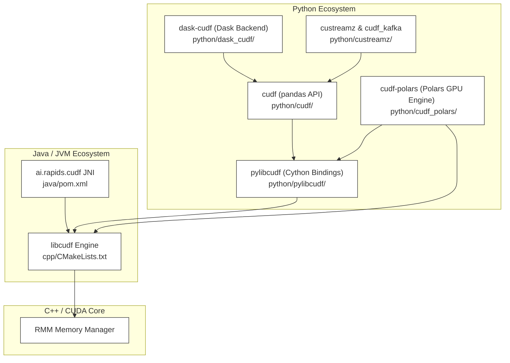
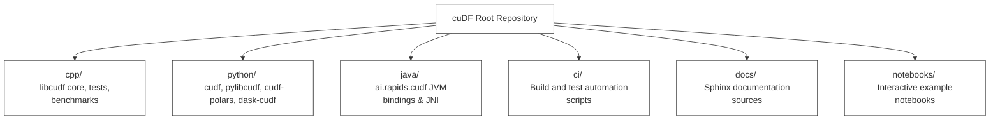

<!-- source: DeepWiki mcp.deepwiki.com · repo NVIDIA/cudf · page 1 Overview · fetched 2026-10-26 -->

# 1. Overview

Relevant source files

The following files were used as context for generating this wiki page:

- [.github/workflows/build.yaml](.github/workflows/build.yaml)
- [.github/workflows/pandas-tests.yaml](.github/workflows/pandas-tests.yaml)
- [.github/workflows/pr.yaml](.github/workflows/pr.yaml)
- [.github/workflows/pr_issue_status_automation.yml](.github/workflows/pr_issue_status_automation.yml)
- [.github/workflows/test.yaml](.github/workflows/test.yaml)
- [.github/workflows/trigger-breaking-change-alert.yaml](.github/workflows/trigger-breaking-change-alert.yaml)
- [CHANGELOG.md](CHANGELOG.md)
- [CONTRIBUTING.md](CONTRIBUTING.md)
- [RAPIDS_BRANCH](RAPIDS_BRANCH)
- [README.md](README.md)
- [build.sh](build.sh)
- [cpp/CMakeLists.txt](cpp/CMakeLists.txt)
- [cpp/benchmarks/CMakeLists.txt](cpp/benchmarks/CMakeLists.txt)
- [cpp/benchmarks/join/join_common.hpp](cpp/benchmarks/join/join_common.hpp)
- [cpp/examples/versions.cmake](cpp/examples/versions.cmake)
- [cpp/include/cudf/detail/transform.hpp](cpp/include/cudf/detail/transform.hpp)
- [cpp/include/cudf/transform.hpp](cpp/include/cudf/transform.hpp)
- [cpp/src/transform/bools_to_mask.cu](cpp/src/transform/bools_to_mask.cu)
- [cpp/src/transform/nans_to_nulls.cu](cpp/src/transform/nans_to_nulls.cu)
- [cpp/tests/CMakeLists.txt](cpp/tests/CMakeLists.txt)
- [cpp/tests/transform/nans_to_null_test.cpp](cpp/tests/transform/nans_to_null_test.cpp)
- [docs/cudf/source/pylibcudf/developer_docs.md](docs/cudf/source/pylibcudf/developer_docs.md)
- [java/README.md](java/README.md)
- [java/ci/Dockerfile.rocky](java/ci/Dockerfile.rocky)
- [java/ci/README.md](java/ci/README.md)
- [java/ci/build-in-docker.sh](java/ci/build-in-docker.sh)
- [java/ci/env.sh](java/ci/env.sh)
- [java/pom.xml](java/pom.xml)
- [java/src/main/native/CMakeLists.txt](java/src/main/native/CMakeLists.txt)
- [python/cudf/cudf/__init__.py](python/cudf/cudf/__init__.py)
- [python/cudf/cudf/core/__init__.py](python/cudf/cudf/core/__init__.py)
- [python/cudf_polars/docs/overview.md](python/cudf_polars/docs/overview.md)
- [python/custreamz/README.md](python/custreamz/README.md)

NVIDIA cuDF is a GPU-accelerated DataFrame library designed for high-performance tabular data processing, serving as a core component of the NVIDIA CUDA-X ecosystem [README.md:1-6](). By shifting dataframes and vector operations entirely to the GPU, cuDF provides drop-in acceleration for data science and analytics pipelines.

The cuDF codebase is structured as a multi-language, multi-package stack spanning low-level C++/CUDA acceleration engines, Python wrappers and accelerators, distributed computing integrations, and Java Virtual Machine (JVM) bindings.

*Figure 1: cuDF Component Stack and Code Entity Architecture Map*

Sources: `README.md:10-20`, `python/cudf/cudf/__init__.py`, `python/cudf_polars/docs/overview.md`, `java/pom.xml:11-13`, `cpp/CMakeLists.txt:20-24`

---

## Stack Components Summary

cuDF is composed of several tightly integrated sub-projects and language bindings:
- **libcudf**: The foundational C++/CUDA library providing Apache Arrow-compliant GPU data structures, string operations, table formats, and relational algorithms [README.md:12-13](). Managed via `cpp/CMakeLists.txt` [cpp/CMakeLists.txt:20-24]().
- **pylibcudf**: Cython-based Python wrappers providing direct, zero-overhead bindings to `libcudf` APIs [README.md:14]().
- **cudf (Python)**: A high-level DataFrame library mirroring the `pandas` API, featuring the `cudf.pandas` zero-code-change acceleration proxy [README.md:15-17]().
- **cudf-polars**: A high-performance execution engine that translates Polars logical plans and expressions into GPU kernels [README.md:18]().
- **dask-cudf**: Distributed GPU DataFrame collection supporting Dask task graphs and multi-GPU parquet/csv/orc operations [README.md:19]().
- **Java JNI Bindings**: The `ai.rapids.cudf` Maven artifact bridging JVM workloads (such as Apache Spark) to native `libcudf` routines [java/pom.xml:11-13](), `java/src/main/native/CMakeLists.txt` [java/src/main/native/CMakeLists.txt:21-25]().

Sources: `README.md:10-20`, `cpp/CMakeLists.txt:20-24`, `java/pom.xml:11-13`, `java/src/main/native/CMakeLists.txt:21-25`

---

## 1.1 Getting Started and Building

Building cuDF from source or setting up a development environment requires configuring specific compilation options, compiler versions, and target dependencies [CONTRIBUTING.md:79-105](). 

The repository provides an orchestration script, `build.sh`, which accepts fine-grained target selections such as `libcudf`, `pylibcudf`, `cudf`, `cudf_polars`, `dask_cudf`, and `benchmarks` [build.sh:21-37](). C++ components are built using `CMake` (requiring CMake 3.29.6+ and CUDA 12.2+) [cpp/CMakeLists.txt:8-31](), while Python components rely on `pyproject.toml` and standard PEP 517 build backends. Developers can leverage pre-configured `conda` environments defined under `conda/environments/` [CONTRIBUTING.md:121-128] or use containerized devcontainers for isolation [.github/workflows/pr.yaml:158-166]().

For detailed instructions on setting up environments, custom CMake flags, build targets, and running tests, see [Getting Started and Building](#1.1).

Sources: `build.sh:21-54`, `cpp/CMakeLists.txt:8-31`, `CONTRIBUTING.md:79-128`, `.github/workflows/pr.yaml:158-166`

---

## 1.2 Repository Layout

The cuDF repository is organized into distinct top-level directories separating core C++ engines, Python bindings, Java layers, continuous integration pipelines, and documentation:

*Figure 2: Top-Level Repository Directory Map*

- `cpp/`: Contains `libcudf`, `libcudf_kafka`, `libcudf_streaming`, C++ unit tests (`cpp/tests/`), and benchmarks (`cpp/benchmarks/`) [build.sh:21-37]().
- `python/`: Houses the Python packages including `cudf`, `pylibcudf`, `cudf_polars`, `dask_cudf`, and `custreamz` [build.sh:21-37]().
- `java/`: Contains the Maven project structure, JVM classes, and native JNI bridge implementations (`java/src/main/native/`) [java/src/main/native/CMakeLists.txt:1-25]().
- `ci/`: Contains orchestration scripts for GitHub Actions testing, linters, and package builds [.github/workflows/pr.yaml:102-125]().
- `docs/` & `notebooks/`: Sphinx documentation configurations and user guide notebooks [CONTRIBUTING.md:22-37]().

For a comprehensive tour of top-level directories and their internal subfolders, see [Repository Layout](#1.2).

Sources: `build.sh:21-64`, `java/src/main/native/CMakeLists.txt:1-25`, `.github/workflows/pr.yaml:102-125`, `CONTRIBUTING.md:22-37`

---

