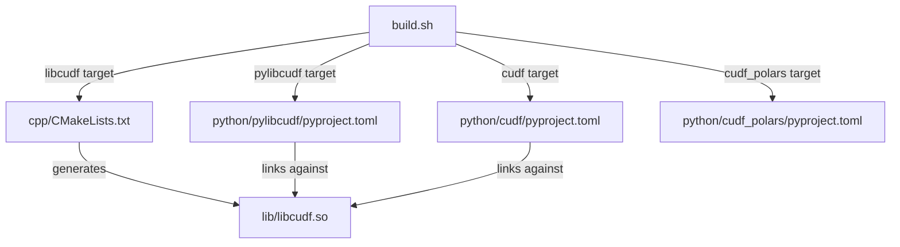
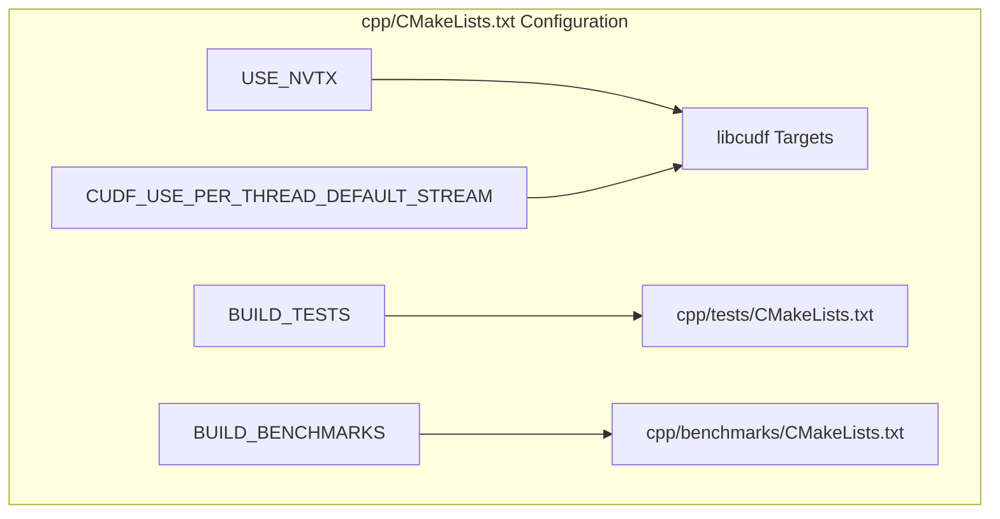
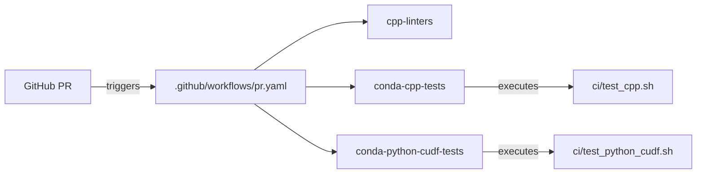

<!-- source: DeepWiki mcp.deepwiki.com · repo NVIDIA/cudf · page 1.1 Getting Started and Building · fetched 2026-10-26 -->

# Getting Started and Building

<details>
<summary>Relevant source files</summary>

The following files were used as context for generating this wiki page:

- [.github/workflows/build.yaml](.github/workflows/build.yaml)
- [.github/workflows/pandas-tests.yaml](.github/workflows/pandas-tests.yaml)
- [.github/workflows/pr.yaml](.github/workflows/pr.yaml)
- [.github/workflows/pr_issue_status_automation.yml](.github/workflows/pr_issue_status_automation.yml)
- [.github/workflows/test.yaml](.github/workflows/test.yaml)
- [.github/workflows/trigger-breaking-change-alert.yaml](.github/workflows/trigger-breaking-change-alert.yaml)
- [CHANGELOG.md](CHANGELOG.md)
- [CONTRIBUTING.md](CONTRIBUTING.md)
- [RAPIDS_BRANCH](RAPIDS_BRANCH)
- [README.md](README.md)
- [build.sh](build.sh)
- [conda/environments/all_cuda-129_arch-aarch64.yaml](conda/environments/all_cuda-129_arch-aarch64.yaml)
- [conda/environments/all_cuda-129_arch-x86_64.yaml](conda/environments/all_cuda-129_arch-x86_64.yaml)
- [conda/environments/all_cuda-133_arch-aarch64.yaml](conda/environments/all_cuda-133_arch-aarch64.yaml)
- [conda/environments/all_cuda-133_arch-x86_64.yaml](conda/environments/all_cuda-133_arch-x86_64.yaml)
- [conda/recipes/libcudf/conda_build_config.yaml](conda/recipes/libcudf/conda_build_config.yaml)
- [cpp/CMakeLists.txt](cpp/CMakeLists.txt)
- [cpp/benchmarks/CMakeLists.txt](cpp/benchmarks/CMakeLists.txt)
- [cpp/benchmarks/join/join_common.hpp](cpp/benchmarks/join/join_common.hpp)
- [cpp/examples/versions.cmake](cpp/examples/versions.cmake)
- [cpp/include/cudf/detail/transform.hpp](cpp/include/cudf/detail/transform.hpp)
- [cpp/include/cudf/transform.hpp](cpp/include/cudf/transform.hpp)
- [cpp/src/transform/bools_to_mask.cu](cpp/src/transform/bools_to_mask.cu)
- [cpp/src/transform/nans_to_nulls.cu](cpp/src/transform/nans_to_nulls.cu)
- [cpp/tests/CMakeLists.txt](cpp/tests/CMakeLists.txt)
- [cpp/tests/transform/nans_to_null_test.cpp](cpp/tests/transform/nans_to_null_test.cpp)
- [dependencies.yaml](dependencies.yaml)
- [docs/cudf/source/pylibcudf/developer_docs.md](docs/cudf/source/pylibcudf/developer_docs.md)
- [java/README.md](java/README.md)
- [java/ci/Dockerfile.rocky](java/ci/Dockerfile.rocky)
- [java/ci/README.md](java/ci/README.md)
- [java/ci/build-in-docker.sh](java/ci/build-in-docker.sh)
- [java/ci/env.sh](java/ci/env.sh)
- [java/pom.xml](java/pom.xml)
- [java/src/main/native/CMakeLists.txt](java/src/main/native/CMakeLists.txt)
- [python/cudf/pyproject.toml](python/cudf/pyproject.toml)
- [python/cudf_kafka/pyproject.toml](python/cudf_kafka/pyproject.toml)
- [python/cudf_polars/docs/overview.md](python/cudf_polars/docs/overview.md)
- [python/cudf_polars/pyproject.toml](python/cudf_polars/pyproject.toml)
- [python/custreamz/README.md](python/custreamz/README.md)
- [python/custreamz/pyproject.toml](python/custreamz/pyproject.toml)
- [python/dask_cudf/pyproject.toml](python/dask_cudf/pyproject.toml)
- [python/libcudf/pyproject.toml](python/libcudf/pyproject.toml)
- [python/pylibcudf/pyproject.toml](python/pylibcudf/pyproject.toml)

</details>


## Purpose and Scope
This section details how to configure, build, and run the cuDF codebase across all constituent components, including the core C++/CUDA engine (`libcudf`), Python wrappers (`pylibcudf`, `cudf`, `cudf-polars`, `dask-cudf`), Java JNI bindings (`ai.rapids.cudf`), and associated streaming/Kafka components. It covers build target specifications in `build.sh`, CMake configuration options, conda environment management via `dependencies.yaml`, containerized devcontainers, and continuous integration workflows.

---

## 1. Build Script Orchestration (`build.sh`)
The primary entry point for compiling cuDF components from source is the root script `build.sh`. It manages parallel compilation levels, target selection, and Python editable vs. standard installations.

### Build Targets
The script accepts several target arguments, which dictate which components are built:
* `libcudf`: Compiles the core C++/CUDA library located in `cpp/`.
* `pylibcudf`: Builds the Cython bindings package located in `python/pylibcudf/`.
* `cudf`: Builds the pandas-like Python API package in `python/cudf/`.
* `cudf_polars`: Builds the Polars GPU execution engine in `python/cudf_polars/`.
* `dask_cudf`: Builds the Dask GPU DataFrame backend in `python/dask_cudf/`.
* `tests` / `benchmarks`: Compiles test suites or performance benchmarks.
* `libcudf_kafka` / `cudf_kafka` / `custreamz`: Build streaming data integration modules.

### Build Flags and Options
Key flags supported by `build.sh` include:
* `-g`: Compiles in Debug mode rather than Release.
* `-n`: Skips the installation step (useful for custom library linkage).
* `--pydevelop`: Installs Python packages in editable/development mode.
* `--ptds`: Enables the per-thread default stream configuration.
* `--disable_large_strings`: Compiles libcudf without large string support.
* `--cmake-args="..."`: Passes arbitrary extra configuration parameters down to CMake.


*Sources: [build.sh:21-53](), [build.sh:74-92]()*

---

## 2. CMake Build Options (`cpp/CMakeLists.txt`)
When compiling `libcudf` directly via CMake, several configuration options control profiling, diagnostics, memory resources, and dependency fetching strategies:

| Option Name | Default | Description |
| :--- | :--- | :--- |
| `USE_NVTX` | `ON` | Injects NVTX profiling ranges into kernels and functions. |
| `BUILD_TESTS` | `ON` | Configures Google Test targets under `cpp/tests/`. |
| `BUILD_BENCHMARKS` | `OFF` | Configures NVBench benchmarks under `cpp/benchmarks/`. |
| `BUILD_SHARED_LIBS` | `ON` | Builds shared libraries (`.so`) instead of static archives (`.a`). |
| `CUDF_USE_PER_THREAD_DEFAULT_STREAM` | `OFF` | Passes per-thread default stream definitions to CUDA operations. |
| `CUDA_ENABLE_LINEINFO` | `OFF` | Appends `-lineinfo` to `nvcc` compilation for profiler symbol resolution. |
| `CUDF_BUILD_STATIC_DEPS` | `ON` | Three-state control (`ON`/`OFF`/`FORCE`) for static third-party dependencies. |


*Sources: [cpp/CMakeLists.txt:37-70](), [cpp/tests/CMakeLists.txt:38-81](), [cpp/benchmarks/CMakeLists.txt:10-26]() *

---

## 3. Conda Environments and Dependency Management
cuDF uses `dependencies.yaml` at the repository root to declare all build, test, and runtime constraints across conda matrix variations (CUDA versions 12.9, 13.3, x86_64 and aarch64 architectures).

```yaml
# Example structure referenced from dependency generation
files:
  all:
    output: conda
    matrix:
      cuda: ["12.9", "13.3"]
      arch: [x86_64, aarch64]
```

Conda environments can be provisioned using the generated recipes:
```bash
conda env create -n cudf-dev -f conda/environments/all_cuda-129_arch-x86_64.yaml
conda activate cudf-dev
```
*Sources: [dependencies.yaml:1-11]()*

---

## 4. Devcontainers and CI Workflows
Development container configurations are supplied under `.devcontainer/` to support instantaneous setup within VS Code or compatible container runtimes. Continuous integration pipelines are orchestrated through GitHub Actions workflows in `.github/workflows/`:
* `pr.yaml`: Triggers checks, linters, C++ tests, and Python test matrices on pull requests.
* `build.yaml`: Handles nightly and branch builds for conda packages and documentation.
* `test.yaml`: Coordinates post-build testing suites including memory checks (`ci/test_cpp_memcheck.sh`) and benchmarking jobs.


*Sources: [.github/workflows/pr.yaml:1-52](), [.github/workflows/test.yaml:28-85]() *

---

## 5. Component Building and Execution Guide

### Building libcudf (C++)
To build only the core C++ engine and execute unit tests:
```bash
./build.sh libcudf tests
cd cpp/build
cmake --build . -j$(nproc)
ctest --output-on-failure
```
*Sources: [build.sh:21-32](), [cpp/CMakeLists.txt:20-24]()*

### Building Python Bindings and Packages
To install the Python stack in editable development mode alongside built C++ extensions:
```bash
./build.sh libcudf pylibcudf cudf --pydevelop
```
Python wheels and packages leverage `pyproject.toml` configurations paired with `rapids-build-backend`.
*Sources: [build.sh:21-41](), [python/cudf/pyproject.toml:4-10]() *

### Building Java JNI Bindings
The Java module (`java/`) compiles native bridges against libcudf. Native CMake options can be configured via:
```bash
cd java/src/main/native
mkdir build && cd build
cmake -DCUDF_CPP_BUILD_DIR=../../../../cpp/build ..
make -j$(nproc)
```
*Sources: [java/src/main/native/CMakeLists.txt:21-86]()*

---

