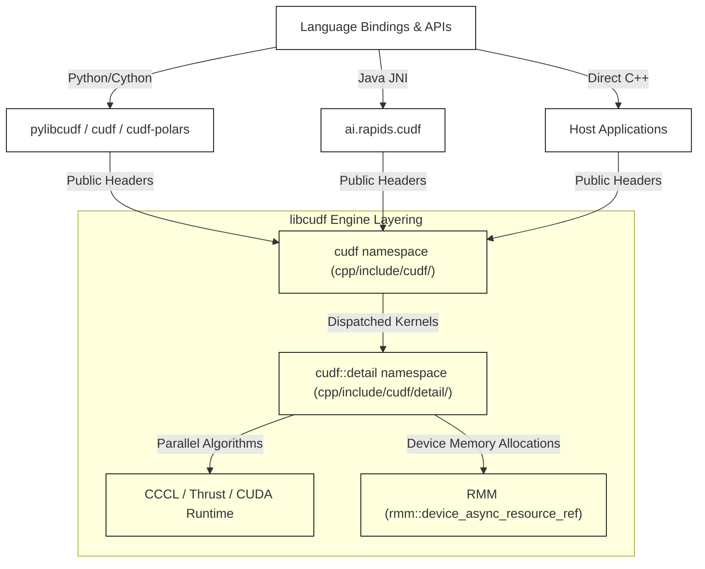
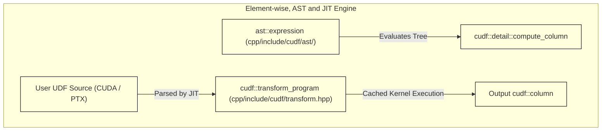

<!-- source: DeepWiki mcp.deepwiki.com · repo NVIDIA/cudf · page 2 libcudf: C++/CUDA Core · fetched 2026-10-26 -->

# libcudf: C++/CUDA Core

Relevant source files

The following files were used as context for generating this wiki page:

- [.agents/skills/review-cudf/SKILL.md](.agents/skills/review-cudf/SKILL.md)
- [CHANGELOG.md](CHANGELOG.md)
- [cpp/CMakeLists.txt](cpp/CMakeLists.txt)
- [cpp/benchmarks/CMakeLists.txt](cpp/benchmarks/CMakeLists.txt)
- [cpp/benchmarks/dictionary/concatenate.cpp](cpp/benchmarks/dictionary/concatenate.cpp)
- [cpp/benchmarks/io/fst.cu](cpp/benchmarks/io/fst.cu)
- [cpp/benchmarks/join/join_common.hpp](cpp/benchmarks/join/join_common.hpp)
- [cpp/doxygen/DoxygenLayout.xml](cpp/doxygen/DoxygenLayout.xml)
- [cpp/doxygen/developer_guide/DEVELOPER_GUIDE.md](cpp/doxygen/developer_guide/DEVELOPER_GUIDE.md)
- [cpp/doxygen/developer_guide/DOCUMENTATION.md](cpp/doxygen/developer_guide/DOCUMENTATION.md)
- [cpp/doxygen/developer_guide/TESTING.md](cpp/doxygen/developer_guide/TESTING.md)
- [cpp/doxygen/developer_guide/strings.png](cpp/doxygen/developer_guide/strings.png)
- [cpp/doxygen/modify_fences.sh](cpp/doxygen/modify_fences.sh)
- [cpp/include/cudf/detail/nvtx/ranges.hpp](cpp/include/cudf/detail/nvtx/ranges.hpp)
- [cpp/include/cudf/detail/transform.hpp](cpp/include/cudf/detail/transform.hpp)
- [cpp/include/cudf/detail/utilities/stream_pool.hpp](cpp/include/cudf/detail/utilities/stream_pool.hpp)
- [cpp/include/cudf/lists/combine.hpp](cpp/include/cudf/lists/combine.hpp)
- [cpp/include/cudf/transform.hpp](cpp/include/cudf/transform.hpp)
- [cpp/include/cudf_test/print_utilities.cuh](cpp/include/cudf_test/print_utilities.cuh)
- [cpp/include/doxygen_groups.h](cpp/include/doxygen_groups.h)
- [cpp/src/io/fst/agent_dfa.cuh](cpp/src/io/fst/agent_dfa.cuh)
- [cpp/src/io/fst/dispatch_dfa.cuh](cpp/src/io/fst/dispatch_dfa.cuh)
- [cpp/src/io/fst/in_reg_array.cuh](cpp/src/io/fst/in_reg_array.cuh)
- [cpp/src/io/fst/logical_stack.cuh](cpp/src/io/fst/logical_stack.cuh)
- [cpp/src/io/fst/lookup_tables.cuh](cpp/src/io/fst/lookup_tables.cuh)
- [cpp/src/io/parquet/writer_impl_helpers.cpp](cpp/src/io/parquet/writer_impl_helpers.cpp)
- [cpp/src/io/parquet/writer_impl_helpers.hpp](cpp/src/io/parquet/writer_impl_helpers.hpp)
- [cpp/src/lists/combine/concatenate_list_elements.cu](cpp/src/lists/combine/concatenate_list_elements.cu)
- [cpp/src/lists/combine/concatenate_rows.cu](cpp/src/lists/combine/concatenate_rows.cu)
- [cpp/src/lists/copying/scatter_helper.cu](cpp/src/lists/copying/scatter_helper.cu)
- [cpp/src/lists/dremel.cu](cpp/src/lists/dremel.cu)
- [cpp/src/lists/explode.cu](cpp/src/lists/explode.cu)
- [cpp/src/lists/interleave_columns.cu](cpp/src/lists/interleave_columns.cu)
- [cpp/src/lists/reverse.cu](cpp/src/lists/reverse.cu)
- [cpp/src/lists/set_operations.cu](cpp/src/lists/set_operations.cu)
- [cpp/src/transform/bools_to_mask.cu](cpp/src/transform/bools_to_mask.cu)
- [cpp/src/transform/nans_to_nulls.cu](cpp/src/transform/nans_to_nulls.cu)
- [cpp/src/utilities/stream_pool.cpp](cpp/src/utilities/stream_pool.cpp)
- [cpp/tests/CMakeLists.txt](cpp/tests/CMakeLists.txt)
- [cpp/tests/column/column_test.cpp](cpp/tests/column/column_test.cpp)
- [cpp/tests/copying/concatenate_tests.cpp](cpp/tests/copying/concatenate_tests.cpp)
- [cpp/tests/encode/encode_tests.cpp](cpp/tests/encode/encode_tests.cpp)
- [cpp/tests/io/fst/common.hpp](cpp/tests/io/fst/common.hpp)
- [cpp/tests/io/fst/fst_test.cu](cpp/tests/io/fst/fst_test.cu)
- [cpp/tests/io/fst/logical_stack_test.cu](cpp/tests/io/fst/logical_stack_test.cu)
- [cpp/tests/io/parquet_chunked_writer_test.cpp](cpp/tests/io/parquet_chunked_writer_test.cpp)
- [cpp/tests/io/parquet_misc_test.cpp](cpp/tests/io/parquet_misc_test.cpp)
- [cpp/tests/io/parquet_v2_test.cpp](cpp/tests/io/parquet_v2_test.cpp)
- [cpp/tests/lists/combine/concatenate_list_elements_tests.cpp](cpp/tests/lists/combine/concatenate_list_elements_tests.cpp)
- [cpp/tests/lists/combine/concatenate_rows_tests.cpp](cpp/tests/lists/combine/concatenate_rows_tests.cpp)
- [cpp/tests/lists/explode_tests.cpp](cpp/tests/lists/explode_tests.cpp)
- [cpp/tests/streams/io/csv_test.cpp](cpp/tests/streams/io/csv_test.cpp)
- [cpp/tests/streams/io/orc_test.cpp](cpp/tests/streams/io/orc_test.cpp)
- [cpp/tests/streams/io/parquet_test.cpp](cpp/tests/streams/io/parquet_test.cpp)
- [cpp/tests/streams/pool_test.cu](cpp/tests/streams/pool_test.cu)
- [cpp/tests/structs/structs_column_tests.cpp](cpp/tests/structs/structs_column_tests.cpp)
- [cpp/tests/transform/nans_to_null_test.cpp](cpp/tests/transform/nans_to_null_test.cpp)
- [cpp/tests/utilities/identify_stream_usage.cpp](cpp/tests/utilities/identify_stream_usage.cpp)
- [cpp/tests/utilities_tests/lists_column_wrapper_tests.cpp](cpp/tests/utilities_tests/lists_column_wrapper_tests.cpp)
- [cpp/tests/utilities_tests/stream_pool_tests.cpp](cpp/tests/utilities_tests/stream_pool_tests.cpp)

## Purpose and Scope

`libcudf` is the C++ and CUDA core engine of cuDF [cpp/doxygen/developer_guide/DEVELOPER_GUIDE.md:13-17] that provides GPU-accelerated, data-parallel columnar primitives, relational operators, text/string algorithms, and file I/O pipelines. It serves as the single native computation engine underneath multiple higher-level language bindings, including Python (`pylibcudf`, `cudf`, `cudf-polars`), Java (`ai.rapids.cudf` via JNI), and distributed runtimes (`dask-cudf`). 

The library is organized into a clean architectural layering that separates host-side orchestration, public API headers (`cudf::`), internal device translation units (`cudf::detail::`), and raw CUDA kernels built using Thrust, CCCL, and RMM (RAPIDS Memory Manager).

*Diagram 1: libcudf Architectural Layering and Client Bindings*

Sources: [cpp/CMakeLists.txt:1-31](), [cpp/doxygen/developer_guide/DEVELOPER_GUIDE.md:11-17]()

---

## 2.1 Core Data Structures

The foundation of `libcudf` is its columnar memory model, comprising owning containers and non-owning zero-copy views. A `column` owns device buffers (data buffer, validity/null mask buffer, and optional nested child columns), while a `column_view` or `column_device_view` provides light-weight accessors used directly inside CUDA kernels [cpp/doxygen/developer_guide/DEVELOPER_GUIDE.md:23-50]. Tables aggregate collections of columns representing relational datasets with equal row counts [cpp/doxygen/developer_guide/DEVELOPER_GUIDE.md:39-44].

For detailed information on memory layouts, factories, type dispatchers, fixed-point/timestamp wrappers, iterators, list columns, struct columns, and dictionary encoding, see [Core Data Structures](#2.1).

Sources: [cpp/doxygen/developer_guide/DEVELOPER_GUIDE.md:23-50](), [cpp/include/doxygen_groups.h:20-41]()

---

## 2.2 Copying, Reshaping and Compaction

`libcudf` provides high-performance data manipulation routines that restructure columns and tables without unnecessary data duplication. This includes element selection algorithms like `gather` and `scatter`, conditional routing via `copy_if_else`, array slicing, splitting, shifting, transposition, column interleaving, and stream compaction (filtering out null or unwanted rows) [cpp/include/doxygen_groups.h:42-68,96-100].

For detailed information on gather/scatter routines, contiguous splits, packing, filling, repetition, sequence generation, and stream compaction, see [Copying, Reshaping and Compaction](#2.2).

Sources: [cpp/include/doxygen_groups.h:42-68](), [cpp/src/lists/interleave_columns.cu:90-123]()

---

## 2.3 Relational and Analytical Algorithms

To support database operations and data science analytics, `libcudf` implements optimized parallel relational operators. These include multi-type hash joins and sort-merge joins, powerful GroupBy aggregation workflows, global sorting, ranking, ordered reductions, prefix scans, quantiles, rolling windows, and table partitioning [cpp/include/doxygen_groups.h:70-83].

For detailed information on join types (hash, sort-merge, conditional, semi/anti), the GroupBy request model, sorting, reductions, rolling windows, and partitioning, see [Relational and Analytical Algorithms](#2.3).

Sources: [cpp/include/doxygen_groups.h:70-83](), [cpp/benchmarks/join/join_common.hpp:24-61]()

---

## 2.4 Strings and Text (`nvtext`)

Text processing in `libcudf` revolves around `string_view`, a zero-copy representation of UTF-8 encoded character strings residing in device memory. The strings API supports rich pattern matching via a custom regular expression engine (`reprog`), string manipulation, substring extraction, splitting, padding, casing, and complex conversions [cpp/include/doxygen_groups.h:112-127]. Additionally, the `nvtext` module provides natural language processing primitives like tokenization, normalization, $n$-grams, edit distance, and subword vocabularies [cpp/include/doxygen_groups.h:161-172].

For detailed information on the regular expression engine, string manipulation, conversions, and `nvtext` primitives, see [Strings and Text (nvtext)](#2.4).

Sources: [cpp/include/doxygen_groups.h:112-127,161-172]()

---

## 2.5 Element-wise Operations, AST and JIT

Element-wise arithmetic, logical, and datetime operations allow transforming columns using unary and binary operators. For complex or custom expressions, `libcudf` provides an Abstract Syntax Tree (`ast`) expression evaluation framework and JIT compilation infrastructure (`cudf::transform_program`) that compiles and executes custom CUDA/PTX UDFs on columns at runtime [cpp/include/cudf/transform.hpp:84-170, cpp/include/cudf/detail/transform.hpp:24-28].

*Diagram 2: Element-wise Operations, Expression Trees, and JIT Transformation Pipeline*

Sources: [cpp/include/cudf/transform.hpp:84-170](), [cpp/include/cudf/detail/transform.hpp:24-28]()

---

## 2.6 Arrow Interop and Streaming Extensions

`libcudf` natively interoperates with Apache Arrow data structures on both host and device memory, supporting the Arrow C Data Interface and DLPack for zero-copy data exchange with external frameworks like PyTorch and NumPy [cpp/include/doxygen_groups.h:101-105]. Specialized streaming and messaging components (`libcudf_streaming` and `libcudf_kafka`) extend the core engine to ingest and process continuous data streams.

For detailed information on Apache Arrow host/device conversions, DLPack integration, and streaming extensions, see [Arrow Interop and Streaming Extensions](#2.6).

Sources: [cpp/include/doxygen_groups.h:101-105]()

---

