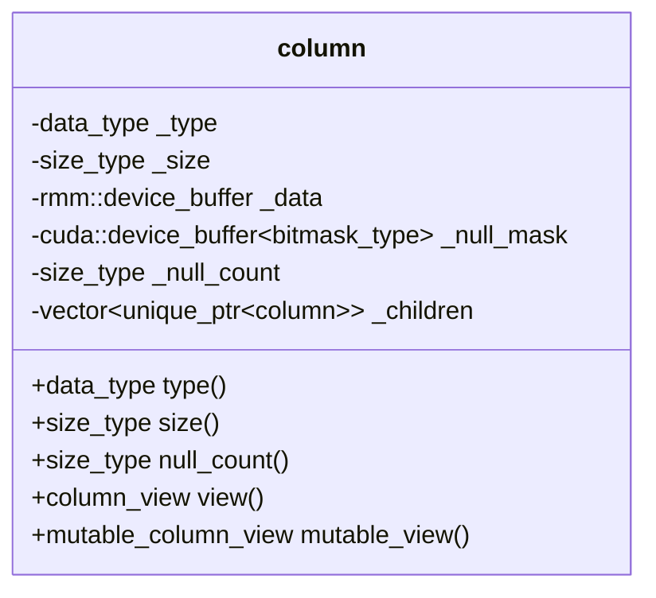

<!-- source: DeepWiki mcp.deepwiki.com · repo NVIDIA/cudf · page 2.1 Core Data Structures · fetched 2026-10-26 -->

# Core Data Structures

<details>
<summary>Relevant source files</summary>

The following files were used as context for generating this wiki page:

- [cpp/benchmarks/bitmask/bitmask_and.cpp](cpp/benchmarks/bitmask/bitmask_and.cpp)
- [cpp/include/cudf/column/column.hpp](cpp/include/cudf/column/column.hpp)
- [cpp/include/cudf/column/column_device_view.cuh](cpp/include/cudf/column/column_device_view.cuh)
- [cpp/include/cudf/column/column_factories.hpp](cpp/include/cudf/column/column_factories.hpp)
- [cpp/include/cudf/column/column_view.hpp](cpp/include/cudf/column/column_view.hpp)
- [cpp/include/cudf/concatenate.hpp](cpp/include/cudf/concatenate.hpp)
- [cpp/include/cudf/detail/is_element_valid.hpp](cpp/include/cudf/detail/is_element_valid.hpp)
- [cpp/include/cudf/detail/null_mask.cuh](cpp/include/cudf/detail/null_mask.cuh)
- [cpp/include/cudf/detail/null_mask.hpp](cpp/include/cudf/detail/null_mask.hpp)
- [cpp/include/cudf/io/parquet_io_utils.hpp](cpp/include/cudf/io/parquet_io_utils.hpp)
- [cpp/include/cudf/null_mask.hpp](cpp/include/cudf/null_mask.hpp)
- [cpp/include/cudf/strings/detail/concatenate.hpp](cpp/include/cudf/strings/detail/concatenate.hpp)
- [cpp/include/cudf/structs/detail/concatenate.hpp](cpp/include/cudf/structs/detail/concatenate.hpp)
- [cpp/include/cudf/table/table.hpp](cpp/include/cudf/table/table.hpp)
- [cpp/include/cudf/table/table_device_view.cuh](cpp/include/cudf/table/table_device_view.cuh)
- [cpp/include/cudf/table/table_view.hpp](cpp/include/cudf/table/table_view.hpp)
- [cpp/src/bitmask/is_element_valid.cpp](cpp/src/bitmask/is_element_valid.cpp)
- [cpp/src/bitmask/null_mask.cu](cpp/src/bitmask/null_mask.cu)
- [cpp/src/column/column.cu](cpp/src/column/column.cu)
- [cpp/src/column/column_device_view.cu](cpp/src/column/column_device_view.cu)
- [cpp/src/column/column_factories.cpp](cpp/src/column/column_factories.cpp)
- [cpp/src/column/column_view.cpp](cpp/src/column/column_view.cpp)
- [cpp/src/copying/concatenate.cu](cpp/src/copying/concatenate.cu)
- [cpp/src/io/parquet/io_utils/parquet_io_utils.cpp](cpp/src/io/parquet/io_utils/parquet_io_utils.cpp)
- [cpp/src/strings/copying/concatenate.cu](cpp/src/strings/copying/concatenate.cu)
- [cpp/src/strings/strings_column_factories.cu](cpp/src/strings/strings_column_factories.cu)
- [cpp/src/strings/strings_scalar_factories.cpp](cpp/src/strings/strings_scalar_factories.cpp)
- [cpp/src/structs/utilities.cu](cpp/src/structs/utilities.cu)
- [cpp/src/table/table.cpp](cpp/src/table/table.cpp)
- [cpp/src/table/table_device_view.cu](cpp/src/table/table_device_view.cu)
- [cpp/src/table/table_view.cpp](cpp/src/table/table_view.cpp)
- [cpp/tests/bitmask/bitmask_tests.cpp](cpp/tests/bitmask/bitmask_tests.cpp)
- [cpp/tests/bitmask/set_nullmask_tests.cu](cpp/tests/bitmask/set_nullmask_tests.cu)
- [cpp/tests/column/factories_test.cpp](cpp/tests/column/factories_test.cpp)
- [cpp/tests/strings/factories_test.cu](cpp/tests/strings/factories_test.cu)
- [cpp/tests/table/table_tests.cpp](cpp/tests/table/table_tests.cpp)
- [java/src/main/native/src/multi_host_buffer_source.cpp](java/src/main/native/src/multi_host_buffer_source.cpp)

</details>


## Purpose and Scope

This page provides a high-level overview of libcudf's core data structures, which represent columnar data, tabular data, scalar values, and validity bitmasks on NVIDIA GPUs. These structures form the foundation of the C++/CUDA execution engine, offering zero-copy slicing, device-side accessibility, and compatibility with the Apache Arrow memory layout specification [cpp/include/cudf/column/column_view.hpp:27-36]().

For detailed information on specific subsystems, refer to the child pages:
- For types, type identification, traits, and the runtime type dispatcher, see [Type System and Dispatch](#2.1.1).
- For complex types including list columns, struct columns, and dictionary encoding, see [Nested and Dictionary Types](#2.1.2).

---

## 1. The `column` Container (`cudf::column`)

The `cudf::column` class is an owning container for a column of nullable device data [cpp/include/cudf/column/column.hpp:31-37](). It manages device memory via `rmm::device_buffer` for the underlying data elements, a `cuda::device_buffer<cudf::bitmask_type>` for the null validity mask, and an optional `std::vector<std::unique_ptr<column>>` for child columns (used in nested or compound types) [cpp/include/cudf/column/column.hpp:109-120](). 

Because `column` owns its memory, copying a `column` triggers a deep copy of its buffers and children [cpp/include/cudf/column/column.hpp:55-58](), whereas moving a `column` transfers ownership instantly [cpp/include/cudf/column/column.hpp:60-66]().


*Figure: Architecture of `cudf::column` and its underlying buffer management members.*

Sources: `[cpp/include/cudf/column/column.hpp:37-144]()`, `[cpp/src/column/column.cu:40-128]()`

---

## 2. Non-Owning Views (`column_view` and `column_device_view`)

To avoid expensive deep copies when passing data into algorithms or launching CUDA kernels, libcudf separates owning containers from non-owning views:

- **`column_view` / `mutable_column_view`**: Non-owning, immutable or mutable host-side views of device columnar data [cpp/include/cudf/column/column_view.hpp:27-44](). They support zero-copy slicing via an `offset` attribute relative to the base allocation.
- **`column_device_view` / `mutable_column_device_view`**: Trivially copyable structures designed to be passed directly into CUDA device code and kernels [cpp/include/cudf/column/column_device_view.cuh:33-39](). They handle recursive device pointer translation for nested and child columns.

```mermaid
graph TD
    subgraph NaturalLanguage["Natural Language Space"]
        Owner["Owning Host Container"] -->|Creates View| HostView["Host-side View"]
        HostView -->|Marshals to Device| DeviceView["CUDA Device-side View"]
    end

    subgraph CodeSpace["Code Entity Space"]
        C["cudf::column"] -->|view() / mutable_view()| CV["cudf::column_view"]
        CV -->|column_device_view::create()| CDV["cudf::column_device_view"]
    end

    Owner --- C
    HostView --- CV
    DeviceView --- CDV
```
*Figure: Bridging natural language concepts to libcudf C++ classes for column views.*

Sources: `[cpp/include/cudf/column/column_view.hpp:27-44]`, `[cpp/src/column/column_view.cpp:102-185]`, `[cpp/include/cudf/column/column_device_view.cuh:33-39]`, `[cpp/src/column/column_device_view.cu:36-47]()`

---

## 3. Tables (`table` and `table_view`)

A tabular collection of columns is represented by `cudf::table` (owning) and `cudf::table_view` / `mutable_table_view` (non-owning views). A table holds a collection of `column` instances or `column_view` instances of equal row count, forming the fundamental input and output signature for relational algorithms such as joins, filterings, and aggregations.

Sources: `[cpp/include/cudf/table/table.hpp]()`, `[cpp/include/cudf/table/table_view.hpp]()`

---

## 4. Scalars

The scalar hierarchy (`cudf::scalar` and its derived template types such as `cudf::numeric_scalar<T>`, `cudf::string_scalar`, etc.) represents single element values residing either on the host or device. Scalars encapsulate a value buffer, a validity boolean indicating whether the scalar is null, and the associated CUDA stream context.

---

## 5. Null Masks and Validity Bitmasks

Nullability in libcudf columns is tracked using packed bitmasks where each bit indicates the validity (1 = valid, 0 = null) of a corresponding element [cpp/include/cudf/null_mask.hpp:31-72](). 

- **`mask_state`**: Specifies the initial state of a bitmask (`UNALLOCATED`, `ALL_VALID`, `ALL_NULL`, or `UNINITIALIZED`).
- **Bitmask Utilities**: Functions such as `create_null_mask()`, `bitmask_allocation_size_bytes()`, and bulk set operations (`set_null_masks_safe`) manage buffer allocations padded to Arrow-compliant boundaries [cpp/include/cudf/null_mask.hpp:44-104]().

Sources: `[cpp/include/cudf/null_mask.hpp:31-104]`, `[cpp/src/bitmask/null_mask.cu:39-96]()`

---

## 6. Column Factories

Column factories provide high-level APIs to construct columns with uninitialized or pre-filled memory and bitmasks without manually orchestrating buffer allocations [cpp/include/cudf/column/column_factories.hpp:28-72](). Key factory functions include:
- `make_empty_column()` [cpp/include/cudf/column/column_factories.hpp:36-46]()
- `make_numeric_column()` [cpp/include/cudf/column/column_factories.hpp:66-71]()
- `make_fixed_point_column()` [cpp/include/cudf/column/column_factories.hpp:124-129]()
- `make_timestamp_column()` [cpp/include/cudf/column/column_factories.hpp:174]()

Sources: `[cpp/include/cudf/column/column_factories.hpp:28-129]`, `[cpp/src/column/column_factories.cpp:48-80]()`

---

## Child Pages

For further technical depth, proceed to the child pages:
- **[Type System and Dispatch](#2.1.1)**: Covers `cudf::type_id`, type traits, the `type_dispatcher`, fixed-point decimals, timestamp/duration wrappers, and iterators.
- **[Nested and Dictionary Types](#2.1.2)**: Covers list columns, struct columns, dictionary encoding schemes, and their respective factories and operations.

---

