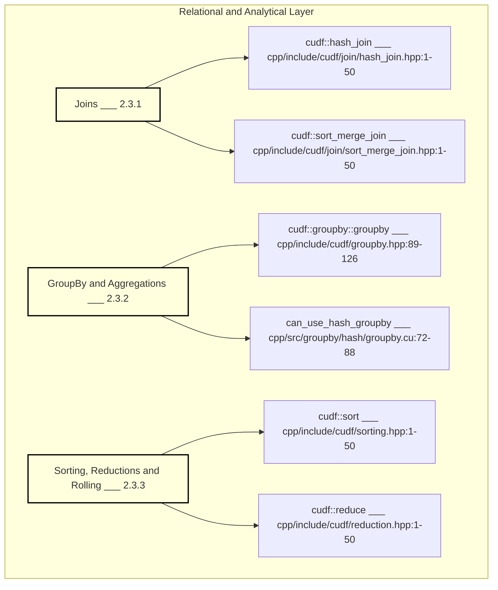
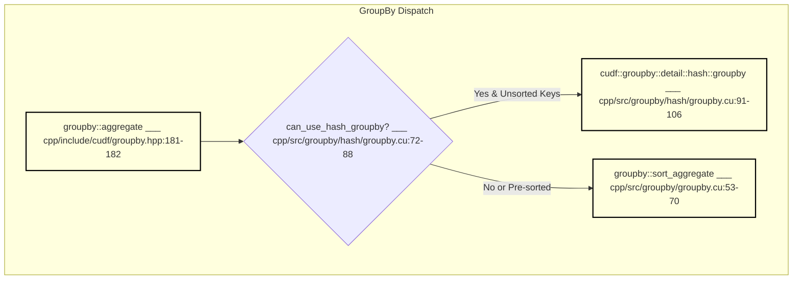

<!-- source: DeepWiki mcp.deepwiki.com · repo NVIDIA/cudf · page 2.3 Relational and Analytical Algorithms · fetched 2026-10-26 -->

# Relational and Analytical Algorithms

Relevant source files

The following files were used as context for generating this wiki page:

- [cpp/benchmarks/common/ndsh_data_generator/random_column_generator.cu](cpp/benchmarks/common/ndsh_data_generator/random_column_generator.cu)
- [cpp/benchmarks/join/direct_join.cu](cpp/benchmarks/join/direct_join.cu)
- [cpp/benchmarks/join/generate_input_tables.cu](cpp/benchmarks/join/generate_input_tables.cu)
- [cpp/benchmarks/join/join_on_int32.cu](cpp/benchmarks/join/join_on_int32.cu)
- [cpp/include/cudf/aggregation.hpp](cpp/include/cudf/aggregation.hpp)
- [cpp/include/cudf/detail/aggregation/aggregation.cuh](cpp/include/cudf/detail/aggregation/aggregation.cuh)
- [cpp/include/cudf/detail/aggregation/aggregation.hpp](cpp/include/cudf/detail/aggregation/aggregation.hpp)
- [cpp/include/cudf/detail/aggregation/device_aggregators.cuh](cpp/include/cudf/detail/aggregation/device_aggregators.cuh)
- [cpp/include/cudf/detail/groupby.hpp](cpp/include/cudf/detail/groupby.hpp)
- [cpp/include/cudf/detail/groupby/sort_helper.hpp](cpp/include/cudf/detail/groupby/sort_helper.hpp)
- [cpp/include/cudf/detail/join/hash_join.hpp](cpp/include/cudf/detail/join/hash_join.hpp)
- [cpp/include/cudf/groupby.hpp](cpp/include/cudf/groupby.hpp)
- [cpp/include/cudf/join/hash_join.hpp](cpp/include/cudf/join/hash_join.hpp)
- [cpp/include/cudf/join/join.hpp](cpp/include/cudf/join/join.hpp)
- [cpp/include/cudf/join/sort_merge_join.hpp](cpp/include/cudf/join/sort_merge_join.hpp)
- [cpp/include/cudf/join/streaming_hash_join.hpp](cpp/include/cudf/join/streaming_hash_join.hpp)
- [cpp/src/aggregation/aggregation.cpp](cpp/src/aggregation/aggregation.cpp)
- [cpp/src/aggregation/aggregation.cu](cpp/src/aggregation/aggregation.cu)
- [cpp/src/groupby/groupby.cu](cpp/src/groupby/groupby.cu)
- [cpp/src/groupby/hash/groupby.cu](cpp/src/groupby/hash/groupby.cu)
- [cpp/src/groupby/sort/aggregate.cpp](cpp/src/groupby/sort/aggregate.cpp)
- [cpp/src/groupby/sort/group_reductions.hpp](cpp/src/groupby/sort/group_reductions.hpp)
- [cpp/src/groupby/sort/sort_helper.cu](cpp/src/groupby/sort/sort_helper.cu)
- [cpp/src/join/filter_join_indices/filter_join_indices.cu](cpp/src/join/filter_join_indices/filter_join_indices.cu)
- [cpp/src/join/filter_join_indices/filter_join_indices_jit.cu](cpp/src/join/filter_join_indices/filter_join_indices_jit.cu)
- [cpp/src/join/filter_join_indices/filter_join_indices_output_size_kernel.cuh](cpp/src/join/filter_join_indices/filter_join_indices_output_size_kernel.cuh)
- [cpp/src/join/filter_join_indices/filter_join_indices_output_size_kernel.hpp](cpp/src/join/filter_join_indices/filter_join_indices_output_size_kernel.hpp)
- [cpp/src/join/filter_join_indices/filter_join_indices_output_size_kernel_complex.cu](cpp/src/join/filter_join_indices/filter_join_indices_output_size_kernel_complex.cu)
- [cpp/src/join/filter_join_indices/filter_join_indices_output_size_kernel_null_complex.cu](cpp/src/join/filter_join_indices/filter_join_indices_output_size_kernel_null_complex.cu)
- [cpp/src/join/filter_join_indices/filter_join_indices_output_size_kernel_null_primitive.cu](cpp/src/join/filter_join_indices/filter_join_indices_output_size_kernel_null_primitive.cu)
- [cpp/src/join/filter_join_indices/filter_join_indices_output_size_kernel_primitive.cu](cpp/src/join/filter_join_indices/filter_join_indices_output_size_kernel_primitive.cu)
- [cpp/src/join/filter_join_indices/full_join.hpp](cpp/src/join/filter_join_indices/full_join.hpp)
- [cpp/src/join/hash_join/common.cuh](cpp/src/join/hash_join/common.cuh)
- [cpp/src/join/join.cu](cpp/src/join/join.cu)
- [cpp/src/join/sort_merge_join.cu](cpp/src/join/sort_merge_join.cu)
- [cpp/src/join/sort_merge_join.hpp](cpp/src/join/sort_merge_join.hpp)
- [cpp/tests/groupby/sum_tests.cpp](cpp/tests/groupby/sum_tests.cpp)
- [cpp/tests/join/join_tests.cpp](cpp/tests/join/join_tests.cpp)
- [cpp/tests/streams/join_test.cpp](cpp/tests/streams/join_test.cpp)

## Purpose and Scope

This section provides a high-level overview of relational and analytical algorithms implemented in `libcudf`. These components form the core relational algebra and analytical query processing engine of cuDF, executed entirely on NVIDIA GPUs using CUDA and C++. This includes operations for combining datasets (joins and merges), grouping and aggregating data, sorting, reductions, rolling window calculations, and partitioning. 

As a parent page, this section introduces each subsystem and links to its respective child page for deep technical details, kernel designs, and internal data structures.

Sources:
- `cpp/include/cudf/groupby.hpp:1-38` [cpp/include/cudf/groupby.hpp]()
- `cpp/include/cudf/join/hash_join.hpp:1-35` [cpp/include/cudf/join/hash_join.hpp]()

---

## Architectural Overview

The relational and analytical engine sits atop the core data structures (`column`, `table`, and `table_view`) and leverages templated dispatchers and primitive libraries (such as CUB and cuco) to accelerate operations on the GPU.

Sources:
- `cpp/include/cudf/groupby.hpp:89-126` [cpp/include/cudf/groupby.hpp]()
- `cpp/src/groupby/hash/groupby.cu:72-88` [cpp/src/groupby/hash/groupby.cu]()

---

## 2.3.1 Joins

Joins combine columns from two tables based on relational keys. `libcudf` supports multiple join algorithms depending on data characteristics, memory constraints, and join predicates. Supported join types include inner, left, full, right, left semi, left anti, conditional, and mixed joins.

For details on hash join implementations, sort-merge joins, conditional/mixed/semi joins, mark & filtered joins, and hashing utilities, see [Joins](#2.3.1).

Sources:
- `cpp/include/cudf/join/hash_join.hpp:1-80` [cpp/include/cudf/join/hash_join.hpp]()
- `cpp/src/join/join.cu:30-105` [cpp/src/join/join.cu]()

---

## 2.3.2 GroupBy and Aggregations

The GroupBy engine partitions rows into groups based on key columns and computes one or more aggregations over the values within each group. Aggregations are requested via an `aggregation_request` model containing target value columns and a vector of unique `groupby_aggregation` pointers.

For details on the aggregation request model, hash vs. sort groupby execution paths, per-group reductions/scans, and the internal result cache, see [GroupBy and Aggregations](#2.3.2).

Sources:
- `cpp/include/cudf/groupby.hpp:54-85` [cpp/include/cudf/groupby.hpp]()
- `cpp/src/groupby/groupby.cu:53-70` [cpp/src/groupby/groupby.cu]()

---

## 2.3.3 Sorting, Reductions and Rolling Windows

Global sorting, ranking, and segmented sorts order table rows or segments of columns according to user-defined column orders and null precedences. Reductions collapse columns or table segments into scalar values or single-row columns using operators like sum, min, max, product, and custom statistical aggregations. 

Rolling windows and grouped rolling windows compute sliding or expanding window statistics (such as moving averages or custom aggregates) across ordered data sequences.

For details on sorting, ranking, segmented sort, reductions, scans, quantiles, rolling windows, merge, and partitioning utilities, see [Sorting, Reductions and Rolling Windows](#2.3.3).

Sources:
- `cpp/include/cudf/sorting.hpp:1-60` [cpp/include/cudf/sorting.hpp]()
- `cpp/include/cudf/aggregation.hpp:76-140` [cpp/include/cudf/aggregation.hpp]()

---

