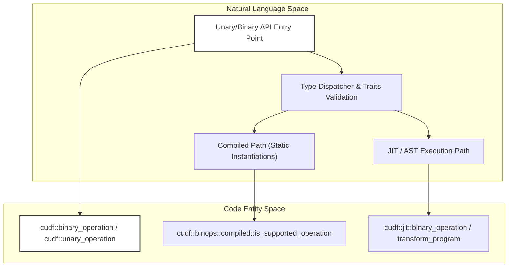
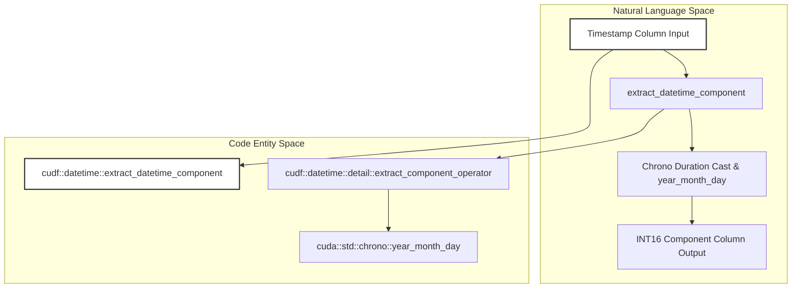
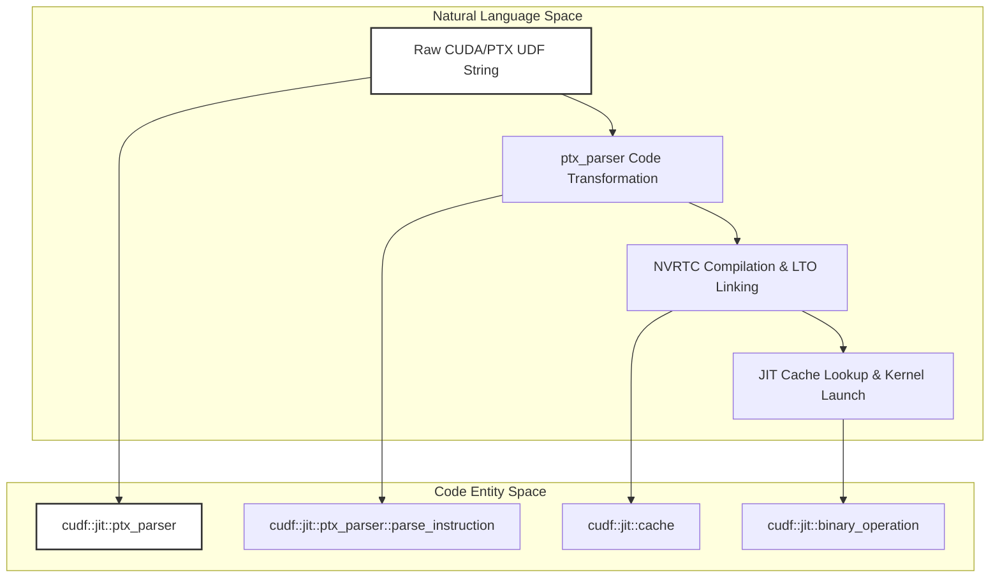

<!-- source: DeepWiki mcp.deepwiki.com · repo NVIDIA/cudf · page 2.5 Element-wise Operations, AST and JIT · fetched 2026-10-26 -->

# Element-wise Operations, Assets and JIT

Relevant source files

The following files were used as context for generating this wiki page:

- [.clang-format](.clang-format)
- [CHANGELOG.md](CHANGELOG.md)
- [cpp/CMakeLists.txt](cpp/CMakeLists.txt)
- [cpp/benchmarks/CMakeLists.txt](cpp/benchmarks/CMakeLists.txt)
- [cpp/benchmarks/fixture/nvbench_fixture.hpp](cpp/benchmarks/fixture/nvbench_fixture.hpp)
- [cpp/benchmarks/fixture/nvbench_main.cpp](cpp/benchmarks/fixture/nvbench_main.cpp)
- [cpp/benchmarks/join/join_common.hpp](cpp/benchmarks/join/join_common.hpp)
- [cpp/cmake/Modules/AddFragment.cmake](cpp/cmake/Modules/AddFragment.cmake)
- [cpp/include/cudf/ast/detail/expression_evaluator.cuh](cpp/include/cudf/ast/detail/expression_evaluator.cuh)
- [cpp/include/cudf/ast/detail/expression_parser.hpp](cpp/include/cudf/ast/detail/expression_parser.hpp)
- [cpp/include/cudf/ast/detail/operator_functor.cuh](cpp/include/cudf/ast/detail/operator_functor.cuh)
- [cpp/include/cudf/ast/detail/operators.hpp](cpp/include/cudf/ast/detail/operators.hpp)
- [cpp/include/cudf/ast/expressions.hpp](cpp/include/cudf/ast/expressions.hpp)
- [cpp/include/cudf/binaryop.hpp](cpp/include/cudf/binaryop.hpp)
- [cpp/include/cudf/context.hpp](cpp/include/cudf/context.hpp)
- [cpp/include/cudf/datetime.hpp](cpp/include/cudf/datetime.hpp)
- [cpp/include/cudf/detail/aggregation/result_cache.hpp](cpp/include/cudf/detail/aggregation/result_cache.hpp)
- [cpp/include/cudf/detail/binaryop.hpp](cpp/include/cudf/detail/binaryop.hpp)
- [cpp/include/cudf/detail/datetime.hpp](cpp/include/cudf/detail/datetime.hpp)
- [cpp/include/cudf/detail/timezone.hpp](cpp/include/cudf/detail/timezone.hpp)
- [cpp/include/cudf/detail/transform.hpp](cpp/include/cudf/detail/transform.hpp)
- [cpp/include/cudf/detail/unary.hpp](cpp/include/cudf/detail/unary.hpp)
- [cpp/include/cudf/transform.hpp](cpp/include/cudf/transform.hpp)
- [cpp/include/cudf/unary.hpp](cpp/include/cudf/unary.hpp)
- [cpp/include/cudf/utilities/bit.hpp](cpp/include/cudf/utilities/bit.hpp)
- [cpp/include/cudf/utilities/error.hpp](cpp/include/cudf/utilities/error.hpp)
- [cpp/include/cudf/utilities/export.hpp](cpp/include/cudf/utilities/export.hpp)
- [cpp/include/cudf_test/default_stream.hpp](cpp/include/cudf_test/default_stream.hpp)
- [cpp/include/cudf_test/stream_checking_resource_adaptor.hpp](cpp/include/cudf_test/stream_checking_resource_adaptor.hpp)
- [cpp/include/cudf_test/testing_main.hpp](cpp/include/cudf_test/testing_main.hpp)
- [cpp/libcudf_streaming/benchmarks/streaming/ndsh/bench_read.cpp](cpp/libcudf_streaming/benchmarks/streaming/ndsh/bench_read.cpp)
- [cpp/libcudf_streaming/benchmarks/streaming/ndsh/q01.cpp](cpp/libcudf_streaming/benchmarks/streaming/ndsh/q01.cpp)
- [cpp/libcudf_streaming/benchmarks/streaming/ndsh/q03.cpp](cpp/libcudf_streaming/benchmarks/streaming/ndsh/q03.cpp)
- [cpp/libcudf_streaming/benchmarks/streaming/ndsh/q04.cpp](cpp/libcudf_streaming/benchmarks/streaming/ndsh/q04.cpp)
- [cpp/libcudf_streaming/benchmarks/streaming/ndsh/q09.cpp](cpp/libcudf_streaming/benchmarks/streaming/ndsh/q09.cpp)
- [cpp/libcudf_streaming/benchmarks/streaming/ndsh/q21.cpp](cpp/libcudf_streaming/benchmarks/streaming/ndsh/q21.cpp)
- [cpp/scripts/gtest_memory_usage.sh](cpp/scripts/gtest_memory_usage.sh)
- [cpp/src/aggregation/result_cache.cpp](cpp/src/aggregation/result_cache.cpp)
- [cpp/src/ast/expression_parser.cpp](cpp/src/ast/expression_parser.cpp)
- [cpp/src/ast/expressions.cpp](cpp/src/ast/expressions.cpp)
- [cpp/src/ast/jit/expressions.cpp](cpp/src/ast/jit/expressions.cpp)
- [cpp/src/ast/jit/expressions.hpp](cpp/src/ast/jit/expressions.hpp)
- [cpp/src/ast/operators.cpp](cpp/src/ast/operators.cpp)
- [cpp/src/binaryop/binaryop.cpp](cpp/src/binaryop/binaryop.cpp)
- [cpp/src/binaryop/compiled/NullEquals.cu](cpp/src/binaryop/compiled/NullEquals.cu)
- [cpp/src/binaryop/compiled/binary_ops.cu](cpp/src/binaryop/compiled/binary_ops.cu)
- [cpp/src/binaryop/compiled/binary_ops.cuh](cpp/src/binaryop/compiled/binary_ops.cuh)
- [cpp/src/binaryop/compiled/binary_ops.hpp](cpp/src/binaryop/compiled/binary_ops.hpp)
- [cpp/src/binaryop/compiled/equality_ops.cu](cpp/src/binaryop/compiled/equality_ops.cu)
- [cpp/src/binaryop/compiled/operation.cuh](cpp/src/binaryop/compiled/operation.cuh)
- [cpp/src/binaryop/compiled/util.cpp](cpp/src/binaryop/compiled/util.cpp)
- [cpp/src/datetime/datetime_ops.cu](cpp/src/datetime/datetime_ops.cu)
- [cpp/src/filling/calendrical_month_sequence.cu](cpp/src/filling/calendrical_month_sequence.cu)
- [cpp/src/groupby/common/utils.hpp](cpp/src/groupby/common/utils.hpp)
- [cpp/src/jit/cache.cpp](cpp/src/jit/cache.cpp)
- [cpp/src/jit/cache.hpp](cpp/src/jit/cache.hpp)
- [cpp/src/jit/parser.cpp](cpp/src/jit/parser.cpp)
- [cpp/src/jit/parser.hpp](cpp/src/jit/parser.hpp)
- [cpp/src/runtime/context.cpp](cpp/src/runtime/context.cpp)
- [cpp/src/runtime/context.hpp](cpp/src/runtime/context.hpp)
- [cpp/src/transform/bools_to_mask.cu](cpp/src/transform/bools_to_mask.cu)
- [cpp/src/transform/compute_column.cu](cpp/src/transform/compute_column.cu)
- [cpp/src/transform/nans_to_nulls.cu](cpp/src/transform/nans_to_nulls.cu)
- [cpp/src/unary/cast_ops.cu](cpp/src/unary/cast_ops.cu)
- [cpp/src/unary/math_ops.cu](cpp/src/unary/math_ops.cu)
- [cpp/src/unary/nan_ops.cu](cpp/src/unary/nan_ops.cu)
- [cpp/src/unary/null_ops.cu](cpp/src/unary/null_ops.cu)
- [cpp/tests/CMakeLists.txt](cpp/tests/CMakeLists.txt)
- [cpp/tests/ast/transform_tests.cpp](cpp/tests/ast/transform_tests.cpp)
- [cpp/tests/binaryop/assert-binops.h](cpp/tests/binaryop/assert-binops.h)
- [cpp/tests/binaryop/binop-compiled-fixed_point-test.cpp](cpp/tests/binaryop/binop-compiled-fixed_point-test.cpp)
- [cpp/tests/binaryop/binop-compiled-test.cpp](cpp/tests/binaryop/binop-compiled-test.cpp)
- [cpp/tests/binaryop/binop-fixture.hpp](cpp/tests/binaryop/binop-fixture.hpp)
- [cpp/tests/binaryop/binop-generic-ptx-test.cpp](cpp/tests/binaryop/binop-generic-ptx-test.cpp)
- [cpp/tests/binaryop/binop-null-test.cpp](cpp/tests/binaryop/binop-null-test.cpp)
- [cpp/tests/binaryop/binop-verify-input-test.cpp](cpp/tests/binaryop/binop-verify-input-test.cpp)
- [cpp/tests/binaryop/util/operation.h](cpp/tests/binaryop/util/operation.h)
- [cpp/tests/datetime/datetime_ops_test.cpp](cpp/tests/datetime/datetime_ops_test.cpp)
- [cpp/tests/jit/parse_ptx_function.cpp](cpp/tests/jit/parse_ptx_function.cpp)
- [cpp/tests/large_strings/case_tests.cpp](cpp/tests/large_strings/case_tests.cpp)
- [cpp/tests/large_strings/concatenate_tests.cpp](cpp/tests/large_strings/concatenate_tests.cpp)
- [cpp/tests/large_strings/large_strings_fixture.cpp](cpp/tests/large_strings/large_strings_fixture.cpp)
- [cpp/tests/large_strings/large_strings_fixture.hpp](cpp/tests/large_strings/large_strings_fixture.hpp)
- [cpp/tests/large_strings/merge_tests.cpp](cpp/tests/large_strings/merge_tests.cpp)
- [cpp/tests/streams/concatenate_test.cpp](cpp/tests/streams/concatenate_test.cpp)
- [cpp/tests/streams/datetime_test.cpp](cpp/tests/streams/datetime_test.cpp)
- [cpp/tests/streams/filling_test.cpp](cpp/tests/streams/filling_test.cpp)
- [cpp/tests/transform/nans_to_null_test.cpp](cpp/tests/transform/nans_to_null_test.cpp)
- [cpp/tests/unary/cast_tests.cpp](cpp/tests/unary/cast_tests.cpp)
- [cpp/tests/unary/math_ops_test.cpp](cpp/tests/unary/math_ops_test.cpp)
- [cpp/tests/unary/unary_ops_test.cpp](cpp/tests/unary/unary_ops_test.cpp)
- [cpp/tests/utilities/default_stream.cpp](cpp/tests/utilities/default_stream.cpp)
- [cpp/tests/utilities_tests/context_tests.cpp](cpp/tests/utilities_tests/context_tests.cpp)
- [python/pylibcudf/pylibcudf/datetime.pxd](python/pylibcudf/pylibcudf/datetime.pxd)
- [python/pylibcudf/pylibcudf/datetime.pyi](python/pylibcudf/pylibcudf/datetime.pyi)
- [python/pylibcudf/pylibcudf/datetime.pyx](python/pylibcudf/pylibcudf/datetime.pyx)
- [python/pylibcudf/pylibcudf/groupby.pyi](python/pylibcudf/pylibcudf/groupby.pyi)
- [python/pylibcudf/pylibcudf/libcudf/datetime.pxd](python/pylibcudf/pylibcudf/libcudf/datetime.pxd)

This page covers section 2.5 of the libcudf architecture, detailing how element-wise operations (binary and unary operations, datetime operations, and `cudf::transform`), abstract syntax tree (AST) expression evaluation, and the Just-In-Time (JIT) compilation engine, cache, parser, and LTO (Link-Time Optimization) fragments are implemented.

---

## 1. Binary and Unary Operations

Element-wise operations in libcudf apply a function to every element of one or two columns. They are split into compiled paths (pre-compiled template instantiations) and JIT-backed paths for custom user-defined expressions or dynamic types.

### Binary Operations (`cudf::binary_operator`)
Binary operations are declared in `cpp/include/cudf/binaryop.hpp` and implemented under `cpp/src/binaryop/`. They cover arithmetic, logical, and comparison operations between two columns, a column and a scalar, or a scalar and a column.
* **Supported Operators:** `ADD`, `SUB`, `MUL`, `DIV`, `MOD`, `PMOD`, `PYMOD`, comparison operators (`EQUAL`, `LESS`, etc.), and null-aware variants (`NULL_EQUALS`, `NULL_MIN`, `NULL_MAX`, etc.) [cpp/src/binaryop/binaryop.cpp:91-132]().
* **Checked Arithmetic:** Operations like `ADD_OVERFLOW` perform checked arithmetic, supporting `error_policy::PROPAGATE` or `error_policy::NULLIFY` [cpp/src/unary/math_ops.cu:25]().
* **Fixed Point Support:** Operations on fixed-point decimals (`decimal32`, `decimal64`, `decimal128`) handle custom scales and rounding rules [cpp/src/binaryop/binaryop.cpp:57-59].

### Unary Operations (`cudf::unary_operator`)
Unary operations are declared in `cpp/include/cudf/unary.hpp` and implemented in `cpp/src/unary/` (e.g., `cast_ops.cu`, `math_ops.cu`, `null_ops.cu`, `nan_ops.cu`).
* **Math & Trigonometry:** Includes `SIN`, `COS`, `TAN`, `EXP`, `LOG`, `SQRT`, `CBRT`, `CEIL`, `FLOOR`, `ABS`, `RINT` [cpp/include/cudf/unary.hpp:33-52]().
* **Bitwise & Logical:** Includes `BIT_COUNT`, `BIT_INVERT`, `NOT`, `NEGATE` [cpp/include/cudf/unary.hpp:53-56]().
* **Casts:** `cudf::cast` performs fixed-width type conversions, backed by `device_cast` and `unary_cast` functors [cpp/src/unary/cast_ops.cu:33-146]().

*Sources: `cpp/include/cudf/binaryop.hpp`, `cpp/include/cudf/unary.hpp`, `cpp/src/binaryop/binaryop.cpp`, `cpp/src/unary/cast_ops.cu`*

---

## 2. Datetime Operations

Datetime operations (`cpp/include/cudf/datetime.hpp` and `cpp/src/datetime/datetime_ops.cu`) provide calendar and component extraction routines for timestamp columns [cpp/include/cudf/datetime.hpp:18]().
* **Component Extraction:** `extract_datetime_component` extracts fields like `YEAR`, `MONTH`, `DAY`, `WEEKDAY`, `HOUR`, `MINUTE`, `SECOND`, `MILLISECOND`, `MICROSECOND`, `NANOSECOND` into an `int16_t` column using chrono-based floor/duration logic [cpp/src/datetime/datetime_ops.cu:42-90]().
* **Calendrical Computations:** Includes `last_day_of_month`, `day_of_year`, and `add_calendrical_months` which properly handles leap years and month boundary clamping [cpp/include/cudf/datetime.hpp:80-132]().

*Sources: `cpp/include/cudf/datetime.hpp`, `cpp/src/datetime/datetime_ops.cu`*

---

## 3. `cudf::transform` and Expression Evaluation

Row-level transformations and user-defined expressions are managed via `cudf::transform` and `transform_program` (`cpp/include/cudf/transform.hpp`) [cpp/include/cudf/transform.hpp:25]().
* **`transform_program`:** A reusable construct that compiles a custom PTX or CUDA source UDF once against provided input/output specifications (`transform_input_spec`, `transform_output_spec`) and runs it iteratively across multiple calls without recompiling [cpp/include/cudf/transform.hpp:92-157]().
* **Null Awareness:** Supports `null_aware::YES` or `NO`, passing row inputs as optional values to user code [cpp/include/cudf/transform.hpp:78]().

---

## 4. AST Expression Evaluation

The Abstract Syntax Tree (AST) framework (`cpp/include/cudf/ast/expressions.hpp`) allows complex expressions to be built in-memory and evaluated directly on tables without generating source code strings or invoking NVRTC.
* **Expression Nodes:** Includes column references, scalar literals, unary operations, binary operations, and conditional expressions (e.g., `case` statements).
* **Evaluator:** `expression_evaluator` (`cpp/include/cudf/ast/detail/expression_evaluator.cuh`) generates optimized CUDA device code/kernels via template metaprogramming to traverse the AST tree per row.

---

## 5. JIT Cache, Parser and LTO Fragments

When runtime compilation is required (e.g., for custom string/binary UDFs or dynamic expressions), libcudf uses a built-in JIT compilation engine.
* **Parser:** `ptx_parser` (`cpp/src/jit/parser.cpp`) inspects, parses, and rewrites PTX instructions, removing comments and handling register width constraints (`ld.param` conversions, register type constraints) [cpp/src/jit/parser.cpp:26-190]().
* **Cache:** The JIT cache (`cpp/src/jit/cache.cpp`) caches compiled kernels to avoid redundant compilation overhead across invocations.
* **LTO Fragments:** CMake modules (`cpp/cmake/Modules/AddFragment.cmake`) and helper utilities manage Link-Time Optimization (LTO) object fragments for runtime linking.

*Sources: `cpp/src/jit/parser.cpp`, `cpp/src/jit/cache.cpp`, `cpp/src/binaryop/binaryop.cpp`*

---

## Summary Table of Subcomponents

| Component | Key Headers | Key Source Files | Core Responsibility |
| :--- | :--- | :--- | :--- |
| **Binary Ops** | `cudf/binaryop.hpp` [()] | `cpp/src/binaryop/binaryop.cpp` [()] | Element-wise binary operations, fixed-point & checked arithmetic |
| **Unary Ops** | `cudf/unary.hpp` [()] | `cpp/src/unary/cast_ops.cu` [()] | Casts, math, trigonometric, and bitwise unary operations |
| **Datetime** | `cudf/datetime.hpp` [()] | `cpp/src/datetime/datetime_ops.cu` [()] | Timestamp component extraction and calendrical arithmetic |
| **Transform** | `cudf/transform.hpp` [()] | `cpp/src/transform/compute_column.cu` [()] | Reusable JIT transform programs and UDF application |
| **AST** | `cudf/ast/expressions.hpp` [()] | `cpp/include/cudf/ast/detail/expression_evaluator.cuh` [()] | In-memory expression tree evaluation |
| **JIT & Parser** | `cpp/src/jit/parser.hpp` | `cpp/src/jit/parser.cpp` [()] | PTX parsing, register mapping, and runtime compilation caching |

Sources: `cpp/include/cudf/binaryop.hpp`, `cpp/include/cudf/unary.hpp`, `cpp/include/cudf/datetime.hpp`, `cpp/include/cudf/transform.hpp`, `cpp/src/jit/parser.cpp`

---

