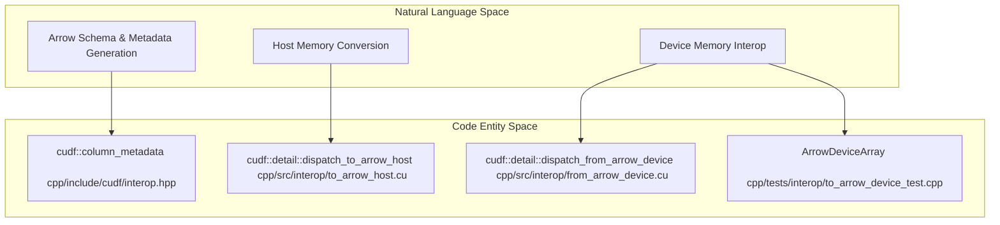
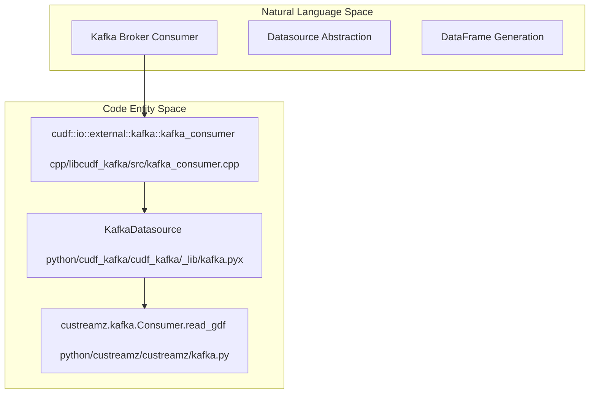

<!-- source: DeepWiki mcp.deepwiki.com · repo NVIDIA/cudf · page 2.6 Arrow Interop and Streaming Extensions · fetched 2026-10-26 -->

# Arrow Interop and Streaming Extensions

<details>
<summary>Relevant source files</summary>

The following files were used as context for generating this wiki page:

- [.clang-format](.clang-format)
- [cpp/benchmarks/fixture/nvbench_fixture.hpp](cpp/benchmarks/fixture/nvbench_fixture.hpp)
- [cpp/benchmarks/fixture/nvbench_main.cpp](cpp/benchmarks/fixture/nvbench_main.cpp)
- [cpp/cmake/Modules/AddFragment.cmake](cpp/cmake/Modules/AddFragment.cmake)
- [cpp/include/cudf/context.hpp](cpp/include/cudf/context.hpp)
- [cpp/include/cudf/detail/interop.hpp](cpp/include/cudf/detail/interop.hpp)
- [cpp/include/cudf/detail/utilities/buffer_factories.hpp](cpp/include/cudf/detail/utilities/buffer_factories.hpp)
- [cpp/include/cudf/interop.hpp](cpp/include/cudf/interop.hpp)
- [cpp/include/cudf/utilities/export.hpp](cpp/include/cudf/utilities/export.hpp)
- [cpp/include/cudf_test/default_stream.hpp](cpp/include/cudf_test/default_stream.hpp)
- [cpp/include/cudf_test/nanoarrow_utils.hpp](cpp/include/cudf_test/nanoarrow_utils.hpp)
- [cpp/include/cudf_test/stream_checking_resource_adaptor.hpp](cpp/include/cudf_test/stream_checking_resource_adaptor.hpp)
- [cpp/include/cudf_test/testing_main.hpp](cpp/include/cudf_test/testing_main.hpp)
- [cpp/libcudf_kafka/include/cudf_kafka/kafka_callback.hpp](cpp/libcudf_kafka/include/cudf_kafka/kafka_callback.hpp)
- [cpp/libcudf_kafka/include/cudf_kafka/kafka_consumer.hpp](cpp/libcudf_kafka/include/cudf_kafka/kafka_consumer.hpp)
- [cpp/libcudf_kafka/src/kafka_consumer.cpp](cpp/libcudf_kafka/src/kafka_consumer.cpp)
- [cpp/libcudf_streaming/benchmarks/streaming/ndsh/bench_read.cpp](cpp/libcudf_streaming/benchmarks/streaming/ndsh/bench_read.cpp)
- [cpp/libcudf_streaming/benchmarks/streaming/ndsh/q01.cpp](cpp/libcudf_streaming/benchmarks/streaming/ndsh/q01.cpp)
- [cpp/libcudf_streaming/benchmarks/streaming/ndsh/q03.cpp](cpp/libcudf_streaming/benchmarks/streaming/ndsh/q03.cpp)
- [cpp/libcudf_streaming/benchmarks/streaming/ndsh/q04.cpp](cpp/libcudf_streaming/benchmarks/streaming/ndsh/q04.cpp)
- [cpp/libcudf_streaming/benchmarks/streaming/ndsh/q09.cpp](cpp/libcudf_streaming/benchmarks/streaming/ndsh/q09.cpp)
- [cpp/libcudf_streaming/benchmarks/streaming/ndsh/q21.cpp](cpp/libcudf_streaming/benchmarks/streaming/ndsh/q21.cpp)
- [cpp/src/interop/arrow_data_structures.cpp](cpp/src/interop/arrow_data_structures.cpp)
- [cpp/src/interop/arrow_utilities.cpp](cpp/src/interop/arrow_utilities.cpp)
- [cpp/src/interop/arrow_utilities.hpp](cpp/src/interop/arrow_utilities.hpp)
- [cpp/src/interop/from_arrow_device.cu](cpp/src/interop/from_arrow_device.cu)
- [cpp/src/interop/from_arrow_host.cu](cpp/src/interop/from_arrow_host.cu)
- [cpp/src/interop/from_arrow_host.hpp](cpp/src/interop/from_arrow_host.hpp)
- [cpp/src/interop/from_arrow_host_strings.cu](cpp/src/interop/from_arrow_host_strings.cu)
- [cpp/src/interop/from_arrow_stream.cu](cpp/src/interop/from_arrow_stream.cu)
- [cpp/src/interop/to_arrow_device.cu](cpp/src/interop/to_arrow_device.cu)
- [cpp/src/interop/to_arrow_host.cu](cpp/src/interop/to_arrow_host.cu)
- [cpp/src/interop/to_arrow_schema.cpp](cpp/src/interop/to_arrow_schema.cpp)
- [cpp/src/jit/cache.cpp](cpp/src/jit/cache.cpp)
- [cpp/src/jit/cache.hpp](cpp/src/jit/cache.hpp)
- [cpp/src/runtime/context.cpp](cpp/src/runtime/context.cpp)
- [cpp/src/runtime/context.hpp](cpp/src/runtime/context.hpp)
- [cpp/tests/interop/arrow_data_structures_test.cpp](cpp/tests/interop/arrow_data_structures_test.cpp)
- [cpp/tests/interop/arrow_utils.hpp](cpp/tests/interop/arrow_utils.hpp)
- [cpp/tests/interop/from_arrow_device_test.cpp](cpp/tests/interop/from_arrow_device_test.cpp)
- [cpp/tests/interop/from_arrow_host_test.cpp](cpp/tests/interop/from_arrow_host_test.cpp)
- [cpp/tests/interop/from_arrow_stream_test.cpp](cpp/tests/interop/from_arrow_stream_test.cpp)
- [cpp/tests/interop/to_arrow_device_test.cpp](cpp/tests/interop/to_arrow_device_test.cpp)
- [cpp/tests/interop/to_arrow_host_test.cpp](cpp/tests/interop/to_arrow_host_test.cpp)
- [cpp/tests/large_strings/case_tests.cpp](cpp/tests/large_strings/case_tests.cpp)
- [cpp/tests/large_strings/concatenate_tests.cpp](cpp/tests/large_strings/concatenate_tests.cpp)
- [cpp/tests/large_strings/large_strings_fixture.cpp](cpp/tests/large_strings/large_strings_fixture.cpp)
- [cpp/tests/large_strings/large_strings_fixture.hpp](cpp/tests/large_strings/large_strings_fixture.hpp)
- [cpp/tests/large_strings/merge_tests.cpp](cpp/tests/large_strings/merge_tests.cpp)
- [cpp/tests/utilities/default_stream.cpp](cpp/tests/utilities/default_stream.cpp)
- [cpp/tests/utilities_tests/context_tests.cpp](cpp/tests/utilities_tests/context_tests.cpp)
- [python/cudf_kafka/cudf_kafka/_lib/kafka.pxd](python/cudf_kafka/cudf_kafka/_lib/kafka.pxd)
- [python/cudf_kafka/cudf_kafka/_lib/kafka.pyx](python/cudf_kafka/cudf_kafka/_lib/kafka.pyx)
- [python/custreamz/custreamz/__init__.py](python/custreamz/custreamz/__init__.py)
- [python/custreamz/custreamz/_version.py](python/custreamz/custreamz/_version.py)
- [python/custreamz/custreamz/kafka.py](python/custreamz/custreamz/kafka.py)

</details>


The purpose and scope of this page cover the technical implementation of Apache Arrow interoperability (host and device conversions, C data and device array interfaces), the `libcudf_streaming` execution framework, and the `libcudf_kafka` streaming connector integrated with `custreamz`.

---

## 1. Apache Arrow Interop and C Data Interface

`libcudf` provides robust bi-directional conversion between libcudf tables/columns and Apache Arrow memory layouts using the Apache Arrow C Data and C Device Interfaces. These routines rely heavily on the `nanoarrow` library as a lightweight dependency to avoid heavy C++ header inclusions while preserving full type, schema, and validity bitmap semantics [cpp/include/cudf/interop.hpp:33-45]().

### Key Data Structures and Metadata

Conversions utilize several core structures defined in `cudf/interop.hpp`:
* `column_metadata`: Captures column names, timezones, decimal precision, and nested children metadata required by Arrow schemas [cpp/include/cudf/interop.hpp:112-125]().
* `unique_schema_t`, `unique_device_array_t`: Smart pointers wrapping `ArrowSchema` and `ArrowDeviceArray` with custom deleters [cpp/include/cudf/interop.hpp:131-137]().
* `custom_view_deleter`: Maintains ownership of auxiliary allocations when zero-copy views are not possible (e.g., boolean unpacking or non-standard index layouts) [cpp/include/cudf/interop.hpp:149-170]().

### Host and Device Conversion Routines

The codebase implements separate translation units for host and device memory interop:
* `to_arrow_host()` / `from_arrow_host()`: Convert columns/tables between GPU device memory and CPU-hosted Arrow buffers, inserting Transparent Huge Pages (`MADV_HUGEPAGE`) for large allocations (>4MB) to accelerate device-to-host transfers [cpp/src/interop/to_arrow_host.cu:61-77]().
* `to_arrow_device()` / `from_arrow_device()`: Operate on `ArrowDeviceArray` structures, allowing zero-copy or minimal-overhead GPU-to-GPU Arrow interchange using CUDA streams and synchronization events [cpp/tests/interop/to_arrow_device_test.cpp:127-140]().

Diagram 1 bridges the natural language concepts of Arrow interop to specific code entities within the libcudf codebase:


Sources: [cpp/include/cudf/interop.hpp:112-125](), [cpp/src/interop/to_arrow_host.cu:79-135](), [cpp/src/interop/from_arrow_device.cu:51-81](), [cpp/tests/interop/to_arrow_device_test.cpp:127-140]()

---

## 2. Streaming Data Sources (`libcudf_kafka`)

`libcudf_kafka` provides a native C++ datasource implementation (`kafka_consumer`) that integrates `librdkafka` directly into libcudf's I/O framework [cpp/libcudf_kafka/include/cudf_kafka/kafka_consumer.hpp:25-30](). 

### The `kafka_consumer` Class

The `kafka_consumer` class inherits from `cudf::io::datasource` and exposes methods to read streaming records from Apache Kafka topics and partitions into host buffers, which are then parsed by libcudf readers (such as JSON, CSV, or Parquet readers) [cpp/libcudf_kafka/include/cudf_kafka/kafka_consumer.hpp:29-111]().

Key methods provided by `kafka_consumer`:
* `host_read(size_t offset, size_t size)`: Returns a non-owning buffer pointing to consumed records [cpp/libcudf_kafka/src/kafka_consumer.cpp:99-104]().
* `commit_offset(std::string const& topic, int partition, int64_t offset)`: Commits consumer offsets back to the Kafka broker [cpp/libcudf_kafka/include/cudf_kafka/kafka_consumer.hpp:122-122]().
* `get_watermark_offset(...)`: Retrieves low and high watermarks for a partition [cpp/libcudf_kafka/include/cudf_kafka/kafka_consumer.hpp:135-139]().

Diagram 2 illustrates the dataflow from Kafka brokers through the C++ datasource and into Python bindings:


Sources: [cpp/libcudf_kafka/src/kafka_consumer.cpp:17-97](), [python/cudf_kafka/cudf_kafka/_lib/kafka.pyx:26-70](), [python/custreamz/custreamz/kafka.py:65-178]()

---

## 3. Python and Cython Integration for Streaming

Python wrappers bridge `libcudf_kafka` into high-level streaming libraries like `custreamz` and `cudf`. 

### Cython Bindings (`kafka.pxd` and `kafka.pyx`)

The Cython declarations in `kafka.pxd` map the C++ `kafka_consumer` methods, while `KafkaDatasource` (inheriting from `pylibcudf.io.datasource.Datasource`) wraps the native pointer to expose it as a standard libcudf input source [python/cudf_kafka/cudf_kafka/_lib/kafka.pxd:56-66](), [python/cudf_kafka/cudf_kafka/_lib/kafka.pyx:26-70]().

```python
# Typical instantiation pattern in custreamz
kafka_datasource = KafkaDatasource(
    self.kafka_configs,
    topic.encode(),
    partition,
    start,
    end,
    batch_timeout,
    delimiter.encode(),
)
```
Sources: [python/custreamz/custreamz/kafka.py:137-145]()

---

## 4. `libcudf_streaming` and Benchmarks

The `libcudf_streaming` component provides primitives for pipelined, low-latency streaming analytics and query execution. It includes specialized benchmark suites (such as the NDSH query harness under `cpp/libcudf_streaming/benchmarks/streaming/ndsh/`) designed to evaluate incremental stream joins, filter-aggregation pipelines, and window operators over continuous GPU memory buffers.

Sources: [cpp/libcudf_streaming/benchmarks/streaming/ndsh/q01.cpp:1-1]()

---

