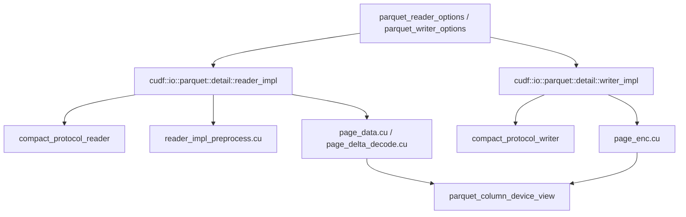
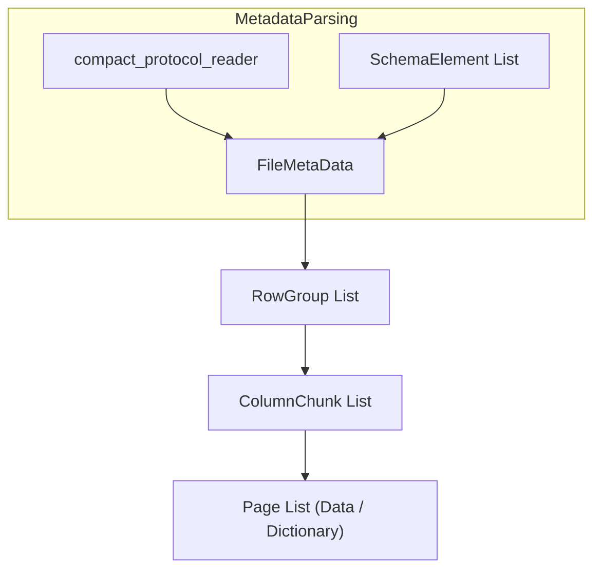
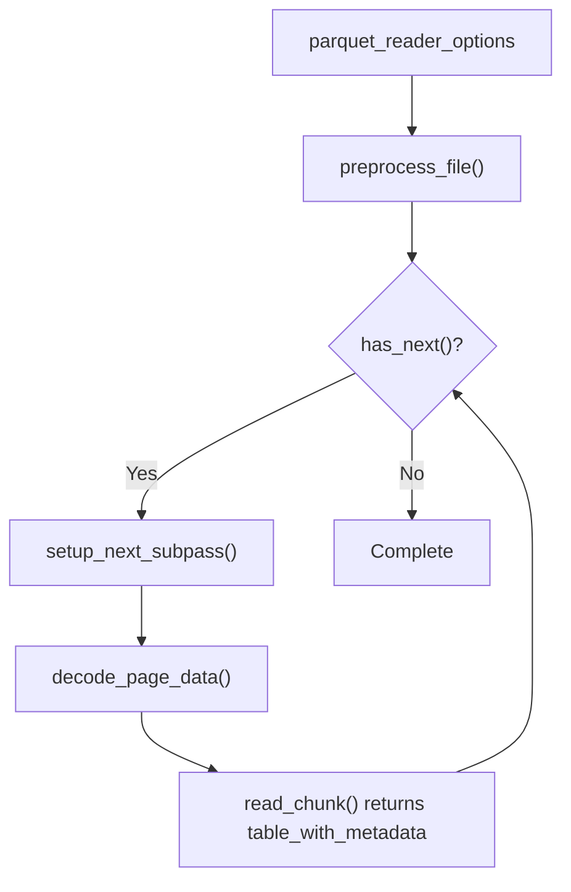
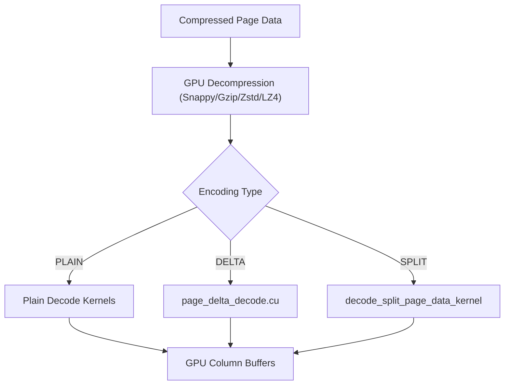
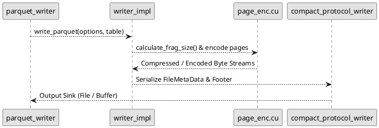

<!-- source: DeepWiki mcp.deepwiki.com · repo NVIDIA/cudf · page 3.1 Parquet Reader and Writer · fetched 2026-10-26 -->

# Parquet Reader and Writer

Relevant source files

The following files were used as context for generating this wiki page:

- [cpp/include/cudf/io/detail/parquet.hpp](cpp/include/cudf/io/detail/parquet.hpp)
- [cpp/include/cudf/io/parquet.hpp](cpp/include/cudf/io/parquet.hpp)
- [cpp/include/cudf/io/types.hpp](cpp/include/cudf/io/types.hpp)
- [cpp/src/io/functions.cpp](cpp/src/io/functions.cpp)
- [cpp/src/io/parquet/compact_protocol_reader.cpp](cpp/src/io/parquet/compact_protocol_reader.cpp)
- [cpp/src/io/parquet/compact_protocol_reader.hpp](cpp/src/io/parquet/compact_protocol_reader.hpp)
- [cpp/src/io/parquet/compact_protocol_writer.cpp](cpp/src/io/parquet/compact_protocol_writer.cpp)
- [cpp/src/io/parquet/compact_protocol_writer.hpp](cpp/src/io/parquet/compact_protocol_writer.hpp)
- [cpp/src/io/parquet/decode_fixed.cu](cpp/src/io/parquet/decode_fixed.cu)
- [cpp/src/io/parquet/decode_preprocess.cu](cpp/src/io/parquet/decode_preprocess.cu)
- [cpp/src/io/parquet/delta_binary.cuh](cpp/src/io/parquet/delta_binary.cuh)
- [cpp/src/io/parquet/experimental/hybrid_scan_chunking.cu](cpp/src/io/parquet/experimental/hybrid_scan_chunking.cu)
- [cpp/src/io/parquet/experimental/hybrid_scan_preprocess.cu](cpp/src/io/parquet/experimental/hybrid_scan_preprocess.cu)
- [cpp/src/io/parquet/experimental/parquet_footer.cpp](cpp/src/io/parquet/experimental/parquet_footer.cpp)
- [cpp/src/io/parquet/page_data.cu](cpp/src/io/parquet/page_data.cu)
- [cpp/src/io/parquet/page_data.cuh](cpp/src/io/parquet/page_data.cuh)
- [cpp/src/io/parquet/page_decode.cuh](cpp/src/io/parquet/page_decode.cuh)
- [cpp/src/io/parquet/page_delta_decode.cu](cpp/src/io/parquet/page_delta_decode.cu)
- [cpp/src/io/parquet/page_enc.cu](cpp/src/io/parquet/page_enc.cu)
- [cpp/src/io/parquet/page_hdr.cu](cpp/src/io/parquet/page_hdr.cu)
- [cpp/src/io/parquet/page_state_composed.cuh](cpp/src/io/parquet/page_state_composed.cuh)
- [cpp/src/io/parquet/page_string_decode.cu](cpp/src/io/parquet/page_string_decode.cu)
- [cpp/src/io/parquet/page_string_utils.cuh](cpp/src/io/parquet/page_string_utils.cuh)
- [cpp/src/io/parquet/parquet_common.hpp](cpp/src/io/parquet/parquet_common.hpp)
- [cpp/src/io/parquet/parquet_gpu.hpp](cpp/src/io/parquet/parquet_gpu.hpp)
- [cpp/src/io/parquet/reader_impl.cpp](cpp/src/io/parquet/reader_impl.cpp)
- [cpp/src/io/parquet/reader_impl.hpp](cpp/src/io/parquet/reader_impl.hpp)
- [cpp/src/io/parquet/reader_impl_chunking.cu](cpp/src/io/parquet/reader_impl_chunking.cu)
- [cpp/src/io/parquet/reader_impl_chunking.hpp](cpp/src/io/parquet/reader_impl_chunking.hpp)
- [cpp/src/io/parquet/reader_impl_chunking_utils.cu](cpp/src/io/parquet/reader_impl_chunking_utils.cu)
- [cpp/src/io/parquet/reader_impl_chunking_utils.cuh](cpp/src/io/parquet/reader_impl_chunking_utils.cuh)
- [cpp/src/io/parquet/reader_impl_preprocess.cu](cpp/src/io/parquet/reader_impl_preprocess.cu)
- [cpp/src/io/parquet/reader_impl_preprocess_utils.cu](cpp/src/io/parquet/reader_impl_preprocess_utils.cu)
- [cpp/src/io/parquet/reader_impl_preprocess_utils.cuh](cpp/src/io/parquet/reader_impl_preprocess_utils.cuh)
- [cpp/src/io/parquet/writer_impl.cu](cpp/src/io/parquet/writer_impl.cu)
- [cpp/src/io/parquet/writer_impl.hpp](cpp/src/io/parquet/writer_impl.hpp)
- [cpp/tests/io/parquet_chunked_reader_test.cu](cpp/tests/io/parquet_chunked_reader_test.cu)
- [cpp/tests/io/parquet_common.cpp](cpp/tests/io/parquet_common.cpp)
- [cpp/tests/io/parquet_common.hpp](cpp/tests/io/parquet_common.hpp)
- [cpp/tests/io/parquet_reader_test.cpp](cpp/tests/io/parquet_reader_test.cpp)
- [cpp/tests/io/parquet_test.cpp](cpp/tests/io/parquet_test.cpp)
- [cpp/tests/io/parquet_writer_test.cpp](cpp/tests/io/parquet_writer_test.cpp)

## Purpose and Scope

Section 3.1 covers the GPU-accelerated Apache Parquet reader and writer subsystems within `libcudf-IO`. The Parquet engine provides high-performance serialization and deserialization between columnar GPU memory (`column`, `table`) and Apache Parquet files or streams. This page outlines the fundamental file layout (row-group/page model), metadata parsing via the Thrift compact protocol, chunked reading mechanics, GPU decode/encode kernels, and the overall reader/writer architecture. 

For advanced filtering, statistics/bloom/dictionary pruning, the experimental `hybrid_scan` API, and Apache Variant extraction, see [Predicate Pushdown, Hybrid Scan and Variant](#3.1.1).

---

## 1. Parquet Architecture and Code Entity Mapping

The Parquet subsystem bridges high-level user options (`parquet_reader_options`, `parquet_writer_options`) with low-level CUDA kernels and Thrift metadata parsers.

*Sources: [`cpp/src/io/parquet/reader_impl.hpp:37-125`](), [`cpp/src/io/parquet/writer_impl.cu:82-195`](), [`cpp/src/io/parquet/parquet_gpu.hpp:100-172`]()*

---

## 2. Page and Row-Group Model & Metadata

Parquet files are organized hierarchically into files, row groups, column chunks, and pages. libcudf parses file footers and metadata using the Thrift compact protocol.

- **FileMetaData**: Contains global schema definitions (`SchemaElement`), row count, and a collection of `RowGroup` descriptors [cpp/src/io/parquet/writer_impl.cu:128-140]().
- **RowGroup**: Subdivides the dataset horizontally, containing metadata for each `ColumnChunk`.
- **ColumnChunk & Pages**: Each column chunk consists of data pages, dictionary pages, and optional index pages (offset/column index).
- **Thrift Compact Protocol**: Metadata headers are serialized/deserialized using `compact_protocol_reader` and `compact_protocol_writer` to interpret schema types, repetition/definition levels, and key-value metadata.

*Sources: [`cpp/src/io/parquet/writer_impl.cu:82-195`](), [`cpp/src/io/parquet/parquet_common.hpp:1-50`]()*

---

## 3. Chunked Reads and Execution Model

To support processing datasets larger than GPU memory, the Parquet reader implements a chunked reading model alongside all-at-once execution. 

- **Pass & Subpass Scheduling**: The reader schedules execution in *passes* (subsets of row groups) and *subpasses* (batches of pages decompressed and decoded together) [cpp/src/io/parquet/reader_impl.hpp:158-188]().
- **Iterative API**: `reader_impl::has_next()` and `reader_impl::read_chunk()` enable streaming execution constrained by `chunk_read_limit` and `pass_read_limit` [cpp/src/io/parquet/reader_impl.hpp:72-124]().

*Sources: [`cpp/src/io/parquet/reader_impl.hpp:116-189`](), [`cpp/src/io/parquet/reader_impl.cpp:41-90`]()*

---

## 4. GPU Decode Kernels and Encodings

The decoding pipeline maps compressed and encoded page streams directly into pre-allocated GPU column buffers.

- **Supported Encodings**: `PLAIN`, `PLAIN_DICTIONARY`, `RLE`, `RLE_DICTIONARY`, `DELTA_BINARY_PACKED`, `DELTA_LENGTH_BYTE_ARRAY`, `DELTA_BYTE_ARRAY`, and `BYTE_STREAM_SPLIT` [cpp/src/io/parquet/parquet_gpu.hpp:86-99]().
- **Decode Kernels**: Specialized CUDA kernels handle level decoding (repetition/definition levels, Dremel-style flattening) and data conversion. For instance, `decode_split_page_data_kernel` processes `BYTE_STREAM_SPLIT` layouts [cpp/src/io/parquet/page_data.cu:44-52](), while `delta_byte_array_decoder` handles incremental string decoding [cpp/src/io/parquet/page_delta_decode.cu:36-68]().

*Sources: [`cpp/src/io/parquet/page_data.cu:44-95`](), [`cpp/src/io/parquet/page_delta_decode.cu:36-68`](), [`cpp/src/io/parquet/parquet_gpu.hpp:86-99`]()*

---

## 5. Encoding and Writing Infrastructure

The Parquet writer serializes GPU `table_view` structures into compressed Parquet row groups and pages.

- **Writer Implementation**: Managed by `writer_impl` and helper structures (`aggregate_writer_metadata`) [cpp/src/io/parquet/writer_impl.cu:82-115]().
- **Page Fragmentation & Statistics**: `page_enc.cu` calculates fragment sizes, builds dictionaries, and computes column statistics (min/max/null counts) across column fragments [cpp/src/io/parquet/page_enc.cu:122-191]().
- **Compression**: Integrates with libcudf compression adapters (`compression_type::SNAPPY`, `GZIP`, `ZSTD`, `LZ4_RAW`) [cpp/src/io/parquet/writer_impl.cu:67-80]().

*Sources: [`cpp/src/io/parquet/writer_impl.cu:67-153`](), [`cpp/src/io/parquet/page_enc.cu:122-191`]()*

---

## 6. Advanced Features and Child Pages

For further details on specialized features implemented on top of the Parquet reader infrastructure, refer to the child page:

- [Predicate Pushdown, Hybrid Scan and Variant](#3.1.1): Covers statistics, bloom filter, dictionary, and page-index filtering, the experimental `hybrid_scan` API, and Apache Variant extraction.

---
Sources:
- [`cpp/src/io/parquet/writer_impl.cu`](../../cpp/src/io/parquet/writer_impl.cu)
- [`cpp/src/io/parquet/reader_impl.hpp`](../../cpp/src/io/parquet/reader_impl.hpp)
- [`cpp/src/io/parquet/parquet_gpu.hpp`](../../cpp/src/io/parquet/parquet_gpu.hpp)
- [`cpp/src/io/parquet/page_data.cu`](../../cpp/src/io/parquet/page_data.cu)
- [`cpp/src/io/parquet/page_delta_decode.cu`](../../cpp/src/io/parquet/page_delta_decode.cu)
- [`cpp/src/io/parquet/page_enc.cu`](../../cpp/src/io/parquet/page_enc.cu)
- [`cpp/src/io/parquet/reader_impl.cpp`](../../cpp/src/io/parquet/reader_impl.cpp)

---

