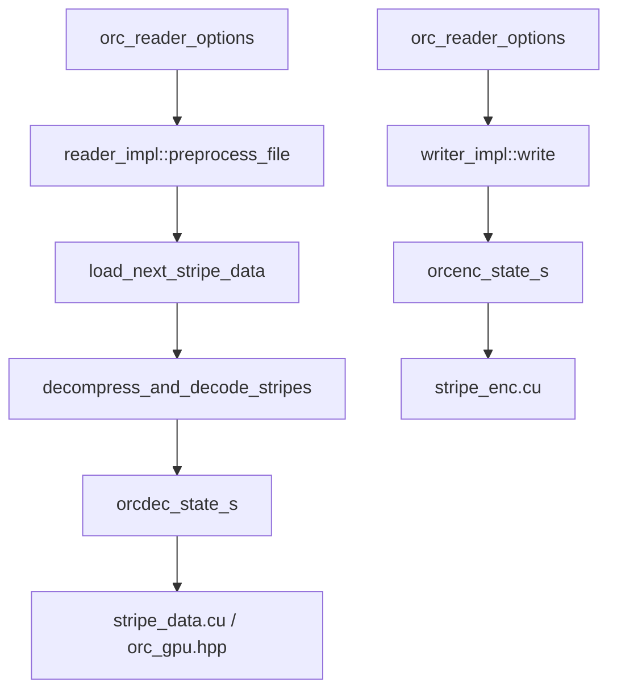
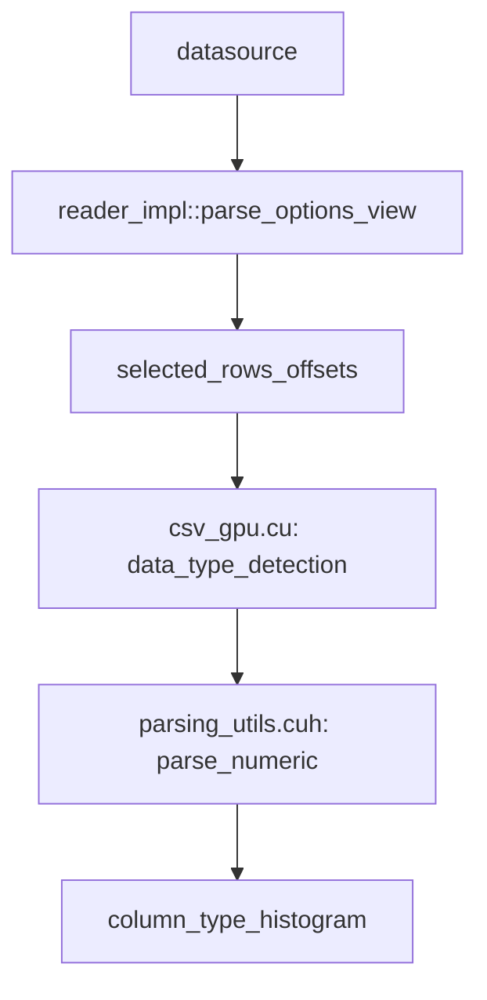

<!-- source: DeepWiki mcp.deepwiki.com · repo NVIDIA/cudf · page 3.2 ORC, Avro, CSV, JSON and Text · fetched 2026-10-26 -->

# ORC, Avro, CSV, JSON and Text

Relevant source files

The following files were used as context for generating this wiki page:

- [cpp/benchmarks/io/text/multibyte_split.cpp](cpp/benchmarks/io/text/multibyte_split.cpp)
- [cpp/include/cudf/io/avro.hpp](cpp/include/cudf/io/avro.hpp)
- [cpp/include/cudf/io/csv.hpp](cpp/include/cudf/io/csv.hpp)
- [cpp/include/cudf/io/detail/avro.hpp](cpp/include/cudf/io/detail/avro.hpp)
- [cpp/include/cudf/io/detail/json.hpp](cpp/include/cudf/io/detail/json.hpp)
- [cpp/include/cudf/io/detail/orc.hpp](cpp/include/cudf/io/detail/orc.hpp)
- [cpp/include/cudf/io/experimental/cudftable.hpp](cpp/include/cudf/io/experimental/cudftable.hpp)
- [cpp/include/cudf/io/json.hpp](cpp/include/cudf/io/json.hpp)
- [cpp/include/cudf/io/orc.hpp](cpp/include/cudf/io/orc.hpp)
- [cpp/include/cudf/io/text/byte_range_info.hpp](cpp/include/cudf/io/text/byte_range_info.hpp)
- [cpp/include/cudf/io/text/data_chunk_source.hpp](cpp/include/cudf/io/text/data_chunk_source.hpp)
- [cpp/include/cudf/io/text/data_chunk_source_factories.hpp](cpp/include/cudf/io/text/data_chunk_source_factories.hpp)
- [cpp/include/cudf/io/text/multibyte_split.hpp](cpp/include/cudf/io/text/multibyte_split.hpp)
- [cpp/include/cudf/packed_types.hpp](cpp/include/cudf/packed_types.hpp)
- [cpp/src/io/avro/avro.cpp](cpp/src/io/avro/avro.cpp)
- [cpp/src/io/avro/avro.hpp](cpp/src/io/avro/avro.hpp)
- [cpp/src/io/avro/avro_common.hpp](cpp/src/io/avro/avro_common.hpp)
- [cpp/src/io/avro/avro_gpu.cu](cpp/src/io/avro/avro_gpu.cu)
- [cpp/src/io/avro/avro_gpu.hpp](cpp/src/io/avro/avro_gpu.hpp)
- [cpp/src/io/avro/reader_impl.cu](cpp/src/io/avro/reader_impl.cu)
- [cpp/src/io/comp/debrotli.cu](cpp/src/io/comp/debrotli.cu)
- [cpp/src/io/comp/gpuinflate.cu](cpp/src/io/comp/gpuinflate.cu)
- [cpp/src/io/comp/snap.cu](cpp/src/io/comp/snap.cu)
- [cpp/src/io/comp/unsnap.cu](cpp/src/io/comp/unsnap.cu)
- [cpp/src/io/csv/csv_gpu.cu](cpp/src/io/csv/csv_gpu.cu)
- [cpp/src/io/csv/datetime.cuh](cpp/src/io/csv/datetime.cuh)
- [cpp/src/io/csv/reader_impl.cu](cpp/src/io/csv/reader_impl.cu)
- [cpp/src/io/csv/writer_impl.cu](cpp/src/io/csv/writer_impl.cu)
- [cpp/src/io/cudftable.cpp](cpp/src/io/cudftable.cpp)
- [cpp/src/io/json/host_tree_algorithms.cu](cpp/src/io/json/host_tree_algorithms.cu)
- [cpp/src/io/json/json_column.cu](cpp/src/io/json/json_column.cu)
- [cpp/src/io/json/json_tree.cu](cpp/src/io/json/json_tree.cu)
- [cpp/src/io/json/nested_json.hpp](cpp/src/io/json/nested_json.hpp)
- [cpp/src/io/json/nested_json_gpu.cu](cpp/src/io/json/nested_json_gpu.cu)
- [cpp/src/io/json/read_json.cu](cpp/src/io/json/read_json.cu)
- [cpp/src/io/json/read_json.hpp](cpp/src/io/json/read_json.hpp)
- [cpp/src/io/json/write_json.cu](cpp/src/io/json/write_json.cu)
- [cpp/src/io/orc/dict_enc.cu](cpp/src/io/orc/dict_enc.cu)
- [cpp/src/io/orc/orc.cpp](cpp/src/io/orc/orc.cpp)
- [cpp/src/io/orc/orc.hpp](cpp/src/io/orc/orc.hpp)
- [cpp/src/io/orc/orc_gpu.hpp](cpp/src/io/orc/orc_gpu.hpp)
- [cpp/src/io/orc/reader_impl.cu](cpp/src/io/orc/reader_impl.cu)
- [cpp/src/io/orc/reader_impl.hpp](cpp/src/io/orc/reader_impl.hpp)
- [cpp/src/io/orc/reader_impl_chunking.cu](cpp/src/io/orc/reader_impl_chunking.cu)
- [cpp/src/io/orc/reader_impl_chunking.hpp](cpp/src/io/orc/reader_impl_chunking.hpp)
- [cpp/src/io/orc/reader_impl_decode.cu](cpp/src/io/orc/reader_impl_decode.cu)
- [cpp/src/io/orc/stats_enc.cu](cpp/src/io/orc/stats_enc.cu)
- [cpp/src/io/orc/stripe_data.cu](cpp/src/io/orc/stripe_data.cu)
- [cpp/src/io/orc/stripe_enc.cu](cpp/src/io/orc/stripe_enc.cu)
- [cpp/src/io/orc/stripe_init.cu](cpp/src/io/orc/stripe_init.cu)
- [cpp/src/io/orc/writer_impl.cu](cpp/src/io/orc/writer_impl.cu)
- [cpp/src/io/orc/writer_impl.hpp](cpp/src/io/orc/writer_impl.hpp)
- [cpp/src/io/text/bgzip_data_chunk_source.cu](cpp/src/io/text/bgzip_data_chunk_source.cu)
- [cpp/src/io/text/byte_range_info.cpp](cpp/src/io/text/byte_range_info.cpp)
- [cpp/src/io/text/data_chunk_source_factories.cpp](cpp/src/io/text/data_chunk_source_factories.cpp)
- [cpp/src/io/text/multibyte_split.cu](cpp/src/io/text/multibyte_split.cu)
- [cpp/src/io/utilities/block_utils.cuh](cpp/src/io/utilities/block_utils.cuh)
- [cpp/src/io/utilities/output_builder.cuh](cpp/src/io/utilities/output_builder.cuh)
- [cpp/src/io/utilities/parsing_utils.cuh](cpp/src/io/utilities/parsing_utils.cuh)
- [cpp/tests/io/comp/comp_test.cpp](cpp/tests/io/comp/comp_test.cpp)
- [cpp/tests/io/csv_test.cpp](cpp/tests/io/csv_test.cpp)
- [cpp/tests/io/cudftable_test.cpp](cpp/tests/io/cudftable_test.cpp)
- [cpp/tests/io/json/json_test.cpp](cpp/tests/io/json/json_test.cpp)
- [cpp/tests/io/json/json_writer.cpp](cpp/tests/io/json/json_writer.cpp)
- [cpp/tests/io/orc_chunked_reader_test.cu](cpp/tests/io/orc_chunked_reader_test.cu)
- [cpp/tests/io/orc_test.cpp](cpp/tests/io/orc_test.cpp)
- [cpp/tests/io/text/data_chunk_source_test.cpp](cpp/tests/io/text/data_chunk_source_test.cpp)
- [cpp/tests/io/text/multibyte_split_test.cpp](cpp/tests/io/text/multibyte_split_test.cpp)
- [cpp/tests/streams/io/multibyte_split_test.cpp](cpp/tests/streams/io/multibyte_split_test.cpp)

This page details the implementation of GPU-accelerated file-format readers and writers within `libcudf-IO` for non-Parquet structured and semi-structured formats: Apache ORC, Apache Avro, CSV, nested JSON, and multibyte text splitting pipelines.

---

## 1. ORC Stripe and RLE Pipelines

The ORC reader and writer manage file segmentation into stripes and row groups, decoding or encoding columns using Run-Length Encoding versions 1 and 2 (`RLEv1`, `RLEv2`, and byte RLE). 

### Architecture and State Management
ORC decoding and encoding maintain state structures on the GPU. The reader uses `orcdec_state_s` [cpp/src/io/orc/stripe_data.cu:101-127]() alongside circular bytestream buffers (`orc_bytestream_s`), while the encoder uses `orcenc_state_s` [cpp/src/io/orc/stripe_enc.cu:68-102]().

*Sources: `cpp/src/io/orc/reader_impl.cu`, `cpp/src/io/orc/writer_impl.cu`, `cpp/src/io/orc/stripe_data.cu`, `cpp/src/io/orc/stripe_enc.cu`*

### Key Components & Data Structures
* `orc_column_view`: Extracts column metadata, precision, scale, and list-vs-map types [cpp/src/io/orc/writer_impl.cu:182-205]().
* `run_cache_manager`: Caches the first run of a `TIMESTAMP` column's `DATA` stream across row group boundaries [cpp/src/io/orc/stripe_data.cu:139-175]().
* `encoded_data`: Manages persistent, transient, and gathered device buffers for compressed stripe streams [cpp/src/io/orc/writer_impl.hpp:110-116]().

Sources: `cpp/src/io/orc/writer_impl.cu`, `cpp/src/io/orc/stripe_data.cu`, `cpp/src/io/orc/stripe_enc.cu`, `cpp/src/io/orc/writer_impl.hpp`

---

## 2. Avro Reader Implementation

The Avro file format reader parses container files containing blocks of serialized records using standard schema definitions. The implementation uses GPU-accelerated deserialization primitives to map Avro blocks into libcudf columns.

* `avro_gpu.cu` implements low-level block decoding and schema resolution.
* `avro.cpp` provides the public API entry points and metadata translation layers.

Sources: `cpp/src/io/avro/avro.cpp`, `cpp/src/io/avro/avro_gpu.cu`

---

## 3. CSV Reader and Writer

The CSV module implements parallel character scanning, line/row offset indexing, automatic data type detection, and stream-based serialization.

### Processing Pipeline

*Sources: `cpp/src/io/csv/reader_impl.cu`, `cpp/src/io/csv/csv_gpu.cu`, `cpp/src/io/utilities/parsing_utils.cuh`*

### Key Classes and Functions
* `selected_rows_offsets`: Manages a shrinkable device span of row offsets to avoid reallocation when discarding lines [cpp/src/io/csv/reader_impl.cu:82-107]().
* `data_type_detection`: CUDA kernel launched over records to build column type histograms [cpp/src/io/csv/csv_gpu.cu:162-168]().
* `parse_numeric`: Template helper parsing integers, floats, and infinities from ASCII/UTF-8 character ranges [cpp/src/io/utilities/parsing_utils.cuh:123-186]().
* `write_compressed_to_sink`: Compresses CSV data blocks using ZSTD chunks prior to writing [cpp/src/io/csv/writer_impl.cu:104-110]().

Sources: `cpp/src/io/csv/reader_impl.cu`, `cpp/src/io/csv/writer_impl.cu`, `cpp/src/io/csv/csv_gpu.cu`, `cpp/src/io/utilities/parsing_utils.cuh`

---

## 4. Nested JSON FST and Tree Algorithms

JSON parsing in libcudf handles arbitrarily nested objects and arrays using Finite State Transducers (FST) and tree-building algorithms.

### Algorithmic Phases
1. **Lexing & Tokenization:** Parallel GPU kernels scan input buffers to identify structural tokens (`{`, `}`, `[`, `]`, `:`, `,`) and literal boundaries.
2. **Tree Construction:** `json_tree.cu` and `host_tree_algorithms.cu` build parent-child hierarchy trees representing the nested JSON document.
3. **Column Projection:** `nested_json_gpu.cu` extracts scalar values and reconstructs list/struct columns based on user-specified schemas or inferred types.

Sources: `cpp/src/io/json/nested_json_gpu.cu`, `cpp/src/io/json/json_tree.cu`, `cpp/src/io/json/host_tree_algorithms.cu`, `cpp/src/io/json/nested_json.hpp`

---

## 5. Multibyte Split Text Source

The text splitting module provides utilities for splitting large text data sources into discrete chunks along multibyte delimiter boundaries.

* `multibyte_split.cu` implements GPU-accelerated split point discovery for UTF-8 and multibyte character sets, ensuring chunks do not break mid-character or split across invalid sequence boundaries.
* Associated unit tests and benchmark harnesses validate throughput and correctness under various delimiter configurations [cpp/tests/io/text/multibyte_split_test.cpp:1](), [cpp/benchmarks/io/text/multibyte_split.cpp:1]().

Sources: `cpp/src/io/text/multibyte_split.cu`, `cpp/tests/io/text/multibyte_split_test.cpp`, `cpp/benchmarks/io/text/multibyte_split.cpp`

---

