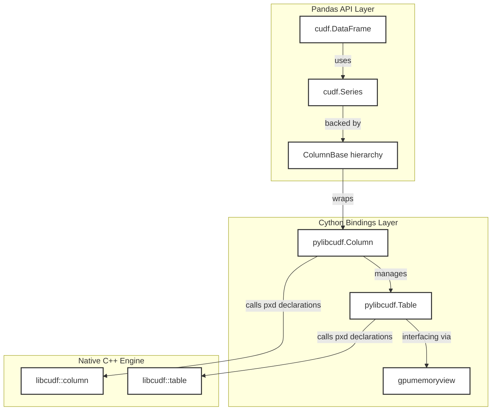
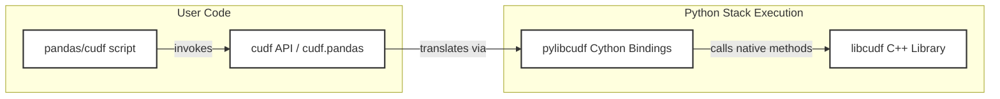

<!-- source: DeepWiki mcp.deepwiki.com · repo NVIDIA/cudf · page 4 Python: cudf and pylibcudf · fetched 2026-10-26 -->

# Python: cudf and pylibcudf

Relevant source files

The following files were used as context for generating this wiki page:

- [python/cudf/cudf/__init__.py](python/cudf/cudf/__init__.py)
- [python/cudf/cudf/core/__init__.py](python/cudf/cudf/core/__init__.py)
- [python/pylibcudf/pylibcudf/column.pxd](python/pylibcudf/pylibcudf/column.pxd)
- [python/pylibcudf/pylibcudf/column.pyi](python/pylibcudf/pylibcudf/column.pyi)
- [python/pylibcudf/pylibcudf/column.pyx](python/pylibcudf/pylibcudf/column.pyx)
- [python/pylibcudf/pylibcudf/column_factories.pxd](python/pylibcudf/pylibcudf/column_factories.pxd)
- [python/pylibcudf/pylibcudf/column_factories.pyi](python/pylibcudf/pylibcudf/column_factories.pyi)
- [python/pylibcudf/pylibcudf/column_factories.pyx](python/pylibcudf/pylibcudf/column_factories.pyx)
- [python/pylibcudf/pylibcudf/contiguous_split.pxd](python/pylibcudf/pylibcudf/contiguous_split.pxd)
- [python/pylibcudf/pylibcudf/contiguous_split.pyi](python/pylibcudf/pylibcudf/contiguous_split.pyi)
- [python/pylibcudf/pylibcudf/contiguous_split.pyx](python/pylibcudf/pylibcudf/contiguous_split.pyx)
- [python/pylibcudf/pylibcudf/gpumemoryview.pxd](python/pylibcudf/pylibcudf/gpumemoryview.pxd)
- [python/pylibcudf/pylibcudf/gpumemoryview.pyi](python/pylibcudf/pylibcudf/gpumemoryview.pyi)
- [python/pylibcudf/pylibcudf/gpumemoryview.pyx](python/pylibcudf/pylibcudf/gpumemoryview.pyx)
- [python/pylibcudf/pylibcudf/libcudf/column/column_factories.pxd](python/pylibcudf/pylibcudf/libcudf/column/column_factories.pxd)
- [python/pylibcudf/pylibcudf/libcudf/contiguous_split.pxd](python/pylibcudf/pylibcudf/libcudf/contiguous_split.pxd)
- [python/pylibcudf/pylibcudf/table.pxd](python/pylibcudf/pylibcudf/table.pxd)
- [python/pylibcudf/pylibcudf/table.pyx](python/pylibcudf/pylibcudf/table.pyx)
- [python/pylibcudf/tests/test_column_from_iterable.py](python/pylibcudf/tests/test_column_from_iterable.py)
- [python/pylibcudf/tests/test_gpumemoryview.py](python/pylibcudf/tests/test_gpumemoryview.py)

## Purpose and Scope

The Python layer of cuDF provides a high-performance GPU-accelerated data science ecosystem that mimics familiar Python data manipulation APIs while leveraging the underlying C++ / CUDA `libcudf` engine [python/cudf/cudf/__init__.py:1-153](). The Python stack is bifurcated into two main packages: `pylibcudf`, which provides low-overhead Cython bindings directly mirroring `libcudf` data structures and algorithms [python/pylibcudf/pylibcudf/column.pxd:43-106](), and `cudf`, which implements a pandas-compatible DataFrame API on top of `pylibcudf` [python/cudf/cudf/__init__.py:30-61]().

This page serves as a high-level overview of the cuDF Python architecture. For deep technical implementation details, refer to the individual child pages linked throughout.

*Sources: [python/cudf/cudf/__init__.py:30-61](), [python/pylibcudf/pylibcudf/column.pxd:43-106](), [python/pylibcudf/pylibcudf/table.pxd:12-42]()*

---

## 4.1. pylibcudf Bindings

`pylibcudf` acts as the thin, high-performance Cython wrapper layer over `libcudf`. It exposes direct interfaces to core structures like `Column`, `Table`, and `gpumemoryview` [python/pylibcudf/pylibcudf/column.pxd:43-106](), [python/pylibcudf/pylibcudf/table.pxd:12-42](), [python/pylibcudf/pylibcudf/gpumemoryview.pyx:83-126](). By compiling against `libcudf`'s `.pxd` declarations, `pylibcudf` enables Python applications to invoke GPU memory management, string operations, interop formats (such as Arrow C Data Interface), and contiguous chunking with minimal overhead.

For comprehensive details on memory management, pxd declarations, and layout structures, see [pylibcudf Bindings](#4.1).

*Sources: [python/pylibcudf/pylibcudf/column.pxd:43-106](), [python/pylibcudf/pylibcudf/table.pxd:12-42](), [python/pylibcudf/pylibcudf/gpumemoryview.pyx:83-126]()*, [python/pylibcudf/pylibcudf/contiguous_split.pxd:33-57]()

---

## 4.2. cudf Core Objects

The `cudf` package implements the pandas-like user-facing API, centered around objects such as `DataFrame`, `Series`, `Index`, and `MultiIndex` [python/cudf/cudf/__init__.py:30-61](). These high-level containers rely on underlying column abstraction hierarchies (`ColumnBase`, `ColumnAccessor`) and data types (`CategoricalDtype`, `ListDtype`, `StructDtype`, decimal types) [python/cudf/cudf/__init__.py:31-39](). 

This tier also encompasses advanced analytical operations (GroupBy, Joins, Windowing, Reshaping) [python/cudf/cudf/__init__.py:40-60](), memory management utilities like `Buffer` and spill managers, and Numba-based User-Defined Functions (UDFs).

For deeper exploration of container structures, accessors, spilling policies, and UDF lowering, see [cudf Core Objects](#4.2).

*Sources: [python/cudf/cudf/__init__.py:1-153]()*

---

## 4.3. cudf Python I/O

The `cudf.io` module provides high-throughput GPU-accelerated file readers and writers for formats including Parquet, CSV, ORC, JSON, Avro, and text [python/cudf/cudf/__init__.py:64-74](). It integrates with `fsspec` path abstractions and transparently translates high-level user filters into lower-level Abstract Syntax Tree (AST) expressions that `libcudf` evaluates directly during scanning.

For details on parsing pipelines, predicate pushdown, and format-specific configurations, see [cudf Python I/O](#4.3).

*Sources: [python/cudf/cudf/__init__.py:64-74]()*

---

## 4.4. cudf.pandas Accelerator

`cudf.pandas` provides zero-code-change pandas acceleration. By dynamically intercepting module imports and substituting pandas objects with GPU-accelerated equivalents via a module accelerator and fast-slow proxy mechanism, standard pandas scripts execute on the GPU where supported, falling back gracefully to CPU pandas for unsupported operations.

For architectural breakdowns of the proxy wrappers, profilers, and test plugins, see [cudf.pandas Accelerator](#4.4).

---

## 4.5. Python Test Suite

The cuDF Python test suite is organized around `pytest`, making extensive use of custom fixtures, parameterization, and integration test modules (`cudf_pandas_tests`). It validates correctness and performance across both the `cudf` API and `pylibcudf` wrappers.

For details on test organization, test suite execution, and benchmarking frameworks, see [Python Test Suite](#4.5).

---

*Sources: [python/cudf/cudf/__init__.py:1-153](), [python/pylibcudf/pylibcudf/column.pxd:43-106]()*

---

