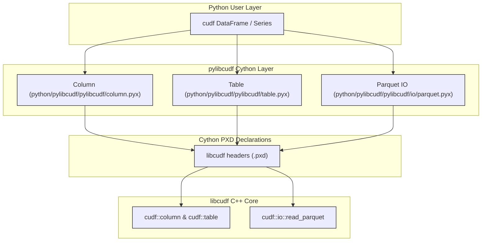
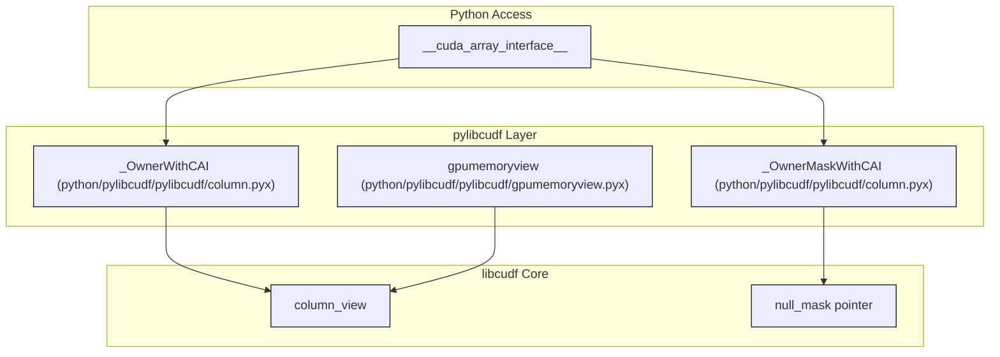

<!-- source: DeepWiki mcp.deepwiki.com · repo NVIDIA/cudf · page 4.1 pylibcudf Bindings · fetched 2026-10-26 -->

# pylibcudf Bindings

<details>
<summary>Relevant source files</summary>

The following files were used as context for generating this wiki page:

- [.github/workflows/wheels-build-stage.yaml](.github/workflows/wheels-build-stage.yaml)
- [cpp/include/cudf/io/parquet_metadata.hpp](cpp/include/cudf/io/parquet_metadata.hpp)
- [cpp/libcudf_kafka/tests/CMakeLists.txt](cpp/libcudf_kafka/tests/CMakeLists.txt)
- [python/cudf/CMakeLists.txt](python/cudf/CMakeLists.txt)
- [python/cudf/cudf/_lib/CMakeLists.txt](python/cudf/cudf/_lib/CMakeLists.txt)
- [python/cudf/cudf/_lib/__init__.py](python/cudf/cudf/_lib/__init__.py)
- [python/cudf_kafka/CMakeLists.txt](python/cudf_kafka/CMakeLists.txt)
- [python/cudf_streaming/CMakeLists.txt](python/cudf_streaming/CMakeLists.txt)
- [python/pylibcudf/CMakeLists.txt](python/pylibcudf/CMakeLists.txt)
- [python/pylibcudf/pylibcudf/column.pxd](python/pylibcudf/pylibcudf/column.pxd)
- [python/pylibcudf/pylibcudf/column.pyi](python/pylibcudf/pylibcudf/column.pyi)
- [python/pylibcudf/pylibcudf/column.pyx](python/pylibcudf/pylibcudf/column.pyx)
- [python/pylibcudf/pylibcudf/column_factories.pxd](python/pylibcudf/pylibcudf/column_factories.pxd)
- [python/pylibcudf/pylibcudf/column_factories.pyi](python/pylibcudf/pylibcudf/column_factories.pyi)
- [python/pylibcudf/pylibcudf/column_factories.pyx](python/pylibcudf/pylibcudf/column_factories.pyx)
- [python/pylibcudf/pylibcudf/contiguous_split.pxd](python/pylibcudf/pylibcudf/contiguous_split.pxd)
- [python/pylibcudf/pylibcudf/contiguous_split.pyi](python/pylibcudf/pylibcudf/contiguous_split.pyi)
- [python/pylibcudf/pylibcudf/contiguous_split.pyx](python/pylibcudf/pylibcudf/contiguous_split.pyx)
- [python/pylibcudf/pylibcudf/gpumemoryview.pxd](python/pylibcudf/pylibcudf/gpumemoryview.pxd)
- [python/pylibcudf/pylibcudf/gpumemoryview.pyi](python/pylibcudf/pylibcudf/gpumemoryview.pyi)
- [python/pylibcudf/pylibcudf/gpumemoryview.pyx](python/pylibcudf/pylibcudf/gpumemoryview.pyx)
- [python/pylibcudf/pylibcudf/io/avro.pxd](python/pylibcudf/pylibcudf/io/avro.pxd)
- [python/pylibcudf/pylibcudf/io/avro.pyi](python/pylibcudf/pylibcudf/io/avro.pyi)
- [python/pylibcudf/pylibcudf/io/avro.pyx](python/pylibcudf/pylibcudf/io/avro.pyx)
- [python/pylibcudf/pylibcudf/io/csv.pxd](python/pylibcudf/pylibcudf/io/csv.pxd)
- [python/pylibcudf/pylibcudf/io/csv.pyi](python/pylibcudf/pylibcudf/io/csv.pyi)
- [python/pylibcudf/pylibcudf/io/csv.pyx](python/pylibcudf/pylibcudf/io/csv.pyx)
- [python/pylibcudf/pylibcudf/io/json.pxd](python/pylibcudf/pylibcudf/io/json.pxd)
- [python/pylibcudf/pylibcudf/io/json.pyi](python/pylibcudf/pylibcudf/io/json.pyi)
- [python/pylibcudf/pylibcudf/io/json.pyx](python/pylibcudf/pylibcudf/io/json.pyx)
- [python/pylibcudf/pylibcudf/io/orc.pxd](python/pylibcudf/pylibcudf/io/orc.pxd)
- [python/pylibcudf/pylibcudf/io/orc.pyi](python/pylibcudf/pylibcudf/io/orc.pyi)
- [python/pylibcudf/pylibcudf/io/orc.pyx](python/pylibcudf/pylibcudf/io/orc.pyx)
- [python/pylibcudf/pylibcudf/io/parquet.pxd](python/pylibcudf/pylibcudf/io/parquet.pxd)
- [python/pylibcudf/pylibcudf/io/parquet.pyi](python/pylibcudf/pylibcudf/io/parquet.pyi)
- [python/pylibcudf/pylibcudf/io/parquet.pyx](python/pylibcudf/pylibcudf/io/parquet.pyx)
- [python/pylibcudf/pylibcudf/io/parquet_metadata.pxd](python/pylibcudf/pylibcudf/io/parquet_metadata.pxd)
- [python/pylibcudf/pylibcudf/io/parquet_metadata.pyi](python/pylibcudf/pylibcudf/io/parquet_metadata.pyi)
- [python/pylibcudf/pylibcudf/io/parquet_metadata.pyx](python/pylibcudf/pylibcudf/io/parquet_metadata.pyx)
- [python/pylibcudf/pylibcudf/json.pyx](python/pylibcudf/pylibcudf/json.pyx)
- [python/pylibcudf/pylibcudf/libcudf/column/column_factories.pxd](python/pylibcudf/pylibcudf/libcudf/column/column_factories.pxd)
- [python/pylibcudf/pylibcudf/libcudf/contiguous_split.pxd](python/pylibcudf/pylibcudf/libcudf/contiguous_split.pxd)
- [python/pylibcudf/pylibcudf/libcudf/io/CMakeLists.txt](python/pylibcudf/pylibcudf/libcudf/io/CMakeLists.txt)
- [python/pylibcudf/pylibcudf/libcudf/io/csv.pxd](python/pylibcudf/pylibcudf/libcudf/io/csv.pxd)
- [python/pylibcudf/pylibcudf/libcudf/io/json.pxd](python/pylibcudf/pylibcudf/libcudf/io/json.pxd)
- [python/pylibcudf/pylibcudf/libcudf/io/orc.pxd](python/pylibcudf/pylibcudf/libcudf/io/orc.pxd)
- [python/pylibcudf/pylibcudf/libcudf/io/orc_metadata.pxd](python/pylibcudf/pylibcudf/libcudf/io/orc_metadata.pxd)
- [python/pylibcudf/pylibcudf/libcudf/io/parquet.pxd](python/pylibcudf/pylibcudf/libcudf/io/parquet.pxd)
- [python/pylibcudf/pylibcudf/libcudf/io/parquet_metadata.pxd](python/pylibcudf/pylibcudf/libcudf/io/parquet_metadata.pxd)
- [python/pylibcudf/pylibcudf/libcudf/io/parquet_schema.pxd](python/pylibcudf/pylibcudf/libcudf/io/parquet_schema.pxd)
- [python/pylibcudf/pylibcudf/libcudf/io/parquet_schema.pyx](python/pylibcudf/pylibcudf/libcudf/io/parquet_schema.pyx)
- [python/pylibcudf/pylibcudf/table.pxd](python/pylibcudf/pylibcudf/table.pxd)
- [python/pylibcudf/pylibcudf/table.pyx](python/pylibcudf/pylibcudf/table.pyx)
- [python/pylibcudf/tests/io/test_parquet.py](python/pylibcudf/tests/io/test_parquet.py)
- [python/pylibcudf/tests/test_column_from_iterable.py](python/pylibcudf/tests/test_column_from_iterable.py)
- [python/pylibcudf/tests/test_gpumemoryview.py](python/pylibcudf/tests/test_gpumemoryview.py)

</details>


## Purpose and Scope

`pylibcudf` is a thin, high-performance Cython wrapper library that exposes `libcudf` C++ data structures, core algorithms, and input/output (I/O) facilities directly to Python. It serves as the foundational GPU-accelerated execution layer for higher-level APIs such as `cudf` (pandas-like interface) and `cudf-polars`. 

This page details the implementation of `pylibcudf` bindings, focusing on the layout of core data structures (`Column`, `Table`, `gpumemoryview`), the Cython `.pxd` declaration mapping strategy for `libcudf`, I/O option builder patterns, and the underlying CMake build architecture.

---

## 1. Build Layout and Cython Architecture

The Python stack builds Cython extensions using RAPIDS CMake integration macros (`rapids_cython_create_modules`), compiling C++ wrappers that link directly against `lib`cudf and RMM (RAPIDS Memory Manager) libraries.


*Sources: [python/cudf/CMakeLists.txt:1-33](), [python/pylibcudf/pylibcudf/column.pyx:1-85](), [python/pylibcudf/pylibcudf/io/parquet.pyx:1-74]()*

The build configuration is orchestrated via `python/cudf/CMakeLists.txt` and package-specific subdirectories like `python/pylibcudf/CMakeLists.txt`. Cython caching is integrated into CI build stages to accelerate iterative compilation [:.github/workflows/wheels-build-stage.yaml:104-112]().

---

## 2. Core Data Structures: Column, Table, and gpumemoryview

`pylibcudf` manages GPU memory by wrapping `libcudf` memory owners and views inside Python-managed classes.

### Column and Table Wrappers
* `Column`: Represents a single `cudf::column` containing a data buffer, an optional bitmask buffer for nullability, and child columns for nested types [python/pylibcudf/pylibcudf/column.pxd:43-56](). It provides methods like `view()`, `mutable_view()`, `to_pylist()`, and `copy()` [python/pylibcudf/pylibcudf/column.pxd:58-100]().
* `ListsColumnView` and `StructsColumnView`: Specialized views providing structured access to nested types [python/pylibcudf/pylibcudf/column.pxd:107-118]().

### gpumemoryview and Zero-Copy Interop
`gpumemoryview` exposes raw GPU device memory to Python without copying it to host memory. Interoperability with other GPU libraries (such as PyTorch, CuPy, and Numba) is achieved via the CUDA Array Interface (`__cuda_array_interface__`).


*Sources: [python/pylibcudf/pylibcudf/column.pyx:101-163](), [python/pylibcudf/pylibcudf/column.pxd:24-38]()*

The helper classes `_OwnerWithCAI` and `_OwnerMaskWithCAI` construct dictionary descriptors exposing shape, strides, data pointers, and type indicators (`typestr`) for zero-copy sharing [python/pylibcudf/pylibcudf/column.pyx:108-162]().

---

## 3. libcudf PXD Declarations

Cython `.pxd` files mirror `libcudf` C++ namespace structures and class headers. This allows `.pyx` files to declare `cdef extern from` blocks and invoke underlying C++ functions directly with zero overhead.

* **Type Declarations**: Mappings for `size_type`, `bitmask_type`, and `type_id` locate standard `libcudf` types [python/pylibcudf/pylibcudf/column.pxd:10-18]().
* **Memory Management Integration**: `DeviceMemoryResource` and `Stream` are imported directly from `rmm.pylibrmm` bindings to manage CUDA streams and memory pools on every invocation [python/pylibcudf/pylibcudf/io/parquet.pxd:9-11]().

---

## 4. I/O Bindings: Parquet, CSV, JSON, and ORC

The I/O package exposes readers and writers for popular columnar and tabular file formats. File readers utilize an options-builder pattern to configure execution parameters cleanly.

### Parquet Options Builder Data Flow
The Parquet reader and writer options use a builder pattern mirroring the `libcudf` C++ API (`cudf::io::parquet_reader_options::builder`).

```mermaid
graph TD
    subgraph UserSpace ["Python Call"]
        SI["SourceInfo (python/pylibcudf/pylibcudf/io/parquet.pyx)"]
    end
    subgraph BuilderSpace ["Options Builder"]
        PB["ParquetReaderOptionsBuilder"]
        PO["ParquetReaderOptions"]
    end
    subgraph ExecutionSpace ["libcudf Execution"]
        RP["cpp_read_parquet"]
        TWM["TableWithMetadata"]
    end

    SI --> PB
    PB -->|build()| PO
    PO --> RP
    RP --> TWM

    classDef default fill:#none,stroke:#000,stroke-width:1px;
```
*Sources: [python/pylibcudf/pylibcudf/io/parquet.pyx:78-143](), [python/pylibcudf/pylibcudf/io/parquet.pxd:43-84]()*

### Key I/O Classes and Functions
* `ParquetReaderOptions` / `ParquetReaderOptionsBuilder`: Configures columns, row groups, filtering expressions, and schema casting during Parquet decoding [python/pylibcudf/pylibcudf/io/parquet.pxd:43-84]().
* `ChunkedParquetReader`: Enables incremental chunk-by-chunk reading of massive Parquet datasets across streams and memory resources [python/pylibcudf/pylibcudf/io/parquet.pxd:86-95]().
* `read_parquet`: Top-level function taking `ParquetReaderOptions`, an optional `Stream`, and a `DeviceMemoryResource` to return a `TableWithMetadata` [python/pylibcudf/pylibcudf/io/parquet.pxd:97-102]().

---

