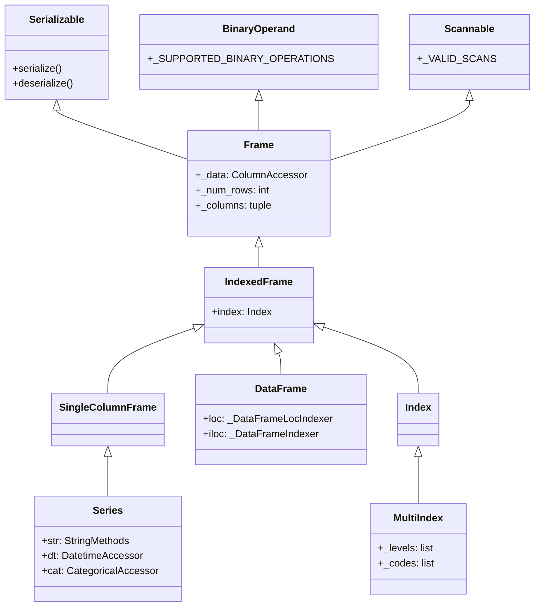
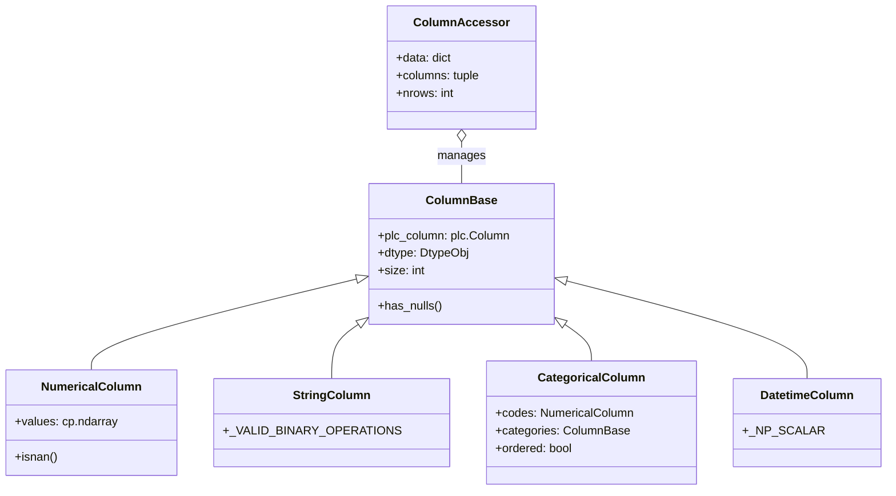

<!-- source: DeepWiki mcp.deepwiki.com · repo NVIDIA/cudf · page 4.2 cudf Core Objects · fetched 2026-10-26 -->

# cudf Core Objects

Relevant source files

The following files were used as context for generating this wiki page:

- [python/cudf/cudf/core/column/categorical.py](python/cudf/cudf/core/column/categorical.py)
- [python/cudf/cudf/core/column/column.py](python/cudf/cudf/core/column/column.py)
- [python/cudf/cudf/core/column/datetime.py](python/cudf/cudf/core/column/datetime.py)
- [python/cudf/cudf/core/column/decimal.py](python/cudf/cudf/core/column/decimal.py)
- [python/cudf/cudf/core/column/interval.py](python/cudf/cudf/core/column/interval.py)
- [python/cudf/cudf/core/column/lists.py](python/cudf/cudf/core/column/lists.py)
- [python/cudf/cudf/core/column/numerical.py](python/cudf/cudf/core/column/numerical.py)
- [python/cudf/cudf/core/column/string.py](python/cudf/cudf/core/column/string.py)
- [python/cudf/cudf/core/column/struct.py](python/cudf/cudf/core/column/struct.py)
- [python/cudf/cudf/core/column/timedelta.py](python/cudf/cudf/core/column/timedelta.py)
- [python/cudf/cudf/core/column_accessor.py](python/cudf/cudf/core/column_accessor.py)
- [python/cudf/cudf/core/dataframe.py](python/cudf/cudf/core/dataframe.py)
- [python/cudf/cudf/core/dtypes.py](python/cudf/cudf/core/dtypes.py)
- [python/cudf/cudf/core/frame.py](python/cudf/cudf/core/frame.py)
- [python/cudf/cudf/core/groupby/groupby.py](python/cudf/cudf/core/groupby/groupby.py)
- [python/cudf/cudf/core/index.py](python/cudf/cudf/core/index.py)
- [python/cudf/cudf/core/indexed_frame.py](python/cudf/cudf/core/indexed_frame.py)
- [python/cudf/cudf/core/multiindex.py](python/cudf/cudf/core/multiindex.py)
- [python/cudf/cudf/core/series.py](python/cudf/cudf/core/series.py)
- [python/cudf/cudf/core/single_column_frame.py](python/cudf/cudf/core/single_column_frame.py)
- [python/cudf/cudf/utils/dtypes.py](python/cudf/cudf/utils/dtypes.py)

This page provides a high-level overview of the `cudf` core object model, which implements a pandas-like API on top of `pylibcudf` (`plc`) and `libcudf`. The core abstractions bridge high-level data analysis patterns with GPU-accelerated execution engines.

For details on specific functional extensions, see [Operations: GroupBy, Join, Reshape, Rolling, Datetime Tools](#4.2.1), [Buffers, Spilling and Options](#4.2.2), and [User-Defined Functions (Numba)](#4.2.3).

---

## 1. Container Hierarchy: Frame, DataFrame, Series, and Index

The core data structures mirror pandas containers (`DataFrame`, `Series`, `Index`, `MultiIndex`) while managing columnar data stored in GPU memory via underlying `ColumnBase` instances and `ColumnAccessor` mappings.

*Diagram: Core Container Class Hierarchy mapping Python container classes (`DataFrame`, `Series`, `Index`, `MultiIndex`) to their base mixins.*

Sources: 
- `python/cudf/cudf/core/frame.py:61-105`
- `python/cudf/cudf/core/dataframe.py:38-227`
- `python/cudf/cudf/core/series.py:30-64`
- `python/cudf/cudf/core/index.py:33-90`
- `python/cudf/cudf/core/multiindex.py:80-110`

- **`Frame`**: The base container class [python/cudf/cudf/core/frame.py:61-68]() providing serialization [python/cudf/cudf/core/frame.py:107-152](), binary operations, and column accessors (`_data`) [python/cudf/cudf/core/frame.py:72-74]().
- **`IndexedFrame`**: Extends `Frame` to incorporate an explicit `Index` [python/cudf/cudf/core/indexed_frame.py:3](), supporting alignment, labeling, and re-indexing.
- **`DataFrame`**: A two-dimensional tabular data structure with labeled axes representing rows and columns, supporting `.loc` and `.iloc` indexers [python/cudf/cudf/core/dataframe.py:175-225]().
- **`Series`**: A one-dimensional single-column frame [python/cudf/cudf/core/single_column_frame.py]() that supports specialized string, datetime, and categorical accessors [python/cudf/cudf/core/series.py:30-35]().
- **`Index` / `MultiIndex`**: Immutable sequence structures utilized for axis labeling, hierarchical grouping, and join operations [python/cudf/cudf/core/index.py:93-101](), [python/cudf/cudf/core/multiindex.py:80-142]().

---

## 2. ColumnBase Hierarchy and ColumnAccessor

Underneath every container object lies the `ColumnBase` hierarchy, which encapsulates type-specific representations, null masks, and direct integration with `pylibcudf.Column` (`plc.Column`).

*Diagram: ColumnBase and ColumnAccessor Entity Architecture showing subclass specializations linked to ColumnAccessor.*

Sources:
- `python/cudf/cudf/core/column/column.py:1-50`
- `python/cudf/cudf/core/column/numerical.py:97-152`
- `python/cudf/cudf/core/column/string.py:99-140`
- `python/cudf/cudf/core/column/categorical.py:76-122`
- `python/cudf/cudf/core/column/datetime.py:190-207`
- `python/cudf/cudf/core/column_accessor.py:1-50`

- **`ColumnBase`**: The root abstract class for all columns [python/cudf/cudf/core/column/column.py:1-50](), wrapping a `plc.Column` object and managing metadata and memory interactions.
- **Specialized Columns**: Subclasses such as `NumericalColumn` [python/cudf/cudf/core/column/numerical.py:97](), `StringColumn` [python/cudf/cudf/core/column/string.py:99](), `CategoricalColumn` [python/cudf/cudf/core/column/categorical.py:76](), and `DatetimeColumn` [python/cudf/cudf/core/column/datetime.py:190]() implement operations native to their specific data types.
- **`ColumnAccessor`**: A dictionary-like mapping structure that coordinates column collections, ensures uniform row counts across a `Frame`, and tracks index labels [python/cudf/cudf/core/column_accessor.py]().

---

## 3. Data Types (`dtypes`)

cuDF defines custom extension types alongside standard NumPy/Pandas types to represent complex and nested structures on the GPU. These include:
- **`CategoricalDtype`**: Manages categories and integer code mappings [python/cudf/cudf/core/dtypes.py:66]().
- **`ListDtype` & `StructDtype`**: Represent nested lists and dictionaries/structs [python/cudf/cudf/core/dtypes.py:77-78]().
- **`Decimal32Dtype`, `Decimal64Dtype`, `Decimal128Dtype`**: Fixed-point decimal representations [python/cudf/cudf/core/dtypes.py:73-75]().
- **`IntervalDtype`**: Represents bounded numerical or temporal intervals [python/cudf/cudf/core/dtypes.py:76]().

Sources:
- `python/cudf/cudf/core/dtypes.py:1-80`

---

## 4. Sub-Topics and Child Pages

For more granular technical information regarding operations, memory management, and UDF execution, refer to the following child pages:

- **[Operations: GroupBy, Join, Reshape, Rolling, Datetime Tools](#4.2.1)**: Explores grouping semantics, join algorithms, reshaping primitives, windowing operations, and accessor namespaces (`.str`, `.dt`, `.cat`, `.list`, `.struct`).
- **[Buffers, Spilling and Options](#4.2.2)**: Covers `Buffer` and `SpillableBuffer` management, device memory spilling policies, copy-on-write mechanisms, and runtime option configurations via `cudf.options`.
- **[User-Defined Functions (Numba)](#4.2.3)**: Details Numba-accelerated UDF compilation, typing/lowering pipelines, masked types, and row/groupby execution kernels.

---

